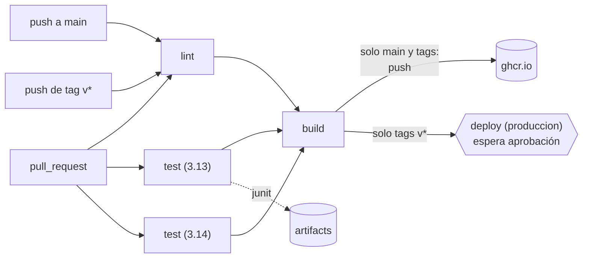

---
tags:
  - laboratorio
  - ci-cd
  - github-actions
  - contenedores
---

# Lab 07: Pipeline de CI con GitHub Actions

> Construyes el pipeline de integración continua de la API del Lab 05: lint, tests en matrix, build de la imagen con caché, artefactos, publicación en GitHub Container Registry con permisos mínimos y actions fijadas por SHA, y un environment con aprobación manual.

| Nivel | Duración | Costo | Requisitos |
| --- | --- | --- | --- |
| Intermedio | ~75 min | Gratis (minutos de Actions incluidos en repos públicos) | [Lab 04](git-flujo-pull-request.md) y [Lab 05](docker-multistage-compose.md), repo público `lab-devops-app` |

!!! info "Qué vas a aprender"
    - Diseñar un workflow con jobs dependientes: **lint** → **test** (en **matrix**) → **build** → **deploy**.
    - Acelerar el pipeline con **caché** de dependencias y de capas de Docker, y guardar reportes como **artifacts**.
    - Publicar la imagen en **GitHub Container Registry** (GHCR) solo desde `main` y desde tags, con `permissions` mínimos por job.
    - Fijar cada action por **SHA** y obtener esos SHA tú misma con `git ls-remote`.
    - Proteger el despliegue con un **environment** que exige aprobación manual.
    - Convertir los jobs en **required status checks** del ruleset de `main`.

!!! warning "Costos y seguridad"
    En repositorios públicos los runners estándar de GitHub son gratuitos; en privados consumes minutos de tu cuota. El workflow publica una imagen en GHCR: no metas secretos en la imagen (el `.dockerignore` del Lab 05 lo evita) y revisa la visibilidad del paquete. Nunca uses `pull_request_target` para este tipo de pipeline: ejecuta código de forks con permisos de escritura.

## Antes de empezar

- Repositorio `lab-devops-app` (público) con el ruleset del Lab 04 y la app, el `Dockerfile` y los tests del Lab 05 en `main`.
- Python 3.12+ en local para reproducir los pasos del pipeline antes de subirlos.
- Git para consultar los SHA de las actions.

Teoría recomendada: [Integración continua (CI)](../../devops/ci-cd/integracion-continua.md), [Despliegue continuo (CD)](../../devops/ci-cd/despliegue-continuo.md) y, sobre todo, [Seguridad del pipeline](../../devsecops/identidades-y-pipeline/seguridad-pipeline.md). Guía de sintaxis: [GitHub Actions](../../recursos/sintaxis/github-actions.md).

```bash
cd lab-devops-app
git switch main && git pull
git switch -c ci/pipeline
```

## Arquitectura



En un PR el pipeline valida y construye la imagen **sin publicarla**. Al integrar en `main` publica la imagen con el tag `sha-<commit>`. Al crear un tag `v0.2.0` publica `0.2.0` y `0.2`, y el job de despliegue queda esperando a que alguien lo apruebe.

## Paso a paso

### Paso 1: Reproduce el pipeline en local

Un pipeline solo automatiza comandos que ya funcionan en tu máquina. Si fallan aquí, depurarlos en Actions es mucho más lento. Con el entorno virtual del Lab 05 activado:

```bash
ruff check .
ruff format --check .
pytest -q --junitxml=reports/junit-local.xml
```

```text
All checks passed!
5 files already formatted
...                                                                      [100%]
3 passed in 0.91s
```

Añade `reports/` al `.gitignore`: los reportes los genera el pipeline, no se versionan.

Prueba también que el lint detecta errores. Si añades un `import os` repetido al final de `app/storage.py`:

```text
F811 [*] Redefinition of unused `os` from line 3
  --> app\storage.py:69:8
Found 1 error.
```

Quita la línea antes de seguir.

### Paso 2: Obtén los SHA de las actions

Un tag como `v7` es un puntero que el autor puede mover; si alguien compromete la action, tu pipeline ejecutaría el código nuevo sin enterarte. Un **SHA** de commit es inmutable. Consulta el SHA de la versión que quieres directamente en el repositorio de cada action:

```bash
git ls-remote --tags https://github.com/actions/setup-python.git | grep -E 'v7\.1\.0$'
git ls-remote --tags https://github.com/docker/build-push-action.git | grep -E 'v7\.4\.0$'
```

```text
6d4fd22b20465ccc0f7354476588e8df7c9ca0e0    refs/tags/v7.1.0
c3c9e263c25d99ce0380d002d59b67737d91b0dc    refs/tags/v7.4.0
```

!!! note "Tags anotados"
    Si el tag es anotado, `git ls-remote` muestra dos líneas: `refs/tags/vX` (el objeto tag) y `refs/tags/vX^{}` (el commit). Usa siempre el SHA de la línea con `^{}`. En las versiones de este lab solo hay una línea por tag, así que es directamente el commit.

| Action | Versión | SHA |
| --- | --- | --- |
| `actions/checkout` | v7.0.1 | `3d3c42e5aac5ba805825da76410c181273ba90b1` |
| `actions/setup-python` | v7.1.0 | `6d4fd22b20465ccc0f7354476588e8df7c9ca0e0` |
| `actions/upload-artifact` | v7.0.2 | `cf430e030ddbb5b0abf93d22962f4752f3646cd9` |
| `docker/setup-buildx-action` | v4.4.1 | `f87e5991a6d7451dcb8d9637bfbc97413f497069` |
| `docker/metadata-action` | v6.2.0 | `dc802804100637a589fabce1cb79ff13a1411302` |
| `docker/login-action` | v4.7.0 | `81c6f93d4bc991e510b342a00b419b3bb4efc5c6` |
| `docker/build-push-action` | v7.4.0 | `c3c9e263c25d99ce0380d002d59b67737d91b0dc` |

Son las versiones vigentes al escribir el lab; comprueba si hay otras más nuevas con el mismo comando.

### Paso 3: Escribe el workflow

```yaml title=".github/workflows/ci.yml"
name: ci

on:
  pull_request:
    branches: [main]
  push:
    branches: [main]
    tags: ["v*.*.*"]

# Sin permisos por defecto: cada job pide solo lo que necesita
permissions: {}

# Si llega un commit nuevo al mismo PR, cancela la ejecución anterior
concurrency:
  group: ci-${{ github.ref }}
  cancel-in-progress: ${{ github.event_name == 'pull_request' }}

env:
  IMAGE: ghcr.io/${{ github.repository }}

jobs:
  lint:
    name: lint
    runs-on: ubuntu-latest
    timeout-minutes: 10
    permissions:
      contents: read
    steps:
      - uses: actions/checkout@3d3c42e5aac5ba805825da76410c181273ba90b1 # v7.0.1
        with:
          persist-credentials: false
      - uses: actions/setup-python@6d4fd22b20465ccc0f7354476588e8df7c9ca0e0 # v7.1.0
        with:
          python-version: "3.14"
          cache: pip
          cache-dependency-path: requirements-dev.txt
      - run: pip install -r requirements-dev.txt
      - run: ruff check .
      - run: ruff format --check .

  test:
    name: test (${{ matrix.python-version }})
    runs-on: ubuntu-latest
    timeout-minutes: 10
    permissions:
      contents: read
    strategy:
      fail-fast: false
      matrix:
        python-version: ["3.13", "3.14"]
    steps:
      - uses: actions/checkout@3d3c42e5aac5ba805825da76410c181273ba90b1 # v7.0.1
        with:
          persist-credentials: false
      - uses: actions/setup-python@6d4fd22b20465ccc0f7354476588e8df7c9ca0e0 # v7.1.0
        with:
          python-version: ${{ matrix.python-version }}
          cache: pip
          cache-dependency-path: requirements-dev.txt
      - run: pip install -r requirements-dev.txt
      - run: pytest -q --junitxml=reports/junit-${{ matrix.python-version }}.xml
      - name: Guardar el reporte de tests
        if: always()
        uses: actions/upload-artifact@cf430e030ddbb5b0abf93d22962f4752f3646cd9 # v7.0.2
        with:
          name: junit-${{ matrix.python-version }}
          path: reports/
          retention-days: 7

  build:
    name: build
    needs: [lint, test]
    runs-on: ubuntu-latest
    timeout-minutes: 20
    permissions:
      contents: read
      packages: write # solo este job puede publicar en GHCR
    outputs:
      digest: ${{ steps.build.outputs.digest }}
    steps:
      - uses: actions/checkout@3d3c42e5aac5ba805825da76410c181273ba90b1 # v7.0.1
        with:
          persist-credentials: false
      - uses: docker/setup-buildx-action@f87e5991a6d7451dcb8d9637bfbc97413f497069 # v4.4.1
      - name: Calcular tags y labels
        id: meta
        uses: docker/metadata-action@dc802804100637a589fabce1cb79ff13a1411302 # v6.2.0
        with:
          images: ${{ env.IMAGE }}
          tags: |
            type=ref,event=pr
            type=sha
            type=semver,pattern={{version}}
            type=semver,pattern={{major}}.{{minor}}
      - name: Login en GHCR
        if: github.event_name != 'pull_request'
        uses: docker/login-action@81c6f93d4bc991e510b342a00b419b3bb4efc5c6 # v4.7.0
        with:
          registry: ghcr.io
          username: ${{ github.actor }}
          password: ${{ secrets.GITHUB_TOKEN }}
      - name: Build (y push fuera de los PR)
        id: build
        uses: docker/build-push-action@c3c9e263c25d99ce0380d002d59b67737d91b0dc # v7.4.0
        with:
          context: .
          target: runtime
          build-args: APP_VERSION=${{ steps.meta.outputs.version }}
          push: ${{ github.event_name != 'pull_request' }}
          tags: ${{ steps.meta.outputs.tags }}
          labels: ${{ steps.meta.outputs.labels }}
          cache-from: type=gha
          cache-to: type=gha,mode=max

  deploy:
    name: deploy (produccion)
    if: startsWith(github.ref, 'refs/tags/v')
    needs: build
    runs-on: ubuntu-latest
    timeout-minutes: 10
    permissions: {}
    environment:
      name: produccion
    steps:
      - name: Desplegar (simulado)
        env:
          DIGEST: ${{ needs.build.outputs.digest }}
        run: |
          echo "Desplegaría ${IMAGE,,}@${DIGEST}"
          echo "### Desplegado ${IMAGE,,}@${DIGEST}" >> "$GITHUB_STEP_SUMMARY"
```

Las decisiones importantes, bloque a bloque:

| Bloque | Qué hace | Por qué |
| --- | --- | --- |
| `permissions: {}` arriba y por job | El `GITHUB_TOKEN` no tiene ningún permiso salvo los que pide cada job | Solo `build` puede escribir paquetes; si un paso de `test` se ve comprometido, no puede publicar nada |
| `persist-credentials: false` | El token no se queda guardado en `.git/config` del runner | Ningún paso posterior puede reutilizarlo para hacer push |
| `concurrency` | En PR, un push nuevo cancela la ejecución anterior | Ahorra minutos; en `main` y tags no se cancela nada |
| `cache: pip` | Guarda la caché de pip con clave basada en `requirements-dev.txt` | La segunda ejecución instala desde caché; si cambian las dependencias, la clave cambia |
| `matrix` + `fail-fast: false` | Ejecuta los tests en Python 3.13 y 3.14 en paralelo, y no cancela uno si falla el otro | Ves en qué versión falla; útil antes de subir la imagen base |
| `upload-artifact` con `if: always()` | Guarda el reporte JUnit aunque los tests fallen | Es justo cuando más lo necesitas |
| `metadata-action` | Calcula los tags: `pr-N`, `sha-abc1234`, `0.2.0`, `0.2` | Un solo lugar define la política de versionado de la imagen; además pasa el nombre a minúsculas, como exige el registry |
| `push: ${{ github.event_name != 'pull_request' }}` | En PR construye pero no publica | El código de un PR aún no está revisado |
| `cache-from/to: type=gha` | Guarda las capas de Docker en la caché de Actions | Si solo cambias código, no reinstala dependencias |
| `deploy` con `environment` | El job se pausa hasta que alguien lo apruebe | Separa "construido" de "en producción" y deja registro de quién aprobó |

Fíjate también en que el job `deploy` despliega por **digest** (`imagen@sha256:...`), no por tag: así despliegas exactamente la imagen que se construyó y probó.

### Paso 4: Crea el environment con aprobación

En el repo: **Settings → Environments → New environment** → nombre `produccion`:

- **Required reviewers**: añádete tú (en repos públicos de cuentas gratuitas está disponible). Deja sin marcar *Prevent self-review*: si lo marcas, no podrías aprobar despliegues que tú misma lanzaste.
- **Deployment branches and tags** → *Selected branches and tags* → **Add deployment branch or tag rule** → tipo *Tag*, patrón `v*`. Así, aunque alguien cambie el `if:` del workflow, desde una rama no se puede desplegar en este environment.

Si el environment no existe cuando el workflow lo referencia, GitHub lo crea vacío y sin protección. Créalo antes del primer tag.

### Paso 5: Abre el PR y observa el pipeline

```bash
printf 'reports/\n' >> .gitignore
git add .github/workflows/ci.yml .gitignore
git commit -m "ci: pipeline de lint, tests y build de la imagen"
git push -u origin ci/pipeline
```

Abre el PR. En la pestaña **Checks** verás `lint`, `test (3.13)`, `test (3.14)`, `build` y el `verificar` del Lab 04. Revisa:

- En el log de `build`, el paso *Login en GHCR* aparece como **skipped** y la imagen se construye sin push.
- En el resumen de la ejecución (**Summary**), los artifacts `junit-3.13` y `junit-3.14`. Descarga uno: es el XML de pytest.
- Vuelve a ejecutar el workflow (**Re-run all jobs**): el paso `setup-python` indica que restauró la caché de pip y el build de Docker reutiliza capas (`CACHED`), así que tarda menos.

### Paso 6: Haz obligatorios los nuevos checks

Edita el ruleset `proteger-main` del Lab 04 → **Require status checks to pass** → añade `lint`, `test (3.13)`, `test (3.14)` y `build`. Ahora un PR con tests en rojo no se puede integrar.

Compruébalo: en la rama del PR, rompe un test a propósito (por ejemplo, cambia `"ok"` por `"OK"` en `test_health`), haz push y observa que `test` falla, `build` no llega a ejecutarse (*skipped*, porque depende de `test`) y el botón de merge queda bloqueado. Revierte el cambio con otro commit.

### Paso 7: Integra en `main` y comprueba la imagen en GHCR

Haz **Squash and merge**. La ejecución en `main` hace login y publica la imagen con el tag `sha-<commit corto>`. En la página principal del repo aparece la sección **Packages**.

```bash
docker pull ghcr.io/tuusuario/lab-devops-app:sha-1a2b3c4
docker run --rm -p 8000:8000 ghcr.io/tuusuario/lab-devops-app:sha-1a2b3c4
```

Si el `pull` responde `denied` o `unauthorized`, el paquete es privado: en **Package settings → Change visibility** ponlo público, o haz `docker login ghcr.io` con un token personal con permiso `read:packages`. En la misma página, comprueba en **Manage Actions access** que el repo `lab-devops-app` tiene acceso de escritura al paquete.

### Paso 8: Publica una versión y aprueba el despliegue

Cada tag `v*` es una versión candidata a producción:

```bash
git switch main && git pull
git tag -a v0.2.0 -m "API de tareas con pipeline de CI"
git push origin v0.2.0
```

En **Actions** verás la ejecución del tag: `lint`, `test` y `build` corren solos (y publican `0.2.0` y `0.2`), y `deploy (produccion)` queda en **Waiting**. Pulsa **Review deployments**, marca `produccion` y **Approve and deploy**. En el **Summary** aparece la línea con la imagen y su digest, y en la portada del repo, la sección **Deployments**.

## Verificación

| Comprobación | Dónde | Resultado esperado |
| --- | --- | --- |
| PR sin publicación | Log de `build` en un PR | *Login en GHCR* skipped, `push: false` |
| Matrix | Checks del PR | `test (3.13)` y `test (3.14)` en verde |
| Artifacts | Summary de la ejecución | `junit-3.13` y `junit-3.14` descargables |
| Caché | Segunda ejecución | `Cache restored` en setup-python y capas `CACHED` en el build |
| Imagen en `main` | Packages del repo | Tag `sha-…` |
| Imagen versionada | Packages del repo | Tags `0.2.0` y `0.2` |
| Aprobación | Ejecución del tag | `deploy` esperó y registra quién aprobó |
| Checks obligatorios | PR con un test roto | Merge bloqueado |

## Retos extra

1. Añade `.github/dependabot.yml` con el ecosistema `github-actions` (y `pip`). Dependabot abrirá PRs que actualizan el SHA **y** el comentario de versión. Pista: [Seguridad del pipeline](../../devsecops/identidades-y-pipeline/seguridad-pipeline.md#pinning-de-actions-por-sha).
2. Audita el workflow con **zizmor** o **actionlint** y corrige lo que reporten. ¿Encuentran algo en `pr-checks.yml` del Lab 04?
3. Genera la imagen para `linux/amd64` y `linux/arm64` con `platforms:` y `docker/setup-qemu-action` (fíjala por SHA). ¿Cuánto más tarda el build?
4. Añade al job `build` la generación de **SBOM** y **provenance** (`sbom: true`, `provenance: mode=max`) y revisa qué aparece en GHCR. Lo profundizas en [Software supply chain](../../devsecops/codigo-y-dependencias/cadena-suministro.md).

## Limpieza

- **Paquete en GHCR**: en el paquete → **Package settings → Delete this package** (o borra solo versiones antiguas). Los paquetes públicos no tienen costo, pero no acumules imágenes que no usas.
- **Cachés de Actions**: **Actions → Caches** → borra las entradas (también caducan solas si no se usan).
- **Artifacts**: caducan a los 7 días por `retention-days`; puedes borrarlos antes desde la ejecución.
- **Environment**: consérvalo si vas a hacer el Lab 13; si no, **Settings → Environments → produccion → Delete**.

Conserva el repositorio: el [Lab 12](../devsecops/escaneos-en-pipeline.md) añade escaneos de seguridad a este mismo pipeline.

## Problemas comunes

| Síntoma | Causa | Solución |
| --- | --- | --- |
| `denied: installation not allowed to Write organization package` o `permission_denied: write_package` | El job no tiene `packages: write` o el paquete existe y el repo no tiene acceso | Revisa `permissions` del job `build` y **Manage Actions access** del paquete |
| `repository name must be lowercase` | Usaste `github.repository` tal cual en `tags:` | Deja que `metadata-action` calcule los tags (convierte a minúsculas) |
| `Unable to resolve action ... unable to find version` | SHA mal copiado o incompleto | Copia los 40 caracteres desde `git ls-remote` |
| El job `deploy` nunca aparece | El `if:` solo se cumple con tags `v*` | Es lo esperado en PR y `main`; publica un tag |
| `deploy` falla con *branch/tag not allowed to deploy* | La regla del environment no coincide con el tag | Revisa el patrón `v*` de tipo *Tag* en el environment |
| No puedes aprobar el despliegue | Marcaste *Prevent self-review* o no estás en *Required reviewers* | Ajusta el environment |
| El ruleset no ofrece `test (3.14)` | El check todavía no se ejecutó nunca | Abre el PR primero (Paso 5) y luego edita el ruleset |
| El paso de caché de pip dice `Cache not found` | Primera ejecución o cambió `requirements-dev.txt` | Normal: la siguiente ejecución la restaura |

Para el método general de diagnóstico de pipelines, ver [Troubleshooting](../../devops/operacion/troubleshooting.md#cicd).

## Información complementaria

- **Etapas de CI**: lint y tests rápidos primero (*fail fast*), build después. Ver [Etapas típicas de un pipeline de CI](../../devops/ci-cd/integracion-continua.md#etapas-tipicas-de-un-pipeline-de-ci).
- **Caché vs artifact**: la caché acelera ejecuciones futuras y puede desaparecer; un artifact es un resultado de esta ejecución que quieres conservar o pasar a otro job. Ver [Caché](../../devops/ci-cd/integracion-continua.md#cache) y [Artifacts y versionado](../../devops/ci-cd/integracion-continua.md#artifacts-y-versionado).
- **Permisos mínimos y pinning**: limitan el daño si una dependencia del pipeline se ve comprometida. Ver [Permisos mínimos del GITHUB_TOKEN](../../devsecops/identidades-y-pipeline/seguridad-pipeline.md#permisos-minimos-del-github_token).
- **Environments**: aprobación, restricción de ramas/tags y secretos por entorno. Ver [Environments y aprobaciones](../../devsecops/identidades-y-pipeline/seguridad-pipeline.md#environments-y-aprobaciones).
- **Registry de cada nube**: este mismo job publicaría en ECR, ACR o Artifact Registry cambiando el login; para autenticarte sin llaves usarás OIDC en el [Lab 13](../devsecops/oidc-github-aws.md).

En el trabajo real, este es el esqueleto de casi cualquier pipeline: el PR valida, `main` produce un artefacto inmutable y el tag (con aprobación) lo promueve. Lo que cambia de un equipo a otro son las etapas que añaden: escaneos (Lab 12), despliegue real a Kubernetes (Lab 06) o a la nube.

## Documentación oficial

- [Sintaxis de flujos de trabajo de GitHub Actions](https://docs.github.com/es/actions/reference/workflows-and-actions/workflow-syntax)
- [Autenticarse con el `GITHUB_TOKEN` y ajustar sus permisos](https://docs.github.com/es/actions/tutorials/authenticate-with-github_token)
- [Uso de una matriz para tus jobs](https://docs.github.com/es/actions/how-tos/write-workflows/choose-what-workflows-do/run-job-variations)
- [Environments para despliegue](https://docs.github.com/es/actions/reference/workflows-and-actions/deployments-and-environments)
- [Trabajar con el registro de contenedores (GHCR)](https://docs.github.com/es/packages/working-with-a-github-packages-registry/working-with-the-container-registry)
- [Docker: GitHub Actions y caché `type=gha`](https://docs.docker.com/build/ci/github-actions/cache/)
- [docker/metadata-action](https://github.com/docker/metadata-action)
- [Fortalecimiento de seguridad para GitHub Actions](https://docs.github.com/es/actions/reference/security/secure-use)

## Preguntas para verificar el aprendizaje

??? question "1. ¿Por qué el job `build` no publica la imagen en los pull requests?"
    Porque el código del PR aún no está revisado ni integrado. Publicarlo dejaría en el registry imágenes que nunca deberían desplegarse, y en PRs de forks el token ni siquiera tiene permiso de escritura.

??? question "2. ¿Qué pasaría si declaras `permissions: write-all` a nivel de workflow?"
    Todos los jobs recibirían un token con permisos de escritura sobre el código, los paquetes, los issues, etc. Si una dependencia de `test` (un paquete de PyPI, una action) estuviera comprometida, podría hacer push a ramas, publicar imágenes o modificar releases.

??? question "3. ¿Qué ganas fijando `actions/checkout` por SHA si ya usas una versión concreta como `v7.0.1`?"
    Un tag se puede mover a otro commit (por error o en un ataque, como pasó con `tj-actions/changed-files` en 2025). Un SHA identifica un contenido inmutable. El comentario `# v7.0.1` mantiene la legibilidad y permite a Dependabot actualizarlo.

??? question "4. ¿Por qué el despliegue usa el digest en vez del tag `0.2.0`?"
    Porque un tag de imagen puede reescribirse con otro push. El digest identifica exactamente la imagen que se construyó y probó en esta ejecución.

??? question "5. ¿Qué diferencia hay entre `cache: pip` y `upload-artifact`?"
    La caché guarda dependencias para acelerar ejecuciones futuras y GitHub puede borrarla cuando quiera. El artifact guarda un resultado concreto de esta ejecución (el reporte JUnit) durante el tiempo de retención, para descargarlo o pasarlo a otro job.

??? question "6. Con `fail-fast: false`, si `test (3.13)` falla, ¿se ejecuta `build`?"
    No. `fail-fast` solo decide si se cancelan los otros jobs de la matrix. `build` tiene `needs: [lint, test]` y necesita que **todas** las variantes de `test` terminen bien.

??? question "7. ¿Qué pasaría si borras el environment `produccion` del repo y vuelves a lanzar un tag?"
    GitHub crearía automáticamente un environment `produccion` vacío, sin reviewers ni restricción de tags, y el job `deploy` se ejecutaría sin aprobación. Por eso la protección se configura antes y se audita.

??? question "8. Un compañero propone cambiar `pull_request` por `pull_request_target` para que los PR de forks puedan publicar imágenes. ¿Qué respondes?"
    Que no: `pull_request_target` se ejecuta con el contexto y los permisos del repositorio base. Si además hace checkout del código del fork, ese código no revisado se ejecutaría con un token con escritura y acceso a secretos. Es uno de los ataques más comunes a pipelines.

## Notas relacionadas

**DevOps**

- [Integración continua (CI)](../../devops/ci-cd/integracion-continua.md)
- [Anatomía de los workflows de GitHub Actions](../../recursos/anatomia/github-actions.md)
- [Despliegue continuo (CD) y estrategias](../../devops/ci-cd/despliegue-continuo.md)
- [Docker: imágenes, multi-stage builds y Compose](../../devops/contenedores/docker.md)
- [Git y control de versiones](../../devops/fundamentos/git-control-versiones.md)
- [Cultura DevOps y métricas DORA](../../devops/fundamentos/cultura-metricas-dora.md)

**DevSecOps**

- [Seguridad del pipeline](../../devsecops/identidades-y-pipeline/seguridad-pipeline.md)
- [Software supply chain](../../devsecops/codigo-y-dependencias/cadena-suministro.md)
- [Escaneo de seguridad en el pipeline](../../devsecops/escaneos/escaneo-en-pipeline.md)

**Python**

- [Calidad y seguridad de scripts](../../python/scripting/calidad-codigo.md)

**Recursos**

- [Sintaxis de GitHub Actions](../../recursos/sintaxis/github-actions.md)
- [Comandos de Git](../../recursos/comandos/git.md)

**Labs**

- Lab anterior: [Lab 06: Desplegar una app en Kubernetes local con kind](kubernetes-local-kind.md)
- Lab siguiente: [Lab 08: Terraform sin nube: providers locales y workspaces](terraform-local-workspaces.md)
- Siguiente paso en seguridad: [Lab 12: Escaneos de seguridad en el pipeline](../devsecops/escaneos-en-pipeline.md)
