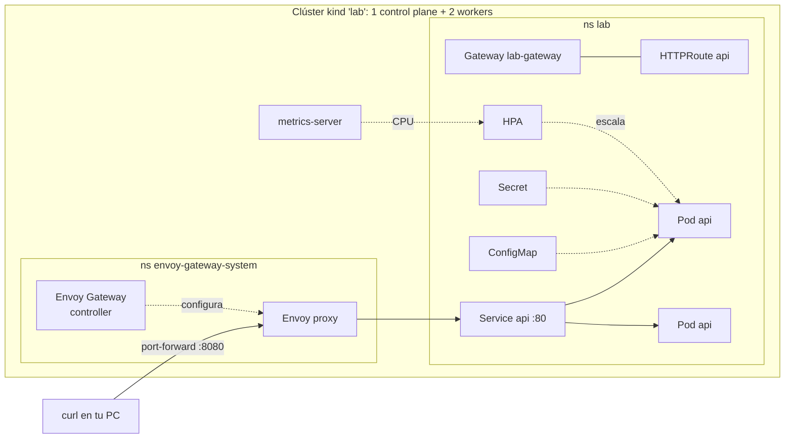

---
tags:
  - laboratorio
  - kubernetes
  - contenedores
---

# Lab 06: Desplegar una app en Kubernetes local con kind

> Creas un clúster de tres nodos con kind, despliegas la API del Lab 05 con probes, recursos, ConfigMap y Secret, la publicas con Gateway API (Envoy Gateway), practicas escalado, rolling update y rollback, y la autoescalas con un HPA.

| Nivel | Duración | Costo | Requisitos |
| --- | --- | --- | --- |
| Intermedio | ~90 min | Gratis | [Lab 05](docker-multistage-compose.md) (imagen `lab-api:0.1.0`), Docker, kind, kubectl, Helm |

!!! info "Qué vas a aprender"
    - Crear un clúster multinodo reproducible con **kind** (*Kubernetes in Docker*) y una imagen de nodo fijada por digest.
    - Escribir un **Deployment** con *startup*, *liveness* y *readiness probes*, *requests/limits* y `securityContext` sin root.
    - Inyectar configuración con **ConfigMap** y un token con **Secret**.
    - Exponer la app con **Service** y **Gateway API** usando Envoy Gateway instalado con Helm.
    - Escalar, hacer un **rolling update** (actualización gradual) y un **rollback** (reversión) de un despliegue roto.
    - Autoescalar con un **HorizontalPodAutoscaler** (HPA) y metrics-server, y empaquetar todo con Kustomize.

## Antes de empezar

| Herramienta | Versión | Comprobar |
| --- | --- | --- |
| Docker | Corriendo, con ~4 GB de RAM libres para el clúster | `docker version` |
| kind | **v0.33.0** (cada versión de kind publica sus imágenes de nodo; usa la que corresponde) | `kind version` |
| kubectl | 1.35 a 1.37 (como máximo una versión menor de diferencia con el clúster, que es 1.36) | `kubectl version --client` |
| Helm | 3.8+ o 4.x (soporte de registries OCI) | `helm version` |

Si no tienes kind o tu versión es antigua, descarga el binario en una carpeta del lab (no hace falta instalarlo en el sistema):

=== "Linux/macOS"

    ```bash
    # Linux x86_64; en macOS cambia a kind-darwin-arm64 o kind-darwin-amd64
    curl -Lo ./kind https://kind.sigs.k8s.io/dl/v0.33.0/kind-linux-amd64
    chmod +x ./kind && ./kind version
    ```

=== "Windows (PowerShell)"

    ```powershell
    curl.exe -Lo kind.exe https://kind.sigs.k8s.io/dl/v0.33.0/kind-windows-amd64
    .\kind.exe version
    ```

**Comprobación previa en Windows (Docker Desktop con WSL2).** Kubernetes 1.35+ no arranca por defecto sobre **cgroup v1** (*control groups* versión 1, el mecanismo antiguo del kernel para limitar CPU y memoria), y un WSL2 sin actualizar todavía lo usa. Compruébalo antes de crear el clúster:

=== "Linux/macOS"

    ```bash
    uname -r                      # dentro de WSL o en Linux; en macOS, mira solo docker info
    docker info --format 'cgroup v{{.CgroupVersion}} - kernel {{.KernelVersion}}'
    ```

=== "Windows (PowerShell)"

    ```powershell
    wsl --version                 # "Versión de kernel": 5.15.x es antiguo
    docker info --format "cgroup v{{.CgroupVersion}} - kernel {{.KernelVersion}}"
    ```

```text
cgroup v1 - kernel 5.15.146.1-microsoft-standard-WSL2     ← WSL2 antiguo: actualiza
cgroup v2 - kernel 6.x.y-microsoft-standard-WSL2          ← correcto
```

Si ves `cgroup v1`, la solución de fondo es actualizar el kernel de WSL2: `wsl --update` en PowerShell, `wsl --shutdown`, reinicia Docker Desktop y repite la comprobación hasta ver `cgroup v2`. Si no puedes actualizar (por ejemplo, un equipo gestionado por tu empresa), en el Paso 1 tienes una variante de `kind-config.yaml` que lo permite como apaño de laboratorio. Un kernel antiguo también impide que kindnet aplique NetworkPolicies, algo que necesitarás en el [Lab 14](../devsecops/seguridad-kubernetes.md#paso-5-networkpolicy-default-deny-y-sus-excepciones). En Linux con una distribución reciente y en macOS ya tienes cgroup v2.

Teoría recomendada: [Kubernetes: pods, deployments, services, Helm y Kustomize](../../devops/contenedores/kubernetes.md) y [Despliegue continuo y estrategias](../../devops/ci-cd/despliegue-continuo.md) (rolling update y rollback). Chuletas: [kubectl](../../recursos/comandos/kubectl.md) y [Helm](../../recursos/comandos/helm.md).

Crea la carpeta `k8s/` en el repositorio `lab-devops-app` y trabaja en una rama: `git switch -c feat/k8s`.

## Arquitectura



Envoy Gateway lee tus objetos `Gateway` y `HTTPRoute` y configura un proxy Envoy que enruta al `Service`. Como kind corre dentro de Docker, llegas al proxy con `kubectl port-forward`.

!!! warning "Por qué Gateway API y no Ingress NGINX"
    El controller comunitario Ingress NGINX se retiró en marzo de 2026 y ya no recibe parches de seguridad (ver [Ingress y Gateway API](../../devops/contenedores/kubernetes.md#ingress-y-gateway-api)). Para un clúster nuevo, Gateway API es la opción recomendada. Este lab usa **Envoy Gateway v1.9.3**, un proyecto de Envoy (CNCF) que implementa Gateway API; su v1.9 está probada con Kubernetes 1.33 a 1.36, por eso el clúster usa 1.36 y no la 1.37 que trae kind por defecto.

## Paso a paso

### Paso 1: Crea el clúster multinodo

Un archivo de configuración hace el clúster **reproducible**: cualquiera que lo use obtiene los mismos nodos con la misma versión. La imagen de nodo va fijada por digest, como recomienda kind en sus notas de versión.

```yaml title="kind-config.yaml"
# Clúster de laboratorio: 1 control plane + 2 workers
kind: Cluster
apiVersion: kind.x-k8s.io/v1alpha4
name: lab
nodes:
  - role: control-plane
    image: kindest/node:v1.36.4@sha256:099e049362a1526b2db71494e1947aae99bd16290d7c895f2b7ea312e3cbfaed
  - role: worker
    image: kindest/node:v1.36.4@sha256:099e049362a1526b2db71494e1947aae99bd16290d7c895f2b7ea312e3cbfaed
  - role: worker
    image: kindest/node:v1.36.4@sha256:099e049362a1526b2db71494e1947aae99bd16290d7c895f2b7ea312e3cbfaed
```

```bash
kind create cluster --config kind-config.yaml
kubectl get nodes
```

```text
Creating cluster "lab" ...
 ...
Set kubectl context to "kind-lab"

NAME                STATUS   ROLES           AGE   VERSION
lab-control-plane   Ready    control-plane   70s   v1.36.4
lab-worker          Ready    <none>          50s   v1.36.4
lab-worker2         Ready    <none>          50s   v1.36.4
```

??? warning "Variante si tu Docker usa cgroup v1 y no puedes hacer `wsl --update`"
    Si `kind create cluster` muestra `cgroup v1 is deprecated in Kubernetes and will not be supported in a future kind release, please upgrade to cgroup v2` y después falla en *Starting control-plane* (ver **Problemas comunes**), el kubelet de Kubernetes 1.36 se niega a arrancar porque su opción `failCgroupV1` vale `true` por defecto. Borra el intento fallido (`kind delete cluster --name lab`) y usa esta variante, que añade un **patch** de kubeadm para desactivar esa comprobación en todos los nodos:

    ```yaml title="kind-config.yaml (variante cgroup v1)"
    # Clúster de laboratorio: 1 control plane + 2 workers
    # Variante SOLO para Docker sobre cgroup v1 (WSL2 antiguo). Lo correcto es wsl --update.
    kind: Cluster
    apiVersion: kind.x-k8s.io/v1alpha4
    name: lab
    kubeadmConfigPatches:
      - |
        kind: KubeletConfiguration
        failCgroupV1: false
    nodes:
      - role: control-plane
        image: kindest/node:v1.36.4@sha256:099e049362a1526b2db71494e1947aae99bd16290d7c895f2b7ea312e3cbfaed
      - role: worker
        image: kindest/node:v1.36.4@sha256:099e049362a1526b2db71494e1947aae99bd16290d7c895f2b7ea312e3cbfaed
      - role: worker
        image: kindest/node:v1.36.4@sha256:099e049362a1526b2db71494e1947aae99bd16290d7c895f2b7ea312e3cbfaed
    ```

    `kubeadmConfigPatches` a nivel de clúster se aplica a la configuración de kubeadm de cada nodo; aquí solo cambia un campo de la `KubeletConfiguration`. Es un apaño para poder hacer el lab: **cgroup v1 está deprecado** en Kubernetes y en kind, dejará de funcionar en una versión futura y no debe llegar a ningún clúster real. kind seguirá mostrando el aviso de deprecación, pero el clúster arranca. No subas esta variante al repositorio como la configuración "buena": guárdala aparte o documenta por qué existe.

Cada "nodo" es un contenedor de Docker (`docker ps` los muestra). kind cambió tu contexto de kubectl a `kind-lab`: compruébalo siempre con `kubectl config current-context` antes de aplicar nada, para no tocar otro clúster por error.

### Paso 2: Carga la imagen del Lab 05

El clúster no ve las imágenes de tu Docker local ni hay un registry. `kind load` copia la imagen a cada nodo:

```bash
kind load docker-image lab-api:0.1.0 --name lab
docker exec lab-worker crictl images | grep lab-api
```

```text
Image: "lab-api:0.1.0" with ID "sha256:…" not yet present on node "lab-worker", loading...
...
docker.io/library/lab-api   0.1.0   …   …MB
```

Como el tag no es `latest`, Kubernetes usa por defecto `imagePullPolicy: IfNotPresent` y no intentará descargarla de Docker Hub.

### Paso 3: Namespace, ConfigMap y Secret

Un **namespace** agrupa los recursos del lab y permite borrarlos de una vez. La **configuración** va en un ConfigMap (versionado en Git); el **token**, en un Secret que creas desde la línea de comandos para que no quede en el repositorio.

```yaml title="k8s/namespace.yaml"
apiVersion: v1
kind: Namespace
metadata:
  name: lab
```

```yaml title="k8s/configmap.yaml"
apiVersion: v1
kind: ConfigMap
metadata:
  name: api-config
  namespace: lab
data:
  APP_MENSAJE: "Hola desde Kubernetes"
```

```bash
kubectl apply -f k8s/namespace.yaml -f k8s/configmap.yaml
kubectl create secret generic api-secretos -n lab --from-literal=API_TOKEN=token-de-prueba-123
kubectl get secret api-secretos -n lab -o jsonpath='{.data.API_TOKEN}'
```

```text
namespace/lab created
configmap/api-config created
secret/api-secretos created
dG9rZW4tZGUtcHJ1ZWJhLTEyMw==
```

!!! danger "Base64 no es cifrado"
    Ese valor se decodifica con `base64 -d` en un segundo. Un Secret protege por **RBAC** (quién puede leerlo) y, si el clúster lo tiene activado, por cifrado en etcd. En producción el valor viene de un gestor de secretos (Vault, Secrets Manager, Key Vault, Secret Manager) y no de un `--from-literal` que queda en el historial de tu shell. Ver [Secretos e identidades](../../devsecops/identidades-y-pipeline/secretos-identidades.md).

### Paso 4: Despliega con un Deployment

El **Deployment** mantiene N réplicas de la app y gestiona las actualizaciones. Lee los comentarios: cada bloque responde a un problema real.

```yaml title="k8s/deployment.yaml"
apiVersion: apps/v1
kind: Deployment
metadata:
  name: api
  namespace: lab
  labels:
    app: api
spec:
  replicas: 2
  revisionHistoryLimit: 5
  selector:
    matchLabels:
      app: api
  strategy:
    type: RollingUpdate
    rollingUpdate:
      maxSurge: 1        # como máximo 1 pod extra durante la actualización
      maxUnavailable: 0  # nunca baja de las réplicas deseadas
  template:
    metadata:
      labels:
        app: api
    spec:
      securityContext:
        runAsNonRoot: true
        runAsUser: 10001
        seccompProfile:
          type: RuntimeDefault
      containers:
        - name: api
          image: lab-api:0.1.0
          imagePullPolicy: IfNotPresent
          ports:
            - name: http
              containerPort: 8000
          envFrom:
            - configMapRef:
                name: api-config
          env:
            - name: API_TOKEN
              valueFrom:
                secretKeyRef:
                  name: api-secretos
                  key: API_TOKEN
          resources:
            requests:
              cpu: 50m
              memory: 64Mi
            limits:
              memory: 192Mi
          startupProbe:
            httpGet:
              path: /health
              port: http
            periodSeconds: 2
            failureThreshold: 15
          livenessProbe:
            httpGet:
              path: /health
              port: http
            periodSeconds: 10
            failureThreshold: 3
          readinessProbe:
            httpGet:
              path: /ready
              port: http
            periodSeconds: 5
            failureThreshold: 2
          securityContext:
            allowPrivilegeEscalation: false
            readOnlyRootFilesystem: true
            capabilities:
              drop: ["ALL"]
```

| Bloque | Para qué |
| --- | --- |
| `startupProbe` | Da hasta 30 s (15 × 2 s) para arrancar; mientras tanto no corren las otras probes |
| `livenessProbe` | Si `/health` falla 3 veces seguidas, kubelet **reinicia** el contenedor |
| `readinessProbe` | Si `/ready` falla, el pod sale del Service (no recibe tráfico) pero **no** se reinicia |
| `requests` | Lo que el scheduler reserva en el nodo; el HPA calcula el % de CPU sobre este valor |
| `limits.memory` | Si la app supera 192 Mi, el kernel la mata (`OOMKilled`). Sin límite de CPU, para evitar *throttling*, una práctica habitual |
| `securityContext` | Sin root, sin escalar privilegios, sin *capabilities* y con el sistema de archivos de solo lectura |

Sin `DB_HOST`, la app usa almacenamiento en memoria (cada pod tiene sus propias tareas); aquí el foco es la orquestación, no los datos.

```bash
kubectl apply -f k8s/deployment.yaml
kubectl rollout status deployment/api -n lab
kubectl get pods -n lab -o wide
```

```text
deployment "api" successfully rolled out
NAME                   READY   STATUS    RESTARTS   AGE   IP           NODE
api-6d9c7b8f5d-7xk2p   1/1     Running   0          20s   10.244.1.2   lab-worker
api-6d9c7b8f5d-qm4zr   1/1     Running   0          20s   10.244.2.2   lab-worker2
```

El scheduler repartió las réplicas entre los dos workers: si cae un nodo, la app sigue respondiendo.

### Paso 5: Exponlo con un Service

Los pods son efímeros y cambian de IP. El **Service** da un nombre DNS estable (`api.lab.svc.cluster.local`, o simplemente `api` dentro del namespace) y reparte el tráfico entre los pods *ready*.

```yaml title="k8s/service.yaml"
apiVersion: v1
kind: Service
metadata:
  name: api
  namespace: lab
spec:
  selector:
    app: api
  ports:
    - name: http
      port: 80
      targetPort: http
```

```bash
kubectl apply -f k8s/service.yaml
kubectl get endpointslices -n lab -l kubernetes.io/service-name=api
kubectl run prueba -n lab --rm -it --restart=Never --image=busybox:1.38.0 -- \
  sh -c 'for i in 1 2 3 4; do wget -qO- http://api/info; echo; done'
```

```text
NAME        ADDRESSTYPE   PORTS   ENDPOINTS               AGE
api-x8k2d   IPv4          8000    10.244.1.2,10.244.2.2   5s
{"version":"0.1.0","mensaje":"Hola desde Kubernetes","storage":"memoria","token_configurado":true,"hostname":"api-6d9c7b8f5d-7xk2p"}
{"version":"0.1.0","mensaje":"Hola desde Kubernetes","storage":"memoria","token_configurado":true,"hostname":"api-6d9c7b8f5d-qm4zr"}
...
```

El `hostname` cambia: el Service reparte entre réplicas. `mensaje` viene del ConfigMap y `token_configurado: true` confirma que el Secret llegó (sin mostrar su valor).

### Paso 6: Publica la app con Gateway API (Envoy Gateway)

Instala Envoy Gateway con Helm. El chart instala también las **CRD** (*Custom Resource Definitions*) de Gateway API (`Gateway`, `HTTPRoute`...), que no vienen en Kubernetes de serie:

```bash
helm install eg oci://docker.io/envoyproxy/gateway-helm --version v1.9.3 \
  -n envoy-gateway-system --create-namespace
kubectl wait --timeout=5m -n envoy-gateway-system deployment/envoy-gateway --for=condition=Available
```

```text
NAME: eg
NAMESPACE: envoy-gateway-system
STATUS: deployed
REVISION: 1
deployment.apps/envoy-gateway condition met
```

Gateway API separa responsabilidades: la **GatewayClass** dice qué controller se usa, el **Gateway** es el punto de entrada (lo gestiona plataforma) y cada equipo publica sus **HTTPRoute**:

```yaml title="k8s/gateway.yaml"
apiVersion: gateway.networking.k8s.io/v1
kind: GatewayClass
metadata:
  name: eg
spec:
  controllerName: gateway.envoyproxy.io/gatewayclass-controller
---
apiVersion: gateway.networking.k8s.io/v1
kind: Gateway
metadata:
  name: lab-gateway
  namespace: lab
spec:
  gatewayClassName: eg
  listeners:
    - name: http
      protocol: HTTP
      port: 80
---
apiVersion: gateway.networking.k8s.io/v1
kind: HTTPRoute
metadata:
  name: api
  namespace: lab
spec:
  parentRefs:
    - name: lab-gateway
  hostnames:
    - api.lab.local
  rules:
    - matches:
        - path:
            type: PathPrefix
            value: /
      backendRefs:
        - name: api
          port: 80
```

```bash
kubectl apply -f k8s/gateway.yaml
kubectl get gateway -n lab
```

```text
NAME          CLASS   ADDRESS   PROGRAMMED   AGE
lab-gateway   eg                True         30s
```

`ADDRESS` queda vacío porque kind no tiene un balanceador de carga externo (el Service de Envoy queda en `<pending>`). Llega al proxy con un port-forward en otra terminal y prueba con la cabecera `Host` que espera la ruta:

=== "Linux/macOS"

    ```bash
    ENVOY_SERVICE=$(kubectl get svc -n envoy-gateway-system \
      --selector=gateway.envoyproxy.io/owning-gateway-namespace=lab,gateway.envoyproxy.io/owning-gateway-name=lab-gateway \
      -o jsonpath='{.items[0].metadata.name}')
    kubectl -n envoy-gateway-system port-forward service/$ENVOY_SERVICE 8080:80
    # en otra terminal:
    curl -s -H "Host: api.lab.local" http://localhost:8080/info
    ```

=== "Windows (PowerShell)"

    ```powershell
    $ENVOY_SERVICE = kubectl get svc -n envoy-gateway-system `
      --selector=gateway.envoyproxy.io/owning-gateway-namespace=lab,gateway.envoyproxy.io/owning-gateway-name=lab-gateway `
      -o jsonpath='{.items[0].metadata.name}'
    kubectl -n envoy-gateway-system port-forward service/$ENVOY_SERVICE 8080:80
    # en otra terminal:
    curl.exe -s -H "Host: api.lab.local" http://localhost:8080/info
    ```

```text
{"version":"0.1.0","mensaje":"Hola desde Kubernetes","storage":"memoria","token_configurado":true,"hostname":"api-6d9c7b8f5d-qm4zr"}
```

Sin la cabecera (`curl http://localhost:8080/info`) recibes un `404`: ninguna ruta coincide con ese host. Así funciona el *virtual hosting* en cualquier gateway o load balancer L7.

!!! tip "Alternativa sin port-forward"
    kind recomienda **cloud-provider-kind**, un binario que se ejecuta en tu PC, asigna direcciones a los Services `LoadBalancer` y también implementa Gateway API e Ingress. En Windows y macOS necesita ejecutarse como administrador. Ver la [guía de LoadBalancer de kind](https://kind.sigs.k8s.io/docs/user/loadbalancer/).

### Paso 7: Escala a mano

```bash
kubectl scale deployment/api -n lab --replicas=4
kubectl get pods -n lab
```

```text
deployment.apps/api scaled
NAME                   READY   STATUS    RESTARTS   AGE
api-6d9c7b8f5d-7xk2p   1/1     Running   0          8m
api-6d9c7b8f5d-b2v9s   1/1     Running   0          6s
api-6d9c7b8f5d-qm4zr   1/1     Running   0          8m
api-6d9c7b8f5d-tz7hn   1/1     Running   0          6s
```

Borra un pod (`kubectl delete pod <nombre> -n lab`) y vuelve a listar: el Deployment crea otro al instante. Ese es el *reconciliation loop*. Vuelve a 2 réplicas: `kubectl scale deployment/api -n lab --replicas=2`.

### Paso 8: Rolling update a la versión 0.2.0

Construye una nueva versión de la imagen (desde la carpeta del Lab 05) y cárgala en el clúster:

```bash
docker build --build-arg APP_VERSION=0.2.0 -t lab-api:0.2.0 .
kind load docker-image lab-api:0.2.0 --name lab
kubectl set image deployment/api -n lab api=lab-api:0.2.0
kubectl annotate deployment/api -n lab kubernetes.io/change-cause="lab-api 0.2.0"
kubectl rollout status deployment/api -n lab
```

```text
deployment.apps/api image updated
Waiting for deployment "api" rollout to finish: 1 out of 2 new replicas have been updated...
Waiting for deployment "api" rollout to finish: 1 old replicas are pending termination...
deployment "api" successfully rolled out
```

Con `maxSurge: 1` y `maxUnavailable: 0`, Kubernetes crea un pod nuevo, espera a que pase la **readiness probe**, y solo entonces retira uno viejo. Repite el `curl` del Paso 6 durante la actualización: nunca falla y verás `0.1.0` y `0.2.0` mezclados hasta que termina.

```bash
kubectl rollout history deployment/api -n lab
```

```text
REVISION  CHANGE-CAUSE
1         <none>
2         lab-api 0.2.0
```

### Paso 9: Provoca un despliegue roto y haz rollback

Simula un error típico: un tag que no existe.

```bash
kubectl set image deployment/api -n lab api=lab-api:9.9.9
kubectl rollout status deployment/api -n lab --timeout=60s
kubectl get pods -n lab
```

```text
Waiting for deployment "api" rollout to finish: 1 out of 2 new replicas have been updated...
error: timed out waiting for the condition
NAME                   READY   STATUS             RESTARTS   AGE
api-5f7d9c6b4-h8w2x    0/1     ImagePullBackOff   0          62s
api-7c8b5d9f6-kq3lm    1/1     Running            0          4m
api-7c8b5d9f6-vn8tp    1/1     Running            0          4m
```

Gracias a `maxUnavailable: 0`, las dos réplicas de la 0.2.0 **siguen atendiendo**: el despliegue roto no causó caída. `kubectl describe pod <pod-roto> -n lab` muestra en *Events* el motivo (`Failed to pull image "lab-api:9.9.9"`). Vuelve a la revisión anterior:

```bash
kubectl rollout undo deployment/api -n lab
kubectl rollout status deployment/api -n lab
kubectl get deployment api -n lab -o jsonpath='{.spec.template.spec.containers[0].image}'
```

```text
deployment.apps/api rolled back
deployment "api" successfully rolled out
lab-api:0.2.0
```

En un pipeline real, el `rollout status` con `--timeout` fallaría el job y dispararía este rollback automáticamente (ver [Rollbacks](../../devops/ci-cd/despliegue-continuo.md#rollbacks)).

### Paso 10: Autoescala con HPA y metrics-server

El HPA necesita métricas de CPU, que en kind no vienen de serie. Instala **metrics-server** v0.9.0 (compatible con Kubernetes 1.34+). En kind los kubelets usan certificados autofirmados, así que hay que añadir `--kubelet-insecure-tls`; **solo** para laboratorio.

```json title="metrics-server-patch.json"
[
  {
    "op": "add",
    "path": "/spec/template/spec/containers/0/args/-",
    "value": "--kubelet-insecure-tls"
  }
]
```

```bash
kubectl apply -f https://github.com/kubernetes-sigs/metrics-server/releases/download/v0.9.0/components.yaml
kubectl patch deployment metrics-server -n kube-system --type=json --patch-file=metrics-server-patch.json
kubectl rollout status deployment/metrics-server -n kube-system
kubectl top pods -n lab        # espera ~1 minuto si dice "metrics not available yet"
```

```text
NAME                  CPU(cores)   MEMORY(bytes)
api-7c8b5d9f6-kq3lm   2m           45Mi
api-7c8b5d9f6-vn8tp   2m           44Mi
```

```yaml title="k8s/hpa.yaml"
apiVersion: autoscaling/v2
kind: HorizontalPodAutoscaler
metadata:
  name: api
  namespace: lab
spec:
  scaleTargetRef:
    apiVersion: apps/v1
    kind: Deployment
    name: api
  minReplicas: 2
  maxReplicas: 6
  metrics:
    - type: Resource
      resource:
        name: cpu
        target:
          type: Utilization
          averageUtilization: 50
```

El objetivo es 50 % **del request** (50m), es decir, unos 25m de CPU por pod de media. Aplica el HPA, genera carga y observa (en otra terminal) cómo reacciona:

```bash
kubectl apply -f k8s/hpa.yaml
kubectl run carga -n lab --restart=Never --image=busybox:1.38.0 -- \
  sh -c 'while true; do wget -qO- http://api/tareas >/dev/null; done'
kubectl get hpa api -n lab --watch
```

```text
NAME   REFERENCE        TARGETS        MINPODS   MAXPODS   REPLICAS   AGE
api    Deployment/api   cpu: 4%/50%    2         6         2          20s
api    Deployment/api   cpu: 180%/50%  2         6         2          75s
api    Deployment/api   cpu: 180%/50%  2         6         4          90s
api    Deployment/api   cpu: 95%/50%   2         6         6          2m
```

Detén la carga con `kubectl delete pod carga -n lab`. Las réplicas bajan despacio: por defecto el HPA espera 5 minutos de métricas bajas antes de reducir (*stabilization window*), para no oscilar.

### Paso 11 (opcional): Empaqueta todo con Kustomize

Has aplicado archivo por archivo para entender cada pieza. En el día a día se aplica el conjunto. **Kustomize** viene integrado en kubectl y permite, por ejemplo, cambiar el tag de la imagen sin editar el Deployment:

```yaml title="k8s/kustomization.yaml"
apiVersion: kustomize.config.k8s.io/v1beta1
kind: Kustomization
resources:
  - namespace.yaml
  - configmap.yaml
  - deployment.yaml
  - service.yaml
  - gateway.yaml
  - hpa.yaml
images:
  - name: lab-api
    newTag: "0.2.0"
```

```bash
kubectl kustomize k8s/ | grep "image:"
kubectl diff -k k8s/
kubectl apply -k k8s/
```

```text
        image: lab-api:0.2.0
```

`kubectl diff` muestra qué cambiaría antes de aplicarlo, igual que un `terraform plan`. Si prefieres Helm, `helm create api` genera un chart de ejemplo con estas mismas piezas como plantillas; compara ambos enfoques en [Helm y Kustomize](../../devops/contenedores/kubernetes.md#helm-y-kustomize). Sube la carpeta `k8s/` y `kind-config.yaml` con un PR (`feat: manifiestos de Kubernetes para la API`).

## Verificación

| Comprobación | Comando | Resultado esperado |
| --- | --- | --- |
| Tres nodos listos | `kubectl get nodes` | 3 nodos `Ready`, `v1.36.4` |
| Réplicas sanas | `kubectl get deploy api -n lab` | `READY 2/2` (o más si el HPA escaló) |
| Pods sin root | `kubectl exec -n lab deploy/api -- id` | `uid=10001(app)` |
| Secret inyectado | `curl -H "Host: api.lab.local" localhost:8080/info` | `"token_configurado":true` |
| Gateway programado | `kubectl get gateway lab-gateway -n lab` | `PROGRAMMED True` |
| Historial de versiones | `kubectl rollout history deploy/api -n lab` | Varias revisiones, la última con `0.2.0` |
| HPA con métricas | `kubectl get hpa -n lab` | `TARGETS` muestra `cpu: N%/50%`, no `<unknown>` |

## Retos extra

1. Cambia `APP_MENSAJE` en el ConfigMap y aplícalo. ¿Cambia la respuesta de `/info`? Pista: las variables de entorno se leen al arrancar; investiga `kubectl rollout restart` y el `configMapGenerator` de Kustomize.
2. Añade un **PodDisruptionBudget** con `minAvailable: 1` y prueba `kubectl drain lab-worker --ignore-daemonsets`. ¿Qué pods se mueven y cuáles esperan?
3. Despliega PostgreSQL en el clúster (StatefulSet con un PersistentVolumeClaim) y conecta la API con `DB_HOST`. ¿Qué pasa con `/ready` si la base de datos cae?
4. Añade una segunda regla al `HTTPRoute` que envíe el 10 % del tráfico a un Deployment `api-canary` con la versión 0.2.0 usando `weight` en `backendRefs`. Es un *canary release* sin herramientas extra.

## Limpieza

```bash
kind delete cluster --name lab
kind get clusters                              # no debe aparecer "lab"
docker ps --filter "name=lab-"                 # no debe listar nodos
docker image rm lab-api:0.2.0                  # opcional
```

Borrar el clúster elimina todo lo que había dentro (namespaces, Helm releases, metrics-server). kind también quita el contexto `kind-lab` de tu kubeconfig.

## Problemas comunes

| Síntoma | Causa | Solución |
| --- | --- | --- |
| `kind create cluster` falla o tarda mucho | Docker sin memoria suficiente o detenido | Docker Desktop → *Resources*: 4 GB o más; `docker version` debe responder |
| kind avisa `cgroup v1 is deprecated in Kubernetes...`, se queda en *Starting control-plane* y falla con `failed to init node with kubeadm` (`...dial tcp ...:6443: connect: connection refused`); `docker exec lab-control-plane journalctl -u kubelet` muestra `kubelet is configured to not run on a host using cgroup v1` | El kubelet de Kubernetes 1.35+ no arranca sobre cgroup v1 (`failCgroupV1: true` por defecto). Pasa con Docker Desktop sobre un WSL2 antiguo (kernel 5.15) | `wsl --update`, `wsl --shutdown` y reinicia Docker Desktop hasta que `docker info` diga `Cgroup Version: 2`. Si no puedes actualizar: `kind delete cluster --name lab` y usa la variante de `kind-config.yaml` del Paso 1 con `failCgroupV1: false` |
| En el [Lab 14](../devsecops/seguridad-kubernetes.md#problemas-comunes) una NetworkPolicy *default deny* no bloquea nada | kindnet no puede aplicar las políticas en un kernel sin soporte de nftables (WSL2 antiguo); sus logs muestran `initial nftables sync failed ... operation not supported` | `wsl --update` y recrea el clúster. El patch de cgroup v1 hace que el clúster arranque, pero **no** arregla esto |
| Pods `Running` pero `0/1 READY` y `rollout status` no termina; `kubectl describe pod` muestra `Readiness probe failed: HTTP probe failed with statuscode: 404` | La imagen `lab-api:0.1.0` se construyó con una versión anterior del Lab 05 que no tenía el endpoint `/ready` | Reconstruye la imagen desde el código actual del [Lab 05](docker-multistage-compose.md#paso-5-escribe-el-dockerfile-multi-stage) (`docker build --build-arg APP_VERSION=0.1.0 -t lab-api:0.1.0 .`), vuelve a cargarla con `kind load docker-image lab-api:0.1.0 --name lab` y recrea los pods con `kubectl rollout restart deployment/api -n lab` |
| Pods en `ErrImagePull` / `ImagePullBackOff` con `lab-api` | No cargaste la imagen en el clúster o el tag no coincide | `kind load docker-image lab-api:<tag> --name lab` y revisa el tag en el Deployment |
| `kind load` falla con un error de *digest* o *content not found* | Problema conocido con el *containerd image store* de Docker Desktop | `docker save lab-api:0.1.0 -o lab-api.tar` y `kind load image-archive lab-api.tar --name lab` |
| Pod en `CreateContainerConfigError` | Falta el Secret o el ConfigMap referenciado | `kubectl describe pod` → *Events*; crea `api-secretos` (Paso 3) |
| Pod en `CrashLoopBackOff` | La app falla al arrancar o la liveness probe la mata | `kubectl logs <pod> -n lab --previous` y revisa la ruta y el puerto de las probes |
| `Gateway` con `PROGRAMMED False` o sin Service de Envoy | Envoy Gateway no está listo o la GatewayClass no coincide | `kubectl get gatewayclass` (debe estar `ACCEPTED True`) y `kubectl logs -n envoy-gateway-system deploy/envoy-gateway` |
| `curl` al port-forward devuelve 404 | Falta la cabecera `Host: api.lab.local` | Añade `-H "Host: api.lab.local"` |
| HPA con `TARGETS <unknown>` | metrics-server no está listo o falta `--kubelet-insecure-tls`, o el pod no tiene `requests.cpu` | `kubectl logs -n kube-system deploy/metrics-server`; espera 1–2 minutos |
| `error: You must be logged in to the server` o recursos que no esperabas | kubectl apunta a otro clúster | `kubectl config use-context kind-lab` |

Ver también la sección de Kubernetes en [Troubleshooting](../../devops/operacion/troubleshooting.md#kubernetes).

## Información complementaria

- **Probes**: liveness reinicia, readiness saca del balanceo, startup protege los arranques lentos. Confundirlas causa reinicios en cascada. Ver [Deployment con probes y recursos](../../devops/contenedores/kubernetes.md#deployment-con-probes-y-recursos).
- **Requests y limits**: los requests deciden dónde cabe un pod y son la base del HPA; un límite de memoria demasiado bajo produce `OOMKilled`.
- **Rolling update y rollback**: la estrategia por defecto de Kubernetes; blue/green y canary se construyen encima. Ver [Estrategias de despliegue](../../devops/ci-cd/despliegue-continuo.md#estrategias-de-despliegue).
- **Gateway API**: el sucesor de Ingress, con roles separados y reglas más expresivas (pesos, cabeceras). Lo implementan Envoy Gateway, NGINX Gateway Fabric, Istio, Cilium y los balanceadores gestionados de cada nube.
- **Seguridad del clúster**: el `securityContext` de este lab cumple el perfil *restricted* de Pod Security Standards; lo harás obligatorio en el [Lab 14](../devsecops/seguridad-kubernetes.md). Ver [Seguridad de Kubernetes](../../devsecops/infraestructura-y-contenedores/seguridad-kubernetes.md).
- **En el trabajo real**: los mismos manifiestos se aplican en EKS, AKS o GKE (ver [Contenedores gestionados](../../cloud/computo/contenedores-gestionados.md)), normalmente desde un pipeline o con GitOps (Argo CD, Flux) en lugar de `kubectl` a mano.

## Documentación oficial

- [kind: Quick Start](https://kind.sigs.k8s.io/docs/user/quick-start/) y [configuración](https://kind.sigs.k8s.io/docs/user/configuration/)
- [Kubernetes: Deployments](https://kubernetes.io/es/docs/concepts/workloads/controllers/deployment/)
- [Kubernetes: Liveness, Readiness y Startup Probes](https://kubernetes.io/docs/tasks/configure-pod-container/configure-liveness-readiness-startup-probes/)
- [Kubernetes: HorizontalPodAutoscaler walkthrough](https://kubernetes.io/docs/tasks/run-application/horizontal-pod-autoscale-walkthrough/)
- [Gateway API](https://gateway-api.sigs.k8s.io/)
- [Envoy Gateway: Quickstart](https://gateway.envoyproxy.io/docs/tasks/quickstart/) y [matriz de compatibilidad](https://gateway.envoyproxy.io/news/releases/matrix/)
- [metrics-server](https://github.com/kubernetes-sigs/metrics-server)
- [Kustomize en kubectl](https://kubernetes.io/docs/tasks/manage-kubernetes-objects/kustomization/)

## Preguntas para verificar el aprendizaje

??? question "1. ¿Qué pasaría si `/ready` comprueba la base de datos y la usas como livenessProbe?"
    Si la base de datos cae, todos los pods fallarían la liveness y kubelet los reiniciaría en bucle, aunque el proceso esté sano. Reiniciar no arregla la base de datos y añade carga. La dependencia externa va en la readiness; la liveness solo comprueba que el proceso responde.

??? question "2. ¿Por qué el despliegue de `lab-api:9.9.9` no provocó una caída?"
    Por `maxUnavailable: 0`: Kubernetes no retira pods viejos hasta que los nuevos estén *ready*. Como el nuevo nunca arrancó, las réplicas anteriores siguieron atendiendo.

??? question "3. ¿Qué diferencia hay entre `kubectl rollout undo` y volver a hacer `kubectl set image` con la versión anterior?"
    El resultado es parecido (otra revisión con la plantilla anterior), pero `undo` usa la plantilla exacta guardada en el historial (imagen, variables, probes), no solo la imagen. En GitOps lo correcto es revertir el commit en Git para que el estado deseado coincida.

??? question "4. El HPA muestra `cpu: 180%/50%`. ¿180 % de qué?"
    Del **request** de CPU de cada pod (50m), no del límite ni del nodo. 180 % significa unos 90m de media por pod. Sin `requests.cpu`, el HPA no puede calcular el porcentaje.

??? question "5. Tienes el HPA activo y vuelves a aplicar `deployment.yaml` con `replicas: 2`. ¿Qué pasa?"
    El Deployment vuelve a 2 réplicas y el HPA lo corrige en su siguiente ciclo, provocando altibajos. Cuando hay HPA, se suele quitar `replicas` del manifiesto para que lo controle solo el HPA.

??? question "6. ¿Por qué un Secret de Kubernetes no basta como gestión de secretos?"
    Porque solo está codificado en base64; cualquiera con permiso de lectura en el namespace lo ve, y sin cifrado en reposo queda en claro en etcd. Hace falta RBAC estricto, cifrado de etcd y, en producción, un gestor externo de secretos.

??? question "7. ¿Por qué el clúster usa Kubernetes 1.36 si kind v0.33.0 trae 1.37 por defecto?"
    Porque Envoy Gateway v1.9 está probado con Kubernetes 1.33–1.36. Elegir versiones según la matriz de compatibilidad de los componentes es parte de operar un clúster.

??? question "8. ¿Qué ventaja tiene Gateway API sobre Ingress para un equipo de plataforma?"
    Separa roles: plataforma gestiona `GatewayClass` y `Gateway` (puertos, TLS, quién puede enganchar rutas) y cada equipo de aplicación gestiona sus `HTTPRoute`. Además soporta de forma estándar pesos, cabeceras y otros protocolos sin anotaciones específicas de cada controller.

## Notas relacionadas

**Cloud**

- [Contenedores gestionados](../../cloud/computo/contenedores-gestionados.md)
- [Resiliencia](../../cloud/operacion-y-gobierno/resiliencia.md)

**DevOps**

- [Kubernetes: pods, deployments, services, Helm y Kustomize](../../devops/contenedores/kubernetes.md)
- [Despliegue continuo (CD) y estrategias](../../devops/ci-cd/despliegue-continuo.md)
- [Docker: imágenes, multi-stage builds y Compose](../../devops/contenedores/docker.md)
- [Troubleshooting](../../devops/operacion/troubleshooting.md)

**DevSecOps**

- [Seguridad de Kubernetes](../../devsecops/infraestructura-y-contenedores/seguridad-kubernetes.md)
- [Secretos e identidades](../../devsecops/identidades-y-pipeline/secretos-identidades.md)

**Networking**

- [Balanceo y alta disponibilidad](../../networking/avanzado/balanceo-alta-disponibilidad.md)

**Recursos**

- [Comandos de kubectl](../../recursos/comandos/kubectl.md)
- [Comandos de Helm](../../recursos/comandos/helm.md)

**Labs**

- Lab anterior: [Lab 05: Imagen multi-stage y Docker Compose](docker-multistage-compose.md)
- Lab siguiente: [Lab 07: Pipeline de CI con GitHub Actions](github-actions-ci.md)
