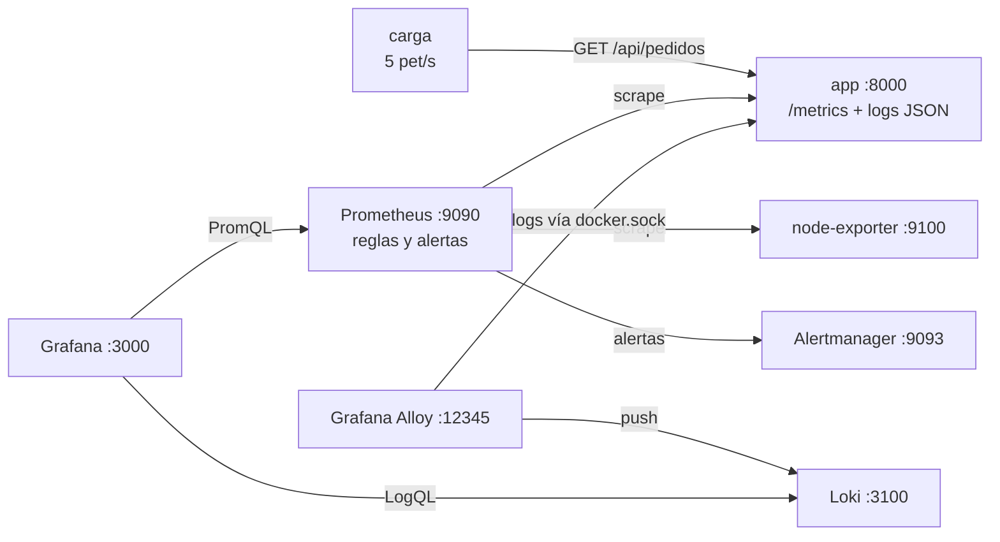

---
tags:
  - laboratorio
  - observabilidad
  - contenedores
---

# Lab 11 (parte 2): Logs con Loki y dashboards en Grafana

> Amplía el stack de la [parte 1](observabilidad-prometheus-grafana.md) con Loki, Grafana Alloy y Grafana con todo provisionado por archivo; cruza en un mismo dashboard las métricas del SLO con los logs de error e inyecta fallos para seguir el incidente de la alerta a la causa.

| Nivel | Duración | Costo | Requisitos |
| --- | --- | --- | --- |
| Intermedio | ~40 min | Gratis | Lab 11 (parte 1), Docker con Compose v2, ~3 GB de RAM libres |

!!! info "Qué vas a aprender"
    - Centralizar los logs de los contenedores en **Loki** con **Grafana Alloy** y consultarlos con **LogQL**.
    - Provisionar en Grafana **datasources** y un **dashboard** desde archivos (nada de clics).
    - Cruzar métricas y logs: del síntoma (la tasa de errores sube) a la causa (los mensajes de error).

## Antes de empezar

- Haber hecho la [parte 1](observabilidad-prometheus-grafana.md). Necesitas lo que deja:
    - La carpeta `lab11/` con `compose.yaml`, `app/`, `prometheus/` y `alertmanager/`.
    - El stack (`app`, `carga`, `prometheus`, `alertmanager` y `node-exporter`) levantado o parado con `docker compose stop`; da igual, el paso 3 lo arranca.
    - Sin fallos inyectados (`TASA_ERRORES` y `LATENCIA_MS` a `0`). Si cerraste la terminal, no hace falta hacer nada; en PowerShell, si exportaste variables, usa `Remove-Item Env:LATENCIA_MS, Env:TASA_ERRORES`.
- Puertos libres en `127.0.0.1`: 3100, 12345 y 3000 (además de 8000, 9090 y 9093, que ya usa la parte 1).
- Teoría: [Logs centralizados](../../devops/operacion/observabilidad.md#logs-centralizados), [Grafana](../../devops/operacion/observabilidad.md#grafana) y [Cómo leer logs](../../devops/operacion/leer-logs.md).

Imágenes que añade esta parte (versiones vigentes al escribir el lab; revisa si hay más nuevas). Las de la app, Prometheus, Alertmanager y node-exporter están en la [parte 1](observabilidad-prometheus-grafana.md#antes-de-empezar).

| Componente | Imagen |
| --- | --- |
| Loki | `grafana/loki:3.7.9` |
| Grafana Alloy | `grafana/alloy:v1.21.2` |
| Grafana | `grafana/grafana:13.2.4` |

!!! warning "Promtail ya no se usa"
    Muchos tutoriales usan **Promtail** para enviar logs a Loki. Promtail llegó a su **fin de vida (EOL) el 2 de marzo de 2026**: no recibe más actualizaciones. Su sustituto es **Grafana Alloy**, que además recoge métricas y trazas (OpenTelemetry). Alloy incluye un comando para convertir configuraciones de Promtail.

## Arquitectura



La mitad izquierda (app, carga, Prometheus, node-exporter y Alertmanager) es la de la parte 1, sin cambios. Las **métricas** llegan por *pull* (Prometheus las pide); los **logs** por *push* (Alloy los lee de Docker y los envía a Loki). Grafana consulta ambos para que veas en un mismo dashboard el síntoma (más errores) y la causa (los mensajes de error).

## Paso a paso

### Paso 1: Logs con Grafana Alloy y Loki

Alloy se configura con su propio lenguaje (componentes conectados entre sí). Este archivo descubre **solo** los contenedores del proyecto `lab11`, convierte sus metadatos en labels y envía los logs a Loki:

```alloy title="alloy/config.alloy"
// Descubre solo los contenedores de este proyecto de Compose
discovery.docker "contenedores" {
  host = "unix:///var/run/docker.sock"

  filter {
    name   = "label"
    values = ["com.docker.compose.project=lab11"]
  }
}

// Convierte metadatos de Docker en labels de Loki
discovery.relabel "contenedores" {
  targets = []

  rule {
    source_labels = ["__meta_docker_container_label_com_docker_compose_service"]
    target_label  = "service"
  }

  rule {
    source_labels = ["__meta_docker_container_name"]
    regex         = "/(.*)"
    target_label  = "container"
  }
}

// Lee los logs de esos contenedores
loki.source.docker "contenedores" {
  host          = "unix:///var/run/docker.sock"
  targets       = discovery.docker.contenedores.targets
  labels        = {"lab" = "11"}
  relabel_rules = discovery.relabel.contenedores.rules
  forward_to    = [loki.write.local.receiver]
}

// Los envía a Loki
loki.write "local" {
  endpoint {
    url = "http://loki:3100/loki/api/v1/push"
  }
}
```

Loki indexa solo las labels (`service`, `container`, `lab`): deben ser pocas y estables, igual que en Prometheus. Ver [Logs centralizados](../../devops/operacion/observabilidad.md#logs-centralizados).

!!! warning "El socket de Docker es un acceso muy privilegiado"
    Montar `/var/run/docker.sock` en un contenedor le da control casi total sobre Docker del host. Aquí se monta en solo lectura y en local; en producción se usan agentes con permisos acotados o la integración nativa del orquestador (por ejemplo, Alloy como DaemonSet en Kubernetes leyendo `/var/log/pods`).

### Paso 2: Grafana provisionado por archivo

Todo lo que configures con clics se pierde al recrear el contenedor y no se puede revisar en un pull request. Grafana lee al arrancar los archivos de `/etc/grafana/provisioning/`.

```yaml title="grafana/provisioning/datasources/datasources.yml"
apiVersion: 1

datasources:
  - name: Prometheus
    type: prometheus
    uid: prometheus
    access: proxy
    url: http://prometheus:9090
    isDefault: true

  - name: Loki
    type: loki
    uid: loki
    access: proxy
    url: http://loki:3100
```

```yaml title="grafana/provisioning/dashboards/dashboards.yml"
apiVersion: 1

providers:
  - name: lab11
    folder: Lab 11
    type: file
    allowUiUpdates: true
    options:
      path: /etc/grafana/dashboards
```

El dashboard es un JSON con cinco paneles: peticiones por status, tasa de errores (con umbrales del SLO), latencia p95, CPU del host y los logs de error de Loki. Los `uid` de los datasources coinciden con los del archivo anterior.

```json title="grafana/dashboards/app.json"
{
  "uid": "lab11-app",
  "title": "Lab 11 - App de pedidos",
  "schemaVersion": 41,
  "time": { "from": "now-30m", "to": "now" },
  "refresh": "10s",
  "panels": [
    {
      "id": 1, "type": "timeseries", "title": "Peticiones por segundo por status",
      "gridPos": { "x": 0, "y": 0, "w": 12, "h": 8 },
      "datasource": { "type": "prometheus", "uid": "prometheus" },
      "targets": [{ "refId": "A", "expr": "sum by (status) (rate(http_requests_total{job=\"app\"}[1m]))", "legendFormat": "{{status}}" }]
    },
    {
      "id": 2, "type": "stat", "title": "Tasa de errores /api/pedidos (SLO: < 1 %)",
      "gridPos": { "x": 12, "y": 0, "w": 6, "h": 8 },
      "datasource": { "type": "prometheus", "uid": "prometheus" },
      "fieldConfig": { "defaults": { "unit": "percentunit", "thresholds": { "mode": "absolute", "steps": [
        { "color": "green", "value": null }, { "color": "orange", "value": 0.01 }, { "color": "red", "value": 0.05 } ] } } },
      "targets": [{ "refId": "A", "expr": "app:tasa_errores:ratio_rate5m" }]
    },
    {
      "id": 3, "type": "stat", "title": "Latencia p95 /api/pedidos",
      "gridPos": { "x": 18, "y": 0, "w": 6, "h": 8 },
      "datasource": { "type": "prometheus", "uid": "prometheus" },
      "fieldConfig": { "defaults": { "unit": "s", "thresholds": { "mode": "absolute", "steps": [
        { "color": "green", "value": null }, { "color": "red", "value": 0.3 } ] } } },
      "targets": [{ "refId": "A", "expr": "app:latencia_p95:5m" }]
    },
    {
      "id": 4, "type": "timeseries", "title": "CPU del host (node-exporter)",
      "gridPos": { "x": 0, "y": 8, "w": 12, "h": 8 },
      "datasource": { "type": "prometheus", "uid": "prometheus" },
      "fieldConfig": { "defaults": { "unit": "percentunit" } },
      "targets": [{ "refId": "A", "expr": "1 - avg(rate(node_cpu_seconds_total{mode=\"idle\"}[1m]))", "legendFormat": "CPU en uso" }]
    },
    {
      "id": 5, "type": "logs", "title": "Errores de la app (Loki)",
      "gridPos": { "x": 12, "y": 8, "w": 12, "h": 8 },
      "datasource": { "type": "loki", "uid": "loki" },
      "targets": [{ "refId": "A", "expr": "{service=\"app\"} | json | nivel=\"ERROR\"" }]
    }
  ]
}
```

### Paso 3: Ampliar el Compose y arrancar

Añade a `compose.yaml` de la parte 1 los servicios `loki`, `alloy` y `grafana`, y el volumen `grafana-data`. Los cinco servicios de la parte 1 no cambian. Como en la parte 1, todos los puertos se publican solo en `127.0.0.1`, y `name: lab11` es el nombre de proyecto que filtra Alloy.

```yaml title="compose.yaml (lo que se añade)"
name: lab11

services:
  # app, carga, prometheus, alertmanager y node-exporter: igual que en la parte 1

  loki:
    image: grafana/loki:3.7.9
    ports:
      - "127.0.0.1:3100:3100"

  alloy:
    image: grafana/alloy:v1.21.2
    command:
      - run
      - --server.http.listen-addr=0.0.0.0:12345
      - --storage.path=/var/lib/alloy/data
      - /etc/alloy/config.alloy
    volumes:
      - ./alloy/config.alloy:/etc/alloy/config.alloy:ro
      - /var/run/docker.sock:/var/run/docker.sock:ro
    ports:
      - "127.0.0.1:12345:12345"

  grafana:
    image: grafana/grafana:13.2.4
    environment:
      GF_SECURITY_ADMIN_USER: admin
      GF_SECURITY_ADMIN_PASSWORD: ${GRAFANA_ADMIN_PASSWORD:-cambia-esto-lab11}
    volumes:
      - ./grafana/provisioning:/etc/grafana/provisioning:ro
      - ./grafana/dashboards:/etc/grafana/dashboards:ro
      - grafana-data:/var/lib/grafana
    ports:
      - "127.0.0.1:3000:3000"

volumes:
  prometheus-data:
  grafana-data:
```

Loki usa la configuración por defecto de la imagen (un solo proceso, almacenamiento en disco local): suficiente para aprender, no para producción.

La estructura final:

```text
lab11/
├── compose.yaml
├── app/            app.py, carga.py, requirements.txt, Dockerfile
├── prometheus/     prometheus.yml, alertas.yml, alertas_test.yml
├── alertmanager/   alertmanager.yml
├── alloy/          config.alloy
└── grafana/
    ├── provisioning/datasources/datasources.yml
    ├── provisioning/dashboards/dashboards.yml
    └── dashboards/app.json
```

`up -d` crea solo los servicios nuevos y deja como están los que ya corrían (o arranca los parados):

```bash
cd lab11
docker compose up -d --build
docker compose ps
```

```text
NAME                    SERVICE         STATUS         PORTS
lab11-alertmanager-1    alertmanager    Up 20 seconds  127.0.0.1:9093->9093/tcp
lab11-alloy-1           alloy           Up 20 seconds  127.0.0.1:12345->12345/tcp
lab11-app-1             app             Up 20 seconds  127.0.0.1:8000->8000/tcp
lab11-carga-1           carga           Up 20 seconds
lab11-grafana-1         grafana         Up 20 seconds  127.0.0.1:3000->3000/tcp
lab11-loki-1            loki            Up 20 seconds  127.0.0.1:3100->3100/tcp
lab11-node-exporter-1   node-exporter   Up 20 seconds  9100/tcp
lab11-prometheus-1      prometheus      Up 20 seconds  127.0.0.1:9090->9090/tcp
```

### Paso 4: Explorar dashboards y logs

1. **Grafana** ([http://localhost:3000](http://localhost:3000), usuario `admin`, contraseña `cambia-esto-lab11` o la de `GRAFANA_ADMIN_PASSWORD`) → *Dashboards → Lab 11 → Lab 11 - App de pedidos*. Con `TASA_ERRORES=0` la tasa de errores debe estar en 0 % (verde).
2. En *Explore*, elige **Loki** y consulta en **LogQL**:

    ```logql
    {service="app"} | json | status >= 500
    {service="carga"}
    ```

3. **Alloy** ([http://localhost:12345](http://localhost:12345)) muestra el grafo de componentes; todos deben aparecer como *healthy*.

### Paso 5: Inyectar errores y seguir el incidente en Grafana

Repite la inyección de la [parte 1](observabilidad-prometheus-grafana.md#paso-5-inyectar-errores-y-ver-la-alerta), ahora mirando Grafana:

=== "Linux/macOS"

    ```bash
    curl -s -X POST "http://localhost:8000/admin/fallas?tasa_errores=0.3"
    ```

=== "Windows (PowerShell)"

    ```powershell
    curl.exe -s -X POST "http://localhost:8000/admin/fallas?tasa_errores=0.3"
    ```

1. En el dashboard, la tasa de errores sube por encima del 5 % y se pone en rojo; el panel de logs se llena de `fallo simulado al consultar la base de datos`.
2. Del síntoma a la causa: copia el `request_id` de una línea de error y búscalo en *Explore* (Loki) con `{service="app"} | json | request_id="<el-id>"`. Ese es el dato que **no** puede ir como label de Prometheus.
3. La alerta sigue el mismo camino que en la parte 1: `TasaErrores5xxAlta` en Prometheus → *Alerts* y en Alertmanager.

Si repites la prueba de latencia (`LATENCIA_MS=400`), el panel *Latencia p95* pasa a rojo por encima de 0,3 s. Vuelve a la normalidad igual que en la parte 1:

=== "Linux/macOS"

    ```bash
    curl -s -X POST "http://localhost:8000/admin/fallas?tasa_errores=0"
    LATENCIA_MS=0 docker compose up -d app
    ```

=== "Windows (PowerShell)"

    ```powershell
    curl.exe -s -X POST "http://localhost:8000/admin/fallas?tasa_errores=0"
    $env:LATENCIA_MS = "0"; docker compose up -d app
    ```

## Verificación

```bash
curl -s -G http://localhost:3100/loki/api/v1/labels
curl -s http://localhost:3000/api/health
docker compose ps
```

| Comprobación | Resultado esperado |
| --- | --- |
| Labels en Loki | Incluye `service`, `container` y `lab` |
| `api/health` de Grafana | `"database": "ok"` |
| `docker compose ps` | Ocho servicios en `Up` |
| UI de Alloy (:12345) | Todos los componentes *healthy* |
| Dashboard *Lab 11 - App de pedidos* | Cinco paneles con datos, sin errores de datasource |
| Tras inyectar `tasa_errores=0.3` | Panel de tasa de errores en rojo y panel de logs con los `500` |

Las comprobaciones de Prometheus y Alertmanager (`promtool`, `amtool`, `up`) son las de la [verificación de la parte 1](observabilidad-prometheus-grafana.md#verificacion) y deben seguir dando lo mismo.

## Retos extra

1. **Trazas con OpenTelemetry**: añade `opentelemetry-distro` y `opentelemetry-exporter-otlp` a la app, ejecútala con `opentelemetry-instrument python app.py` y envía las trazas por OTLP a Grafana Tempo o a Jaeger (añade el servicio y su datasource). Pista: `OTEL_SERVICE_NAME` y `OTEL_EXPORTER_OTLP_ENDPOINT`; ver [Trazas distribuidas con OpenTelemetry](../../devops/operacion/observabilidad.md#trazas-distribuidas-con-opentelemetry).
2. **Alertas en Grafana**: crea la misma regla del SLO como alerta de Grafana y provisiónala por archivo en `provisioning/alerting/`. Compara las dos opciones.
3. **Un panel más**: añade al `app.json` un panel con la consulta LogQL `sum by (status) (count_over_time({service="app"} | json [1m]))` y compáralo con el panel de peticiones por status de Prometheus.

## Limpieza

Esto borra todo el stack de las dos partes:

```bash
docker compose down -v
docker image rm lab11-app:1.0
```

`-v` borra también los volúmenes `prometheus-data` y `grafana-data`. Comprueba que no queda nada del proyecto:

```bash
docker compose ls --all
docker volume ls --filter name=lab11
```

Ninguna de las dos órdenes debe listar `lab11`. Si no vas a repetir el lab, borra también las imágenes descargadas (`docker image ls` y `docker image rm <imagen>:<tag>`), que ocupan varios cientos de MB.

!!! tip "Si vas a hacer el Lab 21"
    El [Lab 21: Game day](../operacion/game-day-incidente.md) reutiliza la carpeta `lab11/`: no borres los archivos. Basta con `docker compose down -v` (o ni eso: el Lab 21 lo arranca de nuevo).

## Problemas comunes

| Síntoma | Causa | Solución |
| --- | --- | --- |
| `bind: address already in use` al arrancar | Otro proceso usa 3000, 3100 u otro puerto | Libera el puerto o cambia el de la izquierda en `ports` |
| Panel con `No data` | Aún no hay 5 minutos de datos, o la consulta no coincide con las labels | Espera unos minutos y prueba la consulta en Prometheus |
| `Datasource prometheus was not found` en el dashboard | El `uid` del dashboard no coincide con el del datasource | Usa el mismo `uid` en ambos archivos |
| Loki sin logs de la app | Alloy no ve el socket de Docker o el nombre del proyecto no es `lab11` | Revisa la UI de Alloy (:12345) y `name: lab11` en `compose.yaml` |
| `permission denied` sobre `/var/run/docker.sock` en Alloy | En Linux, el usuario del contenedor no puede leer el socket | Añade `user: root` al servicio `alloy` solo en este laboratorio |

Para los problemas de la app, Prometheus y las alertas, ver los [problemas comunes de la parte 1](observabilidad-prometheus-grafana.md#problemas-comunes). Para un método general, ver [Troubleshooting](../../devops/operacion/troubleshooting.md#contenedores).

## Información complementaria

- **Tres pilares**: métricas para saber **que** algo pasa, logs para saber **qué** pasó, trazas para saber **dónde**. Ver [Observabilidad](../../devops/operacion/observabilidad.md#los-tres-pilares).
- **Logs estructurados**: una línea JSON por petición, con `request_id`, permite filtrar en Loki por campos. Ver [Logs JSON estructurados](../../recursos/formatos-de-logs.md#logs-json-estructurados).
- **Loki frente a ELK / OpenSearch**: qué indexa cada uno y cuándo conviene. Ver [Logs centralizados](../../devops/operacion/observabilidad.md#logs-centralizados).
- **En la nube**: Amazon Managed Grafana, Azure Managed Grafana y los servicios de logs de cada proveedor. Ver [Observabilidad nativa](../../cloud/operacion-y-gobierno/observabilidad-nativa.md).
- **En el trabajo real**: el stack suele ir en Kubernetes con el chart `kube-prometheus-stack`, los dashboards y reglas viven en Git y se revisan como código, y cada alerta enlaza a su runbook. Ver [Runbooks y playbooks](../../devops/operacion/runbooks-playbooks.md).

## Documentación oficial

- [Grafana: provisioning](https://grafana.com/docs/grafana/latest/administration/provisioning/)
- [Grafana Loki](https://grafana.com/docs/loki/latest/) y [LogQL](https://grafana.com/docs/loki/latest/query/)
- [Grafana Alloy](https://grafana.com/docs/alloy/latest/), [`loki.source.docker`](https://grafana.com/docs/alloy/latest/reference/components/loki/loki.source.docker/) y [migrar desde Promtail](https://grafana.com/docs/alloy/latest/set-up/migrate/from-promtail/)
- [OpenTelemetry para Python](https://opentelemetry.io/docs/languages/python/)

## Preguntas para verificar el aprendizaje

??? question "1. ¿Por qué provisionar datasources y dashboards por archivo en vez de crearlos con clics?"
    Porque así son reproducibles (sobreviven a recrear el contenedor), se versionan en Git, se revisan en pull requests y se despliegan igual en todos los entornos.

??? question "2. ¿Qué agente usarías hoy para enviar logs a Loki y por qué no Promtail?"
    Grafana Alloy. Promtail llegó a su fin de vida el 2 de marzo de 2026 y ya no recibe actualizaciones; Alloy lo sustituye y además recoge métricas y trazas.

??? question "3. ¿Por qué las labels de Loki son `service`, `container` y `lab`, y no el `request_id`?"
    Porque Loki solo indexa las labels: igual que en Prometheus, deben ser pocas y estables. El `request_id` va dentro de la línea JSON y se filtra al consultar con `| json | request_id="..."`.

??? question "4. ¿Por qué Alloy filtra por `com.docker.compose.project=lab11` en vez de leer todos los contenedores?"
    Para recoger solo lo que importa: sin el filtro, enviaría a Loki los logs de cualquier contenedor de tu equipo, con más ruido, más almacenamiento y el riesgo de centralizar datos que no deberían salir de ahí.

??? question "5. El panel de tasa de errores está en rojo. ¿Cómo llegas a la causa?"
    Del panel de métricas (el síntoma) pasas a los logs del mismo intervalo: el panel *Errores de la app (Loki)* o *Explore* con `{service="app"} | json | nivel="ERROR"`. El campo `error` dice qué falló y el `request_id` permite seguir una petición concreta.

## Notas relacionadas

**Cloud**

- [Observabilidad nativa](../../cloud/operacion-y-gobierno/observabilidad-nativa.md)

**DevOps**

- [Observabilidad: Prometheus, Grafana, OpenTelemetry y SLOs](../../devops/operacion/observabilidad.md)
- [Cómo leer logs](../../devops/operacion/leer-logs.md)
- [Runbooks y playbooks](../../devops/operacion/runbooks-playbooks.md)
- [Troubleshooting](../../devops/operacion/troubleshooting.md)
- [Guía de comandos de Docker](../../recursos/comandos/docker.md)

**DevSecOps**

- [Detección y respuesta](../../devsecops/gobierno-y-respuesta/deteccion-respuesta.md)

**Recursos**

- [Formatos de logs](../../recursos/formatos-de-logs.md)

**Labs**

- Anterior: [Lab 11 (parte 1): Métricas, SLO y alertas con Prometheus](observabilidad-prometheus-grafana.md)
- Lab siguiente: [Lab 12: Escaneos de seguridad en el pipeline](../devsecops/escaneos-en-pipeline.md)
- Para practicar un incidente con este stack: [Lab 21: Game day](../operacion/game-day-incidente.md)
