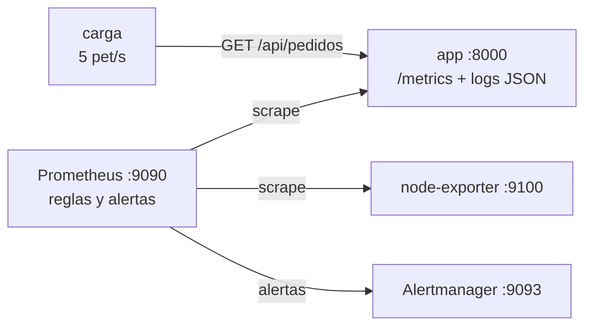

---
tags:
  - laboratorio
  - observabilidad
  - contenedores
---

# Lab 11 (parte 1): Métricas, SLO y alertas con Prometheus

> Levanta con Docker Compose una app instrumentada, Prometheus, Alertmanager y node-exporter; mide un SLO con recording rules, pruébalo con `promtool`, inyecta errores y latencia y mira cómo salta la alerta. En la [parte 2](observabilidad-logs-grafana.md) le añades logs (Loki y Grafana Alloy) y dashboards en Grafana.

| Nivel | Duración | Costo | Requisitos |
| --- | --- | --- | --- |
| Intermedio | ~50 min | Gratis | Lab 00, Lab 05, Docker con Compose v2, ~2 GB de RAM libres, Python 3.12+ (opcional) |

!!! info "Qué vas a aprender"
    - Instrumentar una app en Python con `prometheus-client` (un **counter** y un **histogram**) y exponer `/metrics`.
    - Configurar el **scrape** de Prometheus y consultar tasa de errores y latencia p95 con **PromQL**.
    - Definir un SLO simple con **recording rules** y **alerting rules**, probarlas con `promtool` y enviarlas a **Alertmanager**.
    - Inyectar fallos controlados con variables de entorno (la base del [Lab 21](../operacion/game-day-incidente.md)).

## Antes de empezar

- **Docker** con **Compose v2** (`docker compose version`) del [Lab 00](../fundamentos/preparar-entorno.md). Puertos libres en `127.0.0.1`: 8000, 9090 y 9093 (la parte 2 usará además 3100, 12345 y 3000).
- Opcional: **Python 3.12+** para probar la app sin Docker en el paso 1.
- Haber hecho el [Lab 05](docker-multistage-compose.md) (Dockerfile y Compose).
- Teoría: [Observabilidad](../../devops/operacion/observabilidad.md) (sobre todo [Prometheus](../../devops/operacion/observabilidad.md#prometheus) y [SLI, SLO, SLA y error budget](../../devops/operacion/observabilidad.md#sli-slo-sla-y-error-budget)) y [Niveles de servicio](../../negocio/niveles-de-servicio.md).

Imágenes usadas en esta parte (versiones vigentes al escribir el lab; revisa si hay más nuevas). Las de Loki, Alloy y Grafana están en la [parte 2](observabilidad-logs-grafana.md#antes-de-empezar).

| Componente | Imagen |
| --- | --- |
| App de ejemplo | `python:3.13.17-slim-trixie` + `prometheus-client` 0.26.0 |
| Prometheus | `prom/prometheus:v3.15.1` |
| Alertmanager | `prom/alertmanager:v0.34.1` |
| node-exporter | `prom/node-exporter:v1.12.1` |

## Arquitectura



Las **métricas** llegan por *pull*: Prometheus las pide cada 15 segundos a `/metrics`. Prometheus evalúa las reglas del SLO y, cuando una alerta se dispara, se la envía a Alertmanager. Los logs JSON de la app se quedan por ahora en la salida del contenedor (`docker compose logs app`); en la [parte 2](observabilidad-logs-grafana.md#arquitectura) Alloy los envía a Loki y Grafana muestra métricas y logs juntos.

## Paso a paso

### Paso 1: La app instrumentada

Crea la carpeta `lab11/app/`. La app es un servidor HTTP mínimo con la librería oficial de Prometheus. Mide **cada petición** con dos métricas:

- `http_requests_total{method, path, status}` (**counter**, contador que solo sube): sirve para tasas y porcentajes de error.
- `http_request_duration_seconds{path}` (**histogram**, histograma por *buckets*): sirve para percentiles de latencia.

Las labels tienen pocos valores posibles (`path` es la ruta, no la URL completa) para no disparar la **cardinalidad** (ver [Prometheus](../../devops/operacion/observabilidad.md#prometheus)).

```python title="app/app.py"
"""App de ejemplo para el Lab 11 (y el Lab 21): expone métricas Prometheus
y permite inyectar errores y latencia para practicar alertas e incidentes."""

import json
import logging
import os
import random
import sys
import time
import uuid
from http.server import BaseHTTPRequestHandler, ThreadingHTTPServer
from urllib.parse import parse_qs, urlparse

from prometheus_client import CONTENT_TYPE_LATEST, Counter, Gauge, Histogram, generate_latest

# --- Inyección de fallas (valores iniciales desde variables de entorno) ---
FALLAS = {
    "tasa_errores": float(os.getenv("TASA_ERRORES", "0")),  # 0.0 a 1.0
    "latencia_ms": int(os.getenv("LATENCIA_MS", "0")),  # milisegundos extra
}
PUERTO = int(os.getenv("PUERTO", "8000"))
ADMIN_HABILITADO = os.getenv("ADMIN_HABILITADO", "true").lower() == "true"
DIR_DATOS = os.getenv("DIR_DATOS", "")  # si se define, cada pedido deja una línea de auditoría (Lab 21)

# --- Métricas ---
PETICIONES = Counter(
    "http_requests_total", "Peticiones HTTP atendidas", ["method", "path", "status"]
)
DURACION = Histogram(
    "http_request_duration_seconds", "Duración de las peticiones HTTP", ["path"],
    buckets=(0.025, 0.05, 0.1, 0.25, 0.5, 1, 2.5, 5),
)
FALLA_ERRORES = Gauge("app_falla_tasa_errores", "Tasa de errores inyectada (0-1)")
FALLA_LATENCIA = Gauge("app_falla_latencia_ms", "Latencia extra inyectada (ms)")

# --- Logs JSON a stdout (los recoge Alloy y los envía a Loki) ---
logging.basicConfig(stream=sys.stdout, level=logging.INFO, format="%(message)s")
log = logging.getLogger("app")


def log_json(**campos):
    campos = {"ts": time.strftime("%Y-%m-%dT%H:%M:%S%z"), **campos}
    log.info(json.dumps(campos, ensure_ascii=False))


class Manejador(BaseHTTPRequestHandler):
    def log_message(self, *args):  # silencia el log por defecto de http.server
        pass

    def responder(self, status, cuerpo, tipo="application/json"):
        datos = cuerpo if isinstance(cuerpo, bytes) else json.dumps(cuerpo).encode()
        self.send_response(status)
        self.send_header("Content-Type", tipo)
        self.send_header("Content-Length", str(len(datos)))
        self.end_headers()
        self.wfile.write(datos)

    def do_GET(self):
        url = urlparse(self.path)
        if url.path == "/metrics":
            return self.responder(200, generate_latest(), CONTENT_TYPE_LATEST)
        if url.path == "/health":
            return self.responder(200, {"estado": "ok"})
        if url.path in ("/", "/api/pedidos"):
            return self.atender(url.path)
        return self.atender_404(url.path)

    def do_POST(self):
        url = urlparse(self.path)
        if url.path == "/admin/fallas" and ADMIN_HABILITADO:
            params = parse_qs(url.query)
            if "tasa_errores" in params:
                FALLAS["tasa_errores"] = max(0.0, min(1.0, float(params["tasa_errores"][0])))
            if "latencia_ms" in params:
                FALLAS["latencia_ms"] = max(0, int(params["latencia_ms"][0]))
            actualizar_gauges()
            log_json(nivel="WARNING", evento="fallas_actualizadas", **FALLAS)
            return self.responder(200, FALLAS)
        return self.atender_404(url.path)

    def atender_404(self, path):
        PETICIONES.labels(self.command, "otro", "404").inc()
        self.responder(404, {"error": "no encontrado"})

    def atender(self, path):
        inicio = time.perf_counter()
        request_id = self.headers.get("X-Request-ID", str(uuid.uuid4()))
        time.sleep(random.uniform(0.005, 0.05) + FALLAS["latencia_ms"] / 1000)
        if path == "/api/pedidos" and random.random() < FALLAS["tasa_errores"]:
            status, cuerpo = 500, {"error": "fallo simulado al consultar la base de datos"}
        elif path == "/api/pedidos" and (error := auditar()):
            status, cuerpo = 500, {"error": error}
        else:
            status, cuerpo = 200, {"pedidos": random.randint(0, 50)}
        duracion = time.perf_counter() - inicio
        PETICIONES.labels(self.command, path, str(status)).inc()
        DURACION.labels(path).observe(duracion)
        log_json(
            nivel="ERROR" if status >= 500 else "INFO",
            request_id=request_id, metodo=self.command, path=path,
            status=status, duracion_ms=round(duracion * 1000, 1),
            **({"error": cuerpo["error"]} if status >= 500 else {}),
        )
        self.responder(status, cuerpo)


def auditar():
    """Escribe una línea por pedido en DIR_DATOS; devuelve el error si no puede."""
    if not DIR_DATOS:
        return None
    try:
        with open(os.path.join(DIR_DATOS, "pedidos.log"), "a", encoding="utf-8") as f:
            f.write(f"{time.time()} pedido ok\n")
    except OSError as e:
        return f"no se pudo escribir en el volumen de datos: {e}"
    return None


def actualizar_gauges():
    FALLA_ERRORES.set(FALLAS["tasa_errores"])
    FALLA_LATENCIA.set(FALLAS["latencia_ms"])


if __name__ == "__main__":
    actualizar_gauges()
    log_json(nivel="INFO", evento="inicio", puerto=PUERTO, **FALLAS)
    ThreadingHTTPServer(("0.0.0.0", PUERTO), Manejador).serve_forever()
```

Un generador de tráfico simula usuarios para que siempre haya datos:

```python title="app/carga.py"
"""Generador de tráfico: llama a la app sin parar para que haya métricas."""

import os
import random
import time
import urllib.error
import urllib.request

OBJETIVO = os.getenv("OBJETIVO", "http://app:8000")
PETICIONES_POR_SEGUNDO = float(os.getenv("PETICIONES_POR_SEGUNDO", "5"))

while True:
    path = random.choice(["/api/pedidos", "/api/pedidos", "/api/pedidos", "/"])
    try:
        urllib.request.urlopen(OBJETIVO + path, timeout=5).read()
    except urllib.error.HTTPError:
        pass  # los 5xx también cuentan: los mide la app
    except OSError as e:
        print(f"no se pudo conectar con {OBJETIVO}: {e}", flush=True)
        time.sleep(2)
    time.sleep(1 / PETICIONES_POR_SEGUNDO)
```

```text title="app/requirements.txt"
prometheus-client==0.26.0
```

```dockerfile title="app/Dockerfile"
FROM python:3.13.17-slim-trixie
ENV PYTHONUNBUFFERED=1
WORKDIR /app
COPY requirements.txt .
RUN pip install --no-cache-dir -r requirements.txt
COPY app.py carga.py ./
USER nobody
EXPOSE 8000
CMD ["python", "app.py"]
```

#### Interruptores de fallo (los reutiliza el Lab 21)

| Variable de entorno | Valor por defecto | Efecto |
| --- | --- | --- |
| `TASA_ERRORES` | `0` | Probabilidad (de `0.0` a `1.0`) de que `/api/pedidos` responda `500` |
| `LATENCIA_MS` | `0` | Milisegundos que se suman a cada petición de `/` y `/api/pedidos` |
| `PUERTO` | `8000` | Puerto HTTP de la app |
| `ADMIN_HABILITADO` | `true` | Si es `false`, desactiva `POST /admin/fallas` |
| `DIR_DATOS` | vacío | Si se define (el Lab 21 usa `/datos`), cada pedido escribe una línea en `DIR_DATOS/pedidos.log`; si no puede (disco lleno), responde `500` |

Además, `POST /admin/fallas?tasa_errores=0.3&latencia_ms=400` cambia los fallos **en caliente**, sin reiniciar el contenedor, y lo deja registrado en el log (`evento: fallas_actualizadas`). Los gauges `app_falla_tasa_errores` y `app_falla_latencia_ms` muestran en Prometheus qué fallo está inyectado. El endpoint no tiene autenticación: **es solo para laboratorio**.

**Prueba rápida sin Docker** (opcional). Antes de montar todo el stack, comprueba que la app funciona:

=== "Linux/macOS"

    ```bash
    cd lab11/app
    python3 -m venv .venv && source .venv/bin/activate
    pip install -r requirements.txt
    TASA_ERRORES=0.2 python app.py &
    curl -s localhost:8000/health
    for i in $(seq 20); do curl -s -o /dev/null localhost:8000/api/pedidos; done
    curl -s localhost:8000/metrics | grep '^http_requests_total'
    kill %1
    ```

=== "Windows (PowerShell)"

    ```powershell
    cd lab11\app
    py -3.12 -m venv .venv; .\.venv\Scripts\Activate.ps1
    pip install -r requirements.txt
    $env:TASA_ERRORES = "0.2"
    $app = Start-Process python -ArgumentList "app.py" -PassThru -NoNewWindow
    curl.exe -s localhost:8000/health
    1..20 | ForEach-Object { curl.exe -s -o NUL localhost:8000/api/pedidos }
    curl.exe -s localhost:8000/metrics | Select-String '^http_requests_total'
    Stop-Process -Id $app.Id
    ```

```text
{"estado": "ok"}
http_requests_total{method="GET",path="/api/pedidos",status="200"} 16.0
http_requests_total{method="GET",path="/api/pedidos",status="500"} 4.0
```

Con `TASA_ERRORES=0.2`, alrededor de 1 de cada 5 peticiones falla (es aleatorio: tus números variarán).

### Paso 2: Prometheus, reglas del SLO y Alertmanager

**El SLO del lab**: el 99 % de las peticiones a `/api/pedidos` debe responder sin error 5xx. El **error budget** es el 1 %. La alerta salta si en los últimos 5 minutos falla más del 5 %: se está gastando el presupuesto **5 veces más rápido** de lo sostenible.

```yaml title="prometheus/prometheus.yml"
global:
  scrape_interval: 15s
  evaluation_interval: 15s

rule_files:
  - alertas.yml

alerting:
  alertmanagers:
    - static_configs:
        - targets: ["alertmanager:9093"]

scrape_configs:
  - job_name: prometheus
    static_configs:
      - targets: ["localhost:9090"]

  - job_name: app
    static_configs:
      - targets: ["app:8000"]

  - job_name: node
    static_configs:
      - targets: ["node-exporter:9100"]
```

Las **recording rules** precalculan una consulta y la guardan como serie nueva (`app:tasa_errores:ratio_rate5m`): las alertas y el dashboard reutilizan la misma definición del SLI.

```yaml title="prometheus/alertas.yml"
groups:
  - name: slo-app
    rules:
      # SLI de disponibilidad: proporción de peticiones con error 5xx
      - record: app:tasa_errores:ratio_rate5m
        expr: |
          sum(rate(http_requests_total{job="app", path="/api/pedidos", status=~"5.."}[5m]))
          /
          sum(rate(http_requests_total{job="app", path="/api/pedidos"}[5m]))

      # SLI de latencia: percentil 95 en segundos
      - record: app:latencia_p95:5m
        expr: |
          histogram_quantile(0.95,
            sum by (le) (rate(http_request_duration_seconds_bucket{job="app", path="/api/pedidos"}[5m])))

      - alert: TasaErrores5xxAlta
        expr: app:tasa_errores:ratio_rate5m > 0.05
        for: 2m
        labels:
          severity: page
        annotations:
          summary: "Más del 5 % de /api/pedidos falla"
          description: "Tasa de errores: {{ $value | humanizePercentage }}. El SLO permite 1 %: el error budget se consume 5 veces más rápido de lo previsto."

      - alert: LatenciaP95Alta
        expr: app:latencia_p95:5m > 0.3
        for: 5m
        labels:
          severity: ticket
        annotations:
          summary: "p95 de /api/pedidos por encima de 300 ms"
          description: "p95 actual: {{ $value | humanizeDuration }}."

      - alert: AppCaida
        expr: up{job="app"} == 0
        for: 1m
        labels:
          severity: page
        annotations:
          summary: "Prometheus no puede leer las métricas de la app"
```

`for: 2m` evita alertar por un pico de segundos: la condición debe mantenerse 2 minutos (estado *Pending*) antes de pasar a *Firing*. Una prueba unitaria de la regla, que ejecutarás con `promtool` en la verificación:

```yaml title="prometheus/alertas_test.yml"
rule_files:
  - alertas.yml

evaluation_interval: 1m

tests:
  - interval: 1m
    input_series:
      # 10 peticiones por minuto, 3 de ellas con error (30 %)
      - series: 'http_requests_total{job="app", path="/api/pedidos", status="200"}'
        values: "0+7x15"
      - series: 'http_requests_total{job="app", path="/api/pedidos", status="500"}'
        values: "0+3x15"
    alert_rule_test:
      - eval_time: 10m
        alertname: TasaErrores5xxAlta
        exp_alerts:
          - exp_labels:
              severity: page
            exp_annotations:
              summary: "Más del 5 % de /api/pedidos falla"
              description: "Tasa de errores: 30%. El SLO permite 1 %: el error budget se consume 5 veces más rápido de lo previsto."
```

Alertmanager agrupa, silencia y reparte las alertas. Aquí solo hay un receptor sin integraciones, para verlas en su interfaz:

```yaml title="alertmanager/alertmanager.yml"
route:
  receiver: lab
  group_by: ["alertname"]
  group_wait: 30s
  group_interval: 5m
  repeat_interval: 4h

receivers:
  # Sin integraciones: las alertas se ven en la interfaz web (puerto 9093).
  # En el trabajo real aquí iría Slack, PagerDuty, Opsgenie, correo, etc.
  - name: lab
```

### Paso 3: Docker Compose y arranque

Todos los puertos se publican solo en `127.0.0.1`: nada queda expuesto a tu red. `name: lab11` fija el nombre del proyecto, que es el que filtrará Alloy en la parte 2.

```yaml title="compose.yaml"
name: lab11

services:
  app:
    build: ./app
    image: lab11-app:1.0
    environment:
      TASA_ERRORES: ${TASA_ERRORES:-0}
      LATENCIA_MS: ${LATENCIA_MS:-0}
    ports:
      - "127.0.0.1:8000:8000"

  carga:
    image: lab11-app:1.0
    command: ["python", "carga.py"]
    environment:
      OBJETIVO: http://app:8000
      PETICIONES_POR_SEGUNDO: "5"
    depends_on:
      - app

  prometheus:
    image: prom/prometheus:v3.15.1
    command:
      - --config.file=/etc/prometheus/prometheus.yml
      - --storage.tsdb.path=/prometheus
      - --storage.tsdb.retention.time=2d
      - --web.enable-lifecycle
    volumes:
      - ./prometheus:/etc/prometheus:ro
      - prometheus-data:/prometheus
    ports:
      - "127.0.0.1:9090:9090"

  alertmanager:
    image: prom/alertmanager:v0.34.1
    volumes:
      - ./alertmanager/alertmanager.yml:/etc/alertmanager/alertmanager.yml:ro
    ports:
      - "127.0.0.1:9093:9093"

  node-exporter:
    image: prom/node-exporter:v1.12.1

volumes:
  prometheus-data:
```

`node-exporter` sin montajes del host mide la máquina donde corre Docker: en Docker Desktop es su VM de Linux, no tu Windows o macOS. En un servidor Linux real se ejecuta en el host (o con `--path.rootfs` y el `/` del host montado).

La estructura al terminar esta parte:

```text
lab11/
├── compose.yaml
├── app/            app.py, carga.py, requirements.txt, Dockerfile
├── prometheus/     prometheus.yml, alertas.yml, alertas_test.yml
└── alertmanager/   alertmanager.yml
```

```bash
cd lab11
docker compose up -d --build
docker compose ps
```

```text
NAME                    SERVICE         STATUS         PORTS
lab11-alertmanager-1    alertmanager    Up 20 seconds  127.0.0.1:9093->9093/tcp
lab11-app-1             app             Up 20 seconds  127.0.0.1:8000->8000/tcp
lab11-carga-1           carga           Up 20 seconds
lab11-node-exporter-1   node-exporter   Up 20 seconds  9100/tcp
lab11-prometheus-1      prometheus      Up 20 seconds  127.0.0.1:9090->9090/tcp
```

### Paso 4: Explorar las métricas en Prometheus

1. **Prometheus** ([http://localhost:9090](http://localhost:9090)) → *Status → Target health*: los tres jobs (`prometheus`, `app`, `node`) deben estar **UP**. Si uno está DOWN, el mensaje de error dice por qué.
2. En la pestaña *Query*, prueba:

    ```promql
    # Peticiones por segundo por status
    sum by (status) (rate(http_requests_total{job="app"}[1m]))

    # Tasa de errores (el SLI) y latencia p95, ya precalculadas
    app:tasa_errores:ratio_rate5m
    app:latencia_p95:5m
    ```

    Con `TASA_ERRORES=0` la tasa de errores debe ser `0`. Las recording rules usan ventanas de 5 minutos: si recién arrancaste, espera unos minutos para que tengan datos.

3. En *Alerts*, las tres reglas (`TasaErrores5xxAlta`, `LatenciaP95Alta` y `AppCaida`) deben aparecer como **Inactive**.
4. Los logs JSON de la app todavía no están centralizados, pero ya puedes leerlos:

    ```bash
    docker compose logs --tail 5 app
    ```

### Paso 5: Inyectar errores y ver la alerta

Activa un 30 % de errores **en caliente**:

=== "Linux/macOS"

    ```bash
    curl -s -X POST "http://localhost:8000/admin/fallas?tasa_errores=0.3"
    ```

=== "Windows (PowerShell)"

    ```powershell
    curl.exe -s -X POST "http://localhost:8000/admin/fallas?tasa_errores=0.3"
    ```

```json
{"tasa_errores": 0.3, "latencia_ms": 0}
```

Observa la secuencia (unos 3 minutos):

1. En Prometheus, la consulta `app:tasa_errores:ratio_rate5m` (pestaña *Graph*) sube por encima de `0.05`; `docker compose logs app` muestra líneas con `fallo simulado al consultar la base de datos`.
2. En Prometheus → *Alerts*, `TasaErrores5xxAlta` pasa a **Pending** y, tras 2 minutos, a **Firing**.
3. En Alertmanager ([http://localhost:9093](http://localhost:9093)) aparece la alerta con `severity="page"` y su descripción.

Ahora prueba la **latencia** reiniciando la app con una variable de entorno (la otra forma de inyectar fallos):

=== "Linux/macOS"

    ```bash
    curl -s -X POST "http://localhost:8000/admin/fallas?tasa_errores=0"
    LATENCIA_MS=400 docker compose up -d app
    ```

=== "Windows (PowerShell)"

    ```powershell
    curl.exe -s -X POST "http://localhost:8000/admin/fallas?tasa_errores=0"
    $env:LATENCIA_MS = "400"; docker compose up -d app
    ```

Compose recrea solo el contenedor `app`. El p95 (`app:latencia_p95:5m`) sube por encima de 0,3 s y `LatenciaP95Alta` se dispara tras 5 minutos. Mientras la app se reinicia, quizá veas `AppCaida` en *Pending*: un reinicio corto no llega al minuto del `for`.

Vuelve a la normalidad:

=== "Linux/macOS"

    ```bash
    LATENCIA_MS=0 docker compose up -d app
    ```

=== "Windows (PowerShell)"

    ```powershell
    $env:LATENCIA_MS = "0"; docker compose up -d app
    ```

Las alertas pasan a *Inactive* cuando la ventana de 5 minutos deja de contener los errores. Por eso una alerta no se "apaga" en el mismo segundo en que arreglas el problema.

## Verificación

```bash
docker compose exec prometheus promtool check config /etc/prometheus/prometheus.yml
docker compose exec prometheus promtool test rules /etc/prometheus/alertas_test.yml
docker compose exec alertmanager amtool check-config /etc/alertmanager/alertmanager.yml
curl -s 'http://localhost:9090/api/v1/query?query=up'
```

| Comprobación | Resultado esperado |
| --- | --- |
| `promtool check config` | `SUCCESS` para `prometheus.yml` y `SUCCESS: 5 rules found` para `alertas.yml` (2 recording rules y 3 alerting rules) |
| `promtool test rules` | `SUCCESS`: la alerta salta con 30 % de errores |
| `amtool check-config` | `SUCCESS` y `receivers: 1` |
| `up` en la API de Prometheus | Tres series con valor `"1"` (`prometheus`, `app`, `node`) |
| Tras inyectar `tasa_errores=0.3` | `TasaErrores5xxAlta` en *Firing* en Prometheus y visible en Alertmanager |
| Tras `LATENCIA_MS=400` | `LatenciaP95Alta` en *Firing* tras 5 minutos |

## Retos extra

1. **Alerta por burn rate con dos ventanas**: reescribe `TasaErrores5xxAlta` como en la [nota de observabilidad](../../devops/operacion/observabilidad.md#alertas-accionables) (14,4 × error budget en 1 h y en 5 min). Pista: crea recording rules para `[1h]` y `[5m]`.
2. **Un receptor real**: envía las alertas a un webhook (por ejemplo, un canal de Slack o Microsoft Teams de pruebas) con `webhook_configs` o `slack_configs` en Alertmanager. No pongas la URL del webhook en Git: es un secreto.

## Limpieza

Si vas a seguir con la [parte 2](observabilidad-logs-grafana.md), **no borres nada**: la parte 2 amplía este mismo `compose.yaml`. Puedes dejar el stack levantado o pararlo con `docker compose stop` y retomarlo con `docker compose start`.

Si terminas aquí:

```bash
docker compose down -v
docker image rm lab11-app:1.0
```

`-v` borra también el volumen `prometheus-data`. Comprueba que no queda nada del proyecto:

```bash
docker compose ls --all
docker volume ls --filter name=lab11
```

Ninguna de las dos órdenes debe listar `lab11`. Si no vas a repetir el lab, borra también las imágenes descargadas (`docker image ls` y `docker image rm <imagen>:<tag>`).

## Problemas comunes

| Síntoma | Causa | Solución |
| --- | --- | --- |
| Target `app` en **DOWN** con `connection refused` | La app no arrancó o falló | `docker compose logs app` |
| `bind: address already in use` al arrancar | Otro proceso usa 8000, 9090 u otro puerto | Libera el puerto o cambia el de la izquierda en `ports` |
| `Empty query result` en las recording rules | Aún no hay 5 minutos de datos, o la consulta no coincide con las labels | Espera unos minutos y prueba primero `http_requests_total{job="app"}` |
| La alerta no pasa a *Firing* | No se cumplió el `for`, o la tasa de errores no supera el 5 % | Mira el estado *Pending* y el valor de `app:tasa_errores:ratio_rate5m` |
| Cambios en `alertas.yml` sin efecto | Prometheus no recargó la configuración | `curl -X POST http://localhost:9090/-/reload` (activado con `--web.enable-lifecycle`) |

Para un método general, ver [Troubleshooting](../../devops/operacion/troubleshooting.md#contenedores). Los problemas de Loki, Alloy y Grafana están en la [parte 2](observabilidad-logs-grafana.md#problemas-comunes).

## Información complementaria

- **SLI, SLO y error budget**: el SLI es la medida, el SLO el objetivo, el error budget lo que te puedes permitir fallar. Ver [SLI, SLO, SLA y error budget](../../devops/operacion/observabilidad.md#sli-slo-sla-y-error-budget) y, desde negocio, [Niveles de servicio](../../negocio/niveles-de-servicio.md#sli-slo-y-sla-quien-los-usa).
- **Alertar sobre síntomas**: la alerta del lab mide lo que sufre el usuario (errores, latencia), no la CPU. Ver [Alertas accionables](../../devops/operacion/observabilidad.md#alertas-accionables).
- **Qué medir**: el counter y el histogram de la app cubren la tasa, los errores y la duración del método RED. Ver [Métodos RED, USE y golden signals](../../devops/operacion/observabilidad.md#metodos-red-use-y-golden-signals).
- **En la nube**: los equivalentes gestionados son Amazon Managed Service for Prometheus, Azure Monitor (con su servicio gestionado para Prometheus) y Google Cloud Managed Service for Prometheus. Ver [Observabilidad nativa](../../cloud/operacion-y-gobierno/observabilidad-nativa.md).

## Documentación oficial

- [Prometheus: configuración](https://prometheus.io/docs/prometheus/latest/configuration/configuration/), [recording rules](https://prometheus.io/docs/prometheus/latest/configuration/recording_rules/), [alerting rules](https://prometheus.io/docs/prometheus/latest/configuration/alerting_rules/) y [pruebas unitarias de reglas](https://prometheus.io/docs/prometheus/latest/configuration/unit_testing_rules/)
- [PromQL: funciones (`rate`, `histogram_quantile`)](https://prometheus.io/docs/prometheus/latest/querying/functions/)
- [Alertmanager: configuración](https://prometheus.io/docs/alerting/latest/configuration/)
- [Cliente oficial de Prometheus para Python](https://prometheus.github.io/client_python/)
- [node_exporter](https://github.com/prometheus/node_exporter)

## Preguntas para verificar el aprendizaje

??? question "1. ¿Por qué `http_requests_total` es un counter y la latencia un histogram?"
    Un counter solo sube y con `rate()` da tasas por segundo y porcentajes de error. Un histogram cuenta observaciones por buckets, lo que permite calcular percentiles (p95, p99) agregando varias instancias con `histogram_quantile`.

??? question "2. ¿Qué pasaría si añadieras el `request_id` como label de la métrica?"
    Cada petición crearía una serie temporal nueva: la cardinalidad se dispararía y Prometheus consumiría cada vez más memoria hasta caer. El `request_id` va en los logs (o en las trazas), no en las labels.

??? question "3. La tasa de errores fue del 30 % durante 1 minuto y volvió a 0. ¿Salta `TasaErrores5xxAlta`?"
    Probablemente no. La condición tiene que cumplirse de forma continua durante el `for: 2m`; además, el `rate` de 5 minutos diluye el pico. Ese es el objetivo: no despertar a nadie por algo que ya se resolvió solo.

??? question "4. Con un SLO del 99 %, ¿qué significa una tasa de errores del 5 %?"
    Que se está consumiendo el error budget (1 %) 5 veces más rápido de lo sostenible (burn rate 5). Si siguiera así, el presupuesto del mes se agotaría en unos 6 días.

??? question "5. Prometheus marca el target `app` como DOWN pero `curl localhost:8000/health` funciona desde tu máquina. ¿Qué revisas?"
    Que Prometheus la alcance desde **su** red: el target es `app:8000` dentro de la red de Compose, no `localhost`. Revisa el nombre del servicio, que ambos estén en el mismo proyecto y el mensaje de error en *Target health*.

??? question "6. ¿Por qué la alerta no desaparece en el mismo momento en que quitas la inyección de errores?"
    Porque la regla usa una ventana de 5 minutos (`rate(...[5m])`): hasta que los errores salen de la ventana, la tasa sigue por encima del umbral. Es un compromiso entre reaccionar rápido y no generar ruido.

## Notas relacionadas

**Cloud**

- [Observabilidad nativa](../../cloud/operacion-y-gobierno/observabilidad-nativa.md)

**DevOps**

- [Observabilidad: Prometheus, Grafana, OpenTelemetry y SLOs](../../devops/operacion/observabilidad.md)
- [Operación y fiabilidad (SRE)](../../devops/operacion/operacion-sre.md)
- [Runbooks y playbooks](../../devops/operacion/runbooks-playbooks.md)
- [Troubleshooting](../../devops/operacion/troubleshooting.md)
- [Docker: imágenes, multi-stage builds y Compose](../../devops/contenedores/docker.md)
- [Guía de comandos de Docker](../../recursos/comandos/docker.md)

**Python**

- [APIs y HTTP](../../python/scripting/apis-http.md)

**Negocio TI**

- [Niveles de servicio](../../negocio/niveles-de-servicio.md)
- [Métricas de negocio y técnicas](../../negocio/metricas-kpis-okrs.md)

**Labs**

- Lab anterior: [Lab 10: Configurar servidores con Ansible](ansible-configuracion.md)
- Siguiente: [Lab 11 (parte 2): Logs con Loki y dashboards en Grafana](observabilidad-logs-grafana.md)
- Para practicar un incidente con este stack (necesita las dos partes): [Lab 21: Game day](../operacion/game-day-incidente.md)
