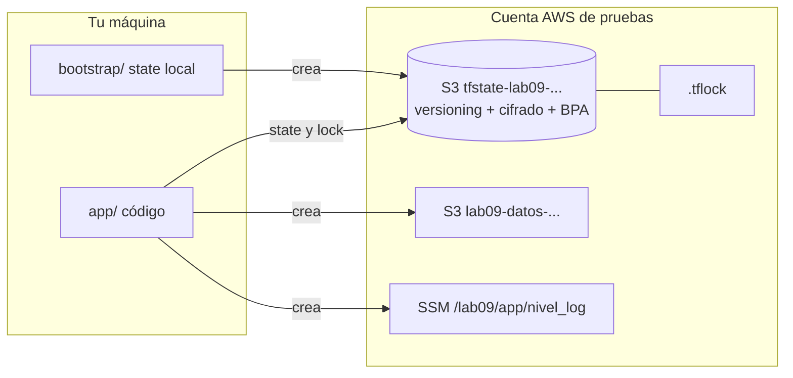

---
tags:
  - laboratorio
  - terraform
  - iac
  - aws
---

# Lab 09: Terraform en AWS con remote state en S3

> Crea el bucket del state con buenas prácticas, migra tu state local a S3 con bloqueo nativo, provoca un bloqueo y un drift a propósito, y limpia todo hasta la última versión.

| Nivel | Duración | Costo | Requisitos |
| --- | --- | --- | --- |
| Intermedio | ~75 min | ~0 USD si limpias (S3 y SSM Parameter Store estándar) | Lab 00, Lab 08, Terraform >= 1.10, AWS CLI v2, cuenta AWS de pruebas |

!!! info "Qué vas a aprender"
    - Resolver el "huevo y la gallina" del state con un proyecto **bootstrap** (arranque) separado.
    - Crear un bucket de state con **versioning**, cifrado y **Block Public Access**.
    - Configurar el backend `s3` con `use_lockfile` y migrar un state local con `terraform init -migrate-state`.
    - Ver el **state locking** (bloqueo del estado) en acción con dos terminales.
    - Detectar **drift** (desviación) con `terraform plan -detailed-exitcode` tras un cambio manual.
    - Borrar todo, incluidas las versiones antiguas y los **delete markers** (marcadores de borrado) de un bucket versionado.

!!! warning "Costos y seguridad"
    - Usa **una cuenta de pruebas**, nunca una cuenta con cargas de producción. Configura antes la alerta de presupuesto del [Lab 00, parte 2](../fundamentos/preparar-cuentas-cloud.md#paso-2-configura-las-alertas-de-presupuesto).
    - Lo que crea el lab (dos buckets S3 casi vacíos y un parámetro estándar de SSM Parameter Store) cuesta centavos o nada, pero **los buckets versionados guardan cada versión**: si no haces la limpieza completa, seguirán ahí.
    - Inicia sesión con credenciales temporales (IAM Identity Center / `aws sso login` o un rol). No uses access keys de larga duración ni las pongas en el código.

## Antes de empezar

- **Terraform >= 1.10** (`use_lockfile` no existe en versiones anteriores). La configuración de este lab se validó con Terraform 1.17.0 y el provider `hashicorp/aws` 6.70.0.
- **AWS CLI v2** con un perfil que apunte a tu cuenta de pruebas. En este lab se usa el perfil `lab` (PowerUserAccess) del [Lab 00, parte 2](../fundamentos/preparar-cuentas-cloud.md#paso-3-crea-la-identidad-de-laboratorio-y-conecta-las-clis); cambia el nombre si el tuyo es otro. No necesitas `lab-admin`: el lab solo crea buckets S3 y un parámetro de SSM, sin roles ni políticas de IAM.
- Haber hecho el [Lab 08](terraform-local-workspaces.md): aquí se da por sabido el ciclo `init`/`plan`/`apply` y qué es el state.
- Teoría: [Remote state](../../devops/iac/terraform-basico.md#remote-state-estado-remoto), [Qué subir a Git](../../devops/iac/terraform-basico.md#que-subir-a-git) y [Drift detection](../../devsecops/infraestructura-y-contenedores/seguridad-iac.md#drift-detection).

=== "Linux/macOS"

    ```bash
    export AWS_PROFILE=lab
    aws sts get-caller-identity
    ```

=== "Windows (PowerShell)"

    ```powershell
    $env:AWS_PROFILE = "lab"
    aws sts get-caller-identity
    ```

```json
{
    "UserId": "AROA...:dani",
    "Account": "123456789012",
    "Arn": "arn:aws:sts::123456789012:assumed-role/AWSReservedSSO_PowerUserAccess_.../lab-tu-nombre"
}
```

Comprueba que `Account` es tu cuenta de pruebas **antes** de seguir.

## Arquitectura



Dos proyectos: `bootstrap/` crea el bucket del state y guarda **su propio** state en local; `app/` crea los recursos de ejemplo y guarda su state en ese bucket.

## Paso a paso

### Paso 1: Bootstrap del bucket del state

El backend necesita que el bucket exista **antes** de `terraform init`, así que no puede crearlo el mismo proyecto que lo usa. Por eso se crea en un proyecto aparte (o a mano), con su state local o, en empresas, en una cuenta central de "management".

```hcl title="bootstrap/main.tf"
terraform {
  required_version = ">= 1.10"

  required_providers {
    aws = {
      source  = "hashicorp/aws"
      version = "~> 6.0"
    }
  }
}

provider "aws" {
  region = var.region

  default_tags {
    tags = {
      Proyecto  = "lab09"
      ManagedBy = "terraform"
    }
  }
}

variable "region" {
  type    = string
  default = "us-east-1"
}

variable "force_destroy" {
  type    = bool
  default = false
}

data "aws_caller_identity" "actual" {}

resource "aws_s3_bucket" "state" {
  # El nombre de un bucket es global: el ID de cuenta lo hace único
  bucket = "tfstate-lab09-${data.aws_caller_identity.actual.account_id}-${var.region}"

  # false: Terraform se niega a borrar el bucket si tiene objetos (protege el state)
  force_destroy = var.force_destroy
}

resource "aws_s3_bucket_versioning" "state" {
  bucket = aws_s3_bucket.state.id

  versioning_configuration {
    status = "Enabled"
  }
}

resource "aws_s3_bucket_server_side_encryption_configuration" "state" {
  bucket = aws_s3_bucket.state.id

  rule {
    apply_server_side_encryption_by_default {
      sse_algorithm = "AES256" # SSE-S3; usa "aws:kms" si necesitas una clave KMS propia
    }
  }
}

resource "aws_s3_bucket_public_access_block" "state" {
  bucket = aws_s3_bucket.state.id

  block_public_acls       = true
  block_public_policy     = true
  ignore_public_acls      = true
  restrict_public_buckets = true
}

output "bucket_state" {
  value = aws_s3_bucket.state.bucket
}
```

- **Versioning**: si el state se corrompe o alguien lo borra, recuperas la versión anterior.
- **Cifrado** y **Block Public Access**: S3 ya los activa por defecto en buckets nuevos, pero declararlos deja la intención en el código y hace que un escáner de IaC no los marque como hallazgo.
- `default_tags` etiqueta todo lo que crea el provider: te servirá para comprobar la limpieza.

```bash
cd bootstrap
terraform init
terraform apply
```

```text
Plan: 4 to add, 0 to change, 0 to destroy.
...
Apply complete! Resources: 4 added, 0 changed, 0 destroyed.

Outputs:
bucket_state = "tfstate-lab09-123456789012-us-east-1"
```

Verifica la configuración del bucket con la AWS CLI:

```bash
B=$(terraform output -raw bucket_state)          # PowerShell: $B = terraform output -raw bucket_state
aws s3api get-bucket-versioning --bucket "$B"
aws s3api get-public-access-block --bucket "$B"
```

```text
{ "Status": "Enabled" }
{ "PublicAccessBlockConfiguration": { "BlockPublicAcls": true, "IgnorePublicAcls": true, "BlockPublicPolicy": true, "RestrictPublicBuckets": true } }
```

### Paso 2: El proyecto app con state local

Ahora crea, **al lado** de `bootstrap/`, la carpeta `app/`. Primero trabajarás con state local, como en el Lab 08, para luego migrarlo.

```hcl title="app/versions.tf"
terraform {
  required_version = ">= 1.10"

  required_providers {
    aws = {
      source  = "hashicorp/aws"
      version = "~> 6.0"
    }
  }
}
```

```hcl title="app/main.tf"
provider "aws" {
  region = var.region

  default_tags {
    tags = {
      Proyecto  = "lab09"
      ManagedBy = "terraform"
    }
  }
}

variable "region" {
  type    = string
  default = "us-east-1"
}

variable "nivel_log" {
  type    = string
  default = "info"
}

data "aws_caller_identity" "actual" {}

resource "aws_s3_bucket" "datos" {
  bucket = "lab09-datos-${data.aws_caller_identity.actual.account_id}"
}

resource "aws_s3_bucket_public_access_block" "datos" {
  bucket = aws_s3_bucket.datos.id

  block_public_acls       = true
  block_public_policy     = true
  ignore_public_acls      = true
  restrict_public_buckets = true
}

# Parámetro de configuración (no secreto): insecure_value deja ver el valor en el plan
resource "aws_ssm_parameter" "nivel_log" {
  name           = "/lab09/app/nivel_log"
  type           = "String"
  insecure_value = var.nivel_log
}

output "bucket_datos" {
  value = aws_s3_bucket.datos.bucket
}
```

```bash
cd ../app
terraform init
terraform apply
```

```text
Apply complete! Resources: 3 added, 0 changed, 0 destroyed.
bucket_datos = "lab09-datos-123456789012"
```

En la carpeta `app/` aparece `terraform.tfstate`. Ese archivo solo existe en tu disco: nadie más del equipo puede usarlo y, si lo pierdes, Terraform "olvida" los recursos.

### Paso 3: Configurar el backend S3 y migrar el state

Los valores que cambian según la cuenta (bucket, región) van en un archivo aparte y se pasan en `init`: es la **partial configuration** (configuración parcial) del backend. Así el mismo código sirve para varias cuentas.

```hcl title="app/backend.tf"
terraform {
  backend "s3" {
    key          = "lab09/app/terraform.tfstate"
    encrypt      = true
    use_lockfile = true # bloqueo nativo con un objeto .tflock en el bucket
  }
}
```

```hcl title="app/backend.hcl"
bucket = "tfstate-lab09-123456789012-us-east-1" # el output del paso 1
region = "us-east-1"
```

```bash
terraform init -migrate-state -backend-config=backend.hcl
```

```text
Initializing the backend...
Do you want to copy existing state to the new backend?
  Pre-existing state was found while migrating the previous "local" backend to the
  newly configured "s3" backend. No existing state was found in the newly
  configured "s3" backend. Do you want to copy this state to the new "s3"
  backend? Enter "yes" to copy and "no" to start with an empty state.

  Enter a value: yes

Successfully configured the backend "s3"! Terraform will automatically
use this backend unless the backend configuration changes.
```

Comprueba que el state vive en S3 y que Terraform lo lee desde allí:

```bash
aws s3 ls "s3://$B/lab09/app/"
terraform state list
```

```text
2026-10-26 12:05:41       4321 terraform.tfstate

data.aws_caller_identity.actual
aws_s3_bucket.datos
aws_s3_bucket_public_access_block.datos
aws_ssm_parameter.nivel_log
```

Tras la migración, el `terraform.tfstate` local normalmente queda vacío y `terraform.tfstate.backup` conserva la copia anterior (así se comportó en una prueba de migración local → local). Cuando confirmes que `state list` funciona, **bórralos**: contienen datos de tu cuenta y ya no se usan. La carpeta `.terraform/` guarda la configuración del backend, no el state.

!!! note "DynamoDB ya no hace falta"
    Antes el bloqueo del backend S3 necesitaba una tabla DynamoDB (`dynamodb_table`). Ese argumento está **deprecated** (obsoleto) y se eliminará en una versión futura; `use_lockfile = true` bloquea con un objeto `<key>.tflock` en el mismo bucket.

### Paso 4: Ver el bloqueo con dos terminales

El lock impide que dos ejecuciones escriban el state a la vez (por ejemplo, tú y el pipeline). Para verlo, necesitas dos terminales en la carpeta `app/` con el mismo perfil de AWS.

**Terminal A**: lanza un apply y **no respondas** a la confirmación. Mientras espera, Terraform mantiene el lock.

```bash
terraform apply -var="nivel_log=debug"
```

```text
Plan: 0 to add, 1 to change, 0 to destroy.

Do you want to perform these actions?
  Enter a value: _
```

**Terminal B**: intenta leer el state para un plan y mira el bucket.

```bash
terraform plan
aws s3 ls "s3://$B/lab09/app/"
```

```text
Error: Error acquiring the state lock

Error message: operation error S3: PutObject, https response error
StatusCode: 412, ... api error PreconditionFailed: At least one of the
pre-conditions you specified did not hold
Lock Info:
  ID:        3f2a...-....
  Path:      tfstate-lab09-123456789012-us-east-1/lab09/app/terraform.tfstate
  Operation: OperationTypeApply
  Who:       dani@portatil
  Version:   1.17.0
  Created:   2026-10-26 18:10:02 +0000 UTC

2026-10-26 12:10:02        210 terraform.tfstate.tflock
2026-10-26 12:05:41       4321 terraform.tfstate
```

El lock es un objeto que se crea con una escritura condicional: si ya existe, S3 responde `412 PreconditionFailed` y la segunda ejecución se detiene. El texto exacto del error puede variar entre versiones; lo importante son `Error acquiring the state lock` y el bloque `Lock Info`.

Ahora, en la **terminal A**, escribe `no`. Terraform libera el lock (borra el `.tflock`). Repite el plan en la terminal B con espera:

```bash
terraform plan -lock-timeout=60s
```

`-lock-timeout` reintenta durante ese tiempo en vez de fallar al instante: es lo habitual en pipelines.

!!! danger "`force-unlock` solo con locks huérfanos"
    Si un proceso murió (Ctrl+C brusco, runner de CI cancelado) el lock puede quedar colgado. Solo entonces, tras confirmar con el campo `Who` y `Created` que nadie está ejecutando nada, usa `terraform force-unlock <ID>`. Forzarlo con una ejecución viva puede corromper el state.

### Paso 5: Provocar y detectar drift

Un **drift** aparece cuando alguien cambia un recurso fuera de Terraform. Simula dos cambios manuales: uno en la consola y otro con la CLI.

1. En la consola de AWS, abre S3 → bucket `lab09-datos-...` → **Properties** → **Tags** → **Edit** y añade `Owner = consola`.
2. Cambia el parámetro con la CLI:

    ```bash
    aws ssm put-parameter --name /lab09/app/nivel_log --value debug --overwrite
    ```

Ahora pregunta a Terraform si la realidad coincide con el código:

=== "Linux/macOS"

    ```bash
    terraform plan -detailed-exitcode
    echo "exit code: $?"
    ```

=== "Windows (PowerShell)"

    ```powershell
    terraform plan -detailed-exitcode
    "exit code: $LASTEXITCODE"
    ```

```text
  # aws_s3_bucket.datos will be updated in-place
  ~ resource "aws_s3_bucket" "datos" {
      ~ tags     = {
          - "Owner" = "consola" -> null
        }
      ~ tags_all = {
          - "Owner"     = "consola" -> null
            # (2 unchanged elements hidden)
        }
    }

  # aws_ssm_parameter.nivel_log will be updated in-place
  ~ resource "aws_ssm_parameter" "nivel_log" {
      ~ insecure_value = "debug" -> "info"
    }

Plan: 0 to add, 2 to change, 0 to destroy.
exit code: 2
```

(Salida abreviada; el formato exacto puede variar según la versión.) Con `-detailed-exitcode`: `0` = sin cambios, `1` = error, `2` = hay diferencias. Un job programado en CI usa ese código para avisar de drift. Para ver **solo** lo que cambió fuera de Terraform, sin mezclarlo con cambios pendientes del código:

```bash
terraform plan -refresh-only
```

Decide qué hacer con cada diferencia:

- **Revertir** (el cambio manual fue un error): `terraform apply`. El tag desaparece y el parámetro vuelve a `info`.
- **Incorporar** (el cambio era correcto): llévalo al código (por ejemplo, el tag en `aws_s3_bucket.datos`) y aplica hasta que el plan dé `exit code: 0`.

Para este lab, revierte con `terraform apply` y comprueba que `terraform plan -detailed-exitcode` devuelve `0`.

## Verificación

| Comprobación | Resultado esperado |
| --- | --- |
| `aws s3api get-bucket-versioning --bucket "$B"` | `"Status": "Enabled"` |
| `aws s3api get-bucket-encryption --bucket "$B"` | Regla con `"SSEAlgorithm": "AES256"` |
| `aws s3 ls "s3://$B/lab09/app/"` | `terraform.tfstate` (y ningún `.tflock` si no hay ejecuciones en curso) |
| `terraform state list` en `app/` sin `terraform.tfstate` local | Lista los 4 objetos: el state se lee de S3 |
| Segunda terminal durante un `apply` pendiente | `Error acquiring the state lock` |
| `terraform plan -detailed-exitcode` tras revertir | `No changes.` y `exit code: 0` |
| `aws s3api list-object-versions --bucket "$B" --prefix lab09/` | Varias versiones del state y delete markers del `.tflock`: cada lock deja rastro en un bucket versionado |

## Retos extra

1. Añade una **lifecycle rule** al bucket del state que borre versiones no actuales tras 90 días (`aws_s3_bucket_lifecycle_configuration` con `noncurrent_version_expiration`). Pista: el bucket versionado crece con cada `apply`.
2. Crea una **bucket policy** que deniegue peticiones sin TLS (`aws:SecureTransport = false`) y comprueba que Terraform sigue funcionando.
3. Usa workspaces con este backend (`terraform workspace new dev`) y busca dónde guarda S3 el state (`env:/dev/lab09/app/terraform.tfstate`). Ver [Terraform workspaces](../../devops/iac/terraform-workspaces.md#donde-se-guarda-cada-state).
4. Escribe un workflow de GitHub Actions programado que ejecute `terraform plan -detailed-exitcode` y falle si hay drift, autenticado con OIDC (lo preparas en el [Lab 13](../devsecops/oidc-github-aws.md)).

## Limpieza

Hazlo en este orden: primero los recursos de `app/` (su state está en el bucket), luego vacía el bucket del state y por último destruye el bootstrap.

**1. Destruir los recursos de la app**

```bash
cd app
terraform destroy
```

```text
Destroy complete! Resources: 3 destroyed.
```

**2. Vaciar el bucket del state, incluidas todas las versiones y delete markers**

Un `aws s3 rm --recursive` **no basta** en un bucket versionado: solo añade delete markers y las versiones siguen ahí (y S3 no deja borrar un bucket que las tenga).

=== "Linux/macOS"

    ```bash
    cd ../bootstrap
    B=$(terraform output -raw bucket_state)
    aws s3api list-object-versions --bucket "$B" \
      --query '{Objects: Versions[].{Key: Key, VersionId: VersionId}}' --output json > versiones.json
    aws s3api delete-objects --bucket "$B" --delete file://versiones.json
    aws s3api list-object-versions --bucket "$B" \
      --query '{Objects: DeleteMarkers[].{Key: Key, VersionId: VersionId}}' --output json > marcadores.json
    aws s3api delete-objects --bucket "$B" --delete file://marcadores.json
    aws s3api list-object-versions --bucket "$B"
    ```

=== "Windows (PowerShell)"

    ```powershell
    cd ..\bootstrap
    $B = terraform output -raw bucket_state
    aws s3api list-object-versions --bucket $B `
      --query '{Objects: Versions[].{Key: Key, VersionId: VersionId}}' --output json |
      Out-File -Encoding ascii versiones.json
    aws s3api delete-objects --bucket $B --delete file://versiones.json
    aws s3api list-object-versions --bucket $B `
      --query '{Objects: DeleteMarkers[].{Key: Key, VersionId: VersionId}}' --output json |
      Out-File -Encoding ascii marcadores.json
    aws s3api delete-objects --bucket $B --delete file://marcadores.json
    aws s3api list-object-versions --bucket $B
    ```

La última orden no debe mostrar `Versions` ni `DeleteMarkers`. Si un `delete-objects` falla con `Invalid type for parameter Delete.Objects`, es que esa lista estaba vacía: sigue con el siguiente. `delete-objects` admite hasta 1000 objetos por llamada; en este lab hay muchos menos.

!!! tip "Alternativa con `force_destroy`"
    `terraform apply -var="force_destroy=true"` y luego `terraform destroy -var="force_destroy=true"` hacen que el provider borre todas las versiones antes de eliminar el bucket. Es cómodo en laboratorio; en un bucket de state real, déjalo en `false`.

**3. Destruir el bootstrap y borrar los archivos locales**

```bash
terraform destroy
```

```text
Destroy complete! Resources: 4 destroyed.
```

Borra `versiones.json`, `marcadores.json`, los `terraform.tfstate*` de ambas carpetas y `backend.hcl` (contiene el ID de tu cuenta).

**4. Comprobar que no queda nada**

```bash
aws s3api head-bucket --bucket "$B"
aws ssm get-parameter --name /lab09/app/nivel_log
aws resourcegroupstaggingapi get-resources --tag-filters Key=Proyecto,Values=lab09
```

```text
An error occurred (404) when calling the HeadBucket operation: Not Found
An error occurred (ParameterNotFound) when calling the GetParameter operation:
{ "ResourceTagMappingList": [] }
```

La API de etiquetas puede tardar unos minutos en dejar de listar recursos borrados. Revisa también **Billing and Cost Management** al día siguiente.

## Problemas comunes

| Síntoma | Causa | Solución |
| --- | --- | --- |
| `AccessDenied ... is not authorized to perform: iam:...` | Añadiste al código recursos de IAM (por ejemplo, un rol en un reto), que el perfil `lab` (PowerUserAccess) no puede gestionar | Para esos recursos usa el perfil `lab-admin` ([Lab 00, parte 2, Paso 4](../fundamentos/preparar-cuentas-cloud.md#paso-4-perfil-lab-admin-para-gestionar-iam-en-aws)) y retira la asignación al terminar |
| `No valid credential sources found` | No hay perfil activo o la sesión SSO expiró | `aws sso login --profile lab` y exporta `AWS_PROFILE` |
| `BucketAlreadyExists` en el bootstrap | Los nombres de bucket son globales | Cambia el prefijo o confirma que el nombre incluye tu ID de cuenta |
| `Backend configuration changed` | Cambiaste `backend.tf` o `backend.hcl` sin reinicializar | `terraform init -reconfigure` (sin migrar) o `-migrate-state` (copiando) |
| `Error acquiring the state lock` sin que nadie ejecute nada | Lock huérfano de un proceso interrumpido | Verifica `Who`/`Created` y usa `terraform force-unlock <ID>` |
| `AccessDenied` sobre `*.tflock` | La política IAM no permite `s3:DeleteObject` sobre el lock | Añade `s3:GetObject`, `s3:PutObject` y `s3:DeleteObject` sobre `<key>.tflock` |
| `BucketNotEmpty` al destruir el bootstrap | Quedan versiones o delete markers | Repite el paso 2 de la limpieza |
| `unsupported argument "use_lockfile"` | Terraform < 1.10 | Actualiza Terraform |

Para un método general de diagnóstico, ver [Troubleshooting](../../devops/operacion/troubleshooting.md#nube).

## Información complementaria

- **Remote state y locking**: el state compartido en un backend con bloqueo es lo que permite trabajar en equipo y desde CI/CD. Ver [Remote state](../../devops/iac/terraform-basico.md#remote-state-estado-remoto).
- **Permisos mínimos del backend**: `s3:ListBucket` sobre el bucket, `s3:GetObject` y `s3:PutObject` sobre la key del state, y `s3:GetObject`, `s3:PutObject` y `s3:DeleteObject` sobre `<key>.tflock`. Quien lee el state ve sus secretos: restringe el acceso. Ver [IAM: AWS, Azure y GCP](../../cloud/fundamentos/iam-comparativa.md).
- **Drift detection**: un plan programado con `-detailed-exitcode` es el control más simple; los servicios de configuración de la nube lo complementan. Ver [Seguridad de IaC](../../devsecops/infraestructura-y-contenedores/seguridad-iac.md#drift-detection).
- **Provider AWS v6**: casi todos los recursos aceptan un argumento `region` propio, así que un mismo provider puede gestionar recursos en varias regiones. Fija la versión mayor (`~> 6.0`) para no saltar a la 7 sin querer.
- **Otras nubes**: el equivalente es el backend `azurerm` (Azure Storage) o `gcs` (Cloud Storage), ambos con bloqueo incluido. Ver [Almacenamiento y datos](../../cloud/redes-y-datos/almacenamiento-datos.md).
- **En el trabajo real**: el bucket del state suele vivir en una cuenta central con acceso muy restringido, un state por entorno y componente, y el pipeline es el único que aplica. Ver [Gobernanza](../../cloud/operacion-y-gobierno/gobernanza.md).

## Documentación oficial

- [Backend S3 (Terraform)](https://developer.hashicorp.com/terraform/language/backend/s3)
- [Comando `terraform init` (`-migrate-state`, `-backend-config`)](https://developer.hashicorp.com/terraform/cli/commands/init)
- [Comando `terraform plan` (`-detailed-exitcode`, `-refresh-only`)](https://developer.hashicorp.com/terraform/cli/commands/plan)
- [Comando `terraform force-unlock`](https://developer.hashicorp.com/terraform/cli/commands/force-unlock)
- [Provider AWS en el Terraform Registry](https://registry.terraform.io/providers/hashicorp/aws/latest/docs) y su [guía de actualización a la v6](https://registry.terraform.io/providers/hashicorp/aws/latest/docs/guides/version-6-upgrade)
- [Amazon S3: versionado](https://docs.aws.amazon.com/AmazonS3/latest/userguide/Versioning.html) y [borrar objetos de un bucket versionado](https://docs.aws.amazon.com/AmazonS3/latest/userguide/DeletingObjectVersions.html)
- [Amazon S3: Block Public Access](https://docs.aws.amazon.com/AmazonS3/latest/userguide/access-control-block-public-access.html)

## Preguntas para verificar el aprendizaje

??? question "1. ¿Por qué el bucket del state no puede crearlo el mismo proyecto que lo usa como backend?"
    Porque `terraform init` necesita que el backend exista para leer o escribir el state, y eso ocurre antes de crear ningún recurso. Por eso se crea en un proyecto bootstrap aparte (con state local) o a mano.

??? question "2. ¿Qué hace `use_lockfile = true` y qué reemplaza?"
    Crea un objeto `<key>.tflock` en el bucket con una escritura condicional mientras dura una operación; si ya existe, la otra ejecución falla con `Error acquiring the state lock`. Reemplaza el bloqueo con una tabla DynamoDB, que está deprecated.

??? question "3. ¿Qué pasaría si dos personas aplican a la vez sin locking?"
    Ambas leen el mismo state, cada una aplica sus cambios y la última en escribir pisa el state de la otra. Terraform "olvidaría" recursos que sí existen o intentaría recrearlos.

??? question "4. Tu pipeline nocturno ejecuta `terraform plan -detailed-exitcode` y termina con código 2. ¿Qué significa y qué haces?"
    Que hay diferencias entre el código y la realidad (drift o cambios sin aplicar). Se investiga con `plan -refresh-only`, se decide si revertir con `apply` o incorporar el cambio al código, y se busca quién lo hizo y por qué (CloudTrail).

??? question "5. ¿Por qué `aws s3 rm --recursive` no basta para borrar el bucket del state?"
    En un bucket versionado solo añade delete markers; las versiones anteriores siguen almacenadas (y facturando) y S3 no permite borrar el bucket hasta eliminar todas las versiones y marcadores.

??? question "6. ¿Qué ventaja tiene pasar `bucket` y `region` en `backend.hcl` en vez de escribirlos en `backend.tf`?"
    El mismo código sirve para distintas cuentas o entornos cambiando solo el archivo de configuración en `init`, y no se sube el ID de cuenta al repositorio si no quieres.

??? question "7. ¿Cuándo es aceptable usar `terraform force-unlock`?"
    Solo cuando el lock es huérfano: el proceso que lo creó ya no existe (lo confirmas con `Who` y `Created`). Con una ejecución viva, forzarlo permite escrituras concurrentes y puede corromper el state.

??? question "8. ¿Qué datos sensibles puede contener el state y cómo los proteges en S3?"
    IDs de recursos, ARNs y valores marcados como `sensitive` (contraseñas, tokens) en texto plano. Se protegen con cifrado, Block Public Access, IAM restrictivo, versioning para recuperarlo y sin subirlo nunca a Git.

## Notas relacionadas

**Cloud**

- [Almacenamiento y datos](../../cloud/redes-y-datos/almacenamiento-datos.md)
- [IAM: AWS, Azure y GCP](../../cloud/fundamentos/iam-comparativa.md)
- [Seguridad de cifrado y secretos](../../cloud/seguridad/seguridad-cifrado-secretos.md)
- [Gobernanza](../../cloud/operacion-y-gobierno/gobernanza.md)
- [FinOps y costos](../../cloud/fundamentos/finops-costos.md)

**DevOps**

- [Infrastructure as Code con Terraform](../../devops/iac/terraform-basico.md)
- [Terraform workspaces](../../devops/iac/terraform-workspaces.md)
- [Infrastructure as Code: panorama y herramientas](../../devops/iac/infraestructura-como-codigo.md)
- [Guía de comandos de Terraform](../../recursos/comandos/terraform.md)
- [Guía de comandos de AWS CLI](../../recursos/comandos/aws-cli.md)

**DevSecOps**

- [Seguridad de IaC](../../devsecops/infraestructura-y-contenedores/seguridad-iac.md)
- [Secretos e identidades](../../devsecops/identidades-y-pipeline/secretos-identidades.md)

**Certificaciones**

- [HashiCorp Terraform Associate: resumen para el examen](../../certificaciones/hashicorp/terraform-associate/resumen-examen.md)
- [Terraform Associate: estado y mantenimiento](../../certificaciones/hashicorp/terraform-associate/objetivo-6-7-estado-y-mantenimiento.md)

**Labs**

- Lab anterior: [Lab 08: Terraform sin nube](terraform-local-workspaces.md)
- Lab siguiente: [Lab 10: Configurar servidores con Ansible](ansible-configuracion.md)
