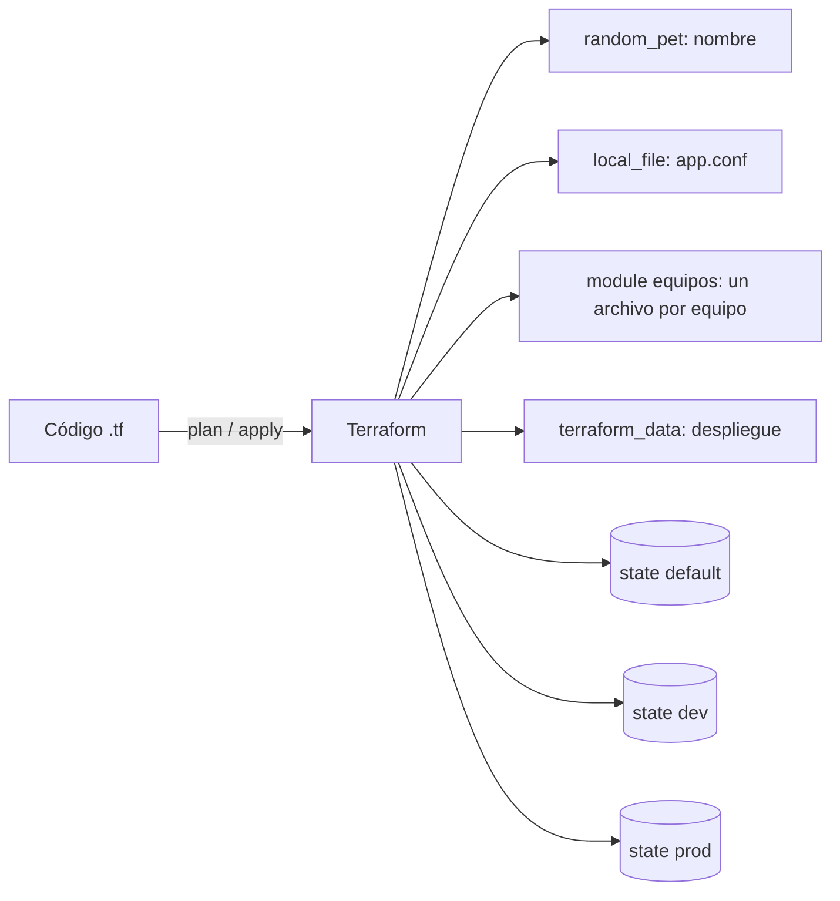

---
tags:
  - laboratorio
  - terraform
  - iac
---

# Lab 08: Terraform sin nube: providers locales y workspaces

> Practica todo el ciclo de Terraform (init, plan, apply, state, módulos, workspaces, pruebas y destroy) en tu propia máquina, sin cuenta cloud y sin costo.

| Nivel | Duración | Costo | Requisitos |
| --- | --- | --- | --- |
| Básico | ~60 min | Gratis | Lab 00, Terraform >= 1.10, una terminal |

!!! info "Qué vas a aprender"
    - Escribir una configuración con los providers `random` y `local` y el recurso integrado `terraform_data`.
    - Recorrer el **workflow** (flujo de trabajo) `init` → `fmt` → `validate` → `plan` → `apply` → `destroy`.
    - Usar variables, `terraform.tfvars`, `locals`, outputs y `for_each`.
    - Extraer código a un **module** (módulo) local sin recrear nada, con un bloque `moved`.
    - Inspeccionar y modificar el **state** (estado) con `state list`, `state show` y `state mv`.
    - Tener entornos `dev` y `prod` con **workspaces** y probar la configuración con `terraform test`.

## Antes de empezar

- **Terraform >= 1.10** (este lab se probó con **Terraform 1.17.0**, `hashicorp/random` 3.9.1 y `hashicorp/local` 2.9.1). Comprueba tu versión con `terraform version`. Si no lo tienes, sigue el [Lab 00](../fundamentos/preparar-entorno.md) o descarga el binario oficial de [releases.hashicorp.com](https://releases.hashicorp.com/terraform/) y ponlo en una carpeta de tu `PATH`.
- Un editor con la extensión de HashiCorp Terraform (resalta HCL y avisa de errores).
- Teoría recomendada: [Infrastructure as Code con Terraform](../../devops/iac/terraform-basico.md), [Terraform workspaces](../../devops/iac/terraform-workspaces.md) y [Pruebas de infraestructura](../../devops/iac/pruebas-infraestructura.md#terraform-test).

!!! tip "¿Por qué sin nube?"
    Los providers `random` y `local` no llaman a ninguna API: generan valores aleatorios y escriben archivos en tu disco. El comportamiento de Terraform (plan, state, dependencias, workspaces) es **exactamente el mismo** que con AWS, Azure o Google Cloud, pero no hay credenciales ni facturas en juego.

## Arquitectura



Una sola configuración genera una carpeta `salida/<workspace>/` con un archivo de configuración y un archivo por equipo. Cada workspace guarda su propio state, así que `dev` y `prod` conviven sin pisarse.

## Paso a paso

### Paso 1: Crear el proyecto y fijar versiones

Crea una carpeta vacía `lab08` y dentro el archivo de versiones. Fijar `required_version` y las versiones de los providers (**version pinning**, fijar versiones) evita que una versión mayor nueva rompa tu código sin avisar.

```hcl title="versions.tf"
terraform {
  required_version = ">= 1.10"

  required_providers {
    random = {
      source  = "hashicorp/random"
      version = "~> 3.9"
    }
    local = {
      source  = "hashicorp/local"
      version = "~> 2.9"
    }
  }
}
```

```bash
terraform init
```

```text
Initializing provider plugins...
- Installing hashicorp/random v3.9.1...
- Installed hashicorp/random v3.9.1 (signed by HashiCorp)
- Installing hashicorp/local v2.9.1...
- Installed hashicorp/local v2.9.1 (signed by HashiCorp)

Terraform has created a lock file .terraform.lock.hcl ...
Terraform has been successfully initialized!
```

`init` descarga los providers en `.terraform/` y crea `.terraform.lock.hcl`, que **sí** se sube a Git (fija versiones exactas para todo el equipo).

### Paso 2: Variables, locals y recursos

Las **variables** son la entrada del módulo raíz; los **locals** son valores calculados que reutilizas; los **outputs** son la salida. El mapa `config` por workspace se usará en el paso 7.

```hcl title="variables.tf"
variable "proyecto" {
  description = "Nombre corto del proyecto; se usa como prefijo"
  type        = string
  default     = "cuaderno"

  validation {
    condition     = can(regex("^[a-z][a-z0-9-]{2,19}$", var.proyecto))
    error_message = "proyecto: 3-20 caracteres, minúsculas, números o guiones, empezando por letra."
  }
}

variable "equipos" {
  description = "Equipos y su canal de contacto"
  type        = map(string)
  default = {
    plataforma = "#plataforma"
  }
}

variable "carpeta_salida" {
  description = "Carpeta raíz donde se generan los archivos"
  type        = string
  default     = "salida"
}
```

```hcl title="locals.tf"
locals {
  entorno = terraform.workspace

  config = {
    default = { longitud_sufijo = 1, nivel_log = "debug" }
    dev     = { longitud_sufijo = 1, nivel_log = "debug" }
    prod    = { longitud_sufijo = 3, nivel_log = "warn" }
  }

  actual  = local.config[local.entorno]
  prefijo = "${var.proyecto}-${local.entorno}"
}
```

```hcl title="main.tf"
resource "random_pet" "sufijo" {
  length = local.actual.longitud_sufijo
}

resource "local_file" "config" {
  filename = "${path.root}/${var.carpeta_salida}/${local.entorno}/app.conf"
  content  = <<-EOT
    nombre=${local.prefijo}-${random_pet.sufijo.id}
    entorno=${local.entorno}
    nivel_log=${local.actual.nivel_log}
  EOT
}
```

```hcl title="outputs.tf"
output "nombre_app" {
  description = "Nombre generado para la app"
  value       = "${local.prefijo}-${random_pet.sufijo.id}"
}

output "archivo_config" {
  value = local_file.config.filename
}
```

```hcl title="terraform.tfvars"
proyecto = "cuaderno"
equipos = {
  plataforma = "#plataforma"
  seguridad  = "#seguridad"
  datos      = "#datos"
}
```

`terraform.tfvars` se carga automáticamente y **gana** sobre los `default`. Fíjate en que `local_file.config` usa `random_pet.sufijo.id`: Terraform deduce de esa referencia que primero debe crear el `random_pet` (**dependency graph**, grafo de dependencias).

### Paso 3: fmt, validate, plan y apply

```bash
terraform fmt -check -recursive   # sin salida y código 0: el formato es correcto
terraform validate
terraform plan -out=lab.tfplan
```

```text
Success! The configuration is valid.

  # local_file.config will be created
  + resource "local_file" "config" {
      + content  = (known after apply)
      + filename = "./salida/default/app.conf"
      ...
  # random_pet.sufijo will be created
  + resource "random_pet" "sufijo" {
      + id        = (known after apply)
      + length    = 1
    }

Plan: 2 to add, 0 to change, 0 to destroy.
Saved the plan to: lab.tfplan
```

Guardar el plan con `-out` garantiza que `apply` haga **exactamente** lo que revisaste. Es lo que se hace en un pipeline: un job genera el plan, alguien lo revisa y otro job lo aplica.

```bash
terraform apply lab.tfplan
terraform output
terraform output -raw nombre_app
```

```text
random_pet.sufijo: Creation complete after 0s [id=shad]
local_file.config: Creation complete after 0s [id=9e3ebcf4...]
Apply complete! Resources: 2 added, 0 changed, 0 destroyed.

archivo_config = "./salida/default/app.conf"
nombre_app = "cuaderno-default-shad"
```

El nombre aleatorio (`shad`) será distinto en tu máquina. Abre `salida/default/app.conf` para ver el archivo generado.

### Paso 4: Varios recursos con for_each

**`for_each`** crea una instancia del recurso por cada elemento de un mapa o conjunto. Cada instancia se identifica por su **clave** (`local_file.equipo["datos"]`), no por una posición, así que quitar un equipo no afecta a los demás (con `count` sí se desplazarían los índices).

```hcl title="main.tf (añadir al final)"
resource "local_file" "equipo" {
  for_each = var.equipos

  filename = "${path.root}/${var.carpeta_salida}/${local.entorno}/equipos/${each.key}.txt"
  content  = "equipo=${each.key}\ncanal=${each.value}\napp=${local.prefijo}-${random_pet.sufijo.id}\n"
}
```

```bash
terraform apply
```

El plan muestra `local_file.equipo["datos"]`, `["plataforma"]` y `["seguridad"]` con `will be created`. Escribe `yes` para confirmar.

### Paso 5: Inspeccionar el state

El state es el "inventario" de lo que Terraform gestiona. No se edita a mano: se consulta y se modifica con comandos.

=== "Linux/macOS"

    ```bash
    terraform state list
    terraform state show 'local_file.equipo["seguridad"]'
    ```

=== "Windows (PowerShell)"

    ```powershell
    terraform state list
    # En Windows PowerShell 5.1 las comillas internas se escapan con \
    terraform state show 'local_file.equipo[\"seguridad\"]'
    ```

```text
local_file.config
local_file.equipo["datos"]
local_file.equipo["plataforma"]
local_file.equipo["seguridad"]
random_pet.sufijo

resource "local_file" "equipo" {
    content  = <<-EOT
    ...
    filename = "./salida/default/equipos/seguridad.txt"
```

### Paso 6: Extraer un module local y moverlo sin recrear

Vas a llevar la lógica de los archivos por equipo a un **module** reutilizable. Si solo cambias el código, Terraform creerá que `local_file.equipo` desapareció y que hay recursos nuevos dentro del module: **destruiría y recrearía** todo. El bloque **`moved`** le dice que es el mismo objeto con otra dirección.

```hcl title="modules/archivos-equipos/variables.tf"
variable "equipos" {
  description = "Mapa equipo => canal"
  type        = map(string)
}

variable "directorio" {
  description = "Carpeta donde se escriben los archivos"
  type        = string
}

variable "app" {
  description = "Nombre de la app a la que pertenecen los equipos"
  type        = string
}
```

```hcl title="modules/archivos-equipos/main.tf"
resource "local_file" "equipo" {
  for_each = var.equipos

  filename = "${var.directorio}/${each.key}.txt"
  content  = "equipo=${each.key}\ncanal=${each.value}\napp=${var.app}\n"
}
```

```hcl title="modules/archivos-equipos/outputs.tf"
output "archivos" {
  description = "Mapa equipo => ruta del archivo"
  value       = { for nombre, f in local_file.equipo : nombre => f.filename }
}
```

En `main.tf` **borra** el `resource "local_file" "equipo"` del paso 4 y añade:

```hcl title="main.tf (reemplaza el recurso equipo)"
module "equipos" {
  source = "./modules/archivos-equipos"

  equipos    = var.equipos
  directorio = "${path.root}/${var.carpeta_salida}/${local.entorno}/equipos"
  app        = "${local.prefijo}-${random_pet.sufijo.id}"
}

moved {
  from = local_file.equipo
  to   = module.equipos.local_file.equipo
}
```

```hcl title="outputs.tf (añadir)"
output "archivos_equipos" {
  value = module.equipos.archivos
}
```

Cada vez que añades un module hay que volver a ejecutar `init` (si no, `plan` falla con `Error: Module not installed`):

```bash
terraform init
terraform plan
```

```text
  # local_file.equipo["datos"] has moved to module.equipos.local_file.equipo["datos"]
  # local_file.equipo["plataforma"] has moved to module.equipos.local_file.equipo["plataforma"]
  # local_file.equipo["seguridad"] has moved to module.equipos.local_file.equipo["seguridad"]

Plan: 0 to add, 0 to change, 0 to destroy.
```

`0 to add, 0 to destroy`: solo cambia la dirección en el state. Aplica con `terraform apply`.

**Alternativa por línea de comandos: `terraform state mv`.** Renombra en el código `random_pet "sufijo"` a `random_pet "nombre"` (y sus referencias `random_pet.sufijo.id` → `random_pet.nombre.id` en `main.tf` y `outputs.tf`). Mira qué haría `plan` antes de mover nada:

```text
  # random_pet.nombre will be created
  # random_pet.sufijo will be destroyed
  # local_file.config must be replaced
  # module.equipos.local_file.equipo["datos"] must be replaced
  ...
Plan: 5 to add, 0 to change, 5 to destroy.
```

Un simple cambio de nombre recrearía 5 recursos (en la nube podría ser una base de datos). Muévelo en el state:

```bash
terraform state mv random_pet.sufijo random_pet.nombre
terraform plan
```

```text
Move "random_pet.sufijo" to "random_pet.nombre"
Successfully moved 1 object(s).

No changes. Your infrastructure matches the configuration.
```

!!! tip "`moved` o `state mv`"
    El bloque `moved` queda en el código, pasa por revisión en el pull request y se aplica igual en todos los entornos y workspaces. `state mv` es inmediato pero manual: hay que repetirlo en cada state y nadie lo revisa. En equipo, prefiere `moved`. `state mv` deja una copia `terraform.tfstate.<timestamp>.backup` por si necesitas volver atrás.

### Paso 7: Un recurso sin provider con terraform_data

`terraform_data` viene integrado en Terraform (sustituye al antiguo `null_resource` del provider `null`). Guarda un valor en el state y, con `triggers_replace`, se **reemplaza** cuando cambia lo que observa: es la forma de lanzar acciones (por ejemplo, un *provisioner*) solo cuando algo cambia.

```hcl title="main.tf (añadir al final)"
# Se reemplaza cada vez que cambia el contenido de app.conf
resource "terraform_data" "despliegue" {
  input            = local.prefijo
  triggers_replace = [local_file.config.content_sha256]
}
```

```bash
terraform apply -auto-approve
```

`-auto-approve` se salta la confirmación: úsalo solo en laboratorio o en pipelines donde el plan ya se revisó.

### Paso 8: Workspaces dev y prod

Cada **workspace** tiene su propio state con el mismo código. `terraform.workspace` vale el nombre del workspace activo y el mapa `local.config` elige valores distintos para cada uno.

```bash
terraform workspace list
terraform workspace new dev
terraform apply -auto-approve
terraform workspace new prod
terraform apply -auto-approve
terraform workspace list
```

```text
* default

Created and switched to workspace "dev"!
Apply complete! Resources: 6 added, 0 changed, 0 destroyed.
nombre_app = "cuaderno-dev-cricket"

Created and switched to workspace "prod"!
Apply complete! Resources: 6 added, 0 changed, 0 destroyed.
nombre_app = "cuaderno-prod-highly-renewing-eel"

  default
  dev
* prod
```

`prod` usa un nombre de 3 palabras y `nivel_log=warn`; `dev`, 1 palabra y `debug`. Mira dónde quedó cada state:

```text
terraform.tfstate                          # workspace default
terraform.tfstate.d/dev/terraform.tfstate
terraform.tfstate.d/prod/terraform.tfstate
```

Prueba qué pasa con un workspace que no está en el mapa:

```bash
terraform workspace new qa
terraform plan
```

```text
Error: Invalid index
  on locals.tf line 10, in locals:
  10:   actual = local.config[local.entorno]
    │ local.entorno is "qa"
The given key does not identify an element in this collection value.
```

Es un fallo **deseado**: mejor un error claro en `plan` que desplegar un entorno con valores inventados. Vuelve a `dev` y borra `qa` (está vacío):

```bash
terraform workspace select dev
terraform workspace delete qa
```

### Paso 9: Pruebas con terraform test

`terraform test` ejecuta bloques `run` con `plan` o `apply` y comprueba condiciones con `assert`. Los recursos que crea una prueba se destruyen al terminar.

```hcl title="tests/basico.tftest.hcl"
# Variables comunes a todos los run
variables {
  proyecto       = "prueba"
  carpeta_salida = "salida-test"
  equipos = {
    redes = "#redes"
  }
}

run "nombre_y_archivos" {
  command = plan

  assert {
    condition     = startswith(local_file.config.filename, "./salida-test/")
    error_message = "El archivo de configuración debe ir dentro de ./salida-test/"
  }

  assert {
    condition     = length(module.equipos.archivos) == 1
    error_message = "Debe haber un archivo por equipo"
  }
}

run "crea_de_verdad" {
  # command = apply es el valor por defecto: crea y al final destruye
  assert {
    condition     = startswith(output.nombre_app, "prueba-")
    error_message = "El nombre de la app debe empezar por el proyecto"
  }
}

run "rechaza_proyecto_invalido" {
  command = plan

  variables {
    proyecto = "Mal_Nombre"
  }

  expect_failures = [var.proyecto]
}
```

```bash
terraform test
```

```text
tests\basico.tftest.hcl... in progress
  run "nombre_y_archivos"... pass
  run "crea_de_verdad"... pass
  run "rechaza_proyecto_invalido"... pass
tests\basico.tftest.hcl... tearing down
tests\basico.tftest.hcl... pass

Success! 3 passed, 0 failed.
```

!!! warning "Las pruebas con apply crean recursos de verdad"
    `terraform test` usa el **workspace activo** para `terraform.workspace`. Si la prueba escribiera en la misma carpeta que tu entorno (`salida/dev/`), al destruir lo que creó **borraría el `app.conf` real de `dev`** (pasó al preparar este lab). Por eso existe `carpeta_salida`: la prueba escribe en otra carpeta. En la nube pasa lo mismo: las pruebas con `apply` necesitan nombres propios (o una cuenta de pruebas) para no chocar con recursos reales. Si quieres ver el efecto, borra a mano `salida/dev/app.conf` y ejecuta `terraform plan`: verás `local_file.config has been deleted` (un **drift**, desviación, detectado).

## Verificación

| Comprobación | Resultado esperado |
| --- | --- |
| `terraform fmt -check -recursive` | Sin salida, código de salida 0 |
| `terraform validate` | `Success! The configuration is valid.` |
| `terraform workspace show` | `dev` (o el que hayas dejado activo) |
| `terraform plan` en cada workspace | `No changes. Your infrastructure matches the configuration.` |
| `terraform state list` | 6 direcciones, incluidas `module.equipos.local_file.equipo[...]` y `random_pet.nombre` |
| Contenido de `salida/prod/app.conf` | `entorno=prod` y `nivel_log=warn` |
| `terraform test` | `Success! 3 passed, 0 failed.` |

## Retos extra

1. Añade un equipo nuevo en `terraform.tfvars` y quita otro. Comprueba en el plan que solo se crea uno y se destruye otro (gracias a `for_each`). Pista: repite con `count` y una lista para ver la diferencia.
2. Añade un bloque `mock_provider "local" {}` a un archivo de prueba nuevo y ejecuta un `run` con `apply` sin escribir nada en disco. Pista: [Pruebas de infraestructura](../../devops/iac/pruebas-infraestructura.md#terraform-test).
3. Evita desplegar en `default` con una `precondition` en `terraform_data` (ver [Terraform workspaces](../../devops/iac/terraform-workspaces.md#usar-el-workspace-en-el-codigo)).
4. Exporta los outputs con `terraform output -json` y léelos con un script de Python ([Archivos y formatos](../../python/scripting/archivos-formatos.md)).

## Limpieza

Destruye los recursos de **cada** workspace antes de borrarlo. `workspace delete` se niega si el state tiene recursos (con `-force` los dejaría huérfanos).

```bash
terraform workspace select prod
terraform destroy -auto-approve
terraform workspace select dev
terraform destroy -auto-approve
terraform workspace select default
terraform destroy -auto-approve
terraform workspace delete dev
terraform workspace delete prod
terraform workspace list
```

```text
Destroy complete! Resources: 6 destroyed.
Destroy complete! Resources: 6 destroyed.
Destroy complete! Resources: 6 destroyed.
Deleted workspace "dev"!
Deleted workspace "prod"!
* default
```

La carpeta `salida/` queda vacía. Puedes borrar la carpeta `lab08` completa: no hay nada en la nube.

## Problemas comunes

| Síntoma | Causa | Solución |
| --- | --- | --- |
| `Error: Module not installed` | Añadiste o cambiaste un `module` sin reinicializar | `terraform init` |
| `Error: Invalid index` en `local.config[...]` | El workspace activo no está en el mapa | `terraform workspace select dev` o añade la clave al mapa |
| `Error: Workspace is not empty` al borrar | El state todavía tiene recursos | `terraform destroy` en ese workspace y luego `delete` |
| El plan quiere destruir y recrear tras renombrar | Cambiaste la dirección sin `moved` ni `state mv` | Bloque `moved` o `terraform state mv` |
| `Error: Invalid value for variable` | `proyecto` no cumple la `validation` | Usa minúsculas, números y guiones |
| `state show` con corchetes falla en PowerShell | PowerShell 5.1 quita las comillas internas | Escápalas con `\"` (ver pestaña Windows del paso 5) |
| `Error acquiring the state lock` | Otra ejecución de Terraform sigue abierta en la carpeta | Espera a que termine; ver [Troubleshooting](../../devops/operacion/troubleshooting.md) |

## Información complementaria

- **State**: la fuente de verdad de Terraform; contiene IDs y a veces secretos en texto plano. Ver [Remote state](../../devops/iac/terraform-basico.md#remote-state-estado-remoto) para trabajar en equipo (lo practicas en el [Lab 09](terraform-aws-backend-remoto.md)).
- **Modules**: carpetas reutilizables con entradas y salidas; fija la versión de los externos. Ver [Modules](../../devops/iac/terraform-basico.md#modules-modulos).
- **Workspaces**: varios states con el mismo código; útiles para entornos casi idénticos o efímeros, no para separar `prod` con credenciales distintas. Ver [¿Cuándo usar workspaces?](../../devops/iac/terraform-workspaces.md#cuando-usar-workspaces).
- **`terraform test`**: pruebas nativas en HCL, base de la pirámide de pruebas de IaC. Ver [Pruebas de infraestructura](../../devops/iac/pruebas-infraestructura.md).
- **En el trabajo real**: el ciclo `fmt` → `validate` → `plan -out` → revisión → `apply` es lo que automatiza un pipeline de IaC; `moved` aparece en casi cualquier refactorización de módulos. Ver [Flujo en CI/CD](../../devops/iac/infraestructura-como-codigo.md#flujo-en-cicd).

## Documentación oficial

- [Terraform CLI: comandos](https://developer.hashicorp.com/terraform/cli/commands)
- [Workspaces](https://developer.hashicorp.com/terraform/language/state/workspaces)
- [Refactoring con bloques `moved`](https://developer.hashicorp.com/terraform/language/modules/develop/refactoring)
- [Comando `terraform state mv`](https://developer.hashicorp.com/terraform/cli/commands/state/mv)
- [Recurso `terraform_data`](https://developer.hashicorp.com/terraform/language/resources/terraform-data)
- [Tests (`terraform test`)](https://developer.hashicorp.com/terraform/language/tests)
- [Provider `hashicorp/random`](https://registry.terraform.io/providers/hashicorp/random/latest/docs) y [`hashicorp/local`](https://registry.terraform.io/providers/hashicorp/local/latest/docs)

## Preguntas para verificar el aprendizaje

??? question "1. ¿Por qué se sube a Git `.terraform.lock.hcl` pero no `terraform.tfstate`?"
    El lock file fija las versiones exactas de los providers para que todo el equipo y el pipeline usen las mismas. El state contiene IDs y posibles secretos en texto plano y debe vivir en un backend remoto con bloqueo, no en Git.

??? question "2. ¿Qué ventaja tiene `terraform plan -out=lab.tfplan` seguido de `terraform apply lab.tfplan`?"
    Que se aplica exactamente el plan revisado. Sin `-out`, `apply` vuelve a calcular el plan y podría incluir cambios que aparecieron entre medias.

??? question "3. Si quitas `seguridad` del mapa `equipos`, ¿qué pasa con los otros archivos? ¿Y si usaras `count` con una lista?"
    Con `for_each` solo se destruye `local_file.equipo["seguridad"]`; los demás se identifican por clave y no cambian. Con `count`, los índices se desplazan y Terraform podría reemplazar los elementos que van después del eliminado.

??? question "4. Renombraste un recurso y el plan dice `5 to add, 5 to destroy`. ¿Qué haces?"
    No aplicar. Añadir un bloque `moved` (o usar `terraform state mv`) para que Terraform sepa que es el mismo objeto; el plan debe quedar en `No changes`.

??? question "5. ¿Qué pasaría si ejecutas `terraform workspace delete prod -force` sin destruir antes?"
    Se borra el state de `prod`, pero los recursos siguen existiendo sin que nadie los gestione (huérfanos). En la nube seguirían cobrándose y habría que borrarlos a mano o importarlos.

??? question "6. ¿Por qué no conviene usar workspaces para separar `dev` y `prod` en cuentas cloud distintas?"
    Porque todos los workspaces comparten backend y credenciales: quien accede al state de `dev` accede al de `prod`. Para entornos con permisos distintos es mejor un directorio (y backend) por entorno.

??? question "7. ¿Qué diferencia hay entre `command = plan` y `command = apply` en un bloque `run` de `terraform test`?"
    `plan` solo calcula y comprueba valores conocidos antes de crear; no toca nada. `apply` crea recursos de verdad (y los destruye al final), lo que permite comprobar valores que solo se conocen tras crear, como el nombre aleatorio.

??? question "8. ¿Para qué sirve `triggers_replace` en `terraform_data`?"
    Para forzar el reemplazo del recurso cuando cambia alguno de los valores observados. Se usa para volver a ejecutar acciones (provisioners, scripts) solo cuando algo relevante cambió.

## Notas relacionadas

**DevOps**

- [Infrastructure as Code con Terraform](../../devops/iac/terraform-basico.md)
- [Terraform workspaces](../../devops/iac/terraform-workspaces.md)
- [Pruebas de infraestructura](../../devops/iac/pruebas-infraestructura.md)
- [Infrastructure as Code: panorama y herramientas](../../devops/iac/infraestructura-como-codigo.md)
- [Guía de comandos de Terraform](../../recursos/comandos/terraform.md)

**DevSecOps**

- [Seguridad de IaC](../../devsecops/infraestructura-y-contenedores/seguridad-iac.md)

**Certificaciones**

- [HashiCorp Terraform Associate: resumen para el examen](../../certificaciones/hashicorp/terraform-associate/resumen-examen.md)
- [Terraform Associate: módulos](../../certificaciones/hashicorp/terraform-associate/objetivo-5-modulos.md)
- [Terraform Associate: estado y mantenimiento](../../certificaciones/hashicorp/terraform-associate/objetivo-6-7-estado-y-mantenimiento.md)

**Labs**

- Lab anterior: [Lab 07: Pipeline de CI con GitHub Actions](github-actions-ci.md)
- Lab siguiente: [Lab 09: Terraform en AWS con remote state en S3](terraform-aws-backend-remoto.md)
