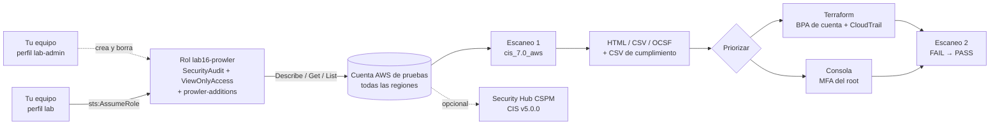

---
tags:
  - laboratorio
  - seguridad
  - cspm
  - cumplimiento
  - aws
  - terraform
---

# Lab 16: Auditar tu cuenta cloud con Prowler (CSPM)

> Audita una cuenta AWS de pruebas contra el CIS AWS Foundations Benchmark con Prowler y un rol de solo lectura, lee el informe, prioriza tres hallazgos clásicos, corrígelos con Terraform, vuelve a escanear y compara el resultado con Security Hub CSPM.

| Nivel | Duración | Costo | Requisitos |
| --- | --- | --- | --- |
| Intermedio | ~90 min | Capa gratuita (~0 USD si limpias); Security Hub CSPM y AWS Config son opcionales y pueden cobrar | Labs 00 y 09; AWS CLI v2, Python 3.10–3.13 o Docker, Terraform 1.10+, una cuenta AWS de pruebas |

!!! info "Qué vas a aprender"
    - Crear una identidad de **auditoría de solo lectura** con las políticas que pide Prowler.
    - Instalar Prowler y descubrir qué marcos de cumplimiento trae (`--list-compliance`).
    - Ejecutar un escaneo **CSPM** (*Cloud Security Posture Management*, gestión de la postura de seguridad en la nube) contra el **CIS AWS Foundations Benchmark** y leer el informe en HTML, CSV y OCSF.
    - **Priorizar** hallazgos por severidad, exposición y esfuerzo, y corregir tres en el código (Terraform) en lugar de en la consola.
    - Verificar la corrección con un segundo escaneo y comparar con el servicio nativo, **Security Hub CSPM**.

!!! warning "Costos y seguridad"
    - Usa **una cuenta AWS de pruebas**, nunca la de producción, con la alerta de presupuesto del [Lab 00](../fundamentos/preparar-entorno.md#paso-9-configura-las-alertas-de-presupuesto) activa.
    - Prowler es gratis y solo hace llamadas de lectura (`Describe*`, `Get*`, `List*`), que no se cobran.
    - La remediación crea un **trail de CloudTrail** y un bucket S3: la primera copia de los eventos de gestión es gratuita y los logs ocupan muy poco, pero si **ya tienes** un trail multi-región no crees otro (un segundo trail con eventos de gestión sí se cobra).
    - El paso 9 (Security Hub CSPM) es **opcional**: tiene prueba gratuita de 30 días, pero sus controles necesitan **AWS Config**, que cobra por cada elemento de configuración registrado. Si lo haces, desactívalo en la Limpieza.
    - Un escaneo CSPM sobre una cuenta ajena es una auditoría no autorizada: escanea solo cuentas tuyas o con permiso explícito.

## Antes de empezar

| Herramienta | Versión probada | Instalación |
| --- | --- | --- |
| Prowler CLI | 5.46.0 | `pipx install prowler`, `uv tool install prowler` o la imagen `prowlercloud/prowler:5.46.0` |
| Python (si no usas Docker) | 3.12 (Prowler admite 3.10 a 3.13) | Ver [Lab 00](../fundamentos/preparar-entorno.md#paso-3-python-312-y-uv) |
| AWS CLI v2 | 2.x | Perfiles `lab` y `lab-admin` del [Lab 00](../fundamentos/preparar-entorno.md#paso-11-perfil-lab-admin-para-gestionar-iam-en-aws) |
| Terraform | 1.10+ con provider `hashicorp/aws` `~> 6.0` | Ver [Lab 09](../devops/terraform-aws-backend-remoto.md) |

Este lab usa **dos perfiles**, cada uno para lo suyo:

- `lab-admin` (AdministratorAccess) **solo** para crear y, en la Limpieza, borrar el rol de auditoría `lab16-prowler` (paso 2). Crear roles y adjuntarles políticas es gestión de IAM, que el perfil `lab` (PowerUserAccess) no permite. Antes de empezar, vuelve a asignar `AdministratorAccess` a tu usuario en IAM Identity Center ([Lab 00, Paso 11](../fundamentos/preparar-entorno.md#paso-11-perfil-lab-admin-para-gestionar-iam-en-aws)).
- `lab` (PowerUserAccess) para todo lo demás: asumir el rol de auditoría para escanear (`sts:AssumeRole` no es una acción de IAM, así que PowerUserAccess la permite) y aplicar la remediación con Terraform, que no crea recursos de IAM.

Comprueba las dos sesiones con `aws sts get-caller-identity --profile lab` y `aws sts get-caller-identity --profile lab-admin`. Teoría recomendada: [CSPM](../../devsecops/escaneos/cspm.md) (qué detecta y cómo se integra), [Cumplimiento y gobierno](../../devsecops/gobierno-y-respuesta/cumplimiento.md) (qué es un CIS Benchmark), [Seguridad base en la nube](../../cloud/identidad-y-seguridad/seguridad-base.md) y [Fundamentos de seguridad en la nube](../../cloud/seguridad/fundamentos-seguridad-cloud.md).

## Arquitectura



Prowler nunca usa tu perfil de administración directamente: asume un rol que solo puede **leer**. Así, aunque una dependencia de la herramienta estuviera comprometida, no podría modificar nada.

## Paso a paso

### Paso 1: Define las variables del lab

=== "Linux/macOS"

    ```bash
    export AWS_PROFILE=lab
    export AWS_REGION=us-east-1
    export ACCOUNT_ID=$(aws sts get-caller-identity --query Account --output text)
    mkdir lab16 && cd lab16
    ```

=== "Windows (PowerShell)"

    ```powershell
    $env:AWS_PROFILE = "lab"
    $env:AWS_REGION = "us-east-1"
    $ACCOUNT_ID = aws sts get-caller-identity --query Account --output text
    mkdir lab16; cd lab16
    ```

### Paso 2: Crea el rol de auditoría de solo lectura

Este es el único paso que crea recursos de IAM, así que cada comando `aws iam` lleva `--profile lab-admin` (con el perfil `lab` fallaría con `AccessDenied ... iam:CreateRole`). El resto del lab sigue con `AWS_PROFILE=lab`.

La documentación de Prowler pide dos **AWS managed policies** (políticas gestionadas por AWS): `SecurityAudit` (metadatos de configuración de seguridad) y `job-function/ViewOnlyAccess` (listar y describir recursos), más una política propia, `prowler-additions-policy.json`, con unas pocas lecturas que ninguna de las dos cubre. Descárgala de la **misma versión** de Prowler que vas a usar y léela antes de aplicarla: solo contiene acciones de lectura.

```bash
curl -sLo prowler-additions-policy.json \
  https://raw.githubusercontent.com/prowler-cloud/prowler/5.46.0/permissions/prowler-additions-policy.json
```

La **trust policy** permite asumir el rol solo a identidades de tu propia cuenta que, además, tengan permiso `sts:AssumeRole` (tu perfil `lab` lo tiene):

```json title="confianza.json"
{
  "Version": "2012-10-17",
  "Statement": [
    {
      "Effect": "Allow",
      "Principal": { "AWS": "arn:aws:iam::ACCOUNT_ID:root" },
      "Action": "sts:AssumeRole"
    }
  ]
}
```

=== "Linux/macOS"

    ```bash
    sed -i.bak "s|ACCOUNT_ID|$ACCOUNT_ID|" confianza.json
    aws iam create-role --profile lab-admin --role-name lab16-prowler \
      --assume-role-policy-document file://confianza.json --max-session-duration 3600
    aws iam attach-role-policy --profile lab-admin --role-name lab16-prowler \
      --policy-arn arn:aws:iam::aws:policy/SecurityAudit
    aws iam attach-role-policy --profile lab-admin --role-name lab16-prowler \
      --policy-arn arn:aws:iam::aws:policy/job-function/ViewOnlyAccess
    aws iam put-role-policy --profile lab-admin --role-name lab16-prowler \
      --policy-name prowler-additions --policy-document file://prowler-additions-policy.json
    export ROLE_ARN=arn:aws:iam::$ACCOUNT_ID:role/lab16-prowler
    ```

=== "Windows (PowerShell)"

    ```powershell
    $json = (Get-Content -Raw confianza.json) -replace 'ACCOUNT_ID', $ACCOUNT_ID
    [IO.File]::WriteAllText("$PWD\confianza.json", $json)   # UTF-8 sin BOM
    aws iam create-role --profile lab-admin --role-name lab16-prowler `
      --assume-role-policy-document file://confianza.json --max-session-duration 3600
    aws iam attach-role-policy --profile lab-admin --role-name lab16-prowler `
      --policy-arn arn:aws:iam::aws:policy/SecurityAudit
    aws iam attach-role-policy --profile lab-admin --role-name lab16-prowler `
      --policy-arn arn:aws:iam::aws:policy/job-function/ViewOnlyAccess
    aws iam put-role-policy --profile lab-admin --role-name lab16-prowler `
      --policy-name prowler-additions --policy-document file://prowler-additions-policy.json
    $ROLE_ARN = "arn:aws:iam::$($ACCOUNT_ID):role/lab16-prowler"
    ```

!!! tip "En una organización real"
    Se crea este rol en **todas** las cuentas (con StackSets o Terraform) y se asume desde una cuenta de seguridad central. Prowler publica una plantilla de CloudFormation para ello (`prowler-scan-role.yml`), pensada para Prowler Cloud. Ver [CSPM: cuenta de seguridad centralizada](../../devsecops/escaneos/cspm.md#cuenta-de-seguridad-centralizada).

### Paso 3: Instala Prowler

Prowler es una CLI de Python; instálala aislada para que sus dependencias no choquen con las tuyas.

=== "pipx"

    ```bash
    pipx install prowler==5.46.0
    prowler -v
    ```

=== "uv"

    ```bash
    uv tool install prowler==5.46.0
    prowler -v
    ```

=== "Docker"

    ```bash
    docker run --rm prowlercloud/prowler:5.46.0 -v
    ```

=== "Windows (PowerShell)"

    ```powershell
    pipx install prowler==5.46.0
    $env:PYTHONUTF8 = "1"      # sin esto, el banner falla con UnicodeEncodeError en la consola
    prowler -v
    ```

Salida esperada:

```text
Prowler 5.46.0 (You are running the latest version, yay!)
```

### Paso 4: Elige el marco de cumplimiento

Prowler trae decenas de marcos y cada uno agrupa sus checks por requisito. Listarlos **no** necesita credenciales:

```bash
prowler aws --list-compliance --no-banner | grep -i cis
```

```text
- cis_1.4_aws
- cis_1.5_aws
- cis_2.0_aws
- cis_3.0_aws
- cis_4.0_aws
- cis_5.0_aws
- cis_6.0_aws
- cis_7.0_aws
- cis_controls_8.1
```

Usa la versión más alta de `cis_X.Y_aws` que te muestre tu Prowler (en la 5.46.0, `cis_7.0_aws`, con 70 requisitos en cinco secciones: IAM, Storage, Logging, Monitoring y Networking). Mira qué checks implementan los requisitos que vas a trabajar:

```bash
prowler aws --list-compliance-requirements cis_7.0_aws --no-banner | grep -A3 -E "Requirement Id: (2\.5|3\.1\.4|4\.1)$"
```

```text
Requirement Id: 2.5
	- Description: Ensure MFA is enabled for the 'root' user account
	- Checks:
 		[aws] iam_root_mfa_enabled
Requirement Id: 3.1.4
	- Description: Ensure that S3 is configured with 'Block Public Access' enabled
	- Checks:
 		[aws] s3_bucket_level_public_access_block
Requirement Id: 4.1
	- Description: Ensure CloudTrail is enabled in all regions
	- Checks:
 		[aws] cloudtrail_multi_region_enabled
```

El requisito 3.1.4 incluye también `s3_account_level_public_access_blocks` (la salida solo muestra la primera línea de checks con `-A3`). Para ver todos los checks disponibles: `prowler aws --list-checks` (668 en la 5.46.0).

### Paso 5: Ejecuta el primer escaneo

Prowler asume el rol (`--role`) con las credenciales de tu perfil y recorre todas las regiones activas. Usa siempre `--profile lab` y el rol de solo lectura, **nunca** `lab-admin`: si lanzaras Prowler con `lab-admin` sin `--role`, el escaneo funcionaría igual, pero con una identidad capaz de modificarlo todo, que es justo lo que este diseño evita. Guarda el resultado en una carpeta propia para poder compararlo después.

=== "AWS"

    ```bash
    prowler aws --profile lab --role "$ROLE_ARN" \
      --compliance cis_7.0_aws \
      --output-formats csv json-ocsf html \
      --output-directory ./escaneo-1
    echo "Código de salida: $?"
    ```

=== "Azure (opcional)"

    ```bash
    # Requiere el rol Reader en la suscripción (y ProwlerRole para algunos checks)
    az login
    prowler azure --az-cli-auth --subscription-ids <SUBSCRIPTION_ID> \
      --compliance cis_6.0_azure --output-directory ./escaneo-azure
    ```

=== "Google Cloud (opcional)"

    ```bash
    # Requiere roles/viewer y roles/serviceusage.serviceUsageConsumer en el proyecto
    gcloud auth application-default login
    prowler gcp --project-ids <PROJECT_ID> \
      --compliance cis_5.0_gcp --output-directory ./escaneo-gcp
    ```

En una cuenta casi vacía tarda entre 5 y 20 minutos. Al final verás un resumen por servicio y severidad, y la tabla del marco elegido (ilustrativa):

```text
Overview Results:
╭────────────────────┬────────────────────┬────────────────╮
│ 18.5% (51) Failed  │ 81.5% (225) Passed │ 0.0% (0) Muted │
╰────────────────────┴────────────────────┴────────────────╯
Compliance Status of CIS_7.0_AWS Framework:
...
Código de salida: 3
```

El **código de salida 3** significa "hay hallazgos `FAIL`", no que Prowler haya fallado. En un pipeline lo usarías para bloquear; aquí basta con saberlo (o añade `--ignore-exit-code-3`).

### Paso 6: Lee el informe

En `./escaneo-1/` tienes tres formatos con los mismos hallazgos y, en `./escaneo-1/compliance/`, un CSV por marco:

| Archivo | Para qué sirve |
| --- | --- |
| `prowler-output-<cuenta>-<fecha>.html` | Leerlo tú: filtros por estado, severidad, servicio y región |
| `....csv` (separado por `;`) | Hoja de cálculo o scripts: columnas `CHECK_ID`, `STATUS`, `SEVERITY`, `REGION`, `RESOURCE_UID`, `REMEDIATION_CODE_TERRAFORM`... |
| `....ocsf.json` | Formato estándar **OCSF** para enviarlo a un SIEM o data lake (Amazon Security Lake lo usa) |
| `compliance/..._cis_7.0_aws.csv` | Estado por requisito del CIS: `REQUIREMENTS_ID`, `STATUS`, `CHECKID`, `REQUIREMENTS_ATTRIBUTES_PROFILE` (Level 1 o 2) |

Saca los `FAIL` críticos y altos del OCSF con `jq`:

```bash
jq -r '.[] | select(.status_code=="FAIL") | select(.severity=="Critical" or .severity=="High")
       | [.severity, .metadata.event_code, .resources[0].region, .resources[0].uid] | @tsv' \
   escaneo-1/*.ocsf.json | sort | uniq | head -20
```

```text
Critical  iam_root_mfa_enabled                  us-east-1  arn:aws:iam::111122223333:root
High      cloudtrail_multi_region_enabled       eu-west-1  arn:aws:cloudtrail:eu-west-1:111122223333:trail
High      s3_account_level_public_access_blocks us-east-1  arn:aws:s3:::111122223333
```

(La salida es ilustrativa: los hallazgos dependen de tu cuenta. Si ya hiciste los labs 09, 13 o 17, verás también recursos suyos.)

### Paso 7: Prioriza tres hallazgos

No se corrige todo a la vez. Ordena por **severidad**, **exposición** (¿es explotable desde internet o con una credencial filtrada?) y **esfuerzo** ([CSPM: gestión de hallazgos](../../devsecops/escaneos/cspm.md#gestion-de-hallazgos)):

| Check de Prowler | Severidad | CIS 7.0 | Por qué va primero | Cómo se corrige |
| --- | --- | --- | --- | --- |
| `iam_root_mfa_enabled` | Critical | 2.5 | El root puede hacerlo todo, incluso cerrar la cuenta; una contraseña filtrada basta para perderla | **Manual** en la consola, con el root |
| `s3_account_level_public_access_blocks` | High | 3.1.4 | Un solo bucket público por error expone datos; el bloqueo de cuenta protege también los buckets futuros | Terraform: un recurso |
| `cloudtrail_multi_region_enabled` | High | 4.1 | Sin trail multi-región, la actividad en regiones "olvidadas" (minería de criptomonedas, por ejemplo) no deja rastro duradero | Terraform: trail y bucket |

Si alguno ya sale en `PASS` en tu cuenta, elige otro `FAIL` de severidad alta del informe y sigue el mismo método: la columna `REMEDIATION_CODE_TERRAFORM` del CSV te da una pista de por dónde empezar.

### Paso 8: Remedia con Terraform (y el root a mano)

**MFA del root.** No se gestiona con IaC: entra como root, ve a **Security credentials > Multi-factor authentication (MFA) > Assign MFA device** y registra una **passkey** o una llave de seguridad FIDO2 (resistentes a phishing) o, como mínimo, una app de autenticación. Guarda los datos de recuperación según la política de tu equipo ([Seguridad de identidades: MFA resistente a phishing](../../cloud/seguridad/seguridad-identidades.md#mfa-resistente-a-phishing)). Cierra la sesión del root en cuanto termines.

**BPA de cuenta y CloudTrail.** En una carpeta `tf/`, este código corrige los otros dos. Como en el [Lab 09](../devops/terraform-aws-backend-remoto.md), lo ejecutas con tu perfil `lab` (el rol de auditoría no puede escribir, y así debe ser).

```hcl title="tf/main.tf"
terraform {
  required_version = ">= 1.10"
  required_providers {
    aws = {
      source  = "hashicorp/aws"
      version = "~> 6.0"
    }
  }
}

provider "aws" {
  region  = var.region
  profile = var.aws_profile
  default_tags {
    tags = { lab = "lab16" }
  }
}

variable "region" {
  type    = string
  default = "us-east-1"
}

variable "aws_profile" {
  type    = string
  default = "lab"
}

data "aws_caller_identity" "actual" {}
data "aws_partition" "actual" {}

locals {
  cuenta     = data.aws_caller_identity.actual.account_id
  trail_name = "lab16-trail"
  trail_arn  = "arn:${data.aws_partition.actual.partition}:cloudtrail:${var.region}:${local.cuenta}:trail/${local.trail_name}"
}

# Hallazgo 1: s3_account_level_public_access_blocks (CIS 3.1.4)
resource "aws_s3_account_public_access_block" "cuenta" {
  block_public_acls       = true
  block_public_policy     = true
  ignore_public_acls      = true
  restrict_public_buckets = true
}

# Hallazgo 2: cloudtrail_multi_region_enabled (CIS 4.1)
resource "aws_s3_bucket" "trail" {
  bucket        = "lab16-cloudtrail-${local.cuenta}"
  force_destroy = true # solo en el lab: permite borrar el bucket con logs dentro
}

resource "aws_s3_bucket_public_access_block" "trail" {
  bucket                  = aws_s3_bucket.trail.id
  block_public_acls       = true
  block_public_policy     = true
  ignore_public_acls      = true
  restrict_public_buckets = true
}

data "aws_iam_policy_document" "trail" {
  statement {
    sid       = "AWSCloudTrailAclCheck"
    actions   = ["s3:GetBucketAcl"]
    resources = [aws_s3_bucket.trail.arn]
    principals {
      type        = "Service"
      identifiers = ["cloudtrail.amazonaws.com"]
    }
    condition {
      test     = "StringEquals"
      variable = "aws:SourceArn"
      values   = [local.trail_arn]
    }
  }

  statement {
    sid       = "AWSCloudTrailWrite"
    actions   = ["s3:PutObject"]
    resources = ["${aws_s3_bucket.trail.arn}/AWSLogs/${local.cuenta}/*"]
    principals {
      type        = "Service"
      identifiers = ["cloudtrail.amazonaws.com"]
    }
    condition {
      test     = "StringEquals"
      variable = "s3:x-amz-acl"
      values   = ["bucket-owner-full-control"]
    }
    condition {
      test     = "StringEquals"
      variable = "aws:SourceArn"
      values   = [local.trail_arn]
    }
  }
}

resource "aws_s3_bucket_policy" "trail" {
  bucket = aws_s3_bucket.trail.id
  policy = data.aws_iam_policy_document.trail.json
}

resource "aws_cloudtrail" "lab" {
  name                          = local.trail_name
  s3_bucket_name                = aws_s3_bucket.trail.id
  is_multi_region_trail         = true # todas las regiones, también las que se activen después
  include_global_service_events = true # IAM, STS y otros servicios globales
  enable_log_file_validation    = true # detecta si alguien modifica o borra logs

  depends_on = [aws_s3_bucket_policy.trail]
}

output "trail_arn" {
  value = aws_cloudtrail.lab.arn
}
```

```bash
cd tf
terraform init
terraform plan          # revisa: 5 recursos a crear
terraform apply
cd ..
```

Por qué así: la bucket policy usa `aws:SourceArn` para que **solo tu trail** pueda escribir en el bucket (evita el problema del *confused deputy*), y `enable_log_file_validation` es el control CIS que sigue en la lista. En una organización real, el trail sería un **organization trail** en una cuenta de logs central ([Logging y detección](../../cloud/seguridad/seguridad-logging-deteccion.md)).

!!! tip "Alternativa rápida con la CLI"
    Para el BPA de cuenta basta con `aws s3control put-public-access-block --account-id $ACCOUNT_ID --public-access-block-configuration BlockPublicAcls=true,IgnorePublicAcls=true,BlockPublicPolicy=true,RestrictPublicBuckets=true`. Sirve para salir del paso, pero el próximo `terraform apply` de otra persona no sabrá que existe: lo sostenible es tenerlo en el código.

### Paso 9 (opcional): Compara con Security Hub CSPM

**Security Hub CSPM** es el CSPM nativo de AWS (el nombre que recibió el antiguo Security Hub cuando AWS lanzó el nuevo Security Hub unificado). Evalúa controles similares de forma continua, apoyándose en reglas de AWS Config. Lee antes el aviso de costos.

```bash
aws securityhub enable-security-hub --no-enable-default-standards --region us-east-1
aws securityhub describe-standards --region us-east-1 \
  --query "Standards[?contains(StandardsArn,'cis')].StandardsArn"
aws securityhub batch-enable-standards --region us-east-1 --standards-subscription-requests \
  StandardsArn=arn:aws:securityhub:us-east-1::standards/cis-aws-foundations-benchmark/v/5.0.0
```

Sin un recorder de AWS Config activo, la mayoría de controles quedan sin datos; actívalo desde la consola de AWS Config (solo en esta región para el lab). Los controles **periódicos** pueden tardar horas en evaluarse. Después, consulta los equivalentes a tus tres hallazgos:

```bash
for c in IAM.9 S3.1 CloudTrail.1; do
  aws securityhub get-findings --region us-east-1 --max-items 1 \
    --filters "{\"ComplianceSecurityControlId\":[{\"Value\":\"$c\",\"Comparison\":\"EQUALS\"}],\"RecordState\":[{\"Value\":\"ACTIVE\",\"Comparison\":\"EQUALS\"}]}" \
    --query "Findings[0].[Compliance.SecurityControlId,Compliance.Status,Title]" --output text
done
```

| Aspecto | Prowler | Security Hub CSPM |
| --- | --- | --- |
| Versión de CIS | La que elijas (hasta `cis_7.0_aws` en la 5.46.0) | v5.0.0 como la más reciente soportada (además de v3.0.0, v1.4.0 y v1.2.0) |
| Cuándo evalúa | Cuando lo ejecutas (o lo programas) | Continuo: por cambio o periódico |
| Costo | Gratis (open source) | Por check evaluado, más AWS Config |
| Multinube | AWS, Azure, Google Cloud, Kubernetes, M365... | Solo AWS |
| Dónde viven los hallazgos | Archivos locales (o Prowler App/Cloud) | Consola, API e integración con EventBridge |

No son competidores: muchas organizaciones usan el nativo como control continuo y Prowler para auditorías puntuales, multinube o para marcos que el nativo no trae. Prowler también puede **enviar** sus hallazgos a Security Hub con `--security-hub` (reto 2).

### Paso 10: Vuelve a escanear

Ejecuta **solo los checks corregidos** para no esperar otro escaneo completo:

```bash
prowler aws --profile lab --role "$ROLE_ARN" \
  --checks iam_root_mfa_enabled s3_account_level_public_access_blocks cloudtrail_multi_region_enabled \
  --output-formats csv html --output-directory ./escaneo-2 --no-banner
```

```text
PASS  iam_root_mfa_enabled                    Root account has MFA enabled.
PASS  s3_account_level_public_access_blocks   Block Public Access is configured for the account 111122223333.
PASS  cloudtrail_multi_region_enabled         Trail lab16-trail is multiregion and it is logging.
```

(Texto ilustrativo; el formato exacto depende de la versión.) Si `iam_root_mfa_enabled` sigue en `FAIL`, espera unos minutos: el check lee el **credential report** de IAM, que AWS regenera cada cierto tiempo. Termina con un escaneo completo del marco (`--compliance cis_7.0_aws`) y compara el porcentaje de `PASS` con el del escaneo 1: esa diferencia es tu evidencia de mejora.

## Verificación

| Comprobación | Resultado esperado |
| --- | --- |
| `prowler -v` | `Prowler 5.46.0` |
| `prowler aws --list-compliance` | Incluye `cis_7.0_aws` (o una versión superior) |
| `aws iam list-attached-role-policies --role-name lab16-prowler --profile lab-admin` | `SecurityAudit` y `ViewOnlyAccess` |
| `aws s3control get-public-access-block --account-id $ACCOUNT_ID` | Los cuatro valores en `true` |
| `aws cloudtrail describe-trails --query "trailList[].[Name,IsMultiRegionTrail]"` | `lab16-trail  True` |
| Escaneo 2 con `--checks ...` | Los tres checks en `PASS` |
| CSV de cumplimiento del escaneo final | Requisitos 2.5, 3.1.4 y 4.1 en `PASS` |

## Retos extra

1. Crea una **mutelist** (`prowler aws -w mutelist.yaml`) que silencie un hallazgo que aceptes como riesgo, con `Description` que explique el motivo. Pista: la sintaxis es `Mutelist > Accounts > "<cuenta>" > Checks > "<check>" > Regions / Resources`.
2. Envía los hallazgos a Security Hub CSPM con `--security-hub --send-sh-only-fails` (requiere activar la integración de Prowler en Security Hub).
3. Programa Prowler en GitHub Actions con OIDC, reutilizando el rol del [Lab 13](oidc-github-aws.md) pero con los permisos de solo lectura de este lab, y sube el HTML como artifact.
4. Repite el escaneo con `--compliance aws_foundational_security_best_practices_aws` y compara qué cubre cada marco.

## Limpieza

```bash
# 1. Recursos de Terraform (trail, bucket con sus logs y BPA de cuenta)
cd tf && terraform destroy && cd ..
```

!!! note "¿Quitar también el BPA de cuenta?"
    `terraform destroy` **elimina** el bloqueo de acceso público de la cuenta. Es una protección sin costo que conviene mantener: si quieres conservarla, ejecuta antes `terraform state rm aws_s3_account_public_access_block.cuenta` y luego el `destroy`.

```bash
# 2. Rol de auditoría (borrar recursos de IAM también necesita lab-admin)
aws iam delete-role-policy --profile lab-admin --role-name lab16-prowler --policy-name prowler-additions
aws iam detach-role-policy --profile lab-admin --role-name lab16-prowler --policy-arn arn:aws:iam::aws:policy/SecurityAudit
aws iam detach-role-policy --profile lab-admin --role-name lab16-prowler --policy-arn arn:aws:iam::aws:policy/job-function/ViewOnlyAccess
aws iam delete-role --profile lab-admin --role-name lab16-prowler

# 3. Solo si hiciste el paso 9
aws securityhub disable-security-hub --region us-east-1
aws configservice describe-configuration-recorders --region us-east-1   # detén y borra el recorder si lo creaste para el lab
```

Comprueba que no queda nada facturando:

```bash
aws cloudtrail describe-trails --query "trailList[?Name=='lab16-trail']"     # []
aws s3 ls | grep lab16                                                       # sin salida
aws iam get-role --role-name lab16-prowler --profile lab-admin 2>&1 | grep -c NoSuchEntity   # 1
aws securityhub describe-hub --region us-east-1      # si lo desactivaste: error InvalidAccessException
```

Por último, en IAM Identity Center quita la asignación de `AdministratorAccess` a tu usuario y comprueba que `aws sts get-caller-identity --profile lab-admin` falla con `No access` ([Lab 00, Paso 11](../fundamentos/preparar-entorno.md#paso-11-perfil-lab-admin-para-gestionar-iam-en-aws)).

Los informes de `escaneo-1/` y `escaneo-2/` contienen ARNs e IDs de tu cuenta: no los subas a un repositorio público.

## Problemas comunes

| Síntoma | Causa | Solución |
| --- | --- | --- |
| `UnicodeEncodeError: 'charmap' codec can't encode character` en Windows | La consola usa cp1252 y el banner de Prowler tiene caracteres Unicode | `$env:PYTHONUTF8 = "1"` (o `--no-banner`) |
| `AccessDenied ... is not authorized to perform: iam:CreateRole` (o `iam:AttachRolePolicy`, `iam:DeleteRole`) | Ejecutaste los comandos del rol de auditoría con el perfil `lab` (PowerUserAccess), que no gestiona IAM | Repite esos comandos con `--profile lab-admin` (paso 2 y Limpieza); si da `No access`, asigna antes `AdministratorAccess` ([Lab 00](../fundamentos/preparar-entorno.md#paso-11-perfil-lab-admin-para-gestionar-iam-en-aws)) |
| `AccessDenied` al asumir el rol | Tu perfil no tiene `sts:AssumeRole` o el ARN es incorrecto | Revisa `ROLE_ARN` y los permisos del perfil `lab` |
| Muchos checks con `AccessDenied` en el informe | Falta `prowler-additions-policy.json` o una SCP lo bloquea | Adjunta la política adicional; revisa las SCP de la organización |
| `pipx install prowler` falla por versión de Python | Prowler admite Python 3.10 a 3.13 | `pipx install --python 3.12 prowler==5.46.0` o usa Docker |
| El escaneo tarda mucho | Recorre todas las regiones y todos los servicios | Para iterar, usa `--checks`, `--services` o `--region` |
| `terraform apply` falla al crear el trail con `InsufficientS3BucketPolicyException` | La bucket policy aún no existía o el `SourceArn` no coincide | Mantén `depends_on` y revisa región y nombre del trail |
| `iam_root_mfa_enabled` sigue en `FAIL` tras activar MFA | El credential report de IAM aún no se ha regenerado | Espera y vuelve a ejecutar ese check |
| Security Hub CSPM muestra "No data" | AWS Config no está grabando o el control es periódico | Activa el recorder y espera la siguiente evaluación |

Para el método general de diagnóstico, ver [Troubleshooting](../../devops/operacion/troubleshooting.md).

## Información complementaria

- **CSPM**: evaluación continua de la configuración de la nube contra un estándar; detecta lo que el IaC scanning no ve porque se cambió en la consola ([CSPM](../../devsecops/escaneos/cspm.md)).
- **CIS Benchmarks**: recomendaciones de configuración con perfiles Level 1 (básico, bajo impacto) y Level 2 (defensa en profundidad) ([Cumplimiento y gobierno](../../devsecops/gobierno-y-respuesta/cumplimiento.md#cis-benchmarks)).
- **Solo lectura para auditar**: la herramienta de auditoría no necesita escribir; separar el rol de auditoría del de remediación es mínimo privilegio aplicado ([Fundamentos de seguridad en la nube](../../cloud/seguridad/fundamentos-seguridad-cloud.md#como-verificarlo)).
- **Remediar en el código**: lo que corriges en la consola vuelve con el siguiente `apply`; corrige en Terraform y añade un guardrail ([CSPM: remediar con IaC](../../devsecops/escaneos/cspm.md#remediar-con-iac)).
- **Servicios nativos**: Security Hub CSPM, Microsoft Defender for Cloud y Security Command Center hacen lo mismo de forma continua dentro de cada nube ([Seguridad base](../../cloud/identidad-y-seguridad/seguridad-base.md#registro-de-configuracion)).
- **En el trabajo real**: CSPM se ejecuta a diario sobre todas las cuentas desde una cuenta de seguridad, los hallazgos van a tickets con SLA según severidad, y las excepciones se documentan en la mutelist con dueño y fecha.

## Documentación oficial

- [Prowler: instalación](https://docs.prowler.com/getting-started/installation/prowler-cli)
- [Prowler: autenticación en AWS y permisos](https://docs.prowler.com/user-guide/providers/aws/authentication)
- [Prowler: mutelist](https://docs.prowler.com/user-guide/cli/tutorials/mutelist)
- [Prowler en GitHub](https://github.com/prowler-cloud/prowler)
- [CIS AWS Foundations Benchmark](https://www.cisecurity.org/benchmark/amazon_web_services)
- [Security Hub CSPM: CIS AWS Foundations Benchmark](https://docs.aws.amazon.com/securityhub/latest/userguide/cis-aws-foundations-benchmark.html)
- [Security Hub CSPM: controles de IAM](https://docs.aws.amazon.com/securityhub/latest/userguide/iam-controls.html)
- [Amazon S3: bloquear el acceso público](https://docs.aws.amazon.com/es_es/AmazonS3/latest/userguide/access-control-block-public-access.html)
- [AWS CloudTrail: trails multi-región](https://docs.aws.amazon.com/awscloudtrail/latest/userguide/cloudtrail-create-and-update-a-trail.html)
- [Terraform: `aws_cloudtrail`](https://registry.terraform.io/providers/hashicorp/aws/latest/docs/resources/cloudtrail)

## Preguntas para verificar el aprendizaje

??? question "1. ¿Por qué Prowler usa un rol con `SecurityAudit` y `ViewOnlyAccess` y no tu perfil de administración?"
    Por mínimo privilegio: auditar solo requiere leer. Si la herramienta, una dependencia o el equipo donde corre se viera comprometido, el daño posible es leer configuración, no cambiarla ni borrar nada.

??? question "2. ¿Qué significa que Prowler termine con código de salida 3?"
    Que el escaneo funcionó y encontró al menos un hallazgo `FAIL`. En un pipeline puedes usarlo para bloquear; si solo quieres el informe, `--ignore-exit-code-3` lo convierte en 0.

??? question "3. ¿Por qué el MFA del root no se corrige con Terraform?"
    Porque registrar un dispositivo MFA del root requiere iniciar sesión como root y una interacción física (passkey, llave o app). Se hace a mano, se documenta y se vigila con una alerta en cada uso del root.

??? question "4. ¿Qué pasaría si corriges el BPA de cuenta en la consola y otra persona aplica un Terraform que lo tiene en `false`?"
    El `apply` lo vuelve a desactivar y el siguiente escaneo vuelve a dar `FAIL`. Por eso se corrige en el código y se añade un guardrail (por ejemplo, una SCP que impida cambiarlo).

??? question "5. ¿Por qué el trail es multi-región aunque solo uses `us-east-1`?"
    Porque un atacante con credenciales robadas suele crear recursos en regiones que no vigilas. Un trail multi-región registra la actividad de todas, incluso de las que se activen después.

??? question "6. ¿Cuál es la diferencia entre `PASS` en Prowler y "cumplir el CIS"?"
    Prowler automatiza solo los requisitos que se pueden comprobar por API; algunos son manuales (marcados como *Manual*) o no tienen check. Un 100 % en Prowler es una buena señal, no una certificación.

??? question "7. ¿Cuándo preferirías Security Hub CSPM y cuándo Prowler?"
    Security Hub CSPM para evaluación continua y nativa en AWS, con alertas por EventBridge. Prowler para auditorías puntuales, multinube, marcos que el nativo no incluye o cuando no quieres el costo de AWS Config en una cuenta pequeña. Muchas veces se usan los dos.

??? question "8. Un hallazgo es un riesgo aceptado (por ejemplo, un bucket público a propósito para una web estática). ¿Qué haces?"
    Lo silencias en la **mutelist** acotado a ese recurso, con una descripción que explique el motivo y quién lo aprobó, y lo revisas periódicamente. No desactivas el check para toda la cuenta.

## Notas relacionadas

**DevSecOps**

- [CSPM](../../devsecops/escaneos/cspm.md)
- [Cumplimiento y gobierno](../../devsecops/gobierno-y-respuesta/cumplimiento.md)
- [Detección y respuesta](../../devsecops/gobierno-y-respuesta/deteccion-respuesta.md)
- [Seguridad de IaC](../../devsecops/infraestructura-y-contenedores/seguridad-iac.md)

**Cloud**

- [Seguridad base en la nube](../../cloud/identidad-y-seguridad/seguridad-base.md)
- [Fundamentos de seguridad en la nube](../../cloud/seguridad/fundamentos-seguridad-cloud.md)
- [Seguridad de identidades](../../cloud/seguridad/seguridad-identidades.md)
- [Seguridad del almacenamiento](../../cloud/seguridad/seguridad-almacenamiento.md)
- [Logging y detección](../../cloud/seguridad/seguridad-logging-deteccion.md)
- [IAM: AWS, Azure y GCP](../../cloud/identidad-y-seguridad/iam-comparativa.md)
- [Gobernanza](../../cloud/operacion-y-gobierno/gobernanza.md)

**DevOps**

- [Infrastructure as Code con Terraform](../../devops/iac/terraform-basico.md)

**Labs**

- [Lab 00: Preparar el entorno de laboratorio](../fundamentos/preparar-entorno.md)
- [Lab 09: Terraform en AWS con remote state en S3](../devops/terraform-aws-backend-remoto.md)
- [Lab 13: Desplegar en AWS desde GitHub Actions con OIDC](oidc-github-aws.md)
- Lab anterior: [Lab 15: DAST con OWASP ZAP sobre OWASP Juice Shop](dast-zap-juice-shop.md)
- Lab siguiente: [Lab 22: Endurecer un servidor Linux con Ansible y medirlo con Lynis y OpenSCAP](hardening-linux-ansible.md)
