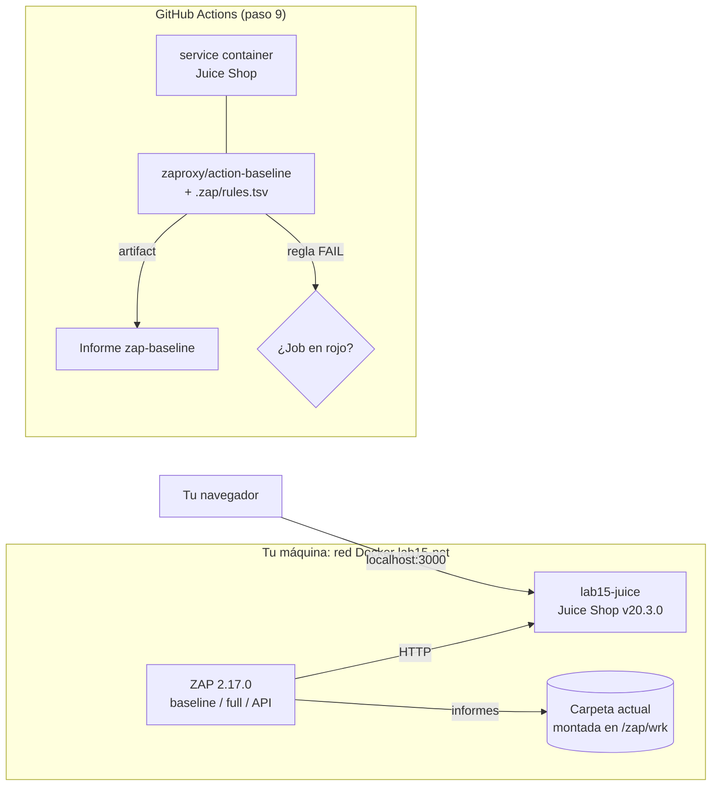

---
tags:
  - laboratorio
  - seguridad
  - dast
  - escaneo
  - github-actions
  - contenedores
---

# Lab 15: DAST con OWASP ZAP sobre OWASP Juice Shop

> Levanta OWASP Juice Shop en local, atácala con los tres escaneos empaquetados de ZAP (baseline, full y API), lee e interpreta el informe, mapea los hallazgos al OWASP Top 10:2025, decide qué bloquea con `rules.tsv` y lleva el baseline a GitHub Actions contra un entorno efímero.

| Nivel | Duración | Costo | Requisitos |
| --- | --- | --- | --- |
| Intermedio | ~90 min | Gratis (todo en local y en un repositorio de GitHub) | Labs 05, 07 y 12; Docker con 4 GB de RAM o más, `curl`, una cuenta de GitHub |

!!! info "Qué vas a aprender"
    - Levantar una **aplicación deliberadamente vulnerable** (*intentionally vulnerable application*) en una red Docker aislada.
    - Ejecutar el **baseline scan** (solo pasivo), el **full scan** (ataque activo) y el **API scan** guiado por OpenAPI, y entender qué hace cada uno.
    - Leer el informe HTML y JSON de ZAP: riesgo, confianza, evidencia y CWE.
    - **Clasificar** (*triage*) los hallazgos y mapearlos a las categorías del **OWASP Top 10:2025**.
    - Decidir qué rompe el build con `rules.tsv` (`IGNORE`, `INFO`, `WARN`, `FAIL`) y escanear **autenticado** con un token.
    - Integrar el baseline en GitHub Actions con la app como **service container** (contenedor de servicio) efímero.

!!! danger "Solo contra aplicaciones propias o deliberadamente vulnerables en local"
    Un escaneo DAST, y sobre todo el **full scan**, es un ataque real: envía miles de peticiones con inyecciones y cargas maliciosas. Ejecútalo **solo** contra Juice Shop en tu máquina (o contra tus propios entornos, con autorización por escrito). Escanear un sistema ajeno sin permiso puede ser un delito y casi siempre viola los términos de servicio del proveedor. Ver [Pruebas dinámicas: pentesting básico](../../devsecops/codigo-y-dependencias/pruebas-dinamicas.md#pentesting-basico).

## Antes de empezar

| Herramienta | Versión probada | Para qué |
| --- | --- | --- |
| Docker (Desktop o Engine) | 28.5 | Ejecutar Juice Shop y ZAP sin instalar nada más |
| OWASP Juice Shop | `bkimminich/juice-shop:v20.3.0` | La aplicación objetivo |
| ZAP | `ghcr.io/zaproxy/zaproxy:2.17.0` | El escáner (trae `zap-baseline.py`, `zap-full-scan.py` y `zap-api-scan.py`) |
| `curl` | Cualquiera | Comprobar la app y pedir un token |

- Necesitas el repositorio del [Lab 07](../devops/github-actions-ci.md) (o cualquier repositorio tuyo en GitHub) para el paso 9, y conviene haber hecho el [Lab 12](escaneos-en-pipeline.md): allí viste los escaneos **estáticos**; este lab cubre el **dinámico**, que necesita la aplicación corriendo.
- Si no tienes soltura con redes y volúmenes de Docker, repasa el [Lab 05](../devops/docker-multistage-compose.md).
- En Docker Desktop, asigna al menos 4 GB de memoria (*Settings > Resources*): el full scan consume bastante.

Teoría recomendada: [DAST](../../devsecops/escaneos/dast.md) (qué detecta y cómo se integra), [Pruebas dinámicas](../../devsecops/codigo-y-dependencias/pruebas-dinamicas.md) (DAST frente a SAST e IAST) y el apartado [OWASP Top 10](../../devsecops/fundamentos-devsecops.md#owasp-top-10) de los fundamentos.

## Arquitectura



Juice Shop y ZAP comparten una red Docker propia, así ZAP llega a la app por su nombre (`lab15-juice`) igual en Linux, macOS y Windows. En el pipeline, la app vive solo lo que dura el job: es un **entorno efímero** (*ephemeral environment*).

## Paso a paso

### Paso 1: Levanta Juice Shop en una red aislada

Crea una carpeta de trabajo y una red solo para el lab. Fijas la imagen con un **tag concreto** para que el resultado sea repetible: con `latest`, un escaneo de mañana podría encontrar cosas distintas sin que cambie nada tuyo.

```bash
mkdir lab15 && cd lab15
docker network create lab15-net
docker run -d --name lab15-juice --network lab15-net -p 127.0.0.1:3000:3000 bkimminich/juice-shop:v20.3.0
curl -sI http://localhost:3000 | head -5
```

`-p 127.0.0.1:3000:3000` publica la app **solo** en tu máquina, no en tu red local: es una aplicación vulnerable a propósito y no debe ser accesible desde fuera. Salida esperada (abreviada):

```text
HTTP/1.1 200 OK
Access-Control-Allow-Origin: *
X-Content-Type-Options: nosniff
X-Frame-Options: SAMEORIGIN
Feature-Policy: payment 'self'
```

Ya ves dos pistas de lo que ZAP va a reportar: CORS abierto a cualquier origen (`*`) y la cabecera obsoleta `Feature-Policy`. Abre `http://localhost:3000` en el navegador para conocer la tienda.

### Paso 2: Baseline scan y archivo de reglas

El **baseline scan** rastrea la app durante un minuto con el *spider* y aplica solo **reglas pasivas**: mira las respuestas, pero no envía ataques. Por eso es seguro en cualquier entorno tuyo y rápido (menos de 1 minuto aquí). `-g` genera además un `rules.tsv` con todas las reglas en `WARN`, que editarás en el paso 5.

=== "Linux/macOS"

    ```bash
    docker run --rm --name lab15-zap --network lab15-net \
      -v "$(pwd):/zap/wrk:rw" ghcr.io/zaproxy/zaproxy:2.17.0 \
      zap-baseline.py -t http://lab15-juice:3000 \
      -g rules.tsv -r baseline.html -J baseline.json
    echo "Código de salida: $?"
    ```

=== "Windows (PowerShell)"

    ```powershell
    docker run --rm --name lab15-zap --network lab15-net `
      -v "${PWD}:/zap/wrk:rw" ghcr.io/zaproxy/zaproxy:2.17.0 `
      zap-baseline.py -t http://lab15-juice:3000 `
      -g rules.tsv -r baseline.html -J baseline.json
    "Código de salida: $LASTEXITCODE"
    ```

Salida esperada (abreviada; los recuentos varían entre ejecuciones):

```text
Total of 116 URLs
WARN-NEW: Content Security Policy (CSP) Header Not Set [10038] x 11
WARN-NEW: Deprecated Feature Policy Header Set [10063] x 11
WARN-NEW: Cross-Domain Misconfiguration [10098] x 11
WARN-NEW: Dangerous JS Functions [10110] x 2
WARN-NEW: Cross-Origin-Embedder-Policy Header Missing or Invalid [90004] x 14
FAIL-NEW: 0  FAIL-INPROG: 0  WARN-NEW: 5  WARN-INPROG: 0  INFO: 0  IGNORE: 0  PASS: 62
Código de salida: 2
```

Los **códigos de salida** son la base del gating: `0` sin alertas, `1` al menos un `FAIL`, `2` al menos un `WARN` y ningún `FAIL`, `3` error del propio escaneo. Si usas Git Bash en Windows, antepón `MSYS_NO_PATHCONV=1` al comando para que no reescriba la ruta `/zap/wrk`.

!!! note "Juice Shop es muy vulnerable, ¿por qué solo salen cabeceras?"
    Porque el baseline no ataca. La inyección SQL del login o los XSS de Juice Shop solo aparecen con un escaneo activo o con pruebas manuales. Un baseline limpio **no** significa una app segura.

### Paso 3: Lee el informe HTML y JSON

Abre `baseline.html` en el navegador. Cada alerta tiene:

| Campo | Qué significa | Cómo usarlo |
| --- | --- | --- |
| **Risk** (riesgo) | High, Medium, Low, Informational | Impacto si la alerta es cierta |
| **Confidence** (confianza) | Confirmed, High, Medium, Low | Cuán seguro está ZAP; Low pide revisión manual |
| **URL / Method / Parameter** | Dónde la vio | Para reproducirla |
| **Evidence** (evidencia) | El fragmento de la respuesta que la dispara | Lo primero que miras en el triage |
| **CWE Id / WASC Id** | Clasificación de la debilidad | Para mapear a OWASP Top 10 y priorizar |
| **Solution / Reference** | Cómo corregirlo | Punto de partida para el ticket |

El JSON es lo que procesarías en un pipeline o en una herramienta de gestión de vulnerabilidades. Un resumen rápido con Python:

```python title="resumen_zap.py"
import json
import sys

informe = json.load(open(sys.argv[1], encoding="utf-8"))
for sitio in informe["site"]:
    for alerta in sitio["alerts"]:
        print(f'{alerta["pluginid"]:>6}  {alerta["riskdesc"]:<24} CWE-{alerta["cweid"]:<4} '
              f'x{alerta["count"]:<3} {alerta["alert"]}')
```

```bash
python3 resumen_zap.py baseline.json
```

```text
 10038  Medium (High)            CWE-693  x5   Content Security Policy (CSP) Header Not Set
 10098  Medium (Medium)          CWE-264  x5   Cross-Domain Misconfiguration
 90004  Low (Medium)             CWE-693  x5   Cross-Origin-Embedder-Policy Header Missing or Invalid
 90004  Low (Medium)             CWE-693  x5   Cross-Origin-Opener-Policy Header Missing or Invalid
 10110  Low (Low)                CWE-749  x2   Dangerous JS Functions
 10063  Low (Medium)             CWE-16   x5   Deprecated Feature Policy Header Set
 10109  Informational (Medium)   CWE--1   x5   Modern Web Application
 10049  Informational (Medium)   CWE-524  x5   Storable but Non-Cacheable Content
```

`riskdesc` combina riesgo y confianza: `Medium (High)` es "riesgo medio, confianza alta". El `count` del JSON se limita a las instancias que ZAP guarda por regla, por eso es menor que el de la consola.

### Paso 4: Clasifica los hallazgos y mapéalos al OWASP Top 10:2025

El **triage** decide, para cada alerta, si es real, cuánto importa y dónde se corrige. Mapear a OWASP Top 10 sirve para hablar un idioma común con el equipo y con auditoría ([la lista completa está en los fundamentos](../../devsecops/fundamentos-devsecops.md#owasp-top-10)).

| Alerta (ID) | ¿Real? | Categoría OWASP Top 10:2025 | Dónde se corrige | Decisión |
| --- | --- | --- | --- | --- |
| CSP Header Not Set (10038) | Sí | A02:2025 Security Misconfiguration | Cabecera en la app o el reverse proxy | Corregir; **bloquear** si vuelve |
| Cross-Domain Misconfiguration (10098): `Access-Control-Allow-Origin: *` | Sí | A01:2025 Broken Access Control (CORS permisivo) | Configuración CORS de la app | Corregir; revisar qué rutas lo necesitan |
| COEP / COOP Missing (90004) | Sí, impacto bajo | A02:2025 Security Misconfiguration | Cabeceras | Backlog |
| Deprecated Feature Policy (10063) | Sí, impacto bajo | A02:2025 Security Misconfiguration | Cambiar a `Permissions-Policy` | Informativo |
| Dangerous JS Functions (10110): `bypassSecurityTrustHtml(` | Revisar | A05:2025 Injection (posible XSS) | Código del frontend | Triage manual: en un bundle minificado suele ser un falso positivo |
| Application Error Disclosure (90022), Server Error 500 (100000) | Sí | A10:2025 Mishandling of Exceptional Conditions | Manejo de errores de la API | Corregir (aparece en el API scan, paso 7) |
| Modern Web Application (10109) | Informativa | Ninguna | No aplica | Ignorar (solo indica que conviene el AJAX spider) |

Prioriza por riesgo **y** confianza **y** exposición: un `Medium (High)` en todas las páginas públicas va antes que un `Low (Low)` en un archivo JS.

### Paso 5: Decide qué bloquea con `rules.tsv`

El archivo de reglas (separado por **tabuladores**, no espacios) cambia la acción de cada regla. Edita en `rules.tsv` estas tres líneas (deja el resto en `WARN`):

```text title="rules.tsv (líneas editadas)"
10038	FAIL	(Content Security Policy (CSP) Header Not Set)
10063	INFO	(Deprecated Feature Policy Header Set)
10110	IGNORE	(Dangerous JS Functions) Falso positivo: bypassSecurityTrustHtml en el bundle de Angular. Ticket SEC-15, revisar 2027-01-31
```

| Acción | Efecto | Cuándo usarla |
| --- | --- | --- |
| `FAIL` | Código de salida 1: rompe el build | Lo que ya corregiste y no debe volver |
| `WARN` | Código 2 (o 0 con `-I`): avisa sin bloquear | Por defecto, mientras haces el triage |
| `INFO` | Aparece en el informe, no cuenta como aviso | Hallazgos informativos |
| `IGNORE` | No se reporta | Falsos positivos documentados |
| `OUTOFSCOPE` + regex de URL | Ignora la regla solo en esas URLs | Excepciones acotadas, por ejemplo `10038`, `OUTOFSCOPE` y `.*/assets/.*` separados por tabuladores |

ZAP no tiene fecha de caducidad para un `IGNORE`: deja el ticket y la fecha de revisión en el comentario de la línea, como en el ejemplo. Vuelve a escanear con el archivo y con `-I` (los `WARN` dejan de romper; solo cuentan los `FAIL`):

```bash
docker run --rm --name lab15-zap --network lab15-net \
  -v "$(pwd):/zap/wrk:rw" ghcr.io/zaproxy/zaproxy:2.17.0 \
  zap-baseline.py -t http://lab15-juice:3000 -c rules.tsv -I -r baseline.html
echo "Código de salida: $?"
```

```text
IGNORE: Dangerous JS Functions [10110] x 2
INFO: Deprecated Feature Policy Header Set [10063] x 5
WARN-NEW: Cross-Domain Misconfiguration [10098] x 5
WARN-NEW: Cross-Origin-Embedder-Policy Header Missing or Invalid [90004] x 10
FAIL-NEW: Content Security Policy (CSP) Header Not Set [10038] x 5
FAIL-NEW: 1  FAIL-INPROG: 0  WARN-NEW: 4  WARN-INPROG: 0  INFO: 1  IGNORE: 1  PASS: 61
Código de salida: 1
```

Juice Shop no envía CSP, así que esta regla `FAIL` es la que hará fallar el pipeline del paso 9. En una app tuya, el siguiente paso sería añadir la cabecera y ver el código de salida volver a `0`.

### Paso 6: Escaneo autenticado

Sin sesión, ZAP solo ve la parte pública. La forma más simple de autenticar es **traer tu propio token**: ZAP añade la cabecera definida en `ZAP_AUTH_HEADER_VALUE` a todas las peticiones (y `ZAP_AUTH_HEADER_SITE` la limita a un host). Crea un **usuario de prueba** para el escaneo y pide su token JWT:

=== "Linux/macOS"

    ```bash
    curl -s -X POST http://localhost:3000/api/Users -H 'Content-Type: application/json' \
      -d '{"email":"lab15@juice-sh.op","password":"Lab15-Prueba!","passwordRepeat":"Lab15-Prueba!","securityQuestion":{"id":1},"securityAnswer":"lab15"}' > /dev/null
    TOKEN=$(curl -s -X POST http://localhost:3000/rest/user/login -H 'Content-Type: application/json' \
      -d '{"email":"lab15@juice-sh.op","password":"Lab15-Prueba!"}' | python3 -c 'import json,sys; print(json.load(sys.stdin)["authentication"]["token"])')
    echo "${TOKEN:0:12}..."     # nunca imprimas el token completo
    ```

=== "Windows (PowerShell)"

    ```powershell
    $alta = '{"email":"lab15@juice-sh.op","password":"Lab15-Prueba!","passwordRepeat":"Lab15-Prueba!","securityQuestion":{"id":1},"securityAnswer":"lab15"}'
    Invoke-RestMethod -Method Post -Uri http://localhost:3000/api/Users -ContentType 'application/json' -Body $alta | Out-Null
    $login = '{"email":"lab15@juice-sh.op","password":"Lab15-Prueba!"}'
    $TOKEN = (Invoke-RestMethod -Method Post -Uri http://localhost:3000/rest/user/login -ContentType 'application/json' -Body $login).authentication.token
    $TOKEN.Substring(0, 12) + "..."
    ```

Comprueba que el token abre una ruta protegida de la API B2B: sin cabecera responde `401`, con ella `200`.

```bash
curl -s -o /dev/null -w '%{http_code}\n' -X POST http://localhost:3000/b2b/v2/orders \
  -H 'Content-Type: application/json' -d '{}'                                   # 401
curl -s -o /dev/null -w '%{http_code}\n' -X POST http://localhost:3000/b2b/v2/orders \
  -H "Authorization: Bearer $TOKEN" -H 'Content-Type: application/json' \
  -d '{"cid":"JS0815DE","orderLines":[{"productId":8,"quantity":1}]}'          # 200
```

Para apps con login por formulario o por navegador, el camino es un **context file** con usuario (`-n` y `-U`) o el **Automation Framework**; los tienes resumidos en [DAST: escaneo autenticado](../../devsecops/escaneos/dast.md#escaneo-autenticado).

### Paso 7: API scan guiado por OpenAPI

Juice Shop documenta su API B2B en OpenAPI (la ves en `http://localhost:3000/api-docs`). El **API scan** importa la especificación y ataca cada operación con reglas activas pensadas para APIs, sin depender del spider. Descarga la especificación de la misma versión que la imagen y escanea con el token:

```bash
curl -sL -o swagger.yml https://raw.githubusercontent.com/juice-shop/juice-shop/v20.3.0/swagger.yml
docker run --rm --name lab15-zap --network lab15-net \
  -v "$(pwd):/zap/wrk:rw" \
  -e ZAP_AUTH_HEADER_VALUE="Bearer $TOKEN" -e ZAP_AUTH_HEADER_SITE="lab15-juice" \
  ghcr.io/zaproxy/zaproxy:2.17.0 \
  zap-api-scan.py -t swagger.yml -f openapi -O http://lab15-juice:3000 -r api.html -J api.json
```

El archivo usa una URL de servidor relativa (`/b2b/v2`), por eso `-O` le dice a ZAP contra qué host lanzar las peticiones. Salida esperada (unos 30 segundos):

```text
Number of Imported URLs: 4
WARN-NEW: A Server Error response code was returned by the server [100000] x 9
WARN-NEW: Unexpected Content-Type was returned [100001] x 13
WARN-NEW: Cross-Domain Misconfiguration [10098] x 1
WARN-NEW: Application Error Disclosure [90022] x 1
FAIL-NEW: 0  FAIL-INPROG: 0  WARN-NEW: 4  WARN-INPROG: 0  INFO: 0  IGNORE: 0  PASS: 118
```

Los errores 500 en `POST /b2b/v2/orders` ante cargas malformadas son el hallazgo interesante: la API no gestiona bien entradas inesperadas (A10:2025). Si repites el escaneo **sin** las variables `ZAP_AUTH_*`, aparece además "A Client Error response code was returned" con respuestas `401`: ZAP se quedó en la puerta.

### Paso 8: Full scan con límite de tiempo

El **full scan** combina spider sin límite, reglas pasivas y **active scan** (inyección SQL, XSS, path traversal...). Es el que encuentra fallos de verdad, y también el que puede romper datos o tumbar un entorno pequeño: por eso solo contra Juice Shop local. Ponle límites para que termine en un tiempo razonable:

```bash
docker run --rm --name lab15-zap-full --network lab15-net \
  -v "$(pwd):/zap/wrk:rw" ghcr.io/zaproxy/zaproxy:2.17.0 \
  zap-full-scan.py -t http://lab15-juice:3000 -m 2 \
  -z "-config scanner.maxScanDurationInMins=15" \
  -r full.html -J full.json
```

- `-m 2`: dos minutos de spider (por defecto no tiene límite).
- `scanner.maxScanDurationInMins`: corta el active scan a los 15 minutos.
- Si tarda demasiado, genera su archivo con `-g full-rules.tsv` y pon en `IGNORE` las reglas activas lentas, como la de DOM XSS (`40026`), que abre un navegador por cada prueba: en el full scan y el API scan, una regla activa en `IGNORE` ni siquiera se ejecuta.

Compara `full.html` con `baseline.html`: lo esperable es que aparezcan alertas de reglas **activas** que el baseline no podía generar (por ejemplo, de inyección o de errores del servidor ante cargas maliciosas). Cuántas encuentres depende de lo que rastree el spider y del tiempo que dejes al active scan: con límites tan cortos, no esperes encontrar todos los fallos de Juice Shop. Clasifícalas con la tabla del paso 4. Cuando termine, **reinicia Juice Shop** (`docker restart lab15-juice`): el active scan deja pedidos, usuarios y reseñas basura en su base de datos, y en un staging real tendrías que restaurarla igual.

### Paso 9: El baseline en GitHub Actions contra un entorno efímero

Lleva el baseline al pipeline. Juice Shop corre como **service container** del job: nace con el job, ZAP lo ataca y desaparece al terminar, sin tocar ningún entorno compartido ([Pruebas de infraestructura: entornos efímeros](../../devops/iac/pruebas-infraestructura.md#entornos-efimeros)). Copia tu `rules.tsv` a `.zap/rules.tsv` en el repositorio.

Antes de fijar la action, comprueba el SHA del tag tú misma (el que termina en `^{}` es el commit al que apunta un tag anotado):

```bash
git ls-remote --tags https://github.com/zaproxy/action-baseline | grep v0.15.0
```

```text
6c5a007541891231cd9e0ddec25d4f25c59c9874	refs/tags/v0.15.0
de8ad967d3548d44ef623df22cf95c3b0baf8b25	refs/tags/v0.15.0^{}
```

```yaml title=".github/workflows/dast.yml"
name: dast

on:
  pull_request:
  workflow_dispatch:

permissions: {}                      # nada por defecto

jobs:
  zap-baseline:
    runs-on: ubuntu-latest
    timeout-minutes: 20
    permissions:
      contents: read                 # leer .zap/rules.tsv
    services:
      juice-shop:                    # entorno efímero: vive lo que dura el job
        image: bkimminich/juice-shop:v20.3.0
        ports:
          - 3000:3000
    steps:
      - uses: actions/checkout@3d3c42e5aac5ba805825da76410c181273ba90b1 # v7.0.1
        with:
          persist-credentials: false

      - name: Esperar a que la app responda
        run: |
          for i in $(seq 1 60); do
            curl -sf -o /dev/null http://localhost:3000 && exit 0
            sleep 2
          done
          echo "Juice Shop no arrancó a tiempo" >&2
          exit 1

      - name: ZAP baseline
        uses: zaproxy/action-baseline@de8ad967d3548d44ef623df22cf95c3b0baf8b25 # v0.15.0
        with:
          target: http://localhost:3000
          docker_name: ghcr.io/zaproxy/zaproxy:2.17.0   # misma versión que en local
          rules_file_name: .zap/rules.tsv
          cmd_options: "-I"            # los WARN no rompen; solo las reglas FAIL
          fail_action: true            # el job falla si ZAP devuelve 1 (FAIL)
          allow_issue_writing: false   # sin issues automáticos: no necesita issues: write
          artifact_name: zap-baseline
```

Por qué cada detalle:

- La action ejecuta ZAP con `--network host`, por eso llega a la app en `localhost:3000`, el puerto que publica el service container.
- El paso de espera evita un falso "no se pudo conectar": el contenedor arranca antes que la app.
- `docker_name` con tag concreto: con el valor por defecto (`stable`), una versión nueva de ZAP con reglas nuevas podría romper tus PR un día cualquiera.
- `allow_issue_writing: false` evita que la action abra issues y así el job no necesita más permisos que `contents: read` ([Seguridad del pipeline](../../devsecops/identidades-y-pipeline/seguridad-pipeline.md#pinning-de-actions-por-sha)).

Haz commit en una rama, abre un PR y espera el resultado: el job queda en **rojo** por la regla `10038 FAIL`, y el informe (HTML, JSON y Markdown) queda en el artifact `zap-baseline` de la ejecución.

!!! tip "Full scan y API scan en el pipeline"
    El mismo patrón sirve para `zaproxy/action-full-scan` (v0.13.0, `3c58388149901b9a03b7718852c5ba889646c27c`) y `zaproxy/action-api-scan` (v0.10.0, `5158fe4d9d8fcc75ea204db81317cce7f9e5453d`, con `format: openapi`). El full scan va mejor en un `schedule` semanal que en cada PR: tarda mucho y su objetivo es abrir tickets, no bloquear un cambio concreto ([DAST: umbrales](../../devsecops/escaneos/dast.md#umbrales-y-cuando-fallar-el-build)).

## Verificación

| Comprobación | Resultado esperado |
| --- | --- |
| `curl -sI http://localhost:3000` | `HTTP/1.1 200 OK` con `Access-Control-Allow-Origin: *` |
| Baseline sin reglas | Código de salida `2` y `FAIL-NEW: 0` |
| Baseline con `-c rules.tsv -I` | Código `1`, `FAIL-NEW: Content Security Policy...`, `IGNORE: Dangerous JS Functions` |
| `python3 resumen_zap.py baseline.json` | Lista de alertas con riesgo, confianza y CWE |
| POST a `/b2b/v2/orders` sin y con token | `401` y `200` |
| API scan autenticado | `Number of Imported URLs: 4` y ninguna alerta de respuestas `401` |
| Workflow `dast` en el PR | Job `zap-baseline` en rojo y artifact `zap-baseline` con el informe |

## Retos extra

1. Cambia la regla `10038` a `WARN` en `.zap/rules.tsv` y comprueba que el PR pasa a verde. Luego pon `10098` en `FAIL`. ¿Qué regla bloquearías en un proyecto real y por qué?
2. Usa un **progress file** (`-p progreso.json`) para marcar `10098` como "en curso": aparecerá como `WARN-INPROG` en lugar de `WARN-NEW`. Pista: la estructura está en la documentación del baseline.
3. Fija también el service container por **digest** (`bkimminich/juice-shop@sha256:...`). Pista: `docker buildx imagetools inspect bkimminich/juice-shop:v20.3.0`.
4. Genera un informe **SARIF** con el Automation Framework y súbelo a code scanning con `github/codeql-action/upload-sarif`, como hiciste en el [Lab 12 (parte 2)](escaneos-en-pipeline-workflow.md).

## Limpieza

No creaste nada en la nube. Borra lo que quedó en Docker:

```bash
docker rm -f lab15-juice lab15-zap lab15-zap-full 2>/dev/null
docker network rm lab15-net
docker ps -a --filter name=lab15 --format '{{.Names}}'     # no debe mostrar nada
# Opcional: liberar espacio (unos 2 GB entre las dos imágenes)
docker image rm ghcr.io/zaproxy/zaproxy:2.17.0 bkimminich/juice-shop:v20.3.0
```

Si dejaste el workflow en tu repositorio, desactívalo o bórralo cuando termines si no quieres que corra en cada PR.

## Problemas comunes

| Síntoma | Causa | Solución |
| --- | --- | --- |
| ZAP en local no llega a `http://localhost:3000` (errores de conexión, `Total of 0 URLs`) | Dentro del contenedor, `localhost` es el propio contenedor de ZAP | Usa la red `lab15-net` y el nombre `lab15-juice`, como en el lab |
| `Permission denied` al escribir `baseline.html` | El usuario `zap` (UID 1000) no puede escribir en la carpeta montada | `chmod a+w .` en Linux, o monta una carpeta de tu usuario |
| La ruta `/zap/wrk` aparece como `C:/Program Files/Git/zap/wrk` | Git Bash reescribe rutas POSIX | Antepón `MSYS_NO_PATHCONV=1` o usa PowerShell |
| `rules.tsv` parece no aplicarse | Separaste las columnas con espacios en lugar de tabuladores | Revisa con `cat -A rules.tsv` (los tabuladores salen como `^I`) |
| El full scan no termina o Docker deja de responder (`error waiting for container: unexpected EOF`) | Spider sin límite, reglas lentas o poca memoria | `-m`, `scanner.maxScanDurationInMins`, reglas lentas en `IGNORE` y 4 GB o más para Docker |
| El API scan importa 0 URLs | La especificación tiene servidores relativos y faltó `-O` | Añade `-O http://lab15-juice:3000` |
| El API scan da 401 en todo | El token caducó o falta `ZAP_AUTH_HEADER_VALUE` | Pide un token nuevo justo antes de escanear |
| En Actions, el paso de ZAP no conecta | La app aún no había arrancado | Mantén el paso de espera con `curl` antes de ZAP |

Para errores del workflow en general, sigue el método de [Troubleshooting](../../devops/operacion/troubleshooting.md).

## Información complementaria

- **DAST**: prueba la aplicación **en ejecución** desde fuera, como lo haría un atacante; encuentra configuración y comportamiento que el SAST no ve ([DAST](../../devsecops/escaneos/dast.md)).
- **Baseline, full y API**: pasivo y seguro; activo y agresivo; activo y guiado por el contrato de la API ([DAST](../../devsecops/escaneos/dast.md)).
- **OWASP Top 10:2025**: el idioma común para clasificar hallazgos web; ZAP da el CWE y tú decides la categoría ([Fundamentos de DevSecOps](../../devsecops/fundamentos-devsecops.md#owasp-top-10)).
- **Dónde corre el DAST**: entorno efímero por PR o staging, nunca producción sin autorización ([DAST: dónde correrlo](../../devsecops/escaneos/dast.md#donde-correrlo)).
- **Gestión de hallazgos**: muchas alertas se corrigen en el reverse proxy o el CDN, no en el código; localiza la capa correcta ([DAST: gestión de hallazgos](../../devsecops/escaneos/dast.md#gestion-de-hallazgos)) y aplica los plazos de [SLA de remediación](../../devsecops/gobierno-y-respuesta/deteccion-respuesta.md#sla-de-remediacion).
- **En el trabajo real**: el baseline va en cada despliegue a staging o en cada PR con entorno efímero; el full scan, semanal y con tickets; el pentest manual complementa ambos, porque ningún escáner entiende la lógica de negocio.

## Documentación oficial

- [ZAP: Baseline Scan](https://www.zaproxy.org/docs/docker/baseline-scan/)
- [ZAP: Full Scan](https://www.zaproxy.org/docs/docker/full-scan/)
- [ZAP: API Scan](https://www.zaproxy.org/docs/docker/api-scan/)
- [ZAP: Docker (redes, volúmenes, modo headless)](https://www.zaproxy.org/docs/docker/about/)
- [ZAP: gestionar la autenticación por tu cuenta](https://www.zaproxy.org/docs/getting-further/authentication/handling-auth-yourself/)
- [zaproxy/action-baseline](https://github.com/zaproxy/action-baseline)
- [OWASP Juice Shop](https://owasp.org/www-project-juice-shop/) y su guía [Pwning OWASP Juice Shop](https://pwning.owasp-juice.shop/)
- [OWASP Top 10:2025](https://owasp.org/Top10/2025/)
- [GitHub Actions: service containers](https://docs.github.com/es/actions/use-cases-and-examples/using-containerized-services/about-service-containers)

## Preguntas para verificar el aprendizaje

??? question "1. ¿Qué diferencia hay entre el baseline scan y el full scan?"
    El baseline solo rastrea y aplica reglas **pasivas**: observa las respuestas sin atacar, por eso es rápido y seguro. El full scan añade el **active scan**, que envía cargas de ataque (inyecciones, XSS, path traversal) y puede modificar datos o tumbar el servicio.

??? question "2. El baseline de tu app sale limpio. ¿Puedes decir que la app es segura?"
    No. El baseline no prueba inyecciones ni lógica de negocio, y sin autenticación solo ve la parte pública. Juice Shop, que es vulnerable a propósito, también da un baseline con solo cabeceras.

??? question "3. ¿Qué código de salida devuelve ZAP con un `WARN` y ningún `FAIL`? ¿Y si añades `-I`?"
    `2` sin `-I`; `0` con `-I`. `-I` hace que los avisos no se consideren fallo, de modo que solo las reglas marcadas `FAIL` en `rules.tsv` rompen el build.

??? question "4. ¿Qué pasaría si en el workflow usas `docker_name: ghcr.io/zaproxy/zaproxy:stable`?"
    Cada nueva versión de ZAP puede traer reglas nuevas o cambios en las existentes, y un PR sin cambios podría pasar a rojo de un día para otro. Con un tag concreto, el resultado solo cambia cuando tú actualizas la versión.

??? question "5. ¿Por qué ZAP no puede escanear `http://localhost:3000` cuando lo ejecutas con `docker run` en tu máquina, pero sí en GitHub Actions?"
    En local, `localhost` dentro del contenedor de ZAP es el propio contenedor. La action de GitHub ejecuta ZAP con `--network host`, así que allí `localhost` es el runner, donde el service container publica el puerto 3000.

??? question "6. ¿Cómo marcarías un falso positivo y qué información dejarías?"
    Con `IGNORE` en `rules.tsv` (o `OUTOFSCOPE` con una regex si solo afecta a ciertas URLs), y en el comentario de la línea: motivo, ticket, quién lo aprobó y fecha de revisión, porque ZAP no hace caducar la supresión.

??? question "7. ¿A qué categoría del OWASP Top 10:2025 mapearías un `500 Internal Server Error` con traza de error ante una entrada malformada?"
    A10:2025 *Mishandling of Exceptional Conditions*: la aplicación no gestiona bien una condición inesperada y además expone detalles internos. Si la traza revela versiones o rutas, también tiene una parte de A02 *Security Misconfiguration*.

??? question "8. ¿Por qué el escaneo autenticado usa un usuario creado para el escaneo y no tu cuenta?"
    Porque el escáner rellena formularios, crea datos y puede cambiar la contraseña o borrar la cuenta si encuentra esas rutas. Un usuario de prueba, sin privilegios de administración y con datos ficticios, limita el daño y deja rastro claro en los logs.

??? question "9. ¿Dónde pondrías el full scan en un proceso real?"
    En un job programado (por ejemplo semanal) contra staging o un entorno efímero, que abre tickets y bloquea la **promoción** a producción si quedan hallazgos altos sin triage, no en cada PR.

## Notas relacionadas

**DevSecOps**

- [DAST](../../devsecops/escaneos/dast.md)
- [Pruebas dinámicas de seguridad](../../devsecops/codigo-y-dependencias/pruebas-dinamicas.md)
- [Fundamentos de DevSecOps (OWASP Top 10)](../../devsecops/fundamentos-devsecops.md)
- [Escaneo de seguridad en el pipeline](../../devsecops/escaneos/escaneo-en-pipeline.md)
- [Seguridad del pipeline](../../devsecops/identidades-y-pipeline/seguridad-pipeline.md)
- [Detección y respuesta](../../devsecops/gobierno-y-respuesta/deteccion-respuesta.md)

**DevOps**

- [Docker](../../devops/contenedores/docker.md)
- [Integración continua](../../devops/ci-cd/integracion-continua.md)
- [Pruebas de infraestructura (entornos efímeros)](../../devops/iac/pruebas-infraestructura.md)

**Cloud**

- [Seguridad de APIs y aplicaciones](../../cloud/seguridad/seguridad-apis-aplicaciones.md)

**Labs**

- [Lab 05: Imagen multi-stage y Docker Compose](../devops/docker-multistage-compose.md)
- [Lab 07: Pipeline de CI con GitHub Actions](../devops/github-actions-ci.md)
- [Lab 12: Escaneos de seguridad en el pipeline](escaneos-en-pipeline.md)
- Lab anterior: [Lab 14: Endurecer un clúster: Pod Security, NetworkPolicy y Kyverno](seguridad-kubernetes.md)
- Lab siguiente: [Lab 16: Auditar tu cuenta cloud con Prowler (CSPM)](cspm-prowler.md)
