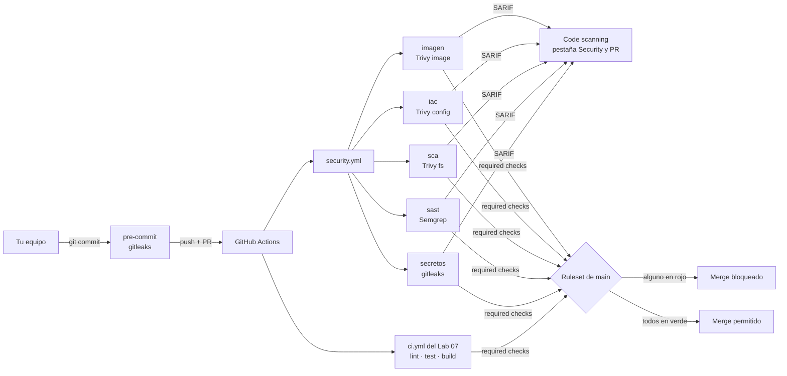

---
tags:
  - laboratorio
  - seguridad
  - escaneo
  - github-actions
---

# Lab 12 (parte 2): Workflow de seguridad, gating y riesgo aceptado

> Continúas la [parte 1](escaneos-en-pipeline.md): llevas los escaneos a un workflow `security.yml` que convive con el `ci.yml` del Lab 07, subes los resultados en SARIF a code scanning, bloqueas el merge por severidad, corriges cada hallazgo en el origen y suprimes un riesgo aceptado con fecha de expiración.

| Nivel | Duración | Costo | Requisitos |
| --- | --- | --- | --- |
| Intermedio | ~45 min | Gratis (repositorio público en GitHub) | [Lab 12 (parte 1)](escaneos-en-pipeline.md), [Lab 04](../devops/git-flujo-pull-request.md) y [Lab 07](../devops/github-actions-ci.md); una cuenta de GitHub |

!!! info "Qué vas a aprender"
    - Montar un workflow de GitHub Actions que sube cada resultado en **SARIF** a **code scanning**, separado del pipeline de CI.
    - Configurar el **gating** (bloqueo) por severidad y comprobar que un pull request vulnerable no puede fusionarse.
    - Corregir cada hallazgo en el origen y gestionar un riesgo aceptado con una **supresión** documentada que **caduca**.

!!! warning "Costos y seguridad"
    - Todo es gratis en un **repositorio público**. En uno privado, code scanning necesita GitHub Code Security (de pago): los escaneos y el bloqueo funcionan igual, pero la subida del SARIF falla.
    - La rama tiene las rutas `/diagnostico/*` vulnerables hasta el Paso 10: no publiques esa versión de la imagen ni la expongas fuera de tu máquina. No apliques el Terraform de este lab.

## Antes de empezar

Esta parte continúa la numeración de la [parte 1](escaneos-en-pipeline.md) (Pasos 1 a 7), así que empieza en el Paso 8. Al terminar la parte 1 tienes:

- La rama `lab12-escaneos` con dos commits: `lab12: siembra fallos de seguridad` (`app/diagnostico.py`, `python-multipart==0.0.6`, `infra/main.tf`) y `lab12: pre-commit con gitleaks`. Ningún fallo está corregido y `app/config.py` no existe.
- El hook de gitleaks instalado (`pre-commit install`) y la imagen local `lab-api:lab12`.
- Semgrep, Trivy y Docker instalados (la tabla de herramientas está en [Antes de empezar de la parte 1](escaneos-en-pipeline.md#antes-de-empezar)). Opcional: `actionlint`, del reto 2 del Lab 07.

Además, en GitHub, el repositorio `lab-devops-app` **público** con el ruleset `proteger-main` del [Lab 04](../devops/git-flujo-pull-request.md) y el workflow `.github/workflows/ci.yml` del [Lab 07](../devops/github-actions-ci.md) (`lint`, `test`, `build`) en `main`. Sin el `ci.yml` el lab funciona igual; solo no verás los dos workflows lado a lado.

Teoría recomendada: [Ejemplo de workflow con varios escaneos](../../devsecops/escaneos/escaneo-en-pipeline.md#ejemplo-de-workflow-con-varios-escaneos), [Criterios comunes de gating](../../devsecops/escaneos/escaneo-en-pipeline.md#criterios-comunes-de-gating) y [Gestión de hallazgos](../../devsecops/escaneos/escaneo-en-pipeline.md#gestion-de-hallazgos).

## Arquitectura



El pre-commit es la primera red (rápida, en tu máquina); el workflow es la red que no se puede saltar. Cada job de `security.yml` falla si encuentra algo HIGH o CRITICAL y, pase lo que pase, sube su SARIF para que veas el detalle en GitHub. El ruleset de `main` exige los checks de los dos workflows.

## Paso a paso

### Paso 8: El workflow de seguridad, junto al CI

Ahora lleva todo al pipeline. Este lab usa un **workflow aparte**, `security.yml`, en lugar de añadir jobs al `ci.yml` del Lab 07:

| Criterio | `ci.yml` (Lab 07) | `security.yml` (Lab 12) |
| --- | --- | --- |
| Pregunta que responde | ¿Funciona y se puede publicar? | ¿Es seguro? |
| Disparadores | PR, push a `main`, tags `v*` | PR, push a `main` y **semanal** (CVE nuevas sin cambios de código) |
| Permisos | `packages: write` solo en `build` | `security-events: write` en cada job, nunca `packages` |
| Si falla | No se publica la imagen | El ruleset bloquea el merge |

Separarlos permite el escaneo programado sin relanzar tests ni publicar imágenes, mantiene cada `GITHUB_TOKEN` con lo mínimo y deja que un equipo de seguridad sea dueño (CODEOWNERS) de su workflow. El costo es que la imagen se construye dos veces en cada PR (en `build` y en `imagen`). Si en tu proyecto prefieres que **nada se publique** sin escanear, la alternativa es añadir los jobs a `ci.yml` y poner `needs:` en `build`; aquí basta con que el ruleset exija ambos workflows antes del merge.

Cada job pide solo sus permisos, falla con HIGH o CRITICAL (`exit-code: 1`, `--error`) y sube su SARIF aunque falle (`!cancelled()`). Las actions de terceros van **fijadas por SHA** con la versión en un comentario ([Seguridad del pipeline](../../devsecops/identidades-y-pipeline/seguridad-pipeline.md#pinning-de-actions-por-sha)).

```yaml title=".github/workflows/security.yml"
name: security

on:
  pull_request:
    branches: [main]
  push:
    branches: [main]
  schedule:
    - cron: "0 6 * * 1" # lunes 06:00 UTC: CVE nuevas sin cambios de código

# Sin permisos por defecto: cada job pide solo lo que necesita
permissions: {}

concurrency:
  group: security-${{ github.ref }}
  cancel-in-progress: ${{ github.event_name == 'pull_request' }}

env:
  TRIVY_VERSION: v0.76.1

jobs:
  secretos:
    runs-on: ubuntu-latest
    timeout-minutes: 10
    permissions:
      contents: read
      security-events: write # subir SARIF a code scanning
    steps:
      - uses: actions/checkout@3d3c42e5aac5ba805825da76410c181273ba90b1 # v7.0.1
        with:
          fetch-depth: 0 # todo el historial: un secreto borrado sigue en commits viejos
          persist-credentials: false
      - name: Gitleaks (historial completo)
        run: |
          docker run --rm \
            --user "$(id -u):$(id -g)" \
            -e GIT_CONFIG_COUNT=1 \
            -e GIT_CONFIG_KEY_0=safe.directory \
            -e GIT_CONFIG_VALUE_0=/repo \
            -v "$PWD:/repo" \
            ghcr.io/gitleaks/gitleaks:v8.30.1 \
            git /repo --redact --exit-code 1 \
            --report-format sarif --report-path /repo/gitleaks.sarif
      - uses: github/codeql-action/upload-sarif@9b3254085494b55a0f7c4c2b3d2d52cc712ce370 # v4.39.1
        if: ${{ !cancelled() && hashFiles('gitleaks.sarif') != '' }}
        with:
          sarif_file: gitleaks.sarif
          category: gitleaks

  sast:
    runs-on: ubuntu-latest
    timeout-minutes: 15
    permissions:
      contents: read
      security-events: write
    steps:
      - uses: actions/checkout@3d3c42e5aac5ba805825da76410c181273ba90b1 # v7.0.1
        with:
          persist-credentials: false
      - name: Semgrep
        run: |
          docker run --rm -v "$PWD:/src" -w /src semgrep/semgrep:1.182.0 \
            semgrep scan --config p/default --metrics off \
            --severity ERROR --error --sarif --output semgrep.sarif
      - uses: github/codeql-action/upload-sarif@9b3254085494b55a0f7c4c2b3d2d52cc712ce370 # v4.39.1
        if: ${{ !cancelled() && hashFiles('semgrep.sarif') != '' }}
        with:
          sarif_file: semgrep.sarif
          category: semgrep

  sca:
    runs-on: ubuntu-latest
    timeout-minutes: 10
    permissions:
      contents: read
      security-events: write
    steps:
      - uses: actions/checkout@3d3c42e5aac5ba805825da76410c181273ba90b1 # v7.0.1
        with:
          persist-credentials: false
      - name: Trivy fs (dependencias)
        uses: aquasecurity/trivy-action@ed142fd0673e97e23eac54620cfb913e5ce36c25 # v0.36.0
        with:
          version: ${{ env.TRIVY_VERSION }}
          scan-type: fs
          scanners: vuln
          severity: HIGH,CRITICAL
          ignore-unfixed: true
          format: sarif
          output: trivy-sca.sarif
          limit-severities-for-sarif: true
          exit-code: 1
      - uses: github/codeql-action/upload-sarif@9b3254085494b55a0f7c4c2b3d2d52cc712ce370 # v4.39.1
        if: ${{ !cancelled() && hashFiles('trivy-sca.sarif') != '' }}
        with:
          sarif_file: trivy-sca.sarif
          category: trivy-sca

  iac:
    runs-on: ubuntu-latest
    timeout-minutes: 10
    permissions:
      contents: read
      security-events: write
    steps:
      - uses: actions/checkout@3d3c42e5aac5ba805825da76410c181273ba90b1 # v7.0.1
        with:
          persist-credentials: false
      - name: Trivy config (IaC y Dockerfile)
        uses: aquasecurity/trivy-action@ed142fd0673e97e23eac54620cfb913e5ce36c25 # v0.36.0
        with:
          version: ${{ env.TRIVY_VERSION }}
          scan-type: config
          scan-ref: .
          severity: HIGH,CRITICAL
          trivyignores: .trivyignore.yaml
          format: sarif
          output: trivy-iac.sarif
          limit-severities-for-sarif: true
          exit-code: 1
      - uses: github/codeql-action/upload-sarif@9b3254085494b55a0f7c4c2b3d2d52cc712ce370 # v4.39.1
        if: ${{ !cancelled() && hashFiles('trivy-iac.sarif') != '' }}
        with:
          sarif_file: trivy-iac.sarif
          category: trivy-iac

  imagen:
    runs-on: ubuntu-latest
    timeout-minutes: 20
    permissions:
      contents: read
      security-events: write
    steps:
      - uses: actions/checkout@3d3c42e5aac5ba805825da76410c181273ba90b1 # v7.0.1
        with:
          persist-credentials: false
      - name: Build de la etapa runtime (sin publicar)
        run: docker build --target runtime -t lab-api:${{ github.sha }} .
      - name: Trivy image
        uses: aquasecurity/trivy-action@ed142fd0673e97e23eac54620cfb913e5ce36c25 # v0.36.0
        with:
          version: ${{ env.TRIVY_VERSION }}
          scan-type: image
          image-ref: lab-api:${{ github.sha }}
          scanners: vuln
          severity: HIGH,CRITICAL
          ignore-unfixed: true
          format: sarif
          output: trivy-imagen.sarif
          limit-severities-for-sarif: true
          exit-code: 1
      - uses: github/codeql-action/upload-sarif@9b3254085494b55a0f7c4c2b3d2d52cc712ce370 # v4.39.1
        if: ${{ !cancelled() && hashFiles('trivy-imagen.sarif') != '' }}
        with:
          sarif_file: trivy-imagen.sarif
          category: trivy-imagen
```

Detalles que importan:

- **`concurrency` con su propio grupo** (`security-…`): si compartiera el grupo `ci-…` del Lab 07, un workflow cancelaría al otro.
- **Gitleaks en contenedor**: `--user "$(id -u):$(id -g)"` ejecuta gitleaks con el mismo usuario del runner (el dueño del checkout), así el SARIF no queda como archivo de root; las variables `GIT_CONFIG_*` declaran `/repo` como `safe.directory`. Sin eso, si el usuario del contenedor no es el dueño del repo montado, git lo rechaza por *dubious ownership* y gitleaks termina con `0 commits scanned` y **código 0**: un check verde que no revisó nada (ver Problemas comunes).
- **`limit-severities-for-sarif: true`** es imprescindible en `trivy-action` v0.36.0: sin él, la action quita el filtro `severity` cuando el formato es SARIF y el job fallaría también por MEDIUM y LOW. Con él, el SARIF solo lleva HIGH y CRITICAL.
- **`version`** fija la versión de Trivy que instala la action (por defecto, la v0.36.0 usa la v0.70.0).
- **`hashFiles(...) != ''`** evita un segundo error confuso si el escaneo falló antes de escribir el SARIF (por ejemplo, al no poder descargar la imagen).
- Los inputs (`version`, `scanners`, `trivyignores`, `ignore-unfixed`, `limit-severities-for-sarif`) están en el `action.yaml` de la v0.36.0; `trivyignores` acepta un único `.trivyignore.yaml` y falla si el archivo no existe.

Verifica los SHA tú misma, como en el Lab 07 (los tags son anotados: usa la línea `^{}`):

```bash
git ls-remote --tags https://github.com/aquasecurity/trivy-action.git | grep 'v0.36.0'
git ls-remote --tags https://github.com/github/codeql-action.git | grep 'v4.39.1'
```

```text
a9c7b0f06e461e9d4b4d1711f154ee024b8d7ab8    refs/tags/v0.36.0
ed142fd0673e97e23eac54620cfb913e5ce36c25    refs/tags/v0.36.0^{}
8498dc4c2b27cdd99baf0f87955b29ebbf30c78d    refs/tags/v4.39.1
9b3254085494b55a0f7c4c2b3d2d52cc712ce370    refs/tags/v4.39.1^{}
```

El job `iac` lee `.trivyignore.yaml`, que completarás en el Paso 10; hasta entonces créalo con tu editor con esta única línea (en PowerShell, `echo ... >` escribe UTF-16 y Trivy no lo lee):

```yaml title=".trivyignore.yaml"
misconfigurations: []
```

Si tienes `actionlint` (el reto 2 del Lab 07), valida el workflow antes de subirlo; no debe mostrar nada:

```bash
actionlint .github/workflows/security.yml .github/workflows/ci.yml
```

```bash
git add .github/workflows/security.yml .trivyignore.yaml
git commit -m "lab12: workflow de seguridad"
git push -u origin lab12-escaneos
```

Abre un pull request hacia `main`. Resultado esperado:

| Workflow | Job | Estado | Por qué |
| --- | --- | --- | --- |
| `ci` | `lint`, `test (3.13)`, `test (3.14)`, `build` | Verde | El código funciona: los tests no buscan vulnerabilidades |
| `security` | `secretos` | Verde | El hook impidió que la credencial falsa llegara al historial |
| `security` | `sast` | Rojo | SQL con f-string y `shell=True` |
| `security` | `sca` | Rojo | `python-multipart` 0.0.6 |
| `security` | `iac` | Rojo | 6 hallazgos en `infra/main.tf` y `DS-0002` en `Dockerfile.simple` |
| `security` | `imagen` | Rojo | `python-multipart` y las librerías internas de pip |

Si te saltaste el hook y la credencial llegó a un commit, `secretos` también falla: así lo ves desde el otro lado.

### Paso 9: Lee los resultados en code scanning y activa el bloqueo

1. En la pestaña **Security > Code scanning** del repositorio verás las alertas agrupadas por herramienta (`category`). Abre una: muestra el archivo, la línea y la regla.
2. En el PR, la pestaña **Files changed** muestra las alertas nuevas anotadas en la línea exacta.
3. Edita el ruleset `proteger-main` del Lab 04 (**Settings > Rules > Rulesets**) y, en **Require status checks to pass**, añade `secretos`, `sast`, `sca`, `iac` e `imagen` junto a los checks del Lab 07. Ahora el botón de merge queda bloqueado mientras falle cualquiera.

Este es el **gating por severidad**: Critical y High bloquean. Con esta configuración, Medium y Low ni bloquean ni llegan a code scanning (`limit-severities-for-sarif: true` y `--severity ERROR` filtran también el SARIF). Si quieres verlos sin bloquear, añade un segundo paso de Trivy con `exit-code: 0`, sin el límite de severidad y con otra `category`. Para cambiar el umbral se toca `severity` en Trivy y `--severity` en Semgrep, no el código.

### Paso 10: Corrige los hallazgos y gestiona un riesgo aceptado

Corrige cada fallo **en el origen**. El código: consulta parametrizada y, para el comando, una lista de valores permitidos más una lista de argumentos sin shell ([Nunca `shell=True` con entradas externas](../../python/scripting/sistema-procesos.md#nunca-shelltrue-con-entradas-externas)).

```python title="app/diagnostico.py"
"""Endpoints de diagnóstico, corregidos en el Lab 12."""

import sqlite3
import subprocess

from fastapi import APIRouter, HTTPException

router = APIRouter(prefix="/diagnostico", tags=["diagnostico"])

HOSTS_PERMITIDOS = {"localhost", "127.0.0.1"}


def _conexion() -> sqlite3.Connection:
    """Base de datos en memoria con dos usuarios de ejemplo."""
    conn = sqlite3.connect(":memory:")
    conn.execute("CREATE TABLE usuarios (id INTEGER PRIMARY KEY, nombre TEXT)")
    conn.executemany("INSERT INTO usuarios (nombre) VALUES (?)", [("ana",), ("luis",)])
    return conn


@router.get("/usuarios")
def buscar_usuario(nombre: str) -> dict:
    conn = _conexion()
    # Consulta parametrizada: el driver trata `nombre` como dato, nunca como SQL
    filas = conn.execute(
        "SELECT id, nombre FROM usuarios WHERE nombre = ?", (nombre,)
    ).fetchall()
    return {"resultados": filas}


@router.get("/ping")
def ping(host: str = "127.0.0.1") -> dict:
    # Lista de valores permitidos + lista de argumentos, sin shell
    if host not in HOSTS_PERMITIDOS:
        raise HTTPException(status_code=400, detail="host no permitido")
    try:
        salida = subprocess.run(
            ["ping", "-c", "1", host],
            capture_output=True,
            text=True,
            timeout=5,
            check=False,
        )
    except FileNotFoundError:  # la imagen slim no trae ping
        raise HTTPException(status_code=501, detail="ping no disponible") from None
    return {"host": host, "codigo": salida.returncode}
```

Añade dos tests que prueban la corrección (si los ejecutas con el código del [Paso 1](escaneos-en-pipeline.md#paso-1-siembra-los-fallos-en-la-api), **fallan**: la inyección devuelve los dos usuarios y el host malicioso responde 200):

```python title="tests/test_api.py (al final)"
def test_diagnostico_no_permite_inyeccion_sql():
    respuesta = client.get("/diagnostico/usuarios", params={"nombre": "x' OR '1'='1"})
    assert respuesta.status_code == 200
    assert respuesta.json() == {"resultados": []}


def test_diagnostico_rechaza_host_no_permitido():
    respuesta = client.get("/diagnostico/ping", params={"host": "127.0.0.1; id"})
    assert respuesta.status_code == 400
```

El resto:

- En `requirements.txt`, sube a `python-multipart==0.0.32` (la última al escribir el lab; como mínimo, la 0.0.30 del [Paso 5](escaneos-en-pipeline.md#paso-5-sca-de-dependencias-con-trivy-u-osv-scanner)).
- En `infra/main.tf`, pon los cuatro `block_*`/`ignore_*`/`restrict_*` en `true` y cambia el `cidr_blocks` del SSH a una red interna, por ejemplo `["10.0.0.0/16"]`.
- Borra `Dockerfile.simple` (`git rm Dockerfile.simple`): era solo para comparar en el Lab 05.
- Quita pip de la imagen final. Solo hace falta para **construir** (etapa `build`), y en la etapa `runtime` trae sus librerías internas vulnerables. En el `Dockerfile`, justo después del `COPY --from=build`:

```dockerfile title="Dockerfile (etapa runtime)" hl_lines="2-4"
COPY --from=build /opt/venv /opt/venv
# pip solo hace falta para construir: fuera de la imagen final (con sus librerías internas)
RUN /usr/local/bin/python -m pip uninstall -y pip \
    && /opt/venv/bin/python -m pip uninstall -y pip
COPY app/ ./app/
```

Se desinstala dos veces porque hay dos pip: el de la imagen base (`/usr/local`) y el del virtualenv. La ruta completa importa: como `/opt/venv/bin` va primero en el `PATH`, un `python -m pip` a secas borraría el del virtualenv dos veces y fallaría.

Comprueba en local:

```bash
pytest -q
semgrep scan --config p/default --metrics off --severity ERROR --error app/
trivy fs --scanners vuln --severity HIGH,CRITICAL --exit-code 1 .
docker build -t lab-api:lab12 . && trivy image --severity HIGH,CRITICAL --ignore-unfixed --exit-code 1 lab-api:lab12
trivy config --severity HIGH,CRITICAL --exit-code 1 .
```

```text
6 passed in 1.46s
Ran 128 rules on 4 files: 0 findings.
│ requirements.txt │ pip │ 0 │
│ lab-api:lab12 (debian 13.7) │ debian │ 0 │      (y ningún paquete de Python con hallazgos)

infra/main.tf (terraform)
Failures: 1 (HIGH: 1, CRITICAL: 0)
AWS-0132 (HIGH): Bucket does not encrypt data with a customer managed key.
```

Queda `AWS-0132`: el bucket no usa una clave KMS gestionada por ti (CMK). Supón que tu equipo decidió que para este bucket de laboratorio, sin datos sensibles, el cifrado por defecto SSE-S3 es suficiente. No vas a corregirlo, así que lo **suprimes con motivo, responsable y fecha de expiración**:

```yaml title=".trivyignore.yaml"
misconfigurations:
  - id: AWS-0132
    paths:
      - "infra/main.tf"          # relativo al directorio escaneado (aquí, la raíz)
    statement: "Bucket de laboratorio sin datos sensibles: SSE-S3 basta. Ticket SEC-12. Aprobó: Dani"
    expired_at: 2027-01-31
```

=== "Linux/macOS"

    ```bash
    trivy config --ignorefile .trivyignore.yaml --severity HIGH,CRITICAL --exit-code 1 .
    echo $?        # 0: ya no bloquea
    ```

=== "Windows (PowerShell)"

    ```powershell
    trivy config --ignorefile .trivyignore.yaml --severity HIGH,CRITICAL --exit-code 1 .
    $LASTEXITCODE  # 0: ya no bloquea
    ```

Prueba la expiración: cambia `expired_at` a una fecha pasada (por ejemplo `2026-01-31`) y repite. El hallazgo **vuelve a aparecer** y el comando devuelve 1. Así, ninguna supresión se queda olvidada para siempre ([Container scanning](../../devsecops/escaneos/container-scanning.md#supresiones-con-fecha-de-expiracion)). Trivy no carga `.trivyignore.yaml` solo: en local necesita `--ignorefile` y en el workflow, el input `trivyignores`.

!!! note "Falso positivo o riesgo aceptado"
    En sentido estricto, AWS-0132 no es un falso positivo (el hallazgo es cierto) sino un **riesgo aceptado** (*risk acceptance*) en tu contexto. El mecanismo es el mismo para ambos ([Gestión de hallazgos](../../devsecops/escaneos/escaneo-en-pipeline.md#gestion-de-hallazgos)): supresión acotada a un archivo, con motivo, quién lo aprobó y caducidad. gitleaks (`.gitleaksignore` con el *fingerprint*) y Semgrep (`# nosemgrep: <regla>`) no tienen caducidad: deja el ticket y la fecha de revisión en un comentario.

```bash
ruff check . && ruff format --check .
git add -A && git commit -m "lab12: corrige hallazgos y documenta la supresión"
git push
```

## Verificación

| Comprobación | Resultado esperado |
| --- | --- |
| Checks del PR tras el primer push (Paso 8) | `ci` y `secretos` en verde; `sast`, `sca`, `iac` e `imagen` en rojo |
| Botón de merge con el ruleset actualizado (Paso 9) | Bloqueado mientras falle cualquier check de `security` |
| `pytest -q` tras corregir | `6 passed` (los dos tests nuevos fallaban con el código del Paso 1) |
| `semgrep scan --config p/default --severity ERROR --error app/` | `0 findings`, código de salida 0 |
| `trivy fs --scanners vuln --severity HIGH,CRITICAL --exit-code 1 .` | Código de salida 0 |
| `trivy image --severity HIGH,CRITICAL --ignore-unfixed --exit-code 1 lab-api:lab12` | Código de salida 0 (imagen sin pip) |
| `trivy config --ignorefile .trivyignore.yaml --severity HIGH,CRITICAL --exit-code 1 .` | Código de salida 0; con `expired_at` en el pasado, 1 |
| Checks del PR tras el último push | Los cuatro de `ci` y los cinco de `security` en verde; merge permitido |
| Security > Code scanning | Las alertas corregidas pasan a *Closed* (*Fixed*) |

Las bases de vulnerabilidades cambian a diario: si una CVE nueva aparece en Debian o en otra librería, `imagen` o `sca` pueden volver a rojo sin que cambies nada. Es justo lo que debe detectar el escaneo programado de los lunes.

## Retos extra

1. Mueve los escaneos `sca` e `imagen` al `ci.yml` y haz que `build` dependa de ellos (`needs:`). ¿Qué ganas y qué pierdes frente al workflow separado? Pista: piensa en el `schedule` y en los permisos.
2. Limita el escaneo de secretos del PR a los commits nuevos (`--log-opts`) y añade un job programado que revise el historial completo. ¿Qué ganas y qué riesgo asumes? (ver la pregunta 7).

## Limpieza

No creaste recursos en la nube. Para dejar el repositorio como estaba:

```bash
pre-commit uninstall                  # quita el hook de .git/hooks
git switch main
git branch -D lab12-escaneos          # si no fusionaste el PR
docker image rm lab-api:lab12
```

Si fusionaste el PR, puedes quedarte con el workflow y el hook: es justo lo que querrías en un proyecto real. Lo que no deberías conservar es la versión vulnerable de `/diagnostico/*`: si no la quieres en la API, borra `app/diagnostico.py`, sus dos líneas en `app/main.py` y sus tests. Cierra o descarta en code scanning las alertas que queden del lab.

## Problemas comunes

| Síntoma | Causa | Solución |
| --- | --- | --- |
| `secretos` en verde, pero el log dice `detected dubious ownership` y `0 commits scanned` | El usuario del contenedor no es el dueño del repo montado y git se niega a leerlo; gitleaks no lo trata como error | Ejecuta el contenedor con el usuario del runner y `safe.directory` (las líneas `--user` y `GIT_CONFIG_*` del workflow); revisa siempre que el log diga cuántos commits escaneó |
| `Report path is not writable: /repo/gitleaks.sarif` | Quedó un SARIF de una ejecución anterior creado como root (pasa en runners *self-hosted*) | Bórralo o limpia el workspace; con `--user` del runner no se vuelve a crear como root |
| `ERROR: cannot find ignorefile '.trivyignore.yaml'` en el job `iac` | El archivo no existe en el repo | Súbelo, aunque sea con `misconfigurations: []` |
| El job `iac` falla por hallazgos MEDIUM o LOW | Falta `limit-severities-for-sarif: true`: con formato SARIF la action ignora `severity` | Añade el input (ver Paso 8) |
| `Resource not accessible by integration` al subir el SARIF | Falta `security-events: write`, el PR viene de un fork o el repo es privado sin Code Security | Revisa los permisos del job; en forks el escaneo corre pero no sube |
| La supresión de `.trivyignore.yaml` no se aplica | `paths` es relativo al directorio escaneado, o falta `--ignorefile` (el YAML no se carga solo) | Escanea `.` con `infra/main.tf`, o `infra` con `main.tf`; pasa `--ignorefile` |
| El job `imagen` sigue en rojo tras subir `python-multipart` | Las librerías internas de pip (`msgpack`, `setuptools`, `urllib3`) o paquetes del sistema operativo | Quita pip de la etapa `runtime` (Paso 10) y reconstruye; si es del SO y no hay parche, `ignore-unfixed` ya lo excluye |

Los problemas del hook, de Semgrep y de las dependencias sembradas están en los [Problemas comunes de la parte 1](escaneos-en-pipeline.md#problemas-comunes).

Para errores de los jobs en general, sigue el método de [Troubleshooting](../../devops/operacion/troubleshooting.md#cicd).

## Información complementaria

- **SARIF**: formato estándar de resultados que GitHub, GitLab y DefectDojo entienden; permite un único lugar para todos los hallazgos ([SAST](../../devsecops/escaneos/sast.md#sarif-el-formato-comun)).
- **Gating**: empieza informando y endurece después; activar el bloqueo de golpe en un repo con historia hace que el equipo desactive el escaneo ([Criterios comunes de gating](../../devsecops/escaneos/escaneo-en-pipeline.md#criterios-comunes-de-gating)).
- **Imagen mínima**: lo que no está en la imagen no hay que parchearlo; quitar pip eliminó cuatro hallazgos sin tocar tu código ([Seguridad de contenedores](../../devsecops/infraestructura-y-contenedores/seguridad-contenedores.md#imagenes-base-minimas)).
- **Checks obligatorios**: los jobs solo bloquean si el ruleset los exige ([Branch protection y rulesets](../../devsecops/identidades-y-pipeline/seguridad-pipeline.md#branch-protection-y-rulesets)).
- **En el trabajo real**: estos cinco jobs son el mínimo habitual de un repositorio; la parte difícil no es instalarlos sino el *triage* (clasificación) de hallazgos con dueño y SLA ([Detección y respuesta](../../devsecops/gobierno-y-respuesta/deteccion-respuesta.md)).

## Documentación oficial

- [Gitleaks](https://github.com/gitleaks/gitleaks)
- [Trivy: filtrado y supresión de hallazgos](https://trivy.dev/latest/docs/configuration/filtering/)
- [aquasecurity/trivy-action](https://github.com/aquasecurity/trivy-action)
- [Git: `safe.directory`](https://git-scm.com/docs/git-config#Documentation/git-config.txt-safedirectory)
- [GitHub: subir un archivo SARIF a code scanning](https://docs.github.com/es/code-security/code-scanning/integrating-with-code-scanning/uploading-a-sarif-file-to-github)
- [GitHub: rulesets](https://docs.github.com/es/repositories/configuring-branches-and-merges-in-your-repository/managing-rulesets/about-rulesets)

## Preguntas para verificar el aprendizaje

??? question "1. Un secreto real llegó a un commit y lo borraste en el commit siguiente. ¿Está resuelto?"
    No. Sigue en el historial (y en cualquier clon o fork); por eso el job `secretos` hace checkout con `fetch-depth: 0`. Hay que **rotarlo** (revocar y emitir uno nuevo) de inmediato; reescribir el historial es secundario.

??? question "2. ¿Qué pasaría si quitas `!cancelled()` de la condición del paso de subida del SARIF?"
    Cuando el escaneo encuentra algo y falla con `exit-code: 1`, los pasos siguientes no se ejecutan: el check queda en rojo pero no subes el SARIF, así que no ves **qué** falló en code scanning.

??? question "3. ¿Por qué el job `secretos` podría quedar en verde sin haber revisado nada?"
    Si git rechaza el repo montado por *dubious ownership* (el usuario del contenedor no es su dueño), gitleaks escanea 0 commits y termina con código 0. Un check verde no prueba que el escaneo funcionó: hay que configurarlo bien (`--user` y `safe.directory`) y revisar el log de vez en cuando, o sembrar un secreto falso a propósito como en este lab.

??? question "4. ¿Por qué la supresión lleva `expired_at`?"
    Para que la decisión se revise: al caducar, el hallazgo vuelve a bloquear y alguien tiene que renovar la justificación o corregirlo. Sin caducidad, las supresiones se acumulan y nadie recuerda por qué existen.

??? question "5. ¿Qué diferencia hay entre un falso positivo y un riesgo aceptado?"
    Un falso positivo es un hallazgo incorrecto (no hay problema real). Un riesgo aceptado es un hallazgo correcto que decides no corregir por contexto, con aprobación. Ambos se documentan, pero el segundo debe tener un responsable que lo asuma.

??? question "6. ¿Por qué `security.yml` es un workflow aparte en vez de jobs dentro de `ci.yml`?"
    Porque tiene otro disparador (el escaneo semanal, que no debe relanzar tests ni publicar imágenes), otros permisos (`security-events: write` y nunca `packages: write`) y puede tener otro dueño. El precio es construir la imagen dos veces; el ruleset que exige ambos workflows mantiene el bloqueo del merge.

??? question "7. Si marcas `secretos` como required check y el job falla por un hallazgo en un commit antiguo de `main`, ¿qué opciones tienes?"
    Rotar el secreto y añadir su *fingerprint* a `.gitleaksignore` (ya no es explotable), o limitar el escaneo de PR a los commits nuevos (`--log-opts`) y dejar el historial completo para un escaneo programado.

## Notas relacionadas

**DevSecOps**

- [Escaneo de seguridad en el pipeline](../../devsecops/escaneos/escaneo-en-pipeline.md)
- [SAST](../../devsecops/escaneos/sast.md)
- [Container scanning](../../devsecops/escaneos/container-scanning.md)
- [IaC scanning](../../devsecops/escaneos/iac-scanning.md)
- [Seguridad del código](../../devsecops/codigo-y-dependencias/seguridad-codigo.md)
- [Seguridad de contenedores](../../devsecops/infraestructura-y-contenedores/seguridad-contenedores.md)
- [Seguridad del pipeline](../../devsecops/identidades-y-pipeline/seguridad-pipeline.md)
- [Detección y respuesta](../../devsecops/gobierno-y-respuesta/deteccion-respuesta.md)

**DevOps**

- [Integración continua](../../devops/ci-cd/integracion-continua.md)
- [Troubleshooting](../../devops/operacion/troubleshooting.md)

**Python**

- [Sistema y procesos](../../python/scripting/sistema-procesos.md)

**Labs**

- Parte anterior: [Lab 12 (parte 1): Escaneos de seguridad en local y pre-commit](escaneos-en-pipeline.md)
- Base de este lab: [Lab 04: Flujo Git con ramas, pull requests y code review](../devops/git-flujo-pull-request.md) y [Lab 07: Pipeline de CI con GitHub Actions](../devops/github-actions-ci.md)
- Lab siguiente: [Lab 13: Desplegar en AWS desde GitHub Actions con OIDC](oidc-github-aws.md)
