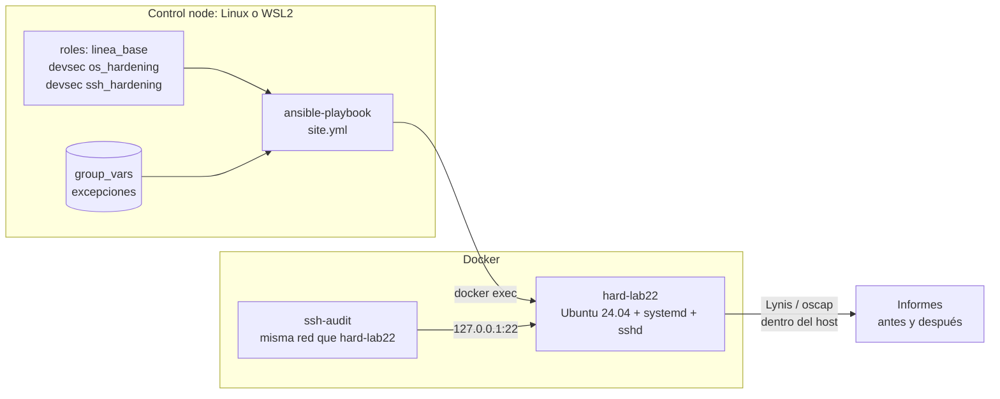

---
tags:
  - laboratorio
  - hardening
  - ansible
  - seguridad
  - cumplimiento
---

# Lab 22: Endurecer un servidor Linux con Ansible y medirlo con Lynis y OpenSCAP

> Mide un Ubuntu 24.04 de práctica con Lynis, OpenSCAP y ssh-audit, endurécelo con devsec.hardening y un rol propio (primero en modo check), comprueba la idempotencia, registra dos excepciones con caducidad y vuelve a medir.

| Nivel | Duración | Costo | Requisitos |
| --- | --- | --- | --- |
| Avanzado | ~90 min | Gratis (la variante con VM local también; con la EC2 del Lab 17, capa gratuita) | Lab 10, Linux o WSL2, Docker, Python 3.12+ |

!!! info "Qué vas a aprender"
    - Tomar una **línea base** de seguridad con Lynis (hardening index), OpenSCAP (perfil CIS de SCAP Security Guide) y ssh-audit.
    - Aplicar los roles `os_hardening` y `ssh_hardening` de **devsec.hardening** junto con un rol propio, sin tocar el código de terceros.
    - Previsualizar los cambios con `--check --diff`, aplicarlos y demostrar la **idempotencia** con `changed=0`.
    - Registrar **excepciones** como variables con justificación, dueño y fecha de caducidad, y hacer que el playbook falle si una vence.
    - Distinguir qué controles no se pueden aplicar en un contenedor (kernel, montajes, auditd, firewall) y cómo aplicarlos en una VM.
    - Leer los resultados con criterio: por qué una herramienta sube y otra no se mueve.

!!! warning "Costos y seguridad"
    - **Nunca ejecutes este playbook contra tu propio equipo ni contra tu distribución de WSL**: cambia SSH, PAM, `login.defs` y permisos del sistema. Todo el lab ocurre dentro del contenedor `hard-lab22` o de una VM desechable.
    - El contenedor arranca systemd con acceso de escritura a `/sys/fs/cgroup` (sin `--privileged`). Es una práctica habitual para probar roles, pero no la uses para cargas reales.
    - No le des `--privileged` para "arreglar" los sysctl: el kernel del contenedor es el de Docker Desktop/WSL2 y lo cambiarías para todos.
    - La variante con la EC2 del [Lab 17](../cloud/aws-vpc-ec2.md) usa una cuenta de pruebas con la alerta de presupuesto del [Lab 00, parte 2](../fundamentos/preparar-cuentas-cloud.md#paso-2-configura-las-alertas-de-presupuesto); bórrala al terminar.

## Antes de empezar

| Herramienta | Versión probada | Notas |
| --- | --- | --- |
| ansible-core / ansible-lint | 2.21.5 / 26.10.1 | El entorno virtual del [Lab 10](../devops/ansible-configuracion.md) |
| Colecciones | `devsec.hardening` 11.0.0, `community.docker` 5.4.0 | Se instalan en el paso 1 (devsec trae `ansible.posix` y `community.general`) |
| Docker | 28.5.1 (Docker Desktop con backend WSL2) | `docker info` debe responder desde tu terminal de Linux/WSL |
| Lynis | 3.1.7 | Tarball oficial de CISOfy, se copia al contenedor |
| OpenSCAP / SCAP Security Guide | `oscap` 1.3.9 (paquete de Ubuntu 24.04) / contenido 0.1.82 | El contenido trae el perfil *CIS Ubuntu Linux 24.04 LTS Benchmark for Level 1 - Server* |
| ssh-audit | 3.9.0 (imagen `positronsecurity/ssh-audit:v3.9.0`) | Analiza los algoritmos que ofrece sshd |

Trabaja en `~/lab22`, en el sistema de archivos de Linux (no en `/mnt/c`, ver el Lab 10). Teoría recomendada: [Fundamentos de hardening](../../devsecops/hardening/fundamentos-hardening.md), [Hardening de Linux](../../devsecops/hardening/hardening-linux.md) (qué hace cada control) y [Hardening como código](../../devsecops/hardening/hardening-como-codigo.md) (roles, excepciones, golden images). Repaso de Ansible: [Configuration management con Ansible](../../devops/iac/ansible.md) y [Anatomía de los archivos de Ansible](../../recursos/anatomia/ansible.md).

!!! note "¿Por qué Ubuntu 24.04 y no 26.04?"
    Ubuntu 26.04 LTS ya existe, pero al escribir este lab SCAP Security Guide 0.1.82 todavía no trae perfiles CIS para 26.04 (su datastream está casi vacío) y los roles CIS de ansible-lockdown para 26.04 figuran como "coming soon". Para medir contra CIS, 24.04 es la opción madura.

## Arquitectura



Ansible entra al contenedor con `docker exec`, así que endurecer SSH no te deja fuera. Lynis y OpenSCAP se ejecutan dentro del host; ssh-audit, desde otro contenedor que comparte su red.

## Paso a paso

### Paso 1: Preparar el proyecto y las colecciones

Reutiliza el entorno virtual del Lab 10 (o crea uno igual) y fija las colecciones **dentro del proyecto**, para que cada proyecto tenga sus versiones y `ansible-lint` pueda ignorarlas.

```bash
mkdir -p ~/lab22 && cd ~/lab22
source ~/lab10/.venv/bin/activate
```

```yaml title="requirements.yml"
collections:
  - name: community.docker
    version: ">=5.0.0,<6.0.0"
  - name: devsec.hardening
    version: "11.0.0"        # versión exacta: actualizarla es un cambio revisado
```

```ini title="ansible.cfg"
[defaults]
inventory = inventory/hosts.yml
roles_path = roles
# Colecciones dentro del proyecto: versiones fijas por proyecto
collections_path = ./collections
callback_result_format = yaml

[connection]
# Menos llamadas a docker exec/ssh por tarea: más rápido
pipelining = true
```

```yaml title=".ansible-lint"
---
profile: production
# No revisar el código de terceros instalado con ansible-galaxy
exclude_paths:
  - collections/
```

```bash
ansible-galaxy collection install -r requirements.yml -p collections
ansible-galaxy collection list -p collections | grep -E "devsec|community.docker"
```

```text
community.docker                         5.4.0
devsec.hardening                         11.0.0
```

### Paso 2: Construir el host de práctica

Un contenedor normal no tiene systemd, y sin systemd los handlers de `ssh_hardening` (reiniciar sshd) fallan. Esta imagen arranca `/sbin/init` como un servidor de verdad. Incluye `python3-apt`, que el módulo `apt` necesita para el modo check, y `rsyslog`, que crea el grupo `syslog` que `os_hardening` usa en `/var/log`.

```dockerfile title="imagen/Dockerfile"
# Host de práctica: Ubuntu 24.04 LTS con systemd y OpenSSH, sin endurecer
FROM ubuntu:24.04
ENV container=docker DEBIAN_FRONTEND=noninteractive
RUN apt-get update \
 && apt-get install -y --no-install-recommends systemd systemd-sysv openssh-server python3 python3-apt rsyslog sudo ca-certificates \
 && apt-get clean && rm -rf /var/lib/apt/lists/* \
 && systemctl enable ssh \
 && systemctl mask systemd-logind.service getty.target console-getty.service
STOPSIGNAL SIGRTMIN+3
CMD ["/sbin/init"]
```

```bash
docker build -t hard-lab22-ubuntu:24.04 imagen/
docker run -d -t --name hard-lab22 --hostname hard-lab22 \
  --cgroupns=host --tmpfs /run --tmpfs /run/lock \
  -v /sys/fs/cgroup:/sys/fs/cgroup:rw \
  hard-lab22-ubuntu:24.04
docker exec hard-lab22 systemctl is-system-running
docker exec hard-lab22 systemctl is-active ssh
```

```text
running
active
```

- `--tmpfs /run` y `/run/lock`: systemd necesita esos directorios en memoria.
- `--cgroupns=host` y `/sys/fs/cgroup` con `rw`: systemd crea sus cgroups. Con el montaje en solo lectura no arranca (`Failed to allocate manager object: Read-only file system`).
- `-t`: systemd espera una consola.

Se probó con Docker Desktop en cgroup v1 (`docker info --format '{{.CgroupVersion}}'` devuelve `1`). Con cgroup v2 la misma orden suele funcionar, pero no se probó aquí; si systemd no arranca, usa la variante con VM del paso 13.

### Paso 3: Medir antes con Lynis

Sin una medición inicial no podrás demostrar qué mejoró. Descarga Lynis, **verifica el checksum** publicado por CISOfy y cópialo al contenedor:

```bash
mkdir -p herramientas && cd herramientas
curl -sSfLO https://downloads.cisofy.com/lynis/lynis-3.1.7.tar.gz
echo "b5314a07fd85fa3ffc7da57b508f0108ec3280d84e4af823f805d95cbbc2428c  lynis-3.1.7.tar.gz" | sha256sum -c
cd ..
docker cp herramientas/lynis-3.1.7.tar.gz hard-lab22:/opt/
docker exec hard-lab22 sh -c 'cd /opt && tar xzf lynis-3.1.7.tar.gz && chown -R root:root lynis && rm lynis-3.1.7.tar.gz'
docker exec -w /opt/lynis hard-lab22 ./lynis audit system --quick --no-colors > lynis-antes.txt
grep -E "warnings|Suggestions|Hardening index|Tests performed" lynis-antes.txt
```

```text
lynis-3.1.7.tar.gz: OK
  Great, no warnings
  Suggestions (43):
  Hardening index : 62 [############        ]
  Tests performed : 236
```

`chown root:root` hace falta porque Lynis se niega a ejecutar archivos de otro dueño cuando corre como root. Entre las 43 sugerencias verás `Consider hardening SSH configuration [SSH-7408]` (nueve veces), `Add a legal banner to /etc/issue [BANN-7126]`, `Default umask in /etc/login.defs could be more strict like 027 [AUTH-9328]` y `Enable auditd to collect audit information [ACCT-9628]`.

### Paso 4: Medir antes con OpenSCAP

Lynis tiene su propia lista; OpenSCAP mide contra una baseline concreta. Instala el escáner en el contenedor y copia el datastream de Ubuntu 24.04 de SCAP Security Guide (el zip pesa unos 180 MB):

```bash
cd herramientas
curl -sSfLO https://github.com/ComplianceAsCode/content/releases/download/v0.1.82/scap-security-guide-0.1.82.zip
curl -sSfLO https://github.com/ComplianceAsCode/content/releases/download/v0.1.82/scap-security-guide-0.1.82.zip.sha512
sha512sum -c scap-security-guide-0.1.82.zip.sha512
unzip -j scap-security-guide-0.1.82.zip scap-security-guide-0.1.82/ssg-ubuntu2404-ds.xml
cd ..
docker exec hard-lab22 sh -c 'apt-get update -qq && apt-get install -y -qq --no-install-recommends openscap-scanner'
docker cp herramientas/ssg-ubuntu2404-ds.xml hard-lab22:/opt/
docker exec hard-lab22 oscap info --profiles /opt/ssg-ubuntu2404-ds.xml
```

```text
xccdf_org.ssgproject.content_profile_cis_level1_server:CIS Ubuntu Linux 24.04 LTS Benchmark for Level 1 - Server
xccdf_org.ssgproject.content_profile_cis_level1_workstation:CIS Ubuntu Linux 24.04 LTS Benchmark for Level 1 - Workstation
xccdf_org.ssgproject.content_profile_cis_level2_server:CIS Ubuntu Linux 24.04 LTS Benchmark for Level 2 - Server
xccdf_org.ssgproject.content_profile_cis_level2_workstation:CIS Ubuntu Linux 24.04 LTS Benchmark for Level 2 - Workstation
xccdf_org.ssgproject.content_profile_stig:Canonical Ubuntu 24.04 LTS Security Technical Implementation Guide (STIG) V1R5
```

```bash
docker exec hard-lab22 oscap xccdf eval \
  --profile xccdf_org.ssgproject.content_profile_cis_level1_server \
  --results /root/oscap-antes.xml --report /root/oscap-antes.html \
  /opt/ssg-ubuntu2404-ds.xml > oscap-antes.txt
awk -F'\t' '/^Result/{c[$2]++} END{for(k in c) print c[k], k}' oscap-antes.txt
docker exec hard-lab22 grep -o '<score[^>]*>[^<]*</score>' /root/oscap-antes.xml
```

```text
132 pass
270 notapplicable
6 fail
<score system="urn:xccdf:scoring:default" maximum="100.000000">95.605164</score>
```

Un 95,6 sobre 100 parece excelente, pero fíjate en el **notapplicable**: SCAP Security Guide detecta que es un contenedor y no evalúa 270 reglas (particiones, kernel, auditd, AIDE, sudo, PAM, banners…). El *score* solo cuenta las 138 que sí evaluó. `oscap` devuelve el código de salida 2 cuando falla alguna regla, lo que sirve para cortar un pipeline. Para ver el informe HTML: `docker cp hard-lab22:/root/oscap-antes.html .`.

### Paso 5: Medir el servidor SSH con ssh-audit

ssh-audit se conecta al puerto 22 y clasifica cada algoritmo que ofrece el servidor. `--network container:hard-lab22` lo pone en la misma red que el host, sin publicar puertos:

```bash
docker run --rm --network container:hard-lab22 positronsecurity/ssh-audit:v3.9.0 -n 127.0.0.1 > sshaudit-antes.txt
grep -E "\[fail\]" sshaudit-antes.txt
```

```text
(kex) ecdh-sha2-nistp256                    -- [fail] using elliptic curves that are suspected as being backdoored by the U.S. National Security Agency
(kex) ecdh-sha2-nistp384                    -- [fail] using elliptic curves that are suspected as being backdoored by the U.S. National Security Agency
(kex) ecdh-sha2-nistp521                    -- [fail] using elliptic curves that are suspected as being backdoored by the U.S. National Security Agency
(key) ecdsa-sha2-nistp256                   -- [fail] using elliptic curves that are suspected as being backdoored by the U.S. National Security Agency
(mac) hmac-sha1-etm@openssh.com             -- [fail] using broken SHA-1 hash algorithm
(mac) hmac-sha1                             -- [fail] using broken SHA-1 hash algorithm
```

Seis algoritmos marcados como `fail` y 18 líneas con `warn` en el OpenSSH 9.6 por defecto de Ubuntu 24.04.

### Paso 6: Inventario, baseline y límites del contenedor

El inventario declara el host y cómo conectarse. Las variables de la baseline van en `group_vars` (valen igual para el contenedor y para una VM); las limitaciones propias del contenedor, en `host_vars`.

```yaml title="inventory/hosts.yml"
all:
  children:
    linux:
      hosts:
        hard-lab22:
          # Contenedor de práctica: conexión con "docker exec"
          ansible_connection: community.docker.docker
          ansible_python_interpreter: /usr/bin/python3
```

```yaml title="inventory/group_vars/linux/hardening.yml"
---
# Línea base del equipo para servidores Linux (aplica a contenedor y VM)

# --- ssh_hardening (devsec.hardening) ---
ssh_permit_root_login: "no"
ssh_server_password_login: false
ssh_max_auth_retries: 3
ssh_allow_groups: "sshusers"        # solo este grupo entra por SSH
ssh_banner: true
ssh_banner_path: /etc/issue.net
ssh_client_alive_interval: 300
# EXC-001: valor exceptuado (ver linea_base_excepciones)
ssh_allow_tcp_forwarding: "local"

# --- os_hardening (devsec.hardening) ---
# EXC-002: valor exceptuado (ver linea_base_excepciones)
os_auth_pw_max_age: 99999

# --- Excepciones aprobadas: justificación, dueño y caducidad ---
linea_base_excepciones:
  - id: EXC-001
    control: "SSH AllowTcpForwarding distinto de 'no'"
    valor: "local"
    motivo: "El equipo de datos abre túneles locales a PostgreSQL a través del bastión"
    mitigacion: "Solo el grupo sshusers entra por SSH; acceso al bastión solo desde la VPN"
    dueno: "equipo-datos"
    aprobada_por: "seguridad-ti"
    caduca: "2027-03-31"
  - id: EXC-002
    control: "Caducidad de contraseñas (PASS_MAX_DAYS)"
    valor: "99999"
    motivo: "Acceso solo con llave SSH; NIST SP 800-63B desaconseja la rotación periódica forzada"
    mitigacion: "PasswordAuthentication no; contraseñas locales bloqueadas"
    dueno: "plataforma"
    aprobada_por: "seguridad-ti"
    caduca: "2027-10-31"
```

```yaml title="inventory/host_vars/hard-lab22.yml"
---
# Controles que NO se pueden aplicar dentro de un contenedor (los aplica la VM).
# No son excepciones: es una limitación del entorno de práctica.
os_sysctl_enabled: false   # el kernel es del host: sysctl no se aplica por contenedor
os_auditd_enabled: false   # auditd necesita el subsistema de auditoría del kernel
os_mnt_dev_enabled: false      # remontar /dev, /dev/shm y /run exige CAP_SYS_ADMIN
os_mnt_dev_shm_enabled: false
os_mnt_run_enabled: false
os_minimize_access_enabled: false  # incluye remontar /proc con hidepid: falla sin CAP_SYS_ADMIN
```

!!! info "Qué no se puede endurecer dentro de un contenedor"
    | Control | Por qué no aplica aquí | Dónde se aplica |
    | --- | --- | --- |
    | **sysctl** del kernel (`kernel.kptr_restrict`, `net.ipv4.*`…) | El contenedor usa el kernel de la VM de Docker Desktop/WSL2; cambiarlo afectaría a todo lo que corre en ella | En la VM, con `os_sysctl_enabled: true` (por defecto) |
    | **Montajes** (`/tmp`, `/dev/shm` con `nodev,nosuid,noexec`, `/proc` con `hidepid`) | Docker define los montajes y remontar exige `CAP_SYS_ADMIN` | En la VM: `fstab` y particiones propias |
    | **auditd** | Hay un único subsistema de auditoría por kernel y necesita `CAP_AUDIT_CONTROL` | En la VM, con `os_auditd_enabled: true` |
    | **Firewall local** (nftables/ufw) | La red del contenedor la gestiona Docker | En la VM, o con security groups/NSG/firewall rules en la nube |
    | **Particiones separadas** (`/var`, `/home`) | El contenedor no tiene discos | Al crear la VM o la imagen |

    `os_minimize_access_enabled: false` desactiva también el endurecimiento de permisos de `/etc/shadow` y `su`, porque el rol los agrupa con el remontaje de `/proc`. Es un precio que se paga solo en el contenedor.

### Paso 7: Un rol propio para lo que es de tu organización

Los roles de terceros se ajustan con variables; lo que es solo tuyo (banner legal, paquetes vetados, grupo de SSH, control de excepciones) va en un rol propio pequeño. Así puedes actualizar devsec.hardening sin tocar su código.

```bash
mkdir -p roles/linea_base/{defaults,tasks,meta}
```

```yaml title="roles/linea_base/defaults/main.yml"
---
linea_base_banner: |
  Sistema privado. Solo personal autorizado.
  Toda la actividad se registra y puede ser auditada.
  Authorized access only. All activity may be monitored and reported.
linea_base_paquetes_prohibidos:
  - telnet
  - rsh-client
  - talk
  - nis
linea_base_paquetes_requeridos:
  - unattended-upgrades
  - apt-show-versions
# Usuarios que deben poder entrar por SSH (ssh_allow_groups: sshusers)
linea_base_usuarios_ssh: []
linea_base_excepciones: []
```

```yaml title="roles/linea_base/tasks/main.yml"
---
- name: Comprobar que ninguna excepción ha caducado
  ansible.builtin.assert:
    that:
      - item.caduca is version(ansible_facts['date_time']['date'], '>=')
    fail_msg: >-
      La excepción {{ item.id }} ({{ item.control }}) caducó el {{ item.caduca }}.
      Renuévala con su dueño ({{ item.dueno }}) o elimínala.
    success_msg: "{{ item.id }} vigente hasta {{ item.caduca }}"
    quiet: true
  loop: "{{ linea_base_excepciones }}"
  loop_control:
    label: "{{ item.id }}"
  tags: [excepciones]

- name: Banner legal en la consola y en SSH
  ansible.builtin.copy:
    content: "{{ linea_base_banner }}"
    dest: "{{ item }}"
    owner: root
    group: root
    mode: "0644"
  loop:
    - /etc/issue
    - /etc/issue.net

- name: Quitar paquetes que no deben estar en un servidor
  ansible.builtin.apt:
    name: "{{ linea_base_paquetes_prohibidos }}"
    state: absent
    purge: true

- name: Instalar parches automáticos y herramientas de inventario
  ansible.builtin.apt:
    name: "{{ linea_base_paquetes_requeridos }}"
    state: present
    update_cache: true
    cache_valid_time: 3600

- name: Activar parches de seguridad automáticos
  ansible.builtin.copy:
    dest: /etc/apt/apt.conf.d/20auto-upgrades
    content: |
      APT::Periodic::Update-Package-Lists "1";
      APT::Periodic::Unattended-Upgrade "1";
    owner: root
    group: root
    mode: "0644"

- name: Grupo autorizado a entrar por SSH
  ansible.builtin.group:
    name: sshusers
    state: present

- name: Añadir los usuarios autorizados al grupo de SSH
  ansible.builtin.user:
    name: "{{ item }}"
    groups: sshusers
    append: true
  loop: "{{ linea_base_usuarios_ssh }}"
```

```yaml title="roles/linea_base/meta/main.yml"
---
galaxy_info:
  author: dani
  description: Línea base propia que complementa devsec.hardening
  license: MIT
  min_ansible_version: "2.17"
  platforms:
    - name: Ubuntu
      versions:
        - noble
dependencies: []
```

- La comparación `is version(..., '>=')` funciona con fechas ISO (`AAAA-MM-DD`) porque compara campo a campo.
- La línea en inglés del banner no es decorativa: Lynis comprueba el banner buscando palabras clave en inglés (*authorized*, *monitored*…). Con el texto solo en español, `BANN-7126` seguía marcado.

### Paso 8: El playbook, con un parche temporal

```yaml title="site.yml"
---
- name: Endurecer servidores Linux
  hosts: linux
  become: true
  pre_tasks:
    # Parche temporal: devsec.hardening 11.0.0 no recarga systemd después de quitar
    # la activación por socket de SSH en Ubuntu 24.04+, y sshd no arranca.
    # Issue dev-sec/ansible-collection-hardening#941. Quitar cuando salga el arreglo.
    - name: Quitar la dependencia ssh.service -> ssh.socket (workaround devsec 941)
      ansible.builtin.file:
        path: "{{ item }}"
        state: absent
      loop:
        - /etc/systemd/system/ssh.service.requires/ssh.socket
        - /etc/systemd/system/sockets.target.wants/ssh.socket
      notify: Recargar systemd

    - name: Recargar systemd antes de aplicar los roles
      ansible.builtin.meta: flush_handlers

  roles:
    - role: linea_base
    - role: devsec.hardening.os_hardening
    - role: devsec.hardening.ssh_hardening

  handlers:
    - name: Recargar systemd
      ansible.builtin.systemd_service:
        daemon_reload: true
```

!!! danger "Lo que pasó sin el parche"
    En la primera prueba, sin las `pre_tasks`, `ssh_hardening` enmascaró `ssh.socket`, borró los enlaces pero no recargó systemd, y la tarea *Ensure ssh service is started after disabling socket activation* falló con `Unit ssh.socket is masked`. Resultado: `systemctl is-active ssh` → `inactive`, nada escuchando en el puerto 22. En una VM por SSH habrías perdido el acceso. Es un bug conocido de la versión 11.0.0 ([issue #941](https://github.com/dev-sec/ansible-collection-hardening/issues/941), con un PR abierto). Por eso se prueba en un host desechable y se fija la versión del rol.

Comprueba la sintaxis y la calidad del código:

```bash
ansible-playbook site.yml --syntax-check
ansible-lint
```

```text
playbook: site.yml
...
Passed: 0 failure(s), 0 warning(s) in 10 files processed of 12 encountered. Profile 'production' was required, and it passed.
```

Sin el `exclude_paths` de `.ansible-lint`, ansible-lint revisa también la colección de devsec y devuelve 844 avisos `var-naming[no-role-prefix]` que no son tuyos.

### Paso 9: Previsualizar con --check --diff

```bash
ansible-playbook site.yml --check --diff | tee check.txt
grep -E "^\+(PermitRootLogin|PasswordAuthentication|MaxAuthTries|AllowGroups|AllowTcpForwarding|Banner|UMASK|PASS_MAX_DAYS)" check.txt
```

```text
+PermitRootLogin no
+MaxAuthTries 3
+PasswordAuthentication no
+AllowGroups sshusers
+AllowTcpForwarding local
+Banner /etc/issue.net
+UMASK             027
+PASS_MAX_DAYS     99999
...
PLAY RECAP *********************************************************************
hard-lab22                 : ok=95   changed=32   unreachable=0    failed=0    skipped=57   rescued=0    ignored=0
```

Lee el diff antes de aplicar: ahí ves que `AllowTcpForwarding local` y `PASS_MAX_DAYS 99999` son tus excepciones y no un error del rol. Recuerda que check mode **no** detectó ninguno de los dos fallos reales de este lab (el remontaje de `/proc` y el arranque de sshd): ambos solo aparecen al aplicar.

### Paso 10: Aplicar y comprobar la idempotencia

```bash
ansible-playbook site.yml
ansible-playbook site.yml      # segunda vez: no debe cambiar nada
```

```text
PLAY RECAP *********************************************************************
hard-lab22                 : ok=98   changed=32   unreachable=0    failed=0    skipped=54   rescued=0    ignored=0

PLAY RECAP *********************************************************************
hard-lab22                 : ok=94   changed=0    unreachable=0    failed=0    skipped=56   rescued=0    ignored=0
```

`changed=0` en la segunda ejecución demuestra que el playbook describe un estado y no una lista de comandos: es lo que permite reaplicarlo cada semana para corregir drift sin efectos secundarios. Valida también que sshd quedó bien:

```bash
docker exec hard-lab22 systemctl is-active ssh
docker exec hard-lab22 sshd -t && echo "sshd -t OK"
docker exec hard-lab22 sshd -T | grep -E '^(permitrootlogin|passwordauthentication|maxauthtries|allowgroups|allowtcpforwarding|banner) '
```

```text
active
sshd -t OK
maxauthtries 3
permitrootlogin no
passwordauthentication no
allowtcpforwarding local
banner /etc/issue.net
allowgroups sshusers
```

En este entorno cada ejecución tardó entre 7 y 14 minutos porque el proyecto estaba en `/mnt/c`; en el sistema de archivos de Linux es bastante más rápido.

### Paso 11: Medir después y comparar

Repite las tres mediciones con los mismos comandos de los pasos 3, 4 y 5 (cambiando `antes` por `despues`):

| Medición | Antes | Después |
| --- | --- | --- |
| Lynis hardening index | 62 | 75 |
| Lynis sugerencias | 43 | 24 |
| ssh-audit: algoritmos `fail` / líneas `warn` | 6 / 18 | 1 / 5 |
| OpenSCAP CIS L1 Server: pass / fail / notapplicable | 132 / 6 / 270 | 132 / 6 / 270 |
| OpenSCAP *score* | 95,61 | 95,61 |

Cómo leerlo:

- **Lynis sube** porque devsec.hardening cubre buena parte de lo que Lynis mira: `login.defs`, core dumps, módulos de red no usados (`dccp`, `sctp`…), SSH y banners.
- **Las excepciones aparecen en el informe**, como debe ser: `AllowTcpForwarding (set LOCAL to NO)` en `SSH-7408` y `Configure maximum password age` en `AUTH-9286`. Se leen junto a la lista de excepciones, no se "arreglan".
- **ssh-audit** pasa de 6 a 1 `fail`: queda la host key `ecdsa-sha2-nistp256`, que el rol mantiene por defecto (reto 1).
- **OpenSCAP no se mueve**, y es la lección más importante del lab. Los seis fallos (`Install pam_pwquality Package`, `pam_wheel` para `su`, umask en `/etc/profile` y en Bash, permisos de archivos de inicio de usuario y de logs) no los cubre devsec.hardening, que **no es una implementación de CIS**: por ejemplo, usa `passwdqc` donde CIS pide `pam_pwquality`. Y 270 reglas ni se evaluaron por ser un contenedor. Si tu objetivo es CIS, mide con CIS y aplica un rol CIS (ansible-lockdown o los playbooks de SCAP Security Guide).

### Paso 12: Probar que una excepción caducada detiene el playbook

Simula una excepción vencida pasando la lista por línea de comandos y ejecutando solo la etiqueta `excepciones`:

```bash
ansible-playbook site.yml --tags excepciones \
  -e '{"linea_base_excepciones":[{"id":"EXC-003","control":"prueba","dueno":"plataforma","caduca":"2026-09-30"}]}'
```

```text
TASK [linea_base : Comprobar que ninguna excepción ha caducado] ****************
[ERROR]: Task failed: Action failed: La excepción EXC-003 (prueba) caducó el 2026-09-30. Renuévala con su dueño (plataforma) o elimínala.
...
PLAY RECAP *********************************************************************
hard-lab22                 : ok=1    changed=0    unreachable=0    failed=1    skipped=0    rescued=0    ignored=0
```

Así la caducidad no depende de que alguien se acuerde: el pipeline se rompe el día que vence.

### Paso 13 (opcional): La variante con una VM

En una VM sí se aplican sysctl, auditd y montajes. Este paso no se ejecutó al escribir el lab: verifícalo con la documentación de la herramienta que uses.

=== "VM local (Multipass)"

    ```bash
    multipass launch 24.04 --name vm-lab22 --cpus 2 --memory 2G --disk 10G
    multipass info vm-lab22          # anota la IPv4
    ```

    Añade tu llave pública a `/home/ubuntu/.ssh/authorized_keys` de la VM (o pásala con `--cloud-init`) y crea el host en el inventario:

    ```yaml title="inventory/hosts.yml (añadido)"
            vm-lab22:
              ansible_host: 192.168.64.10        # la IP de multipass info
              ansible_user: ubuntu
              ansible_ssh_private_key_file: ~/.ssh/id_ed25519
    ```

    ```yaml title="inventory/host_vars/vm-lab22.yml"
    ---
    # Sin esto, AllowGroups sshusers te deja fuera de la VM
    linea_base_usuarios_ssh:
      - ubuntu
    ```

=== "EC2 del Lab 17"

    La instancia del [Lab 17](../cloud/aws-vpc-ec2.md) es Amazon Linux 2023, sin IP pública ni puerto 22: entras con Session Manager. Para Ansible necesitas el connection plugin `community.aws.aws_ssm` (usa un bucket S3 para transferir archivos) y añadir `ec2-user` a `linea_base_usuarios_ssh`. devsec.hardening soporta Amazon Linux solo en parte de sus roles, y SCAP Security Guide tiene un datastream propio para AL2023: revisa qué perfiles trae con `oscap info`.

Después, en la VM:

```bash
ansible-playbook site.yml --limit vm-lab22 --check --diff
ansible-playbook site.yml --limit vm-lab22
ssh ubuntu@<ip> 'sudo sysctl kernel.kptr_restrict; systemctl is-active auditd; findmnt -no OPTIONS /dev/shm'
```

Mantén una segunda sesión SSH abierta mientras aplicas y prueba un login nuevo **antes** de cerrarla. Para OpenSCAP usa el mismo datastream: ahora se evalúan las reglas que en el contenedor salían *notapplicable*.

## Verificación

| Comprobación | Resultado esperado |
| --- | --- |
| `docker exec hard-lab22 systemctl is-active ssh` | `active` |
| `docker exec hard-lab22 sshd -t` | Sin salida (configuración válida) |
| Segunda ejecución de `ansible-playbook site.yml` | `changed=0`, `failed=0` |
| `ansible-lint` | `Passed: 0 failure(s), 0 warning(s)` con perfil `production` |
| Hardening index de Lynis | Mayor que el inicial (62 → 75 en la prueba) |
| `ssh-audit` | 1 `fail` (la host key ECDSA) |
| `docker exec hard-lab22 grep ^UMASK /etc/login.defs` | `UMASK 027` |
| `docker exec hard-lab22 grep ^PASS_MAX_DAYS /etc/login.defs` | `PASS_MAX_DAYS 99999` (la excepción EXC-002) |
| Playbook con una excepción vencida | Falla en *Comprobar que ninguna excepción ha caducado* |

## Retos extra

1. **Quita la host key ECDSA** para que ssh-audit quede sin `fail`. Pista: la variable `ssh_host_key_files` de `ssh_hardening`; vuelve a ejecutar ssh-audit.
2. **Haz pasar los 6 fallos de OpenSCAP** con tareas en `linea_base`. Pista: mira la regla en el informe HTML; para `pam_pwquality` decide antes qué hacer con `passwdqc`, que instala devsec (variable `os_auth_pam_passwdqc_enable`).
3. **Lleva la verificación a CI**: un workflow de GitHub Actions con `actions/checkout@v7` que ejecute `ansible-lint` y Molecule con su *idempotence test* (ver [Lab 07](../devops/github-actions-ci.md) y [Molecule](../../devops/iac/pruebas-infraestructura.md#molecule-para-roles-de-ansible)).
4. **Compara con un rol CIS**: en la VM del paso 13, aplica `ansible-lockdown/UBUNTU24-CIS` con `run_audit: true` y compara su informe Goss con OpenSCAP.

## Limpieza

```bash
docker rm -f hard-lab22
docker image rm hard-lab22-ubuntu:24.04 positronsecurity/ssh-audit:v3.9.0
docker ps -a --filter name=hard-lab22 --format '{{.Names}}'     # no debe mostrar nada
```

Borra `~/lab22/herramientas` si no vas a repetir el lab (el zip de SCAP Security Guide ocupa unos 180 MB). La imagen `ubuntu:24.04` bórrala solo si no la usas en otros labs. Si hiciste la variante con VM: `multipass delete --purge vm-lab22`, o la limpieza del [Lab 17](../cloud/aws-vpc-ec2.md#limpieza).

## Problemas comunes

| Síntoma | Causa | Solución |
| --- | --- | --- |
| El contenedor se detiene al arrancar; `docker logs` muestra `Failed to allocate manager object: Read-only file system` | `/sys/fs/cgroup` montado en solo lectura | Usa `--cgroupns=host -v /sys/fs/cgroup:/sys/fs/cgroup:rw` como en el paso 2 |
| `python3-apt must be installed to use check mode` | El módulo `apt` en modo check necesita `python3-apt` en el host | Inclúyelo en la imagen (ya está en el Dockerfile) |
| `chgrp failed: failed to look up group syslog` en `/var/log` | La imagen no tiene `rsyslog` | Inclúyelo en la imagen (ya está) |
| `Error mounting /proc: umount: /proc: must be superuser to unmount` | `os_minimize_access` remonta `/proc` con `hidepid`; un contenedor no puede | `os_minimize_access_enabled: false` solo en `host_vars` del contenedor |
| `Unable to start service ssh: ... Unit ssh.socket is masked` y sshd parado | Bug de devsec.hardening 11.0.0 en Ubuntu 24.04+ (issue #941) | Las `pre_tasks` del paso 8, o fijar una versión con el arreglo |
| `ansible-lint` devuelve cientos de `var-naming[no-role-prefix]` | Está revisando la colección de terceros | `exclude_paths: [collections/]` en `.ansible-lint` |
| Lynis sigue pidiendo `Add a legal banner` | Busca palabras clave en inglés | Añade una línea en inglés al banner |
| Pierdes el acceso SSH a la VM después de aplicar | `AllowGroups sshusers` y tu usuario no está en el grupo | `linea_base_usuarios_ssh` en `host_vars`; entra por consola y corrige. Ver [Troubleshooting](../../devops/operacion/troubleshooting.md) |
| El *score* de OpenSCAP no cambia | Las reglas que mejora tu rol no están en el perfil, o salen *notapplicable* en el contenedor | Compara los conteos `pass`/`fail`/`notapplicable`, no solo el *score* |

## Información complementaria

- **Baseline y perfiles**: CIS Level 1 Server es el punto de partida habitual para servidores; Level 2 es más estricto y rompe más. Ver [Fundamentos de hardening](../../devsecops/hardening/fundamentos-hardening.md#niveles-y-perfiles-de-cis).
- **Qué hace cada control** (SSH, sysctl, montajes, auditd, PAM) y cómo verificarlo a mano: [Hardening de Linux](../../devsecops/hardening/hardening-linux.md).
- **Roles CIS frente a devsec.hardening**, golden images con Packer y control del drift con State Manager, Machine Configuration u OS policies: [Hardening como código](../../devsecops/hardening/hardening-como-codigo.md).
- **Excepciones**: dueño, justificación, control compensatorio y caducidad. Ver [Excepciones bien gestionadas](../../devsecops/hardening/fundamentos-hardening.md#excepciones-bien-gestionadas).
- **En el trabajo real**, el mismo playbook endurece la golden image en el pipeline y se reaplica de forma periódica en los servidores, el informe de OpenSCAP se guarda como evidencia de auditoría ([Cumplimiento y gobierno](../../devsecops/gobierno-y-respuesta/cumplimiento.md)) y nadie aplica un rol nuevo en producción sin haberlo pasado antes por un host desechable como este.

## Documentación oficial

- [devsec.hardening](https://github.com/dev-sec/ansible-collection-hardening) y sus roles [os_hardening](https://github.com/dev-sec/ansible-collection-hardening/tree/master/roles/os_hardening) y [ssh_hardening](https://github.com/dev-sec/ansible-collection-hardening/tree/master/roles/ssh_hardening)
- [ansible-lockdown UBUNTU24-CIS](https://github.com/ansible-lockdown/UBUNTU24-CIS)
- [Lynis](https://cisofy.com/lynis/) y [descargas con checksums](https://cisofy.com/downloads/lynis/)
- [OpenSCAP](https://www.open-scap.org/) y [SCAP Security Guide (ComplianceAsCode)](https://github.com/ComplianceAsCode/content)
- [ssh-audit](https://github.com/jtesta/ssh-audit)
- [Check mode y diff mode de Ansible](https://docs.ansible.com/ansible/latest/playbook_guide/playbooks_checkmode.html)
- [Connection plugin `community.docker.docker`](https://docs.ansible.com/ansible/latest/collections/community/docker/docker_connection.html)
- [ansible-lint: configuración](https://docs.ansible.com/projects/lint/configuring/)
- [Multipass](https://canonical.com/multipass/docs)

## Preguntas para verificar el aprendizaje

??? question "1. ¿Por qué Ansible se conecta al contenedor con `docker exec` y no por SSH, si lo que endureces es justo SSH?"
    Para no depender del servicio que estás cambiando. Si `ssh_hardening` deja sshd mal configurado o parado, por `docker exec` sigues dentro y puedes diagnosticarlo. En una VM el equivalente es una consola fuera de banda o una segunda sesión abierta.

??? question "2. `--check --diff` terminó sin errores, pero la ejecución real falló dos veces. ¿Cómo es posible?"
    Check mode no ejecuta los cambios: no intenta remontar `/proc` ni arrancar sshd después de enmascarar el socket. Solo compara el estado deseado con el actual. Es una vista previa útil, no una prueba; las pruebas se hacen aplicando en un host desechable.

??? question "3. Lynis pasó de 62 a 75 y OpenSCAP se quedó igual. ¿Mejoró la seguridad o no?"
    Mejoró en lo que mide Lynis (SSH, `login.defs`, core dumps, módulos, banners), pero no en los seis controles CIS que fallaban, porque devsec.hardening no implementa CIS. Cada herramienta mide contra su propia lista: elige la que corresponde a tu baseline y lee los conteos, no solo el número final.

??? question "4. ¿Qué diferencia hay entre `os_sysctl_enabled: false` en `host_vars/hard-lab22.yml` y `ssh_allow_tcp_forwarding: local` en `group_vars`?"
    La primera es una limitación del entorno de práctica: el control no se puede aplicar en un contenedor y sí se aplicará en la VM. La segunda es una **excepción** real a la baseline, válida para todos los servidores del grupo, y por eso tiene justificación, dueño y caducidad en `linea_base_excepciones`.

??? question "5. ¿Qué pasaría si aplicaras este playbook a una VM sin poner tu usuario en `linea_base_usuarios_ssh`?"
    `AllowGroups sshusers` solo deja entrar a los miembros de `sshusers`, que estaría vacío. Al reiniciarse sshd, las sesiones abiertas seguirían, pero cualquier login nuevo fallaría: te quedarías fuera en cuanto cerraras la sesión.

??? question "6. ¿Por qué el informe de Lynis sigue mostrando `AllowTcpForwarding (set LOCAL to NO)` y no debes corregirlo?"
    Es la excepción EXC-001, aprobada y con fecha de caducidad. El escáner debe seguir viéndola: si desapareciera del informe, nadie revisaría si sigue haciendo falta. El informe y la lista de excepciones se leen juntos.

??? question "7. ¿Por qué se fija `devsec.hardening` en `11.0.0` en vez de instalar siempre la última?"
    Una versión nueva puede cambiar valores por defecto o traer un bug como el de sshd en Ubuntu 24.04. Fijarla hace que el resultado sea reproducible y que actualizar sea un cambio revisado que pasa por las mismas pruebas.

??? question "8. Un compañero propone ejecutar el contenedor con `--privileged` para que se apliquen los sysctl. ¿Qué responderías?"
    Que el contenedor comparte el kernel de la VM de Docker Desktop/WSL2: los sysctl se aplicarían a esa VM y a todo lo que corre en ella, no solo al contenedor. Para probar controles de kernel se usa una VM desechable.

??? question "9. ¿Qué ganas al poner el control de caducidad de excepciones dentro del propio playbook?"
    Que una excepción vencida rompe la ejecución (y el pipeline) el día que caduca, en lugar de quedarse olvidada en una hoja de cálculo. Obliga a renovarla con su dueño o a eliminarla y aplicar el control.

## Notas relacionadas

**DevSecOps**

- [Fundamentos de hardening](../../devsecops/hardening/fundamentos-hardening.md)
- [Hardening de Linux](../../devsecops/hardening/hardening-linux.md)
- [Hardening como código](../../devsecops/hardening/hardening-como-codigo.md)
- [Hardening de servicios](../../devsecops/hardening/hardening-servicios.md)
- [Cumplimiento y gobierno](../../devsecops/gobierno-y-respuesta/cumplimiento.md)
- [CVE en Linux y sistemas](../../devsecops/vulnerabilidades/cve-linux-sistemas.md)
- [Seguridad de contenedores](../../devsecops/infraestructura-y-contenedores/seguridad-contenedores.md)

**Cloud**

- [Seguridad de máquinas virtuales](../../cloud/seguridad/seguridad-maquinas-virtuales.md)
- [Responsabilidad compartida](../../cloud/fundamentos/responsabilidad-compartida.md)

**DevOps**

- [Configuration management con Ansible](../../devops/iac/ansible.md)
- [Pruebas de infraestructura](../../devops/iac/pruebas-infraestructura.md)
- [Linux, redes y scripting](../../devops/fundamentos/linux-redes-scripting.md)
- [Docker: imágenes, multi-stage builds y Compose](../../devops/contenedores/docker.md)
- [Anatomía de los archivos de Ansible](../../recursos/anatomia/ansible.md)
- [Guía de comandos de Ansible](../../recursos/comandos/ansible.md)

**Networking**

- [Seguridad de red](../../networking/avanzado/seguridad-red.md)

**Labs**

- [Lab 10: Configurar servidores con Ansible](../devops/ansible-configuracion.md)
- [Lab 17: AWS: VPC con subnets públicas y privadas y una EC2](../cloud/aws-vpc-ec2.md)
- Lab anterior: [Lab 16: Auditar tu cuenta cloud con Prowler (CSPM)](cspm-prowler.md)
- Lab siguiente: [Lab 17: AWS: VPC con subnets públicas y privadas y una EC2](../cloud/aws-vpc-ec2.md)
