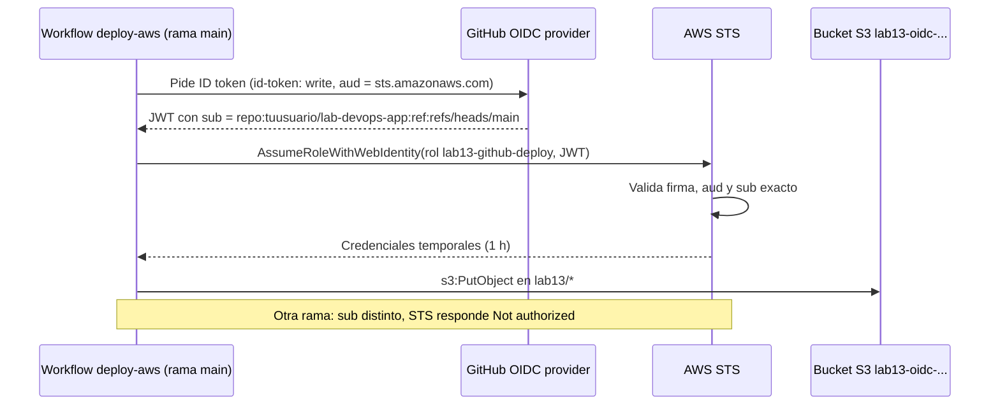

---
tags:
  - laboratorio
  - seguridad
  - iam
  - aws
  - github-actions
---

# Lab 13: Desplegar en AWS desde GitHub Actions con OIDC (sin llaves)

> Conecta el repositorio `lab-devops-app` con tu cuenta AWS de pruebas mediante OIDC: un rol con trust policy restringida por `sub`, permisos mínimos, un despliegue barato a S3 y la prueba de que una rama no autorizada no obtiene credenciales.

| Nivel | Duración | Costo | Requisitos |
| --- | --- | --- | --- |
| Intermedio | ~60 min | Capa gratuita (~0 USD si limpias) | Lab 00 ([parte 1](../fundamentos/preparar-entorno.md) y [parte 2](../fundamentos/preparar-cuentas-cloud.md)), [Lab 04](../devops/git-flujo-pull-request.md) y [Lab 07](../devops/github-actions-ci.md); AWS CLI v2, cuenta AWS de pruebas, repo `lab-devops-app`. Opcional: [Lab 09](../devops/terraform-aws-backend-remoto.md) para la variante con Terraform |

!!! info "Qué vas a aprender"
    - Crear el **IAM OIDC identity provider** de GitHub en AWS y entender qué valida.
    - Escribir una **trust policy** (política de confianza) que solo acepte tu repositorio y tu rama, con el formato exacto del claim `sub`.
    - Dar al rol el **least privilege** (mínimo privilegio): subir archivos a un prefijo de un bucket y nada más.
    - Usar `aws-actions/configure-aws-credentials` fijada por SHA para obtener credenciales temporales.
    - Comprobar que una rama no autorizada recibe `Not authorized to perform sts:AssumeRoleWithWebIdentity` y rastrear el acceso en CloudTrail.

!!! warning "Costos y seguridad"
    - Usa **la cuenta AWS de pruebas** del [Lab 00, parte 2](../fundamentos/preparar-cuentas-cloud.md), nunca la de producción, con la alerta de presupuesto activa.
    - IAM, STS y el proveedor OIDC no cuestan; S3 cobra por almacenamiento y peticiones, pero un archivo de texto queda dentro de la capa gratuita o en centavos. Aun así, haz la **Limpieza** al terminar.
    - La configuración inicial (proveedor, rol y bucket) la haces desde tu equipo con una identidad que puede gestionar IAM. El pipeline, en cambio, no tendrá **ninguna llave guardada**.

## Antes de empezar

- **AWS CLI v2** y el perfil **`lab-admin`** del [Lab 00, parte 2 (Paso 4)](../fundamentos/preparar-cuentas-cloud.md#paso-4-perfil-lab-admin-para-gestionar-iam-en-aws). Casi todo este lab es IAM (proveedor OIDC, rol y su política), y el perfil `lab` (PowerUserAccess) excluye a propósito la gestión de IAM: con él, `create-role` falla con `AccessDenied`. Por eso este lab se hace entero con `lab-admin`:
    1. En IAM Identity Center, vuelve a asignar `AdministratorAccess` (sesión de 1 hora) a `lab-tu-nombre` en tu cuenta de pruebas.
    2. Comprueba con `aws sts get-caller-identity --profile lab-admin` que el ARN contiene `AWSReservedSSO_AdministratorAccess`. Si aún no creaste el permission set o el perfil, sigue el Paso 4 de la parte 2 del Lab 00.
    3. Al terminar, quita esa asignación (ver **Limpieza**). Es el mismo principio que aplicas al pipeline: permisos amplios solo cuando hacen falta y durante poco tiempo.
- El repositorio **`lab-devops-app`** del [Lab 04](../devops/git-flujo-pull-request.md), con el ruleset `proteger-main` (nada llega a `main` sin PR) y el pipeline `ci.yml` del [Lab 07](../devops/github-actions-ci.md). Conserva también el environment `produccion` del Lab 07: lo usarás en el reto 1.
- [GitHub CLI](https://cli.github.com/) (`gh`) es opcional, solo para leer o personalizar el claim `sub`.
- Terraform 1.10+ si haces la variante opcional del paso 9 (validada con Terraform 1.17.0 y el provider `hashicorp/aws` 6.70.0, como el Lab 09).

Teoría recomendada: [Secretos e identidades](../../devsecops/identidades-y-pipeline/secretos-identidades.md#oidc-entre-el-pipeline-y-la-nube) (cómo funciona OIDC entre el pipeline y la nube), [Seguridad del pipeline](../../devsecops/identidades-y-pipeline/seguridad-pipeline.md) e [IAM: AWS, Azure y GCP](../../cloud/fundamentos/iam-comparativa.md). Guía de comandos: [AWS CLI](../../recursos/comandos/aws-cli.md).

## Arquitectura



Nada se guarda en GitHub salvo el ARN del rol, que no es secreto. Las credenciales nacen en cada ejecución y caducan solas.

## Paso a paso

### Paso 1: Define las variables del lab

Guarda los datos en variables para no repetirlos. Cambia `tuusuario` por tu usuario de GitHub.

=== "Linux/macOS"

    ```bash
    export AWS_PROFILE=lab-admin
    export AWS_REGION=us-east-1
    export ACCOUNT_ID=$(aws sts get-caller-identity --query Account --output text)
    export GH_OWNER=tuusuario
    export GH_REPO=lab-devops-app
    export BUCKET=lab13-oidc-$ACCOUNT_ID-$AWS_REGION
    echo $ACCOUNT_ID $BUCKET
    ```

=== "Windows (PowerShell)"

    ```powershell
    $env:AWS_PROFILE = "lab-admin"
    $env:AWS_REGION = "us-east-1"
    $ACCOUNT_ID = aws sts get-caller-identity --query Account --output text
    $GH_OWNER = "tuusuario"
    $GH_REPO = "lab-devops-app"
    $BUCKET = "lab13-oidc-$ACCOUNT_ID-$($env:AWS_REGION)"
    "$ACCOUNT_ID $BUCKET"
    ```

El nombre del bucket incluye la cuenta y la región porque los nombres de S3 son globales (como el `tfstate-lab09-...` del Lab 09): así no choca con el de otra persona.

### Paso 2: Descubre el `sub` exacto de tu repositorio

La trust policy compara el claim `sub` del token **carácter a carácter**, así que necesitas su formato exacto. Según el contexto del job, GitHub emite:

| Contexto del job | `sub` (formato clásico) |
| --- | --- |
| Rama | `repo:OWNER/REPO:ref:refs/heads/main` |
| Tag | `repo:OWNER/REPO:ref:refs/tags/v0.2.0` |
| Job con `environment:` | `repo:OWNER/REPO:environment:produccion` |
| Evento `pull_request` | `repo:OWNER/REPO:pull_request` |

Además hay dos formatos del prefijo:

| Repositorio | Prefijo del `sub` |
| --- | --- |
| Creado antes del 15 de julio de 2026 y sin cambios (formato clásico) | `repo:OWNER/REPO` |
| Creado después, renombrado o transferido después de esa fecha, o con la opción activada (formato inmutable) | `repo:OWNER@OWNER_ID/REPO@REPO_ID` |

El formato inmutable añade los IDs numéricos para que nadie que registre después un usuario o repositorio con el mismo nombre pueda hacerse pasar por ti. La forma más segura de saber cuál tienes es mirar un token real. Crea este workflow, que imprime **solo los claims**, nunca el token:

```yaml title=".github/workflows/oidc-claims.yml"
name: oidc-claims

on:
  workflow_dispatch:

permissions: {}

jobs:
  claims:
    runs-on: ubuntu-latest
    timeout-minutes: 5
    permissions:
      id-token: write   # pedir el ID token
    steps:
      - name: Mostrar los claims (nunca el token completo)
        run: |
          TOKEN=$(curl -sS -H "Authorization: bearer $ACTIONS_ID_TOKEN_REQUEST_TOKEN" \
            "$ACTIONS_ID_TOKEN_REQUEST_URL&audience=sts.amazonaws.com" | jq -r '.value')
          echo "$TOKEN" | cut -d. -f2 | python3 -c '
          import base64, json, sys
          p = sys.stdin.read().strip()
          claims = json.loads(base64.urlsafe_b64decode(p + "=" * (-len(p) % 4)))
          for k in ("sub", "aud", "repository", "repository_id", "repository_owner_id", "ref", "environment"):
              print(f"{k}: {claims.get(k)}")
          '
```

El ruleset del Lab 04 no deja hacer push a `main`, y el botón **Run workflow** solo aparece cuando el workflow está en la rama por defecto. Así que entra por un PR:

```bash
git switch main && git pull
git switch -c ci/oidc-claims
git add .github/workflows/oidc-claims.yml
git commit -m "ci: workflow para inspeccionar los claims de OIDC"
git push -u origin ci/oidc-claims
```

Abre el PR con ese mismo título (el check `verificar` exige Conventional Commits), espera los checks del Lab 07 e intégralo con **Squash and merge**. Después, en **Actions → oidc-claims → Run workflow** (rama `main`). Salida esperada (ejemplo con formato inmutable):

```text
sub: repo:tuusuario@1234567/lab-devops-app@987654321:ref:refs/heads/main
aud: sts.amazonaws.com
repository: tuusuario/lab-devops-app
repository_id: 987654321
repository_owner_id: 1234567
ref: refs/heads/main
environment: None
```

Copia la parte del `sub` **antes** de `:ref:` y guárdala:

=== "Linux/macOS"

    ```bash
    export SUB_PREFIX="repo:tuusuario@1234567/lab-devops-app@987654321"   # o repo:tuusuario/lab-devops-app
    ```

=== "Windows (PowerShell)"

    ```powershell
    $SUB_PREFIX = "repo:tuusuario@1234567/lab-devops-app@987654321"   # o repo:tuusuario/lab-devops-app
    ```

!!! tip "Personalizar el claim `sub`"
    Un administrador del repositorio (o de la organización) puede cambiar qué claims forman el `sub` con la API de GitHub. Para ver la configuración actual: `gh api repos/tuusuario/lab-devops-app/actions/oidc/customization/sub`. Con `PUT` y `{"use_default": false, "include_claim_keys": ["repo", "context", "job_workflow_ref"]}` el `sub` incluiría, por ejemplo, el workflow exacto; con `{"use_default": true}` vuelves al formato por defecto. Si lo cambias, la trust policy tiene que cambiar a la vez. En este lab no lo toques.

### Paso 3: Crea el bucket de destino

Es el "algo barato" que vas a desplegar. Los buckets nuevos ya tienen **Block Public Access** activado y cifrado SSE-S3 por defecto.

```bash
aws s3api create-bucket --bucket "$BUCKET"
aws s3api get-public-access-block --bucket "$BUCKET"
```

Fuera de `us-east-1`, añade `--create-bucket-configuration LocationConstraint=$AWS_REGION`. Salida esperada del segundo comando: las cuatro opciones de `PublicAccessBlockConfiguration` en `true`.

### Paso 4: Crea el proveedor OIDC de GitHub

El **IAM OIDC identity provider** le dice a tu cuenta: "confío en los tokens que emite `token.actions.githubusercontent.com` para la audiencia `sts.amazonaws.com`". Solo puede haber uno por URL en cada cuenta.

```bash
aws iam list-open-id-connect-providers      # ¿ya existe? entonces reutilízalo y salta el siguiente comando
aws iam create-open-id-connect-provider \
  --url https://token.actions.githubusercontent.com \
  --client-id-list sts.amazonaws.com
```

```text
{
    "OpenIDConnectProviderArn": "arn:aws:iam::111122223333:oidc-provider/token.actions.githubusercontent.com"
}
```

`--thumbprint-list` es opcional: si no lo pasas, IAM calcula y guarda la huella de la CA intermedia del servidor. Pero AWS ya no depende de ella para GitHub: valida el certificado TLS del endpoint de claves (JWKS) con su propia biblioteca de CA raíz de confianza, y solo recurre a la huella si el certificado no lo firma una de esas CA. Por eso las guías antiguas que pegaban una huella fija ya no hacen falta.

### Paso 5: Crea el rol con una trust policy restringida

Esta es la pieza de seguridad del lab. La condición sobre `aud` evita tokens emitidos para otro servicio; la condición sobre `sub` limita **qué repositorio y qué rama** pueden asumir el rol. Usa `StringEquals` (coincidencia exacta) siempre que sepas el valor; `StringLike` con comodines (`repo:tuusuario/lab-devops-app:*`) es válido, pero amplía el acceso a cualquier rama, tag o PR.

```json title="confianza.json"
{
  "Version": "2012-10-17",
  "Statement": [
    {
      "Effect": "Allow",
      "Principal": {
        "Federated": "arn:aws:iam::ACCOUNT_ID:oidc-provider/token.actions.githubusercontent.com"
      },
      "Action": "sts:AssumeRoleWithWebIdentity",
      "Condition": {
        "StringEquals": {
          "token.actions.githubusercontent.com:aud": "sts.amazonaws.com",
          "token.actions.githubusercontent.com:sub": "SUB_PREFIX:ref:refs/heads/main"
        }
      }
    }
  ]
}
```

Sustituye `ACCOUNT_ID` y `SUB_PREFIX` por tus valores y crea el rol:

=== "Linux/macOS"

    ```bash
    sed -i.bak "s|ACCOUNT_ID|$ACCOUNT_ID|; s|SUB_PREFIX|$SUB_PREFIX|" confianza.json
    aws iam create-role --role-name lab13-github-deploy \
      --assume-role-policy-document file://confianza.json \
      --max-session-duration 3600
    ```

=== "Windows (PowerShell)"

    ```powershell
    $json = (Get-Content -Raw confianza.json) -replace 'ACCOUNT_ID', $ACCOUNT_ID -replace 'SUB_PREFIX', $SUB_PREFIX
    [IO.File]::WriteAllText("$PWD\confianza.json", $json)   # UTF-8 sin BOM: la CLI no acepta el BOM
    aws iam create-role --role-name lab13-github-deploy `
      --assume-role-policy-document file://confianza.json `
      --max-session-duration 3600
    ```

!!! danger "IAM rechaza un `sub` abierto, pero no uno demasiado amplio"
    Cuando el principal es el proveedor OIDC de GitHub, IAM comprueba al crear o actualizar la trust policy que exista una condición sobre `token.actions.githubusercontent.com:sub` y que su valor no sea solo un comodín (`*` o `?`) ni nulo; si no, devuelve error. Pero `repo:tuusuario/*` sí se acepta y permite **cualquier rama de cualquier repositorio** tuyo. Restringe siempre a repositorio y rama (o environment).

### Paso 6: Dale permisos mínimos

El rol solo necesita escribir objetos bajo `lab13/` en tu bucket. `sts:GetCallerIdentity` no requiere permisos.

```json title="permisos.json"
{
  "Version": "2012-10-17",
  "Statement": [
    {
      "Sid": "SubirSoloAlPrefijoLab13",
      "Effect": "Allow",
      "Action": "s3:PutObject",
      "Resource": "arn:aws:s3:::BUCKET/lab13/*"
    }
  ]
}
```

```bash
sed -i.bak "s|BUCKET|$BUCKET|" permisos.json          # en PowerShell, como en el paso 5
aws iam put-role-policy --role-name lab13-github-deploy \
  --policy-name lab13-subir-a-s3 --policy-document file://permisos.json
aws iam get-role --role-name lab13-github-deploy --query Role.Arn --output text
```

Guarda el ARN que imprime el último comando.

### Paso 7: Configura el repositorio y el workflow

En `lab-devops-app`, ve a **Settings > Secrets and variables > Actions > Variables** y crea cuatro **variables** (no secretos: ninguno de estos valores da acceso por sí solo):

| Variable | Valor |
| --- | --- |
| `AWS_ROLE_ARN` | `arn:aws:iam::<cuenta>:role/lab13-github-deploy` |
| `AWS_REGION` | `us-east-1` |
| `AWS_ACCOUNT_ID` | Tu ID de cuenta |
| `LAB13_BUCKET` | El nombre de tu bucket |

Es un workflow aparte del `ci.yml` del Lab 07, con el mismo estilo: sin permisos por defecto, permisos por job y actions fijadas por SHA.

```yaml title=".github/workflows/deploy-aws.yml"
name: deploy-aws

on:
  push:
    branches: [main]
  workflow_dispatch:

# Sin permisos por defecto: el job pide solo lo que necesita
permissions: {}

concurrency:
  group: deploy-aws
  cancel-in-progress: false

jobs:
  deploy:
    runs-on: ubuntu-latest
    timeout-minutes: 10
    permissions:
      id-token: write   # pedir el ID token de OIDC
      contents: read    # hacer checkout
    steps:
      - uses: actions/checkout@3d3c42e5aac5ba805825da76410c181273ba90b1 # v7.0.1
        with:
          persist-credentials: false

      - name: Credenciales temporales de AWS vía OIDC
        uses: aws-actions/configure-aws-credentials@e1253824e5c10ff9df46874f81ed3ec929e19cfd # v6.3.0
        with:
          role-to-assume: ${{ vars.AWS_ROLE_ARN }}
          aws-region: ${{ vars.AWS_REGION }}
          role-session-name: gh-${{ github.run_id }}
          allowed-account-ids: ${{ vars.AWS_ACCOUNT_ID }}

      - name: ¿Quién soy?
        run: aws sts get-caller-identity

      - name: Desplegar (subir un archivo a S3)
        env:
          BUCKET: ${{ vars.LAB13_BUCKET }}
        run: |
          echo "Desplegado desde ${GITHUB_REF_NAME} (${GITHUB_SHA::7}) el $(date -u +%FT%TZ)" > despliegue.txt
          aws s3 cp despliegue.txt "s3://${BUCKET}/lab13/despliegue-${GITHUB_RUN_ID}.txt"
```

Detalles que importan:

- `id-token: write` es el permiso que deja pedir el token; sin él la action no puede usar OIDC.
- La action va **fijada por SHA** con la versión en un comentario ([Seguridad del pipeline](../../devsecops/identidades-y-pipeline/seguridad-pipeline.md#pinning-de-actions-por-sha)). Compruébalo como en el Lab 07: `git ls-remote --tags https://github.com/aws-actions/configure-aws-credentials.git | grep v6.3.0` devuelve `e1253824e5c10ff9df46874f81ed3ec929e19cfd`.
- `role-session-name` con el `run_id` hace que en CloudTrail sepas qué ejecución hizo cada llamada.
- `allowed-account-ids` hace fallar el job si, por error, el rol pertenece a otra cuenta.
- `aws-region` es obligatorio; el resto de inputs que no pongas usan su valor por defecto (sesión de 1 hora, hasta 12 reintentos).

Súbelo con un PR, igual que en el paso 2 (rama `ci/deploy-aws`, título `ci: despliegue a S3 con OIDC`). Al integrarlo en `main`, el `push` lanza `deploy-aws`. Salida esperada del job:

```text
Run aws sts get-caller-identity
{
    "UserId": "AROAEXAMPLEID:gh-1234567890",
    "Account": "111122223333",
    "Arn": "arn:aws:sts::111122223333:assumed-role/lab13-github-deploy/gh-1234567890"
}
upload: ./despliegue.txt to s3://lab13-oidc-111122223333-us-east-1/lab13/despliegue-1234567890.txt
```

### Paso 8: Demuestra que una rama no autorizada falla

Crea una rama y lanza el mismo workflow desde ella. Su token llevará `sub = ...:ref:refs/heads/no-autorizada`, que no coincide con la trust policy. El ruleset solo protege `main`, así que puedes subir la rama sin PR:

```bash
git switch main && git pull
git switch -c no-autorizada
git commit --allow-empty -m "test: rama no autorizada para OIDC"
git push -u origin no-autorizada
```

En **Actions > deploy-aws > Run workflow**, elige la rama `no-autorizada`. Resultado esperado: el paso de credenciales falla y los siguientes no se ejecutan. La action reintenta por defecto hasta 12 veces con espera creciente (por si el fallo fuera transitorio), así que puede tardar un par de minutos en rendirse:

```text
Retry AssumeRole: attempt 1 of 12 failed: Could not assume role with OIDC: Not authorized to perform sts:AssumeRoleWithWebIdentity. Retrying after 41ms.
...
Retry AssumeRole: reached max retries (12); giving up.
Error: Could not assume role with OIDC: Not authorized to perform sts:AssumeRoleWithWebIdentity
```

Ese error es la prueba de que el control funciona. Prueba también a cambiar en el workflow `s3://${BUCKET}/lab13/` por `s3://${BUCKET}/otro/` en la rama de un PR y lánzalo desde `main` tras integrarlo: el rol se asume, pero S3 responde `AccessDenied` porque el permiso solo cubre `lab13/*`. Revierte el cambio con otro PR.

### Paso 9 (opcional): Todo con Terraform

El mismo resultado como código, para que sea repetible y revisable en un PR. Ejecútalo en una carpeta aparte y **solo si no creaste los recursos a mano** (o bórralos antes: el proveedor OIDC solo puede existir una vez y el nombre del bucket es el mismo). Guarda el state en local o en el backend S3 del [Lab 09](../devops/terraform-aws-backend-remoto.md).

```hcl title="main.tf"
terraform {
  required_version = ">= 1.10"
  required_providers {
    aws = {
      source  = "hashicorp/aws"
      version = "~> 6.0"
    }
  }
}

provider "aws" {
  region  = var.region
  profile = var.aws_profile
  default_tags {
    tags = { lab = "lab13" }
  }
}

data "aws_caller_identity" "actual" {}

locals {
  bucket = "lab13-oidc-${data.aws_caller_identity.actual.account_id}-${var.region}"
}

# Sin thumbprint_list: es opcional y AWS valida con sus propias CA de confianza
resource "aws_iam_openid_connect_provider" "github" {
  url            = "https://token.actions.githubusercontent.com"
  client_id_list = ["sts.amazonaws.com"]
}

data "aws_iam_policy_document" "confianza" {
  statement {
    actions = ["sts:AssumeRoleWithWebIdentity"]
    principals {
      type        = "Federated"
      identifiers = [aws_iam_openid_connect_provider.github.arn]
    }
    condition {
      test     = "StringEquals"
      variable = "token.actions.githubusercontent.com:aud"
      values   = ["sts.amazonaws.com"]
    }
    condition {
      test     = "StringEquals"
      variable = "token.actions.githubusercontent.com:sub"
      values   = ["${var.github_sub_prefix}:ref:refs/heads/${var.rama}"]
    }
  }
}

resource "aws_iam_role" "deploy" {
  name                 = "lab13-github-deploy"
  assume_role_policy   = data.aws_iam_policy_document.confianza.json
  max_session_duration = 3600
}

data "aws_iam_policy_document" "permisos" {
  statement {
    sid       = "SubirSoloAlPrefijoLab13"
    actions   = ["s3:PutObject"]
    resources = ["${aws_s3_bucket.destino.arn}/lab13/*"]
  }
}

resource "aws_iam_role_policy" "deploy" {
  name   = "lab13-subir-a-s3"
  role   = aws_iam_role.deploy.id
  policy = data.aws_iam_policy_document.permisos.json
}

resource "aws_s3_bucket" "destino" {
  bucket        = local.bucket
  force_destroy = true # solo en laboratorio: permite borrar el bucket con objetos
}

resource "aws_s3_bucket_public_access_block" "destino" {
  bucket                  = aws_s3_bucket.destino.id
  block_public_acls       = true
  block_public_policy     = true
  ignore_public_acls      = true
  restrict_public_buckets = true
}

output "role_arn" { value = aws_iam_role.deploy.arn }
output "bucket" { value = aws_s3_bucket.destino.bucket }
```

```hcl title="variables.tf"
variable "region" {
  type    = string
  default = "us-east-1"
}

variable "aws_profile" {
  type    = string
  default = "lab-admin"
}

variable "github_sub_prefix" {
  description = "repo:OWNER/REPO o, en repos nuevos, repo:OWNER@OWNER_ID/REPO@REPO_ID"
  type        = string
  validation {
    condition     = startswith(var.github_sub_prefix, "repo:") && !strcontains(var.github_sub_prefix, "*")
    error_message = "Debe empezar por repo: y no llevar comodines."
  }
}

variable "rama" {
  type    = string
  default = "main"
}
```

```bash
terraform init
terraform fmt -check
terraform validate
terraform plan -var "github_sub_prefix=$SUB_PREFIX" -out lab13.tfplan
terraform apply lab13.tfplan
```

```text
Success! The configuration is valid.
...
Plan: 5 to add, 0 to change, 0 to destroy.
```

La `validation` impide por código el error más grave: un `sub` con comodines (`-var "github_sub_prefix=repo:tuusuario/*"` falla en el `plan` con `Debe empezar por repo: y no llevar comodines.`). Escanea este Terraform con `trivy config .` como en el [Lab 12](escaneos-en-pipeline.md): no sale nada sobre IAM; sí hallazgos del bucket (sin versioning, sin access logging, cifrado sin clave propia de KMS) que en un bucket de laboratorio puedes aceptar y documentar.

## Verificación

| Comprobación | Resultado esperado |
| --- | --- |
| Job `deploy-aws` en `main` | Verde; `get-caller-identity` muestra `assumed-role/lab13-github-deploy/gh-<run_id>` |
| `aws s3 ls s3://$BUCKET/lab13/` | Aparece `despliegue-<run_id>.txt` |
| Job lanzado desde `no-autorizada` | Falla en "Credenciales temporales" con `Not authorized to perform sts:AssumeRoleWithWebIdentity` |
| `aws iam get-role --role-name lab13-github-deploy --query Role.AssumeRolePolicyDocument` | Condiciones `aud` y `sub` con `StringEquals`, sin `*` |
| **Settings > Secrets and variables > Actions > Secrets** | Ningún secreto de AWS |

Rastrea quién entró, con el **Event history** de CloudTrail (gratis, 90 días de eventos de gestión, por región: consulta la región donde corre el workflow):

```bash
aws cloudtrail lookup-events \
  --lookup-attributes AttributeKey=EventName,AttributeValue=AssumeRoleWithWebIdentity \
  --max-results 5 --query 'Events[].{hora:EventTime,usuario:Username}'
```

Los eventos pueden tardar unos minutos en aparecer. En el detalle (`CloudTrailEvent`) verás en `userIdentity` el `sub` del token y en `requestParameters` el nombre de sesión `gh-<run_id>`. El intento de la rama `no-autorizada` también aparece, con `errorCode` `AccessDenied`.

## Retos extra

1. Usa el environment `produccion` del Lab 07, que solo admite tags `v*` y exige tu aprobación: añade `environment: produccion` al job, cambia el disparador a `push` de tags `v*` y añade a la trust policy el valor `SUB_PREFIX:environment:produccion` (en `StringEquals` una lista de valores funciona como "cualquiera de"). Pista: con environment, el `sub` deja de llevar la rama o el tag ([Environments y aprobaciones](../../devsecops/identidades-y-pipeline/seguridad-pipeline.md#environments-y-aprobaciones)).
2. Crea un segundo rol de solo lectura para los pull requests (`sub = SUB_PREFIX:pull_request`) que solo pueda hacer `s3:ListBucket`, y úsalo en un workflow de `pull_request`.
3. Añade `inline-session-policy` a la action para recortar aún más los permisos de una ejecución concreta.
4. Repite el lab con Azure (federated credential) o Google Cloud (Workload Identity Federation) siguiendo las pestañas de [Secretos e identidades](../../devsecops/identidades-y-pipeline/secretos-identidades.md#oidc-entre-el-pipeline-y-la-nube).

## Limpieza

Borra todo en este orden (el bucket debe estar vacío antes de eliminarlo), con el perfil `lab-admin`:

=== "Hecho a mano (CLI)"

    ```bash
    aws s3 rm "s3://$BUCKET" --recursive
    aws s3api delete-bucket --bucket "$BUCKET"
    aws iam delete-role-policy --role-name lab13-github-deploy --policy-name lab13-subir-a-s3
    aws iam delete-role --role-name lab13-github-deploy
    # Solo si creaste el proveedor en este lab y ningún otro rol lo usa:
    aws iam delete-open-id-connect-provider \
      --open-id-connect-provider-arn arn:aws:iam::$ACCOUNT_ID:oidc-provider/token.actions.githubusercontent.com
    ```

=== "Hecho con Terraform"

    ```bash
    terraform destroy -var "github_sub_prefix=$SUB_PREFIX"
    ```

Comprueba que no queda nada:

```bash
aws s3api head-bucket --bucket "$BUCKET"                       # esperado: error 404 (Not Found)
aws iam get-role --role-name lab13-github-deploy               # esperado: NoSuchEntity
aws iam list-open-id-connect-providers                         # esperado: sin el de GitHub (si lo borraste)
```

En GitHub, borra las variables `AWS_ROLE_ARN`, `AWS_REGION`, `AWS_ACCOUNT_ID` y `LAB13_BUCKET`, borra `deploy-aws.yml` y `oidc-claims.yml` con un PR, y la rama `no-autorizada` (`git push origin --delete no-autorizada`). En IAM Identity Center, quita la asignación de `AdministratorAccess` a tu usuario y vuelve al perfil `lab` para el día a día (`export AWS_PROFILE=lab`). Comprueba que quedó retirada: `aws sts get-caller-identity --profile lab-admin` debe fallar con `ForbiddenException ... No access`.

## Problemas comunes

| Síntoma | Causa | Solución |
| --- | --- | --- |
| `AccessDenied ... is not authorized to perform: iam:CreateOpenIDConnectProvider` (o `iam:CreateRole`) | Usas el perfil `lab` con PowerUserAccess, que no gestiona IAM | Usa el perfil `lab-admin` (ver **Antes de empezar** y el [Paso 4 del Lab 00, parte 2](../fundamentos/preparar-cuentas-cloud.md#paso-4-perfil-lab-admin-para-gestionar-iam-en-aws)) |
| `ForbiddenException ... GetRoleCredentials operation: No access` con `--profile lab-admin` | La asignación de `AdministratorAccess` no está activa | Asígnala de nuevo en IAM Identity Center (**Antes de empezar**, punto 1) |
| `GH013: Repository rule violations` al hacer push | Intentaste subir el workflow directo a `main` | Es el ruleset del Lab 04: rama + PR |
| No aparece el botón **Run workflow** | El workflow con `workflow_dispatch` aún no está en `main` | Intégralo primero con un PR |
| `Not authorized to perform sts:AssumeRoleWithWebIdentity` desde `main` | El `sub` de la trust policy no coincide (formato clásico vs inmutable, mayúsculas, rama) o el `aud` no es `sts.amazonaws.com` | Ejecuta `oidc-claims` y copia el `sub` exacto |
| `It looks like you might be trying to authenticate with OIDC. Did you mean to set the id-token permission?` y luego `Credentials could not be loaded, please check your action inputs` | Falta `id-token: write` en los `permissions` del job | Añádelo; con `permissions: {}` arriba, cada job debe pedirlo |
| `No OpenIDConnect provider found in your account for https://token.actions.githubusercontent.com` | El proveedor no existe o la URL no coincide | `aws iam list-open-id-connect-providers`; la URL es `https://token.actions.githubusercontent.com` sin barra final |
| El job tarda minutos en fallar | La action reintenta hasta 12 veces por defecto | Es normal; para fallar antes, `retry-max-attempts: 2` |
| `AccessDenied` en `aws s3 cp` | El objeto no está bajo `lab13/` o el bucket del permiso no es el mismo | Revisa `permisos.json` y la variable `LAB13_BUCKET` |
| `EntityAlreadyExists` al crear el proveedor | Ya hay un proveedor de GitHub en la cuenta | Reutilízalo; no lo borres en la limpieza si otro rol lo usa |
| Funciona en `push` pero no en `pull_request` | En PRs el `sub` es `...:pull_request` | Es lo esperado: crea un rol aparte para PRs (reto 2) |

Para el método general de diagnóstico, ver [Troubleshooting](../../devops/operacion/troubleshooting.md#cicd).

## Información complementaria

- **Federación de identidades**: AWS confía en un emisor externo (GitHub) en lugar de crear usuarios IAM con llaves ([IAM: AWS, Azure y GCP](../../cloud/fundamentos/iam-comparativa.md#aws-iam)).
- **Credenciales temporales**: caducan solas (aquí, en 1 hora); una fuga del log de un job vale poco tiempo ([Secretos e identidades](../../devsecops/identidades-y-pipeline/secretos-identidades.md#por-que-evitar-llaves-estaticas)).
- **El `sub` es la seguridad**: el proveedor OIDC solo dice "confío en GitHub"; la trust policy decide **qué parte** de GitHub.
- **Un rol por entorno y por propósito**: despliegue a prod desde un environment con aprobación, solo lectura para PRs, nunca el mismo rol para todo ([Aislamiento de entornos](../../devsecops/identidades-y-pipeline/seguridad-pipeline.md#aislamiento-de-entornos)).
- **También para las personas**: usaste `AdministratorAccess` solo para este lab y lo retiras al terminar; el día a día va con PowerUserAccess.
- **En el trabajo real**: los roles de pipeline se crean con Terraform en un repositorio de plataforma, y un escáner de IaC o una política (OPA, Checkov) rechaza trust policies con comodines ([Seguridad de IaC](../../devsecops/infraestructura-y-contenedores/seguridad-iac.md)).

## Documentación oficial

- [GitHub: OpenID Connect reference (formatos del claim `sub` y personalización)](https://docs.github.com/en/actions/reference/security/oidc)
- [GitHub: configurar OpenID Connect en Amazon Web Services](https://docs.github.com/es/actions/how-tos/secure-your-work/security-harden-deployments/oidc-in-aws)
- [AWS: crear un proveedor de identidad OIDC](https://docs.aws.amazon.com/IAM/latest/UserGuide/id_roles_providers_create_oidc.html)
- [AWS: rol para un proveedor OIDC (sección de GitHub)](https://docs.aws.amazon.com/IAM/latest/UserGuide/id_roles_create_for-idp_oidc.html)
- [aws-actions/configure-aws-credentials](https://github.com/aws-actions/configure-aws-credentials)
- [Terraform: aws_iam_openid_connect_provider](https://registry.terraform.io/providers/hashicorp/aws/latest/docs/resources/iam_openid_connect_provider)

## Preguntas para verificar el aprendizaje

??? question "1. ¿Qué secreto de AWS guarda GitHub en este lab?"
    Ninguno. Solo guarda el ARN del rol y otros datos no sensibles como variables. Las credenciales se emiten en cada ejecución a partir del token OIDC y caducan solas.

??? question "2. ¿Qué pasaría si la condición sobre `sub` fuera `repo:tuusuario/*` con `StringLike`?"
    Cualquier rama, PR o environment de **cualquier** repositorio de tu usuario podría asumir el rol, incluido un repositorio de pruebas con un workflow malicioso. IAM lo acepta porque no es solo `*`, así que el control depende de ti.

??? question "3. ¿Para qué sirve la condición sobre `aud`?"
    Garantiza que el token se pidió para AWS STS (`sts.amazonaws.com`) y no para otro servicio que también confíe en GitHub. Un token pedido para otra audiencia no sirve aquí.

??? question "4. Tu repositorio se creó en agosto de 2026 y copiaste `repo:usuario/repo:ref:refs/heads/main` de un tutorial. ¿Qué ocurre?"
    Falla con `Not authorized`: los repositorios creados (o renombrados o transferidos) después del 15 de julio de 2026 usan el formato inmutable `repo:usuario@ID/repo@ID:...`. Hay que mirar el `sub` real del token.

??? question "5. ¿Por qué el permiso es `lab13/*` y no `arn:aws:s3:::BUCKET/*`?"
    Por mínimo privilegio: si el pipeline se compromete, solo puede escribir en ese prefijo, no sobrescribir otros objetos del bucket.

??? question "6. ¿Qué ganas usando el environment `produccion` en lugar de una rama en el `sub`?"
    Un environment añade reglas que la rama no tiene: aprobadores obligatorios, tiempo de espera, ramas o tags permitidos y secretos propios. Solo un job que entra en ese environment (y, en el Lab 07, solo desde un tag `v*` y con tu aprobación) obtiene un token con ese `sub`.

??? question "7. Alguien con permiso de escritura edita el workflow para ejecutar `aws s3 rm` y lo integra en `main`. ¿Lo impide OIDC?"
    No: OIDC autentica al **workflow** de esa rama, no revisa lo que hace. Lo limitan los permisos del rol (solo `PutObject` en `lab13/*`) y la protección de `main` (PR con revisión, CODEOWNERS sobre `.github/workflows`).

??? question "8. Quitas `id-token: write` del job. ¿Qué hace la action?"
    No puede pedir el token OIDC: avisa de que quizá falta el permiso `id-token` y busca credenciales por otras vías (variables de entorno, perfiles). Como no hay ninguna, falla con `Credentials could not be loaded`. Es una buena señal: sin el permiso explícito no hay acceso.

??? question "9. ¿Dónde ves después qué ejecución usó el rol?"
    En CloudTrail: el evento `AssumeRoleWithWebIdentity` incluye el `sub` del token, y las llamadas siguientes llevan el nombre de sesión `gh-<run_id>`, que enlaza con la ejecución de Actions.

## Notas relacionadas

**Cloud**

- [IAM: AWS, Azure y GCP](../../cloud/fundamentos/iam-comparativa.md)
- [Seguridad de identidades](../../cloud/seguridad/seguridad-identidades.md)

**DevOps**

- [Integración continua (OIDC en el pipeline)](../../devops/ci-cd/integracion-continua.md#identidad-del-pipeline-oidc-en-vez-de-llaves)
- [Despliegue continuo](../../devops/ci-cd/despliegue-continuo.md)
- [Infrastructure as Code con Terraform](../../devops/iac/terraform-basico.md)

**DevSecOps**

- [Secretos e identidades](../../devsecops/identidades-y-pipeline/secretos-identidades.md)
- [Seguridad del pipeline](../../devsecops/identidades-y-pipeline/seguridad-pipeline.md)
- [Seguridad de IaC](../../devsecops/infraestructura-y-contenedores/seguridad-iac.md)

**Recursos**

- [Comandos de AWS CLI](../../recursos/comandos/aws-cli.md)
- [Sintaxis de GitHub Actions](../../recursos/sintaxis/github-actions.md)

**Labs**

- Lab anterior: [Lab 12 (parte 2): Workflow de seguridad, gating y riesgo aceptado](escaneos-en-pipeline-workflow.md)
- Lab siguiente: [Lab 14: Endurecer un clúster: Pod Security, NetworkPolicy y Kyverno](seguridad-kubernetes.md)
- Base de este lab: [Lab 07: Pipeline de CI con GitHub Actions](../devops/github-actions-ci.md) y [Lab 09: Terraform en AWS con remote state en S3](../devops/terraform-aws-backend-remoto.md)
