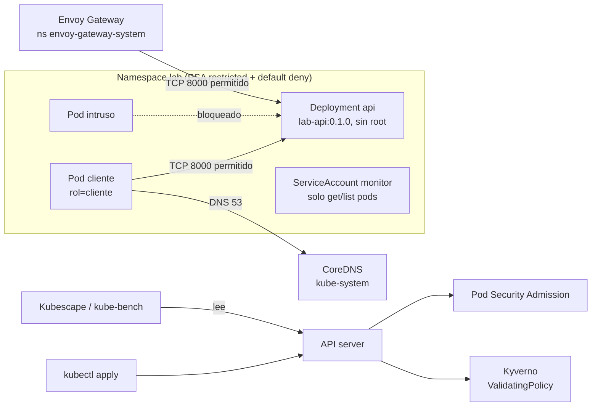

---
tags:
  - laboratorio
  - seguridad
  - kubernetes
  - contenedores
---

# Lab 14: Endurecer un clúster: Pod Security, NetworkPolicy y Kyverno

> Sobre el clúster kind y la API del Lab 06: Pod Security Admission en modo `restricted`, RBAC con un ServiceAccount de mínimo privilegio, NetworkPolicy *default deny*, una política de Kyverno y un escaneo de postura con Kubescape y kube-bench.

| Nivel | Duración | Costo | Requisitos |
| --- | --- | --- | --- |
| Intermedio | ~90 min | Gratis (todo en local) | [Lab 06](../devops/kubernetes-local-kind.md) (clúster `lab` y la API en el namespace `lab`); Docker, kind v0.33.0, kubectl, Helm, Kubescape |

!!! info "Qué vas a aprender"
    - Aplicar los **Pod Security Standards** con labels de **Pod Security Admission** (PSA), ver un pod rechazado y entender qué pasa con los pods que ya existían.
    - Crear un ServiceAccount con un Role mínimo y comprobarlo con `kubectl auth can-i`.
    - Aislar el namespace con **NetworkPolicy** *default deny* y abrir solo el tráfico necesario, comprobando que tu CNI de verdad las aplica.
    - Instalar **Kyverno** y bloquear pods que corren como root o usan imágenes sin tag fijo.
    - Medir la postura del clúster con **Kubescape** y **kube-bench**, y leer sus resultados.

## Antes de empezar

| Herramienta | Versión probada | Comprobar |
| --- | --- | --- |
| Docker | 28.5.1 (Docker Desktop sobre WSL2) | `docker info` |
| kind | v0.33.0, imagen de nodo `kindest/node:v1.36.4` (la del Lab 06) | `kind version` |
| kubectl | 1.37.1 (1.35 a 1.37 sirve, como en el Lab 06) | `kubectl version --client` |
| Helm | 3.14.2 (3.8+ o 4.x) | `helm version` |
| Kubescape | 4.0.16 | `kubescape version` |
| Kyverno CLI (opcional, reto 1) | 1.19.2 | `kyverno version` |

Necesitas el clúster `lab` del [Lab 06](../devops/kubernetes-local-kind.md) con la API desplegada (Deployment `api`, Service `api`, imagen `lab-api:0.1.0`) en el namespace `lab`. Si lo borraste, recréalo con los pasos 1 a 5 de ese lab (el Gateway y el HPA no hacen falta aquí). Antes de cada bloque, confirma que apuntas al clúster local: `kubectl config current-context` debe devolver `kind-lab`.

!!! warning "Docker Desktop con WSL2 antiguo (cgroup v1)"
    Si `docker info` muestra `Cgroup Version: 1` o un `Kernel Version` 5.x, tu WSL2 está desactualizado y te afectará dos veces: Kubernetes 1.35+ no arranca con cgroup v1 por defecto (ver **Problemas comunes**) y kindnet no puede aplicar NetworkPolicies (paso 5). Lo correcto es `wsl --update`, reiniciar Docker Desktop y comprobar que `docker info` muestra `Cgroup Version: 2`.

Teoría recomendada: [Seguridad de Kubernetes](../../devsecops/infraestructura-y-contenedores/seguridad-kubernetes.md) (RBAC, Pod Security Standards, NetworkPolicy y admission control) y [KSPM](../../devsecops/escaneos/kspm.md). Para repasar objetos básicos: [Kubernetes](../../devops/contenedores/kubernetes.md). Guías de comandos: [kubectl](../../recursos/comandos/kubectl.md) y [Helm](../../recursos/comandos/helm.md).

Trabaja en el repositorio `lab-devops-app`, en una rama: `git switch -c feat/k8s-seguridad`. Los manifiestos nuevos van en `k8s/seguridad/`.

## Arquitectura



Cada control cubre un hueco distinto: Pod Security y Kyverno limitan **qué** se puede desplegar, RBAC limita **quién** habla con la API, NetworkPolicy limita **quién habla con quién** dentro del clúster, y el escaneo de postura comprueba todo lo anterior.

## Paso a paso

### Paso 1: Activa Pod Security Admission en el namespace `lab`

**Pod Security Admission** viene integrado en Kubernetes y se activa con labels en el namespace: `enforce` rechaza, `warn` avisa en la terminal y `audit` lo anota en el *audit log*. `restricted` es el perfil más estricto y el objetivo para aplicaciones. La API del Lab 06 ya cumple `restricted` (sin root, sin capabilities, `seccompProfile: RuntimeDefault`), así que puedes activarlo sin romperla.

Antes de aplicarlo, pregunta al API server qué pasaría con los pods que ya existen (`--dry-run=server` no cambia nada). Para verlo, crea primero un pod "viejo" que no cumple:

```bash
kubectl run viejo -n lab --image=busybox:1.38.0 -- sleep 3600
kubectl label --dry-run=server --overwrite ns lab pod-security.kubernetes.io/enforce=restricted
```

```text
pod/viejo created
Warning: existing pods in namespace "lab" violate the new PodSecurity enforce level "restricted:latest"
Warning: viejo: allowPrivilegeEscalation != false, unrestricted capabilities, runAsNonRoot != true, seccompProfile
namespace/lab labeled (server dry run)
```

Los pods de `api` no aparecen: cumplen. Ahora deja los labels en el manifiesto del namespace del Lab 06, para que queden versionados en Git:

```yaml title="k8s/namespace.yaml"
apiVersion: v1
kind: Namespace
metadata:
  name: lab
  labels:
    pod-security.kubernetes.io/enforce: restricted
    pod-security.kubernetes.io/enforce-version: v1.36   # la versión menor de tu clúster
    pod-security.kubernetes.io/warn: restricted
    pod-security.kubernetes.io/warn-version: v1.36
    pod-security.kubernetes.io/audit: restricted
    pod-security.kubernetes.io/audit-version: v1.36
```

```bash
kubectl apply -f k8s/namespace.yaml
kubectl get pods -n lab
```

```text
Warning: existing pods in namespace "lab" violate the new PodSecurity enforce level "restricted:v1.36"
Warning: viejo: allowPrivilegeEscalation != false, unrestricted capabilities, runAsNonRoot != true, seccompProfile
namespace/lab configured
NAME                   READY   STATUS    RESTARTS   AGE
api-7dc7f7d9cd-27k4l   1/1     Running   0          50s
api-7dc7f7d9cd-6kmcv   1/1     Running   0          40s
viejo                  1/1     Running   0          4s
```

`viejo` **sigue corriendo**: PSA evalúa los pods al crearlos, no expulsa los existentes. Fijar `enforce-version` evita que una actualización del clúster endurezca las reglas sin que lo decidas. Borra el pod: `kubectl delete pod viejo -n lab`.

### Paso 2: Comprueba que un pod inseguro es rechazado

Un pod sin `securityContext` corre como root y con las capabilities por defecto:

```yaml title="k8s/seguridad/pod-inseguro.yaml"
apiVersion: v1
kind: Pod
metadata:
  name: inseguro
  namespace: lab
spec:
  containers:
    - name: shell
      image: busybox:1.38.0
      command: ["sleep", "3600"]
```

```bash
kubectl apply -f k8s/seguridad/pod-inseguro.yaml
```

La API lo rechaza antes de crearlo:

```text
Error from server (Forbidden): error when creating "k8s/seguridad/pod-inseguro.yaml": pods "inseguro" is forbidden:
violates PodSecurity "restricted:v1.36": allowPrivilegeEscalation != false (container "shell" must set
securityContext.allowPrivilegeEscalation=false), unrestricted capabilities (container "shell" must set
securityContext.capabilities.drop=["ALL"]), runAsNonRoot != true (pod or container "shell" must set
securityContext.runAsNonRoot=true), seccompProfile (pod or container "shell" must set
securityContext.seccompProfile.type to "RuntimeDefault" or "Localhost")
```

El mensaje es tu lista de tareas: cada cláusula dice qué campo falta. Compáralo con el `securityContext` del `k8s/deployment.yaml` del Lab 06: ahí está todo.

### Paso 3: Un pod cliente que cumple `restricted`

Para probar RBAC y la red necesitas un pod desde el que hacer peticiones. Corrige cada punto del error anterior (busybox arranca como root, así que se le asigna el usuario `nobody`, 65534):

```yaml title="k8s/seguridad/cliente.yaml"
apiVersion: v1
kind: Pod
metadata:
  name: cliente
  namespace: lab
  labels:
    rol: cliente
spec:
  automountServiceAccountToken: false     # no habla con la API
  securityContext:
    runAsNonRoot: true
    runAsUser: 65534                      # nobody
    seccompProfile:
      type: RuntimeDefault
  containers:
    - name: shell
      image: busybox:1.38.0
      command: ["sleep", "infinity"]
      securityContext:
        allowPrivilegeEscalation: false
        readOnlyRootFilesystem: true
        capabilities:
          drop: ["ALL"]
      resources:
        requests: { cpu: 10m, memory: 16Mi }
        limits: { memory: 32Mi }
```

```bash
kubectl apply -f k8s/seguridad/cliente.yaml
kubectl -n lab wait --for=condition=Ready pod/cliente --timeout=120s
kubectl -n lab exec cliente -- wget -qO- -T 5 http://api/health
```

```text
pod/cliente created
pod/cliente condition met
{"status":"ok"}
```

### Paso 4: RBAC con un ServiceAccount mínimo

Imagina una herramienta de monitoreo que solo necesita ver los pods y sus logs. Le das un **ServiceAccount** propio con un **Role** (permisos dentro de un namespace) y un **RoleBinding** (quién recibe ese Role).

```yaml title="k8s/seguridad/rbac.yaml"
apiVersion: v1
kind: ServiceAccount
metadata:
  name: monitor
  namespace: lab
automountServiceAccountToken: false
---
apiVersion: rbac.authorization.k8s.io/v1
kind: Role
metadata:
  name: ver-pods
  namespace: lab
rules:
  - apiGroups: [""]
    resources: ["pods", "pods/log"]
    verbs: ["get", "list", "watch"]
---
apiVersion: rbac.authorization.k8s.io/v1
kind: RoleBinding
metadata:
  name: monitor-ver-pods
  namespace: lab
subjects:
  - kind: ServiceAccount
    name: monitor
    namespace: lab
roleRef:
  kind: Role
  name: ver-pods
  apiGroup: rbac.authorization.k8s.io
```

=== "Linux/macOS"

    ```bash
    kubectl apply -f k8s/seguridad/rbac.yaml
    SA=system:serviceaccount:lab:monitor
    kubectl auth can-i list pods        -n lab         --as=$SA   # yes
    kubectl auth can-i get pods/log     -n lab         --as=$SA   # yes
    kubectl auth can-i delete pods      -n lab         --as=$SA   # no
    kubectl auth can-i get secrets      -n lab         --as=$SA   # no
    kubectl auth can-i create pods/exec -n lab         --as=$SA   # no
    kubectl auth can-i list pods        -n kube-system --as=$SA   # no
    kubectl auth can-i --list -n lab --as=$SA
    ```

=== "Windows (PowerShell)"

    ```powershell
    kubectl apply -f k8s/seguridad/rbac.yaml
    $SA = "system:serviceaccount:lab:monitor"
    kubectl auth can-i list pods        -n lab         --as=$SA   # yes
    kubectl auth can-i get pods/log     -n lab         --as=$SA   # yes
    kubectl auth can-i delete pods      -n lab         --as=$SA   # no
    kubectl auth can-i get secrets      -n lab         --as=$SA   # no
    kubectl auth can-i create pods/exec -n lab         --as=$SA   # no
    kubectl auth can-i list pods        -n kube-system --as=$SA   # no
    kubectl auth can-i --list -n lab --as=$SA
    ```

Salida de `--list` (abreviada):

```text
Resources                                       Non-Resource URLs   Resource Names   Verbs
selfsubjectreviews.authentication.k8s.io        []                  []               [create]
selfsubjectaccessreviews.authorization.k8s.io   []                  []               [create]
selfsubjectrulesreviews.authorization.k8s.io    []                  []               [create]
pods/log                                        []                  []               [get list watch]
pods                                            []                  []               [get list watch]
                                                [/api/*]            []               [get]
...
```

`--as` es **impersonation** (suplantación): tu usuario administrador pregunta "¿qué podría hacer esta identidad?" sin necesitar su token. Las primeras tres filas y las URL no-recurso las dan los roles por defecto a cualquier identidad autenticada. Fíjate en lo que **no** tiene: `secrets` y `pods/exec` son los permisos que más escalan.

### Paso 5: NetworkPolicy *default deny* y sus excepciones

Por defecto, cualquier pod puede hablar con cualquier otro. Una NetworkPolicy solo es un objeto guardado en la API: quien filtra el tráfico es el **CNI**. kind usa **kindnet**, que aplica NetworkPolicies desde kind v0.24 con reglas de nftables. Primero comprueba que el motor de políticas arrancó bien:

```bash
kubectl -n kube-system logs ds/kindnet --tail=200 | grep -iE "policy engine|nftables sync failed"
```

```text
"Policy engine is ready."
```

Si además aparece `"initial nftables sync failed" err=< conn.Receive: netlink receive: operation not supported ...`, tu kernel no soporta lo que kindnet necesita y las políticas **no se aplicarán** (pasa con WSL2 antiguos; ver **Problemas comunes**).

Aplica un *default deny* (deniega todo el tráfico de entrada y salida de todos los pods del namespace):

```yaml title="k8s/seguridad/netpol-deny.yaml"
apiVersion: networking.k8s.io/v1
kind: NetworkPolicy
metadata:
  name: default-deny
  namespace: lab
spec:
  podSelector: {}                 # todos los pods del namespace
  policyTypes: [Ingress, Egress]
```

```bash
kubectl apply -f k8s/seguridad/netpol-deny.yaml
kubectl -n lab exec cliente -- wget -qO- -T 5 http://api/health
```

Salida esperada: un error, normalmente `wget: bad address 'api'` (la consulta DNS también es tráfico de salida y está bloqueada) y `command terminated with exit code 1`.

!!! warning "Si todavía ves `{"status":"ok"}`"
    Tu CNI no está aplicando las políticas: el objeto existe, pero no hace nada. Revisa los logs de kindnet como arriba y la sección **Problemas comunes**. No sigas hasta que este paso falle, o el resto del bloque no demostrará nada.

Ahora abre solo lo necesario: `api` acepta en el 8000 tráfico del cliente y del proxy de Envoy Gateway (para que la ruta del Lab 06 siga funcionando); el cliente puede llegar a `api` y resolver DNS.

```yaml title="k8s/seguridad/netpol-allow.yaml"
apiVersion: networking.k8s.io/v1
kind: NetworkPolicy
metadata:
  name: api-ingress
  namespace: lab
spec:
  podSelector:
    matchLabels:
      app: api
  policyTypes: [Ingress]
  ingress:
    - from:
        - podSelector:            # pods de este namespace con rol=cliente
            matchLabels:
              rol: cliente
        - namespaceSelector:      # el proxy Envoy del Lab 06
            matchLabels:
              kubernetes.io/metadata.name: envoy-gateway-system
      ports:
        - protocol: TCP
          port: 8000              # el puerto del contenedor, no el del Service (80)
---
apiVersion: networking.k8s.io/v1
kind: NetworkPolicy
metadata:
  name: cliente-egress
  namespace: lab
spec:
  podSelector:
    matchLabels:
      rol: cliente
  policyTypes: [Egress]
  egress:
    - to:
        - podSelector:
            matchLabels:
              app: api
      ports:
        - protocol: TCP
          port: 8000
    - to:                          # DNS: sin esto no se resuelve "api"
        - namespaceSelector:
            matchLabels:
              kubernetes.io/metadata.name: kube-system
          podSelector:
            matchLabels:
              k8s-app: kube-dns
      ports:
        - protocol: UDP
          port: 53
        - protocol: TCP
          port: 53
```

```bash
kubectl apply -f k8s/seguridad/netpol-allow.yaml
kubectl -n lab exec cliente -- wget -qO- -T 5 http://api/health          # {"status":"ok"}
kubectl -n lab exec cliente -- wget -qO- -T 5 http://example.com         # bloqueado: no hay salida a internet
```

El segundo comando resuelve el nombre (el DNS está permitido) pero no conecta: `wget: download timed out`. Prueba ahora con un pod sin la label `rol: cliente` (un "intruso"); debe fallar:

```bash
kubectl -n lab run intruso --image=busybox:1.38.0 --restart=Never \
  --overrides='{"spec":{"securityContext":{"runAsNonRoot":true,"runAsUser":65534,"seccompProfile":{"type":"RuntimeDefault"}},"containers":[{"name":"intruso","image":"busybox:1.38.0","command":["wget","-qO-","-T","5","http://api/health"],"securityContext":{"allowPrivilegeEscalation":false,"capabilities":{"drop":["ALL"]}}}]}}'
kubectl -n lab logs intruso        # espera unos segundos: wget: bad address 'api'
```

El `--overrides` largo es el precio de PSA `restricted`: sin él, `kubectl run` crea un pod que la API rechaza. Es la **microsegmentación** de [Seguridad de red](../../networking/avanzado/seguridad-red.md), dentro del clúster. Si mantienes el Gateway del Lab 06, repite su `curl -H "Host: api.lab.local"` por el port-forward: debe seguir respondiendo gracias a la regla de `envoy-gateway-system`.

### Paso 6: Instala Kyverno y aplica una política

Pod Security Admission solo tiene tres perfiles fijos. Para reglas propias (como prohibir imágenes sin tag) necesitas un **admission controller** de políticas. Instala Kyverno con Helm, con una versión fija del chart:

```bash
helm repo add kyverno https://kyverno.github.io/kyverno/
helm repo update
helm search repo kyverno/kyverno          # CHART VERSION 3.9.2, APP VERSION v1.19.2
helm install kyverno kyverno/kyverno --version 3.9.2 \
  -n kyverno --create-namespace --wait --timeout 10m
kubectl -n kyverno get pods
```

```text
NAME                                            READY   STATUS    RESTARTS   AGE
kyverno-admission-controller-75bb8dfc78-xrwlj   1/1     Running   0          5m5s
kyverno-background-controller-9fdc784fb-vt4wz   1/1     Running   0          5m5s
kyverno-cleanup-controller-6484bbdd59-62rxk     1/1     Running   0          5m5s
kyverno-reports-controller-c69bfbdc6-kch2z      1/1     Running   0          5m5s
```

La instalación tarda unos minutos (descarga cuatro imágenes). Las notas que imprime el chart ya avisan de la migración: desde Kyverno 1.19 los tipos clásicos `ClusterPolicy` y `Policy` (`kyverno.io/v1`) están **obsoletos** y está previsto eliminarlos en la 1.20. El tipo nuevo es **ValidatingPolicy** (`policies.kyverno.io/v1`), con reglas en CEL (*Common Expression Language*), el mismo lenguaje de la `ValidatingAdmissionPolicy` nativa de Kubernetes.

!!! note "Si encuentras ejemplos con `ClusterPolicy`"
    En los ejemplos antiguos verás `spec.validationFailureAction: Enforce`. Ese campo ya se había sustituido por `failureAction` dentro de cada regla `validate`, y ahora todo el tipo está obsoleto. En `ValidatingPolicy` el equivalente es `validationActions: [Deny]` (o `[Audit]`). Para migrar, sigue la guía *Migration to CEL* de Kyverno.

```yaml title="k8s/seguridad/kyverno-politica.yaml"
apiVersion: policies.kyverno.io/v1
kind: ValidatingPolicy
metadata:
  name: pods-no-root-y-tag-fijo
spec:
  validationActions: [Deny]          # Audit para solo reportar sin bloquear
  autogen:
    podControllers:                  # genera la regla también para Deployments, Jobs...
      controllers: [deployments, statefulsets, daemonsets, jobs, cronjobs]
  matchConstraints:
    namespaceSelector:
      matchExpressions:
        - key: kubernetes.io/metadata.name
          operator: NotIn
          values: [kube-system, kyverno]
    resourceRules:
      - apiGroups: [""]
        apiVersions: [v1]
        operations: [CREATE, UPDATE]
        resources: [pods]
  variables:
    - name: contenedores
      expression: object.spec.containers + object.spec.?initContainers.orValue([])
  validations:
    - message: "runAsNonRoot debe ser true en el pod o en cada contenedor."
      expression: >-
        object.spec.?securityContext.?runAsNonRoot.orValue(false) ||
        variables.contenedores.all(c, c.?securityContext.?runAsNonRoot.orValue(false))
    - message: "Usa una etiqueta de imagen fija: ni ':latest' ni imagen sin etiqueta."
      expression: >-
        variables.contenedores.all(c,
          c.image.contains('@sha256:') ||
          (c.image.split('/')[size(c.image.split('/')) - 1].contains(':') && !c.image.endsWith(':latest')))
```

```bash
kubectl apply -f k8s/seguridad/kyverno-politica.yaml
kubectl get validatingpolicies.policies.kyverno.io
```

```text
validatingpolicy.policies.kyverno.io/pods-no-root-y-tag-fijo created
NAME                      AGE   READY
pods-no-root-y-tag-fijo   11s   true
```

Los pods de `api` y `cliente` cumplen las dos reglas. Pruébala en un namespace **sin** Pod Security, para ver que es Kyverno quien bloquea:

```bash
kubectl create namespace pruebas
kubectl -n pruebas run root --image=busybox:1.38.0 -- sleep 300
kubectl -n pruebas run sin-tag --image=busybox \
  --overrides='{"spec":{"securityContext":{"runAsNonRoot":true,"runAsUser":65534}}}' -- sleep 300
kubectl -n pruebas create deployment malo --image=busybox:latest -- sleep 300
kubectl -n pruebas run ok --image=busybox:1.38.0 \
  --overrides='{"spec":{"securityContext":{"runAsNonRoot":true,"runAsUser":65534}}}' -- sleep 300
```

```text
Error from server: admission webhook "vpol.validate.kyverno.svc-fail" denied the request: Policy pods-no-root-y-tag-fijo failed: runAsNonRoot debe ser true en el pod o en cada contenedor.
Error from server: admission webhook "vpol.validate.kyverno.svc-fail" denied the request: Policy pods-no-root-y-tag-fijo failed: Usa una etiqueta de imagen fija: ni ':latest' ni imagen sin etiqueta.
error: failed to create deployment: admission webhook "vpol.validate.kyverno.svc-fail" denied the request: Policy pods-no-root-y-tag-fijo failed: runAsNonRoot debe ser true en el pod o en cada contenedor.
pod/ok created
```

Gracias a `autogen`, el Deployment se rechaza al crearlo, en lugar de crearse y quedarse sin pods. Fíjate en que `malo` incumple las dos reglas, pero el mensaje solo muestra la primera que falla: corrige y vuelve a probar. El sufijo `-fail` del webhook indica que, si Kyverno no responde, la petición se rechaza (*fail closed*).

### Paso 7: Escanea la postura con Kubescape y kube-bench

El **KSPM** (*Kubernetes Security Posture Management*) compara el clúster con marcos como NSA/CISA o el CIS Kubernetes Benchmark ([KSPM](../../devsecops/escaneos/kspm.md)).

```bash
kubescape list frameworks
kubescape scan framework nsa --include-namespaces lab,pruebas
```

Salida abreviada (los valores dependen de lo que tengas desplegado):

```text
│ Severity │ Control name                                │ Failed resources │ All Resources │ Compliance score   │
│ Critical │ Disable anonymous access to Kubelet service │         0        │       0       │ Action Required ** │
│   High   │ Ensure CPU limits are set                   │         3        │       3       │         0%         │
│   High   │ Ensure memory limits are set                │         1        │       3       │         67%        │
│  Medium  │ Non-root containers                         │         3        │       3       │         0%         │
│  Medium  │ Ingress and Egress blocked                  │         1        │       4       │         75%        │
│  Medium  │ Automatic mapping of service account        │         2        │       6       │         67%        │
│  Medium  │ Audit logs enabled                          │         0        │       0       │  Action Required * │
│          │ Resource Summary                            │         6        │       30      │       62.93%       │
🚨 * failed to get cloud provider, cluster: kind-lab
🚨 ** missing: hostdata.kubescape.cloud/v1beta0/KubeletInfo
Scan coverage score: 83% (24/26 controls evaluated)
```

Cómo leerlo:

- *Action Required* con `*` son controles que dependen del proveedor cloud (EKS, AKS, GKE); en kind no hay proveedor. Con `**`, datos del nodo que solo recoge el operador de Kubescape, no el CLI.
- `Non-root containers` falla aunque la API corre sin root: Kubescape también exige `runAsGroup` distinto de 0. Usa `kubescape scan control C-0013 --include-namespaces lab -v` para ver el detalle de un control.
- `Ingress and Egress blocked` falla en `pruebas`, que no tiene NetworkPolicy; en `lab` pasa.

Elige un control fallido, corrígelo en el YAML (por ejemplo, añade `runAsGroup: 10001` al `securityContext` del pod en `k8s/deployment.yaml`), vuelve a aplicar y repite el escaneo para ver subir la puntuación.

**kube-bench** revisa la configuración de los componentes de cada nodo contra el CIS Benchmark. Necesita acceso al host (`hostPID`, montajes de `/etc` y `/var/lib`), así que **tu propia política de Kyverno lo bloquearía** y PSA también: ejecútalo en `kube-system`, que ambos excluyen. Hay un Job para nodos worker y otro para el control plane:

```bash
kubectl apply -n kube-system -f https://raw.githubusercontent.com/aquasecurity/kube-bench/v0.16.0/job.yaml
kubectl -n kube-system wait --for=condition=complete job/kube-bench --timeout=300s
kubectl -n kube-system logs job/kube-bench | grep -E "^\[FAIL\]|^== Summary|checks"

kubectl apply -n kube-system -f https://raw.githubusercontent.com/aquasecurity/kube-bench/v0.16.0/job-master.yaml
kubectl -n kube-system wait --for=condition=complete job/kube-bench-master --timeout=300s
kubectl -n kube-system logs job/kube-bench-master | grep -E "^\[FAIL\]|^== Summary|checks"

kubectl -n kube-system delete job kube-bench kube-bench-master
```

```text
[FAIL] 4.1.1 Ensure that the kubelet service file permissions are set to 600 or more restrictive (Automated)
[FAIL] 4.1.9 If the kubelet config.yaml configuration file is being used validate permissions set to 600 or more restrictive (Automated)
== Summary node ==
17 checks PASS
2 checks FAIL
6 checks WARN
...
[FAIL] 1.2.15 Ensure that the --profiling argument is set to false (Automated)
[FAIL] 1.2.16 Ensure that the --audit-log-path argument is set (Automated)
...
== Summary master ==
39 checks PASS
10 checks FAIL
11 checks WARN
```

El Job de `job-master.yaml` lleva una *toleration* para poder ejecutarse en el nodo de control plane (que tiene un *taint* para no recibir cargas). En kind muchos FAIL son esperables (es un clúster de desarrollo sin audit log); en un clúster gestionado (EKS, AKS, GKE) el plano de control lo gestiona el proveedor y kube-bench tiene variantes del Job para cada uno.

## Verificación

| Comprobación | Resultado esperado |
| --- | --- |
| `kubectl get ns lab --show-labels` | Labels `pod-security.kubernetes.io/enforce=restricted` (y `warn`, `audit`) |
| `kubectl apply -f k8s/seguridad/pod-inseguro.yaml` | `Forbidden: violates PodSecurity "restricted:v1.36"` |
| `kubectl -n lab get pods` | `api-...` (2) y `cliente` en `Running` |
| `kubectl auth can-i get secrets -n lab --as=system:serviceaccount:lab:monitor` | `no` |
| `kubectl -n lab exec cliente -- wget -qO- -T 5 http://api/health` | `{"status":"ok"}` |
| `kubectl -n lab logs intruso` | `wget: bad address 'api'` o timeout |
| `kubectl -n pruebas run root --image=busybox:1.38.0 -- sleep 300` | Denegado por `pods-no-root-y-tag-fijo` |
| `kubescape scan framework nsa --include-namespaces lab` | Informe con puntuación; sube al corregir controles |

## Retos extra

1. Evalúa la política **antes** de desplegar, como en el pipeline: `kyverno apply k8s/seguridad/kyverno-politica.yaml --resource k8s/seguridad/pod-inseguro.yaml` (Kyverno CLI 1.19). Debe terminar con `pass: 0, fail: 1`. Pista: es la misma política, ahora como *shift-left* ([Lab 12](escaneos-en-pipeline.md)).
2. Cambia `validationActions` a `[Audit]` y busca los resultados con `kubectl get policyreports -A`.
3. Añade una tercera regla que exija `resources.limits.memory` en todos los contenedores. ¿Qué pods existentes la incumplirían? Pista: con `Audit`, el informe te lo dice sin romper nada.
4. Instala el **Trivy Operator** o el operador de Kubescape para tener escaneo continuo ([KSPM](../../devsecops/escaneos/kspm.md#modo-continuo-con-trivy-operator)).

## Limpieza

Si el clúster era solo para practicar, bórralo entero:

```bash
kind delete cluster --name lab
kind get clusters                         # no debe aparecer "lab"
```

Si quieres conservarlo para otros labs, borra solo lo de este (los labels de PSA puedes dejarlos: la API los cumple):

```bash
kubectl delete -f k8s/seguridad/netpol-allow.yaml -f k8s/seguridad/netpol-deny.yaml -f k8s/seguridad/rbac.yaml
kubectl -n lab delete pod cliente intruso --ignore-not-found
kubectl delete namespace pruebas
kubectl delete validatingpolicies.policies.kyverno.io pods-no-root-y-tag-fijo
helm uninstall kyverno -n kyverno
kubectl delete namespace kyverno
kubectl get ns                            # no deben quedar pruebas ni kyverno
```

Sube `k8s/namespace.yaml` y la carpeta `k8s/seguridad/` con un PR (`feat: endurecer el namespace lab`).

## Problemas comunes

| Síntoma | Causa | Solución |
| --- | --- | --- |
| `kind create cluster` se queda en *Starting control-plane* y falla con `failed to init node with kubeadm`; antes avisa `cgroup v1 is deprecated` | Kubernetes 1.35+ no arranca con cgroup v1 por defecto (Docker Desktop sobre un WSL2 antiguo) | `wsl --update` y reinicia Docker Desktop (`docker info` debe decir `Cgroup Version: 2`). Solo como apaño de laboratorio: añade a `kind-config.yaml` un `kubeadmConfigPatches` con `kind: KubeletConfiguration` y `failCgroupV1: false` |
| El *default deny* no bloquea nada | El CNI no aplica las políticas. En kind: versión anterior a v0.24, o kindnet con `initial nftables sync failed ... operation not supported` (kernel sin soporte de nftables, típico de WSL2 antiguo) | Actualiza kind y `wsl --update`; revisa los logs de `kindnet`. Alternativa: crear el clúster con `disableDefaultCNI: true` e instalar Calico (ver documentación de kind); en un WSL2 antiguo Calico tampoco arranca (`mkdir /sys/kernel/security: read-only file system`) |
| Tras el *default deny*, `wget` dice `bad address 'api'` también con la política de permiso | Falta la regla de salida al DNS | Revisa el bloque de `kube-dns` (UDP y TCP 53) |
| La política de ingress no deja pasar el tráfico | Pusiste el puerto del Service (80) en lugar del del contenedor (8000) | La NetworkPolicy ve el puerto del pod |
| La ruta del Gateway del Lab 06 deja de responder | El proxy Envoy está en otro namespace y el *default deny* lo bloquea | Mantén el `namespaceSelector` de `envoy-gateway-system` en `api-ingress` |
| `kubectl run prueba ... --image=busybox` del Lab 06 ahora falla con `violates PodSecurity` | El namespace `lab` exige `restricted` | Usa el pod `cliente` o añade un `--overrides` con el `securityContext` |
| El Deployment se crea pero no aparecen pods | Pod Security o Kyverno rechazan los pods del ReplicaSet | `kubectl -n <ns> describe rs` y `kubectl get events -n <ns>` muestran el motivo |
| `kubectl apply` de un job de auditoría es rechazado | Tu política de Kyverno o PSA se aplican también a las herramientas | Ejecútalas en un namespace excluido o crea una `PolicyException` documentada |
| `helm install` de Kyverno termina con `context deadline exceeded` | Las imágenes tardan en descargarse | Sube `--timeout` y mira `kubectl -n kyverno get pods` |

Método general: [Troubleshooting](../../devops/operacion/troubleshooting.md#kubernetes).

## Información complementaria

- **Defensa en profundidad**: RBAC, Pod Security, Kyverno y NetworkPolicy se solapan a propósito; si uno falla, otro frena ([Seguridad de Kubernetes](../../devsecops/infraestructura-y-contenedores/seguridad-kubernetes.md)).
- **PodSecurityPolicy ya no existe**: se eliminó en Kubernetes 1.25; Pod Security Admission es el sustituto integrado ([Pod Security Standards](../../devsecops/infraestructura-y-contenedores/seguridad-kubernetes.md#pod-security-standards)).
- **Least privilege en RBAC**: un ServiceAccount por aplicación, sin `secrets` ni `pods/exec` salvo necesidad real, y `automountServiceAccountToken: false` si no habla con la API ([RBAC](../../devsecops/infraestructura-y-contenedores/seguridad-kubernetes.md#rbac)).
- **La imagen ya viene preparada**: la API corre sin root porque el `Dockerfile` del Lab 05 crea un usuario propio ([Endurecer la ejecución](../../devsecops/infraestructura-y-contenedores/seguridad-contenedores.md#endurecer-la-ejecucion)).
- **Policy as code**: la misma política de Kyverno sirve en el clúster (admisión) y en el pipeline (CLI) ([Seguridad de IaC](../../devsecops/infraestructura-y-contenedores/seguridad-iac.md#policy-as-code)).
- **En el trabajo real**: en EKS, AKS o GKE la NetworkPolicy depende del CNI o de una opción del servicio, y el KSPM se combina con las ofertas nativas de cada nube ([Contenedores gestionados](../../cloud/computo/contenedores-gestionados.md)).

## Documentación oficial

- [Kubernetes: Pod Security Admission](https://kubernetes.io/docs/concepts/security/pod-security-admission/)
- [Kubernetes: Pod Security Standards](https://kubernetes.io/docs/concepts/security/pod-security-standards/)
- [Kubernetes: Network Policies](https://kubernetes.io/docs/concepts/services-networking/network-policies/)
- [Kubernetes: RBAC](https://kubernetes.io/docs/reference/access-authn-authz/rbac/)
- [kind: configuración (CNI y networking)](https://kind.sigs.k8s.io/docs/user/configuration/)
- [Kyverno: ValidatingPolicy](https://kyverno.io/docs/policy-types/validating-policy/)
- [Kyverno: anuncio de la versión 1.19 (deprecación de ClusterPolicy)](https://kyverno.io/blog/2026/08/20/announcing-kyverno-release-1.19)
- [Kubescape](https://kubescape.io/docs/)
- [kube-bench](https://github.com/aquasecurity/kube-bench)

## Preguntas para verificar el aprendizaje

??? question "1. ¿Qué diferencia hay entre los modos `enforce`, `warn` y `audit` de Pod Security Admission?"
    `enforce` rechaza el pod; `warn` lo admite pero muestra un aviso a quien lo crea; `audit` lo admite y lo anota en el audit log del API server. Lo habitual es empezar con `warn` y `audit` para medir, y activar `enforce` después.

??? question "2. Activas `enforce: restricted` en un namespace con pods que no cumplen. ¿Qué les pasa?"
    Nada: siguen corriendo. PSA solo evalúa al crear (o actualizar) pods y avisa de los existentes con un `Warning`. Fallarán cuando se recreen (un reinicio de nodo, un rollout), por eso conviene revisar antes con `kubectl label --dry-run=server`.

??? question "3. Aplicas el *default deny* y todo sigue funcionando. ¿Qué pasa?"
    El CNI no aplica NetworkPolicies (o no puede, como kindnet sobre un kernel sin soporte de nftables). Kubernetes guarda el objeto, pero quien filtra el tráfico es el CNI. Hay que comprobarlo siempre con una prueba negativa.

??? question "4. ¿Por qué hay que permitir explícitamente el DNS en la política de salida?"
    Con `Egress` en *default deny*, también se bloquea la consulta a CoreDNS (puerto 53). Sin ella, el pod ni siquiera traduce `api` a una IP.

??? question "5. ¿Qué pasaría si quitas la regla de `envoy-gateway-system` de `api-ingress`?"
    La API seguiría accesible desde `cliente`, pero el proxy Envoy del Lab 06 ya no podría reenviarle tráfico: la ruta publicada respondería con error. Cada flujo legítimo tiene que estar declarado.

??? question "6. ¿Qué aporta Kyverno si ya tienes Pod Security Admission?"
    Reglas propias que los tres perfiles fijos no cubren: tags de imagen, registries permitidos, labels obligatorias, límites de recursos, verificación de firmas o mutación de objetos. Además genera informes y se puede ejecutar fuera del clúster.

??? question "7. ¿Qué pasaría si la política de Kyverno no excluyera `kube-system`?"
    Podría bloquear componentes del sistema (CNI, agentes de nodo, jobs de auditoría como kube-bench) que necesitan privilegios, e incluso impedir que se recuperen tras un reinicio. Las exclusiones deben ser explícitas y mínimas.

??? question "8. `kubectl auth can-i delete pods --as=...monitor` devuelve `no`, pero el Role tiene `pods`. ¿Por qué?"
    Porque el Role solo da los verbos `get`, `list` y `watch`. RBAC no tiene "denegar": lo que no está explícitamente permitido, no se puede hacer.

??? question "9. kube-bench marca FAIL en el audit log de tu clúster kind. ¿Lo corriges?"
    En kind es un entorno de desarrollo y se acepta. En un clúster real sí: sin audit log no puedes investigar quién hizo qué. En clústeres gestionados se activa desde el servicio (por ejemplo, logs del plano de control en EKS).

## Notas relacionadas

**Cloud**

- [Contenedores gestionados](../../cloud/computo/contenedores-gestionados.md)

**DevOps**

- [Kubernetes: pods, deployments, services, Helm y Kustomize](../../devops/contenedores/kubernetes.md)
- [Troubleshooting](../../devops/operacion/troubleshooting.md)

**DevSecOps**

- [Seguridad de Kubernetes](../../devsecops/infraestructura-y-contenedores/seguridad-kubernetes.md)
- [KSPM](../../devsecops/escaneos/kspm.md)
- [Seguridad de contenedores](../../devsecops/infraestructura-y-contenedores/seguridad-contenedores.md)
- [Seguridad de IaC](../../devsecops/infraestructura-y-contenedores/seguridad-iac.md)
- [Cumplimiento y gobierno](../../devsecops/gobierno-y-respuesta/cumplimiento.md)

**Networking**

- [Seguridad de red](../../networking/avanzado/seguridad-red.md)

**Recursos**

- [Comandos de kubectl](../../recursos/comandos/kubectl.md)
- [Comandos de Helm](../../recursos/comandos/helm.md)

**Labs**

- Lab anterior: [Lab 13: Desplegar en AWS desde GitHub Actions con OIDC](oidc-github-aws.md)
- Lab siguiente: [Lab 15: DAST con OWASP ZAP sobre OWASP Juice Shop](dast-zap-juice-shop.md)
- Base de este lab: [Lab 06: Desplegar una app en Kubernetes local con kind](../devops/kubernetes-local-kind.md)
