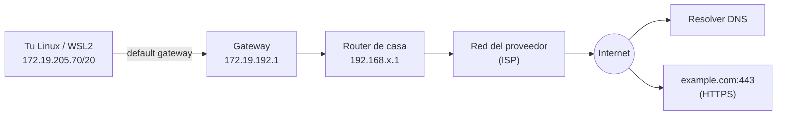

---
tags:
  - laboratorio
  - redes
  - linux
  - troubleshooting
---

# Lab 01: Diagnóstico de red desde Linux

> Recorre tu propia conexión capa por capa con `ip`, `dig`, `ping`, `mtr`, `ss`, `nc`, `curl`, `openssl` y `tcpdump`, y aprende a leer lo que cada herramienta te dice.

| Nivel | Duración | Costo | Requisitos |
| --- | --- | --- | --- |
| Básico | ~60 min | Gratis | [Lab 00](preparar-entorno.md), una terminal Linux (WSL2, macOS con ajustes o Linux nativo) y `sudo` para el paso de `tcpdump` |

!!! info "Qué vas a aprender"
    - Averiguar la IP, la máscara, el default gateway, los servidores DNS y la tabla de rutas de tu equipo.
    - Resolver nombres con `dig` y `nslookup` e interpretar `NOERROR`, `NXDOMAIN` y el TTL.
    - Medir conectividad y latencia salto a salto con `ping`, `traceroute` y `mtr`.
    - Distinguir **connection refused** de **timeout** con `ss` y `nc`.
    - Leer una conexión HTTPS completa con `curl -v` y la cadena de certificados con `openssl s_client`.
    - Capturar con `tcpdump` el **three-way handshake** (saludo en tres pasos) de una conexión TCP tuya.

## Antes de empezar

- Instala las herramientas en Ubuntu/Debian (en WSL2 también):

    ```bash
    sudo apt update
    sudo apt install -y iproute2 dnsutils iputils-ping traceroute mtr-tiny netcat-openbsd curl openssl tcpdump
    ```

- En macOS casi todo viene instalado (`dig`, `ping`, `traceroute`, `nc`, `curl`, `openssl`, `tcpdump`); `ip` y `ss` no existen: usa `ifconfig`, `netstat -rn` y `lsof -i`. `mtr` está en Homebrew.
- **Teoría recomendada** (el lab la practica, no la repite):
    - [Direccionamiento IP](../../networking/basico/direccionamiento-ip.md) y [Routing y NAT](../../networking/intermedio/routing-nat.md).
    - [Servicios de red](../../networking/intermedio/servicios-red.md) (DNS) y [Capa de transporte](../../networking/intermedio/capa-transporte.md) (TCP, puertos).
    - [Protocolos de aplicación](../../networking/intermedio/protocolos-aplicacion.md) (HTTP y TLS).
    - [Troubleshooting de red](../../networking/avanzado/troubleshooting-red.md): la metodología por capas que vas a aplicar.

!!! note "Las salidas de este lab son reales"
    Se obtuvieron en Ubuntu 22.04 sobre WSL2. Las IPs públicas del proveedor de internet se sustituyeron por rangos de documentación (`203.0.113.0/24`, `198.51.100.0/24`). Tus valores serán distintos: lo importante es saber leerlos.

## Arquitectura



Vas a recorrer el camino de abajo arriba: tu interfaz y tu gateway (capas 2–3), el DNS, la ruta hasta internet, los puertos TCP (capa 4) y por último HTTP y TLS (capa 7), como propone la metodología *bottom-up* de [Troubleshooting de red](../../networking/avanzado/troubleshooting-red.md#metodologias).

## Paso a paso

### Paso 1: Tu IP y tu máscara

Lo primero en cualquier diagnóstico es saber **quién eres en la red**: sin una IP válida en la interfaz, nada de lo demás funcionará.

=== "Linux/macOS"

    ```bash
    ip -br addr              # resumen: interfaz, estado, IPs
    ip -4 addr show eth0     # detalle de una interfaz (en macOS: ifconfig en0)
    ```

=== "Windows (PowerShell)"

    ```powershell
    ipconfig /all
    Get-NetIPConfiguration
    ```

```text
lo               UNKNOWN        127.0.0.1/8 ::1/128
eth0             UP             172.19.205.70/20 fe80::215:5dff:fe47:fbde/64

2: eth0: <BROADCAST,MULTICAST,UP,LOWER_UP> mtu 1400 qdisc mq state UP group default qlen 1000
    inet 172.19.205.70/20 brd 172.19.207.255 scope global eth0
```

Cómo se lee:

- `172.19.205.70/20`: tu IP y su prefijo. Una `/20` es la máscara `255.255.240.0`: la red es `172.19.192.0/20` (de `172.19.192.0` a `172.19.207.255`, que coincide con el `brd`, el broadcast). Si no lo ves claro, repasa la [operación AND](../../networking/basico/direccionamiento-ip.md#como-se-calcula-la-red-la-operacion-and).
- `fe80::…/64`: dirección IPv6 **link-local**, solo válida en ese enlace.
- `mtu 1400`: tamaño máximo de paquete en esta interfaz. WSL2 lo baja de los 1500 habituales; si algún día ves conexiones que se cuelgan solo con respuestas grandes, sospecha de la MTU.

!!! tip "WSL2 tiene su propia red"
    Por defecto WSL2 usa una red NAT interna (aquí `172.19.192.0/20`) y Windows hace de router. Por eso tu IP de WSL no es la de tu Wi-Fi. En Windows verás también la IP real del equipo (por ejemplo, `192.168.5.31` en la interfaz Wi-Fi).

### Paso 2: Default gateway y tabla de rutas

El **default gateway** (puerta de enlace por defecto) es a quién mandas todo lo que no está en tu red. La tabla de rutas decide, para cada destino, por dónde sale el paquete.

=== "Linux/macOS"

    ```bash
    ip route                    # macOS: netstat -rn
    ip route get 1.1.1.1        # ¿por dónde saldría un paquete hacia 1.1.1.1?
    ```

=== "Windows (PowerShell)"

    ```powershell
    route print -4
    Find-NetRoute -RemoteIPAddress 1.1.1.1
    ```

```text
default via 172.19.192.1 dev eth0 proto kernel
172.19.192.0/20 dev eth0 proto kernel scope link src 172.19.205.70
```

- La segunda línea es la **ruta conectada**: los destinos de tu propia `/20` se alcanzan directamente (`scope link`), sin router.
- La primera es la **ruta por defecto** (`0.0.0.0/0`): todo lo demás va a `172.19.192.1`.
- Si hubiera varias rutas que encajan, gana la más específica (*longest prefix match*, ver [Routing y NAT](../../networking/intermedio/routing-nat.md#longest-prefix-match)).

### Paso 3: Los servidores DNS y una resolución con dig

Si el DNS falla, "internet no funciona" aunque la red esté perfecta. Primero mira **a quién preguntas** y después **qué te responde**.

=== "Linux/macOS"

    ```bash
    resolvectl status | head -5        # sistemas con systemd-resolved
    cat /etc/resolv.conf               # alternativa universal (macOS: scutil --dns)
    dig example.com A +noall +answer +stats
    ```

=== "Windows (PowerShell)"

    ```powershell
    Get-DnsClientServerAddress -AddressFamily IPv4
    Resolve-DnsName example.com -Type A
    ```

```text
Current DNS Server: 172.19.192.1
       DNS Servers: 172.19.192.1

example.com.		0	IN	A	104.20.23.154
example.com.		0	IN	A	172.66.147.243
;; Query time: 69 msec
;; SERVER: 172.19.192.1#53(172.19.192.1) (UDP)
```

- `SERVER`: qué resolver respondió (aquí, el de WSL, que reenvía a Windows) y por qué protocolo (UDP 53).
- Dos registros `A`: el nombre tiene dos IPs (balanceo o redundancia).
- La segunda columna es el **TTL** (*time to live*, segundos que se puede cachear la respuesta). Un `0` indica que este resolver intermedio no cachea; en Windows `Resolve-DnsName` mostró `TTL 52` para el mismo nombre.

Ahora prueba tres variantes:

```bash
dig +short example.com AAAA          # registros IPv6
dig @1.1.1.1 example.com +short      # pregunta a otro resolver, saltándote el tuyo
dig noexiste.invalid | grep status   # un nombre que no existe
```

```text
2606:4700:10::ac42:93f3
2606:4700:10::6814:179a

172.66.147.243
104.20.23.154

;; ->>HEADER<<- opcode: QUERY, status: NXDOMAIN, id: 25318
```

`NXDOMAIN` significa "ese nombre no existe": el DNS **funciona**, el problema es el nombre. Si en cambio el comando tarda y termina con `connection timed out; no servers could be reached`, el problema es llegar al resolver. Comparar tu resolver con `@1.1.1.1` es la forma rápida de saber si el fallo es de tu DNS o del dominio. Más sobre la salida de `dig` en [Servicios de red](../../networking/intermedio/servicios-red.md#leer-la-salida-de-dig).

### Paso 4: Conectividad y latencia: ping, traceroute y mtr

`ping` usa ICMP para saber si un destino responde y cuánto tarda; `traceroute` y `mtr` muestran **cada router** del camino.

=== "Linux/macOS"

    ```bash
    ping -c 4 1.1.1.1
    traceroute -n -m 8 1.1.1.1      # -n: sin resolver nombres (más rápido)
    mtr -n -r -c 5 1.1.1.1          # informe de 5 rondas por salto
    ```

=== "Windows (PowerShell)"

    ```powershell
    ping -n 4 1.1.1.1
    tracert -d -h 8 1.1.1.1
    pathping -n 1.1.1.1              # lo más parecido a mtr
    ```

```text
64 bytes from 1.1.1.1: icmp_seq=1 ttl=56 time=11.8 ms
...
4 packets transmitted, 4 received, 0% packet loss, time 3003ms
rtt min/avg/max/mdev = 10.268/11.291/12.256/0.768 ms

HOST: lab                         Loss%   Snt   Last   Avg  Best  Wrst StDev
  1.|-- 172.19.192.1               0.0%     5    0.4   0.7   0.4   1.0   0.2
  2.|-- 192.168.5.1               20.0%     5    3.5   3.5   2.8   3.9   0.5
  3.|-- 192.168.1.1               20.0%     5    4.2   5.0   4.2   6.3   0.9
  4.|-- 10.15.1.1                  0.0%     5    5.9   6.9   4.9  10.4   2.1
  5.|-- 203.0.113.153              0.0%     5    7.9   6.1   4.9   7.9   1.2
  6.|-- 10.100.104.49              0.0%     5    9.1   8.8   8.0   9.7   0.6
  7.|-- 172.16.42.229              0.0%     5   10.5   8.9   7.4  10.5   1.2
  8.|-- 198.51.100.245             0.0%     5   12.7  16.2  11.5  24.8   6.0
  9.|-- 1.1.1.1                    0.0%     5   11.5  11.9  10.6  14.8   1.7
```

- `ttl=56`: el paquete de vuelta llegó con TTL 56; si el servidor empezó en 64, pasó por unos 8 routers, lo mismo que muestra `mtr`.
- Salto 1: el gateway de WSL (Windows). Saltos 2 y 3: dos routers domésticos en cascada (*doble NAT*). Saltos 4–8: la red del proveedor, que usa también IPs privadas internamente.
- **Pérdida en saltos intermedios que no se arrastra al destino** (20 % en los saltos 2 y 3, 0 % en el 9) no es un problema: muchos routers limitan las respuestas ICMP que generan ellos mismos. Solo preocupa la pérdida que **continúa hasta el final**.

### Paso 5: Puertos: quién escucha y quién responde

Que un host responda a ping no significa que el servicio funcione. Ahora bajas a la capa 4: ¿hay alguien escuchando en el puerto? Abre **dos terminales**.

```bash
# Terminal 1: un servidor TCP de prueba que escucha en el puerto 8080
nc -l 127.0.0.1 8080
```

```bash
# Terminal 2: qué puertos están en escucha en este equipo
ss -ltn
```

Salida (abreviada):

```text
State  Recv-Q Send-Q Local Address:Port Peer Address:Port
LISTEN 0      4096   127.0.0.53%lo:53        0.0.0.0:*
LISTEN 0      128          0.0.0.0:22        0.0.0.0:*
LISTEN 0      1          127.0.0.1:8080      0.0.0.0:*
```

`-l` muestra sockets en escucha, `-t` TCP y `-n` números en vez de nombres; añade `-p` (con `sudo`) para ver qué proceso es. Fíjate en la diferencia entre `127.0.0.1:8080` (solo accesible desde la propia máquina) y `0.0.0.0:22` (todas las interfaces). Es la causa número uno de "funciona en local pero no desde fuera".

Ahora prueba tres casos desde la terminal 2:

=== "Linux/macOS"

    ```bash
    nc -zv -w 3 127.0.0.1 8080        # alguien escucha
    nc -zv -w 3 127.0.0.1 8081        # nadie escucha
    nc -zv -w 3 10.255.255.1 443      # IP que no responde
    ```

=== "Windows (PowerShell)"

    ```powershell
    Test-NetConnection 127.0.0.1 -Port 8080
    Test-NetConnection 127.0.0.1 -Port 8081
    Get-NetTCPConnection -State Listen | Sort-Object LocalPort
    ```

```text
Connection to 127.0.0.1 8080 port [tcp/http-alt] succeeded!
nc: connect to 127.0.0.1 port 8081 (tcp) failed: Connection refused
nc: connect to 10.255.255.1 port 443 (tcp) timed out: Operation now in progress
```

| Resultado | Qué pasó en la red | Qué suele significar |
| --- | --- | --- |
| `succeeded` | Handshake TCP completo | El puerto está abierto y alcanzable |
| `Connection refused` (inmediato) | El host respondió con un `RST` | Llegas al host, pero **nadie escucha** en ese puerto |
| `timed out` (tras `-w` segundos) | No llegó ninguna respuesta | Un firewall o security group descarta el paquete, o el host/ruta no existe |

Esta distinción, explicada en [Capa de transporte](../../networking/intermedio/capa-transporte.md#connection-refused-frente-a-timeout), te dice si debes mirar la aplicación o la red. Cierra el `nc -l` de la terminal 1 con Ctrl+C.

### Paso 6: HTTP y TLS con curl y openssl

En la capa de aplicación quieres ver tres cosas: que TLS negocia bien, que el certificado es válido y qué responde HTTP.

```bash
curl -sv -o /dev/null https://example.com 2>&1 | grep -E '^\*  |^\* (Connected|SSL|ALPN)|^[<>]'
```

Salida (abreviada; el filtro `grep` deja solo las líneas útiles):

```text
* Connected to example.com (104.20.23.154) port 443 (#0)
* ALPN, offering h2
* ALPN, offering http/1.1
* SSL connection using TLSv1.3 / TLS_AES_256_GCM_SHA384
* ALPN, server accepted to use h2
*  subject: CN=example.com
*  start date: Sep 26 22:49:11 2026 GMT
*  expire date: Dec 25 22:56:35 2026 GMT
*  subjectAltName: host "example.com" matched cert's "example.com"
*  issuer: C=US; O=SSL Corporation; CN=Cloudflare TLS Issuing ECC CA 3
*  SSL certificate verify ok.
> GET / HTTP/2
> Host: example.com
< HTTP/2 200
< content-type: text/html; charset=utf-8
```

Las líneas `*` son de curl (conexión y TLS), `>` lo que envías y `<` lo que recibes. Se negoció TLS 1.3, HTTP/2 (por **ALPN**, *Application-Layer Protocol Negotiation*) y el certificado es válido para el nombre. Para saber **dónde** se va el tiempo, pide los tiempos de cada fase:

```bash
curl -s -o /dev/null -w 'dns=%{time_namelookup} connect=%{time_connect} tls=%{time_appconnect} ttfb=%{time_starttransfer} total=%{time_total} code=%{http_code}\n' https://example.com
```

```text
dns=0.002255 connect=0.010873 tls=0.084889 ttfb=0.096436 total=0.096509 code=200
```

Los tiempos son acumulados: DNS 2 ms, TCP hasta 11 ms, TLS hasta 85 ms (la fase más larga) y el primer byte a los 96 ms. Si `ttfb` fuera mucho mayor que `tls`, el lento sería el servidor, no la red.

Ahora la cadena de certificados con `openssl`:

```bash
echo | openssl s_client -connect example.com:443 -servername example.com 2>/dev/null | sed -n '/Certificate chain/,/^---/p'
echo | openssl s_client -connect example.com:443 -servername example.com 2>/dev/null | openssl x509 -noout -subject -issuer -dates
```

```text
Certificate chain
 0 s:CN = example.com
   i:C = US, O = SSL Corporation, CN = Cloudflare TLS Issuing ECC CA 3
 1 s:C = US, O = SSL Corporation, CN = Cloudflare TLS Issuing ECC CA 3
   i:C = US, O = SSL Corporation, CN = SSL.com TLS Transit ECC CA R2
 2 s:C = US, O = SSL Corporation, CN = SSL.com TLS Transit ECC CA R2
   i:C = US, O = SSL Corporation, CN = SSL.com TLS ECC Root CA 2022
 ...
subject=CN = example.com
issuer=C = US, O = SSL Corporation, CN = Cloudflare TLS Issuing ECC CA 3
notBefore=Sep 26 22:49:11 2026 GMT
notAfter=Dec 25 22:56:35 2026 GMT
```

Cada certificado (`s:`, *subject*) está firmado por el siguiente (`i:`, *issuer*) hasta una raíz de confianza: es la **cadena de confianza** de [Protocolos de aplicación](../../networking/intermedio/protocolos-aplicacion.md#certificados-y-cadena-de-confianza). `-servername` envía el **SNI** (*Server Name Indication*): sin él, un servidor que aloja muchos dominios no sabe qué certificado darte. `notAfter` es la fecha que vigilan las alertas de "certificado a punto de caducar".

### Paso 7: Captura tu propio three-way handshake con tcpdump

Por último, ves los paquetes reales. Capturas en la interfaz **loopback** (`lo`) una conexión entre dos `nc` tuyos: no necesitas tráfico de nadie más y no hay riesgo de capturar datos ajenos. Abre **tres terminales**.

```bash
# Terminal 1: captura (necesita sudo); -nn: sin resolver nombres ni puertos
sudo tcpdump -i lo -nn 'tcp port 8080'
```

```bash
# Terminal 2: servidor
nc -l 127.0.0.1 8080
```

```bash
# Terminal 3: cliente; escribe "hola", pulsa Enter y luego Ctrl+C
nc 127.0.0.1 8080
```

Salida esperada en la terminal 1 (abreviada; los puertos de origen y números de secuencia cambian):

```text
IP 127.0.0.1.51514 > 127.0.0.1.8080: Flags [S], seq 3021740153, win 65495, options [mss 65495,...], length 0
IP 127.0.0.1.8080 > 127.0.0.1.51514: Flags [S.], seq 1270846420, ack 3021740154, win 65483, ..., length 0
IP 127.0.0.1.51514 > 127.0.0.1.8080: Flags [.], ack 1, win 512, length 0
IP 127.0.0.1.51514 > 127.0.0.1.8080: Flags [P.], seq 1:6, ack 1, win 512, length 5
IP 127.0.0.1.8080 > 127.0.0.1.51514: Flags [.], ack 6, win 512, length 0
IP 127.0.0.1.51514 > 127.0.0.1.8080: Flags [F.], seq 6, ack 1, win 512, length 0
IP 127.0.0.1.8080 > 127.0.0.1.51514: Flags [F.], seq 1, ack 7, win 512, length 0
IP 127.0.0.1.51514 > 127.0.0.1.8080: Flags [.], ack 2, win 512, length 0
```

| Flags | Significado |
| --- | --- |
| `[S]` | **SYN**: el cliente pide abrir la conexión (paso 1 del handshake) |
| `[S.]` | **SYN-ACK**: el servidor acepta (paso 2); el punto es el flag ACK |
| `[.]` | **ACK** del cliente (paso 3): conexión establecida |
| `[P.]` | **PSH-ACK** con datos: `length 5` son los 5 bytes de `hola` + salto de línea |
| `[F.]` | **FIN**: cada lado cierra su mitad de la conexión |
| `[R]` | **RST**: lo verías si conectas a un puerto sin nadie escuchando (el "connection refused" del paso 5) |

Tras el primer paquete, tcpdump muestra los números de secuencia **relativos** (`seq 1:6`, `ack 1`). Para guardar la captura y abrirla en Wireshark: `sudo tcpdump -i lo -nn -w handshake.pcap 'tcp port 8080'`.

!!! warning "Captura solo tu tráfico"
    `tcpdump` puede ver todo lo que pasa por una interfaz, incluidos datos de otras personas en redes compartidas. Úsalo en tus equipos y redes, o con autorización explícita.

## Verificación

Completa esta ficha con **tus** valores; si puedes rellenar todas las filas, el lab está hecho:

| Dato | Comando | Ejemplo de este lab |
| --- | --- | --- |
| IP y prefijo | `ip -br addr` | `172.19.205.70/20` |
| Máscara | (cálculo a partir del prefijo) | `255.255.240.0` |
| Default gateway | `ip route` | `172.19.192.1` |
| Servidor DNS | `resolvectl status` | `172.19.192.1` |
| IPs de `example.com` | `dig +short example.com` | `104.20.23.154`, `172.66.147.243` |
| Saltos hasta 1.1.1.1 | `mtr -n -r -c 5 1.1.1.1` | 9 |
| Latencia media a 1.1.1.1 | `ping -c 4 1.1.1.1` | ~11 ms |
| Versión TLS y protocolo HTTP | `curl -sv …` | TLS 1.3, HTTP/2 |
| Caducidad del certificado | `openssl x509 -noout -dates` | `Dec 25 2026` |
| Flags del handshake | `tcpdump` | `[S]`, `[S.]`, `[.]` |

Comprobación rápida: `ip route get 1.1.1.1` debe mostrar `via <tu gateway>`, y `nc -zv 127.0.0.1 8081` debe dar `Connection refused` cuando no hay ningún `nc -l` en marcha.

## Retos extra

1. Cambia el resolver: compara el `Query time` de `dig example.com` contra tu DNS, `@1.1.1.1` y `@8.8.8.8`, dos veces seguidas. Pista: la segunda consulta al mismo resolver suele ser más rápida por la caché.
2. Sigue la resolución desde la raíz con `dig +trace example.com` e identifica qué servidores son raíz, TLD y autoritativos.
3. Captura con `tcpdump -i eth0 -nn 'port 53'` mientras haces un `dig` y busca la pregunta y la respuesta DNS. ¿Va por UDP o TCP?
4. Averigua la MTU real del camino con `ping -M do -s 1372 1.1.1.1` subiendo el tamaño hasta que falle. Pista: tamaño + 28 bytes de cabeceras = MTU.

## Limpieza

No hay nada que facture. Solo cierra lo que abriste:

```bash
# Ctrl+C en las terminales con nc -l y tcpdump; comprueba que no queda nada escuchando en 8080
ss -ltn | grep 8080 || echo "8080 libre"
rm -f handshake.pcap
```

```text
8080 libre
```

## Problemas comunes

| Síntoma | Causa | Solución |
| --- | --- | --- |
| `dig: command not found` | Falta el paquete `dnsutils` (`bind-utils` en Fedora/RHEL) | `sudo apt install dnsutils` |
| `ss` o `ip` no existen (macOS) | Son herramientas de Linux (`iproute2`) | Usa `netstat -an`, `lsof -i -P` e `ifconfig` |
| `traceroute` solo muestra `* * *` | Firewalls que descartan UDP/ICMP en el camino | Prueba `traceroute -T -p 443` (TCP, requiere `sudo`) o `mtr --tcp -P 443` |
| `ping` falla pero `curl` funciona | ICMP bloqueado (habitual en la nube y en redes corporativas) | No concluyas que el host está caído; prueba el puerto con `nc -zv` |
| `tcpdump: lo: You don't have permission` | La captura necesita privilegios | Ejecútalo con `sudo` |
| `nc: invalid option -- 'z'` o sintaxis distinta | Hay varias implementaciones de netcat | Instala `netcat-openbsd` (la de este lab) |
| `curl: (60) SSL certificate problem` | Cadena incompleta, certificado caducado o proxy corporativo que intercepta TLS | Revisa la cadena con `openssl s_client -showcerts` |

Metodología completa en [Troubleshooting de red](../../networking/avanzado/troubleshooting-red.md) y en [Troubleshooting](../../devops/operacion/troubleshooting.md#red).

## Información complementaria

- **Modelo por capas**: diagnosticar de abajo arriba evita perder tiempo en la aplicación cuando el problema es la red; ver [Modelos OSI y TCP/IP](../../networking/basico/modelos-osi-tcpip.md#por-que-importa-en-troubleshooting).
- **Default gateway y longest prefix match**: cómo decide el sistema por dónde sale cada paquete; ver [Routing y NAT](../../networking/intermedio/routing-nat.md).
- **DNS, TTL y resolvers**: ver [Servicios de red](../../networking/intermedio/servicios-red.md#dns-en-profundidad).
- **Three-way handshake y estados TCP**: ver [Capa de transporte](../../networking/intermedio/capa-transporte.md#three-way-handshake).
- **TLS, SNI y cadena de confianza**: ver [Protocolos de aplicación](../../networking/intermedio/protocolos-aplicacion.md#tls).
- **En el trabajo real**: estos mismos comandos se ejecutan dentro de una VM o de un pod (`kubectl exec … -- curl -v`) para saber si falla el DNS interno, un security group o el certificado. En la nube se complementan con VPC Flow Logs, Reachability Analyzer, Network Watcher o Connectivity Tests ([Troubleshooting de red: en la nube](../../networking/avanzado/troubleshooting-red.md#en-la-nube)). Chuleta de comandos en [Linux, redes y scripting](../../devops/fundamentos/linux-redes-scripting.md#puertos-y-troubleshooting-de-red) y [Comandos de Linux](../../recursos/comandos/linux.md).

## Documentación oficial

- [ip(8) y ss(8): iproute2](https://man7.org/linux/man-pages/man8/ip.8.html) · [ss(8)](https://man7.org/linux/man-pages/man8/ss.8.html)
- [dig: manual de BIND 9](https://bind9.readthedocs.io/en/latest/manpages.html#dig-dns-lookup-utility)
- [mtr](https://github.com/traviscross/mtr)
- [curl: opciones `-v` y `-w`](https://curl.se/docs/manpage.html)
- [openssl s_client](https://docs.openssl.org/master/man1/openssl-s_client/)
- [tcpdump: manual](https://www.tcpdump.org/manpages/tcpdump.1.html)
- [Microsoft: redes en WSL](https://learn.microsoft.com/es-es/windows/wsl/networking)
- [Test-NetConnection (PowerShell)](https://learn.microsoft.com/en-us/powershell/module/nettcpip/test-netconnection)

## Preguntas para verificar el aprendizaje

??? question "1. Tu IP es `172.19.205.70/20`. ¿Está `172.19.200.10` en tu misma red? ¿Y `172.19.210.10`?"
    La `/20` va de `172.19.192.0` a `172.19.207.255`. `172.19.200.10` sí está dentro (se alcanza directamente); `172.19.210.10` no, así que se envía al default gateway.

??? question "2. `dig example.com` responde `NXDOMAIN`. ¿Está caído tu DNS?"
    No. `NXDOMAIN` es una respuesta válida del DNS: el nombre no existe (o está mal escrito). Un DNS caído da `timed out` o `SERVFAIL`.

??? question "3. `mtr` muestra 30 % de pérdida en el salto 4 y 0 % en el destino. ¿Hay un problema?"
    Probablemente no: ese router limita las respuestas ICMP que genera él mismo, pero reenvía bien el tráfico. Solo es preocupante la pérdida que se mantiene desde un salto hasta el destino.

??? question "4. ¿Qué diferencia práctica hay entre `Connection refused` y `timed out` al conectar al puerto 5432 de una base de datos?"
    `refused`: el host respondió con RST, así que la red funciona y el servicio no escucha en ese puerto o interfaz (mira la app y `ss -ltn`). `timeout`: no hubo respuesta, típicamente un firewall o security group que descarta el paquete, o una ruta que no existe (mira la red).

??? question "5. ¿Qué pasaría si un servicio escucha en `127.0.0.1:8080` y otra máquina intenta conectarse a él?"
    No podría: `127.0.0.1` es la interfaz loopback y solo acepta conexiones de la propia máquina. Desde fuera daría `Connection refused`. Debe escuchar en `0.0.0.0` o en la IP de la interfaz.

??? question "6. En `curl -w`, `tls=0.085` y `ttfb=2.400`. ¿Dónde está la lentitud?"
    En el servidor: la conexión y TLS terminan a los 85 ms, pero el primer byte de la respuesta tarda 2,4 s. La red está bien; hay que mirar la aplicación o lo que hay detrás (base de datos, otro servicio).

??? question "7. ¿Por qué `openssl s_client` necesita `-servername` para algunos sitios?"
    Para enviar el SNI. Un mismo servidor o CDN aloja muchos dominios en la misma IP y usa el SNI para elegir el certificado. Sin SNI puedes recibir un certificado por defecto que no corresponde al nombre.

??? question "8. En la captura ves `[S]` del cliente y luego `[R.]` del servidor. ¿Qué ocurrió?"
    El cliente intentó abrir la conexión y el servidor la rechazó con un reset: no había ningún proceso escuchando en ese puerto. Es exactamente lo que `nc` muestra como `Connection refused`.

## Notas relacionadas

- **Networking**
    - [Fundamentos de redes](../../networking/basico/fundamentos-redes.md)
    - [Modelos OSI y TCP/IP](../../networking/basico/modelos-osi-tcpip.md)
    - [Capa de enlace y Ethernet](../../networking/basico/capa-enlace-ethernet.md)
    - [Direccionamiento IP](../../networking/basico/direccionamiento-ip.md)
    - [Routing y NAT](../../networking/intermedio/routing-nat.md)
    - [Capa de transporte](../../networking/intermedio/capa-transporte.md)
    - [Servicios de red](../../networking/intermedio/servicios-red.md)
    - [Protocolos de aplicación](../../networking/intermedio/protocolos-aplicacion.md)
    - [Seguridad de red](../../networking/avanzado/seguridad-red.md)
    - [Troubleshooting de red](../../networking/avanzado/troubleshooting-red.md)
- **DevOps**
    - [Linux, redes y scripting](../../devops/fundamentos/linux-redes-scripting.md)
    - [Troubleshooting](../../devops/operacion/troubleshooting.md)
- **Cloud**
    - [Redes en la nube](../../cloud/redes-y-datos/redes.md)
- **Recursos**
    - [Comandos de Linux](../../recursos/comandos/linux.md) · [Puertos](../../recursos/puertos.md)

Lab anterior: [Lab 00: Preparar el entorno de laboratorio](preparar-entorno.md) · Lab siguiente: [Lab 02: Plan de direccionamiento IP para una VPC](subnetting-plan-ips.md)
