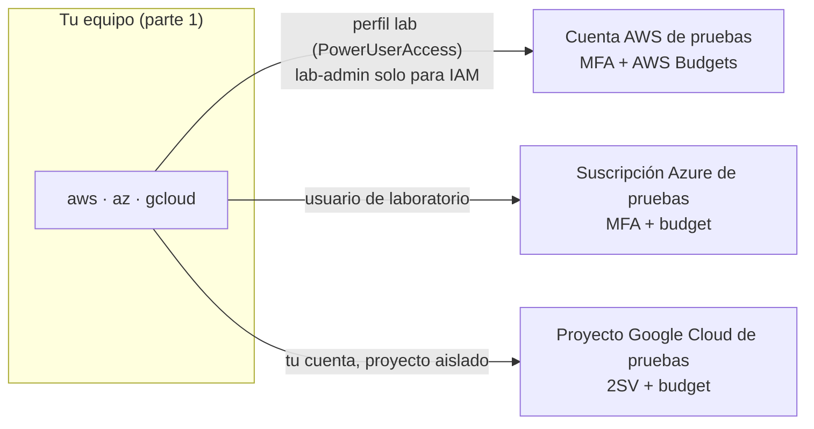

---
tags:
  - laboratorio
  - entorno
  - finops
  - iam
---

# Lab 00 (parte 2): Cuentas cloud, presupuestos e identidades

> Deja tus cuentas de AWS, Azure y Google Cloud protegidas con MFA, alertas de presupuesto y un usuario de laboratorio con permisos limitados, y conecta las CLIs con esa identidad.

| Nivel | Duración | Costo | Requisitos |
| --- | --- | --- | --- |
| Básico | ~1–1,5 h | Gratis (las cuentas cloud quedan creadas, pero vacías) | [Lab 00 (parte 1)](preparar-entorno.md) con las CLIs de AWS, Azure y Google Cloud instaladas, un correo solo para labs y una tarjeta para verificar las cuentas cloud |

!!! info "Qué vas a aprender"
    - Proteger la cuenta raíz o administradora con **MFA** (*multi-factor authentication*, autenticación multifactor) antes de crear nada.
    - Crear **alertas de presupuesto** (*budget alerts*) en las tres nubes para enterarte de cualquier gasto.
    - Trabajar a diario con un usuario de laboratorio con permisos limitados (perfil `lab`), nunca con la cuenta raíz, y usar un perfil con permisos de IAM (`lab-admin`) solo en los labs que lo necesitan y durante poco tiempo.
    - Comprobar con un script que cada CLI usa la identidad de laboratorio y no la raíz.

!!! warning "Costos y seguridad"
    - Crea cuentas **nuevas, solo para aprender**. Nunca hagas los labs en la cuenta de tu trabajo ni en una cuenta con recursos de producción: un `terraform destroy` en la cuenta equivocada no tiene vuelta atrás.
    - Las capas gratuitas y los créditos de bienvenida **cambian a menudo** y tienen límites; revisa las condiciones vigentes en la página de cada proveedor al registrarte.
    - Una alerta de presupuesto **avisa, no corta el gasto**. La protección real es borrar todo al terminar cada lab (sección *Limpieza* de cada uno).
    - Nunca subas llaves de acceso, contraseñas ni archivos `credentials` a Git.

## Antes de empezar

- **Parte 1 terminada**: necesitas las CLIs `aws`, `az` y `gcloud` instaladas ([parte 1, Paso 7](preparar-entorno.md#paso-7-clis-de-aws-azure-y-google-cloud)). Si `verificar-entorno.sh` marca alguna como `FALTA`, instálala antes.
- **Un correo solo para laboratorios** (por ejemplo, un alias `tu-correo+aws-labs@…`), un **gestor de contraseñas** y una **app autenticadora** (o una passkey o llave de seguridad) para el MFA.
- **Una tarjeta** para verificar las cuentas: los proveedores la piden al registrarte aunque uses la capa gratuita.
- **Teoría recomendada**:
    - [FinOps y costos](../../cloud/fundamentos/finops-costos.md): cómo cobra la nube y las herramientas nativas de costos.
    - [IAM: AWS, Azure y GCP](../../cloud/fundamentos/iam-comparativa.md): identidades, roles y por qué no se trabaja con la cuenta raíz.

## Arquitectura



Las tres nubes se usan solo en los labs 09, 13, 16 y 17–20, siempre con una identidad de laboratorio y con alertas de presupuesto ya configuradas.

## Paso a paso

### Paso 1: Crea las cuentas de pruebas y activa MFA

La **cuenta raíz** (*root user*) de AWS, el administrador global de tu tenant de Azure y tu cuenta de Google tienen permisos totales, incluida la facturación. Si alguien roba esa contraseña, puede crear recursos a tu nombre. Por eso lo **primero**, antes de crear ningún recurso, es activar MFA.

1. Regístrate con un correo que uses solo para laboratorios (por ejemplo, un alias `tu-correo+aws-labs@…`) en la página de cuenta gratuita de cada proveedor (enlaces en *Documentación oficial*).
2. Activa MFA en cada una:

=== "AWS"

    1. Inicia sesión como **root user** en la consola.
    2. Menú de tu cuenta (arriba a la derecha) → **Security credentials**.
    3. En **Multi-factor authentication (MFA)** → **Assign MFA device**.
    4. Elige **Passkey or security key** o **Authenticator app** (Microsoft Authenticator, Google Authenticator, 1Password…), escanea el QR e introduce dos códigos seguidos.
    5. Guarda la contraseña raíz en un gestor de contraseñas y **no crees access keys para el root user**.

=== "Azure"

    1. Entra en [My Sign-Ins → Security info](https://mysignins.microsoft.com/security-info) con tu cuenta.
    2. **Add sign-in method** → **Microsoft Authenticator** (o una passkey) y sigue el asistente.
    3. En el portal, Microsoft Entra ID → **Properties** → **Manage security defaults**: deja **Security defaults** habilitado en un tenant de pruebas; obliga a registrar MFA a todos los usuarios.

    Azure ya exige MFA para iniciar sesión en el portal y, progresivamente, en Azure CLI y otras herramientas de administración: mejor tenerlo configurado desde el principio.

=== "Google Cloud"

    1. Ve a [myaccount.google.com/security](https://myaccount.google.com/security).
    2. **2-Step Verification** (verificación en dos pasos) → actívala con una passkey, la app Google Authenticator o una llave de seguridad.
    3. Guarda los **backup codes** (códigos de respaldo) en tu gestor de contraseñas.

    Google Cloud está haciendo obligatoria la verificación en dos pasos para las cuentas que usan la consola y `gcloud`.

### Paso 2: Configura las alertas de presupuesto

Un **budget** (presupuesto) compara el gasto real y el previsto (*forecasted*) con un importe y te envía un correo al cruzar un umbral. Para labs, un presupuesto bajo (por ejemplo, 5 o 10 USD al mes) te avisa enseguida de un recurso olvidado. Más contexto en [FinOps y costos](../../cloud/fundamentos/finops-costos.md#herramientas-nativas-de-costos).

=== "AWS"

    1. Consola → **Billing and Cost Management** → **Budgets** → **Create budget**.
    2. **Use a template (simplified)** → plantilla **Zero spend budget**: avisa en cuanto gastas el primer centavo por encima de la capa gratuita.
    3. Escribe tu correo en **Email recipients** → **Create budget**.
    4. Repite con la plantilla **Monthly cost budget** (por ejemplo, 10 USD): avisa al 85 % y 100 % del gasto real y al 100 % del previsto.
    5. En **Billing preferences**, activa **Receive AWS Free Tier alerts**.

=== "Azure"

    1. Portal → **Cost Management + Billing** → **Cost Management** → **Budgets** → **Add**.
    2. **Scope**: tu suscripción de pruebas. **Reset period**: Monthly. **Amount**: por ejemplo, 10.
    3. **Alert conditions**: tipo **Actual** al 50 % y 100 %, y tipo **Forecasted** al 100 %.
    4. **Alert recipients (email)**: tu correo → **Create**.

    Las cuentas gratuitas de Azure tienen además un **spending limit** (límite de gasto) que desactiva los recursos al agotar el crédito; no lo quites mientras aprendes.

=== "Google Cloud"

    1. Consola → **Billing** → selecciona tu cuenta de facturación → **Budgets & alerts** → **Create budget**.
    2. **Scope**: todos los proyectos (o solo el de labs). **Amount**: **Specified amount**, por ejemplo, 10.
    3. **Actions**: umbrales al 50 %, 90 % y 100 % del gasto real y al 100 % del previsto; deja marcado **Email alerts to billing admins and users**.
    4. **Finish**.

    Durante el periodo de prueba gratuita, Google Cloud no cobra hasta que actives una cuenta de pago completa; aun así, crea el budget para acostumbrarte.

!!! danger "Las alertas llegan con retraso"
    Los datos de facturación se actualizan varias veces al día, no en tiempo real. Un recurso caro puede funcionar horas antes de que llegue el correo. Por eso cada lab de nube termina con una *Limpieza* y una verificación de que no queda nada facturando.

### Paso 3: Crea la identidad de laboratorio y conecta las CLIs

El principio de **least privilege** (mínimo privilegio) dice que cada identidad tenga solo los permisos que necesita. Para el día a día usarás una identidad de laboratorio, no la raíz, y sin llaves de larga duración en tu disco. Comparativa completa en [IAM: AWS, Azure y GCP](../../cloud/fundamentos/iam-comparativa.md).

=== "AWS"

    1. Consola (como root, solo esta vez) → **IAM Identity Center** → **Enable**.
    2. **Users** → **Add user** → `lab-tu-nombre`, con tu correo de labs. Acepta la invitación y registra MFA para ese usuario.
    3. **Permission sets** → **Create permission set** → **Predefined permission set** → **PowerUserAccess** (todo menos la gestión de IAM y de la organización). Session duration: 4 horas.
    4. **AWS accounts** → selecciona tu cuenta → **Assign users or groups** → `lab-tu-nombre` + `PowerUserAccess`.
    5. Copia la **AWS access portal URL** (`https://d-xxxxxxxxxx.awsapps.com/start`) y configura la CLI:

        ```bash
        aws configure sso --profile lab
        # SSO session name: labs · SSO start URL: <tu access portal URL>
        # SSO region: la región donde activaste Identity Center
        # Elige la cuenta y el rol PowerUserAccess · región por defecto: us-east-1
        aws sts get-caller-identity --profile lab
        ```

        ```json
        {
            "UserId": "AROAXXXXXXXXXXXXXXXXX:lab-tu-nombre",
            "Account": "123456789012",
            "Arn": "arn:aws:sts::123456789012:assumed-role/AWSReservedSSO_PowerUserAccess_xxxxxxxx/lab-tu-nombre"
        }
        ```

    `lab` es tu perfil del día a día. PowerUserAccess **no** puede crear roles ni políticas de IAM; para los pocos labs que lo necesitan prepararás un segundo perfil, `lab-admin`, en el Paso 4. No uses el root user para resolverlo.

=== "Azure"

    1. Portal → **Microsoft Entra ID** → **Users** → **New user** → **Create new user**: `lab@<tu-tenant>.onmicrosoft.com`.
    2. **Subscriptions** → tu suscripción → **Access control (IAM)** → **Add role assignment** → rol **Contributor** → miembro `lab@…`. Contributor puede crear y borrar recursos, pero no conceder permisos a otros (eso es Owner).
    3. Inicia sesión con ese usuario (te pedirá registrar MFA) y comprueba:

        ```bash
        az login
        az account show --query "{suscripcion:name, usuario:user.name}" -o table
        ```

        ```text
        Suscripcion          Usuario
        -------------------  ------------------------------
        Azure subscription 1  lab@tutenant.onmicrosoft.com
        ```

=== "Google Cloud"

    1. Consola → selector de proyectos → **New project** → `labs-tu-nombre` (el ID debe ser único) y vincúlalo a tu cuenta de facturación.
    2. Trabaja **solo dentro de ese proyecto**: así puedes borrarlo entero al final del curso y todo lo que contiene desaparece.
    3. Conecta la CLI y fija el proyecto por defecto:

        ```bash
        gcloud auth login
        gcloud config set project labs-tu-nombre
        gcloud auth application-default login   # credenciales para Terraform y los SDKs
        gcloud config list
        ```

        ```text
        [core]
        account = tu-correo@gmail.com
        project = labs-tu-nombre
        ```

    No crees **service account keys** (archivos JSON con llaves): con `application-default login` y, en CI, con Workload Identity Federation no hacen falta.

### Paso 4: Perfil `lab-admin` para gestionar IAM en AWS

En AWS trabajarás con **dos perfiles** de la CLI, los dos del mismo usuario `lab-tu-nombre` de IAM Identity Center:

| Perfil | Permission set | Duración de sesión | Cuándo se usa |
| --- | --- | --- | --- |
| `lab` | **PowerUserAccess** | 4 h | Siempre, salvo que el lab diga lo contrario: redes, EC2, S3, Lambda, escaneos… |
| `lab-admin` | **AdministratorAccess** | 1 h | Solo en los pasos que crean o borran roles, políticas, instance profiles o proveedores OIDC de IAM, o que entregan un rol a un servicio (`iam:PassRole`) |

¿Por qué no usar siempre AdministratorAccess? Por **least privilege**: quien puede gestionar IAM puede concederse cualquier permiso, así que un error o una credencial robada con `lab-admin` tiene un alcance total. Con `lab` el daño queda acotado. Por eso `lab-admin` tiene una sesión corta (1 h) y su **asignación** solo existe mientras haces un lab que la necesita: la creas al empezar y la retiras en la *Limpieza*. Es el mismo principio que aplicarás a los pipelines: permisos amplios solo cuando hacen falta y durante poco tiempo.

Crea el permission set y el perfil ahora, para comprobar que funcionan:

1. **IAM Identity Center** → **Permission sets** → **Create permission set** → **Predefined permission set** → **AdministratorAccess**. Session duration: **1 hour**. El permission set por sí solo no da acceso a nadie: es una plantilla.
2. **AWS accounts** → tu cuenta → **Assign users or groups** → `lab-tu-nombre` + `AdministratorAccess`. Esta **asignación** es lo que da el acceso (Identity Center crea en la cuenta el rol `AWSReservedSSO_AdministratorAccess_…`).
3. Configura el perfil reutilizando la sesión SSO `labs` del perfil `lab` (no vuelve a pedirte la URL):

    ```bash
    aws configure sso --profile lab-admin
    # SSO session name: labs (la misma) · elige la cuenta y el rol AdministratorAccess
    # región por defecto: us-east-1
    aws sts get-caller-identity --profile lab-admin
    ```

    ```json
    {
        "UserId": "AROAXXXXXXXXXXXXXXXXX:lab-tu-nombre",
        "Account": "123456789012",
        "Arn": "arn:aws:sts::123456789012:assumed-role/AWSReservedSSO_AdministratorAccess_xxxxxxxx/lab-tu-nombre"
    }
    ```

4. Comprueba la diferencia entre los dos perfiles con una operación de IAM de solo lectura:

    ```bash
    aws iam list-roles --max-items 1 --profile lab        # funciona: es de las pocas acciones de IAM que PowerUserAccess permite
    aws iam get-account-summary --profile lab            # AccessDenied ... iam:GetAccountSummary
    aws iam get-account-summary --profile lab-admin      # funciona
    ```

5. **Retira la asignación** hasta que la necesites: en **AWS accounts** → tu cuenta, quita la asignación de `AdministratorAccess` a `lab-tu-nombre` y deja la de `PowerUserAccess`. El permission set sigue existiendo para la próxima vez. El perfil `lab-admin` queda configurado en `~/.aws/config`, pero no obtendrá credenciales hasta que vuelvas a asignar el permission set (paso 2).

Labs que necesitan `lab-admin`:

| Lab | Qué hace con IAM | Dónde se usa `lab-admin` |
| --- | --- | --- |
| [Lab 13: OIDC entre GitHub Actions y AWS](../devsecops/oidc-github-aws.md) | Proveedor OIDC de GitHub, rol del pipeline y su política | Todo el lab (casi todos los pasos son de IAM) |
| [Lab 16: Prowler (CSPM)](../devsecops/cspm-prowler.md) | Rol de auditoría de solo lectura | Solo para crear y borrar ese rol; el escaneo se hace con `lab` asumiendo el rol de solo lectura |
| [Lab 17: VPC y EC2](../cloud/aws-vpc-ec2.md) | Rol e instance profile de la EC2 y `iam:PassRole` al lanzarla | Solo los pasos 7–8 (rol, instance profile y lanzamiento de la EC2), el paso 12 con Terraform y el borrado del rol; la red va con `lab` |
| [Lab 18: API serverless](../cloud/aws-serverless-api.md) | Rol de ejecución de Lambda y `iam:PassRole` al crear la función | El despliegue con Terraform, la verificación y la limpieza |

El [Lab 09](../devops/terraform-aws-backend-remoto.md) (buckets S3 y un parámetro de SSM) no toca IAM y se hace entero con `lab`.

### Paso 5: Comprueba las identidades con un script

Igual que en la parte 1 comprobaste las herramientas, este script comprueba de una vez que cada CLI tiene sesión **con la identidad de laboratorio** y no con la raíz. Lo puedes repetir al empezar cada lab de nube.

```bash title="verificar-cuentas.sh"
#!/usr/bin/env bash
# Comprueba que las CLIs de nube usan las identidades de laboratorio.
set -u
fallos=0
ok()    { printf "OK     %-16s %s\n" "$1" "$2"; }
falla() { printf "FALLA  %-16s %s\n" "$1" "$2"; fallos=$((fallos + 1)); }

# AWS: el perfil del día a día es PowerUserAccess, nunca el root user
if arn=$(aws sts get-caller-identity --profile lab --query Arn --output text 2> /dev/null); then
  case "$arn" in
    *:root)            falla "aws (lab)" "es la cuenta raíz: $arn" ;;
    *PowerUserAccess*) ok    "aws (lab)" "$arn" ;;
    *)                 falla "aws (lab)" "rol inesperado: $arn" ;;
  esac
else
  falla "aws (lab)" "sin sesión: aws sso login --profile lab"
fi

# AWS: fuera de los labs que gestionan IAM, lab-admin no debe tener acceso
if aws sts get-caller-identity --profile lab-admin > /dev/null 2>&1; then
  falla "aws (lab-admin)" "AdministratorAccess sigue asignado: retíralo al terminar el lab"
else
  ok    "aws (lab-admin)" "sin acceso (asignación retirada)"
fi

# Azure: sesión iniciada y suscripción de pruebas seleccionada
if suscripcion=$(az account show --query name --output tsv 2> /dev/null); then
  ok    "az" "$suscripcion · $(az account show --query user.name --output tsv)"
else
  falla "az" "sin sesión: az login"
fi

# Google Cloud: proyecto por defecto y credenciales para Terraform y los SDKs
proyecto=$(gcloud config get-value project 2> /dev/null)
if [ -n "$proyecto" ]; then
  ok    "gcloud" "$proyecto · $(gcloud config get-value account 2> /dev/null)"
else
  falla "gcloud" "sin proyecto: gcloud config set project labs-tu-nombre"
fi
if gcloud auth application-default print-access-token > /dev/null 2>&1; then
  ok    "gcloud (ADC)" "credenciales de aplicación disponibles"
else
  falla "gcloud (ADC)" "sin credenciales: gcloud auth application-default login"
fi

echo "Comprobaciones fallidas: $fallos"
exit "$fallos"
```

```bash
bash verificar-cuentas.sh
```

Salida esperada con todo configurado (los valores son de ejemplo):

```text
OK     aws (lab)        arn:aws:sts::123456789012:assumed-role/AWSReservedSSO_PowerUserAccess_xxxxxxxx/lab-tu-nombre
OK     aws (lab-admin)  sin acceso (asignación retirada)
OK     az               Azure subscription 1 · lab@tutenant.onmicrosoft.com
OK     gcloud           labs-tu-nombre · tu-correo@gmail.com
OK     gcloud (ADC)     credenciales de aplicación disponibles
Comprobaciones fallidas: 0
```

Se lee así: el perfil `lab` usa el rol de PowerUserAccess (si el ARN termina en `:root`, estás usando la cuenta raíz y el script lo marca); `lab-admin` no obtiene credenciales porque la asignación está retirada; Azure usa el usuario `lab@…`; y Google Cloud apunta a tu proyecto de labs. Si estás en mitad de un lab que usa `lab-admin` (13, 16, 17 o 18), la segunda línea sale `FALLA` a propósito: es el recordatorio de retirar la asignación en la *Limpieza*. Como el script de la parte 1, sale con un código igual al número de fallos.

## Verificación

Cada fila debe dar una salida parecida:

| Comprobación | Comando | Salida esperada |
| --- | --- | --- |
| AWS (identidad) | `aws sts get-caller-identity --profile lab` | Un ARN con `AWSReservedSSO_PowerUserAccess`, **no** `:root` |
| AWS (perfil `lab-admin`) | `aws sts get-caller-identity --profile lab-admin` | Con la asignación activa (Paso 4), un ARN con `AWSReservedSSO_AdministratorAccess`; después de retirarla, `ForbiddenException ... No access` (es lo esperado fuera de los labs 13, 16, 17 y 18) |
| AWS (mínimo privilegio) | `aws iam get-account-summary --profile lab` | `AccessDenied`: el perfil del día a día no gestiona IAM |
| Azure (identidad) | `az account show -o table` | Tu suscripción de pruebas y el usuario `lab@…` |
| Google Cloud (proyecto) | `gcloud config get-value project` | `labs-tu-nombre` |
| Budgets | Correo de confirmación o lista de budgets en cada consola | Un budget activo por nube |
| Script | `bash verificar-cuentas.sh` | `Comprobaciones fallidas: 0` |

Y una comprobación de seguridad: en la consola de AWS, **IAM → Dashboard** no debe mostrar avisos de "Add MFA for root user".

## Retos extra

1. En AWS, crea un budget por CLI en vez de por consola. Pista: `aws budgets create-budget` con un JSON de `Budget` y otro de `NotificationsWithSubscribers`.
2. Investiga cómo restringir las regiones permitidas en tu cuenta de AWS con una **SCP** (*Service Control Policy*). Pista: requiere AWS Organizations; lo ves en [Gobernanza](../../cloud/operacion-y-gobierno/gobernanza.md).
3. Amplía `verificar-cuentas.sh` para que compruebe también que existe al menos un budget en AWS. Pista: `aws budgets describe-budgets --account-id <id> --profile lab`, con el ID de cuenta que ya devuelve `aws sts get-caller-identity`.

## Limpieza

Este lab no crea recursos que cobren: los usuarios, permisos, proyectos y budgets son gratuitos. **No borres** nada; el resto de labs lo usa. Si en algún momento abandonas los labs de nube:

- AWS: cierra la cuenta desde **Account** → **Close account** (después de borrar todos los recursos).
- Azure: cancela la suscripción en **Subscriptions** → **Cancel subscription**.
- Google Cloud: `gcloud projects delete labs-tu-nombre` (queda 30 días en estado *pending deletion* y luego se borra).

Lo que sí debes comprobar es que **no** quede asignado `AdministratorAccess` (Paso 4, punto 5): `aws sts get-caller-identity --profile lab-admin` debe fallar con `No access`. Repite esa comprobación al terminar cada lab que use `lab-admin`.

Para quitar las credenciales locales: `aws sso logout`, `az logout`, `gcloud auth revoke --all`.

## Problemas comunes

| Síntoma | Causa | Solución |
| --- | --- | --- |
| `Error loading SSO Token: Token for … does not exist` | La sesión SSO caducó | `aws sso login --profile lab` |
| `AccessDenied ... is not authorized to perform: iam:CreateRole` (o `iam:PassRole`, `iam:CreateOpenIDConnectProvider`, `iam:PutRolePolicy`) | Usas el perfil `lab` (PowerUserAccess), que no gestiona IAM | En ese paso usa `--profile lab-admin` (o `AWS_PROFILE=lab-admin`), como indica cada lab; asigna antes `AdministratorAccess` (Paso 4) |
| `ForbiddenException ... GetRoleCredentials operation: No access` con `--profile lab-admin` | La asignación de `AdministratorAccess` está retirada (lo normal fuera de los labs que la necesitan) | Vuelve a asignarla en IAM Identity Center (Paso 4, punto 2) y retírala al terminar el lab |
| `AADSTS50076` o error de MFA al usar `az login` | El tenant exige MFA y la sesión no la tiene | `az login` interactivo en el navegador y completa el segundo factor |
| No llegan los correos del budget | Correo mal escrito o en spam; aún no hay datos de facturación | Revisa los destinatarios y espera 24 h tras crearlo |

Para el método general de diagnóstico, mira [Troubleshooting](../../devops/operacion/troubleshooting.md).

## Información complementaria

- **Budgets y FinOps**: el presupuesto es la primera herramienta de control de costos y la base del *showback*; ver [FinOps y costos](../../cloud/fundamentos/finops-costos.md).
- **Root user vs identidad de trabajo**: la raíz solo para tareas que la exigen (facturación, cerrar la cuenta); el día a día, con identidades federadas y credenciales temporales. Ver [IAM: AWS, Azure y GCP](../../cloud/fundamentos/iam-comparativa.md#best-practices-comunes).
- **En el trabajo real**: las empresas usan una **landing zone** con cuentas separadas por entorno, SSO corporativo, budgets por cuenta y SCPs/Azure Policy/Organization Policy. Tu cuenta de pruebas con MFA, budget y usuario limitado es la versión mínima de eso ([Gobernanza](../../cloud/operacion-y-gobierno/gobernanza.md)).

## Documentación oficial

- [AWS Free Tier](https://aws.amazon.com/free/) · [Cuenta gratuita de Azure](https://azure.microsoft.com/es-es/pricing/free-services) · [Google Cloud Free Program](https://cloud.google.com/free/docs/free-cloud-features)
- [AWS: MFA para el root user](https://docs.aws.amazon.com/IAM/latest/UserGuide/enable-mfa-for-root.html) · [AWS Budgets](https://docs.aws.amazon.com/cost-management/latest/userguide/budgets-managing-costs.html) · [IAM Identity Center: primeros pasos](https://docs.aws.amazon.com/singlesignon/latest/userguide/getting-started.html)
- [Azure: tutorial de budgets](https://learn.microsoft.com/es-es/azure/cost-management-billing/costs/tutorial-acm-create-budgets) · [Azure: MFA obligatoria](https://learn.microsoft.com/es-es/entra/identity/authentication/concept-mandatory-multifactor-authentication)
- [Google Cloud: crear budgets](https://cloud.google.com/billing/docs/how-to/budgets) · [Verificación en dos pasos de Google](https://support.google.com/accounts/answer/185839?hl=es)

## Preguntas para verificar el aprendizaje

??? question "1. ¿Por qué activas MFA en la cuenta raíz antes de crear cualquier recurso?"
    Porque la cuenta raíz tiene permisos totales, incluida la facturación, y no se pueden limitar con políticas normales. Si alguien obtiene su contraseña puede crear recursos caros o borrar todo. MFA hace que la contraseña sola no baste.

??? question "2. Tienes un budget de 10 USD con alerta al 100 %. ¿Qué pasa si una VM cara sigue encendida al cruzarlo?"
    Recibes un correo, pero la VM **sigue funcionando y cobrando**. Un budget avisa, no detiene recursos (salvo que configures acciones automáticas, como las *budget actions* de AWS o un spending limit). Además, el aviso puede llegar con horas de retraso.

??? question "3. ¿Para qué sirve la alerta de gasto previsto (forecasted) además de la de gasto real?"
    Avisa **antes** de llegar al límite: si a mitad de mes la tendencia indica que terminarás por encima del presupuesto, te enteras con tiempo para borrar lo que sobra.

??? question "4. ¿Qué diferencia hay entre el permission set PowerUserAccess y AdministratorAccess en AWS, y por qué `lab-admin` solo se asigna durante algunos labs?"
    PowerUserAccess permite usar casi todos los servicios pero **no** gestionar IAM ni la organización (no puede crear roles ni políticas, ni entregar un rol a un servicio con `iam:PassRole`, ni concederse más permisos). AdministratorAccess lo permite todo, incluido darse cualquier permiso. Por eso el día a día va con `lab` y `lab-admin` solo existe, con sesión de 1 hora, mientras haces un lab que crea recursos de IAM: si una credencial se filtra o te equivocas de comando, el alcance del daño es mucho menor.

??? question "5. ¿Qué pasaría si guardas un access key del root user en `~/.aws/credentials` y ese archivo acaba en un repositorio público?"
    Bots que escanean GitHub lo encontrarían en minutos y podrían usar la cuenta entera (por ejemplo, para minar criptomonedas). Por eso: nada de access keys para root, credenciales temporales vía SSO y escaneo de secretos en los commits.

??? question "6. ¿Por qué en Google Cloud conviene hacer todos los labs dentro de un único proyecto dedicado?"
    Porque el proyecto es la unidad de aislamiento y facturación: puedes ver su costo por separado y, al terminar, borrar el proyecto elimina todos sus recursos de una vez.

??? question "7. `verificar-cuentas.sh` marca `FALLA  aws (lab-admin)` aunque no estás haciendo ningún lab de IAM. ¿Qué significa y qué haces?"
    Que la asignación de `AdministratorAccess` sigue activa: el perfil `lab-admin` obtiene credenciales con permisos totales sin que las necesites. Quítala en IAM Identity Center (Paso 4, punto 5) y vuelve a ejecutar el script hasta que esa línea salga `OK`.

## Notas relacionadas

- **Cloud**
    - [FinOps y costos](../../cloud/fundamentos/finops-costos.md)
    - [IAM: AWS, Azure y GCP](../../cloud/fundamentos/iam-comparativa.md)
    - [Fundamentos de seguridad cloud](../../cloud/seguridad/fundamentos-seguridad-cloud.md)
    - [Gobernanza](../../cloud/operacion-y-gobierno/gobernanza.md)
    - [Modelos de servicio y regiones](../../cloud/fundamentos/modelos-de-servicio-y-regiones.md)
- **DevSecOps**
    - [Secretos e identidades](../../devsecops/identidades-y-pipeline/secretos-identidades.md)
- **Recursos**
    - [Comandos de AWS CLI](../../recursos/comandos/aws-cli.md) · [Comandos de Google Cloud CLI](../../recursos/comandos/google-cli.md)

Lab anterior: [Lab 00 (parte 1): Herramientas locales](preparar-entorno.md) · Lab siguiente: [Lab 01: Diagnóstico de red desde Linux](linux-red-diagnostico.md)
