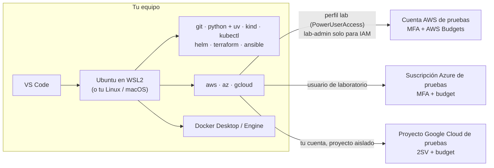

---
tags:
  - laboratorio
  - entorno
  - finops
  - iam
---

# Lab 00: Preparar el entorno de laboratorio

> Instala y comprueba todas las herramientas de los laboratorios y deja tus cuentas de AWS, Azure y Google Cloud protegidas con MFA, alertas de presupuesto y un usuario de laboratorio con permisos limitados.

| Nivel | Duración | Costo | Requisitos |
| --- | --- | --- | --- |
| Básico | ~2–3 h (en una o varias sesiones) | Gratis (las cuentas cloud quedan creadas, pero vacías) | Un equipo con Windows 10/11, macOS o Linux, 16 GB de RAM recomendados, permisos de administrador y una tarjeta para verificar las cuentas cloud |

!!! info "Qué vas a aprender"
    - Montar un entorno de trabajo reproducible: Linux (o WSL2), Git, editor, Python con `uv` y Docker.
    - Instalar las herramientas de Kubernetes e IaC que usan los labs: kind, kubectl, Helm, Terraform y Ansible.
    - Instalar y comprobar las CLI de AWS, Azure y Google Cloud.
    - Proteger la cuenta raíz o administradora con **MFA** (*multi-factor authentication*, autenticación multifactor) antes de crear nada.
    - Crear **alertas de presupuesto** (*budget alerts*) en las tres nubes para enterarte de cualquier gasto.
    - Trabajar a diario con un usuario de laboratorio con permisos limitados (perfil `lab`), nunca con la cuenta raíz, y usar un perfil con permisos de IAM (`lab-admin`) solo en los labs que lo necesitan y durante poco tiempo.

!!! warning "Costos y seguridad"
    - Crea cuentas **nuevas, solo para aprender**. Nunca hagas los labs en la cuenta de tu trabajo ni en una cuenta con recursos de producción: un `terraform destroy` en la cuenta equivocada no tiene vuelta atrás.
    - Las capas gratuitas y los créditos de bienvenida **cambian a menudo** y tienen límites; revisa las condiciones vigentes en la página de cada proveedor al registrarte.
    - Una alerta de presupuesto **avisa, no corta el gasto**. La protección real es borrar todo al terminar cada lab (sección *Limpieza* de cada uno).
    - Nunca subas llaves de acceso, contraseñas ni archivos `credentials` a Git.

## Antes de empezar

- **Sistema operativo**: Windows 10 (21H2 o posterior) / Windows 11, macOS 13 o posterior, o una distribución Linux reciente (los ejemplos usan Ubuntu 22.04/24.04).
- **Recursos**: los labs de Kubernetes y observabilidad levantan varios contenedores a la vez. Con 8 GB de RAM funcionan, pero justos.
- **Teoría recomendada**:
    - [Entorno de trabajo con Python](../../python/fundamentos/entorno-python.md): `venv`, `pip`, `uv` y `pipx`.
    - [FinOps y costos](../../cloud/fundamentos/finops-costos.md): cómo cobra la nube y las herramientas nativas de costos.
    - [IAM: AWS, Azure y GCP](../../cloud/identidad-y-seguridad/iam-comparativa.md): identidades, roles y por qué no se trabaja con la cuenta raíz.

!!! tip "En Windows, trabaja dentro de WSL2"
    **WSL2** (*Windows Subsystem for Linux*) ejecuta un Linux real dentro de Windows. Los labs están escritos para una terminal Linux (Bash), Ansible no funciona en Windows de forma nativa y Docker Desktop usa WSL2 por debajo. La recomendación es: Docker Desktop y el editor en Windows; el resto de herramientas **dentro de Ubuntu en WSL2**, siguiendo las pestañas "Linux".

## Arquitectura



Todo lo local corre en tu equipo y es gratis. Las tres nubes se usan solo en los labs 09, 13, 16 y 17–20, siempre con una identidad de laboratorio y con alertas de presupuesto ya configuradas.

## Paso a paso

### Paso 1: Prepara la base (WSL2 en Windows)

Instalas primero la capa de sistema operativo porque todas las demás herramientas van encima. En macOS y Linux este paso se reduce a tener un gestor de paquetes.

=== "Windows"

    En PowerShell **como administrador**:

    ```powershell
    wsl --install            # instala WSL2 y Ubuntu (la distribución por defecto)
    ```

    Reinicia si te lo pide, abre "Ubuntu" desde el menú Inicio y crea tu usuario Linux. Comprueba que la distribución usa la versión 2:

    ```powershell
    wsl -l -v
    ```

    ```text
      NAME            STATE           VERSION
    * Ubuntu          Running         2
    ```

    A partir de aquí, en cada paso usa la pestaña **Linux** dentro de la terminal de Ubuntu, salvo para Docker Desktop y el editor.

=== "macOS"

    Instala Homebrew (el gestor de paquetes de facto en macOS) siguiendo el comando de [brew.sh](https://brew.sh) y comprueba:

    ```bash
    brew --version
    ```

=== "Linux"

    Actualiza el sistema e instala utilidades básicas que usan los scripts de instalación:

    ```bash
    sudo apt update && sudo apt upgrade -y
    sudo apt install -y curl unzip gnupg ca-certificates lsb-release
    ```

### Paso 2: Git y el editor

Git es la base de todo (código, IaC, pipelines) y el editor te ahorra errores de sintaxis en YAML, HCL y Python.

=== "Windows"

    ```powershell
    winget install --id Microsoft.VisualStudioCode -e
    winget install --id Git.Git -e        # Git para Windows (opcional si trabajas solo en WSL)
    ```

    En VS Code instala la extensión **WSL** y abre tus carpetas de Ubuntu con `code .` desde la terminal de WSL. Dentro de Ubuntu: `sudo apt install -y git`.

=== "macOS"

    ```bash
    brew install git
    brew install --cask visual-studio-code
    ```

=== "Linux"

    ```bash
    sudo apt install -y git
    # VS Code: paquete .deb desde code.visualstudio.com, o el editor que prefieras
    ```

Configura tu identidad (aparece en cada commit):

```bash
git config --global user.name "Tu Nombre"
git config --global user.email "tu-correo@ejemplo.com"
git config --global init.defaultBranch main
```

### Paso 3: Python 3.12+ y uv

Los labs de Python (03) y varios scripts usan Python 3.12 o superior. **uv** crea entornos virtuales e instala paquetes y versiones de Python mucho más rápido que `pip`; lo tienes explicado en [Entorno de trabajo con Python](../../python/fundamentos/entorno-python.md#uv-la-alternativa-moderna).

=== "Windows"

    Dentro de Ubuntu (WSL2) sigue la pestaña Linux. Si además quieres Python nativo en Windows:

    ```powershell
    winget install --id Python.Python.3.12 -e
    winget install --id astral-sh.uv -e
    py -3.12 --version
    ```

=== "macOS"

    ```bash
    brew install python@3.12 uv
    ```

=== "Linux"

    ```bash
    curl -LsSf https://astral.sh/uv/install.sh | sh   # instala uv en ~/.local/bin
    uv python install 3.12                             # Python gestionado por uv
    ```

Comprueba:

```bash
uv --version
uv run --python 3.12 python --version
```

```text
uv 0.x.y (...)
Python 3.12.x
```

### Paso 4: Docker

Docker se usa en los labs 05, 06 (kind crea el clúster con contenedores), 11, 12, 14, 15 y 21.

=== "Windows"

    ```powershell
    winget install --id Docker.DockerDesktop -e
    ```

    Abre Docker Desktop, en *Settings → General* deja marcado **Use the WSL 2 based engine** y en *Settings → Resources → WSL integration* activa tu distribución Ubuntu. Así el comando `docker` funciona también dentro de WSL.

=== "macOS"

    ```bash
    brew install --cask docker-desktop
    ```

    Abre Docker Desktop una vez para que termine la configuración.

=== "Linux"

    Instala **Docker Engine** con el repositorio oficial de tu distribución (guía en *Documentación oficial*) y añade tu usuario al grupo `docker` para no usar `sudo`:

    ```bash
    sudo usermod -aG docker "$USER"
    newgrp docker      # o cierra sesión y vuelve a entrar
    ```

    Pertenecer al grupo `docker` equivale a tener privilegios de root en la máquina: hazlo solo en tu equipo de laboratorio.

Prueba que el daemon responde:

```bash
docker run --rm hello-world
```

```text
Hello from Docker!
This message shows that your installation appears to be working correctly.
```

### Paso 5: kind, kubectl y Helm

**kind** (*Kubernetes in Docker*) crea clústeres de Kubernetes locales con contenedores, **kubectl** es el cliente de Kubernetes y **Helm** instala aplicaciones empaquetadas (*charts*). Los tres son binarios sueltos.

=== "Windows"

    Recomendado: instálalos dentro de WSL con la pestaña Linux. En Windows nativo:

    ```powershell
    winget install --id Kubernetes.kind -e
    winget install --id Kubernetes.kubectl -e
    winget install --id Helm.Helm -e
    ```

=== "macOS"

    ```bash
    brew install kind kubectl helm
    ```

=== "Linux"

    ```bash
    # kind (revisa la última versión en kind.sigs.k8s.io)
    curl -Lo ./kind https://kind.sigs.k8s.io/dl/v0.33.0/kind-linux-amd64
    sudo install -m 0755 kind /usr/local/bin/kind && rm kind

    # kubectl (última versión estable)
    curl -LO "https://dl.k8s.io/release/$(curl -L -s https://dl.k8s.io/release/stable.txt)/bin/linux/amd64/kubectl"
    sudo install -m 0755 kubectl /usr/local/bin/kubectl && rm kubectl

    # Helm 4 con el script oficial
    curl -fsSL -o get_helm.sh https://raw.githubusercontent.com/helm/helm/main/scripts/get-helm-4
    chmod 700 get_helm.sh && ./get_helm.sh && rm get_helm.sh
    ```

!!! note "Lee antes de ejecutar"
    Los comandos `curl … | sh` y los scripts de instalación ejecutan código descargado. Usa solo las URLs de la documentación oficial y, si quieres, descarga primero el script y léelo antes de ejecutarlo (como se hace arriba con Helm).

### Paso 6: Terraform y Ansible

Terraform aprovisiona infraestructura (labs 08, 09, 13) y Ansible configura servidores (lab 10). Ansible **no funciona como nodo de control en Windows sin WSL**, por eso en Windows va dentro de Ubuntu.

=== "Windows"

    Terraform puede ir en Windows (`winget install --id Hashicorp.Terraform -e`), pero para tener todo en un mismo sitio instala ambos **dentro de WSL** con la pestaña Linux.

=== "macOS"

    ```bash
    brew tap hashicorp/tap
    brew install hashicorp/tap/terraform
    brew install pipx && pipx ensurepath
    pipx install --include-deps ansible
    ```

=== "Linux"

    ```bash
    # Terraform desde el repositorio oficial de HashiCorp
    wget -O - https://apt.releases.hashicorp.com/gpg | sudo gpg --dearmor -o /usr/share/keyrings/hashicorp-archive-keyring.gpg
    echo "deb [arch=$(dpkg --print-architecture) signed-by=/usr/share/keyrings/hashicorp-archive-keyring.gpg] https://apt.releases.hashicorp.com $(lsb_release -cs) main" \
      | sudo tee /etc/apt/sources.list.d/hashicorp.list
    sudo apt update && sudo apt install -y terraform

    # Ansible aislado con pipx (método recomendado por Ansible)
    sudo apt install -y pipx && pipx ensurepath
    pipx install --include-deps ansible
    ```

Abre una terminal nueva después de `pipx ensurepath` para que el `PATH` incluya `~/.local/bin`.

### Paso 7: CLIs de AWS, Azure y Google Cloud

Las tres CLIs se instalan ahora, aunque no inicies sesión hasta tener las cuentas protegidas (pasos 8 a 10).

=== "Windows"

    Dentro de WSL usa la pestaña Linux. En Windows nativo:

    ```powershell
    msiexec.exe /i https://awscli.amazonaws.com/AWSCLIV2.msi
    winget install --id Microsoft.AzureCLI -e
    # Google Cloud CLI: descarga y ejecuta el instalador
    # https://dl.google.com/dl/cloudsdk/channels/rapid/GoogleCloudSDKInstaller.exe
    ```

=== "macOS"

    ```bash
    brew install awscli
    brew install --cask azure-cli gcloud-cli
    ```

=== "Linux"

    ```bash
    # AWS CLI v2
    curl "https://awscli.amazonaws.com/awscli-exe-linux-x86_64.zip" -o awscliv2.zip
    unzip -q awscliv2.zip && sudo ./aws/install && rm -rf aws awscliv2.zip

    # Azure CLI (script oficial para Debian/Ubuntu)
    curl -sL https://aka.ms/InstallAzureCLIDeb | sudo bash

    # Google Cloud CLI desde su repositorio apt
    curl https://packages.cloud.google.com/apt/doc/apt-key.gpg | sudo gpg --dearmor -o /usr/share/keyrings/cloud.google.gpg
    echo "deb [signed-by=/usr/share/keyrings/cloud.google.gpg] https://packages.cloud.google.com/apt cloud-sdk main" \
      | sudo tee /etc/apt/sources.list.d/google-cloud-sdk.list
    sudo apt update && sudo apt install -y google-cloud-cli
    ```

Comandos útiles de cada CLI en [AWS CLI](../../recursos/comandos/aws-cli.md) y [Google Cloud CLI](../../recursos/comandos/google-cli.md).

### Paso 8: Crea las cuentas de pruebas y activa MFA

La **cuenta raíz** (*root user*) de AWS, el administrador global de tu tenant de Azure y tu cuenta de Google tienen permisos totales, incluida la facturación. Si alguien roba esa contraseña, puede crear recursos a tu nombre. Por eso lo **primero**, antes de crear ningún recurso, es activar MFA.

1. Regístrate con un correo que uses solo para laboratorios (por ejemplo, un alias `tu-correo+aws-labs@…`) en la página de cuenta gratuita de cada proveedor (enlaces en *Documentación oficial*).
2. Activa MFA en cada una:

=== "AWS"

    1. Inicia sesión como **root user** en la consola.
    2. Menú de tu cuenta (arriba a la derecha) → **Security credentials**.
    3. En **Multi-factor authentication (MFA)** → **Assign MFA device**.
    4. Elige **Passkey or security key** o **Authenticator app** (Microsoft Authenticator, Google Authenticator, 1Password…), escanea el QR e introduce dos códigos seguidos.
    5. Guarda la contraseña raíz en un gestor de contraseñas y **no crees access keys para el root user**.

=== "Azure"

    1. Entra en [My Sign-Ins → Security info](https://mysignins.microsoft.com/security-info) con tu cuenta.
    2. **Add sign-in method** → **Microsoft Authenticator** (o una passkey) y sigue el asistente.
    3. En el portal, Microsoft Entra ID → **Properties** → **Manage security defaults**: deja **Security defaults** habilitado en un tenant de pruebas; obliga a registrar MFA a todos los usuarios.

    Azure ya exige MFA para iniciar sesión en el portal y, progresivamente, en Azure CLI y otras herramientas de administración: mejor tenerlo configurado desde el principio.

=== "Google Cloud"

    1. Ve a [myaccount.google.com/security](https://myaccount.google.com/security).
    2. **2-Step Verification** (verificación en dos pasos) → actívala con una passkey, la app Google Authenticator o una llave de seguridad.
    3. Guarda los **backup codes** (códigos de respaldo) en tu gestor de contraseñas.

    Google Cloud está haciendo obligatoria la verificación en dos pasos para las cuentas que usan la consola y `gcloud`.

### Paso 9: Configura las alertas de presupuesto

Un **budget** (presupuesto) compara el gasto real y el previsto (*forecasted*) con un importe y te envía un correo al cruzar un umbral. Para labs, un presupuesto bajo (por ejemplo, 5 o 10 USD al mes) te avisa enseguida de un recurso olvidado. Más contexto en [FinOps y costos](../../cloud/fundamentos/finops-costos.md#herramientas-nativas-de-costos).

=== "AWS"

    1. Consola → **Billing and Cost Management** → **Budgets** → **Create budget**.
    2. **Use a template (simplified)** → plantilla **Zero spend budget**: avisa en cuanto gastas el primer centavo por encima de la capa gratuita.
    3. Escribe tu correo en **Email recipients** → **Create budget**.
    4. Repite con la plantilla **Monthly cost budget** (por ejemplo, 10 USD): avisa al 85 % y 100 % del gasto real y al 100 % del previsto.
    5. En **Billing preferences**, activa **Receive AWS Free Tier alerts**.

=== "Azure"

    1. Portal → **Cost Management + Billing** → **Cost Management** → **Budgets** → **Add**.
    2. **Scope**: tu suscripción de pruebas. **Reset period**: Monthly. **Amount**: por ejemplo, 10.
    3. **Alert conditions**: tipo **Actual** al 50 % y 100 %, y tipo **Forecasted** al 100 %.
    4. **Alert recipients (email)**: tu correo → **Create**.

    Las cuentas gratuitas de Azure tienen además un **spending limit** (límite de gasto) que desactiva los recursos al agotar el crédito; no lo quites mientras aprendes.

=== "Google Cloud"

    1. Consola → **Billing** → selecciona tu cuenta de facturación → **Budgets & alerts** → **Create budget**.
    2. **Scope**: todos los proyectos (o solo el de labs). **Amount**: **Specified amount**, por ejemplo, 10.
    3. **Actions**: umbrales al 50 %, 90 % y 100 % del gasto real y al 100 % del previsto; deja marcado **Email alerts to billing admins and users**.
    4. **Finish**.

    Durante el periodo de prueba gratuita, Google Cloud no cobra hasta que actives una cuenta de pago completa; aun así, crea el budget para acostumbrarte.

!!! danger "Las alertas llegan con retraso"
    Los datos de facturación se actualizan varias veces al día, no en tiempo real. Un recurso caro puede funcionar horas antes de que llegue el correo. Por eso cada lab de nube termina con una *Limpieza* y una verificación de que no queda nada facturando.

### Paso 10: Crea la identidad de laboratorio y conecta las CLIs

El principio de **least privilege** (mínimo privilegio) dice que cada identidad tenga solo los permisos que necesita. Para el día a día usarás una identidad de laboratorio, no la raíz, y sin llaves de larga duración en tu disco. Comparativa completa en [IAM: AWS, Azure y GCP](../../cloud/identidad-y-seguridad/iam-comparativa.md).

=== "AWS"

    1. Consola (como root, solo esta vez) → **IAM Identity Center** → **Enable**.
    2. **Users** → **Add user** → `lab-tu-nombre`, con tu correo de labs. Acepta la invitación y registra MFA para ese usuario.
    3. **Permission sets** → **Create permission set** → **Predefined permission set** → **PowerUserAccess** (todo menos la gestión de IAM y de la organización). Session duration: 4 horas.
    4. **AWS accounts** → selecciona tu cuenta → **Assign users or groups** → `lab-tu-nombre` + `PowerUserAccess`.
    5. Copia la **AWS access portal URL** (`https://d-xxxxxxxxxx.awsapps.com/start`) y configura la CLI:

        ```bash
        aws configure sso --profile lab
        # SSO session name: labs · SSO start URL: <tu access portal URL>
        # SSO region: la región donde activaste Identity Center
        # Elige la cuenta y el rol PowerUserAccess · región por defecto: us-east-1
        aws sts get-caller-identity --profile lab
        ```

        ```json
        {
            "UserId": "AROAXXXXXXXXXXXXXXXXX:lab-tu-nombre",
            "Account": "123456789012",
            "Arn": "arn:aws:sts::123456789012:assumed-role/AWSReservedSSO_PowerUserAccess_xxxxxxxx/lab-tu-nombre"
        }
        ```

    `lab` es tu perfil del día a día. PowerUserAccess **no** puede crear roles ni políticas de IAM; para los pocos labs que lo necesitan prepararás un segundo perfil, `lab-admin`, en el Paso 11. No uses el root user para resolverlo.

=== "Azure"

    1. Portal → **Microsoft Entra ID** → **Users** → **New user** → **Create new user**: `lab@<tu-tenant>.onmicrosoft.com`.
    2. **Subscriptions** → tu suscripción → **Access control (IAM)** → **Add role assignment** → rol **Contributor** → miembro `lab@…`. Contributor puede crear y borrar recursos, pero no conceder permisos a otros (eso es Owner).
    3. Inicia sesión con ese usuario (te pedirá registrar MFA) y comprueba:

        ```bash
        az login
        az account show --query "{suscripcion:name, usuario:user.name}" -o table
        ```

        ```text
        Suscripcion          Usuario
        -------------------  ------------------------------
        Azure subscription 1  lab@tutenant.onmicrosoft.com
        ```

=== "Google Cloud"

    1. Consola → selector de proyectos → **New project** → `labs-tu-nombre` (el ID debe ser único) y vincúlalo a tu cuenta de facturación.
    2. Trabaja **solo dentro de ese proyecto**: así puedes borrarlo entero al final del curso y todo lo que contiene desaparece.
    3. Conecta la CLI y fija el proyecto por defecto:

        ```bash
        gcloud auth login
        gcloud config set project labs-tu-nombre
        gcloud auth application-default login   # credenciales para Terraform y los SDKs
        gcloud config list
        ```

        ```text
        [core]
        account = tu-correo@gmail.com
        project = labs-tu-nombre
        ```

    No crees **service account keys** (archivos JSON con llaves): con `application-default login` y, en CI, con Workload Identity Federation no hacen falta.

### Paso 11: Perfil `lab-admin` para gestionar IAM en AWS

En AWS trabajarás con **dos perfiles** de la CLI, los dos del mismo usuario `lab-tu-nombre` de IAM Identity Center:

| Perfil | Permission set | Duración de sesión | Cuándo se usa |
| --- | --- | --- | --- |
| `lab` | **PowerUserAccess** | 4 h | Siempre, salvo que el lab diga lo contrario: redes, EC2, S3, Lambda, escaneos… |
| `lab-admin` | **AdministratorAccess** | 1 h | Solo en los pasos que crean o borran roles, políticas, instance profiles o proveedores OIDC de IAM, o que entregan un rol a un servicio (`iam:PassRole`) |

¿Por qué no usar siempre AdministratorAccess? Por **least privilege**: quien puede gestionar IAM puede concederse cualquier permiso, así que un error o una credencial robada con `lab-admin` tiene un alcance total. Con `lab` el daño queda acotado. Por eso `lab-admin` tiene una sesión corta (1 h) y su **asignación** solo existe mientras haces un lab que la necesita: la creas al empezar y la retiras en la *Limpieza*. Es el mismo principio que aplicarás a los pipelines: permisos amplios solo cuando hacen falta y durante poco tiempo.

Crea el permission set y el perfil ahora, para comprobar que funcionan:

1. **IAM Identity Center** → **Permission sets** → **Create permission set** → **Predefined permission set** → **AdministratorAccess**. Session duration: **1 hour**. El permission set por sí solo no da acceso a nadie: es una plantilla.
2. **AWS accounts** → tu cuenta → **Assign users or groups** → `lab-tu-nombre` + `AdministratorAccess`. Esta **asignación** es lo que da el acceso (Identity Center crea en la cuenta el rol `AWSReservedSSO_AdministratorAccess_…`).
3. Configura el perfil reutilizando la sesión SSO `labs` del perfil `lab` (no vuelve a pedirte la URL):

    ```bash
    aws configure sso --profile lab-admin
    # SSO session name: labs (la misma) · elige la cuenta y el rol AdministratorAccess
    # región por defecto: us-east-1
    aws sts get-caller-identity --profile lab-admin
    ```

    ```json
    {
        "UserId": "AROAXXXXXXXXXXXXXXXXX:lab-tu-nombre",
        "Account": "123456789012",
        "Arn": "arn:aws:sts::123456789012:assumed-role/AWSReservedSSO_AdministratorAccess_xxxxxxxx/lab-tu-nombre"
    }
    ```

4. Comprueba la diferencia entre los dos perfiles con una operación de IAM de solo lectura:

    ```bash
    aws iam list-roles --max-items 1 --profile lab        # funciona: es de las pocas acciones de IAM que PowerUserAccess permite
    aws iam get-account-summary --profile lab            # AccessDenied ... iam:GetAccountSummary
    aws iam get-account-summary --profile lab-admin      # funciona
    ```

5. **Retira la asignación** hasta que la necesites: en **AWS accounts** → tu cuenta, quita la asignación de `AdministratorAccess` a `lab-tu-nombre` y deja la de `PowerUserAccess`. El permission set sigue existiendo para la próxima vez. El perfil `lab-admin` queda configurado en `~/.aws/config`, pero no obtendrá credenciales hasta que vuelvas a asignar el permission set (paso 2).

Labs que necesitan `lab-admin`:

| Lab | Qué hace con IAM | Dónde se usa `lab-admin` |
| --- | --- | --- |
| [Lab 13: OIDC entre GitHub Actions y AWS](../devsecops/oidc-github-aws.md) | Proveedor OIDC de GitHub, rol del pipeline y su política | Todo el lab (casi todos los pasos son de IAM) |
| [Lab 16: Prowler (CSPM)](../devsecops/cspm-prowler.md) | Rol de auditoría de solo lectura | Solo para crear y borrar ese rol; el escaneo se hace con `lab` asumiendo el rol de solo lectura |
| [Lab 17: VPC y EC2](../cloud/aws-vpc-ec2.md) | Rol e instance profile de la EC2 y `iam:PassRole` al lanzarla | Solo los pasos 7–8 (rol, instance profile y lanzamiento de la EC2), el paso 12 con Terraform y el borrado del rol; la red va con `lab` |
| [Lab 18: API serverless](../cloud/aws-serverless-api.md) | Rol de ejecución de Lambda y `iam:PassRole` al crear la función | El despliegue con Terraform, la verificación y la limpieza |

El [Lab 09](../devops/terraform-aws-backend-remoto.md) (buckets S3 y un parámetro de SSM) no toca IAM y se hace entero con `lab`.

### Paso 12: Ejecuta el script de comprobación

Un script que comprueba todo de una vez te sirve hoy y cada vez que cambies de equipo.

```bash title="verificar-entorno.sh"
#!/usr/bin/env bash
# Comprueba que las herramientas de los laboratorios están instaladas.
set -u
faltan=0
comprobar() {
  local comando="$1"; shift
  if command -v "$comando" > /dev/null; then
    printf "OK     %-10s %s\n" "$comando" "$("$comando" "$@" 2>&1 | head -n 1)"
  else
    printf "FALTA  %s\n" "$comando"
    faltan=$((faltan + 1))
  fi
}
comprobar git       --version
comprobar python3   --version
comprobar uv        --version
comprobar docker    --version
comprobar kind      version
comprobar kubectl   version --client
comprobar helm      version --short
comprobar terraform version
comprobar ansible   --version
comprobar aws       --version
comprobar az        version --output tsv
comprobar gcloud    --version
echo "Herramientas que faltan: $faltan"
exit "$faltan"
```

```bash
bash verificar-entorno.sh
```

Salida real en un equipo Windows **a medio preparar**, ejecutado desde Git Bash (fuera de WSL):

```text
OK     git        git version 2.51.0.windows.2
FALTA  python3
OK     uv         uv 0.13.1 (62faed335 2026-10-13 x86_64-pc-windows-msvc)
OK     docker     Docker version 28.5.1, build e180ab8
OK     kind       kind v0.22.0 go1.20.13 windows/amd64
OK     kubectl    Client Version: v1.29.1
OK     helm       v3.14.2+gc309b6f
OK     terraform  Terraform v1.7.5
FALTA  ansible
OK     aws        aws-cli/2.15.34 Python/3.11.8 Windows/10 exe/AMD64 prompt/off
FALTA  az
FALTA  gcloud
Herramientas que faltan: 4
```

Se lee así: en Windows Python se llama `py`, no `python3`; Ansible solo existe dentro de WSL; faltan las CLIs de Azure y Google Cloud; y kind, kubectl, Helm y Terraform están instalados pero **viejos**. El script sale con un código igual al número de herramientas que faltan, así que también sirve en un pipeline.

## Verificación

Dentro de tu terminal de trabajo (Ubuntu en WSL2, macOS o Linux), cada fila debe dar una salida parecida:

| Herramienta | Comando | Salida esperada |
| --- | --- | --- |
| WSL2 (solo Windows) | `wsl -l -v` (en PowerShell) | Tu distribución con `VERSION 2` |
| Git | `git --version` | `git version 2.4x` o superior |
| Python | `python3 --version` (Windows: `py -3.12 --version`) | `Python 3.12.x` o superior |
| uv | `uv --version` | `uv 0.x.y` |
| Docker | `docker run --rm hello-world` | `Hello from Docker!` |
| kind | `kind version` | `kind v0.3x.y` |
| kubectl | `kubectl version --client` | `Client Version: v1.3x.y` |
| Helm | `helm version --short` | `v4.x.y` (v3 también sirve) |
| Terraform | `terraform version` | `Terraform v1.1x.y` |
| Ansible | `ansible --version` | `ansible [core 2.x.y]` |
| AWS CLI | `aws --version` | `aws-cli/2.x.y` |
| AWS (identidad) | `aws sts get-caller-identity --profile lab` | Un ARN con `AWSReservedSSO_PowerUserAccess`, **no** `:root` |
| AWS (perfil `lab-admin`) | `aws sts get-caller-identity --profile lab-admin` | Con la asignación activa (Paso 11), un ARN con `AWSReservedSSO_AdministratorAccess`; después de retirarla, `ForbiddenException ... No access` (es lo esperado fuera de los labs 13, 16, 17 y 18) |
| AWS (mínimo privilegio) | `aws iam get-account-summary --profile lab` | `AccessDenied`: el perfil del día a día no gestiona IAM |
| Azure CLI | `az version` | JSON con `"azure-cli": "2.x.y"` |
| Azure (identidad) | `az account show -o table` | Tu suscripción de pruebas y el usuario `lab@…` |
| gcloud | `gcloud --version` | `Google Cloud SDK 5xx.x.x` |
| Google Cloud (proyecto) | `gcloud config get-value project` | `labs-tu-nombre` |
| Budgets | Correo de confirmación o lista de budgets en cada consola | Un budget activo por nube |

Y una comprobación de seguridad: en la consola de AWS, **IAM → Dashboard** no debe mostrar avisos de "Add MFA for root user".

## Retos extra

1. Crea un **dotfiles** repo con tu `verificar-entorno.sh` y un `README` con los comandos de instalación de tu sistema. Pista: así reconstruyes el entorno en otro equipo en minutos.
2. En AWS, crea un budget por CLI en vez de por consola. Pista: `aws budgets create-budget` con un JSON de `Budget` y otro de `NotificationsWithSubscribers`.
3. Añade a `verificar-entorno.sh` una comprobación de **versión mínima** (por ejemplo, Python ≥ 3.12) que marque `VIEJA` en lugar de `OK`.
4. Investiga cómo restringir las regiones permitidas en tu cuenta de AWS con una **SCP** (*Service Control Policy*). Pista: requiere AWS Organizations; lo ves en [Gobernanza](../../cloud/operacion-y-gobierno/gobernanza.md).

## Limpieza

Este lab no crea recursos que cobren: los usuarios, permisos, proyectos y budgets son gratuitos. **No borres** nada; el resto de labs lo usa. Si en algún momento abandonas los labs de nube:

- AWS: cierra la cuenta desde **Account** → **Close account** (después de borrar todos los recursos).
- Azure: cancela la suscripción en **Subscriptions** → **Cancel subscription**.
- Google Cloud: `gcloud projects delete labs-tu-nombre` (queda 30 días en estado *pending deletion* y luego se borra).

Lo que sí debes comprobar es que **no** quede asignado `AdministratorAccess` (Paso 11, punto 5): `aws sts get-caller-identity --profile lab-admin` debe fallar con `No access`. Repite esa comprobación al terminar cada lab que use `lab-admin`.

Para quitar las credenciales locales: `aws sso logout`, `az logout`, `gcloud auth revoke --all`.

## Problemas comunes

| Síntoma | Causa | Solución |
| --- | --- | --- |
| `wsl --install` termina pero Ubuntu no arranca | Virtualización desactivada en la BIOS/UEFI | Activa Intel VT-x / AMD-V en la BIOS y la característica "Virtual Machine Platform" |
| `docker: command not found` dentro de WSL | Falta la integración de Docker Desktop con tu distribución | *Settings → Resources → WSL integration* → activa Ubuntu y reinicia la terminal |
| `permission denied while trying to connect to the Docker daemon socket` (Linux) | Tu usuario no está en el grupo `docker` | `sudo usermod -aG docker "$USER"` y vuelve a iniciar sesión |
| `ansible: command not found` después de instalar | `~/.local/bin` no está en el `PATH` | `pipx ensurepath` y abre una terminal nueva |
| `python3 --version` muestra 3.8 o 3.10 | El sistema trae un Python antiguo y es el primero del `PATH` | Usa `uv run --python 3.12 …` o `py -3.12` en Windows; no reemplaces el Python del sistema |
| `Error loading SSO Token: Token for … does not exist` | La sesión SSO caducó | `aws sso login --profile lab` |
| `AccessDenied ... is not authorized to perform: iam:CreateRole` (o `iam:PassRole`, `iam:CreateOpenIDConnectProvider`, `iam:PutRolePolicy`) | Usas el perfil `lab` (PowerUserAccess), que no gestiona IAM | En ese paso usa `--profile lab-admin` (o `AWS_PROFILE=lab-admin`), como indica cada lab; asigna antes `AdministratorAccess` (Paso 11) |
| `ForbiddenException ... GetRoleCredentials operation: No access` con `--profile lab-admin` | La asignación de `AdministratorAccess` está retirada (lo normal fuera de los labs que la necesitan) | Vuelve a asignarla en IAM Identity Center (Paso 11, punto 2) y retírala al terminar el lab |
| `AADSTS50076` o error de MFA al usar `az login` | El tenant exige MFA y la sesión no la tiene | `az login` interactivo en el navegador y completa el segundo factor |
| No llegan los correos del budget | Correo mal escrito o en spam; aún no hay datos de facturación | Revisa los destinatarios y espera 24 h tras crearlo |

Para el método general de diagnóstico, mira [Troubleshooting](../../devops/operacion/troubleshooting.md).

## Información complementaria

- **WSL2**: una VM ligera con un kernel Linux real gestionada por Windows. Los archivos de tus proyectos van mejor dentro de Linux (`~/proyectos`) que en `/mnt/c`, por rendimiento.
- **Entornos virtuales y uv**: cada proyecto con sus dependencias aisladas; ver [Entorno de trabajo con Python](../../python/fundamentos/entorno-python.md).
- **Budgets y FinOps**: el presupuesto es la primera herramienta de control de costos y la base del *showback*; ver [FinOps y costos](../../cloud/fundamentos/finops-costos.md).
- **Root user vs identidad de trabajo**: la raíz solo para tareas que la exigen (facturación, cerrar la cuenta); el día a día, con identidades federadas y credenciales temporales. Ver [IAM: AWS, Azure y GCP](../../cloud/identidad-y-seguridad/iam-comparativa.md#best-practices-comunes).
- **En el trabajo real**: las empresas usan una **landing zone** con cuentas separadas por entorno, SSO corporativo, budgets por cuenta y SCPs/Azure Policy/Organization Policy. Tu cuenta de pruebas con MFA, budget y usuario limitado es la versión mínima de eso ([Gobernanza](../../cloud/operacion-y-gobierno/gobernanza.md)).

## Documentación oficial

- [Microsoft: instalar WSL](https://learn.microsoft.com/es-es/windows/wsl/install)
- [Docker Desktop](https://docs.docker.com/desktop/) · [Docker Engine en Ubuntu](https://docs.docker.com/engine/install/ubuntu/)
- [uv: instalación](https://docs.astral.sh/uv/getting-started/installation/)
- [kind: Quick Start](https://kind.sigs.k8s.io/docs/user/quick-start/) · [kubectl: instalación](https://kubernetes.io/docs/tasks/tools/) · [Helm: instalación](https://helm.sh/docs/intro/install/)
- [Terraform: instalación](https://developer.hashicorp.com/terraform/install) · [Ansible: instalación](https://docs.ansible.com/ansible/latest/installation_guide/intro_installation.html)
- [AWS CLI: instalación](https://docs.aws.amazon.com/cli/latest/userguide/getting-started-install.html) · [Azure CLI: instalación](https://learn.microsoft.com/es-es/cli/azure/install-azure-cli) · [Google Cloud CLI: instalación](https://cloud.google.com/sdk/docs/install)
- [AWS Free Tier](https://aws.amazon.com/free/) · [Cuenta gratuita de Azure](https://azure.microsoft.com/es-es/pricing/free-services) · [Google Cloud Free Program](https://cloud.google.com/free/docs/free-cloud-features)
- [AWS: MFA para el root user](https://docs.aws.amazon.com/IAM/latest/UserGuide/enable-mfa-for-root.html) · [AWS Budgets](https://docs.aws.amazon.com/cost-management/latest/userguide/budgets-managing-costs.html) · [IAM Identity Center: primeros pasos](https://docs.aws.amazon.com/singlesignon/latest/userguide/getting-started.html)
- [Azure: tutorial de budgets](https://learn.microsoft.com/es-es/azure/cost-management-billing/costs/tutorial-acm-create-budgets) · [Azure: MFA obligatoria](https://learn.microsoft.com/es-es/entra/identity/authentication/concept-mandatory-multifactor-authentication)
- [Google Cloud: crear budgets](https://cloud.google.com/billing/docs/how-to/budgets) · [Verificación en dos pasos de Google](https://support.google.com/accounts/answer/185839?hl=es)

## Preguntas para verificar el aprendizaje

??? question "1. ¿Por qué activas MFA en la cuenta raíz antes de crear cualquier recurso?"
    Porque la cuenta raíz tiene permisos totales, incluida la facturación, y no se pueden limitar con políticas normales. Si alguien obtiene su contraseña puede crear recursos caros o borrar todo. MFA hace que la contraseña sola no baste.

??? question "2. Tienes un budget de 10 USD con alerta al 100 %. ¿Qué pasa si una VM cara sigue encendida al cruzarlo?"
    Recibes un correo, pero la VM **sigue funcionando y cobrando**. Un budget avisa, no detiene recursos (salvo que configures acciones automáticas, como las *budget actions* de AWS o un spending limit). Además, el aviso puede llegar con horas de retraso.

??? question "3. ¿Para qué sirve la alerta de gasto previsto (forecasted) además de la de gasto real?"
    Avisa **antes** de llegar al límite: si a mitad de mes la tendencia indica que terminarás por encima del presupuesto, te enteras con tiempo para borrar lo que sobra.

??? question "4. ¿Por qué en Windows se recomienda instalar Ansible y las CLIs dentro de WSL2?"
    Ansible no admite Windows como nodo de control sin WSL, y los labs usan comandos y scripts de Bash. Tener todo en el mismo Linux evita mezclar rutas, finales de línea y versiones entre Windows y WSL.

??? question "5. ¿Qué diferencia hay entre el permission set PowerUserAccess y AdministratorAccess en AWS, y por qué `lab-admin` solo se asigna durante algunos labs?"
    PowerUserAccess permite usar casi todos los servicios pero **no** gestionar IAM ni la organización (no puede crear roles ni políticas, ni entregar un rol a un servicio con `iam:PassRole`, ni concederse más permisos). AdministratorAccess lo permite todo, incluido darse cualquier permiso. Por eso el día a día va con `lab` y `lab-admin` solo existe, con sesión de 1 hora, mientras haces un lab que crea recursos de IAM: si una credencial se filtra o te equivocas de comando, el alcance del daño es mucho menor.

??? question "6. ¿Qué pasaría si guardas un access key del root user en `~/.aws/credentials` y ese archivo acaba en un repositorio público?"
    Bots que escanean GitHub lo encontrarían en minutos y podrían usar la cuenta entera (por ejemplo, para minar criptomonedas). Por eso: nada de access keys para root, credenciales temporales vía SSO y escaneo de secretos en los commits.

??? question "7. ¿Por qué en Google Cloud conviene hacer todos los labs dentro de un único proyecto dedicado?"
    Porque el proyecto es la unidad de aislamiento y facturación: puedes ver su costo por separado y, al terminar, borrar el proyecto elimina todos sus recursos de una vez.

??? question "8. Tu script de verificación devuelve `exit 3`. ¿Qué significa y cómo lo usarías en un pipeline?"
    Que faltan 3 herramientas. Cualquier código distinto de 0 hace fallar el paso del pipeline, así que puedes usar el script como comprobación previa (*preflight check*) antes de ejecutar el resto del job.

## Notas relacionadas

- **Cloud**
    - [FinOps y costos](../../cloud/fundamentos/finops-costos.md)
    - [IAM: AWS, Azure y GCP](../../cloud/identidad-y-seguridad/iam-comparativa.md)
    - [Seguridad base en la nube](../../cloud/identidad-y-seguridad/seguridad-base.md)
    - [Gobernanza](../../cloud/operacion-y-gobierno/gobernanza.md)
    - [Modelos de servicio y regiones](../../cloud/fundamentos/modelos-de-servicio-y-regiones.md)
- **DevOps**
    - [Linux, redes y scripting](../../devops/fundamentos/linux-redes-scripting.md)
    - [Git y control de versiones](../../devops/fundamentos/git-control-versiones.md)
    - [Docker](../../devops/contenedores/docker.md)
    - [Kubernetes](../../devops/contenedores/kubernetes.md)
    - [Infrastructure as Code](../../devops/iac/infraestructura-como-codigo.md)
    - [Ansible](../../devops/iac/ansible.md)
- **DevSecOps**
    - [Secretos e identidades](../../devsecops/identidades-y-pipeline/secretos-identidades.md)
- **Python**
    - [Entorno de trabajo con Python](../../python/fundamentos/entorno-python.md)
- **Recursos**
    - [Comandos de AWS CLI](../../recursos/comandos/aws-cli.md) · [Comandos de Google Cloud CLI](../../recursos/comandos/google-cli.md)

Lab siguiente: [Lab 01: Diagnóstico de red desde Linux](linux-red-diagnostico.md)
