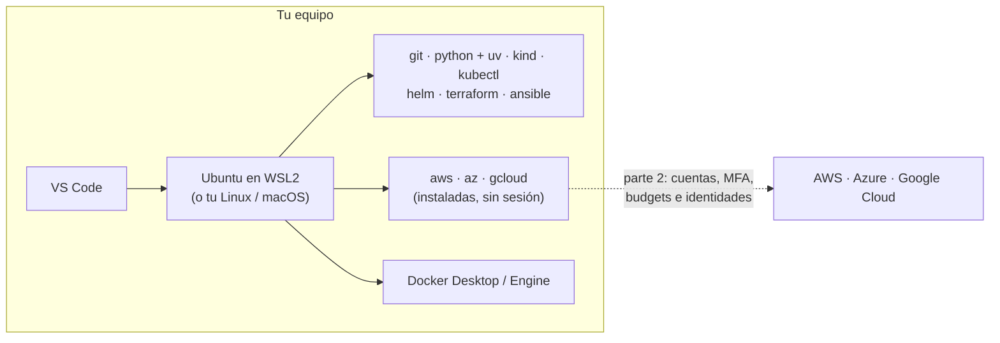

---
tags:
  - laboratorio
  - entorno
---

# Lab 00 (parte 1): Herramientas locales

> Instala y comprueba en tu equipo todas las herramientas de los laboratorios: WSL2 (en Windows), Git, Python con `uv`, Docker, kind, kubectl, Helm, Terraform, Ansible y las CLIs de AWS, Azure y Google Cloud.

| Nivel | Duración | Costo | Requisitos |
| --- | --- | --- | --- |
| Básico | ~1–1,5 h | Gratis (todo se instala en tu equipo) | Un equipo con Windows 10/11, macOS o Linux, 16 GB de RAM recomendados y permisos de administrador |

!!! info "Qué vas a aprender"
    - Montar un entorno de trabajo reproducible: Linux (o WSL2), Git, editor, Python con `uv` y Docker.
    - Instalar las herramientas de Kubernetes e IaC que usan los labs: kind, kubectl, Helm, Terraform y Ansible.
    - Instalar y comprobar las CLI de AWS, Azure y Google Cloud.
    - Comprobar todo el entorno de una vez con un script reutilizable.

!!! note "El Lab 00 tiene dos partes"
    Esta parte solo instala herramientas en tu equipo y no toca la nube. En la [parte 2: Cuentas cloud, presupuestos e identidades](preparar-cuentas-cloud.md) creas las cuentas de pruebas, activas **MFA**, configuras las **alertas de presupuesto** y conectas las CLIs con una identidad de laboratorio. Los labs que usan la nube (09, 13, 16 y 17–20) necesitan las dos partes; el resto, solo esta.

## Antes de empezar

- **Sistema operativo**: Windows 10 (21H2 o posterior) / Windows 11, macOS 13 o posterior, o una distribución Linux reciente (los ejemplos usan Ubuntu 22.04/24.04).
- **Recursos**: los labs de Kubernetes y observabilidad levantan varios contenedores a la vez. Con 8 GB de RAM funcionan, pero justos.
- **Teoría recomendada**:
    - [Entorno de trabajo con Python](../../python/fundamentos/entorno-python.md): `venv`, `pip`, `uv` y `pipx`.

!!! tip "En Windows, trabaja dentro de WSL2"
    **WSL2** (*Windows Subsystem for Linux*) ejecuta un Linux real dentro de Windows. Los labs están escritos para una terminal Linux (Bash), Ansible no funciona en Windows de forma nativa y Docker Desktop usa WSL2 por debajo. La recomendación es: Docker Desktop y el editor en Windows; el resto de herramientas **dentro de Ubuntu en WSL2**, siguiendo las pestañas "Linux".

## Arquitectura



Todo lo de esta parte corre en tu equipo y es gratis. Las CLIs de nube quedan instaladas, pero sin sesión: las conectas a tus cuentas de pruebas en la [parte 2](preparar-cuentas-cloud.md).

## Paso a paso

### Paso 1: Prepara la base (WSL2 en Windows)

Instalas primero la capa de sistema operativo porque todas las demás herramientas van encima. En macOS y Linux este paso se reduce a tener un gestor de paquetes.

=== "Windows"

    En PowerShell **como administrador**:

    ```powershell
    wsl --install            # instala WSL2 y Ubuntu (la distribución por defecto)
    ```

    Reinicia si te lo pide, abre "Ubuntu" desde el menú Inicio y crea tu usuario Linux. Comprueba que la distribución usa la versión 2:

    ```powershell
    wsl -l -v
    ```

    ```text
      NAME            STATE           VERSION
    * Ubuntu          Running         2
    ```

    A partir de aquí, en cada paso usa la pestaña **Linux** dentro de la terminal de Ubuntu, salvo para Docker Desktop y el editor.

=== "macOS"

    Instala Homebrew (el gestor de paquetes de facto en macOS) siguiendo el comando de [brew.sh](https://brew.sh) y comprueba:

    ```bash
    brew --version
    ```

=== "Linux"

    Actualiza el sistema e instala utilidades básicas que usan los scripts de instalación:

    ```bash
    sudo apt update && sudo apt upgrade -y
    sudo apt install -y curl unzip gnupg ca-certificates lsb-release
    ```

### Paso 2: Git y el editor

Git es la base de todo (código, IaC, pipelines) y el editor te ahorra errores de sintaxis en YAML, HCL y Python.

=== "Windows"

    ```powershell
    winget install --id Microsoft.VisualStudioCode -e
    winget install --id Git.Git -e        # Git para Windows (opcional si trabajas solo en WSL)
    ```

    En VS Code instala la extensión **WSL** y abre tus carpetas de Ubuntu con `code .` desde la terminal de WSL. Dentro de Ubuntu: `sudo apt install -y git`.

=== "macOS"

    ```bash
    brew install git
    brew install --cask visual-studio-code
    ```

=== "Linux"

    ```bash
    sudo apt install -y git
    # VS Code: paquete .deb desde code.visualstudio.com, o el editor que prefieras
    ```

Configura tu identidad (aparece en cada commit):

```bash
git config --global user.name "Tu Nombre"
git config --global user.email "tu-correo@ejemplo.com"
git config --global init.defaultBranch main
```

### Paso 3: Python 3.12+ y uv

Los labs de Python (03) y varios scripts usan Python 3.12 o superior. **uv** crea entornos virtuales e instala paquetes y versiones de Python mucho más rápido que `pip`; lo tienes explicado en [Entorno de trabajo con Python](../../python/fundamentos/entorno-python.md#uv-la-alternativa-moderna).

=== "Windows"

    Dentro de Ubuntu (WSL2) sigue la pestaña Linux. Si además quieres Python nativo en Windows:

    ```powershell
    winget install --id Python.Python.3.12 -e
    winget install --id astral-sh.uv -e
    py -3.12 --version
    ```

=== "macOS"

    ```bash
    brew install python@3.12 uv
    ```

=== "Linux"

    ```bash
    curl -LsSf https://astral.sh/uv/install.sh | sh   # instala uv en ~/.local/bin
    uv python install 3.12                             # Python gestionado por uv
    ```

Comprueba:

```bash
uv --version
uv run --python 3.12 python --version
```

```text
uv 0.x.y (...)
Python 3.12.x
```

### Paso 4: Docker

Docker se usa en los labs 05, 06 (kind crea el clúster con contenedores), 11, 12, 14, 15 y 21.

=== "Windows"

    ```powershell
    winget install --id Docker.DockerDesktop -e
    ```

    Abre Docker Desktop, en *Settings → General* deja marcado **Use the WSL 2 based engine** y en *Settings → Resources → WSL integration* activa tu distribución Ubuntu. Así el comando `docker` funciona también dentro de WSL.

=== "macOS"

    ```bash
    brew install --cask docker-desktop
    ```

    Abre Docker Desktop una vez para que termine la configuración.

=== "Linux"

    Instala **Docker Engine** con el repositorio oficial de tu distribución (guía en *Documentación oficial*) y añade tu usuario al grupo `docker` para no usar `sudo`:

    ```bash
    sudo usermod -aG docker "$USER"
    newgrp docker      # o cierra sesión y vuelve a entrar
    ```

    Pertenecer al grupo `docker` equivale a tener privilegios de root en la máquina: hazlo solo en tu equipo de laboratorio.

Prueba que el daemon responde:

```bash
docker run --rm hello-world
```

```text
Hello from Docker!
This message shows that your installation appears to be working correctly.
```

### Paso 5: kind, kubectl y Helm

**kind** (*Kubernetes in Docker*) crea clústeres de Kubernetes locales con contenedores, **kubectl** es el cliente de Kubernetes y **Helm** instala aplicaciones empaquetadas (*charts*). Los tres son binarios sueltos.

=== "Windows"

    Recomendado: instálalos dentro de WSL con la pestaña Linux. En Windows nativo:

    ```powershell
    winget install --id Kubernetes.kind -e
    winget install --id Kubernetes.kubectl -e
    winget install --id Helm.Helm -e
    ```

=== "macOS"

    ```bash
    brew install kind kubectl helm
    ```

=== "Linux"

    ```bash
    # kind (revisa la última versión en kind.sigs.k8s.io)
    curl -Lo ./kind https://kind.sigs.k8s.io/dl/v0.33.0/kind-linux-amd64
    sudo install -m 0755 kind /usr/local/bin/kind && rm kind

    # kubectl (última versión estable)
    curl -LO "https://dl.k8s.io/release/$(curl -L -s https://dl.k8s.io/release/stable.txt)/bin/linux/amd64/kubectl"
    sudo install -m 0755 kubectl /usr/local/bin/kubectl && rm kubectl

    # Helm 4 con el script oficial
    curl -fsSL -o get_helm.sh https://raw.githubusercontent.com/helm/helm/main/scripts/get-helm-4
    chmod 700 get_helm.sh && ./get_helm.sh && rm get_helm.sh
    ```

!!! note "Lee antes de ejecutar"
    Los comandos `curl … | sh` y los scripts de instalación ejecutan código descargado. Usa solo las URLs de la documentación oficial y, si quieres, descarga primero el script y léelo antes de ejecutarlo (como se hace arriba con Helm).

### Paso 6: Terraform y Ansible

Terraform aprovisiona infraestructura (labs 08, 09, 13) y Ansible configura servidores (lab 10). Ansible **no funciona como nodo de control en Windows sin WSL**, por eso en Windows va dentro de Ubuntu.

=== "Windows"

    Terraform puede ir en Windows (`winget install --id Hashicorp.Terraform -e`), pero para tener todo en un mismo sitio instala ambos **dentro de WSL** con la pestaña Linux.

=== "macOS"

    ```bash
    brew tap hashicorp/tap
    brew install hashicorp/tap/terraform
    brew install pipx && pipx ensurepath
    pipx install --include-deps ansible
    ```

=== "Linux"

    ```bash
    # Terraform desde el repositorio oficial de HashiCorp
    wget -O - https://apt.releases.hashicorp.com/gpg | sudo gpg --dearmor -o /usr/share/keyrings/hashicorp-archive-keyring.gpg
    echo "deb [arch=$(dpkg --print-architecture) signed-by=/usr/share/keyrings/hashicorp-archive-keyring.gpg] https://apt.releases.hashicorp.com $(lsb_release -cs) main" \
      | sudo tee /etc/apt/sources.list.d/hashicorp.list
    sudo apt update && sudo apt install -y terraform

    # Ansible aislado con pipx (método recomendado por Ansible)
    sudo apt install -y pipx && pipx ensurepath
    pipx install --include-deps ansible
    ```

Abre una terminal nueva después de `pipx ensurepath` para que el `PATH` incluya `~/.local/bin`.

### Paso 7: CLIs de AWS, Azure y Google Cloud

Las tres CLIs se instalan ahora, aunque no inicies sesión hasta tener las cuentas protegidas, en la [parte 2](preparar-cuentas-cloud.md) de este lab.

=== "Windows"

    Dentro de WSL usa la pestaña Linux. En Windows nativo:

    ```powershell
    msiexec.exe /i https://awscli.amazonaws.com/AWSCLIV2.msi
    winget install --id Microsoft.AzureCLI -e
    # Google Cloud CLI: descarga y ejecuta el instalador
    # https://dl.google.com/dl/cloudsdk/channels/rapid/GoogleCloudSDKInstaller.exe
    ```

=== "macOS"

    ```bash
    brew install awscli
    brew install --cask azure-cli gcloud-cli
    ```

=== "Linux"

    ```bash
    # AWS CLI v2
    curl "https://awscli.amazonaws.com/awscli-exe-linux-x86_64.zip" -o awscliv2.zip
    unzip -q awscliv2.zip && sudo ./aws/install && rm -rf aws awscliv2.zip

    # Azure CLI (script oficial para Debian/Ubuntu)
    curl -sL https://aka.ms/InstallAzureCLIDeb | sudo bash

    # Google Cloud CLI desde su repositorio apt
    curl https://packages.cloud.google.com/apt/doc/apt-key.gpg | sudo gpg --dearmor -o /usr/share/keyrings/cloud.google.gpg
    echo "deb [signed-by=/usr/share/keyrings/cloud.google.gpg] https://packages.cloud.google.com/apt cloud-sdk main" \
      | sudo tee /etc/apt/sources.list.d/google-cloud-sdk.list
    sudo apt update && sudo apt install -y google-cloud-cli
    ```

Comandos útiles de cada CLI en [AWS CLI](../../recursos/comandos/aws-cli.md) y [Google Cloud CLI](../../recursos/comandos/google-cli.md).

### Paso 8: Ejecuta el script de comprobación

Un script que comprueba todo de una vez te sirve hoy y cada vez que cambies de equipo.

```bash title="verificar-entorno.sh"
#!/usr/bin/env bash
# Comprueba que las herramientas de los laboratorios están instaladas.
set -u
faltan=0
comprobar() {
  local comando="$1"; shift
  if command -v "$comando" > /dev/null; then
    printf "OK     %-10s %s\n" "$comando" "$("$comando" "$@" 2>&1 | head -n 1)"
  else
    printf "FALTA  %s\n" "$comando"
    faltan=$((faltan + 1))
  fi
}
comprobar git       --version
comprobar python3   --version
comprobar uv        --version
comprobar docker    --version
comprobar kind      version
comprobar kubectl   version --client
comprobar helm      version --short
comprobar terraform version
comprobar ansible   --version
comprobar aws       --version
comprobar az        version --output tsv
comprobar gcloud    --version
echo "Herramientas que faltan: $faltan"
exit "$faltan"
```

```bash
bash verificar-entorno.sh
```

Salida real en un equipo Windows **a medio preparar**, ejecutado desde Git Bash (fuera de WSL):

```text
OK     git        git version 2.51.0.windows.2
FALTA  python3
OK     uv         uv 0.13.1 (62faed335 2026-10-13 x86_64-pc-windows-msvc)
OK     docker     Docker version 28.5.1, build e180ab8
OK     kind       kind v0.22.0 go1.20.13 windows/amd64
OK     kubectl    Client Version: v1.29.1
OK     helm       v3.14.2+gc309b6f
OK     terraform  Terraform v1.7.5
FALTA  ansible
OK     aws        aws-cli/2.15.34 Python/3.11.8 Windows/10 exe/AMD64 prompt/off
FALTA  az
FALTA  gcloud
Herramientas que faltan: 4
```

Se lee así: en Windows Python se llama `py`, no `python3`; Ansible solo existe dentro de WSL; faltan las CLIs de Azure y Google Cloud; y kind, kubectl, Helm y Terraform están instalados pero **viejos**. El script sale con un código igual al número de herramientas que faltan, así que también sirve en un pipeline.

En la [parte 2](preparar-cuentas-cloud.md#paso-5-comprueba-las-identidades-con-un-script) tienes un segundo script, `verificar-cuentas.sh`, que comprueba que las CLIs tienen sesión con la identidad correcta.

## Verificación

Dentro de tu terminal de trabajo (Ubuntu en WSL2, macOS o Linux), cada fila debe dar una salida parecida:

| Herramienta | Comando | Salida esperada |
| --- | --- | --- |
| WSL2 (solo Windows) | `wsl -l -v` (en PowerShell) | Tu distribución con `VERSION 2` |
| Git | `git --version` | `git version 2.4x` o superior |
| Python | `python3 --version` (Windows: `py -3.12 --version`) | `Python 3.12.x` o superior |
| uv | `uv --version` | `uv 0.x.y` |
| Docker | `docker run --rm hello-world` | `Hello from Docker!` |
| kind | `kind version` | `kind v0.3x.y` |
| kubectl | `kubectl version --client` | `Client Version: v1.3x.y` |
| Helm | `helm version --short` | `v4.x.y` (v3 también sirve) |
| Terraform | `terraform version` | `Terraform v1.1x.y` |
| Ansible | `ansible --version` | `ansible [core 2.x.y]` |
| AWS CLI | `aws --version` | `aws-cli/2.x.y` |
| Azure CLI | `az version` | JSON con `"azure-cli": "2.x.y"` |
| gcloud | `gcloud --version` | `Google Cloud SDK 5xx.x.x` |

Y el script del Paso 8 debe terminar con `Herramientas que faltan: 0` (código de salida `0`).

## Retos extra

1. Crea un **dotfiles** repo con tu `verificar-entorno.sh` y un `README` con los comandos de instalación de tu sistema. Pista: así reconstruyes el entorno en otro equipo en minutos.
2. Añade a `verificar-entorno.sh` una comprobación de **versión mínima** (por ejemplo, Python ≥ 3.12) que marque `VIEJA` en lugar de `OK`.

## Limpieza

Esta parte solo instala herramientas en tu equipo: no crea nada en la nube ni nada que cobre. **No desinstales** nada; el resto de labs lo usa. Si quieres, borra la imagen de prueba de Docker con `docker image rm hello-world`.

## Problemas comunes

| Síntoma | Causa | Solución |
| --- | --- | --- |
| `wsl --install` termina pero Ubuntu no arranca | Virtualización desactivada en la BIOS/UEFI | Activa Intel VT-x / AMD-V en la BIOS y la característica "Virtual Machine Platform" |
| `docker: command not found` dentro de WSL | Falta la integración de Docker Desktop con tu distribución | *Settings → Resources → WSL integration* → activa Ubuntu y reinicia la terminal |
| `permission denied while trying to connect to the Docker daemon socket` (Linux) | Tu usuario no está en el grupo `docker` | `sudo usermod -aG docker "$USER"` y vuelve a iniciar sesión |
| `ansible: command not found` después de instalar | `~/.local/bin` no está en el `PATH` | `pipx ensurepath` y abre una terminal nueva |
| `python3 --version` muestra 3.8 o 3.10 | El sistema trae un Python antiguo y es el primero del `PATH` | Usa `uv run --python 3.12 …` o `py -3.12` en Windows; no reemplaces el Python del sistema |

Para el método general de diagnóstico, mira [Troubleshooting](../../devops/operacion/troubleshooting.md).

## Información complementaria

- **WSL2**: una VM ligera con un kernel Linux real gestionada por Windows. Los archivos de tus proyectos van mejor dentro de Linux (`~/proyectos`) que en `/mnt/c`, por rendimiento.
- **Entornos virtuales y uv**: cada proyecto con sus dependencias aisladas; ver [Entorno de trabajo con Python](../../python/fundamentos/entorno-python.md).
- **Siguiente paso**: las cuentas cloud, el MFA, los budgets y las identidades de laboratorio están en la [parte 2](preparar-cuentas-cloud.md).

## Documentación oficial

- [Microsoft: instalar WSL](https://learn.microsoft.com/es-es/windows/wsl/install)
- [Docker Desktop](https://docs.docker.com/desktop/) · [Docker Engine en Ubuntu](https://docs.docker.com/engine/install/ubuntu/)
- [uv: instalación](https://docs.astral.sh/uv/getting-started/installation/)
- [kind: Quick Start](https://kind.sigs.k8s.io/docs/user/quick-start/) · [kubectl: instalación](https://kubernetes.io/docs/tasks/tools/) · [Helm: instalación](https://helm.sh/docs/intro/install/)
- [Terraform: instalación](https://developer.hashicorp.com/terraform/install) · [Ansible: instalación](https://docs.ansible.com/ansible/latest/installation_guide/intro_installation.html)
- [AWS CLI: instalación](https://docs.aws.amazon.com/cli/latest/userguide/getting-started-install.html) · [Azure CLI: instalación](https://learn.microsoft.com/es-es/cli/azure/install-azure-cli) · [Google Cloud CLI: instalación](https://cloud.google.com/sdk/docs/install)

## Preguntas para verificar el aprendizaje

??? question "1. ¿Por qué en Windows se recomienda instalar Ansible y las CLIs dentro de WSL2?"
    Ansible no admite Windows como nodo de control sin WSL, y los labs usan comandos y scripts de Bash. Tener todo en el mismo Linux evita mezclar rutas, finales de línea y versiones entre Windows y WSL.

??? question "2. ¿Por qué añadir tu usuario al grupo `docker` es un riesgo y cuándo lo aceptas?"
    Porque quien puede usar el daemon de Docker puede arrancar un contenedor que monte el sistema de archivos del host como root: pertenecer al grupo `docker` equivale a tener privilegios de root en la máquina. Lo aceptas solo en tu equipo de laboratorio, para no escribir `sudo` en cada comando.

??? question "3. En la salida del script, `python3` aparece como `FALTA` en Windows aunque Python está instalado. ¿Por qué?"
    Porque en Windows el lanzador de Python se llama `py` (por ejemplo, `py -3.12 --version`), no `python3`. Dentro de WSL2 sí existe `python3`; por eso conviene ejecutar el script en la terminal de trabajo de los labs.

??? question "4. Tu script de verificación devuelve `exit 3`. ¿Qué significa y cómo lo usarías en un pipeline?"
    Que faltan 3 herramientas. Cualquier código distinto de 0 hace fallar el paso del pipeline, así que puedes usar el script como comprobación previa (*preflight check*) antes de ejecutar el resto del job.

## Notas relacionadas

- **DevOps**
    - [Linux, redes y scripting](../../devops/fundamentos/linux-redes-scripting.md)
    - [Git y control de versiones](../../devops/fundamentos/git-control-versiones.md)
    - [Docker](../../devops/contenedores/docker.md)
    - [Kubernetes](../../devops/contenedores/kubernetes.md)
    - [Infrastructure as Code](../../devops/iac/infraestructura-como-codigo.md)
    - [Ansible](../../devops/iac/ansible.md)
- **Python**
    - [Entorno de trabajo con Python](../../python/fundamentos/entorno-python.md)
- **Recursos**
    - [Comandos de AWS CLI](../../recursos/comandos/aws-cli.md) · [Comandos de Google Cloud CLI](../../recursos/comandos/google-cli.md)

Lab siguiente: [Lab 00 (parte 2): Cuentas cloud, presupuestos e identidades](preparar-cuentas-cloud.md)
