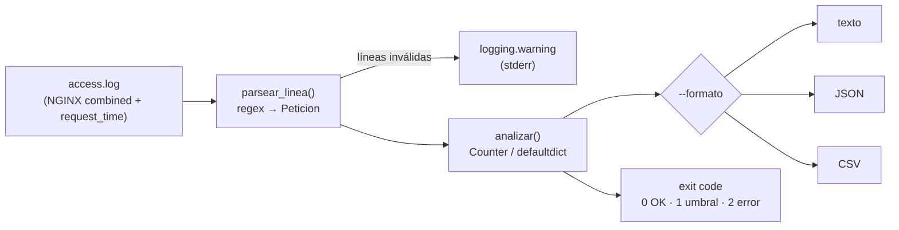

---
tags:
  - laboratorio
  - python
  - scripting
  - observabilidad
---

# Lab 03: Script en Python para analizar logs

> Construye paso a paso una herramienta de línea de comandos que lee un access log de NGINX y reporta códigos de estado, IPs más activas, errores 5xx por minuto y rutas lentas, con salida JSON/CSV, exit codes, tests con pytest y lint con ruff.

| Nivel | Duración | Costo | Requisitos |
| --- | --- | --- | --- |
| Básico / Intermedio | ~75 min | Gratis | [Lab 00](preparar-entorno.md) (Python 3.12+ y `uv`), saber ejecutar un script |

!!! info "Qué vas a aprender"
    - Parsear líneas de log con una expresión regular con grupos con nombre y convertirlas en objetos (`dataclass`).
    - Agregar datos en una sola pasada con `collections.Counter` y `defaultdict`.
    - Diseñar una CLI con `argparse`, mensajes con `logging` (a stderr) y resultados en stdout en texto, JSON o CSV.
    - Usar **exit codes** (códigos de salida) para que el script sirva como *quality gate* en un pipeline.
    - Escribir tests con `pytest` (incluidos `tmp_path` y `capsys`) y dejar el código limpio con `ruff`.

## Antes de empezar

- Python 3.12 o superior y `uv` (o `venv` + `pip`), del [Lab 00](preparar-entorno.md).
- **Teoría recomendada** (el lab la aplica, no la repite):
    - [Formatos de logs](../../recursos/formatos-de-logs.md#access-log-de-nginx-y-apache-combined): el formato *combined* de NGINX campo a campo.
    - [Estructuras de datos](../../python/fundamentos/estructuras-datos.md#collections-counter-y-defaultdict): `Counter` y `defaultdict`.
    - [Archivos y formatos](../../python/scripting/archivos-formatos.md): `pathlib`, CSV y JSON.
    - [Scripts de línea de comandos](../../python/scripting/scripts-cli.md): `argparse`, exit codes y `logging`.
    - [Calidad y seguridad de scripts](../../python/scripting/calidad-codigo.md): `pytest`, `ruff` y `pyproject.toml`.

!!! note "Las salidas de este lab son reales"
    Todo se ejecutó con Python 3.12, pytest 9.1 y ruff 0.17 en Windows. En Linux y macOS la salida es la misma; solo cambia cómo se activa el entorno virtual.

## Arquitectura



El script separa **lógica** (`parsear_linea`, `analizar`: funciones puras, fáciles de probar) de **entrada/salida** (`main`: argumentos, archivos, stdout). Esa separación es la que permite testearlo.

## Paso a paso

### Paso 1: Crea el proyecto y el entorno virtual

Un entorno virtual por proyecto evita mezclar versiones de `pytest` o `ruff` con otros proyectos ([Entorno de trabajo con Python](../../python/fundamentos/entorno-python.md#entornos-virtuales-con-venv)).

=== "Linux/macOS"

    ```bash
    mkdir analizador-logs && cd analizador-logs
    uv venv --python 3.12 .venv
    uv pip install pytest ruff
    source .venv/bin/activate
    ```

=== "Windows (PowerShell)"

    ```powershell
    mkdir analizador-logs; cd analizador-logs
    uv venv --python 3.12 .venv
    uv pip install pytest ruff
    .venv\Scripts\Activate.ps1
    ```

```text
Using CPython 3.12.0 interpreter at: C:\Users\...\Python312\python.exe
Creating virtual environment at: .venv
 + pytest==9.1.1
 + ruff==0.17.2
```

Sin `uv`: `python -m venv .venv`, actívalo y `python -m pip install pytest ruff`. Crea también la configuración de ruff:

```toml title="pyproject.toml"
[project]
name = "analizador-logs"
version = "0.1.0"
requires-python = ">=3.12"

[tool.ruff]
line-length = 100

[tool.ruff.lint]
select = ["E", "F", "W", "I", "UP", "B"]
```

`E`/`W` son errores de estilo, `F` errores reales (variables sin usar, nombres indefinidos), `I` el orden de los imports, `UP` sintaxis moderna de Python y `B` patrones propensos a bugs.

### Paso 2: Prepara el log de ejemplo

El formato *combined* no incluye cuánto tardó cada petición, así que no permite encontrar rutas lentas. En NGINX se añade `$request_time` (segundos, con milisegundos) al final con un `log_format` propio:

```nginx title="nginx.conf (fragmento)"
log_format combined_tiempo '$remote_addr - $remote_user [$time_local] '
                           '"$request" $status $body_bytes_sent '
                           '"$http_referer" "$http_user_agent" $request_time';
access_log /var/log/nginx/access.log combined_tiempo;
```

Guarda este log de ejemplo. Reproduce un incidente: el backend de pagos empieza a fallar a las 10:14, hay un escáner buscando rutas típicas, alguien prueba contraseñas y una línea quedó corrupta.

```text title="access.log"
203.0.113.10 - - [26/Oct/2026:10:12:01 +0000] "GET /api/productos HTTP/1.1" 200 5123 "-" "Mozilla/5.0" 0.045
198.51.100.7 - - [26/Oct/2026:10:12:03 +0000] "GET /api/productos/42 HTTP/1.1" 200 812 "-" "Mozilla/5.0" 0.032
192.0.2.55 - - [26/Oct/2026:10:12:09 +0000] "GET /wp-login.php HTTP/1.1" 404 153 "-" "python-requests/2.31" 0.001
192.0.2.55 - - [26/Oct/2026:10:12:10 +0000] "GET /.env HTTP/1.1" 404 153 "-" "python-requests/2.31" 0.001
203.0.113.10 - - [26/Oct/2026:10:12:15 +0000] "POST /api/carrito HTTP/1.1" 201 64 "-" "Mozilla/5.0" 0.120
192.0.2.55 - - [26/Oct/2026:10:12:20 +0000] "GET /admin HTTP/1.1" 404 153 "-" "python-requests/2.31" 0.001
198.51.100.7 - - [26/Oct/2026:10:12:41 +0000] "GET /api/reportes/ventas?mes=10 HTTP/1.1" 200 48211 "-" "Mozilla/5.0" 2.731
198.51.100.7 - - [26/Oct/2026:10:13:02 +0000] "POST /api/login HTTP/1.1" 401 41 "-" "Mozilla/5.0" 0.089
203.0.113.10 - - [26/Oct/2026:10:13:30 +0000] "POST /api/pagos HTTP/1.1" 200 97 "-" "Mozilla/5.0" 0.410
192.0.2.55 - - [26/Oct/2026:10:13:41 +0000] "GET /phpmyadmin/ HTTP/1.1" 404 153 "-" "python-requests/2.31" 0.001
203.0.113.24 - - [26/Oct/2026:10:14:05 +0000] "POST /api/pagos HTTP/1.1" 502 157 "-" "Mozilla/5.0" 0.004
198.51.100.7 - - [26/Oct/2026:10:14:07 +0000] "GET /api/productos HTTP/1.1" 200 5123 "-" "Mozilla/5.0" 0.051
203.0.113.10 - - [26/Oct/2026:10:14:12 +0000] "POST /api/pagos HTTP/1.1" 502 157 "-" "Mozilla/5.0" 0.003
198.51.100.31 - - [26/Oct/2026:10:14:20 +0000] "POST /api/login HTTP/1.1" 401 41 "-" "curl/8.5.0" 0.077
198.51.100.31 - - [26/Oct/2026:10:14:21 +0000] "POST /api/login HTTP/1.1" 401 41 "-" "curl/8.5.0" 0.081
203.0.113.24 - - [26/Oct/2026:10:14:33 +0000] "POST /api/pagos HTTP/1.1" 502 157 "-" "Mozilla/5.0" 0.004
198.51.100.7 - - [26/Oct/2026:10:14:40 +0000] "GET /api/carrito HTTP/1.1" 200 230 "-" "Mozilla/5.0" 0.038
203.0.113.77 - - [26/Oct/2026:10:14:52 +0000] "POST /api/pagos HTTP/1.1" 502 157 "-" "Mozilla/5.0" 0.005
203.0.113.10 - - [26/Oct/2026:10:15:02 +0000] "POST /api/pagos HTTP/1.1" 504 167 "-" "Mozilla/5.0" 60.001
192.0.2.55 - - [26/Oct/2026:10:15:10 +0000] "GET /config.php HTTP/1.1" 404 153 "-" "python-requests/2.31" 0.001
198.51.100.31 - - [26/Oct/2026:10:15:12 +0000] "POST /api/login HTTP/1.1" 401 41 "-" "curl/8.5.0" 0.079
203.0.113.24 - - [26/Oct/2026:10:15:30 +0000] "POST /api/pagos HTTP/1.1" 502 157 "-" "Mozilla/5.0" 0.004
198.51.100.7 - - [26/Oct/2026:10:15:45 +0000] "GET /api/productos/7 HTTP/1.1" 200 790 "-" "Mozilla/5.0" 0.029
esta línea está corrupta porque el disco se llenó a mitad de escritura
203.0.113.10 - - [26/Oct/2026:10:16:03 +0000] "GET /api/reportes/ventas?mes=9 HTTP/1.1" 200 47002 "-" "Mozilla/5.0" 3.118
203.0.113.77 - - [26/Oct/2026:10:16:20 +0000] "POST /api/pagos HTTP/1.1" 500 89 "-" "Mozilla/5.0" 1.502
198.51.100.7 - - [26/Oct/2026:10:16:31 +0000] "GET /api/productos HTTP/1.1" 200 5123 "-" "Mozilla/5.0" 0.048
203.0.113.24 - - [26/Oct/2026:10:16:45 +0000] "POST /api/pagos HTTP/1.1" 200 97 "-" "Mozilla/5.0" 1.204
203.0.113.10 - - [26/Oct/2026:10:17:02 +0000] "POST /api/pagos HTTP/1.1" 200 97 "-" "Mozilla/5.0" 0.388
198.51.100.7 - - [26/Oct/2026:10:17:15 +0000] "GET /api/carrito HTTP/1.1" 200 230 "-" "Mozilla/5.0" 0.041
203.0.113.77 - - [26/Oct/2026:10:17:28 +0000] "GET /api/productos/42 HTTP/1.1" 200 812 "-" "Mozilla/5.0" 0.030
198.51.100.7 - - [26/Oct/2026:10:17:40 +0000] "GET /health HTTP/1.1" 200 2 "-" "kube-probe/1.34" 0.001
```

### Paso 3: Parsea una línea

El script se escribe en un solo archivo, `analizar_logs.py`, en cuatro bloques que pegas **en orden**. El primero define cómo reconocer una línea.

```python title="analizar_logs.py (1/4)"
#!/usr/bin/env python3
"""Analiza un access log de NGINX (formato combined + $request_time)."""

from __future__ import annotations

import argparse
import csv
import json
import logging
import re
import sys
from collections import Counter, defaultdict
from collections.abc import Iterable
from dataclasses import dataclass
from datetime import datetime
from pathlib import Path

log = logging.getLogger("analizar_logs")

# Exit codes: 0 = todo bien, 1 = se superó el umbral de 5xx, 2 = error de uso o de lectura
EXIT_OK, EXIT_UMBRAL, EXIT_ERROR = 0, 1, 2

PATRON = re.compile(
    r"^(?P<ip>\S+) \S+ \S+ \[(?P<fecha>[^\]]+)\] "
    r'"(?P<metodo>[A-Z]+) (?P<ruta>\S+) [^"]+" '
    r"(?P<estado>\d{3}) (?P<bytes>\d+|-) "
    r'"[^"]*" "[^"]*"'
    r"(?: (?P<tiempo>\d+(?:\.\d+)?))?$"
)


@dataclass(frozen=True)
class Peticion:
    ip: str
    fecha: datetime
    metodo: str
    ruta: str
    estado: int
    tiempo: float | None


def parsear_linea(linea: str) -> Peticion | None:
    """Convierte una línea del log en una Peticion, o None si no tiene el formato esperado."""
    m = PATRON.match(linea.strip())
    if not m:
        return None
    return Peticion(
        ip=m["ip"],
        fecha=datetime.strptime(m["fecha"], "%d/%b/%Y:%H:%M:%S %z"),
        metodo=m["metodo"],
        ruta=m["ruta"].split("?", 1)[0],  # sin query string: /api/x?id=1 -> /api/x
        estado=int(m["estado"]),
        tiempo=float(m["tiempo"]) if m["tiempo"] else None,
    )
```

Por qué así:

- **Grupos con nombre** (`(?P<ip>…)`): `m["ip"]` se lee mejor que `m.group(1)` y no se rompe si añades un grupo.
- El tiempo es **opcional** (`(?: …)?`): el mismo script lee logs *combined* puros, sin `$request_time`.
- Se quita la *query string* de la ruta para que `/api/reportes/ventas?mes=9` y `?mes=10` cuenten como la misma ruta.
- Una línea que no encaja devuelve `None` en vez de lanzar una excepción: un log real siempre trae alguna línea rara y el script no debe morir por ella.
- `from __future__ import annotations` y los tipos (`Peticion | None`) documentan qué entra y qué sale de cada función.

Pruébalo antes de seguir:

```bash
python -c "
from pathlib import Path
from analizar_logs import parsear_linea
lineas = Path('access.log').read_text(encoding='utf-8').splitlines()
print(parsear_linea(lineas[6]))
print(parsear_linea(lineas[23]))"
```

```text
Peticion(ip='198.51.100.7', fecha=datetime.datetime(2026, 10, 26, 10, 12, 41, tzinfo=datetime.timezone.utc), metodo='GET', ruta='/api/reportes/ventas', estado=200, tiempo=2.731)
None
```

La línea 7 se convierte en un objeto con la fecha ya en UTC y la ruta sin query string; la línea 24 (la corrupta) da `None`.

### Paso 4: Agrega las métricas en una sola pasada

El segundo bloque recorre el log **una vez** y acumula todo. Recibe cualquier iterable de líneas (un archivo abierto, una lista, `sys.stdin`), así que no carga el archivo entero en memoria y es fácil de probar.

```python title="analizar_logs.py (2/4)"
def analizar(lineas: Iterable[str], top: int = 5, umbral_lento: float = 1.0) -> dict:
    """Recorre las líneas una sola vez y devuelve un resumen serializable a JSON."""
    estados: Counter[int] = Counter()
    ips: Counter[str] = Counter()
    errores_5xx_por_minuto: Counter[str] = Counter()
    tiempos_por_ruta: defaultdict[str, list[float]] = defaultdict(list)
    total = invalidas = 0

    for numero, linea in enumerate(lineas, start=1):
        if not linea.strip():
            continue
        peticion = parsear_linea(linea)
        if peticion is None:
            invalidas += 1
            log.warning("Línea %d ignorada: formato no reconocido", numero)
            continue
        total += 1
        estados[peticion.estado] += 1
        ips[peticion.ip] += 1
        if peticion.estado >= 500:
            errores_5xx_por_minuto[peticion.fecha.strftime("%Y-%m-%d %H:%M")] += 1
        if peticion.tiempo is not None:
            tiempos_por_ruta[f"{peticion.metodo} {peticion.ruta}"].append(peticion.tiempo)

    rutas_lentas = [
        {
            "ruta": ruta,
            "peticiones": len(tiempos),
            "promedio_s": round(sum(tiempos) / len(tiempos), 3),
            "maximo_s": max(tiempos),
        }
        for ruta, tiempos in tiempos_por_ruta.items()
        if max(tiempos) >= umbral_lento
    ]
    rutas_lentas.sort(key=lambda r: r["maximo_s"], reverse=True)

    return {
        "total_peticiones": total,
        "lineas_invalidas": invalidas,
        "codigos_estado": {str(k): v for k, v in sorted(estados.items())},
        "total_5xx": sum(v for k, v in estados.items() if k >= 500),
        "top_ips": [{"ip": ip, "peticiones": n} for ip, n in ips.most_common(top)],
        "errores_5xx_por_minuto": dict(sorted(errores_5xx_por_minuto.items())),
        "rutas_lentas": rutas_lentas,
    }
```

- `Counter` cuenta sin inicializar claves y `most_common(top)` da el ranking ordenado.
- Para "5xx por minuto" basta con truncar la fecha a `AAAA-MM-DD HH:MM` y usarla como clave.
- `defaultdict(list)` agrupa los tiempos por `MÉTODO ruta` (un `GET` y un `POST` a la misma ruta son operaciones distintas).
- El resultado es un `dict` con tipos simples (claves `str`, números, listas): se puede volcar a JSON tal cual.
- El aviso de línea inválida usa `logging`, no `print`: va a **stderr** y no ensucia el JSON de stdout.

### Paso 5: Escribe las salidas en texto y CSV

El tercer bloque da formato al resumen. JSON no necesita función propia (`json.dump` lo hace en `main`).

```python title="analizar_logs.py (3/4)"
def escribir_texto(resumen: dict, salida) -> None:
    print(
        f"Peticiones: {resumen['total_peticiones']} "
        f"(líneas inválidas: {resumen['lineas_invalidas']})",
        file=salida,
    )
    print("\nCódigos de estado:", file=salida)
    for codigo, n in resumen["codigos_estado"].items():
        print(f"  {codigo}: {n}", file=salida)
    print("\nTop IPs:", file=salida)
    for fila in resumen["top_ips"]:
        print(f"  {fila['ip']:<16} {fila['peticiones']}", file=salida)
    print("\nErrores 5xx por minuto:", file=salida)
    for minuto, n in resumen["errores_5xx_por_minuto"].items():
        print(f"  {minuto}  {'#' * n} {n}", file=salida)
    print("\nRutas lentas:", file=salida)
    for r in resumen["rutas_lentas"]:
        print(
            f"  {r['ruta']:<28} n={r['peticiones']:<3} "
            f"prom={r['promedio_s']:.3f}s max={r['maximo_s']:.3f}s",
            file=salida,
        )


def escribir_csv(resumen: dict, salida) -> None:
    """CSV 'largo': una fila por métrica, fácil de abrir en una hoja de cálculo."""
    w = csv.writer(salida, lineterminator="\n")
    w.writerow(["seccion", "clave", "valor"])
    for codigo, n in resumen["codigos_estado"].items():
        w.writerow(["codigo_estado", codigo, n])
    for fila in resumen["top_ips"]:
        w.writerow(["top_ip", fila["ip"], fila["peticiones"]])
    for minuto, n in resumen["errores_5xx_por_minuto"].items():
        w.writerow(["5xx_por_minuto", minuto, n])
    for r in resumen["rutas_lentas"]:
        w.writerow(["ruta_lenta_max_s", r["ruta"], r["maximo_s"]])
```

Las funciones reciben `salida` (stdout o un archivo abierto) en vez de escribir siempre en pantalla: el mismo código sirve para las dos cosas. El CSV usa formato **largo** (`seccion, clave, valor`) porque las secciones tienen columnas distintas.

### Paso 6: Añade la CLI con argparse, logging y exit codes

El último bloque conecta todo. `main` acepta `argv` como parámetro para que los tests puedan llamarla sin lanzar un proceso nuevo.

```python title="analizar_logs.py (4/4)"
def crear_parser() -> argparse.ArgumentParser:
    p = argparse.ArgumentParser(description=__doc__)
    p.add_argument("log", type=Path, help="ruta del access log")
    p.add_argument("-f", "--formato", choices=["texto", "json", "csv"], default="texto")
    p.add_argument("-o", "--salida", type=Path, help="archivo de salida (por defecto, stdout)")
    p.add_argument("--top", type=int, default=5, help="cuántas IPs mostrar (por defecto 5)")
    p.add_argument(
        "--umbral-lento",
        type=float,
        default=1.0,
        help="segundos a partir de los cuales una ruta es lenta (por defecto 1.0)",
    )
    p.add_argument(
        "--max-5xx",
        type=int,
        default=None,
        help="si hay más 5xx que este número, sale con código 1",
    )
    p.add_argument("-v", "--verbose", action="store_true", help="muestra mensajes de depuración")
    return p


def main(argv: list[str] | None = None) -> int:
    args = crear_parser().parse_args(argv)
    logging.basicConfig(
        level=logging.DEBUG if args.verbose else logging.INFO,
        format="%(levelname)s %(name)s: %(message)s",
        stream=sys.stderr,
    )

    if not args.log.is_file():
        log.error("No existe el archivo: %s", args.log)
        return EXIT_ERROR

    log.debug("Leyendo %s", args.log)
    try:
        with args.log.open(encoding="utf-8", errors="replace") as f:
            resumen = analizar(f, top=args.top, umbral_lento=args.umbral_lento)
    except OSError as e:
        log.error("No se pudo leer %s: %s", args.log, e)
        return EXIT_ERROR

    salida = args.salida.open("w", encoding="utf-8", newline="") if args.salida else sys.stdout
    try:
        if args.formato == "json":
            json.dump(resumen, salida, indent=2, ensure_ascii=False)
            salida.write("\n")
        elif args.formato == "csv":
            escribir_csv(resumen, salida)
        else:
            escribir_texto(resumen, salida)
    finally:
        if args.salida:
            salida.close()
            log.info("Reporte escrito en %s", args.salida)

    if args.max_5xx is not None and resumen["total_5xx"] > args.max_5xx:
        log.error("Hay %d errores 5xx (máximo permitido: %d)", resumen["total_5xx"], args.max_5xx)
        return EXIT_UMBRAL
    return EXIT_OK


if __name__ == "__main__":
    sys.exit(main())
```

- `choices` valida el formato y `type=Path` / `type=float` convierten los argumentos: `argparse` rechaza valores inválidos con exit code 2 sin que escribas nada.
- `errors="replace"` evita que un byte no UTF-8 en el log tumbe el script.
- `--max-5xx` convierte el análisis en un **quality gate**: el código de salida dice si el log está "sano".
- `sys.exit(main())` traslada el entero que devuelve `main` al sistema operativo.

### Paso 7: Ejecuta el análisis

```bash
python analizar_logs.py access.log
```

```text
WARNING analizar_logs: Línea 24 ignorada: formato no reconocido
Peticiones: 31 (líneas inválidas: 1)

Códigos de estado:
  200: 14
  201: 1
  401: 4
  404: 5
  500: 1
  502: 5
  504: 1

Top IPs:
  198.51.100.7     9
  203.0.113.10     7
  192.0.2.55       5
  203.0.113.24     4
  198.51.100.31    3

Errores 5xx por minuto:
  2026-10-26 10:14  #### 4
  2026-10-26 10:15  ## 2
  2026-10-26 10:16  # 1

Rutas lentas:
  POST /api/pagos              n=10  prom=6.353s max=60.001s
  GET /api/reportes/ventas     n=2   prom=2.925s max=3.118s
```

Lo que cuenta el reporte: los 5xx empiezan a las 10:14 y bajan a partir de las 10:16; `POST /api/pagos` concentra los errores y tiene un `504` de 60 s (el timeout del proxy), que dispara su promedio. El reporte de ventas es lento pero estable (~3 s): candidato a optimizar, no a incidente.

Ahora las otras salidas y los exit codes:

```bash
python analizar_logs.py access.log -f json 2>/dev/null | head -12   # PowerShell: 2>$null
python analizar_logs.py access.log -f csv -o reporte.csv
python analizar_logs.py access.log --max-5xx 3 -f json -o resumen.json; echo "exit=$?"
python analizar_logs.py nada.log; echo "exit=$?"
python analizar_logs.py access.log --formato xml; echo "exit=$?"
```

```text
{
  "total_peticiones": 31,
  "lineas_invalidas": 1,
  "codigos_estado": {
    "200": 14,
    "201": 1,
    "401": 4,
    "404": 5,
    "500": 1,
    "502": 5,
    "504": 1
  },
WARNING analizar_logs: Línea 24 ignorada: formato no reconocido
INFO analizar_logs: Reporte escrito en reporte.csv
WARNING analizar_logs: Línea 24 ignorada: formato no reconocido
INFO analizar_logs: Reporte escrito en resumen.json
ERROR analizar_logs: Hay 7 errores 5xx (máximo permitido: 3)
exit=1
ERROR analizar_logs: No existe el archivo: nada.log
exit=2
usage: analizar_logs.py [-h] [-f {texto,json,csv}] [-o SALIDA] [--top TOP]
                        [--umbral-lento UMBRAL_LENTO] [--max-5xx MAX_5XX] [-v]
                        log
analizar_logs.py: error: argument -f/--formato: invalid choice: 'xml' (choose from 'texto', 'json', 'csv')
exit=2
```

Con `2>/dev/null` el JSON sale limpio aunque haya avisos: por eso los mensajes van a stderr. En PowerShell, el código de salida se consulta con `$LASTEXITCODE` en vez de `$?`.

```text title="reporte.csv"
seccion,clave,valor
codigo_estado,200,14
codigo_estado,201,1
codigo_estado,401,4
codigo_estado,404,5
codigo_estado,500,1
codigo_estado,502,5
codigo_estado,504,1
top_ip,198.51.100.7,9
top_ip,203.0.113.10,7
top_ip,192.0.2.55,5
top_ip,203.0.113.24,4
top_ip,198.51.100.31,3
5xx_por_minuto,2026-10-26 10:14,4
5xx_por_minuto,2026-10-26 10:15,2
5xx_por_minuto,2026-10-26 10:16,1
ruta_lenta_max_s,POST /api/pagos,60.001
ruta_lenta_max_s,GET /api/reportes/ventas,3.118
```

### Paso 8: Escribe los tests con pytest

Los tests fijan el comportamiento: si mañana cambias la expresión regular, sabrás al momento si rompiste algo. Se prueban las funciones puras con datos pequeños y `main` con archivos temporales.

```python title="test_analizar_logs.py"
import json

import pytest

from analizar_logs import EXIT_ERROR, EXIT_OK, EXIT_UMBRAL, analizar, main, parsear_linea

LINEA_OK = (
    '203.0.113.10 - - [26/Oct/2026:10:14:05 +0000] "POST /api/pagos?x=1 HTTP/1.1" '
    '502 157 "-" "Mozilla/5.0" 0.004'
)


def test_parsear_linea_valida():
    p = parsear_linea(LINEA_OK)
    assert p is not None
    assert p.ip == "203.0.113.10"
    assert p.estado == 502
    assert p.ruta == "/api/pagos"  # sin query string
    assert p.tiempo == pytest.approx(0.004)


def test_parsear_linea_sin_tiempo_es_valida():
    p = parsear_linea(LINEA_OK.rsplit(" ", 1)[0])  # formato combined puro
    assert p is not None
    assert p.tiempo is None


@pytest.mark.parametrize("linea", ["", "texto cualquiera", "203.0.113.10 - - [fecha mala]"])
def test_parsear_linea_invalida(linea):
    assert parsear_linea(linea) is None


def test_analizar_cuenta_5xx_por_minuto():
    lineas = [LINEA_OK, LINEA_OK.replace("10:14:05", "10:15:01"), "basura"]
    r = analizar(lineas)
    assert r["total_peticiones"] == 2
    assert r["lineas_invalidas"] == 1
    assert r["errores_5xx_por_minuto"] == {"2026-10-26 10:14": 1, "2026-10-26 10:15": 1}


def test_main_json_y_exit_code_umbral(tmp_path, capsys):
    log = tmp_path / "access.log"
    log.write_text(LINEA_OK + "\n", encoding="utf-8")
    assert main([str(log), "--formato", "json", "--max-5xx", "0"]) == EXIT_UMBRAL
    salida = json.loads(capsys.readouterr().out)
    assert salida["total_5xx"] == 1
    assert main([str(log), "--max-5xx", "1"]) == EXIT_OK


def test_main_archivo_inexistente(tmp_path):
    assert main([str(tmp_path / "no-existe.log")]) == EXIT_ERROR
```

- `pytest.approx` compara floats sin problemas de redondeo.
- `parametrize` ejecuta el mismo test con varias entradas inválidas.
- `tmp_path` da una carpeta temporal por test y `capsys` captura lo que el script escribe en stdout.

```bash
python -m pytest -v
```

```text
platform win32 -- Python 3.12.0, pytest-9.1.1, pluggy-1.7.0
configfile: pyproject.toml
collected 8 items

test_analizar_logs.py::test_parsear_linea_valida PASSED                  [ 12%]
test_analizar_logs.py::test_parsear_linea_sin_tiempo_es_valida PASSED    [ 25%]
test_analizar_logs.py::test_parsear_linea_invalida[] PASSED              [ 37%]
test_analizar_logs.py::test_parsear_linea_invalida[texto cualquiera] PASSED [ 50%]
test_analizar_logs.py::test_parsear_linea_invalida[203.0.113.10 - - [fecha mala]] PASSED [ 62%]
test_analizar_logs.py::test_analizar_cuenta_5xx_por_minuto PASSED        [ 75%]
test_analizar_logs.py::test_main_json_y_exit_code_umbral PASSED          [ 87%]
test_analizar_logs.py::test_main_archivo_inexistente PASSED              [100%]

============================== 8 passed in 0.06s ==============================
```

### Paso 9: Revisa el código con ruff

`ruff check` busca errores y malas prácticas; `ruff format` aplica un formato uniforme. En CI se usa `--check` para fallar sin modificar archivos.

```bash
ruff check .
ruff format --check .
```

Si escribiste alguna llamada larga en varias líneas a tu manera, verás algo así (salida real, abreviada):

```text
All checks passed!
unformatted: File would be reformatted
   --> analizar_logs.py:105:11
    -     print(f"Peticiones: {resumen['total_peticiones']} "
    -           f"(líneas inválidas: {resumen['lineas_invalidas']})", file=salida)
105 +     print(
106 +         f"Peticiones: {resumen['total_peticiones']} "
107 +         f"(líneas inválidas: {resumen['lineas_invalidas']})",
108 +         file=salida,
109 +     )
1 file would be reformatted, 1 file already formatted
```

El lint pasó; solo el formato difiere. Aplica el formato y vuelve a comprobar:

```bash
ruff format .
ruff format --check . && ruff check . && python -m pytest -q
```

```text
1 file reformatted, 1 file left unchanged
2 files already formatted
All checks passed!
........                                                                 [100%]
8 passed in 0.09s
```

Esa última línea es exactamente lo que ejecutaría un job de CI antes de aceptar un cambio.

## Verificación

| Check | Comando | Resultado esperado |
| --- | --- | --- |
| Reporte en texto | `python analizar_logs.py access.log` | `Peticiones: 31 (líneas inválidas: 1)` y 7 errores 5xx repartidos en 10:14, 10:15 y 10:16 |
| JSON válido | `python analizar_logs.py access.log -f json 2>/dev/null \| python -m json.tool > /dev/null && echo OK` | `OK` |
| Quality gate | `python analizar_logs.py access.log --max-5xx 10; echo $?` | `0` (7 ≤ 10) |
| Quality gate que falla | `python analizar_logs.py access.log --max-5xx 3; echo $?` | `1` |
| Error de lectura | `python analizar_logs.py nada.log; echo $?` | `2` |
| Tests | `python -m pytest -q` | `8 passed` |
| Lint y formato | `ruff check . && ruff format --check .` | `All checks passed!` y `2 files already formatted` |

## Retos extra

1. Sustituye el promedio de las rutas lentas por el **percentil 95** (p95). Pista: `statistics.quantiles(tiempos, n=20)[-1]`; compara cómo cambia `POST /api/pagos` sin el efecto del `504` de 60 s.
2. Acepta `-` como nombre de archivo para leer de stdin y poder hacer `zcat access.log.gz | python analizar_logs.py -`. Pista: mira el mini-ejercicio de [Scripts de línea de comandos](../../python/scripting/scripts-cli.md#mini-ejercicio-un-quality-gate-para-logs).
3. Detecta posibles ataques de fuerza bruta: IPs con 3 o más `401` en `/api/login` en menos de 5 minutos. Pista: `defaultdict(list)` de fechas por IP.
4. Añade un workflow de GitHub Actions que ejecute `ruff` y `pytest` en cada push (lo harás completo en el [Lab 07](../devops/github-actions-ci.md)).

## Limpieza

Nada que facture. Si no quieres conservar el proyecto:

=== "Linux/macOS"

    ```bash
    deactivate
    cd .. && rm -rf analizador-logs
    ```

=== "Windows (PowerShell)"

    ```powershell
    deactivate
    cd ..; Remove-Item -Recurse -Force analizador-logs
    ```

Si lo conservas, añade un `.gitignore` con `.venv/`, `__pycache__/`, `.pytest_cache/`, `.ruff_cache/` y los reportes generados.

## Problemas comunes

| Síntoma | Causa | Solución |
| --- | --- | --- |
| `ModuleNotFoundError: No module named 'analizar_logs'` al ejecutar pytest | Ejecutas pytest desde otra carpeta | Ejecuta `python -m pytest` desde la carpeta del proyecto |
| `pytest: command not found` | El entorno virtual no está activo | Actívalo o usa `.venv/bin/python -m pytest` (Windows: `.venv\Scripts\python -m pytest`) |
| Todas las líneas salen como inválidas | El `log_format` real de tu NGINX es distinto (otro orden, campos extra) | Compara una línea con el patrón en el REPL y ajusta `PATRON` |
| `ValueError: time data ... does not match format` | Meses en otro idioma o formato de fecha distinto | NGINX usa meses en inglés (`Oct`); revisa `$time_local` vs `$time_iso8601` |
| En Windows (Git Bash o al redirigir) los acentos salen como `L�nea`, o aparece `UnicodeEncodeError` | Python usa la codificación antigua del sistema (cp1252) cuando la salida no es la consola de Windows | Define la variable de entorno `PYTHONUTF8=1` (modo UTF-8 de Python) o usa `-o archivo` |
| `echo $?` siempre da 0 en PowerShell | En PowerShell `$?` es un booleano | Usa `$LASTEXITCODE` |

Más casos de diagnóstico en [Troubleshooting](../../devops/operacion/troubleshooting.md).

## Información complementaria

- **Formato combined y lectura de logs**: qué significa cada campo y cómo interpretar 4xx y 5xx; ver [Leer logs](../../monitoreo/logging/leer-logs.md).
- **Counter y defaultdict**: las dos estructuras que resuelven el 80 % de los "cuenta cuántos…" en scripting; ver [Estructuras de datos](../../python/fundamentos/estructuras-datos.md).
- **Excepciones y `with`**: por qué el archivo se abre con un context manager y se captura `OSError`; ver [Errores, módulos y paquetes](../../python/fundamentos/errores-modulos.md).
- **stdout, stderr y exit codes**: el contrato entre un script y el pipeline que lo ejecuta; ver [Scripts de línea de comandos](../../python/scripting/scripts-cli.md#exit-codes).
- **pytest y ruff**: ver [Calidad y seguridad de scripts](../../python/scripting/calidad-codigo.md).
- **En el trabajo real**: para volúmenes grandes los logs se consultan en una plataforma central (Loki, Elasticsearch, CloudWatch Logs Insights, Log Analytics) y las alertas salen de métricas ([Observabilidad](../../monitoreo/fundamentos/observabilidad.md)). Un script como este sigue siendo útil para analizar un archivo concreto durante un incidente, para un *quality gate* en CI o para preparar datos de un postmortem ([Lab 21](../operacion/game-day-incidente.md)).

## Documentación oficial

- [NGINX: módulo `ngx_http_log_module` (`log_format`)](https://nginx.org/en/docs/http/ngx_http_log_module.html)
- [Python: `re`](https://docs.python.org/es/3/library/re.html) · [`argparse`](https://docs.python.org/es/3/library/argparse.html) · [`logging`](https://docs.python.org/es/3/library/logging.html) · [`collections`](https://docs.python.org/es/3/library/collections.html) · [`pathlib`](https://docs.python.org/es/3/library/pathlib.html) · [`csv`](https://docs.python.org/es/3/library/csv.html) · [`json`](https://docs.python.org/es/3/library/json.html)
- [pytest: documentación](https://docs.pytest.org/en/stable/) · [fixtures `tmp_path` y `capsys`](https://docs.pytest.org/en/stable/reference/fixtures.html)
- [Ruff: documentación](https://docs.astral.sh/ruff/)
- [uv: entornos virtuales y `uv pip`](https://docs.astral.sh/uv/pip/environments/)

## Preguntas para verificar el aprendizaje

??? question "1. ¿Por qué `parsear_linea` devuelve `None` en lugar de lanzar una excepción con una línea corrupta?"
    Porque en un log real siempre hay alguna línea rara (escrituras cortadas, otro formato) y no tiene sentido abortar el análisis de un millón de líneas por una. El script cuenta las inválidas y avisa por stderr; así no pierdes la información.

??? question "2. ¿Qué pasaría si los avisos de líneas inválidas se escribieran con `print` en stdout?"
    Se mezclarían con el JSON o el CSV y la salida dejaría de ser válida: `jq` o `json.tool` fallarían. stdout es para el resultado; stderr, para el diagnóstico.

??? question "3. ¿Por qué `analizar` recibe un iterable de líneas y no la ruta del archivo?"
    Para separar lógica y entrada/salida: así se prueba con una lista en memoria, se puede alimentar desde stdin o un `.gz` y no carga el archivo entero en memoria (lee línea a línea).

??? question "4. Ejecutas el script en un pipeline con `--max-5xx 0` y sale con código 1. ¿Qué hace el pipeline?"
    Marca el paso como fallido y, salvo configuración en contra, detiene el job. Es la forma de convertir el análisis en una condición de calidad: el despliegue no sigue si el log de la prueba de humo tiene 5xx.

??? question "5. `POST /api/pagos` tiene un promedio de 6,35 s. ¿Es lenta la ruta normalmente?"
    No necesariamente: un solo `504` de 60 s (un timeout) dispara el promedio. Las demás peticiones tardan menos de 1,5 s. Por eso en observabilidad se usan percentiles (p95, p99) en lugar del promedio.

??? question "6. ¿Qué diferencia hay entre `ruff check` y `ruff format --check`?"
    `check` es el *linter*: busca errores y malas prácticas (imports sin usar, variables indefinidas, patrones con bugs). `format --check` solo comprueba el estilo de formato (saltos de línea, comillas, sangría) sin cambiar archivos.

??? question "7. ¿Para qué sirven `tmp_path` y `capsys` en los tests?"
    `tmp_path` crea una carpeta temporal única para cada test, donde escribir un log de prueba sin tocar archivos reales. `capsys` captura lo que el código escribe en stdout/stderr para comprobarlo con `assert`.

??? question "8. ¿Qué cambiarías si el NGINX está detrás de un load balancer y todas las peticiones vienen de la misma IP?"
    La IP del cliente sería la del balanceador. Habría que registrar la IP real (`$http_x_forwarded_for` o el módulo `realip` de NGINX) y adaptar el patrón para leer ese campo.

## Notas relacionadas

- **Python**
    - [Entorno de trabajo con Python](../../python/fundamentos/entorno-python.md)
    - [Sintaxis y tipos](../../python/fundamentos/sintaxis-tipos.md)
    - [Estructuras de datos](../../python/fundamentos/estructuras-datos.md)
    - [Control de flujo y funciones](../../python/fundamentos/control-flujo-funciones.md)
    - [Errores, módulos y paquetes](../../python/fundamentos/errores-modulos.md)
    - [Archivos y formatos](../../python/scripting/archivos-formatos.md)
    - [Scripts de línea de comandos](../../python/scripting/scripts-cli.md)
    - [Calidad y seguridad de scripts](../../python/scripting/calidad-codigo.md)
- **DevOps**
    - [Leer logs](../../monitoreo/logging/leer-logs.md)
    - [Observabilidad](../../monitoreo/fundamentos/observabilidad.md)
    - [Troubleshooting](../../devops/operacion/troubleshooting.md)
    - [Integración continua](../../devops/ci-cd/integracion-continua.md)
- **DevSecOps**
    - [Detección y respuesta](../../devsecops/gobierno-y-respuesta/deteccion-respuesta.md)
- **Networking**
    - [Protocolos de aplicación](../../networking/intermedio/protocolos-aplicacion.md)

Lab anterior: [Lab 02: Plan de direccionamiento IP para una VPC](subnetting-plan-ips.md) · Lab siguiente: [Lab 04: Flujo Git con ramas, pull requests y code review](../devops/git-flujo-pull-request.md)
