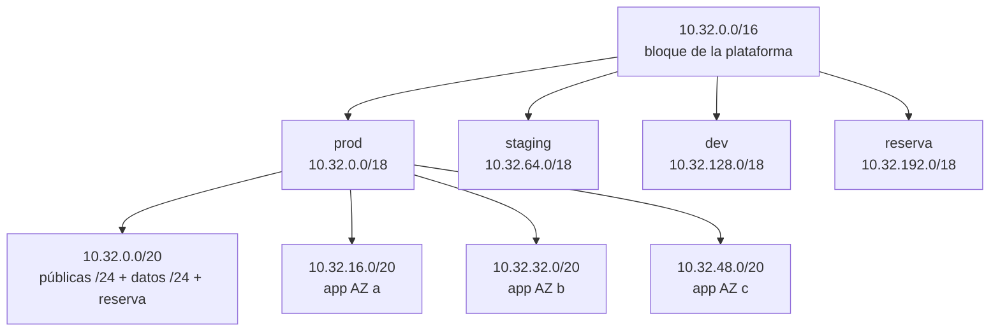

---
tags:
  - laboratorio
  - redes
  - python
  - arquitectura
---

# Lab 02: Plan de direccionamiento IP para una VPC

> Diseña a mano el plan de IPs de un `/16` para tres entornos y tres zonas de disponibilidad, compruébalo con un script de Python que detecta solapes y expórtalo a una tabla lista para IaC.

| Nivel | Duración | Costo | Requisitos |
| --- | --- | --- | --- |
| Básico | ~60 min | Gratis (no se crea nada en la nube) | [Lab 00](preparar-entorno.md), Python 3.12+, papel y lápiz |

!!! info "Qué vas a aprender"
    - Traducir requisitos (entornos, zonas, capas, crecimiento) a un plan de subredes.
    - Calcular a mano cortes de `/16` en `/18`, `/20` y `/24` usando el tamaño de bloque.
    - Reservar espacio para crecer y evitar solapes con redes on-premise, VPN y Docker.
    - Verificar el plan con el módulo `ipaddress` de Python: pertenencia, solapes y direcciones reservadas.
    - Exportar el plan a CSV y a una tabla Markdown que se pueda revisar en un pull request.

## Antes de empezar

- Python 3.12 o superior (`py -3.12` en Windows, `python3` en Linux/macOS). No hace falta instalar paquetes: `ipaddress` y `csv` son de la librería estándar.
- **Teoría recomendada**:
    - [Direccionamiento IP](../../networking/basico/direccionamiento-ip.md): CIDR, subnetting paso a paso y direcciones reservadas en la nube. Este lab amplía su ejercicio 4.
    - [Redes de datacenter e híbridas](../../networking/avanzado/redes-datacenter-hibridas.md#planificar-ips-sin-solapamientos): por qué los solapes rompen la conectividad híbrida.
    - [Redes en la nube](../../cloud/redes-y-datos/redes.md): subnets públicas y privadas, NAT y route tables.

### El encargo

Tu equipo va a desplegar una plataforma de pedidos en la nube. El equipo de redes, que lleva el **IPAM** (*IP Address Management*, gestión de direcciones IP) de la empresa, te asigna `10.32.0.0/16` y te pide un plan que cumpla:

| Requisito | Detalle |
| --- | --- |
| Entornos | `prod`, `staging` y `dev`, cada uno en su propia VPC/VNet, más espacio libre para un cuarto entorno |
| Zonas | 3 **Availability Zones** (zonas de disponibilidad) por entorno: `a`, `b`, `c` |
| Capas | Pública (load balancers, NAT), aplicación (Kubernetes: cada pod consume una IP de la subred) y datos (bases de datos, caché) |
| Crecimiento | Poder añadir una cuarta zona y nuevas subredes (endpoints privados, firewall) sin renumerar |
| Redes existentes | Datacenter `10.0.0.0/12`, oficinas `192.168.0.0/16`, VPN de usuarios `172.16.0.0/22`; en los equipos de desarrollo, la red bridge de Docker `172.17.0.0/16` |

## Arquitectura



Cada entorno recibe un `/18` con la misma estructura interna: así una IP te dice, a simple vista, de qué entorno y capa es.

## Paso a paso

### Paso 1: Comprueba que el bloque no se solapa con nada

Antes de cortar nada, confirma que `10.32.0.0/16` no pisa ninguna red con la que algún día tendrás que hablar: dos redes solapadas no se pueden conectar por peering ni enrutar sin NAT.

Hazlo a mano comparando rangos:

| Red | Rango | ¿Se solapa con 10.32.0.0 – 10.32.255.255? |
| --- | --- | --- |
| Datacenter `10.0.0.0/12` | 10.0.0.0 – 10.15.255.255 | No: termina en `10.15` |
| Oficinas `192.168.0.0/16` | 192.168.0.0 – 192.168.255.255 | No |
| VPN `172.16.0.0/22` | 172.16.0.0 – 172.16.3.255 | No |
| Docker `172.17.0.0/16` | 172.17.0.0 – 172.17.255.255 | No |

Un `/12` abarca 2^(32−12) direcciones: 16 valores en el segundo octeto (de `10.0` a `10.15`). Por eso `10.32` queda fuera.

### Paso 2: Divide el /16 en cuatro /18, uno por entorno

Necesitas 4 bloques iguales (3 entornos + reserva). 4 = 2², así que tomas **2 bits** más de red: `/16` + 2 = `/18`.

El truco del **tamaño de bloque**: el prefijo `/18` cae en el tercer octeto (bits 17 a 24). Los bits de red que se usan en ese octeto son 2, así que quedan 6 bits de host en él, y el bloque mide 2^6 = **64** en el tercer octeto:

| Entorno | Red | Rango | Direcciones |
| --- | --- | --- | --- |
| prod | `10.32.0.0/18` | 10.32.0.0 – 10.32.63.255 | 16 384 |
| staging | `10.32.64.0/18` | 10.32.64.0 – 10.32.127.255 | 16 384 |
| dev | `10.32.128.0/18` | 10.32.128.0 – 10.32.191.255 | 16 384 |
| reserva | `10.32.192.0/18` | 10.32.192.0 – 10.32.255.255 | 16 384 |

Cada `/18` será el CIDR de la VPC (AWS) o del address space de la VNet (Azure) de ese entorno.

### Paso 3: Dimensiona la capa de aplicación

La capa de aplicación es la que más IPs consume: con plugins de red como el VPC CNI de Amazon EKS, **cada pod** recibe una IP de la subred. Con 3 zonas y unos cientos de pods por zona, una `/24` (251 IPs útiles en AWS) se queda corta. Elige `/20` por zona: 4096 direcciones.

En el tercer octeto, un `/20` tiene un tamaño de bloque de 2^(24−20) = **16**. El `/18` de prod (`10.32.0` a `10.32.63`) contiene 64 / 16 = 4 bloques `/20`:

| Bloque | Rango | Uso |
| --- | --- | --- |
| `10.32.0.0/20` | 10.32.0.0 – 10.32.15.255 | Subredes pequeñas (paso 4) |
| `10.32.16.0/20` | 10.32.16.0 – 10.32.31.255 | App AZ a |
| `10.32.32.0/20` | 10.32.32.0 – 10.32.47.255 | App AZ b |
| `10.32.48.0/20` | 10.32.48.0 – 10.32.63.255 | App AZ c |

¿Por qué las subredes pequeñas van en el **primer** `/20` y no al final? Para que las grandes queden alineadas a su tamaño: un `/20` solo puede empezar en múltiplos de 16 del tercer octeto.

### Paso 4: Reparte el primer /20 en /24

El primer `/20` contiene 16 subredes `/24` (`10.32.0.0/24` a `10.32.15.0/24`). Agrúpalas de 4 en 4 para dejar hueco a una cuarta zona en cada capa:

| /24 | Capa | Zona |
| --- | --- | --- |
| `10.32.0.0/24` – `10.32.2.0/24` | Pública | a, b, c |
| `10.32.3.0/24` | Pública (reserva) | d |
| `10.32.4.0/24` – `10.32.6.0/24` | Datos | a, b, c |
| `10.32.7.0/24` | Datos (reserva) | d |
| `10.32.8.0/21` (8 × /24) | Reserva | Endpoints privados, firewall, subredes nuevas |

Un beneficio extra: las cuatro públicas forman exactamente `10.32.0.0/22` y las cuatro de datos `10.32.4.0/22`. Una sola regla de firewall o de NACL puede referirse a "todas las subredes de datos de prod".

### Paso 5: Calcula las IPs usables y escribe el plan a mano

La nube reserva direcciones en cada subnet: **5 en AWS y Azure, 4 en Google Cloud** (detalle en [Direccionamiento IP: en la nube](../../networking/basico/direccionamiento-ip.md#en-la-nube)). En AWS, de `10.32.0.0/24` no puedes usar `.0` (red), `.1` (VPC router), `.2` (DNS), `.3` (reservada) ni `.255` (broadcast).

| Capa | AZ a | AZ b | AZ c | IPs usables (AWS) |
| --- | --- | --- | --- | --- |
| Pública | `10.32.0.0/24` | `10.32.1.0/24` | `10.32.2.0/24` | 256 − 5 = 251 |
| Datos | `10.32.4.0/24` | `10.32.5.0/24` | `10.32.6.0/24` | 251 |
| App | `10.32.16.0/20` | `10.32.32.0/20` | `10.32.48.0/20` | 4096 − 5 = 4091 |

Para staging suma 64 al tercer octeto (`10.32.64.0/24`, `10.32.80.0/20`…) y para dev, 128. Guarda esta tabla: en el paso 7 la vas a comparar con la del script.

### Paso 6: Escribe el script de verificación

Un cálculo a mano se equivoca tarde o temprano. El módulo `ipaddress` ya sabe CIDR: tu script **genera** el plan con la misma lógica y **valida** las reglas. Crea una carpeta de trabajo y guarda:

```python title="plan_ips.py"
"""Genera y valida el plan de IPs de la VPC del Lab 02."""

import csv
import ipaddress
import sys
from itertools import combinations

BLOQUE = ipaddress.ip_network("10.32.0.0/16")
ENTORNOS = ["prod", "staging", "dev", "reserva"]  # un /18 cada uno, en este orden
AZS = ["a", "b", "c"]
RESERVADAS_AWS = 5  # AWS y Azure reservan 5 IPs por subnet; Google Cloud, 4

# Redes que ya existen fuera de la nube: el plan no puede pisarlas
EXISTENTES = {
    "on-premise datacenter": ipaddress.ip_network("10.0.0.0/12"),
    "oficinas": ipaddress.ip_network("192.168.0.0/16"),
    "VPN de usuarios": ipaddress.ip_network("172.16.0.0/22"),
    "bridge de Docker": ipaddress.ip_network("172.17.0.0/16"),
}


def plan_entorno(red: ipaddress.IPv4Network, entorno: str) -> list[dict]:
    """Divide el /18 de un entorno: públicas y datos en /24, aplicación en /20."""
    bloques_20 = list(red.subnets(new_prefix=20))  # 4 bloques /20
    primeras_24 = list(bloques_20[0].subnets(new_prefix=24))  # 16 bloques /24
    filas = []
    for i, az in enumerate(AZS):
        filas.append({"entorno": entorno, "capa": "publica", "az": az, "red": primeras_24[i]})
    for i, az in enumerate(AZS):
        filas.append({"entorno": entorno, "capa": "datos", "az": az, "red": primeras_24[4 + i]})
    for i, az in enumerate(AZS):
        filas.append({"entorno": entorno, "capa": "app", "az": az, "red": bloques_20[1 + i]})
    return filas


def validar(subredes: list[dict]) -> list[str]:
    errores = []
    for s in subredes:
        if not s["red"].subnet_of(BLOQUE):
            errores.append(f"{s['red']} está fuera de {BLOQUE}")
    for a, b in combinations(subredes, 2):
        if a["red"].overlaps(b["red"]):
            errores.append(f"Solape: {a['red']} y {b['red']}")
    for nombre, red in EXISTENTES.items():
        if BLOQUE.overlaps(red):
            errores.append(f"{BLOQUE} se solapa con {nombre} ({red})")
    return errores


def main() -> int:
    entornos = dict(zip(ENTORNOS, BLOQUE.subnets(new_prefix=18), strict=True))
    for nombre, red in entornos.items():
        print(f"{nombre:<8} {red}  ({red.num_addresses} direcciones)")

    subredes = [f for e in ENTORNOS[:3] for f in plan_entorno(entornos[e], e)]
    errores = validar(subredes)
    if errores:
        print("\n".join(errores), file=sys.stderr)
        return 1

    with open("plan-ips.csv", "w", newline="", encoding="utf-8") as f:
        w = csv.writer(f)
        w.writerow(["entorno", "capa", "az", "cidr", "primera", "ultima", "usables_aws"])
        for s in subredes:
            red = s["red"]
            # en AWS las 4 primeras y la última están reservadas
            primera, ultima = red[4], red[-2]
            usables = red.num_addresses - RESERVADAS_AWS
            w.writerow([s["entorno"], s["capa"], s["az"], red, primera, ultima, usables])

    with open("plan-ips.md", "w", encoding="utf-8") as f:
        f.write("| Entorno | Capa | AZ | CIDR | IPs usables (AWS) |\n| --- | --- | --- | --- | --- |\n")
        for s in subredes:
            usables = s["red"].num_addresses - RESERVADAS_AWS
            f.write(f"| {s['entorno']} | {s['capa']} | {s['az']} | `{s['red']}` | {usables} |\n")

    total = sum(s["red"].num_addresses for s in subredes)
    print(f"\n{len(subredes)} subnets sin solapes; usan {total} de {BLOQUE.num_addresses} IPs")
    print("Plan exportado a plan-ips.csv y plan-ips.md")
    return 0


if __name__ == "__main__":
    sys.exit(main())
```

Lo importante del script:

- `subnets(new_prefix=…)` hace el mismo corte que hiciste a mano con el tamaño de bloque.
- `overlaps()` y `subnet_of()` comprueban solapes y pertenencia; `combinations` compara cada par de subredes una vez.
- Una red se indexa como una lista: `red[4]` es la quinta dirección y `red[-2]` la penúltima (la última es el broadcast).
- Si hay errores, sale con **código 1**: el script puede ser un paso de CI que bloquea un cambio de red mal planificado.

### Paso 7: Ejecuta el script y compara con tu tabla

=== "Linux/macOS"

    ```bash
    python3 plan_ips.py
    ```

=== "Windows (PowerShell)"

    ```powershell
    py -3.12 plan_ips.py
    ```

Salida real:

```text
prod     10.32.0.0/18  (16384 direcciones)
staging  10.32.64.0/18  (16384 direcciones)
dev      10.32.128.0/18  (16384 direcciones)
reserva  10.32.192.0/18  (16384 direcciones)

27 subnets sin solapes; usan 41472 de 65536 IPs
Plan exportado a plan-ips.csv y plan-ips.md
```

27 subnets = 3 entornos × 3 capas × 3 zonas. Usan el 63 % del `/16`, pero todo el espacio restante está **en bloques alineados** (el `/18` de reserva, los `/24` de la zona `d` y los `/21` libres), listo para crecer sin renumerar.

### Paso 8: Comprueba que el validador detecta errores

Un validador que nunca falla no demuestra nada. Pruébalo con dos errores típicos. Primero, cambia `BLOQUE` a `10.8.0.0/16` (dentro del rango del datacenter) y ejecuta de nuevo:

```text
10.8.0.0/16 se solapa con on-premise datacenter (10.0.0.0/12)
prod     10.8.0.0/18  (16384 direcciones)
...
```

El script sale con código 1 (el mensaje de error va a stderr, por eso puede aparecer antes que el resto). Vuelve a dejar `10.32.0.0/16`. Después, simula que alguien añade a mano una subred que pisa la capa de aplicación:

```bash
python3 -c "
import ipaddress as ip, plan_ips
s = plan_ips.plan_entorno(ip.ip_network('10.32.0.0/18'), 'prod')
s.append({'entorno': 'prod', 'capa': 'extra', 'az': 'a', 'red': ip.ip_network('10.32.20.0/24')})
print(plan_ips.validar(s))"
```

```text
['Solape: 10.32.16.0/20 y 10.32.20.0/24']
```

`10.32.20.0/24` está dentro de `10.32.16.0/20` (que va de `10.32.16.0` a `10.32.31.255`): el validador lo ve aunque a simple vista "20" y "16" parezcan distintos.

### Paso 9: Revisa la tabla exportada

El script generó dos archivos. El CSV sirve para una hoja de cálculo o para alimentar IaC; el Markdown, para pegarlo en la documentación o en un pull request:

```text title="plan-ips.csv (primeras filas)"
entorno,capa,az,cidr,primera,ultima,usables_aws
prod,publica,a,10.32.0.0/24,10.32.0.4,10.32.0.254,251
prod,publica,b,10.32.1.0/24,10.32.1.4,10.32.1.254,251
prod,publica,c,10.32.2.0/24,10.32.2.4,10.32.2.254,251
prod,datos,a,10.32.4.0/24,10.32.4.4,10.32.4.254,251
prod,datos,b,10.32.5.0/24,10.32.5.4,10.32.5.254,251
prod,datos,c,10.32.6.0/24,10.32.6.4,10.32.6.254,251
prod,app,a,10.32.16.0/20,10.32.16.4,10.32.31.254,4091
prod,app,b,10.32.32.0/20,10.32.32.4,10.32.47.254,4091
prod,app,c,10.32.48.0/20,10.32.48.4,10.32.63.254,4091
staging,publica,a,10.32.64.0/24,10.32.64.4,10.32.64.254,251
```

Así se ve `plan-ips.md` renderizado (filas de prod):

| Entorno | Capa | AZ | CIDR | IPs usables (AWS) |
| --- | --- | --- | --- | --- |
| prod | publica | a | `10.32.0.0/24` | 251 |
| prod | publica | b | `10.32.1.0/24` | 251 |
| prod | publica | c | `10.32.2.0/24` | 251 |
| prod | datos | a | `10.32.4.0/24` | 251 |
| prod | datos | b | `10.32.5.0/24` | 251 |
| prod | datos | c | `10.32.6.0/24` | 251 |
| prod | app | a | `10.32.16.0/20` | 4091 |
| prod | app | b | `10.32.32.0/20` | 4091 |
| prod | app | c | `10.32.48.0/20` | 4091 |

Compara fila a fila con tu tabla del paso 5. Si coinciden, tu cálculo a mano y el del script dicen lo mismo.

## Verificación

Responde con `ipaddress` tres preguntas que harías en una revisión del plan:

```bash
python3 -c "
import ipaddress as ip
print(ip.ip_address('10.32.37.200') in ip.ip_network('10.32.32.0/20'))
print(list(ip.collapse_addresses(ip.ip_network(f'10.32.{i}.0/24') for i in range(4))))
n = ip.ip_network('10.32.16.0/20'); print(n.network_address, n.broadcast_address, n.netmask)
"
```

```text
True
[IPv4Network('10.32.0.0/22')]
10.32.16.0 10.32.31.255 255.255.240.0
```

- `10.32.37.200` es una IP de la capa de aplicación de prod, zona b.
- Las cuatro públicas de prod se resumen en `10.32.0.0/22` (`collapse_addresses` agrupa redes contiguas).
- El `/20` de la app en la zona a va de `.16.0` a `.31.255` con máscara `255.255.240.0`.

El lab está completo si: `plan_ips.py` sale con código 0, los dos archivos existen y tu tabla a mano coincide con `plan-ips.md`.

## Retos extra

1. Adapta el script a **Google Cloud**: reserva 4 IPs por subnet y ten en cuenta que la VPC es global y las subnets son regionales (no hay "CIDR de la VPC"). Pista: cambia `RESERVADAS_AWS` por un diccionario por proveedor.
2. Añade una columna `ruta_por_defecto` al CSV: `igw` para públicas, `nat-<az>` para app y `ninguna` para datos. Pista: compara con las route tables de [Redes en la nube](../../cloud/redes-y-datos/redes.md#una-vpc-tipica-en-dos-zonas).
3. Planifica un segundo `/16` para la región de DR (*disaster recovery*) y comprueba que tampoco se solapa con el primero.
4. Convierte el CSV en variables de Terraform (un `map` por entorno) y úsalas en el [Lab 17](../cloud/aws-vpc-ec2.md). Pista: `csv.DictReader` + `json.dump` y `jsondecode(file(...))` en Terraform.

## Limpieza

No se crea nada en la nube. Si no quieres conservar los archivos:

=== "Linux/macOS"

    ```bash
    rm -f plan-ips.csv plan-ips.md
    ```

=== "Windows (PowerShell)"

    ```powershell
    Remove-Item plan-ips.csv, plan-ips.md
    ```

Conserva `plan_ips.py`: es útil cada vez que diseñes una red nueva.

## Problemas comunes

| Síntoma | Causa | Solución |
| --- | --- | --- |
| `ValueError: 10.32.1.0/16 has host bits set` | El CIDR no empieza en el inicio de un bloque | Usa la dirección de red (`10.32.0.0/16`) o `ip_network(..., strict=False)` si de verdad quieres normalizarla |
| `TypeError: zip() takes no keyword arguments` | Python anterior a 3.10 (`strict=True` es nuevo) | Usa Python 3.12+ (`py -3.12` en Windows) |
| `py` no se reconoce | En Linux/macOS el comando es `python3` | Usa la pestaña Linux/macOS |
| La tabla a mano no coincide con el script | Error de tamaño de bloque (por ejemplo, contar 32 en vez de 16 para `/20`) | Recalcula con 2^(24 − prefijo) para cortes en el tercer octeto |
| `ModuleNotFoundError: No module named 'plan_ips'` en el paso 8 | Ejecutas `python -c` desde otra carpeta | Ejecútalo en la carpeta donde está `plan_ips.py` |
| Subred de app "llena" en un clúster real | Cada pod consume una IP de la subred | Planifica subredes mayores o usa un rango secundario / prefix delegation; ver [Kubernetes](../../devops/contenedores/kubernetes.md) |

Para el método general, mira [Troubleshooting](../../devops/operacion/troubleshooting.md).

## Información complementaria

- **CIDR y tamaño de bloque**: la base de todo el cálculo; ver [Direccionamiento IP](../../networking/basico/direccionamiento-ip.md#mascara-de-red-y-cidr).
- **VLSM**: dar a cada capa el tamaño que necesita (`/20` para app, `/24` para el resto) asignando de mayor a menor; ver el [ejercicio 5 de Direccionamiento IP](../../networking/basico/direccionamiento-ip.md#ejercicio-5-vlsm-subredes-de-distinto-tamano).
- **IPAM y solapes**: un plan de IPs de toda la organización por regiones y entornos; ver [Redes de datacenter e híbridas](../../networking/avanzado/redes-datacenter-hibridas.md#planificar-ips-sin-solapamientos).
- **Subnets públicas, privadas y de datos**: qué ruta por defecto tiene cada una; ver [Redes en la nube](../../cloud/redes-y-datos/redes.md#subnets-publicas-y-privadas).
- **En el trabajo real**: el plan vive en un repositorio y se asigna desde IaC (Terraform con `cidrsubnet()`, que hace lo mismo que `subnets()`), o desde Amazon VPC IPAM o el IPAM de Azure Virtual Network Manager. Un script como este, en el pipeline, evita que un pull request introduzca un solape.

## Documentación oficial

- [Python: módulo `ipaddress`](https://docs.python.org/es/3/library/ipaddress.html) y su [introducción (HOWTO)](https://docs.python.org/es/3/howto/ipaddress.html)
- [RFC 1918: rangos privados](https://www.rfc-editor.org/rfc/rfc1918)
- [AWS: subnet CIDR blocks y direcciones reservadas](https://docs.aws.amazon.com/vpc/latest/userguide/subnet-sizing.html)
- [Azure: preguntas frecuentes de Virtual Network (direcciones reservadas)](https://learn.microsoft.com/es-es/azure/virtual-network/virtual-networks-faq)
- [Google Cloud: subnets y rangos IPv4](https://cloud.google.com/vpc/docs/subnets)
- [Terraform: función `cidrsubnet`](https://developer.hashicorp.com/terraform/language/functions/cidrsubnet)

## Preguntas para verificar el aprendizaje

??? question "1. ¿Cuántos /20 caben en un /18 y por qué?"
    4: pasar de `/18` a `/20` añade 2 bits de red, y 2² = 4. En el tercer octeto, el `/18` mide 64 y el `/20` mide 16; 64 / 16 = 4.

??? question "2. ¿Por qué la capa de aplicación es /20 y las demás /24?"
    Porque en Kubernetes con un CNI que asigna IPs de la VPC, cada pod consume una IP de la subred, y una aplicación puede tener cientos o miles de pods. Las subredes públicas (load balancers, NAT) y de datos (pocas instancias) necesitan muchas menos.

??? question "3. ¿Qué pasaría si eligieras `10.8.0.0/16` para la plataforma?"
    Se solaparía con el datacenter (`10.0.0.0/12` llega hasta `10.15.255.255`). Al conectar la nube con on-premise por VPN o Direct Connect, el router no sabría si `10.8.1.10` está en la nube o en el datacenter: habría que renumerar o recurrir a NAT.

??? question "4. ¿Cuántas IPs puedes asignar a máquinas en `10.32.4.0/24` en AWS? ¿Y en Google Cloud?"
    251 en AWS (256 − 5 reservadas) y 252 en Google Cloud (256 − 4).

??? question "5. ¿Para qué sirve reservar `10.32.3.0/24` y `10.32.7.0/24` aunque hoy no se usen?"
    Para añadir una cuarta zona sin romper el esquema: la nueva subred pública y la de datos quedarían junto a las demás y seguirían resumiéndose en `10.32.0.0/22` y `10.32.4.0/22`.

??? question "6. ¿Por qué el script compara cada par de subredes en vez de solo comprobar que están dentro del /16?"
    Porque dos subredes pueden estar ambas dentro del `/16` y aun así pisarse entre ellas (como `10.32.16.0/20` y `10.32.20.0/24`). La nube rechazaría crear la segunda, o peor, alguien la crearía en otra VPC y fallaría el peering.

??? question "7. ¿Qué ventaja tiene que el script salga con código 1 cuando hay errores?"
    Que puede usarse como paso de CI: si un cambio en el plan introduce un solape, el pipeline falla y el pull request no se puede fusionar.

??? question "8. Una IP `10.32.150.7` aparece en un log. ¿De qué entorno es?"
    De dev: `150` está entre `128` y `191` en el tercer octeto, el rango de `10.32.128.0/18`. Dentro de dev, 150 − 128 = 22 cae en el segundo `/20` (16–31), la capa de aplicación de la zona a.

## Notas relacionadas

- **Networking**
    - [Direccionamiento IP](../../networking/basico/direccionamiento-ip.md)
    - [Routing y NAT](../../networking/intermedio/routing-nat.md)
    - [Redes de datacenter e híbridas](../../networking/avanzado/redes-datacenter-hibridas.md)
- **Cloud**
    - [Redes en la nube](../../cloud/redes-y-datos/redes.md)
    - [Modelos de servicio y regiones](../../cloud/fundamentos/modelos-de-servicio-y-regiones.md)
    - [Resiliencia](../../cloud/operacion-y-gobierno/resiliencia.md)
    - [Arquitecturas de referencia](../../cloud/arquitectura/arquitecturas-referencia.md)
- **DevOps**
    - [Kubernetes](../../devops/contenedores/kubernetes.md)
    - [Infrastructure as Code](../../devops/iac/infraestructura-como-codigo.md)
- **Python**
    - [Estructuras de datos](../../python/fundamentos/estructuras-datos.md)
    - [Archivos y formatos](../../python/scripting/archivos-formatos.md)

Lab anterior: [Lab 01: Diagnóstico de red desde Linux](linux-red-diagnostico.md) · Lab siguiente: [Lab 03: Script en Python para analizar logs](python-analizar-logs.md)
