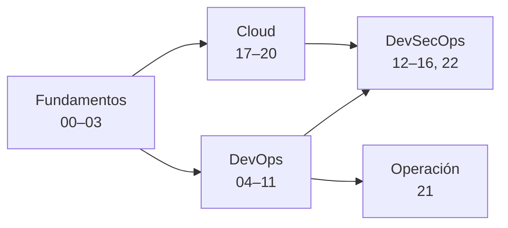

# Laboratorios :material-flask:

Prácticas guiadas para aprender haciendo. Cada laboratorio tiene el paso a paso explicado, cómo verificar que funcionó, retos extra, limpieza, problemas comunes, información complementaria, documentación oficial y **preguntas para verificar el aprendizaje**. Cada uno enlaza a las notas del cuaderno donde está la teoría, y esas notas enlazan de vuelta al laboratorio.

!!! warning "Antes de usar la nube"
    Haz primero el [Lab 00](fundamentos/preparar-entorno.md): MFA en la cuenta principal, **alertas de presupuesto** y una cuenta de pruebas. Nunca hagas los laboratorios en una cuenta de producción, y ejecuta siempre la sección de **Limpieza** al terminar.

## Ruta sugerida

## Fundamentos

| Lab | Tema | Nivel | Costo |
| --- | --- | --- | --- |
| [00. Preparar el entorno](fundamentos/preparar-entorno.md) | Herramientas, cuentas de pruebas, MFA y presupuestos | Básico | Gratis |
| [01. Diagnóstico de red desde Linux](fundamentos/linux-red-diagnostico.md) | IP, rutas, DNS, puertos, HTTP/TLS, tcpdump | Básico | Gratis |
| [02. Plan de direccionamiento IP](fundamentos/subnetting-plan-ips.md) | Subnetting de una VPC multi-AZ con Python | Básico | Gratis |
| [03. Analizar logs con Python](fundamentos/python-analizar-logs.md) | Script CLI con tests sobre un access log | Básico | Gratis |

## DevOps

| Lab | Tema | Nivel | Costo |
| --- | --- | --- | --- |
| [04. Flujo Git con pull requests](devops/git-flujo-pull-request.md) | Ramas, PR, code review, conflictos, rulesets | Básico | Gratis |
| [05. Docker multi-stage y Compose](devops/docker-multistage-compose.md) | Imagen pequeña y sin root, app + base de datos | Básico | Gratis |
| [06. Kubernetes local con kind](devops/kubernetes-local-kind.md) | Deployment, Service, Ingress, rollout, HPA | Intermedio | Gratis |
| [07. CI con GitHub Actions](devops/github-actions-ci.md) | Lint, tests, build, registry, aprobaciones | Intermedio | Gratis |
| [08. Terraform sin nube](devops/terraform-local-workspaces.md) | Providers locales, módulos, state, workspaces, tests | Básico | Gratis |
| [09. Terraform en AWS con remote state](devops/terraform-aws-backend-remoto.md) | Backend S3 con locking, drift | Intermedio | ~0 USD |
| [10. Ansible](devops/ansible-configuracion.md) | Inventario, playbooks, roles, idempotencia, Vault | Intermedio | Gratis |
| [11. Prometheus y Grafana](devops/observabilidad-prometheus-grafana.md) | Métricas, dashboards, alertas sobre un SLO, logs | Intermedio | Gratis |

## DevSecOps

| Lab | Tema | Nivel | Costo |
| --- | --- | --- | --- |
| [12. Escaneos en el pipeline](devsecops/escaneos-en-pipeline.md) | Secretos, SAST, SCA, imagen e IaC con gating | Intermedio | Gratis |
| [13. OIDC de GitHub a AWS](devsecops/oidc-github-aws.md) | Desplegar sin llaves estáticas | Intermedio | ~0 USD |
| [14. Endurecer Kubernetes](devsecops/seguridad-kubernetes.md) | RBAC, Pod Security, NetworkPolicy, Kyverno | Avanzado | Gratis |
| [15. DAST con ZAP](devsecops/dast-zap-juice-shop.md) | Escaneo de OWASP Juice Shop en local | Intermedio | Gratis |
| [16. CSPM con Prowler](devsecops/cspm-prowler.md) | Auditar y remediar tu cuenta cloud | Intermedio | ~0 USD |
| [22. Hardening de Linux con Ansible](devsecops/hardening-linux-ansible.md) | Medir con Lynis y OpenSCAP, aplicar devsec.hardening y un rol propio, excepciones con caducidad | Avanzado | Gratis |

## Cloud

| Lab | Tema | Nivel | Costo |
| --- | --- | --- | --- |
| [17. AWS: VPC y EC2](cloud/aws-vpc-ec2.md) | Subnets públicas y privadas, Session Manager, Terraform | Intermedio | Capa gratuita |
| [18. AWS: API serverless](cloud/aws-serverless-api.md) | API Gateway, Lambda y DynamoDB como IaC | Intermedio | Capa gratuita |
| [19. Azure: VNet y VM](cloud/azure-vnet-vm.md) | NSG, VM sin IP pública, managed identity | Intermedio | Créditos de prueba |
| [20. Google Cloud: Cloud Run](cloud/gcp-cloud-run.md) | Artifact Registry, Secret Manager, canary | Intermedio | Capa gratuita |

## Operación

| Lab | Tema | Nivel | Costo |
| --- | --- | --- | --- |
| [21. Game day](operacion/game-day-incidente.md) | Incidente simulado, troubleshooting, comunicación y postmortem | Avanzado | Gratis |

!!! note "Añadir un laboratorio"
    Crea el `.md` en el bloque que corresponda siguiendo la misma estructura (incluida la sección **Notas relacionadas**) y agrégalo a su `.pages`.
