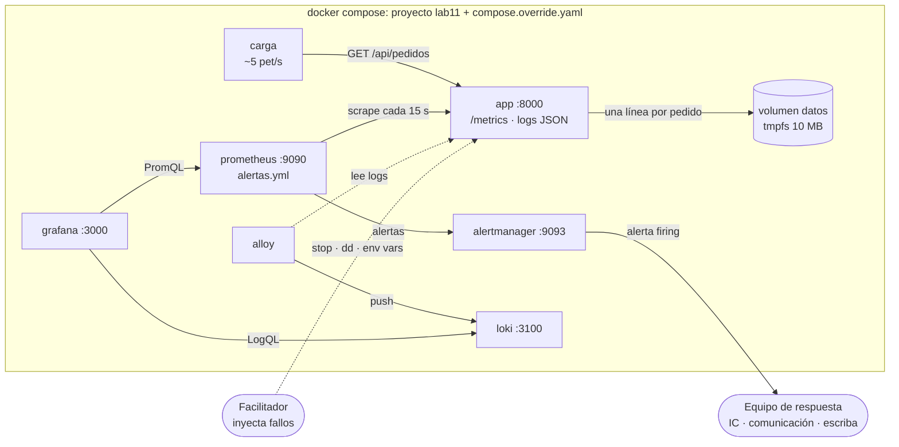

---
tags:
  - laboratorio
  - sre
  - incidentes
  - observabilidad
---

# Lab 21: Game day: incidente simulado, troubleshooting y postmortem

> Organiza un game day sobre el stack de observabilidad del Lab 11 (app, Prometheus, Alertmanager, Loki y Grafana en Docker Compose): inyecta tres fallos controlados, detéctalos con sus alertas, investígalos con métricas y logs, comunica con plantillas, mitiga y escribe el postmortem.

| Nivel | Duración | Costo | Requisitos |
| --- | --- | --- | --- |
| Intermedio | ~2–3 h (mejor en grupo de 2–4 personas) | Gratis (todo en local) | [Lab 11](../devops/observabilidad-prometheus-grafana.md) (su stack, creado y funcionando), Docker con Compose v2, ~3 GB de RAM libres, [Lab 03](../fundamentos/python-analizar-logs.md) opcional |

!!! info "Qué vas a aprender"
    - Planificar un **game day** (día de simulacro): objetivo, hipótesis, alcance, condición de parada y roles.
    - Repartir los roles de un incidente: **Incident Commander**, **Communications lead** y **Scribe**, más quien inyecta los fallos.
    - Inyectar fallos controlados en un entorno local: un contenedor caído, un volumen lleno y un "mal despliegue" con latencia y errores.
    - Detectar cada fallo con una alerta de Prometheus y medir el tiempo hasta detectar (**MTTD**) y hasta restablecer (**MTTR**).
    - Investigar con método (qué cambió, métricas, logs), mitigar antes de entender y comunicar con plantillas.
    - Escribir un **postmortem blameless** (sin culpables) con la plantilla del cuaderno y acciones concretas.

!!! warning "Seguridad del simulacro"
    - Todo ocurre en contenedores de tu equipo. El "disco" que se llena es un **volumen de prueba de 10 MB en memoria** que añade este lab (en `compose.override.yaml`): nunca ejecutes `dd` ni scripts de relleno sobre el disco de tu equipo ni sobre un servidor real.
    - Nunca hagas un game day en producción sin aprobación, aviso previo a soporte, *blast radius* (radio de impacto) limitado y una persona con autoridad para abortar.

## Antes de empezar

- El **stack del [Lab 11](../devops/observabilidad-prometheus-grafana.md)**: la carpeta `lab11/` con todos sus archivos (pasos 1 a 5). No hace falta que esté levantado: lo arrancarás en el paso 3. Este lab no construye otro stack; solo le añade un volumen de prueba.
- Docker Desktop o Docker Engine con **Compose v2** (`docker compose version`), del [Lab 00](../fundamentos/preparar-entorno.md). Los puertos son los del Lab 11 (8000, 9090, 9093, 3100, 12345 y 3000, solo en `127.0.0.1`).
- **Teoría recomendada** (el lab la practica, no la repite):
    - [Operación y fiabilidad (SRE)](../../devops/operacion/operacion-sre.md#incident-management-gestion-de-incidentes): severidades, roles y ciclo de vida del incidente.
    - [Prácticas de aprendizaje](../../devops/operacion/practicas-aprendizaje.md#game-days): cómo se organiza un game day.
    - [Troubleshooting](../../devops/operacion/troubleshooting.md) y [Leer logs](../../devops/operacion/leer-logs.md).
    - [Comunicación durante incidentes](../../devops/operacion/comunicacion-incidentes.md), [Runbooks y playbooks](../../devops/operacion/runbooks-playbooks.md).
    - [Postmortem](../../devops/operacion/postmortem.md) y [Análisis de causa raíz](../../devops/operacion/analisis-causa-raiz.md).

## Arquitectura



Es el stack del Lab 11 (node-exporter no aparece en el diagrama) más un volumen `datos` donde la app escribe una línea por pedido. Prometheus evalúa las tres alertas del Lab 11, sin cambios: **AppCaida** (no puede leer las métricas durante 1 minuto), **TasaErrores5xxAlta** (más del 5 % de `/api/pedidos` con 5xx durante 2 minutos) y **LatenciaP95Alta** (p95 por encima de 300 ms durante 5 minutos). El facilitador rompe cosas; el equipo de respuesta solo ve lo que ven las alertas, los dashboards y los logs.

## Paso a paso

### Paso 1: Planifica el game day

Un game day sin plan es solo romper cosas. Escribe el plan antes de levantar nada; es lo que separa un simulacro de un incidente real.

```markdown title="plan-gameday.md"
# Game day: plataforma de pedidos (local)

- Objetivo: comprobar que las alertas detectan caídas, errores y lentitud de /api/pedidos
  en menos de 5 minutos y que el equipo sabe mitigar con los runbooks.
- Hipótesis: "Si la app cae, AppCaida salta en menos de 2 minutos."
             "Si /api/pedidos falla más del 5 %, TasaErrores5xxAlta salta en menos de 4 minutos."
- Alcance: solo el stack local del Lab 11 (proyecto lab11). Nada fuera de Docker.
- Condición de parada: cualquier efecto fuera del stack (equipo lento, disco del host) → abortar.
- Quién puede abortar: el facilitador.
- Fallos (los conoce solo el facilitador): 3, en orden aleatorio, separados por al menos 10 minutos.
```

Los tiempos de las hipótesis salen de las reglas del Lab 11: scrape cada 15 s, `for: 1m` en AppCaida y `rate(...[5m])` con `for: 2m` en TasaErrores5xxAlta. Los 10 minutos entre fallos dejan que la ventana de 5 minutos se vacíe y las alertas vuelvan a *Inactive*.

Reparte los roles. El modelo sigue el de [Comunicación durante incidentes](../../devops/operacion/comunicacion-incidentes.md#roles):

| Rol | Qué hace en este lab | Si haces el lab sola |
| --- | --- | --- |
| **Facilitador** (*game master*) | Elige el orden de los fallos, los inyecta, cronometra y puede abortar | Escribe los tres fallos en papeles, sácalos al azar y espera unos minutos antes de mirar las alertas |
| **Incident Commander** (IC) | Declara el incidente y su severidad, asigna tareas, decide la mitigación y cuándo se cierra. No toca la terminal | Tú, con un "sombrero" a la vez: decide antes de ejecutar |
| **Operations lead** (investigación) | Ejecuta los comandos de diagnóstico y la mitigación | Tú |
| **Communications lead** | Publica las actualizaciones con las plantillas y la cadencia acordada | Tú, cada 10 minutos de reloj |
| **Scribe** (escriba) | Anota en la bitácora la hora UTC de cada hecho y decisión | Ten la bitácora abierta y escribe antes de cada comando |

### Paso 2: Prepara el stack del Lab 11 para el game day

Partimos del stack del Lab 11 tal cual: la app del [paso 1](../devops/observabilidad-prometheus-grafana.md#paso-1-la-app-instrumentada), las reglas y Alertmanager del [paso 2](../devops/observabilidad-prometheus-grafana.md#paso-2-prometheus-reglas-del-slo-y-alertmanager), Loki y Alloy del [paso 3](../devops/observabilidad-prometheus-grafana.md#paso-3-logs-con-grafana-alloy-y-loki), Grafana del [paso 4](../devops/observabilidad-prometheus-grafana.md#paso-4-grafana-provisionado-por-archivo) y el `compose.yaml` del [paso 5](../devops/observabilidad-prometheus-grafana.md#paso-5-docker-compose-y-arranque). Los fallos usan sus [interruptores de fallo](../devops/observabilidad-prometheus-grafana.md#interruptores-de-fallo-los-reutiliza-el-lab-21): `TASA_ERRORES`, `LATENCIA_MS` y `DIR_DATOS`.

Lo único que el Lab 11 no trae es un **disco que se pueda llenar**. Con `DIR_DATOS` definido, la app escribe una línea de auditoría por cada pedido en `DIR_DATOS/pedidos.log`; si no puede escribir, el pedido responde `500`. Comprueba que tu `app/app.py` tiene la función `auditar()` y la variable `DIR_DATOS` (si hiciste el Lab 11 antes de que existieran, copia de nuevo el `app.py` del Lab 11).

Añade a la carpeta `lab11/`, junto a `compose.yaml`, este archivo. Docker Compose lo **combina automáticamente** con `compose.yaml` (las listas y mapas se fusionan), así que no tocas ningún archivo del Lab 11:

```yaml title="compose.override.yaml"
# Solo para el game day (Lab 21). Compose lo combina automáticamente con compose.yaml.
services:
  app:
    environment:
      DIR_DATOS: /datos          # activa la auditoría de pedidos (ver interruptores del Lab 11)
    volumes:
      - datos:/datos
    restart: unless-stopped      # se reinicia si el proceso muere, no si lo detienes tú

volumes:
  datos:                         # volumen de prueba de 10 MB en memoria: el que vamos a llenar
    driver_opts:
      type: tmpfs
      device: tmpfs
      o: "size=10m,uid=65534"    # 65534 = usuario nobody, el USER de la imagen del Lab 11
```

El volumen `datos` usa el driver `local` con tipo `tmpfs`: vive en memoria, mide 10 MB y pertenece al usuario `nobody` (uid 65534), con el que corre la app. Comprueba la combinación antes de arrancar:

```bash
cd lab11
docker compose config | grep -E 'DIR_DATOS|size=10m|restart'
```

```text
      DIR_DATOS: /datos
    restart: unless-stopped
      o: size=10m,uid=65534
```

!!! note "Las alertas son las del SLO, no unas de simulacro"
    Las reglas del Lab 11 están pensadas para un SLO: ventanas de 5 minutos y `for` de 1 a 5 minutos para no generar ruido. Por eso la detección tarda minutos, no segundos. Medir ese tiempo y decidir si es aceptable es parte del game day.

### Paso 3: Levanta el stack y toma la línea base

Antes de romper nada necesitas saber cómo se ve "normal" (*baseline*, línea base): sin eso no sabrás si un valor es anómalo. `--build` vuelve a construir la imagen por si actualizaste `app.py`.

```bash
docker compose up -d --build
docker compose ps
```

Salida esperada (abreviada; son los servicios del Lab 11):

```text
NAME                    SERVICE         STATUS         PORTS
lab11-alertmanager-1    alertmanager    Up 15 seconds  127.0.0.1:9093->9093/tcp
lab11-app-1             app             Up 15 seconds  127.0.0.1:8000->8000/tcp
lab11-carga-1           carga           Up 15 seconds
lab11-grafana-1         grafana         Up 15 seconds  127.0.0.1:3000->3000/tcp
lab11-prometheus-1      prometheus      Up 15 seconds  127.0.0.1:9090->9090/tcp
...
```

Comprueba las piezas:

```bash
curl -s http://localhost:8000/health
curl -s http://localhost:8000/metrics | grep '^http_requests_total'
curl -s 'http://localhost:9090/api/v1/query?query=up{job="app"}' | python3 -m json.tool | grep -A2 '"value"'
docker compose exec app df -h /datos
```

```text
{"estado": "ok"}
http_requests_total{method="GET",path="/api/pedidos",status="200"} 412.0
http_requests_total{method="GET",path="/",status="200"} 139.0
            "value": [
                1793034123.456,
                "1"
Filesystem      Size  Used Avail Use% Mounted on
tmpfs            10M   12K   10M   1% /datos
```

`up` vale `1`: Prometheus lee las métricas. En [http://localhost:9090/alerts](http://localhost:9090/alerts) las tres alertas del grupo `slo-app` deben estar en **Inactive**. Abre en Grafana ([http://localhost:3000](http://localhost:3000), usuario `admin`, contraseña `cambia-esto-lab11` o la de `GRAFANA_ADMIN_PASSWORD`) el dashboard ya provisionado *Lab 11 - App de pedidos*. Sus paneles usan estas consultas:

| Panel | Consulta |
| --- | --- |
| Peticiones por segundo por status | `sum by (status) (rate(http_requests_total{job="app"}[1m]))` |
| Tasa de errores `/api/pedidos` | `app:tasa_errores:ratio_rate5m` (recording rule sobre `path="/api/pedidos", status=~"5.."`) |
| Latencia p95 `/api/pedidos` | `app:latencia_p95:5m` (`histogram_quantile(0.95, …{path="/api/pedidos"})`) |
| Errores de la app (Loki) | LogQL sobre `{service="app"}` que filtra las líneas JSON con `nivel="ERROR"` |

Anota la línea base en la bitácora: unas 4–5 peticiones/s, 0 % de errores y p95 por debajo de 50 ms (la app añade de 5 a 50 ms aleatorios a cada petición).

### Paso 4: Prepara la bitácora y las plantillas de comunicación

El escriba usa una bitácora con la hora en **UTC** (`date -u +%H:%M:%S`); de ella sale después el timeline del postmortem. El communications lead prepara las actualizaciones con la estructura fija de [Comunicación durante incidentes](../../devops/operacion/comunicacion-incidentes.md#para-stakeholders-internos).

```markdown title="bitacora.md"
# INC-GD-001 · Bitácora (UTC)
| Hora | Quién | Hecho o decisión |
| --- | --- | --- |
| 10:00:00 | Facilitador | Inicio del game day. Línea base: ~5 req/s, 0 % errores, p95 < 50 ms |
```

```text title="actualizacion-interna.txt"
[SEV?] INC-GD-00N · Pedidos · Estado: Investigando | Identificado | Monitoreando | Resuelto · HH:MM UTC
Impacto: <qué no funciona, a quién y desde cuándo>
Qué sabemos: <hechos, no suposiciones>
Qué estamos haciendo: <acción en curso>
Qué necesitamos: <nada | permisos | otra persona>
IC: <nombre> · Comunicación: <nombre> · Próxima actualización: HH:MM UTC
```

Acordad las severidades con la tabla de [Operación y fiabilidad (SRE)](../../devops/operacion/operacion-sre.md#severidades): pedidos caídos para todos = **SEV1**; degradación parcial = **SEV2**. Las alertas del Lab 11 ya distinguen la urgencia con el label `severity`: `page` (avisar ya a la guardia) y `ticket` (se atiende en horario laboral).

### Paso 5: Fallo 1: el contenedor de la app se detiene

**Facilitador**: anota la hora y detén la app (simula un proceso que muere o un nodo que cae).

```bash
date -u +%H:%M:%S && docker compose stop app
```

**Equipo de respuesta**: espera a la alerta, no al facilitador. En [http://localhost:9090/alerts](http://localhost:9090/alerts) verás **AppCaida** pasar a *Pending* (la condición se cumple, pero aún no ha pasado el minuto del `for`) y luego a *Firing*; en Alertmanager ([http://localhost:9093](http://localhost:9093)) aparece con `severity="page"`. Desde la terminal:

```bash
curl -s http://localhost:9090/api/v1/alerts | python3 -m json.tool | grep -E '"alertname"|"state"'
```

```text
                    "alertname": "AppCaida",
                "state": "firing",
```

Con la alerta en *firing*, el IC declara el incidente (SEV1: no se pueden hacer pedidos) y el escriba anota la hora: la diferencia con la hora de inyección es el **MTTD** de este fallo. Investigación, siguiendo el [flujo de diagnóstico](../../devops/operacion/troubleshooting.md#flujo-de-diagnostico) de lo más simple a lo más complejo:

```bash
docker compose ps -a app             # ¿está corriendo?
docker compose logs --tail 5 app     # ¿qué dijo antes de parar?
docker compose logs --tail 3 carga   # ¿qué ven los "usuarios"?
curl -sv http://localhost:8000/health 2>&1 | tail -2
```

```text
NAME          SERVICE   STATUS
lab11-app-1   app       Exited (137) 40 seconds ago
...
carga-1  | no se pudo conectar con http://app:8000: <urlopen error ...>
...
* connect to 127.0.0.1 port 8000 failed: Connection refused
```

`Exited (137)` es 128 + 9 (SIGKILL tras no terminar con SIGTERM a tiempo) y no hay errores en el log: alguien o algo lo detuvo, la app no "se rompió". `Connection refused` confirma que nadie escucha en el puerto ([Lab 01](../fundamentos/linux-red-diagnostico.md)). **Mitigación**: arrancarla.

```bash
docker compose start app
```

El communications lead publica el estado "Monitoreando" y, cuando `up` vuelve a `1` y la alerta se resuelve, "Resuelto". El escriba anota la hora: la diferencia con la inyección es el **MTTR**.

!!! question "Para el postmortem"
    `restart: unless-stopped` (lo añadió `compose.override.yaml`) no la volvió a arrancar porque fue una parada explícita. ¿Qué habría pasado si el proceso hubiera muerto por un error? ¿Quién habría avisado si Prometheus también estuviera caído?

### Paso 6: Fallo 2: el volumen de datos se llena

Espera unos minutos con todo normal. **Facilitador**: llena el volumen de prueba de 10 MB desde dentro del contenedor.

```bash
date -u +%H:%M:%S && docker compose exec app dd if=/dev/zero of=/datos/relleno bs=1M count=20
```

```text
dd: error writing '/datos/relleno': No space left on device
```

`dd` intenta escribir 20 MB y se detiene al llenar los 10 MB del volumen. Es exactamente lo que pasa cuando un log o un backup crece sin control.

**Equipo de respuesta**: en unos 3 minutos salta **TasaErrores5xxAlta** (la app sigue viva, así que AppCaida no salta). En el dashboard, el panel por status muestra `500` donde antes había `200`; las peticiones a `/` siguen en `200` porque no escriben en el volumen: una pista de que el problema es propio de los pedidos. Investiga con los logs, como en [Leer logs](../../devops/operacion/leer-logs.md#metodo-para-leer-logs):

```bash
docker compose logs --since 5m app | grep ERROR | tail -1
```

```text
app-1  | {"ts": "...", "nivel": "ERROR", "request_id": "...", "metodo": "GET", "path": "/api/pedidos", "status": 500, "duracion_ms": 31.2, "error": "no se pudo escribir en el volumen de datos: [Errno 28] No space left on device: '/datos/pedidos.log'"}
```

La misma búsqueda en Grafana → *Explore* → Loki: `{service="app"} | json | status >= 500`. `Errno 28` es `ENOSPC`: no queda espacio. Confirma y busca qué ocupa el espacio, como en el runbook de [disco lleno](../../devops/operacion/runbooks-playbooks.md#ejemplo-disco-lleno-en-un-nodo-linux):

```bash
docker compose exec app df -h /datos
docker compose exec app ls -lh /datos
```

```text
Filesystem      Size  Used Avail Use% Mounted on
tmpfs            10M   10M     0 100% /datos
-rw-r--r-- 1 nobody nogroup  10M ... relleno
-rw-r--r-- 1 nobody nogroup  ...  pedidos.log
```

**Mitigación**: el IC decide borrar el archivo de relleno (en un caso real: rotar o comprimir logs, ampliar el volumen). Primero se mitiga, luego se analiza ([Operación y fiabilidad (SRE)](../../devops/operacion/operacion-sre.md#ciclo-de-vida)).

```bash
docker compose exec app rm /datos/relleno
docker compose exec app df -h /datos | tail -1
```

```text
tmpfs            10M  ...   ...    1% /datos
```

!!! question "Para el postmortem"
    La alerta saltó por el **síntoma** (errores 5xx), pero nadie avisó de la **causa** (disco al 80 %, 90 %…) antes de que afectara a los usuarios. ¿Qué métrica y qué alerta añadirías? Ese es tu primer action item.

### Paso 7: Fallo 3: un "mal despliegue" con latencia y errores

Este fallo imita un despliegue con una configuración equivocada. **Facilitador**: cambia las variables de entorno y recrea solo la app.

=== "Linux/macOS"

    ```bash
    date -u +%H:%M:%S
    LATENCIA_MS=800 TASA_ERRORES=0.2 docker compose up -d app
    ```

=== "Windows (PowerShell)"

    ```powershell
    (Get-Date).ToUniversalTime().ToString("HH:mm:ss")
    $env:LATENCIA_MS = "800"; $env:TASA_ERRORES = "0.2"
    docker compose up -d app
    ```

**Equipo de respuesta**: salta **TasaErrores5xxAlta** (*page*, en unos 3 minutos) y después **LatenciaP95Alta** (*ticket*, tras sus 5 minutos de `for`). La pregunta clave del [troubleshooting](../../devops/operacion/troubleshooting.md#2-pregunta-que-cambio) es **"¿qué cambió?"**:

```bash
docker compose ps app                                # el contenedor se recreó hace poco ("Up 2 minutes")
docker compose logs app | grep '"evento": "inicio"'  # la app registra su configuración al arrancar
docker compose exec app env | grep -E 'LATENCIA|TASA'
```

```text
app-1  | {"ts": "...", "nivel": "INFO", "evento": "inicio", "puerto": 8000, "tasa_errores": 0.2, "latencia_ms": 800}
LATENCIA_MS=800
TASA_ERRORES=0.2
```

`docker compose logs` solo muestra el contenedor actual; el arranque **anterior** está en Loki, que guardó los logs del contenedor ya borrado. En Grafana → *Explore* → Loki, `{service="app"} | json | evento="inicio"` muestra los dos arranques, y en Prometheus los gauges `app_falla_latencia_ms` y `app_falla_tasa_errores` saltan de 0 a 800 y 0,2 justo a la hora del cambio. El último arranque coincide con el inicio de los errores y trae otra configuración: es el cambio sospechoso. **Mitigación**: *rollback* (volver a la configuración anterior), sin esperar a entender por qué alguien la cambió.

=== "Linux/macOS"

    ```bash
    docker compose up -d app        # sin las variables, vuelven los valores por defecto (0)
    ```

=== "Windows (PowerShell)"

    ```powershell
    Remove-Item Env:LATENCIA_MS, Env:TASA_ERRORES
    docker compose up -d app
    ```

Verifica en Grafana que la latencia y los errores vuelven a la línea base y que las alertas pasan a *Inactive*. Tardan unos minutos: hasta que los errores salen de la ventana de 5 minutos del `rate`, la tasa sigue por encima del umbral.

### Paso 8: Cierra los incidentes y mide

Con los tres fallos resueltos, el communications lead publica el "Resuelto" de cada uno con el horario de impacto (plantillas de [status page](../../devops/operacion/comunicacion-incidentes.md#para-clientes-status-page)). El escriba completa una tabla con los tiempos de la bitácora:

| Fallo | Inyección | Alerta firing | Mitigado | MTTD | MTTR | ¿Se cumplió la hipótesis? |
| --- | --- | --- | --- | --- | --- | --- |
| 1. App detenida | 10:05:00 | 10:06:20 | 10:08:00 | 1 min 20 s | 3 min | Sí (< 2 min) |
| 2. Volumen lleno | … | … | … | … | … | … |
| 3. Mal despliegue | … | … | … | … | … | … |

La primera fila es un ejemplo; rellena las demás con **tus** horas. Si un MTTD supera lo que decía la hipótesis, no es un fallo del equipo: es un hallazgo del game day.

### Paso 9: Escribe el postmortem

Elige el fallo con más aprendizaje (normalmente el 2) y escribe el postmortem con la [plantilla del cuaderno](../../devops/operacion/postmortem.md#plantilla). Cópiala completa; este es un ejemplo de cómo rellenar las partes clave:

```markdown title="postmortem-INC-GD-002.md (extracto)"
# Postmortem: errores en pedidos por volumen de datos lleno

| Campo | Valor |
| --- | --- |
| ID del incidente | INC-GD-002 (game day) |
| Severidad | SEV1 |
| Duración del impacto | 00:05 (10:20:10 a 10:25:05 UTC) |
| Incident Commander | <nombre> |

## Resumen
Durante 5 minutos, el 100 % de los pedidos (/api/pedidos) falló con HTTP 500 porque el
volumen /datos se llenó y la app no pudo escribir la auditoría. Se mitigó liberando espacio.

## Timeline (UTC)
| Hora | Evento | Fuente |
| --- | --- | --- |
| 10:20:10 | El volumen /datos llega al 100 % | df, logs (Errno 28) |
| 10:22:45 | TasaErrores5xxAlta en firing | Prometheus, Alertmanager |
| 10:23:00 | IC declara SEV1 | bitácora |
| 10:24:30 | Se identifica el archivo que llena el volumen | ls -lh /datos |
| 10:25:05 | Se borra el archivo; vuelven los 200 | Grafana |

## Factores contribuyentes
- Técnicos: no hay métrica ni alerta de uso del volumen; la app falla la petición
  completa si no puede escribir una línea de auditoría.
- De proceso: no existe runbook de "volumen lleno" para este servicio.

## Action items
| Acción | Tipo | Prioridad | Dueño | Fecha |
| --- | --- | --- | --- | --- |
| Exponer uso del volumen y alertar al 80 % | detectar | P1 | … | … |
| Runbook "volumen de datos lleno" enlazado desde la alerta | mitigar | P2 | … | … |
| Decidir si la auditoría puede fallar sin romper el pedido | prevenir | P2 | … | … |
```

Reglas de un buen postmortem: lenguaje **blameless** ("el volumen no tenía alerta", no "X no puso la alerta"), cada factor contribuyente con su acción, y acciones con dueño y fecha. Si quieres profundizar en el porqué, aplica los 5 porqués o el modelo del queso suizo de [Análisis de causa raíz](../../devops/operacion/analisis-causa-raiz.md).

### Paso 10: Haz el debrief del game day

Cierra con 15 minutos de retrospectiva del **simulacro** (no del sistema), como en [Prácticas de aprendizaje](../../devops/operacion/practicas-aprendizaje.md#retrospectivas-de-incidentes-y-retros-de-equipo):

- ¿Las alertas tenían la información necesaria para empezar (qué falla, dónde mirar, enlace al runbook)?
- ¿Los tiempos de detección de las reglas del SLO son aceptables para cada fallo?
- ¿Estaba claro quién era el IC? ¿Alguien investigó sin avisar?
- ¿La cadencia de comunicación se cumplió?
- ¿Qué runbook faltó? Escríbelo con la [plantilla de runbook](../../devops/operacion/runbooks-playbooks.md#plantilla-de-runbook).

## Verificación

| Check | Cómo comprobarlo | Resultado esperado |
| --- | --- | --- |
| El override se aplica | `docker compose config` (busca `DIR_DATOS`) | `DIR_DATOS: /datos` |
| El volumen de prueba existe | `docker compose exec app df -h /datos` | `tmpfs` de `10M` montado en `/datos` |
| El stack funciona | `curl -s http://localhost:8000/health` | `{"estado": "ok"}` |
| Las alertas cargaron | [http://localhost:9090/alerts](http://localhost:9090/alerts) | AppCaida, TasaErrores5xxAlta y LatenciaP95Alta en el grupo `slo-app` |
| Cada fallo disparó su alerta | Bitácora y Alertmanager | AppCaida (fallo 1), TasaErrores5xxAlta (2 y 3), LatenciaP95Alta (3) |
| Todo volvió a la normalidad | `curl -s http://localhost:9090/api/v1/alerts` | `"alerts":[]` |
| Tiempos medidos | Tabla del paso 8 | MTTD y MTTR de los tres fallos |
| Postmortem | `postmortem-INC-GD-002.md` | Resumen, impacto, timeline, factores, al menos 2 action items con dueño |

## Retos extra

1. **Fallo en caliente, sin despliegue**: el facilitador usa `POST /admin/fallas?latencia_ms=600` (del Lab 11) sin recrear el contenedor. ¿Cómo descubre el equipo qué cambió si `docker compose ps` no muestra ningún reinicio? Pista: el evento `fallas_actualizadas` en Loki y los gauges `app_falla_*`.
2. Cumple tu primer action item: expón el uso de `/datos` como métrica (`Gauge` con `shutil.disk_usage`) y añade al `alertas.yml` del Lab 11 una alerta al 80 %. Repite el fallo 2 y compara el MTTD.
3. Convierte el fallo 3 en un ejercicio de **Wheel of Misfortune**: otra persona inyecta un fallo que tú no conoces (por ejemplo, `TASA_ERRORES=0.03`, que no supera el umbral). ¿Lo detectas? ¿Debería alertar con un SLO del 99 %?
4. Usa el [script del Lab 03](../fundamentos/python-analizar-logs.md) como inspiración para analizar `docker compose logs app --no-log-prefix` y calcular los 5xx por minuto del incidente para el timeline. Pista: los logs ya son JSON (campo `status`), usa `json.loads` en lugar de una expresión regular.

## Limpieza

Desde la carpeta `lab11/`, borra contenedores, red y volúmenes (incluido el volumen de prueba) y quita el override para que el Lab 11 vuelva a su configuración original:

=== "Linux/macOS"

    ```bash
    docker compose down -v
    rm compose.override.yaml
    docker volume ls --filter name=lab11
    ```

=== "Windows (PowerShell)"

    ```powershell
    docker compose down -v
    Remove-Item compose.override.yaml
    docker volume ls --filter name=lab11
    ```

La última orden no debe listar ningún volumen (ni `lab11_datos` ni los de Prometheus y Grafana). Si no vas a repetir los labs, sigue la [limpieza del Lab 11](../devops/observabilidad-prometheus-grafana.md#limpieza) para borrar la imagen `lab11-app:1.0` y las imágenes descargadas. Si exportaste variables en PowerShell, cierra la ventana o usa `Remove-Item Env:LATENCIA_MS, Env:TASA_ERRORES`.

## Problemas comunes

| Síntoma | Causa | Solución |
| --- | --- | --- |
| El fallo 2 no provoca errores | El override no se cargó (otro nombre u otra carpeta) o tu `app.py` no tiene `DIR_DATOS` | Busca `DIR_DATOS` en la salida de `docker compose config`; copia el `app.py` actual del Lab 11 y `docker compose up -d --build app` |
| Todos los pedidos dan 500 desde el principio | La app no puede escribir en `/datos` (permisos del volumen) | Comprueba que el `uid` de `driver_opts` es 65534 (`nobody`, el `USER` del Dockerfile) y recrea con `docker compose down -v && docker compose up -d` |
| AppCaida nunca pasa a *Firing* | Miraste antes del minuto del `for`, o la app sigue corriendo | Espera; comprueba `docker compose ps -a app` |
| TasaErrores5xxAlta no salta con el volumen lleno | No hay tráfico (el servicio `carga` está parado) o aún no pasaron los 2 minutos del `for` | `docker compose ps carga` y `docker compose start carga` |
| Las variables del fallo 3 no se aplican | Se ejecutó `docker compose restart` (no relee la configuración) | Usa `docker compose up -d app`, que recrea el contenedor con el entorno nuevo |
| Puertos ocupados, target DOWN o paneles sin datos | Problemas del stack base | Ver los [problemas comunes del Lab 11](../devops/observabilidad-prometheus-grafana.md#problemas-comunes) |
| `python3: command not found` en los comandos de verificación (Windows) | En Windows el comando es `py` o `python` | Sustituye `python3` por `py`, o abre la URL en el navegador |

Más casos en [Troubleshooting: contenedores](../../devops/operacion/troubleshooting.md#contenedores).

## Información complementaria

- **Game day, Wheel of Misfortune y tabletop**: tipos de simulacro y cuándo usar cada uno; ver [Prácticas de aprendizaje](../../devops/operacion/practicas-aprendizaje.md#comparativa-de-simulacros).
- **Roles y severidades**: IC, communications lead, scribe; ver [Operación y fiabilidad (SRE)](../../devops/operacion/operacion-sre.md#roles).
- **Alertar por síntomas**: alertas que reflejan lo que nota el usuario, con `for` para evitar ruido; ver [Observabilidad](../../devops/operacion/observabilidad.md#alertas-accionables).
- **Método de troubleshooting**: define el problema, pregunta qué cambió, una hipótesis cada vez; ver [Troubleshooting](../../devops/operacion/troubleshooting.md#mentalidad-y-metodo).
- **Postmortem blameless y RCA**: ver [Postmortem](../../devops/operacion/postmortem.md#cultura-blameless-y-just-culture) y [Análisis de causa raíz](../../devops/operacion/analisis-causa-raiz.md).
- **MTTD, MTTR y SLA**: cómo se traducen estos tiempos en disponibilidad y error budget; ver [Niveles de servicio](../../negocio/niveles-de-servicio.md).
- **En el trabajo real**: los game days se hacen en staging o en producción con blast radius limitado, a menudo con herramientas de *chaos engineering* (AWS Fault Injection Service, Azure Chaos Studio, Chaos Mesh, LitmusChaos). Las alertas van a una herramienta de guardias (PagerDuty, Opsgenie, incident.io), el canal de incidente se abre automáticamente y el postmortem se revisa en una reunión con seguimiento de las acciones.

## Documentación oficial

- [Prometheus: alerting rules](https://prometheus.io/docs/prometheus/latest/configuration/alerting_rules/) · [funciones de PromQL (`rate`, `histogram_quantile`)](https://prometheus.io/docs/prometheus/latest/querying/functions/)
- [Alertmanager](https://prometheus.io/docs/alerting/latest/alertmanager/) · [Prometheus Python client](https://prometheus.github.io/client_python/)
- [Grafana Loki: LogQL](https://grafana.com/docs/loki/latest/query/)
- [Docker Compose: referencia del archivo](https://docs.docker.com/reference/compose-file/) · [combinar archivos con `compose.override.yaml`](https://docs.docker.com/compose/how-tos/multiple-compose-files/merge/) · [volúmenes con driver local y tmpfs](https://docs.docker.com/reference/cli/docker/volume/create/)
- [Google SRE Book: Managing Incidents](https://sre.google/sre-book/managing-incidents/) · [Postmortem Culture](https://sre.google/sre-book/postmortem-culture/)
- [AWS Well-Architected: game days](https://docs.aws.amazon.com/wellarchitected/latest/reliability-pillar/rel_testing_resiliency_game_days_resiliency.html)
- [PagerDuty Incident Response (roles)](https://response.pagerduty.com/)

## Preguntas para verificar el aprendizaje

??? question "1. ¿Por qué el facilitador no debe ser la misma persona que responde al incidente?"
    Porque quien inyecta el fallo sabe la causa y no pone a prueba la detección ni la investigación. El objetivo es comprobar que las alertas, los dashboards y los runbooks bastan para llegar a la causa sin información privilegiada.

??? question "2. En el fallo 2, ¿por qué saltó TasaErrores5xxAlta y no AppCaida?"
    Porque la app seguía viva y Prometheus podía leer sus métricas (`up = 1`); lo que fallaba era cada pedido. AppCaida solo detecta que el proceso no responde; los errores de negocio los detecta la regla de tasa de 5xx sobre `http_requests_total{path="/api/pedidos", status=~"5.."}`.

??? question "3. ¿Para qué sirve el `for: 2m` de TasaErrores5xxAlta? ¿Qué pasaría si lo quitas?"
    Exige que la condición se mantenga 2 minutos antes de disparar, para no alertar por picos de segundos. Sin él, alertas más rápido pero con más falsos positivos y fatiga de alertas; con un `for` muy largo, aumenta el MTTD.

??? question "4. Durante el fallo 3, alguien propone investigar a fondo el código antes de hacer rollback. ¿Qué debería decidir el IC?"
    Hacer rollback primero: la prioridad durante el incidente es reducir el impacto. La investigación de por qué se desplegó esa configuración se hace después, en el postmortem.

??? question "5. ¿Qué diferencia hay entre MTTD y MTTR en tu tabla, y cuál mejora una alerta mejor?"
    MTTD es el tiempo desde que empieza el problema hasta que se detecta; MTTR, hasta que se restablece el servicio. Una alerta mejor (más temprana, sobre la causa o con buen umbral) reduce el MTTD, y como el MTTR lo incluye, también lo reduce.

??? question "6. Reescribe en lenguaje blameless: \"Ana llenó el disco porque no revisó el tamaño del backup\"."
    Por ejemplo: "El backup creció hasta llenar el volumen; no había límite de tamaño ni alerta de uso de disco que avisara antes". El foco pasa de la persona a las condiciones del sistema que permitieron el error.

??? question "7. ¿Qué pasaría si Prometheus estuviera en el mismo host que la app y ese host cayera?"
    No habría alerta: el sistema que vigila cae con lo vigilado. Por eso se monitorea el propio monitoreo (por ejemplo, un *dead man's switch* o una sonda externa) y se ejecuta en otra infraestructura.

??? question "8. ¿Por qué el communications lead publica actualizaciones con hora de la próxima aunque no haya novedades?"
    Porque el silencio genera más preguntas y presión sobre quienes investigan. Una cadencia fija ("próxima actualización a las 10:40") da confianza y protege al equipo técnico de interrupciones.

??? question "9. Tu game day reveló que el fallo 2 no tenía runbook. ¿Es un mal resultado?"
    No: es exactamente el tipo de hallazgo que se busca. Un game day "perfecto" no enseña nada; uno que encuentra huecos genera action items (runbook, alerta de disco) antes de que el fallo ocurra de verdad.

??? question "10. En el fallo 3, ¿por qué `docker compose logs app` no muestra el arranque anterior y Loki sí?"
    Porque `docker compose up -d app` borró el contenedor viejo y creó uno nuevo: sus logs locales desaparecieron con él. Alloy ya los había enviado a Loki, que los conserva. Es una de las razones para centralizar los logs fuera de donde se generan.

## Notas relacionadas

- **DevOps**
    - [Operación y fiabilidad (SRE)](../../devops/operacion/operacion-sre.md)
    - [Troubleshooting](../../devops/operacion/troubleshooting.md)
    - [Leer logs](../../devops/operacion/leer-logs.md)
    - [Comunicación durante incidentes](../../devops/operacion/comunicacion-incidentes.md)
    - [Runbooks y playbooks](../../devops/operacion/runbooks-playbooks.md)
    - [Postmortem](../../devops/operacion/postmortem.md)
    - [Análisis de causa raíz](../../devops/operacion/analisis-causa-raiz.md)
    - [Prácticas de aprendizaje](../../devops/operacion/practicas-aprendizaje.md)
    - [Observabilidad](../../devops/operacion/observabilidad.md)
    - [Docker](../../devops/contenedores/docker.md)
    - [Despliegue continuo](../../devops/ci-cd/despliegue-continuo.md)
- **Cloud**
    - [Observabilidad nativa](../../cloud/operacion-y-gobierno/observabilidad-nativa.md)
    - [Resiliencia](../../cloud/operacion-y-gobierno/resiliencia.md)
- **DevSecOps**
    - [Detección y respuesta](../../devsecops/gobierno-y-respuesta/deteccion-respuesta.md)
- **Negocio TI**
    - [Niveles de servicio](../../negocio/niveles-de-servicio.md)
    - [Gestión de servicios (ITSM) e ITIL 4](../../negocio/gestion-servicios-itil.md)
    - [Continuidad de negocio](../../negocio/continuidad-negocio.md)
- **Recursos**
    - [Anatomía de otros archivos: Prometheus, reglas de alerta y Alertmanager](../../recursos/anatomia/otros-archivos.md)

Lab anterior: [Lab 11: Observabilidad con Prometheus y Grafana](../devops/observabilidad-prometheus-grafana.md) (este lab reutiliza su stack) · También recomendado: [Lab 03: Script en Python para analizar logs](../fundamentos/python-analizar-logs.md) · En orden numérico, viene después del [Lab 20: Google Cloud: desplegar un contenedor en Cloud Run](../cloud/gcp-cloud-run.md)
