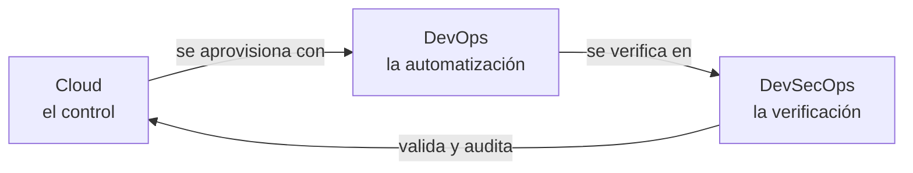
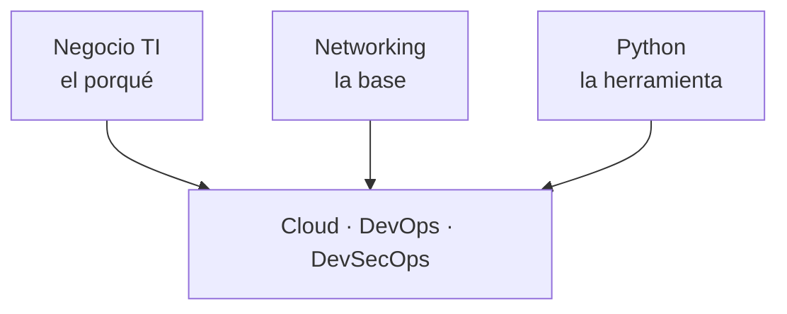

---
hide:
  - toc
---

# Mapa de relaciones

> Cómo se conectan Cloud, DevOps y DevSecOps: el mismo tema visto desde el control, la automatización y la verificación.

## Las tres capas

Cada tema del cuaderno está en tres capas que se apoyan:

| Capa | Rol | Pregunta que responde |
| --- | --- | --- |
| [Cloud](cloud/index.md) | **El control**: dónde corre todo | ¿Qué servicio uso y cómo lo configuro? |
| [DevOps](devops/index.md) | **La automatización**: cómo lo construyes, despliegas y operas | ¿Cómo lo hago repetible, versionado y automático? |
| [DevSecOps](devsecops/index.md) | **La verificación**: cómo compruebas que es seguro | ¿Cómo sé, de forma automática, que es seguro y cumple? |

Alrededor de esas tres capas hay tres secciones transversales:

| Sección | Rol | Para qué sirve |
| --- | --- | --- |
| [Negocio TI](negocio/index.md) | **El porqué** | Traducir decisiones técnicas a valor, costo, riesgo y niveles de servicio |
| [Networking](networking/index.md) | **La base** | Los fundamentos de red que hay debajo de la nube y del datacenter on-premise |
| [Servidores](servidores/index.md) | **La base de sistemas** | Administrar Linux Server y Windows Server y automatizarlos con Ansible |
| [Python](python/index.md) | **La herramienta** | Automatizar tareas de las tres capas con scripts |

## Mapa por concepto

| Concepto | Cloud (el control) | DevOps (la automatización) | DevSecOps (la verificación) |
| --- | --- | --- | --- |
| **IAM** | Crear roles y políticas: [IAM](cloud/identidad-y-seguridad/iam-comparativa.md) | Rol por pipeline vía Terraform: [Terraform](devops/iac/terraform-basico.md), [CI](devops/ci-cd/integracion-continua.md) | Fallar el build si hay `*:*`; OIDC: [Seguridad de IaC](devsecops/infraestructura-y-contenedores/seguridad-iac.md), [Secretos e identidades](devsecops/identidades-y-pipeline/secretos-identidades.md) |
| **Redes** | VPC, security groups, subnets: [Redes](cloud/redes-y-datos/redes.md) | Definirlas como código: [Infrastructure as Code](devops/iac/infraestructura-como-codigo.md) | Escanear reglas abiertas (`0.0.0.0/0`): [Seguridad de IaC](devsecops/infraestructura-y-contenedores/seguridad-iac.md), [Seguridad de Kubernetes](devsecops/infraestructura-y-contenedores/seguridad-kubernetes.md) |
| **Secretos** | KMS, Secrets Manager: [Seguridad base](cloud/identidad-y-seguridad/seguridad-base.md) | Inyectarlos en despliegues: [Despliegue continuo](devops/ci-cd/despliegue-continuo.md), [Ansible](devops/iac/ansible.md) | Detectarlos en commits; rotación: [Seguridad del código](devsecops/codigo-y-dependencias/seguridad-codigo.md), [Secretos e identidades](devsecops/identidades-y-pipeline/secretos-identidades.md) |
| **Contenedores** | ECS/EKS, registry: [Contenedores gestionados](cloud/computo/contenedores-gestionados.md) | Build y deploy: [Docker](devops/contenedores/docker.md), [Kubernetes](devops/contenedores/kubernetes.md) | Escaneo de imágenes y firma: [Seguridad de contenedores](devsecops/infraestructura-y-contenedores/seguridad-contenedores.md), [Software supply chain](devsecops/codigo-y-dependencias/cadena-suministro.md) |
| **Logs** | CloudTrail, CloudWatch: [Observabilidad nativa](cloud/operacion-y-gobierno/observabilidad-nativa.md), [Seguridad base](cloud/identidad-y-seguridad/seguridad-base.md) | Centralizar y alertar: [Observabilidad](devops/operacion/observabilidad.md) | Detección, SIEM, auditoría: [Detección y respuesta](devsecops/gobierno-y-respuesta/deteccion-respuesta.md) |
| **Cambios** | Config, tags: [Gobernanza](cloud/operacion-y-gobierno/gobernanza.md) | CI/CD, GitOps: [Despliegue continuo](devops/ci-cd/despliegue-continuo.md) | Policy as code, aprobaciones: [Seguridad de IaC](devsecops/infraestructura-y-contenedores/seguridad-iac.md), [Seguridad del pipeline](devsecops/identidades-y-pipeline/seguridad-pipeline.md) |

### Conceptos transversales

| Concepto | Negocio TI (el porqué) | Técnico (el cómo) |
| --- | --- | --- |
| **Niveles de servicio** | Acordar y comunicar SLA/SLO: [Niveles de servicio](negocio/niveles-de-servicio.md) | Medir SLI y gestionar el error budget: [Observabilidad](devops/operacion/observabilidad.md), [Operación y SRE](devops/operacion/operacion-sre.md) |
| **Continuidad** | BIA, BCP, RTO/RPO aceptables: [Continuidad de negocio](negocio/continuidad-negocio.md) | Diseñar y probar el DR: [Resiliencia](cloud/operacion-y-gobierno/resiliencia.md) |
| **Costos** | TCO, ROI, CapEx vs OpEx: [TI y negocio](negocio/ti-y-negocio.md) | Optimizar la factura: [FinOps y costos](cloud/fundamentos/finops-costos.md) |
| **Métricas** | KPIs y OKRs: [Métricas, KPIs y OKRs](negocio/metricas-kpis-okrs.md) | Métricas DORA: [Cultura DevOps y DORA](devops/fundamentos/cultura-metricas-dora.md) |
| **Riesgo** | Gobierno y riesgo de TI: [Gobierno y riesgo](negocio/gobierno-riesgo-ti.md) | Threat modeling y cumplimiento: [Fundamentos DevSecOps](devsecops/fundamentos-devsecops.md), [Cumplimiento](devsecops/gobierno-y-respuesta/cumplimiento.md) |
| **Redes** | — | De la base a la nube: [Networking](networking/index.md) → [Redes en la nube](cloud/redes-y-datos/redes.md) → [Seguridad de red](networking/avanzado/seguridad-red.md) |
| **Arquitectura** | Migración y business case: [Migración a la nube](cloud/arquitectura/migracion-cloud.md) | Estilos y patrones: [Arquitectura en la nube](cloud/arquitectura/arquitectura-cloud.md), [Arquitecturas de referencia](cloud/arquitectura/arquitecturas-referencia.md) |
| **Automatización** | — | Scripts: [Python](python/index.md) · Bash: [Linux, redes y scripting](devops/fundamentos/linux-redes-scripting.md) · SDKs: [Automatización cloud](python/scripting/automatizacion-cloud.md) |

## Conexiones entre temas

Las flechas marcan dónde un tema de una capa se apoya en otro de otra capa.

### Desde Cloud

- [Cómputo](cloud/computo/maquinas-virtuales.md) → DevOps: despliegue sobre estos servicios ([Despliegue continuo](devops/ci-cd/despliegue-continuo.md)).
- [Redes](cloud/redes-y-datos/redes.md) → DevSecOps: segmentación y políticas de red ([Seguridad de Kubernetes](devsecops/infraestructura-y-contenedores/seguridad-kubernetes.md), [Seguridad de IaC](devsecops/infraestructura-y-contenedores/seguridad-iac.md)).
- [IAM](cloud/identidad-y-seguridad/iam-comparativa.md) → DevOps: roles para pipelines ([Integración continua](devops/ci-cd/integracion-continua.md)) → DevSecOps: auditoría de permisos ([Secretos e identidades](devsecops/identidades-y-pipeline/secretos-identidades.md)).
- [Seguridad base](cloud/identidad-y-seguridad/seguridad-base.md) → DevSecOps: CSPM y cumplimiento ([Cumplimiento](devsecops/gobierno-y-respuesta/cumplimiento.md)).
- [Observabilidad nativa](cloud/operacion-y-gobierno/observabilidad-nativa.md) → DevOps: observabilidad ([Observabilidad](devops/operacion/observabilidad.md)).

### Desde DevOps

- [Linux, redes y scripting](devops/fundamentos/linux-redes-scripting.md) → Cloud: redes ([Redes](cloud/redes-y-datos/redes.md)).
- [Integración continua](devops/ci-cd/integracion-continua.md) → DevSecOps: aquí se insertan los escaneos ([Escaneo en el pipeline](devsecops/escaneos/escaneo-en-pipeline.md)).
- [Infrastructure as Code](devops/iac/infraestructura-como-codigo.md) → Cloud: aprovisiona todo lo de la capa Cloud → DevSecOps: escaneo de IaC ([Seguridad de IaC](devsecops/infraestructura-y-contenedores/seguridad-iac.md)).
- [Docker](devops/contenedores/docker.md) y [Kubernetes](devops/contenedores/kubernetes.md) → DevSecOps: seguridad de imágenes y clústeres.
- [Observabilidad](devops/operacion/observabilidad.md) → DevSecOps: monitoreo de seguridad ([Detección y respuesta](devsecops/gobierno-y-respuesta/deteccion-respuesta.md)).

### Desde DevSecOps

- [Seguridad del código](devsecops/codigo-y-dependencias/seguridad-codigo.md) → DevOps: se ejecuta en CI ([Integración continua](devops/ci-cd/integracion-continua.md)).
- [Seguridad de contenedores](devsecops/infraestructura-y-contenedores/seguridad-contenedores.md) → DevOps: contenedores ([Docker](devops/contenedores/docker.md)).
- [Seguridad de IaC](devsecops/infraestructura-y-contenedores/seguridad-iac.md) → DevOps: IaC → Cloud: valida lo que se aprovisiona ([Gobernanza](cloud/operacion-y-gobierno/gobernanza.md)).
- [Secretos e identidades](devsecops/identidades-y-pipeline/secretos-identidades.md) → Cloud: IAM y KMS ([IAM](cloud/identidad-y-seguridad/iam-comparativa.md), [Seguridad base](cloud/identidad-y-seguridad/seguridad-base.md)).
- [Cumplimiento](devsecops/gobierno-y-respuesta/cumplimiento.md) → Cloud: Config y CloudTrail ([Seguridad base](cloud/identidad-y-seguridad/seguridad-base.md)).
- [Detección y respuesta](devsecops/gobierno-y-respuesta/deteccion-respuesta.md) → DevOps: observabilidad e incidentes ([Operación y fiabilidad](devops/operacion/operacion-sre.md)).

## Diferencias por proveedor

- **Cloud**: todas las notas comparan AWS, Azure y Google Cloud, con el nombre oficial de cada servicio.
- **DevOps y DevSecOps**: las prácticas son las mismas en cualquier nube. Solo se separa por proveedor donde cambia el servicio nativo: IaC nativo, CI/CD nativo, Kubernetes gestionado, registries, OIDC desde el pipeline, gestión de secretos, CSPM y SIEM.
