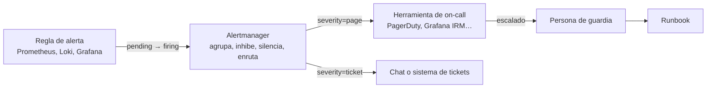

---
tags:
  - monitoreo
  - alertas
  - observabilidad
  - sre
---

# Alertas: diseño, Alertmanager y on-call

> Qué merece una alerta y qué no, severidades, cómo escribir una regla con su runbook, alertas sobre el error budget con burn rate, cómo Alertmanager agrupa, inhibe, silencia y enruta, y cómo llega el aviso a la persona de guardia.

!!! info "Antes de leer"
    Conviene conocer SLI, SLO y error budget ([Observabilidad](../fundamentos/observabilidad.md#sli-slo-sla-y-error-budget)) y qué señales hay en cada capa ([Qué monitorear](../fundamentos/que-monitorear.md)). Las alarmas propias de cada nube están en [Observabilidad nativa](../nube/observabilidad-nativa.md#alarmas-utiles).

## Del dato a la persona



1. Una **regla** evalúa una consulta cada cierto intervalo. Si la condición se cumple, la alerta pasa a **pending**; si se mantiene durante `for`, pasa a **firing** y se envía.
2. **Alertmanager** junta las alertas parecidas en una sola notificación, descarta las que otra alerta ya explica, respeta los silencios y decide a quién enviarlas según sus labels.
3. La **herramienta de on-call** sabe quién está de guardia, insiste si nadie responde y escala.
4. La persona abre el **runbook** enlazado en la alerta.

## Qué merece una alerta

Una buena alerta es **urgente**, **real** (afecta a usuarios o lo hará pronto) y **accionable** (alguien puede hacer algo ahora). Si no cumple las tres, es un ticket o un panel, no un aviso a las 3 de la mañana.

- **Síntomas antes que causas**: "el 5 % de los pagos falla" en vez de "CPU al 90 %". La CPU alta sin impacto en usuarios no debería despertar a nadie; como mucho abre un ticket.
- **Pocas y buenas**: cada página que no requiere acción enseña a ignorar la siguiente (*alert fatigue*, fatiga de alertas).
- **Cada alerta con su runbook**: si no sabes qué haría la persona de guardia al recibirla, todavía no está lista.
- **La excepción**: causas que con seguridad van a provocar un síntoma pronto y que dan margen para evitarlo, como "el disco se llenará en 4 h" o "el certificado caduca en 7 días".

## Severidades

Las alertas se clasifican con un label `severity` que decide el canal. Tres niveles bastan:

| Severidad | Cuándo | Canal | Respuesta esperada |
| --- | --- | --- | --- |
| `page` | Impacto en usuarios ahora o en minutos | Herramienta de on-call: llamada o notificación push, a cualquier hora | Minutos |
| `ticket` | Hay que actuar, pero puede esperar al horario laboral | Ticket o canal del equipo | Horas o días |
| `info` | Contexto útil para diagnosticar; nadie tiene que actuar | Solo dashboard o canal silencioso | Ninguna |

No confundas la severidad de la **alerta** (cómo avisar) con la del **incidente** (SEV1, SEV2…, cuánto impacto tiene): una página puede acabar siendo un SEV3. Las severidades de incidentes están en [Operación y fiabilidad (SRE)](../../devops/operacion/operacion-sre.md#severidades).

## Anatomía de una regla

```yaml title="alertas-api.yml"
groups:
  - name: api
    rules:
      - alert: APITasaErrores5xxAlta
        expr: |
          sum by (service) (rate(http_requests_total{service="api", code=~"5.."}[5m]))
            /
          sum by (service) (rate(http_requests_total{service="api"}[5m]))
          > 0.05
        for: 5m
        keep_firing_for: 10m
        labels:
          severity: page
          team: tienda
        annotations:
          summary: "{{ $labels.service }}: {{ $value | humanizePercentage }} de las peticiones fallan"
          description: "Más del 5 % de errores 5xx durante 5 minutos. Los usuarios ven fallos al comprar."
          runbook_url: "https://wiki.ejemplo.com/runbooks/api-errores-5xx"
          dashboard: "https://grafana.ejemplo.com/d/api"
```

| Campo | Para qué |
| --- | --- |
| `alert` | Nombre en *PascalCase* que diga qué pasa, no qué se mide (`APITasaErrores5xxAlta`, no `Metrica5xx`) |
| `expr` | La condición en PromQL. Lo que devuelva es lo que alerta (una alerta por cada combinación de labels) |
| `for` | Cuánto debe mantenerse la condición antes de enviar. Evita avisar por picos de segundos |
| `keep_firing_for` | Cuánto sigue activa después de dejar de cumplirse. Evita el *flapping* (alerta que se abre y cierra sin parar) |
| `labels` | Para enrutar y agrupar: `severity`, `team`, `service` |
| `annotations` | Para la persona: resumen, descripción del impacto, runbook y dashboard |

!!! tip "Escribe el resumen pensando en el móvil"
    En la notificación solo se ve el `summary`. Debe decir qué servicio, qué pasa y cuánto, sin abrir nada más: "api: 12 % de las peticiones fallan" es mejor que "Alerta de errores disparada".

Valida las reglas antes de desplegarlas y pruébalas con series simuladas (ejemplo completo en el [Lab 11 (parte 1)](../../laboratorios/devops/observabilidad-prometheus-grafana.md)):

```bash
promtool check rules alertas-api.yml     # sintaxis y PromQL válidos
promtool test rules alertas-api_test.yml # pruebas unitarias de las reglas
```

## Alertas basadas en SLO (burn rate)

En lugar de un umbral fijo de errores, se alerta según lo rápido que se gasta el **error budget**. El **burn rate** (velocidad de consumo) indica cuántas veces más rápido de lo sostenible se gasta: con burn rate 1 el presupuesto se agota justo al final de la ventana del SLO; con 14,4, un 2 % del presupuesto mensual se va en una hora.

El *SRE Workbook* de Google propone combinar varias ventanas para un SLO de 30 días:

| Presupuesto gastado | Ventana larga | Ventana corta | Burn rate | Severidad |
| --- | --- | --- | --- | --- |
| 2 % | 1 h | 5 min | 14,4 | `page` |
| 5 % | 6 h | 30 min | 6 | `page` |
| 10 % | 3 días | 6 h | 1 | `ticket` |

La **ventana larga** evita avisar por un pico breve; la **ventana corta** confirma que el problema sigue ocurriendo, para que la alerta se resuelva pronto cuando se arregla.

```yaml title="alertas-slo.yml"
groups:
  - name: slo-api
    rules:
      - alert: APIErrorBudgetBurnRapido
        expr: |
          (
            sum(rate(http_requests_total{service="api", code=~"5.."}[1h]))
              / sum(rate(http_requests_total{service="api"}[1h]))
          ) > (14.4 * 0.001)
          and
          (
            sum(rate(http_requests_total{service="api", code=~"5.."}[5m]))
              / sum(rate(http_requests_total{service="api"}[5m]))
          ) > (14.4 * 0.001)
        labels:
          severity: page
        annotations:
          summary: "La API está consumiendo el error budget 14 veces más rápido de lo sostenible"
          runbook_url: "https://wiki.ejemplo.com/runbooks/api-errores"
```

`0.001` es el error budget de un SLO del 99,9 %. En producción conviene precalcular cada ratio con **recording rules** para no repetir la consulta en cada alerta y en el dashboard. Qué hacer cuando el presupuesto se agota lo decide la [política de error budget](../../devops/operacion/operacion-sre.md#politica-de-error-budget).

## Alertmanager

**Alertmanager** recibe las alertas de Prometheus (y de Loki o Mimir) y decide qué hacer con ellas.

| Concepto | Qué hace |
| --- | --- |
| **Route** (ruta) | Árbol de reglas que, según los labels de la alerta, elige un receptor. La primera ruta hija que coincide gana (salvo `continue: true`) |
| **Receiver** (receptor) | Destino: Slack, Microsoft Teams, correo, PagerDuty, webhook… |
| **Grouping** (agrupación) | `group_by` junta en una notificación las alertas con los mismos labels: 50 pods caídos son un mensaje, no 50 |
| `group_wait` | Cuánto espera antes de enviar el primer mensaje de un grupo, para juntar las alertas que llegan casi a la vez |
| `group_interval` | Cuánto espera para avisar de alertas nuevas en un grupo ya notificado |
| `repeat_interval` | Cada cuánto se repite el aviso si la alerta sigue activa |
| **Inhibition** (inhibición) | Si está activa una alerta, se callan otras que esta ya explica |
| **Silence** (silencio) | Calla temporalmente las alertas que coincidan, por ejemplo durante un mantenimiento |
| **Time intervals** | Horarios en que una ruta está activa o silenciada |

```yaml title="alertmanager.yml"
global:
  resolve_timeout: 5m

route:
  receiver: chat-equipo           # por defecto
  group_by: ["alertname", "service"]
  group_wait: 30s
  group_interval: 5m
  repeat_interval: 4h
  routes:
    - matchers:
        - severity="page"
      receiver: guardia-pagerduty
      repeat_interval: 1h
    - matchers:
        - severity="ticket"
      receiver: chat-equipo
      active_time_intervals: [horario-laboral]
    - matchers:
        - severity=~"info|none"
      receiver: nulo

inhibit_rules:
  # Si el servicio entero está caído, no avises también de su latencia
  - source_matchers: [alertname="APICaida"]
    target_matchers: [alertname=~"APILatencia.*"]
    equal: ["service"]

time_intervals:
  - name: horario-laboral
    time_intervals:
      - weekdays: ["monday:friday"]
        times:
          - start_time: "09:00"
            end_time: "18:00"
        location: "America/Mexico_City"

receivers:
  - name: chat-equipo
    slack_configs:
      - api_url_file: /etc/alertmanager/secrets/slack-webhook
        channel: "#alertas-tienda"
        send_resolved: true
        title: '[{{ .Status | toUpper }}] {{ .CommonLabels.alertname }}'
        text: '{{ range .Alerts }}{{ .Annotations.summary }} · {{ .Annotations.runbook_url }}{{ "\n" }}{{ end }}'
  - name: guardia-pagerduty
    pagerduty_configs:
      - routing_key_file: /etc/alertmanager/secrets/pagerduty-key
        send_resolved: true
  - name: nulo
```

!!! warning "Las alertas `ticket` fuera de horario no se pierden"
    Con `active_time_intervals`, las notificaciones se retienen fuera del horario y se envían al empezar el siguiente si la alerta sigue activa. Para alertas que nunca deben despertar a nadie es justo lo que quieres.

Los secretos (webhook, clave de integración) van en archivos montados desde un gestor de secretos, no escritos en el YAML que se sube a Git (ver [Secretos e identidades](../../devsecops/identidades-y-pipeline/secretos-identidades.md)).

### Probar y operar Alertmanager con amtool

```bash
# Validar la configuración
amtool check-config alertmanager.yml

# ¿A qué receptor llegaría una alerta con estos labels?
amtool config routes test --config.file=alertmanager.yml severity=page service=api

# Silenciar durante un mantenimiento, con motivo y responsable
amtool --alertmanager.url=http://localhost:9093 silence add \
  alertname=DiscoCasiLleno instance=web-1 \
  --duration=2h --comment="Ampliando disco, ticket OPS-123"

# Ver y quitar silencios
amtool --alertmanager.url=http://localhost:9093 silence query
amtool --alertmanager.url=http://localhost:9093 silence expire <id>
```

!!! tip "Silencios con fecha de caducidad"
    Un silencio sin duración corta acaba ocultando un problema real semanas después. Pon siempre `--duration` y un comentario con el ticket.

## Otras plataformas de alertas

Los conceptos son los mismos en otras herramientas; cambian los nombres:

| Concepto | Prometheus + Alertmanager | Grafana Alerting | AWS | Azure | Google Cloud |
| --- | --- | --- | --- | --- | --- |
| Regla | Alerting rule | Alert rule | CloudWatch alarm | Alert rule | Alerting policy |
| Agrupación y enrutado | Routes | Notification policies | Composite alarms, Amazon SNS | Alert processing rules | (por política) |
| Destino | Receiver | Contact point | SNS topic | Action group | Notification channel |
| Silencio | Silence | Silence, mute timings | Desactivar acciones de la alarma | Alert processing rule de supresión | Snooze |

Los comandos de las alarmas nativas están en [Observabilidad nativa](../nube/observabilidad-nativa.md#alarmas-utiles).

## Notificación y on-call

Alertmanager envía, pero no sabe quién está de guardia ni insiste si nadie contesta. Para eso hay herramientas de **on-call** (guardia) que gestionan:

- **Schedules** (calendarios de guardia) y rotaciones.
- **Escalation policies** (políticas de escalado): si la persona primaria no hace *acknowledge* (reconocer la alerta) en X minutos, avisar a la secundaria, después a la responsable del equipo.
- **Varios canales**: push en el móvil, SMS, llamada.
- Registro de cuándo se reconoció y resolvió cada aviso (para MTTA y MTTR, ver [Niveles de servicio](../../negocio/niveles-de-servicio.md#mtbf-mttr-mtta-y-mttd)).

Herramientas habituales: **PagerDuty**, **Grafana Cloud IRM**, **incident.io**, **Splunk On-Call** y **Jira Service Management**. Atlassian dejó de vender **Opsgenie** en 2025 y lo retira en 2027 (su función pasa a Jira Service Management y Compass); la versión *open source* de **Grafana OnCall** también quedó archivada.

Ejemplo de política de escalado:

| Paso | A quién | Si no reconoce en |
| --- | --- | --- |
| 1 | Guardia primaria (push y SMS) | 5 min |
| 2 | Guardia primaria (llamada) + secundaria | 10 min |
| 3 | Responsable del equipo | 15 min |

Cómo organizar las guardias para que sean sostenibles está en [Operación y fiabilidad (SRE)](../../devops/operacion/operacion-sre.md#on-call-guardias-sostenible), y el traspaso de turno en [Prácticas de aprendizaje](../../devops/operacion/practicas-aprendizaje.md#traspaso-de-guardia-on-call-handoff).

## Mantener las alertas sanas

Las alertas se degradan: los servicios cambian y los umbrales no. Revisa con regularidad (en la [revisión semanal de operaciones](../../devops/operacion/practicas-aprendizaje.md#revision-semanal-de-operaciones-y-de-alertas)):

- **Páginas por turno**: más de un par por guardia es señal de ruido.
- **% de alertas accionables**: las que nunca llevan a hacer nada se borran o bajan a `ticket`.
- **Flapping**: alertas que se abren y cierran solas necesitan más `for`, `keep_firing_for` o una ventana más larga.
- **Alertas que nadie vio venir**: si un incidente lo detectó un cliente y no una alerta, falta una (y va al [postmortem](../../devops/operacion/postmortem.md)).
- **Runbooks al día**: si el runbook no sirvió, actualízalo en ese mismo momento.

## Errores comunes

| Error | Consecuencia | Mejor |
| --- | --- | --- |
| Alertar sobre cada causa posible (CPU, memoria, disco…) | Decenas de avisos sin impacto real; la gente deja de mirarlos | Páginas solo por síntomas; las causas a `ticket` o dashboard |
| Sin `for` | Avisos por picos de segundos | `for` de unos minutos o burn rate con dos ventanas |
| `group_by` vacío o demasiado fino | Una notificación por cada pod | Agrupar por `alertname` y `service` |
| Sin runbook | La guardia improvisa a las 3 de la mañana | `runbook_url` obligatorio en cada alerta `page` |
| Todo a un único canal de chat | Las importantes se pierden entre el ruido | Enrutar por severidad |
| Silencios sin caducidad | Problemas reales ocultos durante semanas | Siempre con duración y motivo |
| No probar las reglas | La alerta no salta cuando debería (o nunca se resuelve) | `promtool test rules` en CI |
| No vigilar el pipeline de alertas | Si Alertmanager cae, silencio total | Dead man's switch ([Qué monitorear](../fundamentos/que-monitorear.md#monitorear-el-monitoreo)) |

## Relación con otras secciones

| Enfoque | Qué se mira desde ahí | Nota |
| --- | --- | --- |
| Observabilidad y monitoreo | Qué señales alimentan las alertas; alertas a partir de logs | [Observabilidad](../fundamentos/observabilidad.md), [Qué monitorear](../fundamentos/que-monitorear.md), [Pipeline de logs](../logging/pipeline-de-logs.md#metricas-y-alertas-a-partir-de-logs) |
| Cloud (el control) | Alarmas nativas de cada proveedor | [Observabilidad nativa](../nube/observabilidad-nativa.md#alarmas-utiles) |
| DevOps (la automatización) | Qué pasa después de la página: incidente, runbook, postmortem | [Operación y fiabilidad (SRE)](../../devops/operacion/operacion-sre.md), [Runbooks y playbooks](../../devops/operacion/runbooks-playbooks.md), [Comunicación de incidentes](../../devops/operacion/comunicacion-incidentes.md) |
| DevSecOps (la verificación) | Alertas de seguridad y detección | [Detección y respuesta](../../devsecops/gobierno-y-respuesta/deteccion-respuesta.md), [Seguridad de logging y detección](../../cloud/seguridad/seguridad-logging-deteccion.md#alertas-minimas-recomendadas) |
| Negocio TI (el porqué) | SLA, MTTA y MTTR | [Niveles de servicio](../../negocio/niveles-de-servicio.md) |
| Laboratorios (la práctica) | Reglas, pruebas con `promtool` y Alertmanager; un incidente de principio a fin | [Lab 11 (parte 1)](../../laboratorios/devops/observabilidad-prometheus-grafana.md), [Lab 21: Game day](../../laboratorios/operacion/game-day-incidente.md) |

## Referencias

- [Prometheus: alerting rules](https://prometheus.io/docs/prometheus/latest/configuration/alerting_rules/)
- [Prometheus: unit testing for rules](https://prometheus.io/docs/prometheus/latest/configuration/unit_testing_rules/)
- [Alertmanager](https://prometheus.io/docs/alerting/latest/alertmanager/)
- [Alertmanager: configuration](https://prometheus.io/docs/alerting/latest/configuration/)
- [amtool](https://github.com/prometheus/alertmanager#amtool)
- [Google SRE Workbook: Alerting on SLOs](https://sre.google/workbook/alerting-on-slos/)
- [Rob Ewaschuk: My Philosophy on Alerting](https://docs.google.com/document/d/199PqyG3UsyXlwieHaqbGiWVa8eMWi8zzAn0YfcApr8Q/edit)
- [Grafana Alerting](https://grafana.com/docs/grafana/latest/alerting/)
- [PagerDuty: escalation policies](https://support.pagerduty.com/main/docs/escalation-policies)
