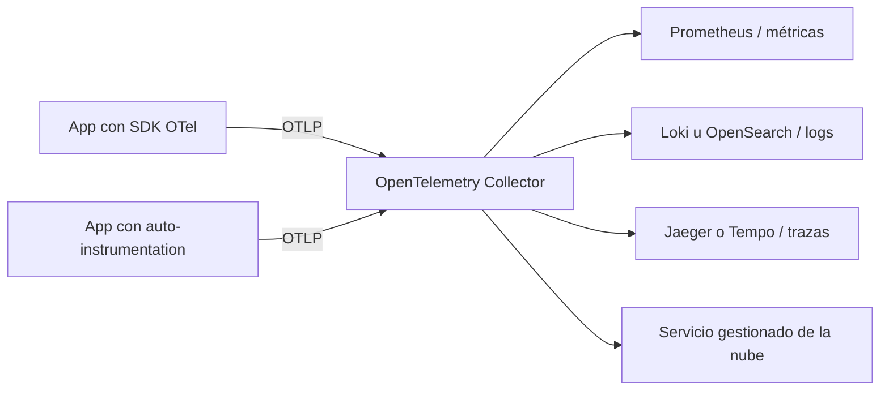

---
tags:
  - observabilidad
  - kubernetes
  - aws
  - azure
  - gcp
---

# Observabilidad: Prometheus, Grafana, OpenTelemetry y SLOs

> Los tres pilares (metrics, logs, traces), las herramientas *open source* más usadas, cómo definir SLI/SLO con *error budget* y cómo escribir alertas que sirvan.

## ¿Qué es?

**Observability** (observabilidad) es la capacidad de entender qué pasa dentro de un sistema a partir de los datos que emite, incluso ante problemas que no habías previsto.

**Monitoring** (monitoreo) responde preguntas que ya conocías: "¿la CPU pasa del 80 %?", "¿el servicio responde?". Funciona para fallos conocidos. En sistemas distribuidos (microservicios, Kubernetes, *serverless*) la mayoría de los problemas son nuevos: "¿por qué el checkout va lento solo para usuarios de un país desde ayer?". Para eso necesitas poder **explorar** los datos y relacionarlos, no solo mirar paneles fijos.

## Los tres pilares

| Pilar | Qué es | Pregunta que responde | Ejemplo |
| --- | --- | --- | --- |
| **Metrics** (métricas) | Valores numéricos agregados en el tiempo | ¿Cuánto? ¿Con qué tendencia? | Peticiones por segundo, latencia p99, % de errores |
| **Logs** (registros) | Eventos individuales con detalle | ¿Qué pasó exactamente? | `ERROR pago rechazado order_id=123` |
| **Traces** (trazas) | El recorrido de una petición por varios servicios | ¿Dónde se fue el tiempo? ¿Qué servicio falló? | Frontend → API → servicio de pagos → base de datos |

El valor está en **correlacionarlos**: una alerta de métrica te lleva a las trazas lentas de ese momento, y de una traza saltas a los logs de esa petición gracias a un `trace_id` común.

!!! tip "Logs estructurados"
    Escribe los logs en **JSON** con campos fijos (`level`, `service`, `trace_id`, `user_id`…) en lugar de texto libre. Así se pueden filtrar y agregar sin expresiones regulares.

## Prometheus

**Prometheus** (proyecto *graduated* de la CNCF) es el estándar *open source* para métricas.

- **Pull model** (modelo de extracción): Prometheus **pide** las métricas cada pocos segundos (*scrape*) a un endpoint HTTP `/metrics` de cada servicio, en lugar de que los servicios las envíen.
- **Exporters** (exportadores): programas que traducen métricas de algo que no habla Prometheus: `node_exporter` (servidores Linux), `blackbox_exporter` (pruebas HTTP/TCP desde fuera), exporters de bases de datos.
- **Service discovery** (descubrimiento de servicios): encuentra solo los objetivos en Kubernetes o en la nube.
- **Time series** (series temporales) identificadas por nombre y **labels** (etiquetas): `http_requests_total{service="api", code="500"}`.
- **Alertmanager**: recibe las alertas de Prometheus, las agrupa, silencia y envía (Slack, PagerDuty, correo).

Ejemplos de **PromQL** (el lenguaje de consulta):

```promql
# Peticiones por segundo de la API en los últimos 5 minutos
sum(rate(http_requests_total{service="api"}[5m]))

# Porcentaje de errores 5xx
sum(rate(http_requests_total{service="api", code=~"5.."}[5m]))
  /
sum(rate(http_requests_total{service="api"}[5m]))

# Latencia p99 a partir de un histograma
histogram_quantile(0.99,
  sum by (le) (rate(http_request_duration_seconds_bucket{service="api"}[5m])))
```

!!! warning "Cuidado con la cardinalidad"
    Cada combinación distinta de labels es una serie nueva. Nunca uses como label valores con muchos posibles valores (`user_id`, `order_id`, URLs completas): la **cardinalidad** se dispara y Prometheus se queda sin memoria. Esos datos van en logs o trazas.

En Kubernetes lo habitual es instalar el chart `kube-prometheus-stack` con Helm, que incluye Prometheus, Alertmanager, Grafana y reglas básicas.

## Grafana

**Grafana** es la herramienta de visualización: paneles (*dashboards*) que consultan muchas fuentes de datos (Prometheus, Loki, Tempo, Elasticsearch/OpenSearch, CloudWatch, Azure Monitor, Cloud Monitoring) en un mismo lugar. También gestiona alertas.

Consejo: un dashboard por servicio con las señales de oro arriba (ver más abajo) y el detalle debajo. Guarda los dashboards como código (JSON en Git o provisionados con Terraform).

## Logs centralizados

En contenedores los logs se escriben a `stdout`/`stderr` y un agente (Fluent Bit, Grafana Alloy, el OpenTelemetry Collector) los recoge y los envía a un backend central.

!!! tip "Aprender a leer logs"
    Formatos, método para encontrar la causa, herramientas de terminal y ejercicios resueltos en [Cómo leer logs](../logging/leer-logs.md).

| | **Loki** (Grafana Labs) | **ELK / OpenSearch** |
| --- | --- | --- |
| Qué indexa | Solo las **labels**; el texto se guarda comprimido | Todo el contenido (**full-text search**, búsqueda de texto completo) |
| Costo de almacenamiento | Bajo | Más alto |
| Búsquedas | Rápidas filtrando por labels, más lentas en texto libre | Muy potentes y flexibles |
| Encaja con | Prometheus y Grafana (mismo modelo de labels, consultas en LogQL) | Análisis de logs complejos, seguridad |

**ELK** son Elasticsearch, Logstash y Kibana; **OpenSearch** es el *fork* *open source* que mantiene la OpenSearch Software Foundation (Linux Foundation).

## Trazas distribuidas con OpenTelemetry

**OpenTelemetry** (OTel, proyecto de la CNCF) es el estándar abierto para **instrumentar** (*instrumentation*, añadir telemetría al código) y enviar trazas, métricas y logs sin atarte a un proveedor.

| Pieza | Qué hace |
| --- | --- |
| **API y SDK** | Librerías por lenguaje para crear *spans* (tramos de una traza) y métricas. Hay **auto-instrumentation** (instrumentación automática) para frameworks comunes |
| **OTLP** (*OpenTelemetry Protocol*) | Protocolo estándar para enviar la telemetría (gRPC en el puerto 4317, HTTP en el 4318) |
| **Collector** | Servicio intermedio que recibe, procesa (filtra, muestrea, añade atributos) y exporta a uno o varios backends |



```yaml title="otel-collector.yaml"
receivers:
  otlp:
    protocols:
      grpc:
        endpoint: 0.0.0.0:4317
      http:
        endpoint: 0.0.0.0:4318

processors:
  batch: {}

exporters:
  otlp/tempo:
    endpoint: tempo:4317
    tls:
      insecure: true   # solo dentro de la red interna de ejemplo

service:
  pipelines:
    traces:
      receivers: [otlp]
      processors: [batch]
      exporters: [otlp/tempo]
```

!!! tip "Instrumenta con OpenTelemetry aunque uses un servicio comercial"
    Si instrumentas con OTel, cambiar de backend (de Jaeger a un servicio gestionado, o entre proveedores) es cambiar la configuración del Collector, no el código.

## SLI, SLO, SLA y error budget

| Término | Qué es | Ejemplo |
| --- | --- | --- |
| **SLI** (*Service Level Indicator*, indicador de nivel de servicio) | Una medida de lo que experimenta el usuario | % de peticiones con respuesta correcta en menos de 300 ms |
| **SLO** (*Service Level Objective*, objetivo de nivel de servicio) | El objetivo interno para ese SLI en una ventana de tiempo | 99,9 % en 30 días |
| **SLA** (*Service Level Agreement*, acuerdo de nivel de servicio) | Compromiso contractual con clientes, con penalizaciones | 99,5 % mensual o devolución de créditos |
| **Error budget** (presupuesto de errores) | Lo que puedes fallar sin incumplir el SLO: `100 % − SLO` | 0,1 % |

El SLO interno debe ser **más estricto** que el SLA, para enterarte antes de incumplir el contrato. Quién acuerda cada número, qué se firma y cómo funcionan los créditos está en [Niveles de servicio](../../negocio/niveles-de-servicio.md#sli-slo-y-sla-quien-los-usa).

**Ejemplo numérico** con un SLO de disponibilidad del **99,9 % en 30 días**:

- Minutos en 30 días: 30 × 24 × 60 = **43 200 min**.
- Error budget: 0,1 % × 43 200 = **43,2 minutos** de indisponibilidad total al mes.
- Si la API recibe 10 millones de peticiones al mes: 0,1 % = **10 000 peticiones fallidas** permitidas.

El error budget de cada SLO (99 %, 99,9 %, 99,99 %…) por año, mes y semana está en [la tabla de los nueves](../../negocio/niveles-de-servicio.md#la-tabla-de-los-nueves). Qué hacer cuando queda o se agota el presupuesto lo decide la [política de error budget](../../devops/operacion/operacion-sre.md#politica-de-error-budget).

## Alertas accionables

Una buena alerta cumple tres condiciones: es **urgente**, es **real** (afecta a usuarios o lo hará pronto) y alguien **puede hacer algo**. Si no, debería ser un ticket o un panel, no un aviso a las 3 de la mañana. Se alerta sobre **síntomas** (el 5 % de los pagos falla) y no sobre causas (CPU al 90 %), y la forma más fiable de hacerlo con un SLO es medir el **burn rate** del error budget.

Severidades, anatomía de una regla, burn rate con varias ventanas, Alertmanager y on-call en [Alertas](../alertas/alertas.md).

## Métodos RED, USE y golden signals

Tres listas para saber qué medir:

| Método | Para qué | Qué mide |
| --- | --- | --- |
| **RED** (Tom Wilkie) | Servicios que atienden peticiones | **Rate** (tasa de peticiones), **Errors** (errores), **Duration** (latencia) |
| **USE** (Brendan Gregg) | Recursos: CPU, memoria, disco, red | **Utilization** (uso), **Saturation** (saturación, trabajo en cola), **Errors** |
| **Four golden signals** (Google SRE) | Cualquier servicio de cara al usuario | **Latency**, **Traffic**, **Errors**, **Saturation** |

RED y golden signals son casi lo mismo visto desde el servicio; USE sirve para diagnosticar la infraestructura que hay debajo.

## Servicios gestionados

Si no quieres operar Prometheus y Grafana tú misma, cada nube los ofrece gestionados, compatibles con PromQL y con los dashboards de Grafana, y los tres reciben OpenTelemetry. La tabla de servicios por proveedor (Prometheus y Grafana gestionados, trazas, OTLP) y las herramientas nativas de cada nube están en [Observabilidad nativa](../nube/observabilidad-nativa.md#vista-rapida).

## Relación con otras secciones

| Enfoque | Qué se mira desde ahí | Nota |
| --- | --- | --- |
| Observabilidad y monitoreo | Qué medir en cada capa, cómo alertar y cómo llegan los logs | [Qué monitorear](que-monitorear.md), [Alertas](../alertas/alertas.md), [Pipeline de logs](../logging/pipeline-de-logs.md) |
| Cloud (el control) | Métricas y logs que ya genera cada servicio de la nube, logs de auditoría | [Observabilidad nativa](../nube/observabilidad-nativa.md) |
| DevOps (la automatización) | Usar SLOs y alertas para operar, gestionar incidentes y medir entregas | [Operación y fiabilidad (SRE)](../../devops/operacion/operacion-sre.md), [Kubernetes](../../devops/contenedores/kubernetes.md), [Cultura DevOps y métricas DORA](../../devops/fundamentos/cultura-metricas-dora.md), [Cómo leer logs](../logging/leer-logs.md), [Troubleshooting](../../devops/operacion/troubleshooting.md) |
| DevSecOps (la verificación) | Monitoreo de seguridad: los mismos logs alimentan el SIEM y la detección de amenazas | [Detección y respuesta](../../devsecops/gobierno-y-respuesta/deteccion-respuesta.md) |
| Negocio TI (el porqué) | Qué se acuerda con clientes (SLA), cuánto cuesta cada nueve y disponibilidad compuesta | [Niveles de servicio](../../negocio/niveles-de-servicio.md) |
| Laboratorios (la práctica) | Practicar esto paso a paso | [Lab 03: Script en Python para analizar logs](../../laboratorios/fundamentos/python-analizar-logs.md), [Lab 11: Observabilidad con Prometheus y Grafana](../../laboratorios/devops/observabilidad-prometheus-grafana.md), [Lab 21: Game day: incidente simulado, troubleshooting y postmortem](../../laboratorios/operacion/game-day-incidente.md) |

## Referencias

- [Prometheus](https://prometheus.io/docs/introduction/overview/)
- [PromQL](https://prometheus.io/docs/prometheus/latest/querying/basics/)
- [Grafana](https://grafana.com/docs/grafana/latest/)
- [Grafana Loki](https://grafana.com/docs/loki/latest/)
- [OpenSearch](https://opensearch.org/docs/latest/)
- [OpenTelemetry (español)](https://opentelemetry.io/es/docs/)
- [Google SRE Book: Service Level Objectives](https://sre.google/sre-book/service-level-objectives/)
- [Google SRE Workbook: Alerting on SLOs](https://sre.google/workbook/alerting-on-slos/)
