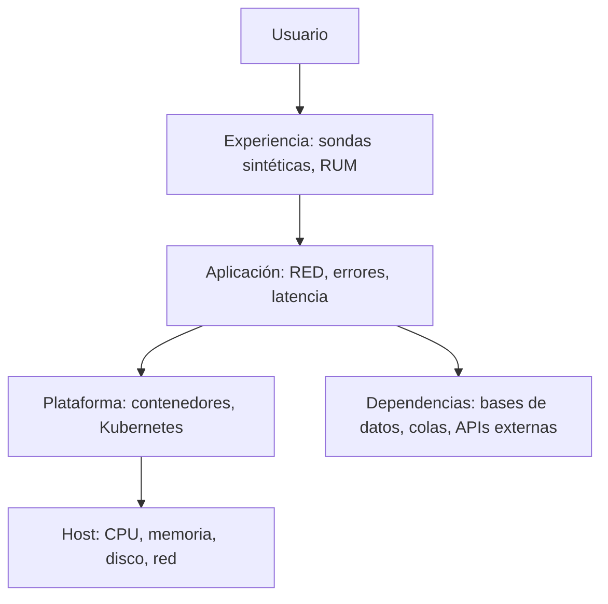

---
tags:
  - monitoreo
  - observabilidad
  - linux
  - kubernetes
---

# Qué monitorear en cada capa

> Una lista por capa (usuario, aplicación, contenedores, Kubernetes, host, bases de datos, colas, red y tareas programadas) con las señales que importan, el exporter que las expone y la consulta o alerta típica; más monitoreo sintético, health checks, dashboards y cómo vigilar el propio sistema de monitoreo.

!!! info "Antes de leer"
    Los tres pilares, PromQL, los métodos RED/USE y los SLO están en [Observabilidad](observabilidad.md). Aquí se aplican capa por capa. Cómo convertir estas señales en avisos está en [Alertas](../alertas/alertas.md).

## Caja negra y caja blanca

| | **Black-box monitoring** (caja negra) | **White-box monitoring** (caja blanca) |
| --- | --- | --- |
| Qué es | Mirar el sistema **desde fuera**, como un usuario | Mirar **por dentro** las métricas que el sistema expone |
| Ejemplos | Una sonda que pide `https://tienda.ejemplo.com/health` cada minuto, una prueba de login | `http_requests_total`, uso de CPU, conexiones a la base de datos |
| Responde | ¿Funciona ahora para el usuario? | ¿Por qué falla? ¿Va a fallar pronto? |
| Para alertar | Síntomas: es la mejor señal de que algo está roto | Causas y tendencias: mejor para diagnosticar y para tickets |

Necesitas las dos: la caja negra detecta lo que el usuario ve (incluido "todo el clúster está caído", donde las métricas internas ni siquiera llegan) y la caja blanca explica la causa.



Empieza por arriba: si la experiencia y la aplicación están bien, lo de abajo solo necesita tickets y dashboards. Si arriba algo falla, baja capa por capa.

## Señales por capa

| Capa | Qué mirar | De dónde sale | Alerta típica |
| --- | --- | --- | --- |
| **Experiencia** | Disponibilidad y latencia vistas desde fuera, certificado TLS, DNS | `blackbox_exporter`, sondas sintéticas de la nube, **RUM** (*Real User Monitoring*, medición en el navegador del usuario) | Sonda fallando desde 2 o más ubicaciones durante 2 min |
| **Aplicación** | **RED**: tasa, errores, duración; *saturation* (hilos, pool de conexiones) | Librería cliente de Prometheus u OpenTelemetry en el código | Burn rate del SLO (ver [Alertas](../alertas/alertas.md#alertas-basadas-en-slo-burn-rate)) |
| **Contenedores** | Reinicios, `OOMKilled`, *CPU throttling*, memoria frente a su límite | **cAdvisor** (integrado en el kubelet) | Más de 3 reinicios en 1 h |
| **Kubernetes** | Pods `Pending` o en `CrashLoopBackOff`, réplicas disponibles frente a deseadas, nodos `NotReady`, PVC llenos | **kube-state-metrics**, eventos del clúster | Deployment con menos réplicas de las deseadas durante 10 min |
| **Host** | **USE**: CPU (incluido `iowait` y `steal`), memoria disponible, disco e inodos, carga, errores de red | `node_exporter` (Linux), `windows_exporter` (Windows), agente de la nube | El disco se llenará en menos de 4 h |
| **Bases de datos** | Conexiones usadas frente al máximo, consultas lentas, *locks*, *replication lag*, espacio | `postgres_exporter`, `mysqld_exporter`, métricas del servicio gestionado | Lag de la réplica > 30 s durante 5 min |
| **Colas y streaming** | Mensajes pendientes, **edad del mensaje más antiguo**, *consumer lag*, mensajes en la *dead-letter queue* | Exporters de RabbitMQ y Kafka, métricas de SQS / Service Bus / Pub/Sub | El mensaje más antiguo tiene más de 5 min |
| **Red** | Latencia, pérdida, errores e interfaces saturadas, conexiones rechazadas | `node_exporter`, SNMP, flow logs, sondas ICMP/TCP | Pérdida > 2 % hacia un sitio |
| **Tareas programadas** | Última ejecución correcta, duración | Métrica propia (`*_last_success_timestamp_seconds`), Pushgateway | No ha terminado bien en 26 h (un job diario) |
| **Dependencias externas** | Errores y latencia al llamar a APIs de terceros | Métricas del cliente HTTP en tu código | Tasa de errores hacia el proveedor de pagos > 5 % |

!!! tip "La edad importa más que la cantidad"
    En colas, "hay 10 000 mensajes" puede ser normal en un pico; "el mensaje más antiguo lleva 20 minutos esperando" siempre significa que alguien no recibe su resultado a tiempo. Alerta sobre la edad o el lag, no sobre el tamaño.

## Consultas PromQL por capa

```promql
# Host: uso de CPU por instancia (0 a 1)
1 - avg by (instance) (rate(node_cpu_seconds_total{mode="idle"}[5m]))

# Host: memoria disponible por debajo del 10 %
node_memory_MemAvailable_bytes / node_memory_MemTotal_bytes < 0.10

# Host: el disco se llenará en menos de 4 horas, según la tendencia de las últimas 6
predict_linear(node_filesystem_avail_bytes{fstype!~"tmpfs|overlay"}[6h], 4 * 3600) < 0

# Contenedores: reinicios en la última hora
increase(kube_pod_container_status_restarts_total[1h]) > 3

# Kubernetes: deployments con menos réplicas disponibles de las deseadas
kube_deployment_status_replicas_available < kube_deployment_spec_replicas

# Experiencia: el certificado TLS caduca en menos de 14 días
probe_ssl_earliest_cert_expiry - time() < 14 * 86400

# Tareas programadas: el backup diario no termina bien desde hace más de 26 h
time() - backup_last_success_timestamp_seconds > 26 * 3600
```

!!! warning "Memoria libre no es memoria disponible"
    En Linux la memoria "libre" (`MemFree`) siempre parece baja porque el kernel usa la sobrante como caché. La que importa es `MemAvailable`; lo mismo que muestra la columna `available` de `free -h` (ver [Procesos y rendimiento en Linux](../../servidores/linux/linux-procesos-rendimiento.md)).

`predict_linear` evita la alerta clásica "disco al 85 %", que salta en un disco de 2 TB que tardará meses en llenarse y no salta en uno pequeño que se llena en minutos. Combínala con un umbral absoluto (por ejemplo, menos del 5 % libre) para cubrir los dos casos.

## Monitoreo sintético

El **synthetic monitoring** (monitoreo sintético) ejecuta peticiones programadas que imitan a un usuario: desde un simple `GET /health` hasta un recorrido completo con navegador (entrar, buscar, pagar). Detecta caídas aunque no haya tráfico real (de madrugada, en un servicio nuevo) y mide desde varias regiones.

| | Herramienta |
| --- | --- |
| *Open source* | `blackbox_exporter` de Prometheus (HTTP, TCP, ICMP, DNS, gRPC) |
| AWS | **CloudWatch Synthetics** (*canaries*) |
| Azure | **Application Insights availability tests** |
| Google Cloud | **Uptime checks** de Cloud Monitoring |

Con `blackbox_exporter`, Prometheus no consulta al servicio sino al exporter, pasándole el objetivo como parámetro:

```yaml title="blackbox.yml"
modules:
  http_2xx:
    prober: http
    timeout: 5s
    http:
      preferred_ip_protocol: ip4
      fail_if_not_ssl: true
```

```yaml title="prometheus.yml (fragmento)"
scrape_configs:
  - job_name: blackbox-http
    metrics_path: /probe
    params:
      module: [http_2xx]
    static_configs:
      - targets:
          - https://tienda.ejemplo.com/health
          - https://api.ejemplo.com/health
    relabel_configs:
      # La URL a probar se pasa como ?target=...
      - source_labels: [__address__]
        target_label: __param_target
      # En las métricas, instance es la URL y no el exporter
      - source_labels: [__param_target]
        target_label: instance
      # Prometheus en realidad llama al blackbox_exporter
      - target_label: __address__
        replacement: blackbox-exporter:9115
```

Las métricas clave son `probe_success` (1 o 0), `probe_duration_seconds` y `probe_ssl_earliest_cert_expiry`.

!!! tip "Prueba desde fuera de tu propia red"
    Una sonda que corre en el mismo clúster que el servicio no ve los fallos de DNS, del load balancer o del CDN. Al menos una sonda debe ejecutarse desde fuera (otra región u otro proveedor).

## Health checks

Un **health check** (comprobación de salud) es un endpoint que el balanceador, el orquestador o una sonda consultan para decidir si una instancia recibe tráfico.

| Tipo | Qué comprueba | Quién lo usa | Si falla |
| --- | --- | --- | --- |
| **Liveness** (¿está vivo?) | Que el proceso responde; nada externo | Kubernetes `livenessProbe` | Se reinicia el contenedor |
| **Readiness** (¿está listo?) | Que puede atender: arrancó, tiene conexión a sus dependencias críticas | Kubernetes `readinessProbe`, target groups del load balancer | Se saca del balanceo, sin reiniciar |
| **Startup** | Que terminó de arrancar | Kubernetes `startupProbe` | Retrasa las otras dos sondas |

!!! warning "No metas dependencias en el liveness"
    Si el liveness falla cuando la base de datos va lenta, Kubernetes reinicia **todas** las réplicas a la vez y convierte una degradación en una caída total. El liveness solo comprueba el propio proceso; las dependencias van en el readiness.

La configuración de las sondas en Kubernetes está en [Kubernetes](../../devops/contenedores/kubernetes.md) y la de los load balancers en [Balanceo y alta disponibilidad](../../networking/avanzado/balanceo-alta-disponibilidad.md).

## Dashboards que se usan

Un dashboard sirve para responder rápido "¿está bien?" y, si no, "¿dónde?". Estructura que funciona:

1. **Arriba**: las señales de oro del servicio (tráfico, errores, latencia p50/p95/p99, saturación) y el estado del SLO con su error budget restante.
2. **En medio**: las dependencias (base de datos, colas, APIs externas) con las mismas señales.
3. **Abajo**: la infraestructura con USE (CPU, memoria, disco, red por instancia o pod).
4. **Anotaciones** con los despliegues: la mitad de los incidentes empiezan justo después de uno.

Buenas prácticas:

- **Uno por servicio**, con variables (entorno, región) en lugar de copiar paneles.
- **Percentiles, no promedios**: el promedio esconde al 1 % de usuarios que espera 10 segundos.
- **Mismas unidades y escalas** en paneles que se comparan.
- **Dashboards como código**: JSON en Git o provisionados (Grafana con archivos o Terraform), como en el [Lab 11 (parte 2)](../../laboratorios/devops/observabilidad-logs-grafana.md).
- Si nadie ha abierto un dashboard en meses, bórralo.

## Monitorear el monitoreo

Si Prometheus o Alertmanager se caen, no llegan alertas y el silencio parece buena noticia. Protégete con:

- **Dead man's switch** (interruptor de hombre muerto): una alerta que **siempre** está activa (en `kube-prometheus-stack` se llama `Watchdog`, con `expr: vector(1)`) y se envía a un servicio externo. Si ese servicio deja de recibirla, te avisa él.
- **`up == 0`**: alerta cuando Prometheus no puede leer un objetivo.
- **Errores de envío**: `alertmanager_notifications_failed_total` y `prometheus_notifications_dropped_total` deben estar en 0.
- **Meta-monitoring**: un segundo Prometheus (o el servicio gestionado de la nube) que vigila al principal.

```yaml title="watchdog.yml"
groups:
  - name: meta
    rules:
      - alert: Watchdog
        expr: vector(1)
        labels:
          severity: none
        annotations:
          summary: "Alerta siempre activa: si deja de llegar, el pipeline de alertas está roto"
```

## Errores comunes

| Error | Consecuencia | Mejor |
| --- | --- | --- |
| Monitorear solo la infraestructura | CPU y memoria normales mientras los usuarios ven errores | Empezar por la experiencia y la aplicación |
| Umbrales fijos copiados de internet ("CPU > 80 %") | Alertas que no indican ningún problema real | Umbrales basados en el impacto o en el SLO |
| Solo sondas internas | No se ven fallos de DNS, CDN o load balancer | Al menos una sonda externa |
| Liveness que consulta la base de datos | Reinicios en cadena ante una dependencia lenta | Dependencias solo en el readiness |
| Labels con `user_id` o URLs completas | Cardinalidad disparada y Prometheus sin memoria | Esos datos en logs o trazas |
| Jobs programados sin métrica de éxito | Un backup que lleva semanas fallando en silencio | Métrica de última ejecución correcta y alerta |
| Nadie vigila al monitoreo | Silencio confundido con estabilidad | Dead man's switch |

## Relación con otras secciones

| Enfoque | Qué se mira desde ahí | Nota |
| --- | --- | --- |
| Observabilidad y monitoreo | Fundamentos, alertas y logs de estas mismas señales | [Observabilidad](observabilidad.md), [Alertas](../alertas/alertas.md), [Pipeline de logs](../logging/pipeline-de-logs.md) |
| Cloud (el control) | Métricas que ya publica cada servicio de la nube y sus agentes | [Observabilidad nativa](../nube/observabilidad-nativa.md) |
| DevOps (la automatización) | Sondas y métricas de contenedores y clústeres; diagnóstico por capa | [Kubernetes](../../devops/contenedores/kubernetes.md), [Troubleshooting](../../devops/operacion/troubleshooting.md) |
| Servidores (la base de sistemas) | De dónde salen las métricas del host y cómo interpretarlas | [Procesos y rendimiento en Linux](../../servidores/linux/linux-procesos-rendimiento.md), [Almacenamiento en Linux](../../servidores/linux/linux-almacenamiento.md) |
| Networking (la base) | Latencia, pérdida y health checks de balanceadores | [Balanceo y alta disponibilidad](../../networking/avanzado/balanceo-alta-disponibilidad.md), [Troubleshooting de red](../../networking/avanzado/troubleshooting-red.md) |
| Laboratorios (la práctica) | `node_exporter`, métricas de una app y dashboards | [Lab 11 (parte 1)](../../laboratorios/devops/observabilidad-prometheus-grafana.md), [Lab 11 (parte 2)](../../laboratorios/devops/observabilidad-logs-grafana.md) |

## Referencias

- [Google SRE Book: Monitoring Distributed Systems](https://sre.google/sre-book/monitoring-distributed-systems/)
- [Prometheus: node_exporter](https://github.com/prometheus/node_exporter)
- [Prometheus: blackbox_exporter](https://github.com/prometheus/blackbox_exporter)
- [kube-state-metrics](https://github.com/kubernetes/kube-state-metrics)
- [Kubernetes: liveness, readiness y startup probes](https://kubernetes.io/docs/tasks/configure-pod-container/configure-liveness-readiness-startup-probes/)
- [Brendan Gregg: The USE Method](https://www.brendangregg.com/usemethod.html)
- [CloudWatch Synthetics](https://docs.aws.amazon.com/AmazonCloudWatch/latest/monitoring/CloudWatch_Synthetics_Canaries.html)
- [Application Insights: availability tests](https://learn.microsoft.com/es-es/azure/azure-monitor/app/availability)
- [Cloud Monitoring: uptime checks](https://cloud.google.com/monitoring/uptime-checks)
