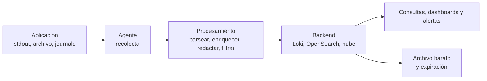

---
tags:
  - monitoreo
  - logs
  - observabilidad
  - kubernetes
---

# Pipeline de logs: recolección, procesamiento y retención

> Cómo llegan los logs desde la aplicación hasta donde se consultan: dónde escribe cada sistema, qué niveles usar en cada entorno, qué agente elegir (Fluent Bit, Vector, Grafana Alloy, OpenTelemetry Collector), cómo parsear, enriquecer y quitar datos sensibles, consultas en Loki con LogQL, métricas y alertas a partir de logs, y cuánto tiempo guardar cada cosa.

!!! info "Antes de leer"
    Leer e interpretar un log está en [Cómo leer logs](leer-logs.md) y los formatos (syslog, journald, NGINX, JSON, Kubernetes, CloudTrail) en [Formatos de logs](../../recursos/formatos-de-logs.md). Esta nota trata del camino que recorren.

## El recorrido de un log



Cada paso puede fallar o encarecer el sistema: un agente que no lee las líneas multilínea, un filtro que deja pasar tokens, un backend sin retención. Por eso conviene diseñarlo y no solo "mandar todo".

## Dónde escribe cada sistema

| Origen | Dónde quedan los logs | Cómo se recogen |
| --- | --- | --- |
| Contenedores (Docker, Kubernetes) | `stdout`/`stderr`; el runtime los guarda en `/var/log/containers/*.log` del nodo | Agente como **DaemonSet** (uno por nodo) que lee esos archivos |
| Servicios de Linux con systemd | **journald** (`journalctl -u servicio`) | Agente con entrada de journald, o reenvío a rsyslog |
| Aplicaciones clásicas | Archivos en `/var/log/<app>/` con **logrotate** | Agente que hace *tail* de los archivos |
| Windows | **Event Log** (Application, System, Security) | Agente con entrada de Event Log (Fluent Bit, Alloy, Azure Monitor Agent) |
| Equipos de red | **syslog** por UDP/TCP 514 (o TLS 6514) | rsyslog, syslog-ng o un agente escuchando syslog |
| Servicios gestionados de la nube | El servicio de logs del proveedor | Ya están ahí; se exportan con *subscriptions*, *diagnostic settings* o *sinks* |

!!! tip "En contenedores, siempre a stdout"
    Una aplicación en contenedor no debe escribir archivos de log propios: escribe a `stdout` y deja que la plataforma los recoja. Es uno de los factores de [The Twelve-Factor App](../../cloud/arquitectura/arquitectura-cloud.md).

## Niveles por entorno

| Nivel | Cuándo usarlo | Desarrollo | Producción |
| --- | --- | --- | --- |
| `DEBUG` | Detalle para depurar | Sí | Solo temporal, en un servicio y con fecha de fin |
| `INFO` | Eventos normales relevantes: arranque, petición atendida, job terminado | Sí | Sí (con muestreo si el volumen es enorme) |
| `WARN` | Algo raro que se recuperó solo: reintento, valor por defecto | Sí | Sí |
| `ERROR` | Algo falló y afectó a una operación | Sí | Sí |
| `FATAL` / `CRITICAL` | El proceso no puede seguir | Sí | Sí |

El nivel se cambia por configuración (variable de entorno `LOG_LEVEL`), nunca recompilando. Cómo usar los niveles al escribir logs está en [Cómo leer logs](leer-logs.md#escribir-logs-que-se-puedan-leer).

## Logs estructurados

Un log estructurado es un objeto JSON por línea con campos fijos. Ejemplo con nombres de campo alineados con las convenciones de OpenTelemetry:

```json
{"timestamp":"2026-10-30T18:04:11.532Z","level":"ERROR","service.name":"pagos","deployment.environment":"prod","trace_id":"4bf92f3577b34da6a3ce929d0e0e4736","request_id":"req-7f3a","msg":"pago rechazado por el proveedor","provider":"psp-1","duration_ms":5012,"http.status_code":502}
```

| Campo | Por qué |
| --- | --- |
| `timestamp` en UTC con milisegundos | Ordenar y comparar entre servicios |
| `level` | Filtrar y contar errores |
| `service.name`, `deployment.environment` | Saber de dónde viene sin depender del nombre del host |
| `trace_id`, `request_id` | Saltar de la línea a la traza y seguir una petición por varios servicios |
| `msg` corto y estable | Agrupar ("pago rechazado…") sin que cada línea sea distinta |
| Contexto en campos aparte | `duration_ms`, `order_id`: filtrar sin expresiones regulares |

Elige un esquema y úsalo en todos los servicios: las **OpenTelemetry semantic conventions** o el **Elastic Common Schema** (ECS). Lo importante es que el mismo dato se llame igual en todas partes.

## Agentes de recolección

| Agente | Qué es | Encaja con |
| --- | --- | --- |
| **Fluent Bit** (CNCF) | Agente ligero en C, muy usado como DaemonSet en Kubernetes | Casi cualquier backend; es el que recomienda AWS para EKS y ECS y el que traen muchos charts |
| **Fluentd** (CNCF) | Agregador en Ruby con muchísimos plugins | Como capa central de procesamiento detrás de Fluent Bit |
| **Vector** (Datadog, *open source*) | Agente y agregador en Rust con lenguaje propio de transformación (VRL) | Pipelines con mucha transformación |
| **Grafana Alloy** | Distribución de Grafana del OpenTelemetry Collector; reemplaza a **Promtail**, que ya no se mantiene | Loki, Prometheus/Mimir y Tempo |
| **OpenTelemetry Collector** | Recibe logs, métricas y trazas con OTLP; lee archivos con el *filelog receiver* | Un único agente para las tres señales, sin atarse a un backend |
| **rsyslog**, **syslog-ng** | Demonios syslog clásicos de Linux | Servidores y equipos de red |
| Agentes de la nube | CloudWatch agent, Azure Monitor Agent, Ops Agent | El servicio de logs de su proveedor (ver [Observabilidad nativa](../nube/observabilidad-nativa.md#vista-rapida)) |

Ejemplo de Fluent Bit como DaemonSet en Kubernetes enviando a Loki, en el formato de configuración YAML:

```yaml title="fluent-bit.yaml"
service:
  flush: 5
  log_level: info

pipeline:
  inputs:
    - name: tail
      path: /var/log/containers/*.log
      multiline.parser: docker, cri   # une las líneas partidas por el runtime
      tag: kube.*
      mem_buf_limit: 50MB

  filters:
    # Añade namespace, pod, contenedor y labels del pod
    - name: kubernetes
      match: kube.*
      merge_log: on                   # si la línea es JSON, sube sus campos
    # Descarta el ruido de los health checks
    - name: grep
      match: kube.*
      exclude: log /healthz

  outputs:
    - name: loki
      match: kube.*
      host: loki.monitoreo.svc
      port: 3100
      labels: job=fluent-bit, $kubernetes['namespace_name'], $kubernetes['container_name']
```

El [Lab 11 (parte 2)](../../laboratorios/devops/observabilidad-logs-grafana.md) hace lo mismo con Grafana Alloy en Docker Compose.

## Procesar en el camino

| Paso | Qué hace | Ejemplo |
| --- | --- | --- |
| **Parsear** | Convertir texto en campos | Separar IP, método, ruta y código de un access log de NGINX |
| **Multilínea** | Unir un stack trace en un solo evento | Una excepción de Java de 40 líneas = 1 log, no 40 |
| **Enriquecer** | Añadir contexto que la aplicación no conoce | Namespace, pod, nodo, región, versión desplegada |
| **Redactar** | Quitar datos sensibles antes de que salgan del nodo | Tokens, cabeceras `Authorization`, correos, tarjetas |
| **Filtrar** | No enviar lo que no se va a mirar | Health checks, `DEBUG` en producción |
| **Muestrear** | Guardar una fracción de lo repetitivo | 10 % de los `INFO` de peticiones correctas, 100 % de los errores |

Redactar en el agente es la última barrera, no la primera: lo correcto es que la aplicación no registre secretos. Ejemplo con el OpenTelemetry Collector, que reemplaza correos en el cuerpo del log:

```yaml title="otel-collector.yaml (fragmento)"
processors:
  transform/pii:
    log_statements:
      - context: log
        statements:
          - replace_pattern(body, "[A-Za-z0-9._%+-]+@[A-Za-z0-9.-]+\\.[A-Za-z]{2,}", "***@***")
```

!!! warning "Un secreto en un log ya está filtrado"
    Los logs se copian a varios sistemas, se exportan y los lee mucha gente. Si un token aparece en un log, **rótalo**: borrar la línea no basta (ver [Secretos e identidades](../../devsecops/identidades-y-pipeline/secretos-identidades.md)).

## Loki y LogQL

**Loki** solo indexa los **labels** (como Prometheus) y guarda el texto comprimido; es barato, pero las consultas deben empezar acotando por labels. La comparación con ELK/OpenSearch está en [Observabilidad](../fundamentos/observabilidad.md#logs-centralizados).

```logql
# Líneas con "ERROR" de la API en el namespace tienda
{namespace="tienda", container="api"} |= "ERROR"

# Logs JSON: parsear y filtrar por campo
{container="pagos"} | json | level="ERROR" and duration_ms > 3000

# Mostrar solo el mensaje
{container="pagos"} | json | level="ERROR" | line_format "{{.request_id}} {{.msg}}"

# Seguir una petición en todos los servicios
{namespace="tienda"} |= "req-7f3a"

# Access log de NGINX sin JSON: extraer campos con pattern
{container="nginx"} | pattern `<ip> - - [<_>] "<method> <path> <_>" <status> <_>` | status >= 500
```

!!! warning "Labels pocos y estables"
    Igual que en Prometheus, cada combinación de labels crea un *stream* nuevo. Labels como `namespace`, `container`, `env` están bien; `request_id`, `user_id` o la IP del cliente van **dentro** de la línea, no como label.

## Métricas y alertas a partir de logs

A veces la única señal está en los logs (una aplicación que no expone métricas, un equipo de red). Se puede contar sobre ellos:

```logql
# Errores por segundo de cada contenedor
sum by (container) (rate({namespace="tienda"} | json | level="ERROR" [5m]))

# Respuestas 5xx de NGINX por minuto
sum(count_over_time({container="nginx"} | pattern `<_> - - [<_>] "<_>" <status> <_>` | status >= 500 [1m]))
```

El **ruler** de Loki evalúa estas consultas como reglas de alerta y las envía a Alertmanager, con el mismo formato que las de Prometheus (ver [Alertas](../alertas/alertas.md)). En la nube: *metric filters* de CloudWatch Logs, *log search alerts* de Azure Monitor y *log-based metrics* de Cloud Logging.

!!! tip "Si consultas lo mismo cada minuto, conviértelo en métrica"
    Contar sobre logs es caro y lento comparado con una métrica. Úsalo para empezar o para casos puntuales; si una alerta depende de ello a largo plazo, instrumenta la aplicación con un contador.

## Retención

| Tipo de log | Retención orientativa | Dónde |
| --- | --- | --- |
| Aplicación (`INFO`, `ERROR`) | 7 a 30 días consultables | Backend caliente (Loki, OpenSearch, servicio de la nube) |
| Access logs y flow logs | 30 a 90 días | Caliente unos días; después almacenamiento de objetos |
| Auditoría y seguridad (CloudTrail, Activity Log, Audit Logs, logs de autenticación) | 1 año o lo que exija la normativa | Cuenta central de logs, almacenamiento inmutable |
| `DEBUG` temporal | Horas o días | Nunca más que el diagnóstico |

La retención la marca primero el **cumplimiento** (ver [Cumplimiento](../../devsecops/gobierno-y-respuesta/cumplimiento.md)) y después el costo. Lo que cuesta cada proveedor y cómo abaratarlo está en [Observabilidad nativa](../nube/observabilidad-nativa.md#retencion-y-costos-de-logs); la integridad y la cuenta central de logs de seguridad, en [Seguridad de logging y detección](../../cloud/seguridad/seguridad-logging-deteccion.md#integridad-y-retencion).

## Errores comunes

| Error | Consecuencia | Mejor |
| --- | --- | --- |
| Texto libre distinto en cada servicio | Cada consulta necesita una regex nueva | JSON con un esquema común |
| Logs sin `trace_id` ni `request_id` | Imposible seguir una petición entre servicios | Propagar un identificador de correlación |
| Stack traces partidos en líneas | Cada línea parece un error distinto | Parser multilínea en el agente |
| `DEBUG` olvidado en producción | Factura de logs disparada | Nivel por variable de entorno y alerta de volumen |
| Labels de alta cardinalidad en Loki | Loki lento y caro | Pocos labels; el detalle dentro de la línea |
| Secretos o datos personales en los logs | Filtración y problemas de cumplimiento | No registrarlos; redactar en el agente como respaldo |
| Sin retención definida | Logs eternos (y pagados) | Retención por tipo, en IaC |
| Agente sin límites de memoria | El agente tumba el nodo en un pico | `mem_buf_limit` o equivalente, y *requests/limits* en Kubernetes |

## Relación con otras secciones

| Enfoque | Qué se mira desde ahí | Nota |
| --- | --- | --- |
| Observabilidad y monitoreo | Leer los logs, los tres pilares y alertas | [Cómo leer logs](leer-logs.md), [Observabilidad](../fundamentos/observabilidad.md), [Alertas](../alertas/alertas.md) |
| Recursos | Formatos de cada tipo de log | [Formatos de logs](../../recursos/formatos-de-logs.md) |
| Cloud (el control) | Servicios de logs de cada nube, costos y logs de auditoría | [Observabilidad nativa](../nube/observabilidad-nativa.md), [Seguridad de logging y detección](../../cloud/seguridad/seguridad-logging-deteccion.md) |
| DevSecOps (la verificación) | Los logs como fuente del SIEM; secretos fuera de los logs | [Detección y respuesta](../../devsecops/gobierno-y-respuesta/deteccion-respuesta.md), [Secretos e identidades](../../devsecops/identidades-y-pipeline/secretos-identidades.md) |
| Servidores (la base de sistemas) | journald y Event Log en el propio servidor | [Fundamentos de Linux Server](../../servidores/linux/linux-fundamentos-servidor.md), [Administración con PowerShell](../../servidores/windows/windows-powershell-administracion.md) |
| Python (la herramienta) | Escribir logs con `logging` | [Scripts de línea de comandos](../../python/scripting/scripts-cli.md#logging-en-vez-de-print) |
| Laboratorios (la práctica) | Loki, Alloy y LogQL en local | [Lab 11 (parte 2)](../../laboratorios/devops/observabilidad-logs-grafana.md), [Lab 03: Script en Python para analizar logs](../../laboratorios/fundamentos/python-analizar-logs.md) |

## Referencias

- [Fluent Bit](https://docs.fluentbit.io/manual)
- [Fluent Bit: Kubernetes filter](https://docs.fluentbit.io/manual/pipeline/filters/kubernetes)
- [Fluent Bit: Loki output](https://docs.fluentbit.io/manual/pipeline/outputs/loki)
- [Vector](https://vector.dev/docs/)
- [Grafana Alloy](https://grafana.com/docs/alloy/latest/)
- [OpenTelemetry: logs](https://opentelemetry.io/docs/concepts/signals/logs/)
- [OpenTelemetry semantic conventions](https://opentelemetry.io/docs/specs/semconv/)
- [OpenTelemetry Collector: transform processor](https://github.com/open-telemetry/opentelemetry-collector-contrib/tree/main/processor/transformprocessor)
- [Grafana Loki: LogQL](https://grafana.com/docs/loki/latest/query/)
- [Grafana Loki: alerting and recording rules](https://grafana.com/docs/loki/latest/alert/)
- [OWASP Logging Cheat Sheet](https://cheatsheetseries.owasp.org/cheatsheets/Logging_Cheat_Sheet.html)
