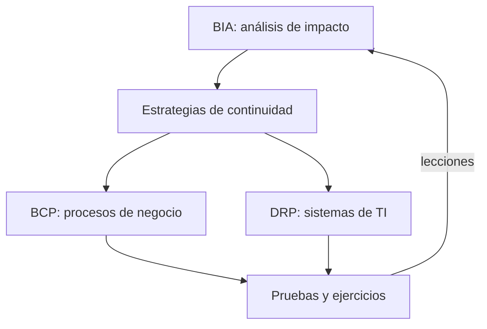
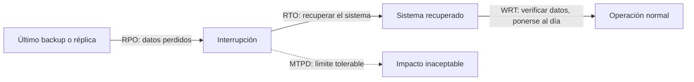

---
tags:
  - negocio
  - continuidad
  - resiliencia
  - riesgo
---

# Continuidad de negocio

> Qué son el BCP, el BIA y el DRP, cómo se relacionan RTO, RPO y MTPD, cómo clasificar los sistemas por criticidad en tiers, cómo se prueba un plan de continuidad y cómo se conecta con la resiliencia en la nube.

## ¿Qué es?

La **business continuity** (continuidad de negocio) es la capacidad de una organización de **seguir entregando sus productos o servicios** a un nivel aceptable durante una interrupción grave: la caída de una región cloud, un ransomware, un incendio, la quiebra de un proveedor, una pandemia.

Es más amplia que la tecnología: incluye personas, oficinas, proveedores, comunicación y procesos manuales alternativos. TI es una parte (muy importante) de ese plan. La norma internacional de referencia es **ISO 22301** (sistemas de gestión de la continuidad del negocio).

## BCP, DRP y planes relacionados

| Plan | Pregunta que responde | Alcance | Ejemplo |
| --- | --- | --- | --- |
| **BCP** (*Business Continuity Plan*, plan de continuidad de negocio) | ¿Cómo sigue funcionando el negocio durante la interrupción? | Toda la organización | Atender pedidos por teléfono y anotarlos a mano si cae el sistema de ventas |
| **DRP** (*Disaster Recovery Plan*, plan de recuperación ante desastres) | ¿Cómo recuperamos los sistemas de TI? | Tecnología | Restaurar la base de datos en otra región y cambiar el DNS |
| **Incident response plan** (plan de respuesta a incidentes) | ¿Qué hacemos en las primeras horas de un incidente? | Operación y seguridad | Playbook de ransomware ([Detección y respuesta](../devsecops/gobierno-y-respuesta/deteccion-respuesta.md)) |
| **Crisis management plan** (plan de gestión de crisis) | ¿Quién decide y cómo se comunica? | Dirección, comunicación, legal | Comité de crisis, mensajes a clientes y prensa |

El DRP es una **parte** del BCP: recuperar los sistemas no sirve si nadie sabe cómo operar mientras tanto.

## BIA: análisis de impacto en el negocio

El **BIA** (*Business Impact Analysis*, análisis de impacto en el negocio) es el punto de partida. Responde: **¿qué pasa si este proceso se detiene, y a partir de cuándo es inaceptable?**

Pasos:

1. **Identificar los procesos de negocio** (cobrar, despachar, atender clientes, pagar nóminas) y sus responsables.
2. **Mapear dependencias**: sistemas, datos, personas, proveedores, ubicaciones. Un proceso "simple" suele depender de una docena de sistemas.
3. **Estimar el impacto en el tiempo**: financiero, legal y regulatorio, reputacional, operativo, a 1 hora, 4 horas, 1 día, 1 semana.
4. **Fijar los objetivos**: MTPD, RTO y RPO de cada proceso, y de ahí los de cada sistema.
5. **Validarlo con dirección**: los números son una decisión de negocio, no técnica.

| Proceso | Impacto a 4 h | Impacto a 24 h | MTPD | RTO | RPO |
| --- | --- | --- | --- | --- | --- |
| Cobro online | Ventas perdidas, clientes molestos | Pérdida grave, prensa | 8 h | 1 h | 5 min |
| Despacho de pedidos | Retrasos recuperables | Incumplimiento con transportistas | 48 h | 8 h | 1 h |
| Reportes internos | Ninguno relevante | Molestia | 1 semana | 72 h | 24 h |

## RTO, RPO y MTPD

- **RTO** (*Recovery Time Objective*, objetivo de tiempo de recuperación): tiempo máximo para **recuperar** el sistema o proceso. "Debemos volver a estar en línea en menos de 1 hora".
- **RPO** (*Recovery Point Objective*, objetivo de punto de recuperación): cantidad máxima de **datos** que se pueden perder, medida en tiempo. "Podemos perder como máximo los últimos 15 minutos de datos".
- **MTPD** (*Maximum Tolerable Period of Disruption*, periodo máximo tolerable de interrupción), también llamado **MTD** (*Maximum Tolerable Downtime*): tiempo a partir del cual el impacto ya es **inaceptable** para la organización (pérdidas que no se recuperan, sanciones, clientes que se van para siempre).

La relación clave: **RTO < MTPD**. Después de recuperar el sistema queda trabajo (verificar datos, reprocesar lo pendiente, avisar a clientes), que en algunos marcos se llama **WRT** (*Work Recovery Time*). Por eso: `RTO + WRT ≤ MTPD`.

ISO 22301 usa también el **MBCO** (*Minimum Business Continuity Objective*, objetivo mínimo de continuidad): el nivel mínimo de servicio aceptable durante la interrupción (por ejemplo, "procesar al menos el 50 % de los pedidos").

!!! note "RTO y RPO no son lo mismo que el SLA"
    El SLA mide la disponibilidad en el día a día (caídas cortas y frecuentes). RTO y RPO se aplican a **desastres**: eventos raros y graves. Un sistema puede tener un SLA de 99,9 % y un RTO de 4 horas a la vez. Ver [Niveles de servicio](niveles-de-servicio.md).

## Clasificación de sistemas por criticidad (tiers)

No todos los sistemas merecen la misma inversión. Lo habitual es definir **tiers** (niveles) con objetivos estándar, y asignar cada sistema a uno según el BIA. Los nombres y valores cambian en cada organización; un ejemplo:

| Tier | Descripción | RTO | RPO | Estrategia típica en la nube |
| --- | --- | --- | --- | --- |
| **Tier 0** – misión crítica | Sin él no hay negocio (pagos, núcleo bancario) | Minutos | Casi cero | Multi-región activo/activo o warm standby |
| **Tier 1** – crítico | Impacto grave en horas | < 4 h | < 15 min | Warm standby o pilot light |
| **Tier 2** – importante | Impacto relevante en un día | < 24 h | < 4 h | Pilot light o backup & restore con IaC |
| **Tier 3** – no crítico | Se puede esperar días | Días | 24 h | Backup & restore |

Las estrategias (backup & restore, pilot light, warm standby, active/active) se explican en [Resiliencia](../cloud/operacion-y-gobierno/resiliencia.md#estrategias-de-disaster-recovery).

!!! warning "El tier de un sistema es el de su dependencia más crítica"
    Si el sistema de pagos (Tier 0) depende del servicio de identidad, ese servicio también es Tier 0, aunque nadie lo haya pensado así. Revisa las dependencias del BIA, incluidas las externas (proveedor de pagos, DNS, proveedor de identidad).

## Pruebas de continuidad

Un plan que no se prueba falla cuando más se necesita: contactos desactualizados, backups que no restauran, pasos que dependen de una persona que ya no está.

| Tipo de prueba | Qué se hace | Esfuerzo y riesgo |
| --- | --- | --- |
| **Checklist review** (revisión documental) | Revisar que el plan está completo y actualizado | Muy bajo |
| **Tabletop exercise** (ejercicio de mesa) | El equipo recorre un escenario en una sala, paso a paso, sin tocar sistemas | Bajo |
| **Simulation** (simulacro) | Se simula el escenario con más realismo (por ejemplo, restaurar en un entorno aislado) | Medio |
| **Parallel test** (prueba en paralelo) | Se levanta el entorno de recuperación mientras producción sigue funcionando | Medio-alto |
| **Full interruption test** (prueba de interrupción completa) | Se hace failover real de producción al sitio de recuperación | Alto; solo con mucha madurez |

En la nube, los **game days** y el **chaos engineering** son la versión técnica y frecuente de estas pruebas (ver [Resiliencia](../cloud/operacion-y-gobierno/resiliencia.md#probar-el-dr-game-days-y-chaos-engineering) y [Prácticas para aprender de incidentes](../devops/operacion/practicas-aprendizaje.md#chaos-engineering)).

Después de cada prueba:

- Mide el **RTO y RPO reales** y compáralos con los objetivos.
- Registra lo que falló como acciones con responsable y fecha.
- Actualiza el plan.

!!! tip "Frecuencia"
    Como referencia, muchas organizaciones revisan el plan y hacen un ejercicio de mesa al menos una vez al año, y prueban la restauración de backups de los sistemas críticos con más frecuencia. Si un regulador o un cliente fija otra frecuencia, manda esa.

## Continuidad y resiliencia en la nube

La nube facilita la continuidad (regiones, zonas, servicios de backup y de DR), pero **no la garantiza**:

- Según el [Shared Responsibility Model](../cloud/fundamentos/responsabilidad-compartida.md), la disponibilidad de **tu** aplicación y la protección de **tus** datos son tu responsabilidad.
- Una región o un servicio del proveedor puede fallar; tu BCP tiene que contemplarlo si tu MTPD es corto.
- La **cuenta** también es un punto único de fallo: credenciales comprometidas o una cuenta suspendida. Guarda backups en otra cuenta, con permisos separados e inmutables.
- **Infrastructure as Code** es lo que hace realista un RTO corto: recrear el entorno en otra región es aplicar el mismo código ([Infrastructure as Code](../devops/iac/infraestructura-como-codigo.md)).
- Incluye en el BIA a los **proveedores SaaS** críticos (identidad, pagos, comunicación) y revisa sus SLAs y planes de continuidad ([Gobierno y riesgo de TI](gobierno-riesgo-ti.md)).

Cómo se traduce cada combinación de RTO y RPO en una arquitectura (multi-AZ, réplicas entre regiones, pilot light, warm standby, active/active) y qué servicios ofrece cada proveedor está en [Resiliencia](../cloud/operacion-y-gobierno/resiliencia.md#estrategias-de-disaster-recovery).

## Relación con otras secciones

| Enfoque | Qué se mira desde ahí | Nota |
| --- | --- | --- |
| Negocio TI (el porqué) | Costo del downtime, niveles de servicio, riesgos y proveedores | [TI y negocio](ti-y-negocio.md), [Niveles de servicio](niveles-de-servicio.md), [Gobierno y riesgo de TI](gobierno-riesgo-ti.md) |
| Cloud (el control) | Multi-AZ, multi-región, backups y servicios de DR de cada proveedor | [Resiliencia](../cloud/operacion-y-gobierno/resiliencia.md), [Almacenamiento y datos](../cloud/redes-y-datos/almacenamiento-datos.md), [Modelos de servicio y regiones](../cloud/fundamentos/modelos-de-servicio-y-regiones.md) |
| DevOps (la automatización) | Recrear entornos con IaC, gestión de incidentes y game days | [Infrastructure as Code](../devops/iac/infraestructura-como-codigo.md), [Operación y fiabilidad (SRE)](../devops/operacion/operacion-sre.md), [Pruebas de infraestructura](../devops/iac/pruebas-infraestructura.md) |
| DevSecOps (la verificación) | Ransomware, playbooks de respuesta y requisitos de cumplimiento sobre continuidad | [Detección y respuesta](../devsecops/gobierno-y-respuesta/deteccion-respuesta.md), [Cumplimiento y gobierno](../devsecops/gobierno-y-respuesta/cumplimiento.md) |
| Laboratorios (la práctica) | Practicar esto paso a paso | [Lab 21: Game day: incidente simulado, troubleshooting y postmortem](../laboratorios/operacion/game-day-incidente.md) |

## Referencias

- [ISO 22301 Business continuity management systems](https://www.iso.org/standard/75106.html)
- [NIST SP 800-34 Rev. 1: Contingency Planning Guide for Federal Information Systems](https://csrc.nist.gov/pubs/sp/800/34/r1/upd1/final)
- [AWS: Disaster Recovery of Workloads on AWS](https://docs.aws.amazon.com/whitepapers/latest/disaster-recovery-workloads-on-aws/disaster-recovery-workloads-on-aws.html)
- [Azure Well-Architected: recuperación ante desastres](https://learn.microsoft.com/es-es/azure/well-architected/reliability/disaster-recovery)
- [Google Cloud: Disaster recovery planning guide](https://cloud.google.com/architecture/dr-scenarios-planning-guide)
