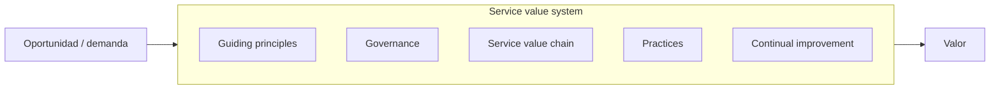

---
tags:
  - negocio
  - itsm
  - itil
  - incidentes
---

# Gestión de servicios (ITSM) e ITIL

> Qué es la gestión de servicios de TI, cómo la organiza ITIL 4 (service value system y prácticas clave), qué es un catálogo de servicios, qué herramientas se usan y cómo encaja ITIL con DevOps y SRE.

## ¿Qué es?

**ITSM** (*IT Service Management*, gestión de servicios de TI) es la forma de diseñar, entregar, operar y mejorar la tecnología **como servicios** para quienes la usan, en lugar de como un conjunto de servidores y aplicaciones sueltos. Un **servicio** es algo que entrega valor al usuario sin que tenga que gestionar los costos y riesgos que hay detrás: "correo corporativo", "plataforma de despliegue", "VPN para trabajo remoto".

**ITIL** (antes *IT Infrastructure Library*) es el marco de buenas prácticas de ITSM más extendido. No es una norma ni una herramienta: es un conjunto de guías que cada organización adapta. La norma certificable equivalente para organizaciones es **ISO/IEC 20000-1**.

!!! info "ITIL 4 e ITIL (Version 5)"
    PeopleCert, dueña de ITIL, publicó **ITIL (Version 5)** a comienzos de 2026. Según sus preguntas frecuentes, conserva el *value system* y los *guiding principles* de ITIL 4, mantiene las **34 prácticas** "en gran medida iguales, con algunos ajustes", y las reagrupa en dos grupos (*product and service management* y *general management*). Las dos versiones conviven por un tiempo; el plan publicado es retirar los módulos de ITIL 4 el **31 de diciembre de 2027**. En el trabajo vas a oír sobre todo el vocabulario de ITIL 4, que es el que usa esta nota.

## El service value system

El **SVS** (*service value system*, sistema de valor del servicio) de ITIL 4 describe cómo todas las piezas de una organización trabajan juntas para convertir una **demanda** u **oportunidad** en **valor**.

| Componente | Qué es |
| --- | --- |
| **Guiding principles** (principios guía) | Recomendaciones que aplican siempre (ver abajo) |
| **Governance** (gobierno) | Cómo se dirige y controla la organización ([Gobierno y riesgo de TI](gobierno-riesgo-ti.md)) |
| **Service value chain** (cadena de valor del servicio) | Seis actividades: *plan*, *improve*, *engage*, *design and transition*, *obtain/build*, *deliver and support* |
| **Practices** (prácticas) | Conjuntos de recursos para hacer un tipo de trabajo (antes llamados "procesos") |
| **Continual improvement** (mejora continua) | Mejorar de forma constante en todos los niveles |

### Los siete principios guía

1. **Focus on value** (enfócate en el valor).
2. **Start where you are** (empieza donde estás): no tires lo que ya funciona.
3. **Progress iteratively with feedback** (avanza de forma iterativa con retroalimentación).
4. **Collaborate and promote visibility** (colabora y promueve la visibilidad).
5. **Think and work holistically** (piensa y trabaja de forma holística).
6. **Keep it simple and practical** (mantenlo simple y práctico).
7. **Optimize and automate** (optimiza y automatiza).

Si te suenan a DevOps, no es casualidad: ITIL 4 (2019) se reescribió para convivir con agile, DevOps y la nube.

ITIL 4 también propone mirar cada servicio desde **cuatro dimensiones**: organizaciones y personas; información y tecnología; socios y proveedores; flujos de valor y procesos.

## Prácticas clave

ITIL 4 define 34 prácticas (14 de gestión general, 17 de gestión de servicios y 3 de gestión técnica). Estas son las que vas a encontrar en casi cualquier equipo de operación:

| Práctica | Objetivo | Ejemplo |
| --- | --- | --- |
| **Incident management** (gestión de incidentes) | Restablecer el servicio normal lo antes posible | La API de pagos devuelve errores 500 |
| **Problem management** (gestión de problemas) | Encontrar y eliminar la **causa** de los incidentes | Por qué la API falla cada lunes a las 9:00 |
| **Change enablement** (habilitación de cambios) | Maximizar los cambios exitosos evaluando su riesgo y autorizándolos | Desplegar una nueva versión, cambiar una regla de firewall |
| **Service request management** (gestión de solicitudes de servicio) | Atender peticiones estándar y predefinidas | Alta de un usuario, acceso a un repositorio, una laptop nueva |
| **Service desk** (mesa de servicio) | Punto único de contacto con los usuarios | Portal, chat, correo, teléfono |
| **Service level management** (gestión de niveles de servicio) | Acordar, medir y revisar los niveles de servicio | SLAs, OLAs, informes mensuales ([Niveles de servicio](niveles-de-servicio.md)) |

### Incidente, problema y solicitud

Es la confusión más habitual:

| | Incidente | Problema | Solicitud de servicio |
| --- | --- | --- | --- |
| Qué es | Una interrupción o degradación **no planificada** | La **causa** (conocida o no) de uno o más incidentes | Una petición normal, nada está roto |
| Objetivo | Volver a la normalidad rápido | Que no vuelva a pasar | Cumplir la petición en el plazo acordado |
| Ejemplo | "No puedo entrar al ERP" | El certificado del proxy caduca sin aviso | "Necesito acceso de lectura al bucket de reportes" |

En problem management aparecen dos términos útiles:

- **Workaround** (solución temporal): reduce el impacto mientras no hay arreglo definitivo ("reiniciar el servicio X").
- **Known error** (error conocido): un problema analizado cuya causa se conoce, aunque todavía no esté resuelto. Se documenta para que el service desk lo reconozca rápido.

!!! tip "Postmortem y problem management"
    Un [postmortem sin culpables](../devops/operacion/postmortem.md#cultura-blameless-y-just-culture) de SRE es, en lenguaje ITIL, una actividad de problem management: busca causas y acciones para que el incidente no se repita.

### Tipos de cambio

| Tipo | Qué es | Autorización |
| --- | --- | --- |
| **Standard change** (cambio estándar) | Bajo riesgo, repetitivo y preaprobado | No necesita aprobación individual |
| **Normal change** (cambio normal) | Necesita evaluar riesgo | Una **change authority** (autoridad de cambio): una persona, un equipo o un comité, según el riesgo |
| **Emergency change** (cambio de emergencia) | Hay que hacerlo ya (parche crítico, mitigar un incidente) | Proceso rápido, revisión posterior |

En versiones anteriores de ITIL la autorización recaía casi siempre en un **CAB** (*Change Advisory Board*, comité de cambios) que se reunía cada semana. ITIL 4 lo flexibiliza: la autoridad puede estar **delegada** y ser automática.

## Catálogo de servicios

El **service catalogue** (catálogo de servicios) es la lista de servicios que TI ofrece, escrita en lenguaje de quien los usa.

| Campo | Ejemplo |
| --- | --- |
| Nombre | Entorno de pruebas efímero |
| Descripción | Un entorno completo por pull request, que se destruye al cerrarlo |
| Quién puede pedirlo | Equipos de desarrollo |
| Cómo se pide | Automático al abrir un PR con la etiqueta `preview` |
| Nivel de servicio | Disponible en menos de 15 minutos; soporte en horario laboral |
| Costo / imputación | Showback al equipo según horas de uso |
| Responsable | Equipo de plataforma |

Un buen catálogo reduce tickets ("¿cómo pido X?"), permite automatizar solicitudes y es la base para acordar niveles de servicio. En equipos de **platform engineering**, el portal interno (por ejemplo, Backstage) cumple a menudo el papel de catálogo de autoservicio.

## Herramientas

| Herramienta | Tipo | Notas |
| --- | --- | --- |
| **ServiceNow** (ITSM) | Plataforma comercial | Muy extendida en grandes empresas; cubre ITSM, activos (CMDB), operaciones y seguridad |
| **Jira Service Management** (Atlassian) | Comercial, SaaS o Data Center | Habitual en equipos que ya usan Jira; integra incidentes, cambios y guardias |
| **Freshservice** (Freshworks) | Comercial, SaaS | Común en empresas medianas |
| **GLPI** | *Open source* | Mesa de ayuda e inventario; opción frecuente con poco presupuesto |

La **CMDB** (*Configuration Management Database*, base de datos de gestión de configuración) registra los **CIs** (*configuration items*, elementos de configuración) y sus relaciones: qué servidor soporta qué servicio. En la nube, buena parte de esa información sale del propio proveedor y del estado de IaC, no de un inventario manual.

## ITIL, DevOps y SRE

ITIL tiene fama de burocrático porque muchas organizaciones lo aplicaron con comités, formularios y semanas de espera. ITIL 4 y DevOps no se contradicen: el problema es la implementación.

| Práctica ITIL | Cómo se ve en DevOps / SRE |
| --- | --- |
| Change enablement | Pipeline con tests, revisión de código en el PR y despliegue gradual como evidencia de bajo riesgo; cambios estándar preaprobados por diseño |
| Incident management | Alertas sobre SLOs, on-call, Incident Commander, página de estado ([Operación y fiabilidad (SRE)](../devops/operacion/operacion-sre.md#incident-management-gestion-de-incidentes), [Comunicación durante incidentes](../devops/operacion/comunicacion-incidentes.md)) |
| Problem management | Postmortems sin culpables con acciones y seguimiento ([Postmortem](../devops/operacion/postmortem.md), [Análisis de causa raíz](../devops/operacion/analisis-causa-raiz.md)) |
| Service level management | SLIs, SLOs y error budget |
| Service request management | Autoservicio: plantillas de IaC, portal interno, aprobaciones automáticas |
| Knowledge management | Runbooks versionados en Git junto al código ([Runbooks y playbooks](../devops/operacion/runbooks-playbooks.md)) |

!!! note "Lo que dice la investigación de DORA"
    La investigación detrás del libro *Accelerate* encontró que exigir **aprobación externa** (un CAB o un responsable ajeno al equipo) para los cambios se asocia con **peor** desempeño de entrega y **no** reduce la tasa de fallos. Lo que funciona mejor es la revisión entre pares y la automatización. Ver [Cultura DevOps y métricas DORA](../devops/fundamentos/cultura-metricas-dora.md).

Una forma práctica de reconciliarlos:

1. Convierte la mayoría de despliegues en **standard changes**: el pipeline, la revisión de código y las pruebas son el control.
2. Registra cada despliegue **automáticamente** en la herramienta de ITSM (vía API desde el pipeline) para tener trazabilidad sin trabajo manual.
3. Reserva la revisión por comité para cambios de alto riesgo y poco frecuentes (migrar una base de datos crítica, cambiar de proveedor).
4. Usa el registro de cambios para correlacionar incidentes con despliegues (es la base del *change failure rate*).

Las aprobaciones dentro del pipeline (*environments* protegidos, revisores obligatorios) se ven en [Seguridad del pipeline](../devsecops/identidades-y-pipeline/seguridad-pipeline.md).

## Relación con otras secciones

| Enfoque | Qué se mira desde ahí | Nota |
| --- | --- | --- |
| Negocio TI (el porqué) | Acordar niveles de servicio, medirlos y gobernar el riesgo de los cambios | [Niveles de servicio](niveles-de-servicio.md), [Métricas, KPIs y OKRs](metricas-kpis-okrs.md), [Gobierno y riesgo de TI](gobierno-riesgo-ti.md) |
| Cloud (el control) | Inventario y configuración reales de los recursos; tags de responsable | [Gobernanza](../cloud/operacion-y-gobierno/gobernanza.md), [Observabilidad nativa](../monitoreo/nube/observabilidad-nativa.md) |
| DevOps (la automatización) | Incidentes, on-call y postmortems; cambios como despliegues automatizados | [Operación y fiabilidad (SRE)](../devops/operacion/operacion-sre.md), [Despliegue continuo](../devops/ci-cd/despliegue-continuo.md), [Cultura DevOps y métricas DORA](../devops/fundamentos/cultura-metricas-dora.md) |
| DevSecOps (la verificación) | Aprobaciones en el pipeline, incidentes de seguridad y evidencias para auditoría | [Seguridad del pipeline](../devsecops/identidades-y-pipeline/seguridad-pipeline.md), [Detección y respuesta](../devsecops/gobierno-y-respuesta/deteccion-respuesta.md), [Cumplimiento y gobierno](../devsecops/gobierno-y-respuesta/cumplimiento.md) |
| Laboratorios (la práctica) | Practicar esto paso a paso | [Lab 21: Game day: incidente simulado, troubleshooting y postmortem](../laboratorios/operacion/game-day-incidente.md) |

## Referencias

- [ITIL (PeopleCert)](https://www.peoplecert.org/browse-certifications/it-governance-and-service-management/ITIL-1)
- [PeopleCert: preguntas frecuentes de ITIL](https://www.peoplecert.org/help-and-support/faq-itil)
- [ISO/IEC 20000-1:2018](https://www.iso.org/standard/70636.html)
- [Atlassian: ITSM e ITIL](https://www.atlassian.com/es/itsm)
- [Jira Service Management](https://www.atlassian.com/es/software/jira/service-management)
- [ServiceNow IT Service Management](https://www.servicenow.com/products/itsm.html)
- [GLPI](https://glpi-project.org/)
- [DORA: streamlining change approval](https://dora.dev/capabilities/streamlining-change-approval/)
