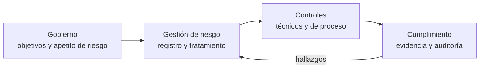

---
tags:
  - negocio
  - gobierno
  - riesgo
  - cumplimiento
---

# Gobierno y riesgo de TI

> Qué es el gobierno de TI (con COBIT en pocas líneas), cómo se gestiona el riesgo con un registro y un apetito de riesgo definidos, cómo se gestionan proveedores y contratos (vendor lock-in, licencias, SLAs de terceros) y cómo se relaciona todo con el cumplimiento.

## ¿Qué es?

**IT governance** (gobierno de TI) es el conjunto de estructuras y reglas con las que la dirección se asegura de que la tecnología **aporta valor, controla sus riesgos y usa bien sus recursos**. Responde preguntas como: ¿quién decide en qué se invierte?, ¿quién acepta un riesgo?, ¿cómo sabemos que se cumplen las políticas?

Conviene distinguir dos niveles:

| | **Gobierno** (*governance*) | **Gestión** (*management*) |
| --- | --- | --- |
| Quién | Directorio, comité de dirección | CIO/CTO, managers, equipos |
| Qué hace | **Evalúa**, **dirige** y **supervisa**: fija objetivos, prioridades y límites | **Planifica**, **construye**, **opera** y **monitorea** dentro de esos límites |
| Ejemplo | "No aceptamos riesgos que puedan detener los pagos más de 8 horas" | Diseñar una arquitectura multi-región y probarla cada semestre |

La norma **ISO/IEC 38500** describe los principios del gobierno de TI para la dirección.

## COBIT en pocas líneas

**COBIT** (de ISACA) es el marco de referencia más usado para el gobierno y la gestión de la información y la tecnología. La versión vigente es **COBIT 2019**.

- Separa explícitamente gobierno y gestión.
- Organiza **40 objetivos de gobierno y gestión** en cinco dominios:

| Dominio | Nombre | Tipo |
| --- | --- | --- |
| **EDM** | Evaluate, Direct and Monitor | Gobierno |
| **APO** | Align, Plan and Organize | Gestión |
| **BAI** | Build, Acquire and Implement | Gestión |
| **DSS** | Deliver, Service and Support | Gestión |
| **MEA** | Monitor, Evaluate and Assess | Gestión |

- Usa **design factors** (factores de diseño) para adaptar el sistema de gobierno a cada organización: tamaño, estrategia, perfil de riesgo, rol de TI.
- Se usa mucho en **auditoría** de TI (es de ISACA, la misma organización de las certificaciones CISA y CISM) y convive con ITIL: COBIT dice **qué** hay que controlar; ITIL, **cómo** gestionar los servicios ([Gestión de servicios (ITSM) e ITIL](gestion-servicios-itil.md)).

## Gestión de riesgo

Un **risk** (riesgo) es la posibilidad de que algo incierto afecte a los objetivos. En TI se suele estimar como:

```text
Riesgo = probabilidad × impacto
```

La norma general de gestión de riesgo es **ISO 31000**; para seguridad de la información, **ISO/IEC 27005** y **NIST SP 800-30**. Cómo identificar amenazas técnicas (STRIDE, threat modeling) se ve en [Fundamentos DevSecOps](../devsecops/fundamentos-devsecops.md).

### Matriz de riesgo

| Probabilidad \ Impacto | Bajo (1) | Medio (2) | Alto (3) |
| --- | --- | --- | --- |
| **Alta (3)** | 3 – medio | 6 – alto | 9 – crítico |
| **Media (2)** | 2 – bajo | 4 – medio | 6 – alto |
| **Baja (1)** | 1 – bajo | 2 – bajo | 3 – medio |

Las escalas y umbrales los define cada organización; lo importante es que sean **siempre los mismos** para poder comparar riesgos entre sí.

### Tratamiento del riesgo

| Opción | Qué significa | Ejemplo |
| --- | --- | --- |
| **Mitigate** (mitigar) | Reducir probabilidad o impacto con controles | Multi-AZ, MFA, backups inmutables |
| **Transfer** (transferir) | Pasar parte del impacto a un tercero | Ciberseguro, contrato con penalizaciones, servicio gestionado |
| **Avoid** (evitar) | Dejar de hacer la actividad que genera el riesgo | No almacenar datos de tarjetas y usar un proveedor de pagos |
| **Accept** (aceptar) | Asumirlo conscientemente, por escrito y con un responsable | Un sistema interno Tier 3 en una sola zona |

Dos conceptos que aparecen en cualquier análisis:

- **Inherent risk** (riesgo inherente): el riesgo antes de aplicar controles.
- **Residual risk** (riesgo residual): el que queda después de los controles. Es el que alguien con autoridad tiene que **aceptar**.

### Registro de riesgos

El **risk register** (registro de riesgos) es la lista viva de riesgos identificados, con su evaluación, dueño y plan.

| ID | Riesgo | Prob. | Impacto | Nivel | Tratamiento | Dueño | Estado | Revisión |
| --- | --- | --- | --- | --- | --- | --- | --- | --- |
| R-01 | Caída de la región principal detiene los pagos más de 8 h | 1 | 3 | 3 – medio | Mitigar: warm standby en otra región | Head of Platform | En curso | Trimestral |
| R-02 | Credenciales de nube expuestas en un repositorio | 2 | 3 | 6 – alto | Mitigar: OIDC en pipelines, detección de secretos | Seguridad | Hecho | Trimestral |
| R-03 | Fin de soporte de la versión de Kubernetes en producción | 3 | 2 | 6 – alto | Mitigar: plan de actualización | Equipo de plataforma | Pendiente | Mensual |
| R-04 | Subida de precio del proveedor de observabilidad | 2 | 2 | 4 – medio | Mitigar: instrumentar con OpenTelemetry para poder cambiar | CTO | Aceptado parcialmente | Anual |

!!! tip "Un riesgo sin dueño no se gestiona"
    Cada riesgo necesita una persona responsable (no "TI" ni "el equipo") y una fecha de revisión. El R-04 muestra un caso típico: [OpenTelemetry](../monitoreo/fundamentos/observabilidad.md#trazas-distribuidas-con-opentelemetry) reduce la dependencia del proveedor.

### Apetito y tolerancia al riesgo

- **Risk appetite** (apetito de riesgo): cuánto riesgo está dispuesta a asumir la organización para lograr sus objetivos. Lo fija la dirección. Ejemplo: "apetito bajo para riesgos que afecten datos de clientes; apetito moderado para riesgos de innovación en productos nuevos".
- **Risk tolerance** (tolerancia al riesgo): la desviación aceptable en un caso concreto, ya en números. Ejemplo: "como máximo 4 horas de indisponibilidad del portal de clientes por trimestre".

Con el apetito definido, los equipos pueden decidir solos dentro de los límites y escalar solo lo que los supera. El error budget de SRE es, en el fondo, una tolerancia al riesgo pactada ([Niveles de servicio](niveles-de-servicio.md)).

## Gestión de proveedores y contratos

Casi todo en TI depende de terceros: proveedor cloud, SaaS, licencias, consultoras, ISP. La **vendor management** (gestión de proveedores) cubre el ciclo completo: selección, contrato, seguimiento y salida.

### Vendor lock-in

El **vendor lock-in** (dependencia del proveedor) es cuando cambiar de proveedor es tan caro o difícil que en la práctica no puedes hacerlo.

| Fuente de lock-in | Ejemplo | Cómo reducirlo |
| --- | --- | --- |
| Servicios propietarios | Bases de datos o colas exclusivas de un proveedor | Aceptarlo conscientemente donde aporta mucho; abstraer en el código |
| Datos | Muchos TB en un proveedor, con costo de egress para sacarlos | Formatos abiertos, planificar el costo de salida |
| Herramientas y formatos | Plantillas de IaC nativas, agentes de monitoreo propietarios | Terraform/OpenTofu, OpenTelemetry, contenedores |
| Contratos | Compromisos de gasto de varios años | Alinear la duración con la estrategia |
| Conocimiento | Equipo formado en una sola plataforma | Documentar, formar en conceptos y no solo en productos |

!!! note "El lock-in no es siempre malo"
    Usar servicios gestionados propios de un proveedor suele ser más rápido y barato que construir algo portable. La pregunta es si el beneficio compensa el costo de salir, y si existe un **exit plan** (plan de salida) razonable, aunque nunca se use.

### Licencias

- Revisa el **modelo de licencia**: por usuario, por núcleo, por instancia, por consumo, suscripción o perpetua.
- **BYOL** (*Bring Your Own License*): algunas licencias se pueden llevar a la nube y otras no, o solo a ciertos tipos de host. Revisa las condiciones del fabricante antes de migrar ([Máquinas virtuales](../cloud/computo/maquinas-virtuales.md)).
- Las condiciones **cambian**: adquisiciones y cambios de política del fabricante pueden pasar de licencias perpetuas a suscripciones o cambiar la unidad de cobro (le ocurrió a muchas empresas con VMware tras su compra por Broadcom). Inclúyelo en el registro de riesgos.
- En *open source*, revisa la licencia (permisiva como MIT o Apache 2.0, o *copyleft* como GPL) y sus cambios: algunos proyectos han pasado a licencias no *open source* (por eso nacieron *forks* como OpenTofu).

### SLAs de terceros y cláusulas a revisar

Antes de firmar con un proveedor crítico, revisa:

| Cláusula | Qué buscar |
| --- | --- |
| **SLA** | Disponibilidad, tiempos de respuesta de soporte, créditos y cómo se reclaman ([Niveles de servicio](niveles-de-servicio.md#creditos-y-penalizaciones-de-sla)) |
| **Seguridad y cumplimiento** | Certificaciones (ISO/IEC 27001, informe SOC 2 Type II), notificación de incidentes y plazos |
| **Datos** | Ubicación (región, país), propiedad, cifrado, devolución y borrado al terminar |
| **Subcontratistas** | Quién más trata tus datos |
| **Derecho de auditoría** | Si puedes auditar o solo recibir informes |
| **Continuidad** | Plan de continuidad del proveedor y qué pasa si quiebra o es adquirido |
| **Salida** | Plazo de preaviso, formato de exportación de datos, asistencia en la migración |
| **Precio** | Revisiones de precio, costos variables (egress, llamadas a API), penalizaciones por terminación anticipada |

## Relación con el cumplimiento

El gobierno define **qué** controles hacen falta según el riesgo y las obligaciones; el **cumplimiento** demuestra que esos controles existen y funcionan.



- Marcos como **ISO/IEC 27001** y **NIST CSF 2.0** (que añadió la función *Govern*) están basados en riesgo: piden justamente un registro de riesgos, un tratamiento y una aceptación formal del riesgo residual.
- La parte técnica (CIS Benchmarks, CSPM, compliance as code) está en [Cumplimiento y gobierno](../devsecops/gobierno-y-respuesta/cumplimiento.md); los guardrails en la nube (SCPs, Azure Policy, Organization Policy), en [Gobernanza](../cloud/operacion-y-gobierno/gobernanza.md).
- La **gestión de terceros** es un requisito explícito en muchas regulaciones, sobre todo en el sector financiero.

!!! warning "DORA no siempre son las métricas DORA"
    En la Unión Europea, **DORA** también es el *Digital Operational Resilience Act*, un reglamento de resiliencia operativa digital para el sector financiero que se aplica desde enero de 2025 y exige, entre otras cosas, gestión del riesgo TIC, pruebas de resiliencia y control de proveedores TIC críticos. No tiene relación con las [métricas DORA](../devops/fundamentos/cultura-metricas-dora.md) de entrega de software. Si trabajas con clientes financieros europeos, aclara de cuál se habla.

## Relación con otras secciones

| Enfoque | Qué se mira desde ahí | Nota |
| --- | --- | --- |
| Negocio TI (el porqué) | Riesgo en los business case, gestión de servicios y continuidad | [TI y negocio](ti-y-negocio.md), [Gestión de servicios (ITSM) e ITIL](gestion-servicios-itil.md), [Continuidad de negocio](continuidad-negocio.md) |
| Cloud (el control) | Guardrails, estructura de cuentas, responsabilidad compartida y costos de salida | [Gobernanza](../cloud/operacion-y-gobierno/gobernanza.md), [Shared Responsibility Model](../cloud/fundamentos/responsabilidad-compartida.md), [FinOps y costos](../cloud/fundamentos/finops-costos.md) |
| DevOps (la automatización) | Herramientas abiertas que reducen el lock-in; IaC como evidencia de cambios | [Infrastructure as Code](../devops/iac/infraestructura-como-codigo.md), [Observabilidad](../monitoreo/fundamentos/observabilidad.md) |
| DevSecOps (la verificación) | Threat modeling, marcos de cumplimiento, CSPM y respuesta a incidentes | [Fundamentos DevSecOps](../devsecops/fundamentos-devsecops.md), [Cumplimiento y gobierno](../devsecops/gobierno-y-respuesta/cumplimiento.md), [Cadena de suministro](../devsecops/codigo-y-dependencias/cadena-suministro.md) |

## Referencias

- [ISACA: COBIT](https://www.isaca.org/resources/cobit)
- [ISO/IEC 38500 Governance of IT](https://www.iso.org/standard/81684.html)
- [ISO 31000 Risk management](https://www.iso.org/iso-31000-risk-management.html)
- [NIST SP 800-30 Rev. 1: Guide for Conducting Risk Assessments](https://csrc.nist.gov/pubs/sp/800/30/r1/final)
- [NIST Cybersecurity Framework 2.0](https://www.nist.gov/cyberframework)
- [Reglamento (UE) 2022/2554 sobre resiliencia operativa digital (DORA)](https://eur-lex.europa.eu/legal-content/ES/TXT/?uri=CELEX:32022R2554)
