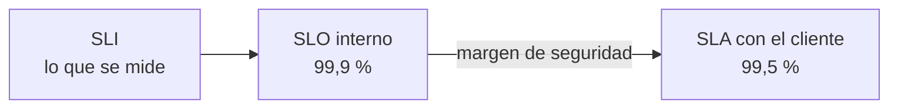
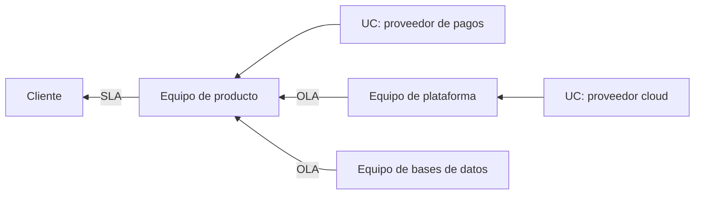
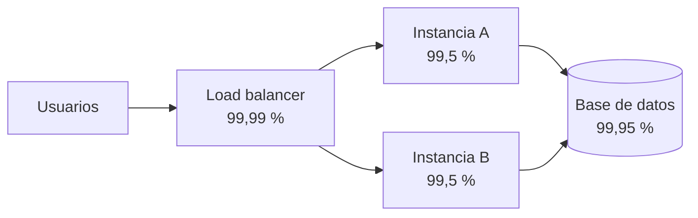

---
tags:
  - negocio
  - sla
  - slo
  - observabilidad
  - resiliencia
---

# Niveles de servicio

> SLA, SLO y SLI vistos desde el negocio, OLA y underpinning contracts, la tabla de "nueves", cómo se calcula la disponibilidad compuesta, las métricas MTBF/MTTR/MTTA/MTTD, los créditos de SLA de los proveedores cloud y cómo negociar y comunicar un SLO.

## ¿Qué es?

Un **service level** (nivel de servicio) es la respuesta medible a "¿qué tan bien tiene que funcionar este servicio?". Sin un número acordado, cada caída es una discusión: para el cliente cualquier fallo es inaceptable y para el equipo técnico "estuvo bien casi todo el mes".

!!! info "Esta nota es la vista de negocio"
    Cómo **medir** un SLI con Prometheus, calcular el error budget y alertar por *burn rate* está en [Observabilidad](../devops/operacion/observabilidad.md#sli-slo-sla-y-error-budget). Cómo **operar** con el error budget (política de congelación, incidentes, postmortems) está en [Operación y fiabilidad (SRE)](../devops/operacion/operacion-sre.md#politica-de-error-budget). Aquí se ve quién acuerda esos números, qué se firma, cuánto cuesta cada nueve y cómo se comunica.

## SLI, SLO y SLA: quién los usa

| | **SLI** (*Service Level Indicator*) | **SLO** (*Service Level Objective*) | **SLA** (*Service Level Agreement*) |
| --- | --- | --- | --- |
| Qué es | La medida | El objetivo para esa medida | El compromiso contractual |
| Quién lo define | Ingeniería, con producto | Producto e ingeniería | Negocio, legal y ventas, con ingeniería |
| Audiencia | Equipos técnicos | Equipos internos y managers | Clientes |
| Si no se cumple | Nada: es un dato | Se activa la política de error budget | **Penalizaciones**: créditos, descuentos, rescisión |
| Ejemplo | % de pagos completados en menos de 2 s | 99,9 % en 30 días | 99,5 % mensual o crédito del 10 % de la factura |

La regla de oro: **SLA más laxo que el SLO**. Si el SLA es 99,5 % y el SLO interno 99,9 %, el equipo reacciona mucho antes de que haya consecuencias contractuales.



### Error budget como acuerdo de negocio

El **error budget** (presupuesto de errores) es `100 % − SLO`. Para negocio es una herramienta de decisión, no un número técnico: convierte la pregunta "¿lanzamos esta funcionalidad arriesgada o estabilizamos?" en una regla acordada de antemano. Si queda presupuesto, producto puede pedir velocidad; si se agotó, la prioridad es la fiabilidad, sin discusión.

## OLA y underpinning contracts

Un SLA con el cliente depende de muchas piezas que no controlas directamente. Para que el compromiso sea creíble, cada pieza necesita su propio acuerdo:

| Acuerdo | Entre quiénes | Ejemplo |
| --- | --- | --- |
| **SLA** | Proveedor del servicio y cliente | "La plataforma estará disponible el 99,5 % del mes" |
| **OLA** (*Operational Level Agreement*, acuerdo de nivel operativo) | Equipos **internos** de la misma organización | "El equipo de bases de datos responde a un incidente SEV1 en 15 minutos" |
| **Underpinning contract** (UC, contrato de soporte) | La organización y un **proveedor externo** | SLA del proveedor cloud, contrato del ISP, soporte del fabricante |



!!! warning "No prometas más de lo que te prometen"
    Si tu servicio depende de un proveedor de pagos con un SLA de 99,9 % y no tienes alternativa, no puedes firmar un 99,99 % con tu cliente. Los términos OLA y underpinning contract vienen de ITIL; ver [Gestión de servicios (ITSM) e ITIL](gestion-servicios-itil.md).

## La tabla de los nueves

La disponibilidad se expresa en "nueves": 99,9 % son "tres nueves". Cada nueve extra divide por diez el tiempo de caída permitido. Cálculo con año de 365 días y mes de 30 días:

| Disponibilidad | Nombre | Caída permitida al año | Caída permitida al mes (30 días) | Caída permitida a la semana |
| --- | --- | --- | --- | --- |
| 99 % | dos nueves | 3 d 15 h 36 min | 7 h 12 min | 1 h 40 min 48 s |
| 99,5 % | dos nueves y medio | 1 d 19 h 48 min | 3 h 36 min | 50 min 24 s |
| 99,9 % | tres nueves | 8 h 45 min 36 s | 43 min 12 s | 10 min 5 s |
| 99,95 % | tres nueves y medio | 4 h 22 min 48 s | 21 min 36 s | 5 min 2 s |
| 99,99 % | cuatro nueves | 52 min 34 s | 4 min 19 s | 1 min |
| 99,999 % | cinco nueves | 5 min 15 s | 26 s | 6 s |

```text
Caída permitida = (1 − disponibilidad) × periodo
Ejemplo 99,95 % al mes: 0,0005 × 43 200 min = 21,6 min = 21 min 36 s
```

!!! tip "Cada nueve cuesta mucho más que el anterior"
    Con 43 minutos al mes (tres nueves) un humano puede recibir una alerta, entrar y hacer un rollback. Con 4 minutos (cuatro nueves) **no da tiempo**: la recuperación tiene que ser automática, con redundancia en varias zonas. Con 26 segundos (cinco nueves) hace falta redundancia en todo, incluidas las dependencias externas. Por eso la pregunta correcta no es "¿cuántos nueves queremos?" sino "¿cuánto nos cuesta cada hora caída y cuánto cuesta evitarla?" (ver [costo de downtime](ti-y-negocio.md#costo-de-downtime)).

### Qué cuenta como "caído"

El porcentaje no significa nada si no se define antes:

- **Basado en tiempo**: minutos en que el servicio no respondía (según un chequeo sintético cada minuto).
- **Basado en peticiones**: porcentaje de peticiones correctas sobre el total. Refleja mejor una caída parcial (el 10 % de los usuarios con errores) y es lo que suelen usar los SLOs modernos.
- **Exclusiones**: ventanas de mantenimiento anunciadas, fallos causados por el cliente, fuerza mayor.
- **Ventana**: mes calendario (típico en SLAs, se "resetea" el día 1) o ventana móvil de 30 días (típica en SLOs internos).

## Disponibilidad compuesta

Un servicio real es una cadena de componentes. Su disponibilidad depende de cómo están conectados. Las fórmulas suponen que los fallos son **independientes** entre sí.

### En serie

Si el servicio necesita que **todos** los componentes funcionen (load balancer → aplicación → base de datos), se **multiplican** las disponibilidades:

```text
A_serie = A1 × A2 × … × An
```

El resultado siempre es **peor** que el del componente más débil. Tres componentes al 99,9 % en serie: 0,999³ = 0,997 → **99,70 %**, unas 2 h 9 min de caída posibles al mes en lugar de 43 minutos.

### En paralelo

Si hay **varias copias** y basta con que **una** funcione (dos instancias detrás de un load balancer, en zonas distintas), se multiplican las **indisponibilidades**:

```text
A_paralelo = 1 − (1 − A1) × (1 − A2) × … × (1 − An)
```

Dos instancias al 99,5 %: 1 − (0,005 × 0,005) = 1 − 0,000025 = **99,9975 %**. La redundancia mejora muchísimo la disponibilidad de esa capa.

### Ejemplo completo

Una aplicación web con un load balancer gestionado (99,99 %), una capa de aplicación y una base de datos gestionada (99,95 %):



| Diseño | Cálculo | Disponibilidad | Caída posible al mes (30 días) |
| --- | --- | --- | --- |
| **Una sola instancia** | 0,9999 × 0,995 × 0,9995 | **99,440 %** | ≈ 4 h 2 min |
| **Dos instancias en paralelo** | Capa de app: 1 − 0,005² = 0,999975; total: 0,9999 × 0,999975 × 0,9995 | **99,938 %** | ≈ 27 min |

Conclusiones:

1. Duplicar la capa de aplicación pasa de unas 4 horas a unos 27 minutos de caída posible al mes.
2. Ahora el **eslabón débil es la base de datos** (99,95 %): ningún esfuerzo en la capa de aplicación sube el total por encima de 0,9999 × 0,9995 ≈ 99,94 %.
3. Para prometer 99,95 % o más, habría que mejorar la base de datos (réplica en otra zona con failover, ver [Resiliencia](../cloud/operacion-y-gobierno/resiliencia.md)).

!!! warning "Límites del cálculo"
    - Los fallos **no siempre son independientes**: dos instancias en la misma zona caen juntas si cae la zona; un mal despliegue rompe todas las copias a la vez. Por eso el paralelo de verdad exige zonas distintas y despliegues graduales.
    - El failover **no es instantáneo**: los segundos o minutos que tarda el health check en retirar una instancia también cuentan.
    - El SLA de un proveedor es un **compromiso con créditos**, no una medida de la disponibilidad real. Sirve para estimar, no para garantizar.

## MTBF, MTTR, MTTA y MTTD

Las métricas "MTx" miden con qué frecuencia falla algo y cuánto tarda en volver.


| Métrica | Significado | Qué mejora si baja (o sube) |
| --- | --- | --- |
| **MTBF** (*Mean Time Between Failures*, tiempo medio entre fallos) | Tiempo medio de funcionamiento entre un fallo y el siguiente | Más alto = el sistema falla menos (calidad, pruebas, arquitectura) |
| **MTTF** (*Mean Time To Failure*, tiempo medio hasta el fallo) | Como el MTBF, para componentes que no se reparan (un disco) | Más alto = componente más duradero |
| **MTTD** (*Mean Time To Detect*, tiempo medio de detección) | Desde que empieza el fallo hasta que alguien o algo lo detecta | Más bajo = mejor [observabilidad](../devops/operacion/observabilidad.md) y alertas |
| **MTTA** (*Mean Time To Acknowledge*, tiempo medio de reconocimiento) | Desde la alerta hasta que una persona la toma | Más bajo = guardias bien organizadas |
| **MTTR** (*Mean Time To Restore/Recover/Repair*, tiempo medio de recuperación) | Desde el fallo hasta que el servicio vuelve | Más bajo = mitigación rápida (rollback, failover, runbooks) |

!!! note "MTTR tiene varios significados"
    Según la fuente, la R es *Repair*, *Recover*, *Restore* o incluso *Respond*, y el reloj empieza en el fallo o en la detección. Define cuál usas antes de reportarlo. En las métricas DORA se sustituyó por **failed deployment recovery time** (ver [Cultura DevOps y métricas DORA](../devops/fundamentos/cultura-metricas-dora.md)).

Relación con la disponibilidad:

```text
Disponibilidad = MTBF / (MTBF + MTTR)
Ejemplo: falla una vez al mes (MTBF ≈ 720 h) y tarda 1 h en volver:
720 / 721 = 0,99861 → 99,86 %
```

Hay dos caminos para subir la disponibilidad: **fallar menos** (subir el MTBF) o **recuperarse más rápido** (bajar el MTTR). En la práctica, bajar el MTTR suele ser más barato y más rápido: despliegues graduales, rollback automático, runbooks. Es la idea detrás de [Operación y fiabilidad (SRE)](../devops/operacion/operacion-sre.md).

## Créditos y penalizaciones de SLA

Cuando un proveedor incumple su SLA, la compensación habitual es un **service credit** (crédito de servicio): un porcentaje de la factura de ese servicio que se descuenta en facturas futuras.

### Ejemplo: SLA de Amazon EC2

AWS publica dos niveles para Amazon EC2 (consultado en octubre de 2026):

| Nivel | Objetivo | Crédito si se incumple |
| --- | --- | --- |
| **Region-Level SLA** (instancias desplegadas en varias Availability Zones de una región) | 99,99 % mensual | 10 % si queda entre 99,0 % y 99,99 %; 30 % entre 95,0 % y 99,0 %; 100 % por debajo de 95,0 % |
| **Instance-Level SLA** (una instancia individual) | 99,5 % mensual | 10 % si queda entre 99,0 % y 99,5 %; 30 % entre 95,0 % y 99,0 %; 100 % por debajo de 95,0 % |

**Cálculo**: gastas 10 000 al mes en EC2 en una región y ese mes la disponibilidad regional fue del 98,5 %. Está entre 95 % y 99 % → crédito del **30 %** = 3 000 de descuento sobre el cargo de EC2 afectado. Si esa caída te hizo perder 50 000 en ventas, **el proveedor no te los devuelve**.

### Otros proveedores

| Servicio | Objetivos publicados (resumen) |
| --- | --- |
| **Azure Virtual Machines** | 99,99 % con dos o más VMs en distintas availability zones; 99,95 % con dos o más VMs en un availability set; una sola VM con un objetivo menor según el tipo de disco (99,9 % con Premium SSD o Ultra Disk) |
| **Google Compute Engine** | 99,99 % con instancias en varias zonas; 99,9 % para una instancia individual de la mayoría de familias (con variaciones por familia y región) |

Los tramos de crédito cambian por servicio y por proveedor. Revisa siempre la página oficial vigente antes de usarlos en un cálculo o en un contrato.

!!! danger "Lo que un SLA de proveedor no hace"
    - **No cubre tus pérdidas**: el crédito es un porcentaje de lo que pagas al proveedor, no de lo que pierdes. Es la "única y exclusiva" compensación según el propio contrato.
    - **No es automático**: normalmente hay que **reclamarlo** dentro de un plazo, con evidencia.
    - **Tiene exclusiones**: fallos causados por tu configuración, fuerza mayor, servicios en preview, mantenimiento anunciado.
    - **Exige un diseño concreto**: el 99,99 % de EC2 o de Azure VMs solo aplica si despliegas en varias zonas. Una VM sola tiene un SLA mucho menor.
    - **No cubre tu aplicación**: tu servicio puede estar caído con el proveedor funcionando perfectamente.

### Penalizaciones en tus propios SLAs

Cuando eres tú quien firma un SLA con clientes, las penalizaciones típicas son:

- Créditos escalonados (como los de los proveedores).
- Derecho a rescindir el contrato si se incumple varios meses seguidos.
- Penalizaciones por tiempo de respuesta en soporte ("respuesta a un incidente crítico en menos de 1 hora").

Fija las penalizaciones sabiendo cuánto margen tienes: calcula tu disponibilidad compuesta, mira el historial real de los últimos meses y deja un margen entre SLO y SLA.

## Cómo negociar y comunicar un SLO

1. **Empieza por el usuario**: qué acciones son críticas (iniciar sesión, pagar, consultar saldo) y qué le resulta "suficientemente bueno". No todo el sistema necesita el mismo nivel.
2. **Mide antes de prometer**: usa varias semanas de datos reales del SLI. Un SLO que nunca se cumplió no es un objetivo, es un deseo.
3. **Calcula el techo**: con la disponibilidad compuesta de tus dependencias, ¿cuál es el máximo alcanzable?
4. **Ponle precio a cada nueve**: compara el costo de la arquitectura necesaria con el costo de downtime evitado.
5. **Acuerda la política de error budget** con producto: qué pasa cuando se agota (ver [Operación y fiabilidad (SRE)](../devops/operacion/operacion-sre.md#politica-de-error-budget)).
6. **Escríbelo**: SLI exacto, cómo se mide, ventana, exclusiones, responsables.
7. **Revísalo** cada trimestre: si se cumple siempre con mucho margen, quizás es demasiado laxo (o estás gastando de más); si se incumple siempre, es irreal.

```yaml title="slo-pagos.yaml"
servicio: api-pagos
responsable: equipo-pagos
sli:
  descripcion: "Peticiones POST /payments con respuesta 2xx en menos de 2 s"
  fuente: "métricas del load balancer"
slo:
  objetivo: 99.9      # %
  ventana: 30d        # ventana móvil
sla_cliente:
  objetivo: 99.5      # % mensual calendario
  credito: "10 % de la cuota mensual si < 99.5 %"
exclusiones:
  - "Mantenimiento anunciado con 72 h de antelación"
politica_error_budget: "Congelar cambios no urgentes si se consume el 100 %"
revision: trimestral
```

!!! tip "Cómo comunicarlo"
    - A **clientes**: página de estado pública, informe mensual de disponibilidad y comunicación proactiva durante incidentes.
    - A **dirección**: un número (¿se cumplió?), la tendencia y el costo de los incidentes, no gráficos de latencia p99.
    - A **equipos**: el error budget restante, visible en un dashboard.
    - Nunca uses "100 %" ni "siempre disponible": no es alcanzable y te deja sin margen para cambiar nada.

## Relación con otras secciones

| Enfoque | Qué se mira desde ahí | Nota |
| --- | --- | --- |
| Negocio TI (el porqué) | Costo de downtime, gestión de niveles de servicio en ITIL, continuidad y KPIs de servicio | [TI y negocio](ti-y-negocio.md), [Gestión de servicios (ITSM) e ITIL](gestion-servicios-itil.md), [Continuidad de negocio](continuidad-negocio.md), [Métricas, KPIs y OKRs](metricas-kpis-okrs.md) |
| Cloud (el control) | Multi-AZ y multi-región para alcanzar los nueves; métricas nativas para medirlos | [Resiliencia](../cloud/operacion-y-gobierno/resiliencia.md), [Observabilidad nativa](../cloud/operacion-y-gobierno/observabilidad-nativa.md), [Well-Architected Framework](../cloud/fundamentos/well-architected.md) |
| DevOps (la automatización) | Medir SLIs, alertar por burn rate y operar con error budget | [Observabilidad](../devops/operacion/observabilidad.md), [Operación y fiabilidad (SRE)](../devops/operacion/operacion-sre.md), [Despliegue continuo](../devops/ci-cd/despliegue-continuo.md) |
| DevSecOps (la verificación) | SLA de remediación de vulnerabilidades y respuesta a incidentes de seguridad | [Detección y respuesta](../devsecops/gobierno-y-respuesta/deteccion-respuesta.md) |
| Laboratorios (la práctica) | Practicar esto paso a paso | [Lab 11: Observabilidad con Prometheus y Grafana](../laboratorios/devops/observabilidad-prometheus-grafana.md), [Lab 21: Game day: incidente simulado, troubleshooting y postmortem](../laboratorios/operacion/game-day-incidente.md) |

## Referencias

- [Google SRE Book: Service Level Objectives](https://sre.google/sre-book/service-level-objectives/)
- [Google SRE Book: Availability Table](https://sre.google/sre-book/availability-table/)
- [Google SRE Workbook: Implementing SLOs](https://sre.google/workbook/implementing-slos/)
- [Amazon Compute Service Level Agreement](https://aws.amazon.com/compute/sla/)
- [AWS Service Level Agreements](https://aws.amazon.com/legal/service-level-agreements/)
- [Acuerdos de nivel de servicio de Microsoft (Service Level Agreements for Online Services)](https://www.microsoft.com/licensing/docs/view/Service-Level-Agreements-SLA-for-Online-Services)
- [Compute Engine Service Level Agreement](https://cloud.google.com/compute/sla)
- [Google Cloud: Service Level Agreements](https://cloud.google.com/terms/sla)
- [Azure Well-Architected: objetivos de fiabilidad y disponibilidad compuesta](https://learn.microsoft.com/es-es/azure/well-architected/reliability/metrics)
