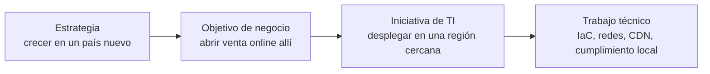

---
tags:
  - negocio
  - finops
  - costos
---

# TI y negocio

> Para qué existe TI en una organización, cómo se alinea con la estrategia, quiénes son los stakeholders y cómo hablar de dinero: CapEx vs OpEx, TCO, ROI, business case, build vs buy y costo de downtime.

## ¿Qué es?

Ninguna empresa tiene servidores, pipelines o clústeres de Kubernetes porque sí. La tecnología existe para que la organización **gane dinero, ahorre dinero, reduzca riesgo o cumpla una obligación** (legal, contractual o de misión, en el caso de una ONG o del sector público). Esta sección del cuaderno es **el porqué**: el idioma que usan negocio, managers y clientes para decidir en qué se invierte.

Saber hablar este idioma te sirve para:

- Justificar una inversión técnica (una segunda región, una herramienta de observabilidad, tiempo para pagar deuda técnica).
- Entender por qué te piden un número ("¿cuánto cuesta una hora caída?") y no una explicación técnica.
- Negociar plazos, alcances y niveles de servicio con argumentos, no con opiniones.

!!! tip "Traduce la técnica a impacto"
    "Migrar a Multi-AZ" no le dice nada a una gerencia. "Reducir el riesgo de perder 4 horas de ventas al año por la caída de un centro de datos, por X al mes" sí.

## El rol de TI

Una forma habitual de ver el rol de TI es en tres niveles. No son excluyentes: una misma área de TI suele hacer los tres a la vez.

| Rol | Qué hace TI | Cómo se mide | Ejemplo |
| --- | --- | --- | --- |
| **Cost center** (centro de costos) | Mantener la operación al menor costo posible | Costo por usuario, presupuesto cumplido | Correo, puestos de trabajo, red interna |
| **Service provider** (proveedor de servicios) | Entregar servicios con niveles acordados a las áreas de negocio | SLAs cumplidos, satisfacción | Plataforma de despliegue interna, mesa de ayuda |
| **Strategic partner** (socio estratégico) | Crear capacidades nuevas que generan ingresos o ventaja | Ingresos, crecimiento, time to market | Una app móvil que abre un canal de venta nuevo |

En empresas donde el producto **es** software (SaaS, banca digital, comercio electrónico), la frontera entre "TI" y "negocio" casi desaparece: la plataforma es el negocio.

## Alineamiento con la estrategia

**Business-IT alignment** (alineamiento entre TI y negocio) significa que lo que hace TI se puede rastrear hasta un objetivo de la organización.



Si no puedes completar esa cadena para una iniciativa, pregunta para qué se hace. Puede que tenga una razón válida (riesgo, cumplimiento, deuda técnica), pero conviene que esté escrita. Los OKRs son una herramienta común para hacer visible esta cadena; se ven en [Métricas, KPIs y OKRs](metricas-kpis-okrs.md).

## Stakeholders

Un **stakeholder** (parte interesada) es cualquier persona o grupo afectado por una decisión o que puede influir en ella.

| Stakeholder | Qué le importa | Cómo hablarle |
| --- | --- | --- |
| Dirección (CEO, directorio) | Estrategia, crecimiento, riesgo, reputación | Impacto en dinero y riesgo, en una página |
| Finanzas (CFO) | Presupuesto, previsibilidad del gasto, CapEx vs OpEx | Números, escenarios, TCO |
| Áreas de negocio / producto | Funcionalidades, plazos, experiencia del cliente | Fechas, alcance, riesgos para la entrega |
| Seguridad y cumplimiento | Controles, auditorías, incidentes | Evidencia, riesgo residual |
| Clientes | Que el servicio funcione y sus datos estén seguros | SLAs, página de estado, comunicación clara |
| Equipos técnicos | Carga de trabajo, herramientas, deuda técnica | Detalle técnico y prioridades claras |

Una herramienta simple para organizarlos es la matriz **poder / interés**: a quien tiene mucho poder y mucho interés se le gestiona de cerca; a quien tiene poco de ambos basta con informarle.

## CapEx vs OpEx

| | **CapEx** (*capital expenditure*, gasto de capital) | **OpEx** (*operational expenditure*, gasto operativo) |
| --- | --- | --- |
| Qué es | Compra de activos que duran varios años | Gasto recurrente para operar |
| Ejemplo en TI | Servidores, *storage*, licencias perpetuas, construir un centro de datos | Suscripciones SaaS, nube pay-as-you-go, soporte, sueldos |
| Pago | Gran desembolso al inicio | Pagos periódicos según el uso |
| Contabilidad | Se **amortiza** o **deprecia** en varios años | Se registra como gasto del periodo |
| Riesgo | Comprar de más (capacidad ociosa) o de menos | Que el gasto crezca sin control |

La nube convierte buena parte del CapEx en OpEx: no compras servidores, pagas por uso. Eso da flexibilidad, pero traslada el riesgo a la **variabilidad del gasto**, que es justo lo que gestiona [FinOps](../cloud/fundamentos/finops-costos.md).

!!! note "Depende de la contabilidad"
    Cómo se clasifica un gasto (por ejemplo, compromisos de varios años con el proveedor o desarrollo de software propio) lo decide el área contable según la normativa del país. Pregunta a finanzas antes de afirmar que algo "es OpEx".

## TCO

El **TCO** (*Total Cost of Ownership*, costo total de propiedad) suma **todos** los costos de una solución durante su vida útil, no solo el precio de compra o la factura mensual.

| Categoría | On-premise | Nube |
| --- | --- | --- |
| Infraestructura | Hardware, espacio, energía, refrigeración, red | Factura del proveedor (cómputo, storage, egress) |
| Software | Licencias, soporte del fabricante | Licencias (incluidas o BYOL), servicios gestionados |
| Personas | Administración, guardias, renovaciones de hardware | Operación, FinOps, formación |
| Riesgo y continuidad | Centro de datos secundario, backups | Multi-AZ, multi-región, backups |
| Salida | Desmantelar, vender o reciclar equipos | Migrar datos (egress), reescribir integraciones |

!!! warning "La comparación más común está mal hecha"
    Comparar "el precio de un servidor" con "la factura mensual de la nube" deja fuera energía, espacio, personas, renovaciones y el costo de la capacidad ociosa. Al revés, mirar solo la factura de la nube olvida el tiempo del equipo y el costo de salir. Los proveedores tienen calculadoras de precios (ver [FinOps y costos](../cloud/fundamentos/finops-costos.md)), pero el TCO completo lo construyes tú.

## ROI y business case

El **ROI** (*Return on Investment*, retorno de la inversión) compara lo que se gana con lo que se invierte:

```text
ROI = (beneficio − costo) / costo × 100 %
```

**Ejemplo**: automatizar un proceso de alta de entornos cuesta 20 000 (horas del equipo + herramientas) y ahorra 30 000 al año en horas manuales y errores.

- ROI a un año: (30 000 − 20 000) / 20 000 = **50 %**.
- **Payback period** (periodo de recuperación): 20 000 / 30 000 al año = **8 meses**.

Para decisiones de varios años, finanzas suele usar además el **NPV** (*Net Present Value*, valor actual neto), que descuenta los flujos futuros porque un peso hoy vale más que un peso en tres años.

Un **business case** (caso de negocio) es el documento que reúne todo eso para pedir una decisión:

1. **Problema u oportunidad**, en términos de negocio.
2. **Opciones** consideradas, incluida "no hacer nada".
3. **Costos** (TCO) y **beneficios** (ingresos, ahorro, riesgo evitado) de cada opción.
4. **Riesgos** y supuestos.
5. **Recomendación** y cómo se medirá el éxito.

!!! tip "Incluye siempre la opción de no hacer nada"
    No hacer nada también tiene costo: incidentes que se repiten, horas manuales, riesgo de cumplimiento. Ponerle número es a menudo el argumento más fuerte.

## Build vs buy

**Build vs buy** (construir o comprar) es la decisión de desarrollar algo propio o usar un producto existente (SaaS, *open source*, servicio gestionado).

| Criterio | Inclina a **construir** | Inclina a **comprar** |
| --- | --- | --- |
| Diferenciación | Es parte de tu ventaja competitiva | Es igual en todas las empresas (nómina, correo, ticketing) |
| Ajuste | Ningún producto cubre tu caso | Un producto cubre el 80 % y puedes adaptar el proceso |
| Capacidad | Tienes equipo para construir **y mantener** | No tienes, o lo necesitas para otra cosa |
| Tiempo | Puedes esperar | Lo necesitas ya |
| Costo a largo plazo | El TCO propio es menor | El TCO de la suscripción es menor |
| Riesgo | Te preocupa depender de un proveedor | Te preocupa el mantenimiento propio |

Hay una tercera vía frecuente: **comprar y extender** (un producto con APIs o *plugins*) o usar *open source* con soporte comercial. La dependencia de proveedores se trata en [Gobierno y riesgo de TI](gobierno-riesgo-ti.md).

## Costo de downtime

El **downtime** (tiempo de inactividad) es el tiempo en que un servicio no está disponible. Su costo es el número que más convence para invertir en fiabilidad.

```text
Costo por hora = ingresos perdidos + productividad perdida + costo de recuperación
                 + penalizaciones de SLA + impacto en reputación (difícil de medir)
```

**Ejemplo**: una tienda online factura 2 400 000 al mes, de forma más o menos uniforme.

- Ingresos por hora: 2 400 000 / (30 × 24) ≈ **3 333 por hora**.
- Una caída de 3 horas en hora punta puede costar bastante más que el promedio (las ventas no se reparten igual), más horas extra del equipo y posibles créditos a clientes.

Con ese número ya puedes comparar: si una arquitectura Multi-AZ cuesta 1 500 más al mes y evita, en promedio, 4 horas de caída al año, la cuenta se puede hacer. Cómo convertir disponibilidad en horas de caída se ve en [Niveles de servicio](niveles-de-servicio.md); cómo decidir cuánta continuidad necesita cada sistema, en [Continuidad de negocio](continuidad-negocio.md).

!!! warning "Cifras de la industria"
    Circulan cifras de "costo medio del downtime por minuto" de distintas consultoras, a menudo antiguas y con metodologías muy distintas. Úsalas solo como contexto; para decidir, calcula el de tu organización.

## Relación con otras secciones

| Enfoque | Qué se mira desde ahí | Nota |
| --- | --- | --- |
| Negocio TI (el porqué) | Cómo se acuerdan y miden los servicios, cuánta continuidad se paga, cómo se decide qué construir | [Niveles de servicio](niveles-de-servicio.md), [Métricas, KPIs y OKRs](metricas-kpis-okrs.md), [Continuidad de negocio](continuidad-negocio.md), [Proyectos y producto en TI](gestion-proyectos-producto.md) |
| Cloud (el control) | Cómo se cobra la nube y cómo se controla el gasto; pilar de optimización de costos | [FinOps y costos](../cloud/fundamentos/finops-costos.md), [Well-Architected Framework](../cloud/fundamentos/well-architected.md), [Modelos de servicio y regiones](../cloud/fundamentos/modelos-de-servicio-y-regiones.md) |
| DevOps (la automatización) | Medir la entrega de valor; automatizar para reducir costos de operación | [Cultura DevOps y métricas DORA](../devops/fundamentos/cultura-metricas-dora.md), [Infrastructure as Code](../devops/iac/infraestructura-como-codigo.md) |
| DevSecOps (la verificación) | El riesgo como parte del costo; cumplimiento como requisito de negocio | [Fundamentos DevSecOps](../devsecops/fundamentos-devsecops.md), [Cumplimiento y gobierno](../devsecops/gobierno-y-respuesta/cumplimiento.md) |

## Referencias

- [AWS Cloud Economics](https://aws.amazon.com/es/economics/)
- [Microsoft Cloud Adoption Framework: business case](https://learn.microsoft.com/es-es/azure/cloud-adoption-framework/strategy/cloud-migration-business-case)
- [Google Cloud: TCO y calculadora de precios](https://cloud.google.com/products/calculator)
- [FinOps Foundation: FinOps Framework](https://www.finops.org/framework/)
- [Martin Fowler: Utility vs Strategic Dichotomy](https://martinfowler.com/bliki/UtilityVsStrategicDichotomy.html)
