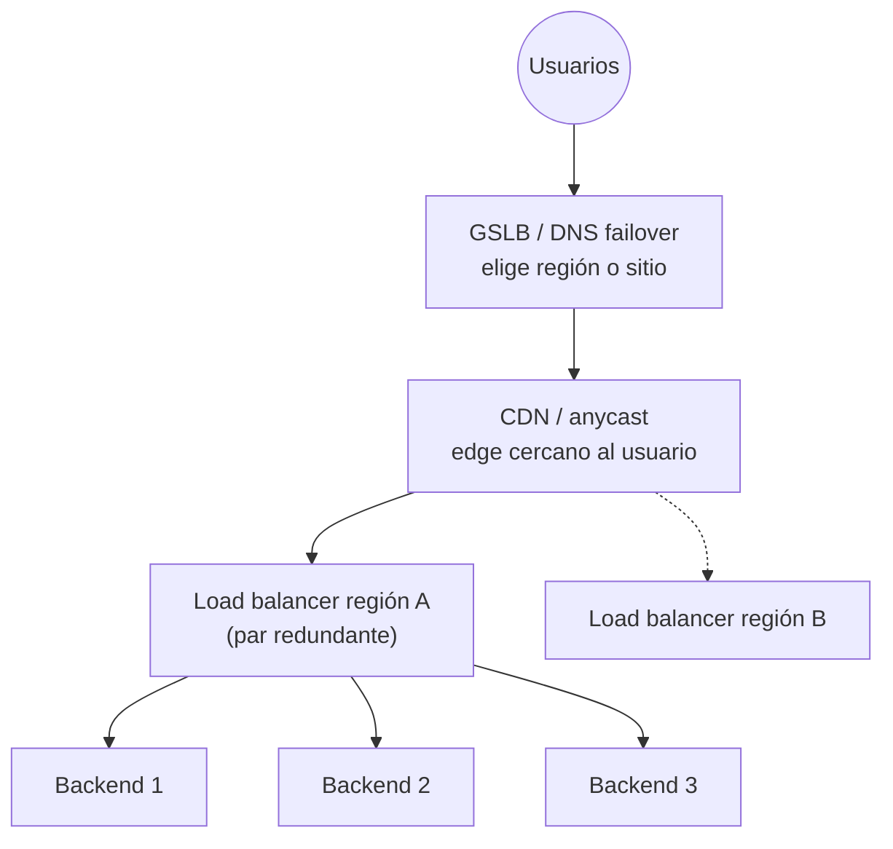

---
tags:
  - redes
  - networking
  - load-balancing
  - alta-disponibilidad
---

# Balanceo y alta disponibilidad de red

> Cómo se reparte el tráfico entre varios servidores y cómo se evita que un solo equipo de red sea el punto de falla: load balancers L4 y L7, algoritmos, health checks, reverse proxies, VRRP, anycast, GSLB y CDN.

!!! info "Antes de leer"
    Esta nota asume lo visto en [Seguridad de red](seguridad-red.md) (reverse proxies) y en las notas anteriores, en especial [Modelos OSI y TCP/IP](../basico/modelos-osi-tcpip.md) (capa 4 vs capa 7), [Servicios de red](../intermedio/servicios-red.md) (DNS y TTL) y [Protocolos de aplicación](../intermedio/protocolos-aplicacion.md) (HTTP y TLS).

## ¿Qué es el balanceo de carga?

Un **load balancer** (balanceador de carga) recibe el tráfico en una dirección única (una **VIP**, *virtual IP*, o un nombre DNS) y lo reparte entre varios **backends** (servidores, contenedores, funciones). Resuelve dos problemas a la vez:

- **Escalabilidad**: más servidores atienden más tráfico.
- **Disponibilidad**: si un backend falla, deja de recibir tráfico y el servicio sigue.

**High availability** (alta disponibilidad) en red significa que **ningún componente individual** (un servidor, un load balancer, un gateway, un enlace, un datacenter) sea un **SPOF** (*single point of failure*, punto único de falla). Por eso esta nota va de abajo hacia arriba: backends, el propio balanceador, el gateway, y finalmente sitios completos.



## L4 vs L7

| | **L4** (capa de transporte) | **L7** (capa de aplicación) |
| --- | --- | --- |
| Decide con | IP y puerto de origen/destino, protocolo (TCP/UDP) | Todo lo de HTTP: host, ruta, headers, cookies, método |
| Conexión | Reenvía la conexión (o la proxea sin mirar el contenido) | **Termina** la conexión del cliente y abre otra hacia el backend |
| TLS | Normalmente pasa cifrado hasta el backend (*passthrough*) | Lo termina: necesita el certificado |
| Funciones extra | Muy alto rendimiento, IP estática, cualquier protocolo TCP/UDP | Routing por ruta o host (`/api` → servicio A), redirecciones, reescritura de headers, WAF, compresión |
| Usos típicos | Bases de datos, protocolos no HTTP, tráfico masivo, gRPC o TLS de extremo a extremo | APIs y aplicaciones web, ingress de Kubernetes |

!!! note "La IP del cliente detrás del balanceador"
    Un L7 abre una conexión nueva hacia el backend, así que el backend ve la IP del balanceador. La IP original llega en el header `X-Forwarded-For` (HTTP) o con el **PROXY protocol** (para L4 que proxean TCP). Configura tu aplicación y tus logs para leerla, y confía en ese header **solo** si viene de tu propio balanceador.

## Algoritmos de balanceo

| Algoritmo | Cómo reparte | Cuándo usarlo |
| --- | --- | --- |
| **Round robin** | Por turnos: 1, 2, 3, 1, 2, 3… | Backends iguales y peticiones de costo parecido |
| **Weighted round robin** | Por turnos con pesos (un servidor con peso 2 recibe el doble) | Backends de distinto tamaño; *canary* con 5 % del tráfico |
| **Least connections** | Al backend con menos conexiones activas | Peticiones de duración muy variable, conexiones largas (WebSockets) |
| **Least response time / least outstanding requests** | Al que responde más rápido o tiene menos peticiones pendientes | Backends con rendimiento desigual |
| **Hashing** (IP de origen, header, URL) | Un hash decide el backend: el mismo cliente o clave va siempre al mismo | Afinidad sin cookies, cachés distribuidas |
| **Consistent hashing** (hashing consistente) | Variante en la que añadir o quitar un backend solo remapea una fracción pequeña de las claves | Cachés y sistemas con estado por clave |

## Health checks

Un **health check** (comprobación de salud) es lo que hace que el balanceo dé disponibilidad: el balanceador prueba cada backend y saca de rotación los que fallan.

| Tipo | Qué prueba |
| --- | --- |
| TCP | Que el puerto acepta conexiones |
| HTTP/HTTPS | Que una ruta (p. ej. `/healthz`) devuelve un código esperado (`200`) |
| Pasivo | Observa errores en el tráfico real (*outlier detection*) |

Parámetros que siempre verás: **intervalo**, **timeout**, **unhealthy threshold** (fallos seguidos para sacarlo) y **healthy threshold** (aciertos seguidos para volver a meterlo).

!!! warning "Qué debe comprobar un health check"
    Si `/healthz` comprueba también la base de datos y esta tiene un problema momentáneo, **todos** los backends fallan a la vez y el balanceador se queda sin destinos: convertiste un problema parcial en una caída total. Separa **liveness** (el proceso está vivo) de **readiness** (puede atender tráfico ahora) y sé cuidadosa con las dependencias que incluyes. Kubernetes usa exactamente esa separación en sus *probes* ([Kubernetes](../../devops/contenedores/kubernetes.md)).

**Connection draining** (o *deregistration delay*) es el tiempo que el balanceador espera a que terminen las conexiones en curso de un backend que sale de rotación. Sin él, cada despliegue corta peticiones a medias ([Despliegue continuo](../../devops/ci-cd/despliegue-continuo.md)).

## Sticky sessions

Las **sticky sessions** (sesiones persistentes, o *session affinity*) envían a un cliente siempre al mismo backend, normalmente con una cookie que pone el balanceador. Sirven para aplicaciones que guardan la sesión **en memoria** del servidor.

Su costo: reparto desigual, y si ese backend cae, el usuario pierde la sesión. La alternativa recomendada es diseñar la aplicación **stateless** y guardar la sesión en un almacén compartido (Redis, base de datos) o en un token; así cualquier backend puede atender cualquier petición.

## Reverse proxies: NGINX, HAProxy y Envoy

Un load balancer L7 es, por dentro, un **reverse proxy** con varios backends. Los tres más usados fuera de los servicios gestionados:

| | NGINX | HAProxy | Envoy |
| --- | --- | --- | --- |
| Perfil | Servidor web + reverse proxy | Balanceador L4/L7 de alto rendimiento | Proxy L4/L7 pensado para microservicios |
| Configuración | Archivos estáticos | Archivos estáticos (con API de runtime) | Dinámica por API (xDS) |
| Dónde lo verás | Ingress controllers, servidores web | Balanceo on-premise, bordes de alto tráfico | Service mesh (Istio), API gateways, Gateway API |

```nginx title="/etc/nginx/conf.d/api.conf"
upstream api_backend {
    least_conn;                          # algoritmo: menos conexiones
    server 10.0.11.10:8080 max_fails=3 fail_timeout=30s;
    server 10.0.12.10:8080 max_fails=3 fail_timeout=30s;
    server 10.0.13.10:8080 backup;       # solo si los otros fallan
}

server {
    listen 443 ssl;
    http2 on;
    server_name api.ejemplo.com;
    ssl_certificate     /etc/ssl/api/fullchain.pem;   # certificado + intermedios
    ssl_certificate_key /etc/ssl/api/privkey.pem;

    location / {
        proxy_pass http://api_backend;
        proxy_set_header Host $host;
        proxy_set_header X-Forwarded-For $proxy_add_x_forwarded_for;
        proxy_set_header X-Forwarded-Proto $scheme;
    }
}
```

`max_fails` es un health check **pasivo**; los checks activos están en NGINX Plus o en HAProxy y Envoy de serie.

### Dónde terminar TLS

| Modo | Cómo | Cuándo |
| --- | --- | --- |
| **TLS termination** (terminación) | El balanceador descifra y habla HTTP con el backend | Red interna de confianza; permite routing L7 y WAF |
| **TLS re-encryption** (recifrado) | Descifra, inspecciona y vuelve a cifrar hacia el backend | Requisitos de cifrado en tránsito de extremo a extremo con funciones L7 |
| **TLS passthrough** | El balanceador (L4) no descifra; el backend termina TLS | mTLS con el cliente final, o cuando el balanceador no debe ver el contenido |

## Redundancia de gateway: VRRP y HSRP

Los equipos de una red usan **un** default gateway. Si ese router cae, la red se queda sin salida aunque haya otro router al lado. La solución es una **IP virtual compartida**:

- **VRRP** (*Virtual Router Redundancy Protocol*, estándar abierto) y **HSRP** (*Hot Standby Router Protocol*, de Cisco) hacen que dos o más routers compartan una IP (y una MAC) virtual.
- Uno es el **activo** (*master* en VRRP, *active* en HSRP) y responde por la IP virtual; los demás escuchan sus anuncios periódicos. Si dejan de oírlos, el de mayor prioridad toma el control en segundos.
- Los clientes no se enteran: su gateway sigue siendo la misma IP.

En Linux, **keepalived** implementa VRRP y se usa para dar una IP flotante a un par de balanceadores (por ejemplo, dos HAProxy en activo-pasivo).

!!! info "En la nube no existe VRRP"
    Las redes cloud no permiten el broadcast/multicast que usa VRRP ni mover libremente una IP entre VMs. El gateway de la subred ya es redundante y lo gestiona el proveedor, y la redundancia de tus servicios la dan los **load balancers gestionados** (que ya son redundantes entre zonas) o mecanismos propios como reasignar una IP con una llamada a la API.

## Anycast

Con **anycast**, la **misma IP** se anuncia por **BGP** desde muchos sitios del mundo, y el routing de internet lleva a cada usuario al sitio más cercano en términos de red (ver [Routing y NAT](../intermedio/routing-nat.md)). Si un sitio cae, deja de anunciar la ruta y el tráfico va al siguiente, sin cambiar DNS. Lo usan los root servers de DNS, resolvers públicos como `1.1.1.1` y `8.8.8.8`, las CDN y los balanceadores globales de los proveedores cloud. Además, reparte naturalmente los ataques DDoS entre muchos sitios.

## GSLB y DNS failover

**GSLB** (*Global Server Load Balancing*) reparte usuarios entre **sitios o regiones**, normalmente respondiendo DNS distinto según:

| Política | Responde con |
| --- | --- |
| Failover | El sitio primario; si su health check falla, el secundario |
| Latencia / geolocalización | La región más cercana o rápida para ese usuario |
| Weighted | Un reparto por porcentaje (migraciones graduales) |

El límite es el **TTL**: los clientes y resolvers que ya tienen la respuesta en caché siguen yendo al sitio caído hasta que expire. Por eso los registros de failover usan TTL bajos (30–60 s) y por eso, cuando se necesita una conmutación más rápida, se combina con anycast. La parte de negocio (cuánto tiempo de caída es aceptable) se ve en [Resiliencia](../../cloud/operacion-y-gobierno/resiliencia.md) y en [Niveles de servicio](../../negocio/niveles-de-servicio.md).

## CDN

Una **CDN** (*Content Delivery Network*) es una red de **edge locations** (puntos de presencia) que cachean contenido cerca del usuario y reenvían al **origin** (origen) lo que no tienen.

- Reduce la **latencia** (el contenido está a pocos milisegundos) y la carga del origen.
- Absorbe picos y ataques DDoS en el borde; suele incluir WAF.
- Qué y cuánto tiempo se cachea lo decide `Cache-Control` (ver [Protocolos de aplicación](../intermedio/protocolos-aplicacion.md#headers-que-conviene-conocer)) y las reglas de la CDN.
- **Cache hit ratio**: porcentaje de peticiones servidas desde el edge. Un ratio bajo suele indicar headers mal puestos o URLs con parámetros únicos.

!!! warning "Cuidado con cachear contenido privado"
    Una respuesta con datos de un usuario cacheada por error en la CDN se le sirve a todos. Las respuestas personalizadas deben llevar `Cache-Control: private` o `no-store`.

## En la nube

| Pieza | AWS | Azure | Google Cloud |
| --- | --- | --- | --- |
| L7 regional | Application Load Balancer | Application Gateway | Regional Application Load Balancer |
| L4 | Network Load Balancer | Azure Load Balancer | Network Load Balancer (*passthrough* o *proxy*) |
| Global con anycast | AWS Global Accelerator | Azure Front Door, cross-region Load Balancer | Global external Application Load Balancer |
| GSLB por DNS | Route 53 routing policies con health checks | Azure Traffic Manager | Cloud DNS routing policies |
| CDN | Amazon CloudFront | Azure Front Door | Cloud CDN |

La tabla completa de load balancers está en [Redes en la nube](../../cloud/redes-y-datos/redes.md#load-balancers), y su papel en arquitecturas multizona en [Arquitecturas de referencia](../../cloud/arquitectura/arquitecturas-referencia.md).

## Relación con otras secciones

| Enfoque | Qué se mira desde ahí | Nota |
| --- | --- | --- |
| Networking (la base) | Capa 4 vs capa 7; DNS y TTL; BGP debajo de anycast; reverse proxy como control de seguridad | [Modelos OSI y TCP/IP](../basico/modelos-osi-tcpip.md), [Servicios de red](../intermedio/servicios-red.md), [Routing y NAT](../intermedio/routing-nat.md), [Seguridad de red](seguridad-red.md) |
| Cloud (el control) | Load balancers gestionados, alta disponibilidad multizona y multirregión, diseño stateless | [Redes en la nube](../../cloud/redes-y-datos/redes.md), [Resiliencia](../../cloud/operacion-y-gobierno/resiliencia.md), [Arquitectura en la nube](../../cloud/arquitectura/arquitectura-cloud.md) |
| DevOps (la automatización) | Health checks y draining en despliegues blue/green y canary; probes e ingress en Kubernetes; métricas del balanceador | [Despliegue continuo](../../devops/ci-cd/despliegue-continuo.md), [Kubernetes](../../devops/contenedores/kubernetes.md), [Observabilidad](../../devops/operacion/observabilidad.md) |
| DevSecOps (la verificación) | WAF y protección DDoS en el borde; TLS y certificados en el balanceador | [Pruebas dinámicas](../../devsecops/codigo-y-dependencias/pruebas-dinamicas.md), [Cumplimiento y gobierno](../../devsecops/gobierno-y-respuesta/cumplimiento.md) |
| Negocio TI (el porqué) | Disponibilidad compuesta y SLA: por qué duplicar cada pieza | [Niveles de servicio](../../negocio/niveles-de-servicio.md) |
| Laboratorios (la práctica) | Practicar esto paso a paso | [Lab 06: Desplegar una app en Kubernetes local con kind](../../laboratorios/devops/kubernetes-local-kind.md) |

**Siguiente:** [Redes de datacenter e híbridas](redes-datacenter-hibridas.md)

## Referencias

- [RFC 5798: Virtual Router Redundancy Protocol (VRRP) Version 3](https://www.rfc-editor.org/rfc/rfc5798)
- [NGINX: HTTP Load Balancing](https://docs.nginx.com/nginx/admin-guide/load-balancer/http-load-balancer/)
- [HAProxy documentation](https://docs.haproxy.org/)
- [Envoy proxy documentation](https://www.envoyproxy.io/docs/envoy/latest/)
- [Keepalived](https://www.keepalived.org/)
- [Cloudflare: ¿Qué es el balanceo de carga?](https://www.cloudflare.com/es-es/learning/performance/what-is-load-balancing/)
- [Cloudflare: ¿Qué es una CDN?](https://www.cloudflare.com/es-es/learning/cdn/what-is-a-cdn/)
- [Elastic Load Balancing](https://docs.aws.amazon.com/elasticloadbalancing/latest/userguide/what-is-load-balancing.html)
- [Opciones de equilibrio de carga en Azure](https://learn.microsoft.com/es-es/azure/architecture/guide/technology-choices/load-balancing-overview)
- [Cloud Load Balancing overview](https://cloud.google.com/load-balancing/docs/load-balancing-overview)
