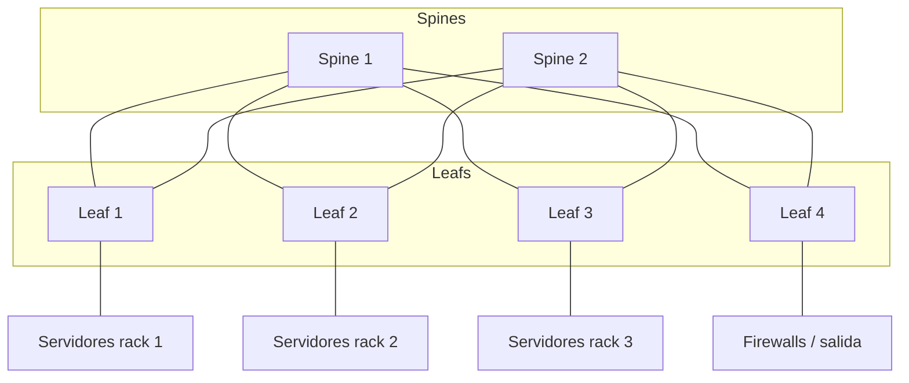
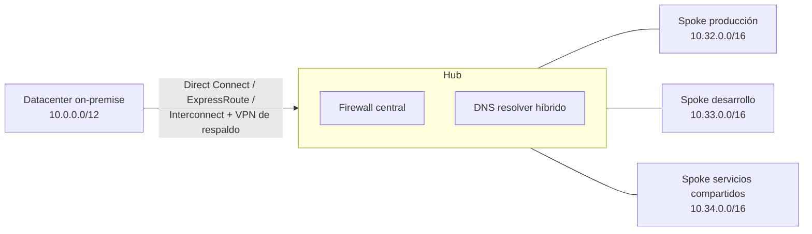

---
tags:
  - redes
  - networking
  - arquitectura
  - hibrida
---

# Redes de datacenter y redes híbridas

> Cómo se diseña la red de un datacenter (three-tier y spine-leaf), qué aportan SDN y VXLAN, y cómo se conecta un datacenter con la nube sin solapamientos de IPs.

!!! info "Antes de leer"
    Esta nota asume lo visto en [Balanceo y alta disponibilidad](balanceo-alta-disponibilidad.md) y en las notas anteriores, en especial [Capa de enlace y Ethernet](../basico/capa-enlace-ethernet.md) (VLANs, Spanning Tree), [Direccionamiento IP](../basico/direccionamiento-ip.md) (CIDR, RFC 1918), [Routing y NAT](../intermedio/routing-nat.md) (BGP) y [Seguridad de red](seguridad-red.md) (IPsec).

## ¿Qué es una red de datacenter?

Es la red que conecta los servidores, el almacenamiento y los equipos de seguridad de un datacenter entre sí y con el exterior. Su diseño depende de por dónde va el tráfico:

- **North-south** (norte-sur): entre el datacenter y el exterior (usuarios, internet, otras sedes).
- **East-west** (este-oeste): entre servidores dentro del datacenter (aplicación ↔ base de datos, microservicio ↔ microservicio, replicación de almacenamiento).

Hace veinte años dominaba el tráfico north-south. Con virtualización, microservicios y almacenamiento distribuido, hoy el **east-west es mayoritario**, y eso cambió la forma de diseñar la red.

## Diseño three-tier

El modelo clásico (*three-tier*, tres capas, o **core/distribution/access**):

| Capa | Función |
| --- | --- |
| **Access** (acceso) | Switches donde se conectan los servidores (*top of rack*) o los usuarios. VLANs |
| **Distribution** / **aggregation** (distribución) | Agrega los switches de acceso; routing entre VLANs, políticas, gateways (con VRRP/HSRP) |
| **Core** (núcleo) | Transporte rápido entre bloques de distribución y hacia la salida |

Funciona bien para tráfico north-south, pero tiene límites con el east-west: dos servidores en bloques distintos atraviesan varias capas (más saltos, latencia variable), y como la capa 2 se extiende con VLANs, **Spanning Tree** bloquea enlaces redundantes para evitar bucles, así que se paga por enlaces que no se usan.

## Diseño spine-leaf

El diseño moderno para datacenter (topología **Clos**):

- **Leaf** (hoja): switches donde se conectan los servidores. Cada leaf se conecta a **todos** los spines.
- **Spine** (columna): switches que solo interconectan leafs. Los spines no se conectan entre sí, ni los leafs entre sí.

| | Three-tier | Spine-leaf |
| --- | --- | --- |
| Saltos entre dos servidores | Variable | Siempre **leaf → spine → leaf** (latencia predecible) |
| Enlaces redundantes | Spanning Tree bloquea algunos | Todos activos con routing capa 3 y **ECMP** (*Equal-Cost Multi-Path*, reparto entre rutas de igual costo) |
| Cómo crece | Cambiar equipos por otros más grandes (*scale up*) | Añadir leafs (más puertos) o spines (más ancho de banda) (*scale out*) |
| Pensado para | Tráfico north-south, campus | Tráfico east-west, datacenters y nubes |

La salida a internet o a otras sedes se conecta en unos leafs dedicados, los **border leafs**.

## SDN

**SDN** (*Software-Defined Networking*, redes definidas por software) separa:

- El **control plane** (plano de control): decide cómo se reenvía el tráfico (rutas, políticas).
- El **data plane** (plano de datos): reenvía los paquetes según esas decisiones.

En una red clásica cada equipo tiene los dos planos y se configura uno a uno. En SDN un **controller** (controlador) centralizado programa a muchos equipos a través de una API: la red se gestiona como software, con automatización e intención (*"la app A puede hablar con la B"*) en vez de comandos por equipo.

!!! note "La nube es SDN"
    Cuando creas una VPC, una subnet o una regla de security group con una llamada a la API y se aplica en segundos sobre miles de hosts, estás usando la SDN del proveedor. Por eso en la nube no ves switches ni VLANs: ves objetos de API. Esa es la base de definir la red como código ([Infrastructure as Code](../../devops/iac/infraestructura-como-codigo.md)).

## Overlays y VXLAN

Una red **overlay** (superpuesta) es una red virtual construida encima de otra física (la **underlay**), encapsulando los paquetes de una dentro de los de la otra.

**VXLAN** (*Virtual Extensible LAN*) es el overlay estándar en datacenters:

- Encapsula **tramas Ethernet completas dentro de paquetes UDP** (puerto 4789). Así una red capa 2 puede extenderse sobre una underlay capa 3 (como un spine-leaf con routing).
- Identifica cada red con un **VNI** (*VXLAN Network Identifier*) de 24 bits: unos **16 millones** de segmentos, frente a los 4094 VLANs utilizables de 802.1Q. Esto es lo que permite la multi-tenancy a gran escala.
- Los extremos que encapsulan y desencapsulan se llaman **VTEP** (*VXLAN Tunnel Endpoint*); suelen ser los leafs o el hipervisor.
- Para que los VTEP aprendan dónde está cada MAC sin inundar la red se usa **BGP EVPN** como plano de control.

!!! warning "El overlay come MTU"
    La encapsulación VXLAN añade unos 50 bytes. Si la underlay tiene MTU 1500, los paquetes de 1500 del overlay no caben y se fragmentan o se descartan. Por eso las underlays usan **jumbo frames** (MTU ~9000) o el overlay reduce su MTU. Lo mismo pasa con túneles IPsec y con las redes de pods en Kubernetes: es un caso clásico de [Troubleshooting de red](troubleshooting-red.md).

## Conectividad híbrida

Una **red híbrida** conecta el datacenter on-premise (o las oficinas) con una o varias nubes como si fueran una sola red privada.

| Opción | Cómo va | Ventajas | Límites |
| --- | --- | --- | --- |
| **VPN site-to-site** (IPsec) | Túnel cifrado por internet | Se monta en horas, barata, cifrada | Latencia y ancho de banda variables (depende de internet) |
| **Conexión dedicada** | Circuito privado entre tu red y el proveedor, en un punto de interconexión | Ancho de banda estable, latencia predecible, no pasa por internet | Semanas de aprovisionamiento, más cara, **no cifrada por defecto** |

En la nube, la conexión dedicada se llama **AWS Direct Connect**, **Azure ExpressRoute** o **Cloud Interconnect**; los servicios de VPN de cada proveedor están en [Redes en la nube: conexión con on-premises](../../cloud/redes-y-datos/redes.md#conexion-con-on-premises).

En los tres casos las rutas se intercambian normalmente con **BGP**: el router on-premise anuncia sus prefijos y aprende los de la nube. Un diseño típico combina una conexión dedicada como camino principal y una VPN como respaldo, o dos conexiones dedicadas en ubicaciones distintas para alta disponibilidad.

## Hub-and-spoke

Con varias redes en la nube (una por aplicación o por entorno) más la conexión al datacenter, conectar todas con todas por peering no escala (y el peering no es transitivo). El modelo **hub-and-spoke** (concentrador y radios) pone una red central por la que pasa todo:

- El **hub** concentra la conectividad con on-premise, la salida a internet, el firewall central y el DNS híbrido ([Servicios de red](../intermedio/servicios-red.md#en-la-nube)).
- Los **spokes** solo se conectan al hub. Si dos spokes deben hablar, el tráfico pasa por el hub (y su firewall), lo que permite inspeccionarlo y controlarlo.

En la nube el hub puede ser un servicio gestionado (AWS Transit Gateway, Azure Virtual WAN, Network Connectivity Center) o una red propia con un firewall; la comparación está en [Redes en la nube: peering y hubs](../../cloud/redes-y-datos/redes.md#peering-y-hubs).

## En la nube

Cada pieza de un datacenter tiene un equivalente gestionado en la nube: el switch con su VLAN pasa a ser una subnet, el firewall perimetral un firewall gestionado, el circuito MPLS una conexión dedicada y el core de la WAN un hub de tránsito. La tabla de equivalencias on-premise ↔ nube, con los nombres en AWS, Azure y Google Cloud, está en [Redes en la nube](../../cloud/redes-y-datos/redes.md#equivalencias-con-on-premise).

## Planificar IPs sin solapamientos

Dos redes con rangos solapados **no se pueden enrutar entre sí** (el router no sabe a cuál de las dos va `10.0.5.10`). Se pueden parchar con NAT, pero es frágil y complica todo. La solución es planificar desde el principio un **IPAM** (*IP Address Management*, gestión de direcciones IP) para toda la organización.

### Ejemplo de plan

Partimos de `10.0.0.0/8` (RFC 1918) y reservamos bloques grandes por ubicación:

| Bloque | Rango | Direcciones | Uso |
| --- | --- | --- | --- |
| `10.0.0.0/12` | 10.0.0.0 – 10.15.255.255 | ~1 millón | On-premise (datacenter y oficinas) |
| `10.16.0.0/12` | 10.16.0.0 – 10.31.255.255 | ~1 millón | Reservado (otra nube, adquisiciones) |
| `10.32.0.0/12` | 10.32.0.0 – 10.47.255.255 | ~1 millón | Nube, región principal: una `/16` por VPC/VNet (16 redes) |
| `10.48.0.0/12` | 10.48.0.0 – 10.63.255.255 | ~1 millón | Nube, región secundaria (DR) |
| `100.64.0.0/10` | — | — | Rango CGNAT ([RFC 6598](https://www.rfc-editor.org/rfc/rfc6598)), usado a veces para pods de Kubernetes |

Dentro de cada `/16` de la nube, la división en subredes `/24` por zona y capa se calcula como en [Direccionamiento IP](../basico/direccionamiento-ip.md).

!!! tip "Reglas para el plan de IPs"
    - **Bloques por región y por entorno**, alineados a límites de CIDR, para poder resumir rutas (una sola ruta `10.32.0.0/12` hacia la nube en vez de dieciséis).
    - Reserva espacio para crecer: es mucho más fácil no usar un bloque que ampliar una red ya en uso.
    - Pregunta por los rangos que **ya existen**: oficinas, VPN de usuarios, redes de socios, otras nubes.
    - Cuidado con rangos por defecto: `172.17.0.0/16` es la red bridge por defecto de Docker, y las redes de pods y services de Kubernetes también consumen rangos.
    - Gestiona el plan en una herramienta (Amazon VPC IPAM, Azure Virtual Network Manager con IPAM, o una hoja de cálculo controlada por versiones al principio) y asigna los rangos desde IaC.

## Relación con otras secciones

| Enfoque | Qué se mira desde ahí | Nota |
| --- | --- | --- |
| Networking (la base) | VLANs y Spanning Tree; CIDR y subnetting; BGP; IPsec; DNS híbrido; problemas de MTU | [Capa de enlace y Ethernet](../basico/capa-enlace-ethernet.md), [Direccionamiento IP](../basico/direccionamiento-ip.md), [Routing y NAT](../intermedio/routing-nat.md), [Seguridad de red](seguridad-red.md), [Troubleshooting de red](troubleshooting-red.md) |
| Cloud (el control) | VPC/VNet, peering, hubs, conexiones dedicadas; landing zone con red central; migración desde on-premise | [Redes en la nube](../../cloud/redes-y-datos/redes.md), [Gobernanza](../../cloud/operacion-y-gobierno/gobernanza.md), [Migración a la nube](../../cloud/arquitectura/migracion-cloud.md) |
| DevOps (la automatización) | Hub, spokes, rutas y plan de IPs definidos como código; redes de pods en Kubernetes | [Infrastructure as Code](../../devops/iac/infraestructura-como-codigo.md), [Terraform](../../devops/iac/terraform-basico.md), [Kubernetes](../../devops/contenedores/kubernetes.md) |
| DevSecOps (la verificación) | Inspección centralizada en el hub; segmentación entre spokes; cumplimiento de la topología | [Seguridad de IaC](../../devsecops/infraestructura-y-contenedores/seguridad-iac.md), [Cumplimiento y gobierno](../../devsecops/gobierno-y-respuesta/cumplimiento.md) |
| Laboratorios (la práctica) | Practicar esto paso a paso | [Lab 02: Plan de direccionamiento IP para una VPC](../../laboratorios/fundamentos/subnetting-plan-ips.md), [Lab 19: Azure: VNet, NSG y una VM con Azure CLI](../../laboratorios/cloud/azure-vnet-vm.md) |

**Siguiente:** [Troubleshooting de red](troubleshooting-red.md)

## Referencias

- [RFC 7348: Virtual eXtensible Local Area Network (VXLAN)](https://www.rfc-editor.org/rfc/rfc7348)
- [RFC 7432: BGP MPLS-Based Ethernet VPN](https://www.rfc-editor.org/rfc/rfc7432)
- [RFC 1918: Address Allocation for Private Internets](https://www.rfc-editor.org/rfc/rfc1918)
- [AWS Direct Connect](https://docs.aws.amazon.com/directconnect/latest/UserGuide/Welcome.html)
- [AWS Transit Gateway](https://docs.aws.amazon.com/vpc/latest/tgw/what-is-transit-gateway.html)
- [Amazon VPC IP Address Manager](https://docs.aws.amazon.com/vpc/latest/ipam/what-it-is-ipam.html)
- [Azure ExpressRoute](https://learn.microsoft.com/es-es/azure/expressroute/expressroute-introduction)
- [Topología de red en estrella tipo hub-spoke en Azure](https://learn.microsoft.com/es-es/azure/architecture/networking/architecture/hub-spoke)
- [Cloud Interconnect overview](https://cloud.google.com/network-connectivity/docs/interconnect/concepts/overview)
- [Network Connectivity Center](https://cloud.google.com/network-connectivity/docs/network-connectivity-center/concepts/overview)
