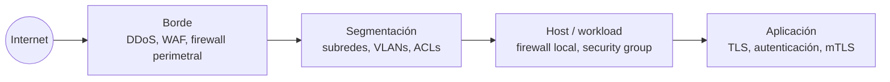
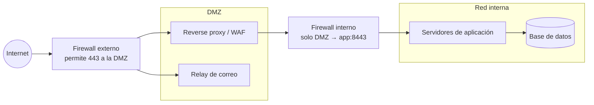

---
tags:
  - redes
  - networking
  - seguridad
  - firewall
  - vpn
---

# Seguridad de red

> Cómo se controla y se protege el tráfico: tipos de firewall, DMZ y segmentación, IDS/IPS, proxies, VPN, zero trust y los ataques de red más comunes con sus mitigaciones.

!!! info "Antes de leer"
    Esta nota asume lo visto en [Protocolos de aplicación](../intermedio/protocolos-aplicacion.md) (TLS) y en todas las notas anteriores, en especial [Capa de transporte](../intermedio/capa-transporte.md) (firewalls stateful y tráfico de retorno), [Routing y NAT](../intermedio/routing-nat.md) y [Capa de enlace y Ethernet](../basico/capa-enlace-ethernet.md) (VLANs y ARP).

## ¿Qué es la seguridad de red?

Es el conjunto de controles que decide **qué tráfico puede ir de dónde a dónde**, que **detecta** el tráfico malicioso y que **protege** la confidencialidad del que viaja por redes no confiables. Se aplica en capas (**defense in depth**, defensa en profundidad): ningún control es suficiente solo.



## Firewalls

Un **firewall** permite o bloquea tráfico según reglas. Lo que cambia entre tipos es **cuánta información mira** para decidir.

| Tipo | Mira | Ventaja | Límite |
| --- | --- | --- | --- |
| **Stateless** (filtro de paquetes sin estado) | Cada paquete por separado: IPs, protocolo, puertos | Muy rápido, simple | Hay que permitir explícitamente el tráfico de retorno (puertos efímeros) |
| **Stateful** (con estado) | Además, la **tabla de conexiones**: si una conexión se inició desde dentro, deja pasar su respuesta | Reglas más cortas y seguras | Consume memoria por conexión; se puede saturar |
| **NGFW** (*Next-Generation Firewall*) | Además, la **aplicación** (identifica "esto es SSH" aunque vaya por el 443), el usuario, la reputación de URLs; incluye IPS y puede inspeccionar TLS | Políticas por aplicación e identidad | Más caro y complejo; la inspección TLS rompe el cifrado extremo a extremo |
| **WAF** (*Web Application Firewall*) | El contenido HTTP: inyección SQL, XSS, bots, rate limiting | Protege aplicaciones web (capa 7) | Solo HTTP(S); necesita ajuste para evitar falsos positivos |

Como viste en la capa de transporte, un firewall stateful recuerda la conexión; un stateless no. Esa diferencia es exactamente la de un **security group** (stateful) frente a una **Network ACL** (stateless) en AWS.

!!! tip "Reglas de firewall bien escritas"
    - **Default deny** (denegar por defecto) y abrir solo lo necesario.
    - Origen lo más específico posible: un rango, un grupo o una identidad, nunca `0.0.0.0/0` para administración.
    - Una regla, un motivo: documenta el porqué (ticket, servicio) en la descripción.
    - Revisa periódicamente reglas sin uso; los firewalls acumulan reglas "por si acaso".

## DMZ y segmentación

### DMZ

Una **DMZ** (*demilitarized zone*, zona desmilitarizada) es una red intermedia donde se colocan los servicios que reciben tráfico de internet (reverse proxy, servidores web, relay de correo). Si uno de ellos se ve comprometido, el atacante **no** queda dentro de la red interna: todavía tiene que atravesar otro firewall.



En la nube, el equivalente es la **public subnet** con solo el load balancer, y las aplicaciones y bases de datos en **private subnets** (ver [Redes en la nube](../../cloud/redes-y-datos/redes.md#subnets-publicas-y-privadas)).

### Segmentación y microsegmentación

- **Segmentación**: dividir la red en zonas (por entorno, por sensibilidad, por función) con controles entre ellas. Se hace con VLANs, subredes, ACLs y firewalls. Limita el **lateral movement** (movimiento lateral): que un atacante que entra por un equipo llegue a todos los demás.
- **Microsegmentación**: llevar la segmentación hasta **cada workload** (cada VM, contenedor o pod), con políticas basadas en identidad o etiquetas y no en IPs. Ejemplos: security groups que referencian otros security groups, NetworkPolicies de Kubernetes ([Seguridad de Kubernetes](../../devsecops/infraestructura-y-contenedores/seguridad-kubernetes.md#networkpolicy)).

| Segmento típico | Puede hablar con | No debería hablar con |
| --- | --- | --- |
| Producción | Sus dependencias de producción | Desarrollo, laptops de usuarios |
| Base de datos | Solo la capa de aplicación, en su puerto | Internet, otras aplicaciones |
| Administración (gestión) | Interfaces de gestión de los equipos | Tráfico de usuarios |
| Invitados / Wi-Fi visitas | Internet | Cualquier red interna |

## IDS e IPS

| | IDS (*Intrusion Detection System*) | IPS (*Intrusion Prevention System*) |
| --- | --- | --- |
| Qué hace | **Detecta** y alerta | **Detecta y bloquea** |
| Dónde se ubica | Fuera de línea: recibe una copia del tráfico (*port mirroring*, TAP) | En línea: el tráfico pasa por él |
| Riesgo | Llega tarde: solo avisa | Un falso positivo corta tráfico legítimo; si cae, puede cortar la red |

Detectan por **firmas** (patrones conocidos de ataques) o por **anomalías** (desvíos del comportamiento normal). Herramientas open source conocidas: **Suricata** y **Snort** (IDS/IPS) y **Zeek** (análisis y logs de tráfico). Hoy el IPS suele venir integrado en el NGFW. Sus alertas alimentan el SIEM ([Detección y respuesta](../../devsecops/gobierno-y-respuesta/deteccion-respuesta.md)).

## Proxies

Un **proxy** es un intermediario que recibe la conexión y abre otra hacia el destino.

| | Forward proxy | Reverse proxy |
| --- | --- | --- |
| Representa a | Los **clientes** (salen a internet a través de él) | Los **servidores** (los clientes entran a través de él) |
| Para qué | Filtrar y registrar la navegación, controlar la salida (*egress*) de servidores, cachear | Terminar TLS, balancear, WAF, ocultar los backends |
| Ejemplos | Squid, proxies web corporativos, *secure web gateways* | NGINX, HAProxy, Envoy, load balancers L7 |

!!! note "Controlar la salida también es seguridad"
    Muchas defensas miran solo lo que entra. Pero un servidor comprometido necesita **salir** para descargar herramientas o exfiltrar datos. Forzar la salida de los servidores por un proxy o firewall con lista de destinos permitidos (*egress filtering*) corta muchos ataques en esa fase.

El reverse proxy como balanceador se desarrolla en [Balanceo y alta disponibilidad](balanceo-alta-disponibilidad.md).

## VPN

Una **VPN** (*Virtual Private Network*) crea un túnel cifrado sobre una red no confiable (internet) para que dos redes, o un usuario y una red, se comuniquen como si estuvieran conectados directamente.

| Tipo | Conecta | Tecnología habitual |
| --- | --- | --- |
| **Site-to-site** | Una red con otra (oficina ↔ datacenter ↔ nube) | **IPsec** |
| **Client VPN** / *remote access* | Un usuario con una red | IPsec, VPN sobre TLS (OpenVPN y similares), WireGuard |

### IPsec en lo esencial

- **IKE** (*Internet Key Exchange*, hoy IKEv2) negocia y autentica el túnel (con clave precompartida o certificados). Usa **UDP 500**, y **UDP 4500** cuando hay NAT en el camino (*NAT traversal*).
- **ESP** (*Encapsulating Security Payload*) cifra y autentica los paquetes del túnel.
- En **tunnel mode** (modo túnel) se cifra el paquete IP completo y se envuelve en uno nuevo: es el modo de las VPN site-to-site.
- Para que un túnel suba, **ambos lados deben coincidir** en parámetros (algoritmos de cifrado, grupos Diffie-Hellman, tiempos de vida). Es la causa número uno de túneles que no levantan.
- Las rutas a través del túnel pueden ser estáticas o aprendidas con **BGP** (ver [Routing y NAT](../intermedio/routing-nat.md)); con BGP el failover entre dos túneles es automático.

### WireGuard

**WireGuard** es un protocolo de VPN moderno: muy poco código, criptografía fija y moderna (sin negociar algoritmos), corre sobre **UDP** y se configura con un par de llaves por extremo, de forma parecida a SSH.

```ini title="/etc/wireguard/wg0.conf"
[Interface]
PrivateKey = <clave-privada-de-este-equipo>
Address = 10.200.0.2/32

[Peer]
PublicKey = <clave-publica-del-servidor>
Endpoint = vpn.ejemplo.com:51820
AllowedIPs = 10.0.0.0/16      # solo el tráfico a esta red va por el túnel
PersistentKeepalive = 25
```

`AllowedIPs` decide qué tráfico entra al túnel: aquí es **split tunneling** (túnel dividido, solo la red corporativa va por la VPN); con `0.0.0.0/0` sería *full tunnel* (todo el tráfico).

## Zero trust y ZTNA

El modelo clásico de **perímetro** ("dentro de la red es confiable, fuera no") falla cuando hay nube, teletrabajo y atacantes que ya entraron. **Zero trust** (confianza cero) parte de que **ninguna ubicación de red da confianza por sí misma**:

- Cada acceso se **autentica y autoriza** según la identidad del usuario o servicio, el estado del dispositivo y el contexto, y se reevalúa continuamente.
- **Least privilege** (mínimo privilegio): acceso a **una aplicación**, no a toda una red.
- Se asume que la brecha ya ocurrió (*assume breach*): segmentación, cifrado interno y monitoreo en todas partes.

**ZTNA** (*Zero Trust Network Access*) es su aplicación al acceso remoto: en vez de una VPN que te mete en la red completa, un broker te conecta solo con la aplicación autorizada, tras verificar identidad y dispositivo. Ejemplos en la nube: **AWS Verified Access**, **Microsoft Entra Private Access** y **Identity-Aware Proxy (IAP)** de Google Cloud.

## Ataques comunes y mitigaciones

| Ataque | Cómo funciona | Mitigaciones |
| --- | --- | --- |
| **IP spoofing** (suplantación de IP) | Enviar paquetes con IP de origen falsa (base de muchos DDoS por reflexión) | Filtrado de origen en el borde (**BCP 38**, *ingress filtering*), anti-spoofing en firewalls |
| **ARP spoofing** | Responder ARP falsos para que el tráfico de la LAN pase por el atacante | **Dynamic ARP Inspection** y DHCP snooping en switches; cifrado (TLS) aunque la red sea local |
| **DNS spoofing / cache poisoning** | Inyectar respuestas DNS falsas | DNSSEC, resolvers actualizados, DoT/DoH hacia resolvers de confianza |
| **MITM** (*man-in-the-middle*, intermediario) | Interponerse entre dos partes para leer o modificar el tráfico | TLS bien validado, **HSTS**, mTLS, no ignorar alertas de certificado ni de host key SSH |
| **DDoS volumétrico** | Saturar el ancho de banda (a menudo por reflexión y amplificación con DNS, NTP, memcached) | Servicios anti-DDoS del proveedor o de terceros, anycast, CDN |
| **DDoS de protocolo** (p. ej. **SYN flood**) | Agotar la tabla de conexiones con handshakes a medias | **SYN cookies**, límites de conexión, protección en el borde |
| **DDoS de aplicación** (capa 7) | Peticiones HTTP "legítimas" en masa a endpoints caros | WAF con rate limiting, CDN y caché, detección de bots, autoescalado |
| **Escaneo de puertos** | Descubrir servicios expuestos | Exponer lo mínimo, default deny, alertas en IDS |

!!! danger "No todo es red"
    Un firewall perfecto no protege una aplicación vulnerable que tiene que estar expuesta en el 443. La seguridad de red reduce la superficie y frena el movimiento lateral; la seguridad del código y de las identidades hace el resto ([Fundamentos DevSecOps](../../devsecops/fundamentos-devsecops.md)).

## En la nube

| Control | AWS | Azure | Google Cloud |
| --- | --- | --- | --- |
| Firewall stateful por recurso | Security group | Network security group (NSG), application security groups | VPC firewall rules, firewall policies |
| Firewall stateless por subred | Network ACL | — (el NSG en la subnet es stateful) | — |
| Firewall gestionado / NGFW | AWS Network Firewall | Azure Firewall (Standard, Premium con IDPS e inspección TLS) | Cloud Next Generation Firewall (Cloud NGFW) |
| WAF | AWS WAF | Azure Web Application Firewall (en Application Gateway o Front Door) | Google Cloud Armor |
| Protección DDoS | AWS Shield (Standard incluido, Advanced de pago) | Azure DDoS Protection | Google Cloud Armor |
| VPN site-to-site | AWS Site-to-Site VPN | Azure VPN Gateway | Cloud VPN (HA VPN) |
| Acceso remoto / ZTNA | AWS Client VPN, AWS Verified Access | VPN Gateway point-to-site, Microsoft Entra Private Access | Identity-Aware Proxy (IAP) |

Detalle de reglas, valores por defecto y ejemplos en [Redes en la nube](../../cloud/redes-y-datos/redes.md#firewalls-stateful-y-stateless) y [Seguridad base](../../cloud/identidad-y-seguridad/seguridad-base.md).

## Relación con otras secciones

| Enfoque | Qué se mira desde ahí | Nota |
| --- | --- | --- |
| Networking (la base) | Firewalls stateful sobre TCP; TLS contra MITM; reverse proxies; VPN hacia la nube; diagnosticar un firewall que bloquea | [Capa de transporte](../intermedio/capa-transporte.md), [Protocolos de aplicación](../intermedio/protocolos-aplicacion.md), [Balanceo y alta disponibilidad](balanceo-alta-disponibilidad.md), [Redes de datacenter e híbridas](redes-datacenter-hibridas.md), [Troubleshooting de red](troubleshooting-red.md) |
| Cloud (el control) | Security groups, NSG, firewall rules, WAF, DDoS y firewalls gestionados | [Redes en la nube](../../cloud/redes-y-datos/redes.md), [Seguridad base](../../cloud/identidad-y-seguridad/seguridad-base.md), [Gobernanza](../../cloud/operacion-y-gobierno/gobernanza.md) |
| DevOps (la automatización) | Reglas de firewall y segmentación definidas como código y revisadas en pull requests | [Infrastructure as Code](../../devops/iac/infraestructura-como-codigo.md), [Terraform](../../devops/iac/terraform-basico.md) |
| DevSecOps (la verificación) | Detectar reglas abiertas a `0.0.0.0/0`; NetworkPolicies; amenazas y riesgo (STRIDE); alertas de IDS en el SIEM | [Seguridad de IaC](../../devsecops/infraestructura-y-contenedores/seguridad-iac.md), [Seguridad de Kubernetes](../../devsecops/infraestructura-y-contenedores/seguridad-kubernetes.md), [Fundamentos DevSecOps](../../devsecops/fundamentos-devsecops.md), [Detección y respuesta](../../devsecops/gobierno-y-respuesta/deteccion-respuesta.md), [CVE en dispositivos perimetrales y VPN](../../devsecops/vulnerabilidades/cve-perimetro-vpn.md) |
| Laboratorios (la práctica) | Practicar esto paso a paso | [Lab 01: Diagnóstico de red desde Linux](../../laboratorios/fundamentos/linux-red-diagnostico.md), [Lab 14: Endurecer un clúster: Pod Security, NetworkPolicy y Kyverno](../../laboratorios/devsecops/seguridad-kubernetes.md), [Lab 17: AWS: VPC con subnets públicas y privadas y una EC2](../../laboratorios/cloud/aws-vpc-ec2.md), [Lab 19: Azure: VNet, NSG y una VM con Azure CLI](../../laboratorios/cloud/azure-vnet-vm.md), [Lab 22: Endurecer un servidor Linux con Ansible y medirlo con Lynis y OpenSCAP](../../laboratorios/devsecops/hardening-linux-ansible.md) |

**Siguiente:** [Balanceo y alta disponibilidad](balanceo-alta-disponibilidad.md)

## Referencias

- [NIST SP 800-207: Zero Trust Architecture](https://csrc.nist.gov/pubs/sp/800/207/final)
- [NIST SP 800-41 Rev. 1: Guidelines on Firewalls and Firewall Policy](https://csrc.nist.gov/pubs/sp/800/41/r1/final)
- [RFC 7296: Internet Key Exchange Protocol Version 2 (IKEv2)](https://www.rfc-editor.org/rfc/rfc7296)
- [WireGuard](https://www.wireguard.com/)
- [BCP 38 (RFC 2827): Network Ingress Filtering](https://www.rfc-editor.org/rfc/rfc2827)
- [Cloudflare: ¿Qué es un ataque DDoS?](https://www.cloudflare.com/es-es/learning/ddos/what-is-a-ddos-attack/)
- [Suricata](https://docs.suricata.io/)
- [AWS Network Firewall](https://docs.aws.amazon.com/network-firewall/latest/developerguide/what-is-aws-network-firewall.html)
- [Azure Firewall](https://learn.microsoft.com/es-es/azure/firewall/overview)
- [Cloud Next Generation Firewall](https://cloud.google.com/firewall/docs/about-firewalls)
- [AWS Verified Access](https://docs.aws.amazon.com/verified-access/latest/ug/what-is-verified-access.html)
- [Microsoft Entra Private Access](https://learn.microsoft.com/es-es/entra/global-secure-access/concept-private-access)
- [Identity-Aware Proxy](https://cloud.google.com/iap/docs/concepts-overview)
