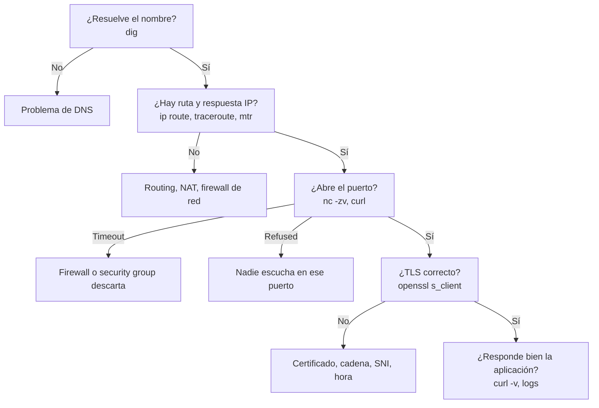

---
tags:
  - redes
  - networking
  - troubleshooting
  - observabilidad
---

# Troubleshooting de red

> Cómo diagnosticar un problema de red con método: recorrer las capas, elegir la herramienta adecuada, leer su salida y resolver los casos más típicos, on-premise y en la nube.

!!! info "Antes de leer"
    Esta es la última nota de la sección y usa todo lo anterior. La previa es [Redes de datacenter e híbridas](redes-datacenter-hibridas.md); el modelo por capas de [Modelos OSI y TCP/IP](../basico/modelos-osi-tcpip.md) es el mapa que vas a seguir.

## ¿Qué es el troubleshooting de red?

Es diagnosticar **por qué dos cosas no se comunican como deberían**: no conecta, conecta lento, conecta a veces. Lo que separa un diagnóstico de horas de uno de minutos no son los comandos, es el **método**: formular hipótesis, probar una cosa a la vez y descartar capas.

Antes de tocar nada, define el problema con precisión:

- **Qué** falla exactamente (mensaje de error literal, código HTTP, timeout).
- **Desde dónde** hacia **dónde** (origen, destino, puerto). ¿Falla desde todos los orígenes o desde uno?
- **Desde cuándo**, y **qué cambió** (despliegue, regla de firewall, certificado, DNS). La mayoría de los incidentes siguen a un cambio.
- ¿Es **siempre** o **intermitente**?

## Metodologías

| Enfoque | Cómo | Cuándo |
| --- | --- | --- |
| **Bottom-up** (de abajo hacia arriba) | Empiezas por la capa física/enlace y subes: interfaz, IP, ruta, puerto, aplicación | Problemas nuevos o cuando sospechas de la infraestructura |
| **Top-down** (de arriba hacia abajo) | Empiezas por la aplicación y bajas | El usuario reporta un error de aplicación concreto |
| **Divide and conquer** (divide y vencerás) | Empiezas en la mitad (por ejemplo, ¿hay conectividad IP con `ping` o `nc`?) y según el resultado subes o bajas | Lo más rápido cuando tienes experiencia |
| **Follow the path** (seguir el camino) | Revisas cada salto: cliente → DNS → firewall → balanceador → backend | Arquitecturas con muchos intermediarios |



## Herramientas

| Herramienta | Capa | Qué responde |
| --- | --- | --- |
| `ip a`, `ip route`, `ip neigh` | 2–3 | Mis IPs, mis rutas, mi tabla ARP |
| `ping` | 3 | ¿Hay respuesta ICMP y con qué latencia y pérdida? |
| `traceroute` / `tracert` (Windows) | 3 | ¿Por qué saltos pasa y dónde se corta? |
| `mtr` | 3 | `ping` + `traceroute` continuo: pérdida y latencia por salto |
| `dig` / `nslookup` | 7 (DNS) | ¿Qué responde DNS y quién lo responde? |
| `nc` (netcat) | 4 | ¿Abre el puerto TCP? |
| `ss` / `netstat` | 4 | ¿Qué escucha aquí? ¿Qué conexiones hay y en qué estado? |
| `curl -v` | 7 | Conexión, TLS, petición y respuesta HTTP completas |
| `openssl s_client` | 6–7 | Handshake TLS, certificado y cadena |
| `tcpdump` | 2–7 | Qué paquetes entran y salen realmente |
| **Wireshark** | 2–7 | Análisis gráfico de capturas (`.pcap`) |
| `nmap` | 4 | Qué puertos están abiertos en un host |

Los comandos básicos de Linux están en [Linux, redes y scripting](../../devops/fundamentos/linux-redes-scripting.md#puertos-y-troubleshooting-de-red) y en [Comandos de Linux](../../recursos/comandos/linux.md); aquí el foco es **leer la salida**.

### ping

```console
$ ping -c 4 10.0.12.10
PING 10.0.12.10 (10.0.12.10) 56(84) bytes of data.
64 bytes from 10.0.12.10: icmp_seq=1 ttl=63 time=1.21 ms
64 bytes from 10.0.12.10: icmp_seq=2 ttl=63 time=1.05 ms
64 bytes from 10.0.12.10: icmp_seq=3 ttl=63 time=1.10 ms
64 bytes from 10.0.12.10: icmp_seq=4 ttl=63 time=1.08 ms

--- 10.0.12.10 ping statistics ---
4 packets transmitted, 4 received, 0% packet loss, time 3004ms
rtt min/avg/max/mdev = 1.050/1.110/1.210/0.060 ms
```

- `time` es el **RTT** (*round-trip time*, ida y vuelta); `mdev` da una idea del **jitter**.
- `ttl=63`: el destino envió con TTL 64 (típico de Linux) y hubo un router en medio.
- **Que `ping` falle no prueba nada**: muchos firewalls y security groups bloquean ICMP. Prueba también el puerto real con `nc` o `curl`.

### traceroute y mtr

```console
$ mtr -rwc 50 api.ejemplo.com
HOST: laptop                       Loss%   Snt   Last   Avg  Best  Wrst StDev
  1.|-- 192.168.1.1                 0.0%    50    1.2   1.4   0.9   3.1   0.4
  2.|-- 100.70.0.1                  0.0%    50    8.3   9.0   7.8  15.2   1.3
  3.|-- ???                        100.0    50    0.0   0.0   0.0   0.0   0.0
  4.|-- 203.0.113.1                 0.0%    50   18.4  18.9  17.6  25.0   1.2
  5.|-- 203.0.113.25                0.0%    50   19.1  19.5  18.2  24.8   1.0
```

- `???` con 100 % de pérdida en un salto **intermedio** pero sin pérdida después: ese router no responde ICMP, no es el problema.
- Pérdida que **empieza en un salto y continúa en todos los siguientes**: ahí hay un problema real.
- Linux usa UDP por defecto en `traceroute`; `traceroute -T -p 443` usa TCP al puerto real, útil cuando hay firewalls.

### ss

```console
$ ss -tlnp
State   Recv-Q  Send-Q  Local Address:Port   Peer Address:Port  Process
LISTEN  0       511         0.0.0.0:443          0.0.0.0:*      users:(("nginx",pid=812,fd=6))
LISTEN  0       4096      127.0.0.1:8080         0.0.0.0:*      users:(("java",pid=901,fd=45))
```

La app Java escucha **solo en `127.0.0.1`**: es inalcanzable desde otra máquina aunque el firewall esté abierto. `ss -tan state time-wait | wc -l` cuenta conexiones en TIME_WAIT (ver [Capa de transporte](../intermedio/capa-transporte.md)).

### curl -v

```console
$ curl -sv https://api.ejemplo.com/health -o /dev/null
* Host api.ejemplo.com:443 was resolved.
* IPv4: 203.0.113.25
*   Trying 203.0.113.25:443...
* Connected to api.ejemplo.com (203.0.113.25) port 443
* SSL connection using TLSv1.3 / TLS_AES_128_GCM_SHA256
* Server certificate:
*  subject: CN=api.ejemplo.com
*  expire date: Dec 29 12:00:00 2026 GMT
*  SSL certificate verify ok.
> GET /health HTTP/2
> Host: api.ejemplo.com
< HTTP/2 200
< content-type: application/json
```

Una sola salida recorre DNS (`resolved`), TCP (`Connected`), TLS (versión, certificado) y HTTP (petición `>` y respuesta `<`). **Dónde se detiene** te dice qué capa falla. Con `-w` mides tiempos por fase:

```bash
curl -so /dev/null -w "dns=%{time_namelookup} tcp=%{time_connect} tls=%{time_appconnect} ttfb=%{time_starttransfer} total=%{time_total}\n" https://api.ejemplo.com/
```

### tcpdump

Cuando las herramientas anteriores no bastan, mira los paquetes:

```console
$ sudo tcpdump -ni eth0 'tcp port 5432 and host 10.0.21.15'
10:42:01.120 IP 10.0.11.10.51544 > 10.0.21.15.5432: Flags [S], seq 1829...
10:42:02.141 IP 10.0.11.10.51544 > 10.0.21.15.5432: Flags [S], seq 1829...
10:42:04.189 IP 10.0.11.10.51544 > 10.0.21.15.5432: Flags [S], seq 1829...
```

SYN que salen, se reenvían y **nunca reciben SYN-ACK**: algo en el camino descarta el tráfico (firewall, security group, ruta de vuelta). Guarda la captura con `-w captura.pcap` y ábrela en **Wireshark** para analizarla con calma. Captura en **ambos extremos** cuando puedas: si el SYN sale de A pero no llega a B, el problema está entre medias.

## Casos típicos resueltos

### No resuelve el nombre

```console
$ curl https://api.interna.ejemplo.com
curl: (6) Could not resolve host: api.interna.ejemplo.com
```

1. `dig api.interna.ejemplo.com`: ¿`NXDOMAIN` o `SERVFAIL`?
2. `dig @<resolver-de-la-red> ...` y `dig @<autoritativo> ...`: si el autoritativo responde y el resolver no, el problema está en el resolver o en su caché (espera al TTL negativo o límpiala).
3. Si es una **zona privada**: ¿la red desde la que preguntas está **asociada** a la zona? ¿La VM usa el resolver de la nube o uno propio que no la conoce? En redes híbridas, ¿existe la regla de reenvío? ([Servicios de red](../intermedio/servicios-red.md#split-horizon-y-zonas-privadas)).

### Timeout vs connection refused

| Síntoma | Qué pasa en la red | Causa probable |
| --- | --- | --- |
| `Connection refused` (inmediato) | El host respondió con **RST**: llegaste, pero nadie escucha en ese puerto | Servicio caído, puerto equivocado, escucha solo en `127.0.0.1` |
| `Connection timed out` (tras segundos) | El SYN **no recibe respuesta**: se descartó en algún sitio | Firewall, security group, NACL, ruta inexistente o asimétrica, host apagado |
| `No route to host` | Un router o el propio host avisa que no hay camino (ICMP unreachable) o ARP no resuelve | Ruta faltante, host en otra subred sin gateway, firewall que rechaza con ICMP |

Esta distinción sola te ahorra la mitad del diagnóstico: **refused** mira el servidor, **timeout** mira el camino.

### Problemas de MTU

Síntoma clásico: `ping` y `ssh` funcionan, la página web "se queda cargando", los `git clone` grandes o las respuestas grandes nunca terminan. Los paquetes pequeños pasan y los grandes no, porque en algún punto del camino (un túnel VPN, un overlay VXLAN, una conexión dedicada) la MTU es menor y el ICMP "fragmentation needed" que avisaría se está bloqueando (**PMTUD black hole**).

```console
$ ping -M do -s 1472 10.0.21.15     # 1472 + 28 de cabeceras = 1500, sin fragmentar
ping: local error: message too long, mtu=1420
$ ping -M do -s 1392 10.0.21.15     # 1392 + 28 = 1420
64 bytes from 10.0.21.15: icmp_seq=1 ttl=62 time=21.3 ms
```

Soluciones: no bloquear ICMP "fragmentation needed" (tipo 3, código 4), ajustar la MTU de la interfaz o del túnel, o usar **MSS clamping** en el router o firewall del túnel. Contexto en [Redes de datacenter e híbridas](redes-datacenter-hibridas.md#overlays-y-vxlan).

### Asimetría de rutas

El tráfico de ida va por un camino y la respuesta vuelve por otro. Con firewalls **stateful** en medio esto rompe las conexiones: el firewall de la vuelta ve un SYN-ACK de una conexión que nunca vio empezar y lo descarta. Síntoma: timeouts entre redes conectadas por dos caminos (por ejemplo, Direct Connect y VPN a la vez, o dos firewalls en un hub).

- Compara `traceroute` en **los dos sentidos** (desde A hacia B y desde B hacia A).
- Revisa las rutas más específicas: por **longest prefix match** gana la ruta más específica aunque no sea la que esperabas ([Routing y NAT](../intermedio/routing-nat.md)).
- En BGP, ajusta preferencias para que ida y vuelta usen el mismo camino.

### Un security group que bloquea

La app en `10.0.11.10` no conecta con PostgreSQL en `10.0.21.15:5432`: `nc -zv 10.0.21.15 5432` da **timeout**. En el servidor de base de datos `ss -tlnp` muestra que escucha en `0.0.0.0:5432` y `tcpdump` **no ve llegar** los SYN. Entonces algo los descarta antes del sistema operativo: el firewall de la nube.

1. Security group de la base de datos: ¿permite 5432 desde el security group (o la IP) de la app?
2. Network ACL de las dos subnets: al ser **stateless**, ¿permite la entrada al 5432 **y** la salida de la respuesta a los puertos efímeros?
3. Route tables: ¿hay ruta entre las dos subnets (si están en VPCs distintas, peering o Transit Gateway con rutas en ambos lados)?
4. Confírmalo con las herramientas del proveedor (abajo) en vez de adivinar.

## En la nube

| Necesidad | AWS | Azure | Google Cloud |
| --- | --- | --- | --- |
| Logs de flujos (quién habló con quién, aceptado o rechazado) | **VPC Flow Logs** | **Network Watcher**: VNet flow logs (reemplazan a los NSG flow logs) | **VPC Flow Logs**, Firewall Rules Logging |
| Análisis de alcanzabilidad sin enviar tráfico | **VPC Reachability Analyzer** | Network Watcher: IP flow verify, Connection troubleshoot, Next hop | **Connectivity Tests** (Network Intelligence Center) |
| Detectar accesos de red no deseados | Network Access Analyzer | Network Watcher: NSG diagnostics, Effective security rules | Firewall Insights |
| Captura de paquetes | VPC Traffic Mirroring | Network Watcher packet capture | Packet Mirroring |

Un registro de VPC Flow Logs (formato por defecto) se lee así:

```text
2 123456789012 eni-0a1b2c3d 10.0.11.10 10.0.21.15 51544 5432 6 3 180 1729677721 1729677781 REJECT OK
```

Origen `10.0.11.10:51544` → destino `10.0.21.15:5432`, protocolo `6` (TCP), 3 paquetes, **`REJECT`**: un security group o una NACL lo rechazó. Si ves `ACCEPT` en la ida y `REJECT` en la vuelta, sospecha de una NACL (stateless).

!!! tip "Los analizadores de alcanzabilidad primero"
    Reachability Analyzer, Connection troubleshoot y Connectivity Tests analizan la configuración (rutas, security groups, NACLs, NSG, firewall rules) y te dicen **qué componente** bloquea el camino, sin que tengas acceso a las VMs. Son lo primero que conviene probar ante un timeout en la nube.

!!! danger "nmap solo sobre sistemas propios o con autorización"
    `nmap` es útil para comprobar qué puertos expone **tu** servidor (`nmap -Pn -p 22,443,5432 10.0.21.15`). Escanear redes o sistemas de terceros sin permiso escrito puede ser ilegal y violar los términos de servicio del proveedor. Incluso en tu propia cuenta cloud, revisa la política de pruebas de seguridad del proveedor y coordina con el equipo de seguridad: un escaneo puede disparar alertas del IDS.

## Recorrido completo de Networking

Con esta nota terminas la sección. Este es el camino, cada nota apoyada en las anteriores:

| # | Nivel | Nota | Qué aporta al diagnóstico |
| --- | --- | --- | --- |
| 1 | Básico | [Fundamentos de redes](../basico/fundamentos-redes.md) | Vocabulario: latencia, throughput, jitter, pérdida |
| 2 | Básico | [Modelos OSI y TCP/IP](../basico/modelos-osi-tcpip.md) | El mapa por capas que recorre esta nota |
| 3 | Básico | [Capa de enlace y Ethernet](../basico/capa-enlace-ethernet.md) | MAC, ARP, VLANs: `ip neigh`, problemas de capa 2 |
| 4 | Básico | [Direccionamiento IP](../basico/direccionamiento-ip.md) | Máscaras y subredes: ¿están en la misma red? |
| 5 | Intermedio | [Routing y NAT](../intermedio/routing-nat.md) | Rutas, longest prefix match, NAT: `ip route`, asimetría |
| 6 | Intermedio | [Capa de transporte](../intermedio/capa-transporte.md) | Puertos, handshake, RST vs timeout, estados TCP |
| 7 | Intermedio | [Servicios de red](../intermedio/servicios-red.md) | DHCP, DNS y NTP: `dig`, zonas privadas, hora |
| 8 | Intermedio | [Protocolos de aplicación](../intermedio/protocolos-aplicacion.md) | HTTP y TLS: `curl -v`, `openssl s_client` |
| 9 | Avanzado | [Seguridad de red](seguridad-red.md) | Firewalls stateful/stateless, VPN, proxies |
| 10 | Avanzado | [Balanceo y alta disponibilidad](balanceo-alta-disponibilidad.md) | Load balancers, health checks, GSLB y CDN |
| 11 | Avanzado | [Redes de datacenter e híbridas](redes-datacenter-hibridas.md) | Spine-leaf, overlays, conectividad híbrida, MTU |
| 12 | Avanzado | Troubleshooting de red (esta nota) | Método y herramientas para unirlo todo |

Desde aquí, el siguiente paso natural es aplicar todo esto a la nube en [Redes en la nube](../../cloud/redes-y-datos/redes.md).

## Relación con otras secciones

| Enfoque | Qué se mira desde ahí | Nota |
| --- | --- | --- |
| Networking (la base) | Todas las capas anteriores; ver el recorrido completo arriba | [Modelos OSI y TCP/IP](../basico/modelos-osi-tcpip.md), [Capa de transporte](../intermedio/capa-transporte.md), [Seguridad de red](seguridad-red.md) |
| Cloud (el control) | Security groups, NACLs, route tables; flow logs y analizadores de alcanzabilidad; logs nativos | [Redes en la nube](../../cloud/redes-y-datos/redes.md), [Observabilidad nativa](../../monitoreo/nube/observabilidad-nativa.md) |
| DevOps (la automatización) | Comandos del día a día; métricas y logs de red en dashboards; diagnóstico durante incidentes | [Linux, redes y scripting](../../devops/fundamentos/linux-redes-scripting.md), [Observabilidad](../../monitoreo/fundamentos/observabilidad.md), [Operación y fiabilidad (SRE)](../../devops/operacion/operacion-sre.md), [Troubleshooting](../../devops/operacion/troubleshooting.md), [Cómo leer logs](../../monitoreo/logging/leer-logs.md) |
| DevSecOps (la verificación) | Flow logs como fuente de detección; escaneo autorizado de puertos expuestos | [Detección y respuesta](../../devsecops/gobierno-y-respuesta/deteccion-respuesta.md), [Pruebas dinámicas](../../devsecops/codigo-y-dependencias/pruebas-dinamicas.md) |
| Laboratorios (la práctica) | Practicar esto paso a paso | [Lab 01: Diagnóstico de red desde Linux](../../laboratorios/fundamentos/linux-red-diagnostico.md), [Lab 17: AWS: VPC con subnets públicas y privadas y una EC2](../../laboratorios/cloud/aws-vpc-ec2.md), [Lab 19: Azure: VNet, NSG y una VM con Azure CLI](../../laboratorios/cloud/azure-vnet-vm.md) |

## Referencias

- [mtr](https://github.com/traviscross/mtr)
- [tcpdump and libpcap](https://www.tcpdump.org/)
- [Wireshark User's Guide](https://www.wireshark.org/docs/wsug_html_chunked/)
- [curl: Everything curl](https://everything.curl.dev/)
- [Nmap Reference Guide](https://nmap.org/book/man.html)
- [Cloudflare: ¿Qué es la MTU?](https://www.cloudflare.com/es-es/learning/network-layer/what-is-mtu/)
- [VPC Flow Logs (AWS)](https://docs.aws.amazon.com/vpc/latest/userguide/flow-logs.html)
- [VPC Reachability Analyzer](https://docs.aws.amazon.com/vpc/latest/reachability/what-is-reachability-analyzer.html)
- [Azure Network Watcher](https://learn.microsoft.com/es-es/azure/network-watcher/network-watcher-overview)
- [Registros de flujo de red virtual en Azure](https://learn.microsoft.com/es-es/azure/network-watcher/vnet-flow-logs-overview)
- [Connectivity Tests (Google Cloud)](https://cloud.google.com/network-intelligence-center/docs/connectivity-tests/concepts/overview)
- [VPC Flow Logs (Google Cloud)](https://cloud.google.com/vpc/docs/flow-logs)
- [AWS: política de pruebas de penetración](https://aws.amazon.com/security/penetration-testing/)
- [Comandos de Linux](../../recursos/comandos/linux.md)
