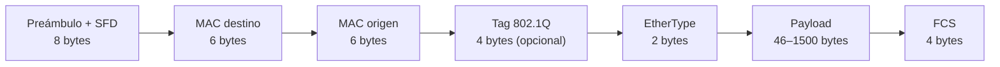
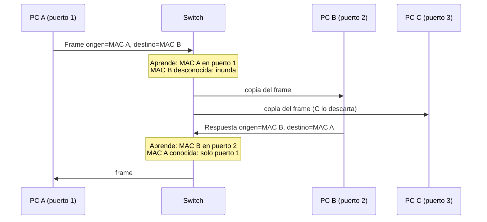
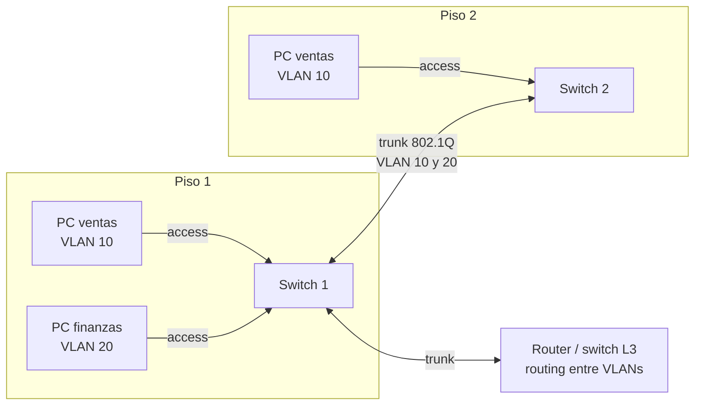
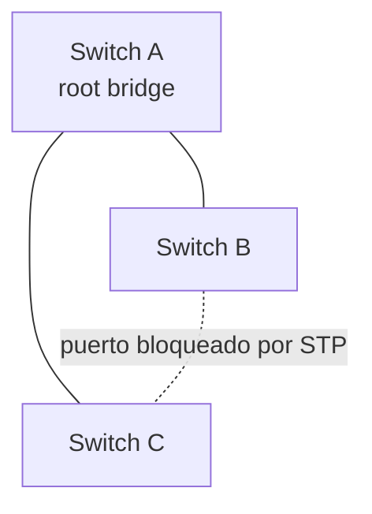

---
tags:
  - redes
  - networking
  - ethernet
---

# Capa de enlace y Ethernet

> Cómo se entregan los datos dentro de una misma red local: direcciones MAC, la trama Ethernet, cómo aprende un switch, ARP, VLANs, Spanning Tree y lo esencial de Wi-Fi.

!!! info "Antes de leer"
    Esta nota asume lo visto en [Modelos OSI y TCP/IP](modelos-osi-tcpip.md): las capas, la encapsulación y que la capa 2 trabaja con **frames**.

## ¿Qué es la capa de enlace?

La **capa de enlace** (*data link layer*, L2) se encarga de llevar un frame de un equipo al **siguiente equipo conectado directamente**: de tu PC al switch, del switch al router. No sabe nada de "internet": solo de la red local en la que está.

Analogía: si la capa 3 (IP) es la dirección postal completa de un edificio, la capa 2 es el **número de departamento** dentro del edificio. El conserje (el switch) solo necesita saber en qué puerta dejar cada sobre.

La tecnología L2 dominante en redes cableadas es **Ethernet** (familia de estándares IEEE 802.3), y en inalámbricas, **Wi-Fi** (IEEE 802.11).

## Direcciones MAC

Una **MAC address** (*Media Access Control address*, dirección física) identifica a una interfaz de red en la red local.

- Tiene **48 bits**, escritos como 12 dígitos hexadecimales.
- Los primeros 24 bits son el **OUI** (*Organizationally Unique Identifier*), asignado por el IEEE a cada fabricante; los otros 24 los asigna el fabricante.
- `ff:ff:ff:ff:ff:ff` es la **MAC de broadcast**: un frame con ese destino lo reciben todos los equipos de la red local.

| Formato | Dónde lo verás |
| --- | --- |
| `00:1a:2b:3c:4d:5e` | Linux, macOS |
| `00-1A-2B-3C-4D-5E` | Windows |
| `001a.2b3c.4d5e` | Equipos Cisco |

Dos bits del primer byte tienen significado especial:

- Bit menos significativo (**I/G**): `0` = unicast, `1` = multicast o broadcast.
- Segundo bit menos significativo (**U/L**): `0` = asignada por el fabricante (universal), `1` = **administrada localmente**. Las MAC aleatorias que usan los teléfonos en cada red Wi-Fi (por privacidad) y muchas MAC de máquinas virtuales tienen este bit en `1`.

```text
$ ip -br link
lo               UNKNOWN        00:00:00:00:00:00 <LOOPBACK,UP,LOWER_UP>
eth0             UP             00:1a:2b:3c:4d:5e <BROADCAST,MULTICAST,UP,LOWER_UP>
```

En Windows: `getmac` o `ipconfig /all` (campo "Dirección física").

!!! note "La MAC no sale de la red local"
    La MAC de origen y destino **cambia en cada salto** entre redes: cada router crea un frame nuevo. Por eso un servidor en internet nunca ve la MAC de tu portátil, solo tu dirección IP (o la de tu router). Se ve en detalle en [Routing y NAT](../intermedio/routing-nat.md).

## La trama Ethernet



| Campo | Para qué sirve |
| --- | --- |
| **Preámbulo** y **SFD** (*Start Frame Delimiter*) | Sincronizan al receptor y marcan el inicio del frame. Las capturas como Wireshark no los muestran |
| **MAC destino** y **MAC origen** | A quién va y quién lo envía. El destino va primero para que el switch pueda empezar a decidir antes de leer todo el frame |
| **Tag 802.1Q** | Solo si el frame lleva marca de VLAN (ver más abajo) |
| **EtherType** | Qué protocolo va dentro: `0x0800` IPv4, `0x86DD` IPv6, `0x0806` ARP |
| **Payload** (carga útil) | El paquete de capa 3. Máximo **1500 bytes** (la MTU); si es menor de 46, se rellena |
| **FCS** (*Frame Check Sequence*) | Código CRC para detectar errores. Si no cuadra, el frame se descarta |

Tamaño total sin preámbulo: mínimo **64 bytes**, máximo **1518** (1522 con tag de VLAN). Algunas redes de centro de datos usan **jumbo frames** (*tramas jumbo*, MTU de hasta unos 9000 bytes) para mover más datos por frame, pero todos los equipos del camino deben soportarlos.

## Cómo aprende un switch

Un switch mantiene una **MAC address table** (tabla de direcciones MAC, también llamada *CAM table*): qué MAC está detrás de qué puerto. La construye solo, mirando el tráfico:

1. **Aprende** (*learning*): cuando llega un frame, anota "la MAC de **origen** está en este puerto".
2. **Reenvía** (*forwarding*): busca la MAC de **destino** en la tabla. Si la conoce, envía el frame **solo por ese puerto**.
3. **Inunda** (*flooding*): si no conoce el destino (*unknown unicast*) o es broadcast, envía el frame por **todos los puertos** menos por el que llegó.
4. **Filtra**: si el destino está en el mismo puerto por el que llegó, descarta el frame.
5. **Olvida** (*aging*): las entradas que no se usan caducan (en muchos equipos, por defecto a los 300 segundos).



Salida típica en un switch (formato de Cisco IOS, comando `show mac address-table`):

```text
          Mac Address Table
-------------------------------------------
Vlan    Mac Address       Type        Ports
----    -----------       --------    -----
  10    001a.2b3c.4d5e    DYNAMIC     Gi0/1
  10    001a.2b3c.9f10    DYNAMIC     Gi0/2
  20    0050.56aa.0001    DYNAMIC     Gi0/24
```

## ARP: de IP a MAC

Para enviar un frame necesitas la MAC del destino, pero las aplicaciones solo conocen su **dirección IP** (la dirección lógica de capa 3, que se ve a fondo en la siguiente nota). **ARP** (*Address Resolution Protocol*) hace la traducción en IPv4:

1. El equipo pregunta por **broadcast**: "¿Quién tiene la IP `192.168.1.20`? Responde a `192.168.1.10`".
2. Solo el dueño de esa IP responde por **unicast**: "`192.168.1.20` está en `00:1a:2b:3c:9f:10`".
3. El equipo guarda la respuesta en su **ARP cache** (caché ARP) durante un tiempo.

Si el destino está **en otra red**, el equipo no pregunta por la MAC del destino, sino por la MAC de su **default gateway** (el router), porque es a quien tiene que entregar el frame.

```text
$ ip neigh
192.168.1.1 dev eth0 lladdr 00:1a:2b:00:00:01 REACHABLE
192.168.1.20 dev eth0 lladdr 00:1a:2b:3c:9f:10 STALE
```

En Windows: `arp -a`. En IPv6, la misma función la cumple **NDP** (*Neighbor Discovery Protocol*), que usa multicast en vez de broadcast.

!!! warning "ARP no tiene autenticación"
    Cualquier equipo de la red local puede responder "esa IP soy yo". El ataque **ARP spoofing** (suplantación ARP) aprovecha esto para ponerse en medio de una comunicación. Se mitiga con funciones del switch como *Dynamic ARP Inspection* y, sobre todo, cifrando el tráfico (TLS). Ver [Seguridad de red](../avanzado/seguridad-red.md).

## Dominios de colisión y de broadcast

- **Dominio de colisión** (*collision domain*): conjunto de equipos cuyas transmisiones pueden chocar porque comparten el medio. Con un **hub** todos los puertos forman un solo dominio. Con un **switch**, cada puerto es su propio dominio, y en enlaces **full duplex** (enviar y recibir a la vez) ya no hay colisiones. El mecanismo histórico para gestionarlas en Ethernet se llama **CSMA/CD**.
- **Dominio de broadcast** (*broadcast domain*): conjunto de equipos que reciben un broadcast. Un switch **no** lo divide (reenvía el broadcast por todos los puertos); un **router** o una **VLAN** sí.

| Dispositivo | ¿Separa dominios de colisión? | ¿Separa dominios de broadcast? |
| --- | --- | --- |
| Hub | No | No |
| Switch | Sí (uno por puerto) | No (salvo con VLANs) |
| Router | Sí | Sí (uno por interfaz) |

Ejemplo: un switch de 24 puertos con todos los puertos en la misma VLAN tiene **24 dominios de colisión** y **1 dominio de broadcast**. Si creas dos VLANs, pasa a tener 2 dominios de broadcast.

Un dominio de broadcast muy grande (cientos o miles de equipos) desperdicia capacidad y CPU en tráfico que casi nadie necesita. Por eso las redes se **segmentan**.

## VLANs

Una **VLAN** (*Virtual LAN*, red local virtual) divide un switch físico en varias redes lógicas: los equipos de la VLAN 10 no ven el broadcast de la VLAN 20 y, para hablar entre ellas, el tráfico debe pasar por un **router** o un **switch de capa 3** (*inter-VLAN routing*), donde además puedes filtrarlo con un firewall.

Usos típicos: separar usuarios, servidores, telefonía IP, invitados y equipos de gestión.

- **Access port** (puerto de acceso): pertenece a **una** VLAN. El equipo conectado no sabe que existen VLANs.
- **Trunk port** (puerto troncal): transporta **varias** VLANs por un mismo cable (normalmente entre switches, o hacia un router o un hipervisor). Para distinguirlas, añade a cada frame una marca: el **tag 802.1Q**.



### El tag 802.1Q

Son **4 bytes** que se insertan entre la MAC de origen y el EtherType:

| Campo | Bits | Contenido |
| --- | --- | --- |
| **TPID** | 16 | `0x8100`: indica "este frame lleva tag" |
| **PCP** (prioridad) | 3 | Prioridad para calidad de servicio (QoS), 0–7 |
| **DEI** | 1 | Marca de "descartable si hay congestión" |
| **VID** (VLAN ID) | 12 | Número de VLAN: 12 bits dan 4096 valores; 0 y 4095 están reservados, así que se usan **1 a 4094** |

La **native VLAN** (VLAN nativa) de un trunk viaja **sin tag**. Por seguridad se recomienda no usar la VLAN 1 para datos de usuarios y cambiar la native VLAN a una sin uso, porque una mala configuración permite ataques de **VLAN hopping** (saltar de VLAN).

## Spanning Tree en lo esencial

Para tener redundancia, se conectan los switches con más de un camino. Pero en capa 2 un **bucle** (*loop*) es desastroso: los frames de Ethernet no tienen un contador de saltos que los haga morir, así que un broadcast da vueltas para siempre y se multiplica. Resultado: una **broadcast storm** (tormenta de broadcast) que satura la red en segundos y tablas MAC que cambian sin parar.

**STP** (*Spanning Tree Protocol*, IEEE 802.1D) lo evita:

1. Los switches intercambian mensajes **BPDU** (*Bridge Protocol Data Units*).
2. Eligen un **root bridge** (puente raíz): el de menor *bridge ID* (prioridad configurada + MAC).
3. Cada switch calcula su mejor camino hacia la raíz y **bloquea** los puertos que formarían bucles.
4. Si un enlace activo cae, se recalcula y un puerto bloqueado pasa a reenviar.



| Variante | Qué aporta |
| --- | --- |
| **STP** (802.1D) | El original; tarda decenas de segundos en converger |
| **RSTP** (*Rapid STP*, 802.1w) | Converge en segundos o menos; es lo habitual hoy |
| **MSTP** (*Multiple STP*, 802.1s) | Varias instancias de árbol para grupos de VLANs |

Dos funciones que conviene conocer: **PortFast** (o *edge port*) hace que los puertos de usuarios pasen a reenviar al instante, y **BPDU Guard** apaga un puerto de usuario si recibe BPDUs (alguien conectó un switch donde no debía).

## Wi-Fi en lo esencial

**Wi-Fi** es la familia IEEE 802.11. El **access point** hace de puente entre los clientes inalámbricos y la red cableada.

- **SSID** (*Service Set Identifier*): el nombre de la red. Un AP puede anunciar varios SSID, cada uno asociado a una VLAN (por ejemplo, "Empleados" y "Invitados").
- **Medio compartido y half duplex**: en un canal solo transmite un dispositivo a la vez. En lugar de detectar colisiones, Wi-Fi intenta **evitarlas** (**CSMA/CA**).
- **Bandas**: **2,4 GHz** (más alcance, más interferencia; en América solo los canales 1, 6 y 11 no se solapan), **5 GHz** (más canales y capacidad, menos alcance) y **6 GHz** (Wi-Fi 6E y 7, mucha capacidad, alcance corto).

| Generación | Estándar | Bandas |
| --- | --- | --- |
| Wi-Fi 4 | 802.11n | 2,4 y 5 GHz |
| Wi-Fi 5 | 802.11ac | 5 GHz |
| Wi-Fi 6 / 6E | 802.11ax | 2,4 y 5 GHz / + 6 GHz |
| Wi-Fi 7 | 802.11be | 2,4, 5 y 6 GHz |

Las velocidades que anuncian los fabricantes son máximos teóricos: el throughput real es bastante menor y se reparte entre todos los clientes del canal.

!!! tip "Seguridad Wi-Fi"
    Usa **WPA3** (o WPA2 con AES si hay equipos antiguos). WEP y WPA original están rotos. En empresas se usa el modo **Enterprise** (802.1X con credenciales por usuario) en lugar de una contraseña compartida.

## En la nube

En la nube **no gestionas la capa 2**: no hay switches, VLANs ni Spanning Tree que configurar, y la red del proveedor resuelve ARP por ti. Lo que sigue existiendo es la **idea** de segmentar:

| On-premise (L2) | AWS | Azure | Google Cloud |
| --- | --- | --- | --- |
| VLAN / segmento | Subnet | Subnet | Subnet |
| Tarjeta de red con su MAC | Elastic network interface (ENI) | Network interface (NIC) | Network interface (vNIC) |
| Broadcast y multicast en la LAN | No hay broadcast en la VPC | Broadcast y multicast bloqueados en la VNet | Sin broadcast en la VPC |

Por eso, software que depende de broadcast o de IPs "flotantes" anunciadas por ARP (algunos clústeres de alta disponibilidad clásicos) necesita adaptarse en la nube, normalmente con un load balancer o con las APIs del proveedor. Ver [Redes en la nube](../../cloud/redes-y-datos/redes.md) y su [tabla de equivalencias con on-premise](../../cloud/redes-y-datos/redes.md#equivalencias-con-on-premise).

## Conclusión práctica

- La capa 2 entrega frames **dentro de la red local** usando direcciones **MAC**.
- El switch aprende por la MAC de **origen** y reenvía por la MAC de **destino**; si no la conoce, inunda.
- **ARP** traduce IP a MAC; para destinos de otra red, se pide la MAC del **gateway**.
- Las **VLANs** dividen los dominios de broadcast; entre VLANs hace falta capa 3.
- **STP/RSTP** permite cablear con redundancia sin crear bucles.
- En la nube, la capa 2 desaparece de tu vista y la segmentación se hace con **subnets**.

## Relación con otras secciones

| Enfoque | Qué se mira desde ahí | Nota |
| --- | --- | --- |
| Cloud (el control) | Subnets como equivalente de la segmentación por VLAN; interfaces de red de las VMs | [Redes en la nube](../../cloud/redes-y-datos/redes.md), [Máquinas virtuales](../../cloud/computo/maquinas-virtuales.md) |
| DevOps (la automatización) | Ver interfaces y vecinos ARP desde Linux (`ip link`, `ip neigh`); redes de Docker como bridges L2 | [Linux, redes y scripting](../../devops/fundamentos/linux-redes-scripting.md), [Docker](../../devops/contenedores/docker.md) |
| DevSecOps (la verificación) | Segmentación como control de seguridad; ARP spoofing y VLAN hopping | [Fundamentos DevSecOps](../../devsecops/fundamentos-devsecops.md), [Seguridad de red](../avanzado/seguridad-red.md) |
| Laboratorios (la práctica) | Practicar esto paso a paso | [Lab 01: Diagnóstico de red desde Linux](../../laboratorios/fundamentos/linux-red-diagnostico.md) |

**Siguiente:** [Direccionamiento IP](direccionamiento-ip.md)

## Referencias

- [IEEE 802.3 Ethernet Working Group](https://www.ieee802.org/3/)
- [IEEE 802.1Q: Bridges and Bridged Networks](https://www.ieee802.org/1/pages/802.1Q.html)
- [RFC 826: An Ethernet Address Resolution Protocol (ARP)](https://www.rfc-editor.org/rfc/rfc826)
- [RFC 4861: Neighbor Discovery for IPv6](https://www.rfc-editor.org/rfc/rfc4861)
- [Wi-Fi Alliance: Wi-Fi CERTIFIED](https://www.wi-fi.org/discover-wi-fi)
- [Azure Virtual Network FAQ (broadcast y multicast)](https://learn.microsoft.com/es-es/azure/virtual-network/virtual-networks-faq)
