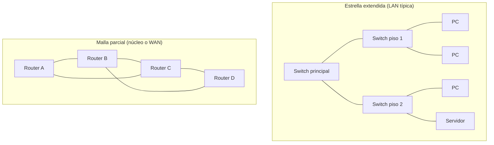
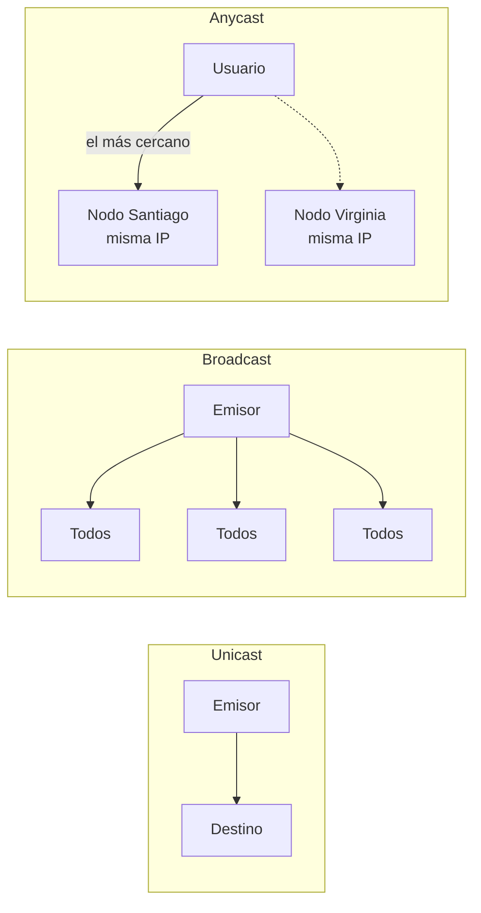

---
tags:
  - redes
  - networking
---

# Fundamentos de redes

> Qué es una red, qué tipos hay según su alcance, cómo se conectan sus piezas, por qué medios viajan los datos y con qué métricas se mide si una red "va bien".

!!! info "Antes de leer"
    Esta es la primera nota de la sección de Networking: no necesitas nada previo. Las notas siguientes asumen solo lo que se explica aquí y en las anteriores del orden de lectura.

## ¿Qué es una red?

Una **red** (*network*) es un conjunto de dispositivos conectados que intercambian datos siguiendo unas reglas comunes, llamadas **protocolos** (*protocols*). Un **host** (equipo final) es cualquier dispositivo que envía o recibe datos: un portátil, un servidor, un teléfono, una impresora, una VM en la nube.

La intuición más útil es el **correo postal**: cada mensaje viaja dentro de un "sobre" con una dirección de destino y otra de origen, pasa por oficinas intermedias que solo miran la dirección para decidir el siguiente tramo, y llega sin que el remitente sepa el camino exacto. Las redes funcionan igual: los datos se parten en trozos (**paquetes**, *packets*), cada uno con direcciones, y los equipos intermedios los reenvían.

**Internet** no es una red única, sino una **red de redes**: miles de redes independientes (de empresas, universidades, proveedores de internet y nubes) interconectadas con protocolos comunes.

## Tipos de red según su alcance

| Tipo | Significado | Alcance típico | Ejemplo |
| --- | --- | --- | --- |
| **PAN** (*Personal Area Network*) | Red de área personal | Unos metros | Audífonos Bluetooth con el teléfono |
| **LAN** (*Local Area Network*) | Red de área local | Una casa, una oficina, un edificio | La red Wi-Fi y cableada de una oficina |
| **WLAN** (*Wireless LAN*) | LAN inalámbrica | Igual que una LAN | La red Wi-Fi de tu casa |
| **MAN** (*Metropolitan Area Network*) | Red de área metropolitana | Una ciudad | Fibra que une las sedes de un municipio |
| **WAN** (*Wide Area Network*) | Red de área amplia | Países, continentes | Enlaces entre sedes de una empresa; internet es la WAN más grande |

La frontera entre tipos no es exacta: lo importante es que **una LAN la controla tu organización** (cableado, switches, Wi-Fi) y **una WAN normalmente pasa por infraestructura de terceros** (un proveedor de telecomunicaciones o internet).

## Topologías

La **topología** describe cómo están conectados los dispositivos. Hay dos miradas:

- **Topología física** (*physical topology*): por dónde van los cables o enlaces de verdad.
- **Topología lógica** (*logical topology*): cómo fluyen los datos, aunque el cableado sea otro. Por ejemplo, una red Wi-Fi tiene forma física de estrella (todos hablan con el access point), pero lógicamente es un medio compartido donde solo uno transmite a la vez.

| Topología | Cómo es | Ventaja | Desventaja |
| --- | --- | --- | --- |
| **Bus** | Todos cuelgan de un único cable | Barata | Un corte tumba toda la red; histórica |
| **Estrella** (*star*) | Todos conectados a un equipo central (switch) | Fácil de gestionar; un cable roto solo afecta a un equipo | El equipo central es un punto único de fallo |
| **Anillo** (*ring*) | Cada equipo conectado al siguiente, en círculo | Recorrido predecible | Un fallo puede cortar el anillo (salvo anillos dobles) |
| **Malla** (*mesh*) | Muchos o todos los equipos conectados entre sí (*full mesh* o *partial mesh*) | Muy redundante | Cara y compleja de cablear |
| **Árbol / híbrida** | Varias estrellas conectadas jerárquicamente | Escala bien | Depende de los equipos de los niveles superiores |

Hoy casi todas las LAN cableadas son **estrellas** o **estrellas extendidas** (switches conectados a otros switches), y los núcleos de red y las WAN usan **mallas parciales** para tener caminos alternativos.



## Dispositivos de red

| Dispositivo | Qué hace | Analogía |
| --- | --- | --- |
| **NIC** (*Network Interface Card*, tarjeta de red) | Conecta un host a la red (cableada o inalámbrica). Tiene una dirección física única, la **MAC address** | La puerta de la casa |
| **Switch** (conmutador) | Conecta equipos **dentro de la misma red local** y envía cada trama solo al puerto del destinatario | El conserje que entrega cada carta en el departamento correcto del edificio |
| **Router** (enrutador) | Conecta **redes distintas** entre sí y decide por dónde enviar cada paquete | La oficina de correos que decide hacia qué ciudad va cada carta |
| **Access point** (AP, punto de acceso) | Conecta dispositivos inalámbricos a la red cableada | Un switch "por aire" |
| **Firewall** (cortafuegos) | Permite o bloquea tráfico según reglas | El guardia de la entrada con una lista de quién puede pasar |
| **Modem** (módem) | Convierte la señal del proveedor (fibra, cable coaxial, línea telefónica, celular) a una señal que entiende tu red | El traductor entre tu casa y la compañía |
| **Hub** (concentrador) | Repite lo que recibe por **todos** los puertos. Obsoleto, reemplazado por el switch | Gritar la carta en el pasillo para que la oiga todo el edificio |

!!! note "El router de casa es varios equipos en uno"
    El aparato que te instala tu proveedor de internet suele ser a la vez **modem, router, switch** (los puertos de atrás), **access point** (el Wi-Fi) y **firewall** básico. En una empresa cada función suele ser un equipo distinto.

## Medios de transmisión

Los datos viajan como señales eléctricas, de luz o de radio.

| Medio | Cómo transmite | Alcance típico | Uso |
| --- | --- | --- | --- |
| **Cobre: par trenzado** (*twisted pair*, UTP/STP) | Pulsos eléctricos por pares de cables trenzados, con conector **RJ45**. Categorías Cat5e, Cat6, Cat6a… | Hasta 100 m por tramo en Ethernet | Puestos de trabajo, racks |
| **Cobre: coaxial** | Señal eléctrica por un conductor central blindado | Variable | Internet por cable (TV cable), histórico en LAN |
| **Fibra óptica** (*optical fiber*) | Pulsos de luz por un hilo de vidrio | **Multimodo** (*multimode*): cientos de metros; **monomodo** (*single-mode*): decenas de km o más | Enlaces entre edificios, centros de datos, WAN, cables submarinos |
| **Inalámbrico** (*wireless*) | Ondas de radio | Wi-Fi: decenas de metros; celular: km; satélite: global | Movilidad, sitios sin cable |

La fibra no sufre interferencia electromagnética y tiene más capacidad, pero es más cara de instalar y manipular. El inalámbrico es cómodo, pero es un **medio compartido**: todos los dispositivos de un mismo canal se reparten la capacidad y sufren interferencias.

## Cómo se mide una red

Cinco métricas que vas a escuchar todo el tiempo. Analogía: una **autopista**.

| Métrica | Qué es | En la autopista | Unidad típica |
| --- | --- | --- | --- |
| **Bandwidth** (ancho de banda) | Capacidad **máxima** teórica del enlace | Número de carriles | Mbps, Gbps |
| **Throughput** (rendimiento real) | Datos que **de verdad** pasan por segundo | Autos que efectivamente cruzan por hora | Mbps, Gbps |
| **Latencia** (*latency*) | Tiempo que tarda un dato en llegar. Se suele medir ida y vuelta: **RTT** (*round-trip time*) | Lo que tarda un auto en llegar | ms |
| **Jitter** (variación de la latencia) | Cuánto **varía** la latencia de un paquete a otro | Unos autos tardan 10 min y otros 25 | ms |
| **Packet loss** (pérdida de paquetes) | Porcentaje de paquetes que no llegan | Autos que nunca llegan | % |

El throughput siempre es menor que el bandwidth: hay cabeceras de protocolo, retransmisiones, congestión y equipos intermedios más lentos.

!!! warning "Bits y bytes"
    Las velocidades de red se dan en **bits** por segundo (**Mbps**, con *b* minúscula); los tamaños de archivo, en **bytes** (**MB**, con *B* mayúscula). Un byte son 8 bits.

    Ejemplo: descargar un archivo de 1 GB con un enlace de 100 Mbps. 1 GB = 1000 MB = 8000 Mb, así que tarda como mínimo 8000 / 100 = **80 segundos**, y en la práctica algo más, porque el throughput real es menor.

### La latencia tiene un piso físico

La luz en la fibra viaja a unos 200 000 km/s, es decir, **unos 5 ms por cada 1000 km** en un sentido. Si tu servidor está a 10 000 km de cable, el RTT nunca bajará de unos 100 ms, por mucho ancho de banda que compres. Por eso se elige la **región** de la nube cercana a los usuarios y se usan **CDN**.

### Qué tolera cada aplicación

| Aplicación | Sensible a | Comentario |
| --- | --- | --- |
| Descargas, backups | Throughput | Unos milisegundos más de latencia no importan |
| Web y APIs | Latencia | Cada petición suma varios viajes de ida y vuelta |
| Voz y videollamadas | Latencia, jitter, pérdida | La recomendación ITU-T G.114 sitúa en **150 ms en un sentido** el límite para una conversación cómoda |
| Juegos en línea | Latencia, jitter | Pequeñas variaciones se notan como "lag" |

### Ejemplo: medir con `ping`

`ping` envía mensajes de eco (protocolo ICMP) y mide el RTT. En Linux:

```text
$ ping -c 4 203.0.113.10
PING 203.0.113.10 (203.0.113.10) 56(84) bytes of data.
64 bytes from 203.0.113.10: icmp_seq=1 ttl=54 time=24.1 ms
64 bytes from 203.0.113.10: icmp_seq=2 ttl=54 time=25.9 ms
64 bytes from 203.0.113.10: icmp_seq=3 ttl=54 time=23.8 ms
64 bytes from 203.0.113.10: icmp_seq=4 ttl=54 time=24.6 ms

--- 203.0.113.10 ping statistics ---
4 packets transmitted, 4 received, 0% packet loss, time 3004ms
rtt min/avg/max/mdev = 23.8/24.6/25.9/0.8 ms
```

- `time=` es el RTT de cada paquete; `avg` es la **latencia** media.
- `mdev` mide cuánto se desvían los RTT de la media: sirve como aproximación del **jitter**.
- `0% packet loss` es la **pérdida de paquetes**.

En Windows el comando es `ping -n 4 203.0.113.10`. Ojo: muchos firewalls y nubes bloquean ICMP, así que un `ping` sin respuesta no significa por sí solo que el equipo esté caído (se ve en [Troubleshooting de red](../avanzado/troubleshooting-red.md)).

## Tipos de comunicación

| Tipo | Quién recibe | Ejemplo |
| --- | --- | --- |
| **Unicast** | Un único destinatario | Tu navegador hablando con un servidor web |
| **Broadcast** (difusión) | **Todos** los equipos de la red local | Un equipo preguntando "¿quién tiene esta dirección?" al conectarse |
| **Multicast** | Un **grupo** de equipos que se suscribió | Streaming de video interno, algunos protocolos de routing |
| **Anycast** | El **más cercano** de varios equipos que comparten la misma dirección | Servidores DNS públicos, CDN |



El broadcast **no cruza routers**: se queda dentro de la red local. Eso es intencional, porque si cruzara, cada mensaje de "¿quién tiene…?" inundaría internet. IPv6 ni siquiera tiene broadcast: usa multicast (se ve en [Direccionamiento IP](direccionamiento-ip.md)).

## Cliente-servidor y peer-to-peer

| | **Cliente-servidor** (*client-server*) | **Peer-to-peer** (P2P, entre pares) |
| --- | --- | --- |
| Roles | Uno ofrece el servicio (servidor), otros lo piden (clientes) | Cada nodo es cliente y servidor a la vez |
| Ejemplos | Web, APIs, bases de datos, correo | BitTorrent, algunas llamadas de voz/video, blockchain |
| Ventajas | Control centralizado, más fácil de asegurar y auditar | Escala con los participantes, sin punto central |
| Desventajas | El servidor es punto de fallo y de carga (se mitiga con balanceo y alta disponibilidad) | Más difícil de controlar, asegurar y depurar |

Casi todo lo que vas a desplegar en la nube es **cliente-servidor**: una aplicación expone un servicio y los clientes (navegadores, otras APIs) se conectan a ella.

## En la nube

La nube no elimina estos conceptos: los **virtualiza**. No ves cables ni switches, pero sigues diseñando redes.

| Concepto | AWS | Azure | Google Cloud |
| --- | --- | --- | --- |
| Tu LAN privada | VPC | Virtual Network (VNet) | VPC network |
| NIC | Elastic network interface (ENI) | Network interface (NIC) | Network interface (vNIC) |
| Firewall | Security group, Network ACL | Network security group (NSG) | VPC firewall rules |
| Anycast para usuarios globales | AWS Global Accelerator, Amazon CloudFront | Azure Front Door | Global external Application Load Balancer |

Más detalle en [Redes en la nube](../../cloud/redes-y-datos/redes.md).

## Conclusión práctica

- Una red es un conjunto de equipos que siguen protocolos comunes; internet es una red de redes.
- El **switch** conecta equipos de la misma red; el **router** conecta redes distintas.
- No confundas **bandwidth** (capacidad) con **throughput** (lo que pasa de verdad), ni **Mbps** con **MB/s**.
- La latencia tiene un mínimo físico por distancia: acerca los servicios a los usuarios.
- El broadcast se queda en la red local; el anycast lleva al usuario al nodo más cercano.

## Relación con otras secciones

| Enfoque | Qué se mira desde ahí | Nota |
| --- | --- | --- |
| Cloud (el control) | Las mismas piezas virtualizadas: VPC/VNet, interfaces, firewalls; regiones cercanas para reducir latencia | [Redes en la nube](../../cloud/redes-y-datos/redes.md), [Modelos de servicio y regiones](../../cloud/fundamentos/modelos-de-servicio-y-regiones.md) |
| DevOps (la automatización) | Medir y diagnosticar la red desde la terminal (`ping`, `ip`, `ss`) | [Linux, redes y scripting](../../devops/fundamentos/linux-redes-scripting.md), [Observabilidad](../../devops/operacion/observabilidad.md) |
| Negocio TI (el porqué) | La latencia y la disponibilidad de la red forman parte de lo que se promete a los usuarios | [Niveles de servicio](../../negocio/niveles-de-servicio.md) |
| Laboratorios (la práctica) | Practicar esto paso a paso | [Lab 01: Diagnóstico de red desde Linux](../../laboratorios/fundamentos/linux-red-diagnostico.md) |

**Siguiente:** [Modelos OSI y TCP/IP](modelos-osi-tcpip.md)

## Referencias

- [Cloudflare: What is latency?](https://www.cloudflare.com/learning/performance/glossary/what-is-latency/)
- [Cloudflare: What is anycast?](https://www.cloudflare.com/learning/cdn/glossary/anycast-network/)
- [ITU-T G.114: One-way transmission time](https://www.itu.int/rec/T-REC-G.114)
- [RFC 5737: rangos de direcciones IPv4 para documentación](https://www.rfc-editor.org/rfc/rfc5737)
