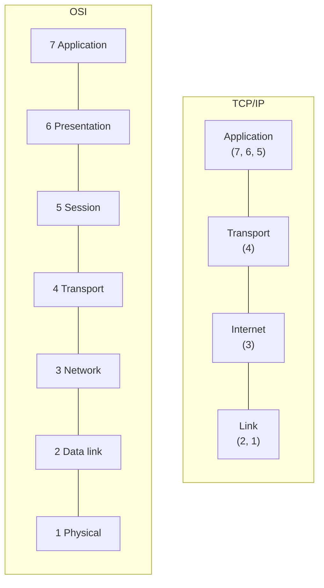
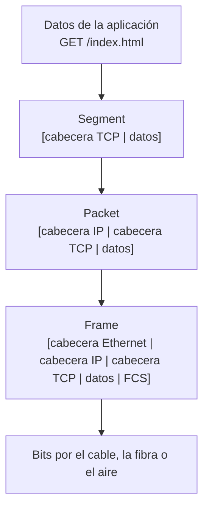

---
tags:
  - redes
  - networking
---

# Modelos OSI y TCP/IP

> Los dos mapas por capas con los que se explica (y se diagnostica) cualquier comunicación de red: qué hace cada capa, cómo se encapsulan los datos y por qué en la nube se habla de load balancers "de capa 4" y "de capa 7".

!!! info "Antes de leer"
    Esta nota asume lo visto en [Fundamentos de redes](fundamentos-redes.md): qué es un host, un switch, un router, un protocolo y un paquete.

## ¿Qué es un modelo por capas?

Enviar datos por una red implica muchos problemas distintos: convertir bits en señales, entregar a la máquina correcta de la red local, encontrar el camino entre redes, no perder datos, entender el formato de la aplicación. Un **modelo por capas** (*layered model*) separa esos problemas: cada capa resuelve uno, usa los servicios de la capa de abajo y ofrece los suyos a la de arriba.

Analogía: enviar un regalo por mensajería. Tú escribes la tarjeta (aplicación), la metes en una caja con el nombre del destinatario (transporte), la empresa le pega una etiqueta con la dirección (red), el camión la lleva al siguiente centro de distribución (enlace) por la carretera (física). Cada nivel solo mira su etiqueta y no necesita entender el contenido de las otras.

La ventaja práctica: puedes cambiar una capa sin tocar las demás. Tu navegador funciona igual por Wi-Fi o por cable, porque HTTP no sabe nada del medio físico.

## El modelo OSI (7 capas)

El **modelo OSI** (*Open Systems Interconnection*), de ISO, es un modelo **de referencia**: casi ningún sistema real lo implementa tal cual, pero es el vocabulario común. Cuando alguien dice "es un problema de capa 2" o "un firewall de capa 7", habla en términos OSI.

| N.º | Capa | Qué resuelve | PDU | Ejemplos de protocolos | Dispositivos típicos |
| --- | --- | --- | --- | --- | --- |
| 7 | **Application** (aplicación) | Servicios que usa la aplicación | Datos | HTTP, DNS, SSH, SMTP | Load balancer L7, WAF, proxy |
| 6 | **Presentation** (presentación) | Formato, codificación, cifrado | Datos | TLS (en parte), codificaciones como UTF-8 | — |
| 5 | **Session** (sesión) | Abrir, mantener y cerrar diálogos | Datos | (en la práctica, lo hacen la app o TLS) | — |
| 4 | **Transport** (transporte) | Comunicación entre procesos (puertos), fiabilidad | **Segment** (segmento) / datagrama | TCP, UDP | Firewall, load balancer L4 |
| 3 | **Network** (red) | Direccionamiento lógico y routing entre redes | **Packet** (paquete) | IPv4, IPv6, ICMP | Router, switch L3 |
| 2 | **Data link** (enlace de datos) | Entrega dentro de la red local, direcciones físicas | **Frame** (trama) | Ethernet, Wi-Fi (802.11), ARP | Switch, access point |
| 1 | **Physical** (física) | Bits como señales eléctricas, de luz o de radio | **Bits** | Estándares de cable, fibra y radio | Cable, hub, repetidor, transceptor |

**PDU** (*Protocol Data Unit*, unidad de datos del protocolo) es el nombre del "paquete de datos" en cada capa. Usar el nombre correcto ayuda a ser preciso: un switch reenvía **frames**, un router reenvía **packets**.

!!! tip "Para recordar el orden"
    De abajo arriba: **F**ísica, **E**nlace, **R**ed, **T**ransporte, **S**esión, **P**resentación, **A**plicación. En inglés circula la frase "*Please Do Not Throw Sausage Pizza Away*" (Physical, Data link, Network, Transport, Session, Presentation, Application).

## El modelo TCP/IP (4 capas)

El **modelo TCP/IP** describe cómo funciona **internet de verdad**. Junta varias capas de OSI:

| Capa TCP/IP | Equivale en OSI a | Protocolos |
| --- | --- | --- |
| **Application** (aplicación) | 7, 6 y 5 | HTTP, DNS, TLS, SSH, DHCP |
| **Transport** (transporte) | 4 | TCP, UDP, QUIC (sobre UDP) |
| **Internet** | 3 | IPv4, IPv6, ICMP |
| **Link** (enlace o acceso a la red) | 2 y 1 | Ethernet, Wi-Fi |

Algunos libros usan una versión de **5 capas** que separa física y enlace. En el trabajo se mezclan: se usa la **numeración OSI** (L2, L3, L4, L7) aunque la pila real sea TCP/IP.

## Encapsulación

Al enviar, cada capa **añade su cabecera** (*header*) a lo que recibe de arriba: eso es la **encapsulación** (*encapsulation*). Al recibir, cada capa quita su cabecera y entrega el resto hacia arriba: **desencapsulación** (*decapsulation*).

Cada cabecera lleva lo que su capa necesita:

| Cabecera | Tamaño típico | Información clave |
| --- | --- | --- |
| Ethernet | 14 bytes + 4 de **FCS** (*Frame Check Sequence*, control de errores) al final | MAC de origen y destino, tipo de contenido |
| IPv4 | 20 bytes (sin opciones) | IP de origen y destino, TTL, protocolo de arriba |
| TCP | 20 bytes (sin opciones) | Puerto de origen y destino, números de secuencia y confirmación |

### Ejemplo: cuánto dato útil cabe en un frame

La **MTU** (*Maximum Transmission Unit*, unidad máxima de transmisión) de Ethernet es normalmente **1500 bytes**: es lo máximo que cabe dentro del frame (el paquete IP completo).

- Paquete IP máximo: 1500 bytes.
- Menos cabecera IPv4 (20) y cabecera TCP (20): quedan **1460 bytes** de datos de aplicación por segmento.
- Ese valor se llama **MSS** (*Maximum Segment Size*, tamaño máximo de segmento).

Si algún tramo del camino tiene una MTU menor (por ejemplo, un túnel VPN que añade sus propias cabeceras), los paquetes grandes pueden fragmentarse o descartarse. Es un clásico de "funciona el `ping` pero se cuelgan las descargas", que se ve en [Troubleshooting de red](../avanzado/troubleshooting-red.md).

## Qué pasa al abrir una página, capa por capa

Cuando escribes `https://ejemplo.com` en el navegador, de forma simplificada:

1. **Aplicación**: el navegador resuelve el nombre con **DNS** para obtener una dirección IP, prepara la petición HTTP y negocia el cifrado **TLS**.
2. **Transporte**: TCP abre una conexión con el puerto 443 del servidor y parte los datos en segmentos.
3. **Red**: IP pone en cada paquete la IP de origen (tu equipo) y de destino (el servidor) y decide si el destino está en tu red local o si hay que enviarlo al **router** (default gateway).
4. **Enlace**: Ethernet o Wi-Fi meten el paquete en un frame dirigido a la dirección física (MAC) del siguiente equipo, normalmente tu router.
5. **Física**: la tarjeta de red convierte el frame en señales.

En cada router intermedio, el paquete sube hasta la capa 3 (para decidir el siguiente salto) y vuelve a bajar en un frame nuevo. En el servidor, sube las cinco capas hasta llegar al proceso web. Cada uno de estos pasos tiene su propia nota en esta sección.

## Protocolos y dispositivos por capa

| Capa | Qué "mira" el dispositivo para decidir | Dispositivo |
| --- | --- | --- |
| L1 | Nada: solo repite señales | Hub, repetidor, cable |
| L2 | Dirección **MAC** de destino | Switch, access point |
| L3 | Dirección **IP** de destino | Router, switch de capa 3 |
| L4 | IP + **puerto** + protocolo (TCP/UDP) | Firewall tradicional, load balancer L4, NAT |
| L7 | El contenido: host, URL, headers, cookies | Load balancer L7, reverse proxy, WAF, API gateway |

Cuanto más alta la capa, **más información** tiene el equipo para decidir, pero **más trabajo** cuesta (por ejemplo, para leer HTTP dentro de HTTPS tiene que descifrar TLS).

## Por qué importa en troubleshooting

Los modelos dan un **método**: revisar capa por capa en vez de probar cosas al azar. Lo más habitual es ir de abajo arriba (*bottom-up*):

| Capa | Síntoma típico | Pregunta | Comando de ejemplo |
| --- | --- | --- | --- |
| L1 | Interfaz caída, sin luz en el puerto | ¿Hay enlace físico? | `ip link` |
| L2 | No se ve a nadie de la red local | ¿Estoy en la VLAN correcta? ¿Resuelvo la MAC del gateway? | `ip neigh` |
| L3 | Llego a la red local pero no fuera | ¿Tengo IP, máscara y gateway correctos? ¿Hay ruta? | `ip addr`, `ip route`, `ping`, `traceroute` |
| L4 | "Connection refused" o *timeout* en un puerto | ¿El puerto escucha? ¿Lo bloquea un firewall? | `ss -tulpn`, `nc -zv host 443` |
| L7 | Error 502, certificado inválido, respuesta incorrecta | ¿Responde bien la aplicación? | `curl -v`, logs |

La nota [Linux, redes y scripting](../../devops/fundamentos/linux-redes-scripting.md#puertos-y-troubleshooting-de-red) tiene el mismo flujo resumido para el día a día en DevOps.

## En la nube

En la nube **las capas 1 y 2 las gestiona el proveedor**: no ves cables, switches ni VLANs, y las redes virtuales no reenvían broadcast entre VMs como una LAN física. Tú trabajas sobre todo en L3 (subnets, rutas), L4 (security groups, firewalls, load balancers L4) y L7 (load balancers de aplicación, WAF).

La diferencia más visible es en los **load balancers**:

| | Load balancer **L4** | Load balancer **L7** |
| --- | --- | --- |
| Decide con | IP, puerto, protocolo | Host, ruta (`/api`), headers, cookies |
| Ve el contenido HTTP | No | Sí (si termina TLS) |
| Casos de uso | TCP/UDP genérico, bases de datos, muy alto rendimiento, IP fija | Webs y APIs: enrutar `/api` a un servicio y `/` a otro, redirecciones, WAF |
| AWS | Network Load Balancer (NLB) | Application Load Balancer (ALB) |
| Azure | Azure Load Balancer | Application Gateway, Azure Front Door |
| Google Cloud | Network Load Balancer (*passthrough* o *proxy*) | Application Load Balancer (regional o global) |

Lo mismo pasa con la seguridad: un **security group** o un **NSG** filtra en L3/L4 (IP y puerto), mientras que un **WAF** inspecciona L7 (por ejemplo, detecta una inyección SQL en una URL). Más detalle en [Redes en la nube](../../cloud/redes-y-datos/redes.md#load-balancers) y en [Balanceo y alta disponibilidad](../avanzado/balanceo-alta-disponibilidad.md).

## Conclusión práctica

- OSI (7 capas) es el **vocabulario**; TCP/IP (4 capas) es cómo funciona **internet**. En el trabajo se usa la numeración OSI.
- Datos → **segment** (L4) → **packet** (L3) → **frame** (L2) → **bits** (L1).
- Cada dispositivo decide con la información de "su" capa: MAC (switch), IP (router), puerto (firewall L4), contenido (L7).
- Diagnostica por capas, de abajo arriba, en vez de probar al azar.
- MTU de 1500 bytes y MSS de 1460 son números que vas a ver muchas veces.

## Relación con otras secciones

| Enfoque | Qué se mira desde ahí | Nota |
| --- | --- | --- |
| Cloud (el control) | Load balancers L4 vs L7, security groups (L3/L4) frente a WAF (L7) | [Redes en la nube](../../cloud/redes-y-datos/redes.md), [Seguridad base](../../cloud/identidad-y-seguridad/seguridad-base.md) |
| DevOps (la automatización) | Diagnóstico capa por capa desde Linux; ingress (L7) y services (L4) en Kubernetes | [Linux, redes y scripting](../../devops/fundamentos/linux-redes-scripting.md), [Kubernetes](../../devops/contenedores/kubernetes.md) |
| DevSecOps (la verificación) | Controles en distintas capas: network policies (L3/L4) y pruebas de aplicación (L7) | [Seguridad de Kubernetes](../../devsecops/infraestructura-y-contenedores/seguridad-kubernetes.md), [Pruebas dinámicas](../../devsecops/codigo-y-dependencias/pruebas-dinamicas.md) |
| Laboratorios (la práctica) | Practicar esto paso a paso | [Lab 01: Diagnóstico de red desde Linux](../../laboratorios/fundamentos/linux-red-diagnostico.md) |

**Siguiente:** [Capa de enlace y Ethernet](capa-enlace-ethernet.md)

## Referencias

- [RFC 1122: Requirements for Internet Hosts (capas de la arquitectura de internet)](https://www.rfc-editor.org/rfc/rfc1122)
- [Cloudflare: What is the OSI model?](https://www.cloudflare.com/learning/ddos/glossary/open-systems-interconnection-model-osi/)
- [Elastic Load Balancing: tipos de load balancer](https://docs.aws.amazon.com/elasticloadbalancing/latest/userguide/how-elastic-load-balancing-works.html)
- [Azure: opciones de balanceo de carga](https://learn.microsoft.com/es-es/azure/architecture/guide/technology-choices/load-balancing-overview)
- [Google Cloud Load Balancing overview](https://cloud.google.com/load-balancing/docs/load-balancing-overview)
