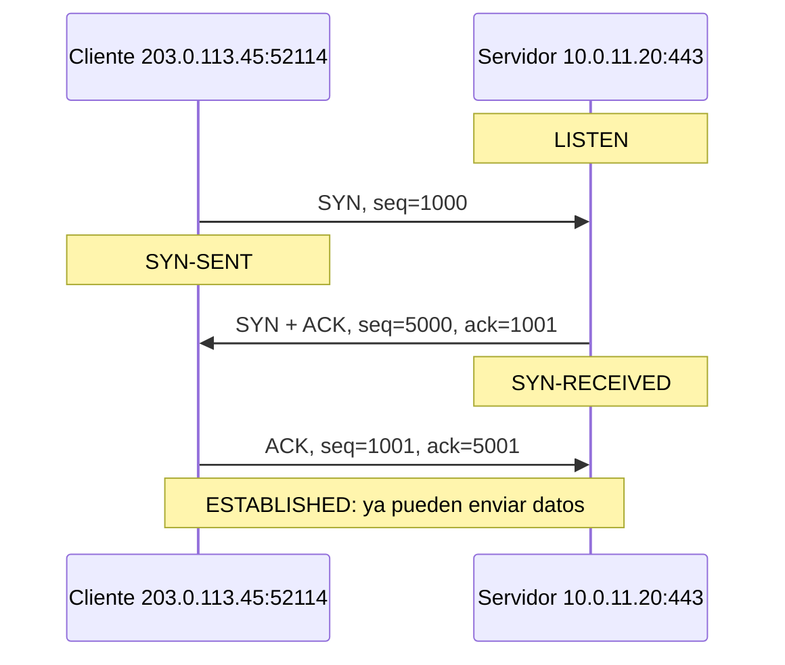
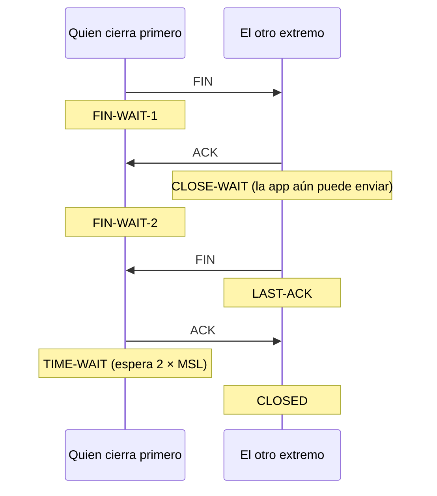
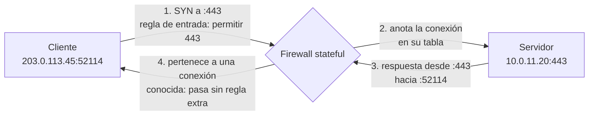

---
tags:
  - redes
  - networking
  - tcp
---

# Capa de transporte

> Cómo llegan los datos al proceso correcto y con qué garantías: puertos y sockets, TCP (handshake, ACKs, ventanas, retransmisión, cierre y estados como TIME_WAIT), UDP, QUIC y cómo los firewalls stateful dejan pasar el tráfico de retorno.

!!! info "Antes de leer"
    Esta nota asume lo visto en [Routing y NAT](routing-nat.md): cómo un paquete IP llega de un host a otro atravesando routers, y cómo PAT usa puertos para distinguir conexiones.

## ¿Qué es la capa de transporte?

IP lleva un paquete **hasta un equipo**. Pero en ese equipo hay muchos programas usando la red a la vez: un navegador con diez pestañas, un cliente de base de datos, un agente de monitoreo. La **capa de transporte** (*transport layer*, L4) entrega los datos **al proceso correcto** y, según el protocolo, garantiza que lleguen completos y en orden.

Analogía: IP es la dirección del **edificio**; el **puerto** es el número de **departamento**. TCP es una mensajería con acuse de recibo que numera cada página y reenvía las que se pierden; UDP es tirar postales al buzón: rápido, sin confirmación.

## Puertos y sockets

Un **puerto** (*port*) es un número de 16 bits (0 a 65535) que identifica a un proceso dentro de un equipo.

| Rango (IANA) | Nombre | Uso |
| --- | --- | --- |
| 0–1023 | **Well-known ports** (puertos bien conocidos) | Servicios estándar: 22 SSH, 53 DNS, 80 HTTP, 443 HTTPS. En Linux, escuchar en ellos requiere privilegios |
| 1024–49151 | **Registered ports** (puertos registrados) | Aplicaciones concretas: 3306 MySQL, 5432 PostgreSQL, 6443 Kubernetes API |
| 49152–65535 | **Dynamic / ephemeral ports** (puertos efímeros) | Puerto de origen temporal que el sistema asigna al **cliente** en cada conexión |

Los sistemas no siempre siguen el rango efímero de IANA: Linux usa por defecto de **32768 a 60999** (`sysctl net.ipv4.ip_local_port_range`) y Windows, de 49152 a 65535. Para la lista de puertos de servicios habituales, ver [Puertos comunes](../../recursos/puertos.md).

Un **socket** es la combinación de **IP + puerto** (más el protocolo). Una conexión TCP queda identificada de forma única por la **5-tupla** (*5-tuple*):

`(protocolo, IP origen, puerto origen, IP destino, puerto destino)`

Por eso un servidor puede atender miles de conexiones en el mismo puerto 443: cada cliente tiene una IP o un puerto de origen distinto.

```text
$ ss -tan
State      Recv-Q Send-Q  Local Address:Port    Peer Address:Port
LISTEN     0      511           0.0.0.0:443          0.0.0.0:*
ESTAB      0      0         10.0.11.20:443      203.0.113.45:52114
ESTAB      0      0         10.0.11.20:443      198.51.100.7:61022
TIME-WAIT  0      0         10.0.11.20:40310     10.0.21.5:5432
```

- `LISTEN`: el proceso espera conexiones en el 443, en todas las interfaces (`0.0.0.0`).
- `ESTAB`: conexiones establecidas con dos clientes distintos, ambas al puerto 443 local.
- `TIME-WAIT`: una conexión a PostgreSQL que este equipo cerró hace poco (se explica más abajo).

## TCP

**TCP** (*Transmission Control Protocol*) ofrece una comunicación **fiable**:

- **Orientado a conexión**: antes de enviar datos, las dos partes se ponen de acuerdo.
- **Fiable y ordenado**: numera cada byte, confirma lo recibido y retransmite lo perdido; la aplicación recibe los datos en orden y sin huecos.
- **Control de flujo** (*flow control*): no envía más de lo que el receptor puede procesar.
- **Control de congestión** (*congestion control*): reduce el ritmo cuando detecta que la red está saturada.

Campos clave de su cabecera (20 bytes sin opciones, hasta 60 con ellas): puertos de origen y destino, **número de secuencia** (*sequence number*), **número de confirmación** (*acknowledgment number*), **flags** (`SYN`, `ACK`, `FIN`, `RST`, `PSH`, `URG`) y **ventana** (*window*).

### Three-way handshake

Para abrir una conexión, TCP usa un saludo en tres pasos (*three-way handshake*). Cada lado elige un **número de secuencia inicial** (ISN) aleatorio; aquí usamos 1000 y 5000 para que se lea fácil:



- `SYN`: "quiero conectar, mi numeración empieza en 1000".
- `SYN-ACK`: "recibido hasta el 1000, espero el 1001; mi numeración empieza en 5000".
- `ACK`: "recibido, espero tu 5001".

El handshake cuesta **un RTT** completo antes de enviar el primer byte útil (y TLS añade al menos otro encima). Por eso la latencia pesa tanto en conexiones cortas, y por eso se reutilizan conexiones (*keep-alive*, *connection pooling*).

### ACKs y números de secuencia

TCP numera **bytes**, no paquetes. El ACK indica **el siguiente byte que se espera** (confirmación acumulativa).

Siguiendo el ejemplo: el cliente envía 500 bytes con `seq=1001` (bytes 1001 a 1500); el servidor responde `ack=1501`. Si un segmento se pierde, el receptor sigue pidiendo el mismo número de ACK y el emisor sabe qué reenviar.

### Ventanas: control de flujo y de congestión

TCP no espera un ACK por cada segmento: envía varios seguidos ("en vuelo"), hasta el límite que marcan dos ventanas:

- **Receive window** (ventana de recepción, *rwnd*): la anuncia el **receptor** en cada ACK: "tengo espacio para X bytes más". Es el **control de flujo**.
- **Congestion window** (ventana de congestión, *cwnd*): la calcula el **emisor** según lo que observa en la red. Empieza pequeña (*slow start*), crece mientras todo va bien y se reduce al detectar pérdidas. Algoritmos habituales: **CUBIC** (por defecto en Linux) y **BBR**.

El emisor usa la menor de las dos. Consecuencia práctica: el throughput máximo de una conexión está limitado por **ventana / RTT**.

!!! info "Ejemplo: por qué una conexión lejana va lenta"
    El campo ventana de la cabecera TCP tiene 16 bits: máximo 65 535 bytes. Con un RTT de 100 ms y sin más ajustes, una conexión no puede superar 65 535 × 8 / 0,1 ≈ **5,2 Mbps**, aunque el enlace sea de 1 Gbps.

    Para llenar un enlace de 100 Mbps con 100 ms de RTT hacen falta 100 000 000 × 0,1 / 8 = **1,25 MB en vuelo** (el *bandwidth-delay product*). Por eso existe la opción **window scaling**, que permite ventanas de hasta 1 GiB y que los sistemas modernos activan por defecto.

### Retransmisión

TCP detecta pérdidas de dos formas:

- **Timeout** (RTO, *retransmission timeout*): si un ACK no llega a tiempo, reenvía. El tiempo de espera se calcula según el RTT medido y se duplica en cada intento fallido.
- **Fast retransmit**: si recibe **tres ACK duplicados** (el receptor sigue pidiendo el mismo byte porque le llegaron segmentos posteriores pero no ese), reenvía sin esperar al timeout.

Con la opción **SACK** (*Selective Acknowledgment*), el receptor indica exactamente qué bloques le faltan, para no reenviar lo que ya llegó. La pérdida de paquetes, aunque sea del 1–2 %, reduce mucho el throughput de TCP, porque cada pérdida hace bajar la ventana de congestión.

### Cierre de la conexión

El cierre normal es en **cuatro pasos**, porque cada sentido se cierra por separado:



Además existe el cierre **abrupto** con `RST` (*reset*): "esta conexión no existe o la corto ya".

### Estados TCP que conviene reconocer

| Estado | Qué significa | Si ves muchos… |
| --- | --- | --- |
| `LISTEN` | Esperando conexiones | — |
| `SYN-SENT` | Cliente envió SYN y espera respuesta | El destino no responde: firewall que descarta, ruta rota |
| `SYN-RECEIVED` | Servidor respondió al SYN y espera el ACK final | Posible ataque **SYN flood** |
| `ESTABLISHED` | Conexión abierta | Normal; si crece sin parar, revisa fugas de conexiones |
| `CLOSE-WAIT` | El otro lado cerró y **tu aplicación aún no** | Casi siempre un **bug**: la app no cierra sockets |
| `TIME-WAIT` | Quien cerró primero espera antes de liberar la 5-tupla | Muchas conexiones cortas; ver abajo |

**TIME_WAIT** existe para que los segmentos retrasados de una conexión vieja no se confundan con una nueva que reutilice la misma 5-tupla, y para poder reenviar el último ACK si se perdió. Dura **2 × MSL** (*Maximum Segment Lifetime*); en Linux es un valor fijo de **60 segundos**.

!!! warning "Agotamiento de puertos efímeros"
    Un cliente que abre y cierra miles de conexiones por segundo contra el **mismo destino** (por ejemplo, una app que no reutiliza conexiones a su base de datos o a una API) acumula sockets en TIME_WAIT y puede quedarse sin puertos efímeros libres para ese destino. El síntoma son errores intermitentes al conectar. La solución de fondo es **reutilizar conexiones** (*keep-alive*, *connection pooling*), no "bajar el TIME_WAIT". Lo mismo ocurre a gran escala detrás de un NAT, que comparte una IP pública entre muchos clientes.

### Connection refused frente a timeout

Una distinción que ahorra horas de diagnóstico:

| Síntoma | Qué pasó en TCP | Causa habitual |
| --- | --- | --- |
| **Connection refused** (inmediato) | El destino respondió al SYN con **RST** | El host existe, pero **nadie escucha** en ese puerto (servicio caído, puerto equivocado, escucha solo en `127.0.0.1`) |
| **Timeout** (tarda y falla) | El SYN **no recibió respuesta** | Un **firewall descarta** el paquete (security group, NSG), no hay ruta, o el host está apagado |

## UDP

**UDP** (*User Datagram Protocol*) es lo mínimo sobre IP: puertos, longitud y checksum. Cabecera de **8 bytes**, sin conexión, sin confirmaciones, sin orden ni retransmisión. Cada mensaje es un **datagrama** independiente.

Que sea "no fiable" no es un defecto: es una elección. Si la aplicación necesita fiabilidad, la implementa ella a su manera; y si no la necesita (una muestra de audio que llega tarde ya no sirve), se ahorra la latencia de esperar retransmisiones.

Usos típicos: **DNS** (la mayoría de consultas; usa TCP para respuestas grandes y transferencias de zona), **DHCP**, **NTP**, voz y video en tiempo real, juegos, **syslog**, **SNMP**, **QUIC**, VPNs como **WireGuard** y túneles como **VXLAN**.

## TCP o UDP

| | TCP | UDP |
| --- | --- | --- |
| Conexión | Sí (handshake) | No |
| Fiabilidad y orden | Garantizados | No garantizados |
| Cabecera | 20–60 bytes | 8 bytes |
| Latencia de inicio | Al menos 1 RTT | Ninguna |
| Control de flujo y congestión | Sí | No (lo pone la aplicación si quiere) |
| Broadcast / multicast | No | Sí |
| Ejemplos | HTTP/1.1 y HTTP/2, SSH, bases de datos, SMTP | DNS, DHCP, NTP, VoIP, streaming en vivo, QUIC |

Regla práctica: usa **TCP** cuando cada byte importa y puedes tolerar algo de espera (archivos, APIs, bases de datos). Usa **UDP** cuando importa más llegar a tiempo que llegar todo (tiempo real), cuando las consultas son mínimas (DNS) o cuando un protocolo superior aporta su propia fiabilidad (QUIC).

## QUIC

**QUIC** es un protocolo de transporte moderno que funciona **sobre UDP** (normalmente en el puerto 443) y es la base de **HTTP/3**. Resuelve limitaciones de TCP + TLS:

- **Handshake más rápido**: integra **TLS 1.3**, así que conexión y cifrado se negocian a la vez (1 RTT; 0-RTT al reconectar a un servidor conocido).
- **Varios streams independientes** en una conexión: perder un paquete solo retrasa su stream, no todos (en HTTP/2 sobre TCP, una pérdida bloquea todo: *head-of-line blocking*).
- **Migración de conexión**: se identifica por un *connection ID*, no por la 5-tupla, así que sobrevive a un cambio de red (de Wi-Fi a datos móviles).
- **Cifrado siempre**: incluso gran parte de las cabeceras van cifradas.

Si un firewall bloquea UDP 443, los navegadores vuelven a HTTP/2 sobre TCP. Más sobre HTTP/3 en [Protocolos de aplicación](protocolos-aplicacion.md).

## Firewalls stateful y el tráfico de retorno

Cuando un cliente se conecta al puerto 443 de un servidor, la respuesta vuelve desde el 443 **hacia un puerto efímero** del cliente. Un firewall tiene que dejar pasar esa vuelta sin abrir todos los puertos altos al mundo.

- Un **firewall stateful** (con estado) lleva una **tabla de conexiones** (*connection tracking*): al ver salir el SYN, anota la 5-tupla y deja pasar automáticamente los paquetes de respuesta de **esa** conexión.
- Un **firewall stateless** (sin estado) evalúa cada paquete por separado: tienes que permitir explícitamente la vuelta hacia el rango de puertos efímeros.



En Linux, la regla que activa este comportamiento en `iptables` es:

```bash
sudo iptables -A INPUT -m conntrack --ctstate ESTABLISHED,RELATED -j ACCEPT
```

Y el mismo **connection tracking** es lo que usa NAT para deshacer sus traducciones. Las entradas caducan tras un tiempo de inactividad: si una conexión larga queda en silencio más que ese tiempo (en un firewall, un NAT o un load balancer), se corta sin aviso. Por eso existen los **TCP keepalives** y los *timeouts* configurables en clientes y proxies.

## En la nube

| | AWS | Azure | Google Cloud |
| --- | --- | --- | --- |
| Firewall stateful | **Security group** | **Network security group (NSG)** | **VPC firewall rules / firewall policies** |
| Firewall stateless | **Network ACL** | — | — |
| Load balancer L4 (TCP/UDP) | Network Load Balancer | Azure Load Balancer | Network Load Balancer |

Con un **security group** basta con permitir la entrada al 443: la respuesta sale sola. Con una **Network ACL** (stateless) tienes que añadir también una regla de **salida** hacia el rango efímero de los clientes:

| Regla NACL | Dirección | Protocolo | Puertos | Origen/destino | Acción |
| --- | --- | --- | --- | --- | --- |
| 100 | Entrada | TCP | 443 | `0.0.0.0/0` | Allow |
| 100 | Salida | TCP | 1024–65535 | `0.0.0.0/0` | Allow |

AWS recomienda el rango 1024–65535 en las NACL porque los clientes pueden usar distintos rangos efímeros según su sistema operativo. Más sobre firewalls en la nube en [Redes en la nube](../../cloud/redes-y-datos/redes.md#firewalls-stateful-y-stateless) y en [Seguridad de red](../avanzado/seguridad-red.md).

## Conclusión práctica

- IP llega al equipo; el **puerto** llega al proceso. Una conexión es una **5-tupla**.
- TCP: handshake (SYN, SYN-ACK, ACK), ACKs acumulativos, ventanas y retransmisión. Fiable, pero cada conexión nueva cuesta al menos un RTT.
- **Connection refused** = nadie escucha (RST); **timeout** = algo descarta el paquete (firewall, ruta).
- Muchos **CLOSE_WAIT** = bug en la aplicación; muchos **TIME_WAIT** = conexiones cortas sin reutilizar.
- UDP es mínimo y rápido; QUIC construye sobre UDP un transporte moderno con TLS integrado.
- Los firewalls **stateful** dejan pasar la respuesta solos; con los **stateless** debes abrir los puertos efímeros de vuelta.

## Relación con otras secciones

| Enfoque | Qué se mira desde ahí | Nota |
| --- | --- | --- |
| Cloud (el control) | Security groups (stateful) frente a Network ACLs (stateless); load balancers L4 | [Redes en la nube](../../cloud/redes-y-datos/redes.md) |
| DevOps (la automatización) | Diagnóstico con `ss`, `nc` y `curl`; *timeouts*, reintentos y reutilización de conexiones; services L4 en Kubernetes | [Linux, redes y scripting](../../devops/fundamentos/linux-redes-scripting.md), [Kubernetes](../../devops/contenedores/kubernetes.md), [Observabilidad](../../monitoreo/fundamentos/observabilidad.md) |
| DevSecOps (la verificación) | Puertos abiertos de más, reglas `0.0.0.0/0`, network policies que limitan puertos entre pods | [Seguridad de IaC](../../devsecops/infraestructura-y-contenedores/seguridad-iac.md), [Seguridad de Kubernetes](../../devsecops/infraestructura-y-contenedores/seguridad-kubernetes.md) |
| Laboratorios (la práctica) | Practicar esto paso a paso | [Lab 01: Diagnóstico de red desde Linux](../../laboratorios/fundamentos/linux-red-diagnostico.md), [Lab 17: AWS: VPC con subnets públicas y privadas y una EC2](../../laboratorios/cloud/aws-vpc-ec2.md) |

**Siguiente:** [Servicios de red](servicios-red.md)

## Referencias

- [RFC 9293: Transmission Control Protocol (TCP)](https://www.rfc-editor.org/rfc/rfc9293)
- [RFC 768: User Datagram Protocol](https://www.rfc-editor.org/rfc/rfc768)
- [RFC 7323: TCP Extensions for High Performance (window scaling)](https://www.rfc-editor.org/rfc/rfc7323)
- [RFC 9000: QUIC](https://www.rfc-editor.org/rfc/rfc9000)
- [IANA: Service Name and Transport Protocol Port Number Registry](https://www.iana.org/assignments/service-names-port-numbers/service-names-port-numbers.xhtml)
- [AWS: Network ACLs (puertos efímeros)](https://docs.aws.amazon.com/vpc/latest/userguide/nacl-ephemeral-ports.html)
- [Azure: network security groups](https://learn.microsoft.com/es-es/azure/virtual-network/network-security-groups-overview)
- [Google Cloud: VPC firewall rules](https://cloud.google.com/firewall/docs/firewalls)
