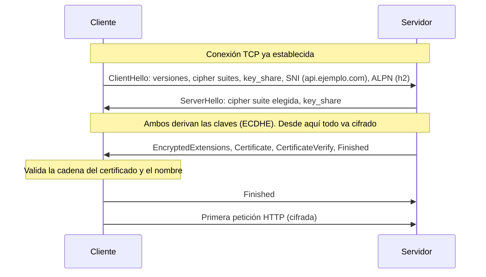
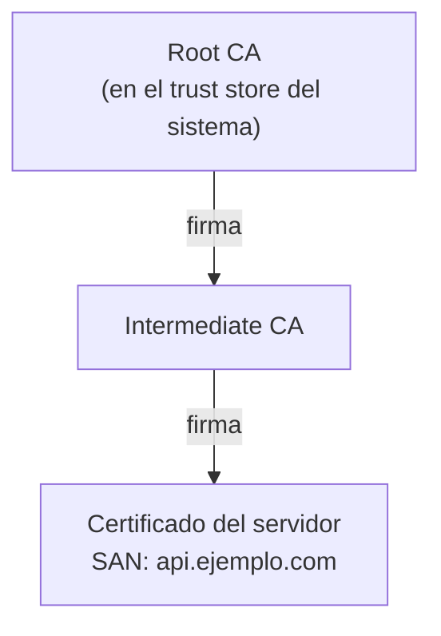

---
tags:
  - redes
  - networking
  - http
  - tls
---

# Protocolos de aplicación: HTTP, TLS, SSH y WebSockets

> Cómo hablan las aplicaciones sobre la red: las versiones de HTTP, qué lleva una petición, cómo TLS cifra y autentica la conexión, y dónde encajan SSH, SMTP y WebSockets.

!!! info "Antes de leer"
    Esta nota asume lo visto en [Servicios de red](servicios-red.md) (DNS) y en [Capa de transporte](capa-transporte.md) (TCP, UDP, QUIC y el three-way handshake). Una petición HTTPS empieza siempre por esos dos pasos: resolver el nombre y abrir la conexión.

## ¿Qué es un protocolo de aplicación?

Es el "idioma" que acuerdan dos programas para entenderse una vez que la red ya los conectó. En el modelo TCP/IP vive en la capa de aplicación (capas 5–7 de OSI, ver [Modelos OSI y TCP/IP](../basico/modelos-osi-tcpip.md)). Esta nota se centra en los que más vas a tocar en cloud y DevOps:

| Protocolo | Para qué | Transporte y puerto habitual |
| --- | --- | --- |
| **HTTP** | Web y APIs | TCP 80 (HTTP/1.1, HTTP/2) o UDP 443 (HTTP/3) |
| **HTTPS** | HTTP cifrado con TLS | TCP 443 |
| **SSH** | Acceso remoto y túneles cifrados | TCP 22 |
| **SMTP** | Envío de correo entre servidores | TCP 25 (entre servidores) y 587 (envío desde clientes) |
| **WebSocket** | Canal bidireccional y persistente sobre HTTP | El mismo de HTTP(S) |

## HTTP

**HTTP** (*Hypertext Transfer Protocol*) sigue un modelo **request/response** (petición/respuesta): el cliente envía una petición, el servidor devuelve una respuesta. Es **stateless** (sin estado): cada petición se entiende sola; para "recordar" al usuario se usan cookies o tokens.

### Anatomía de una petición y una respuesta

```http
GET /api/pedidos?estado=abierto HTTP/1.1
Host: api.ejemplo.com
Accept: application/json
Authorization: Bearer eyJhbGciOi...
User-Agent: curl/8.5.0
```

```http
HTTP/1.1 200 OK
Content-Type: application/json
Content-Length: 58
Cache-Control: no-store

{"pedidos":[{"id":42,"estado":"abierto","total":15990}]}
```

- **Línea de inicio**: método, ruta y versión (en la petición) o versión, código y texto (en la respuesta).
- **Headers** (cabeceras): metadatos clave-valor.
- **Body** (cuerpo): opcional, separado por una línea en blanco.

### Las tres versiones

| | HTTP/1.1 | HTTP/2 | HTTP/3 |
| --- | --- | --- | --- |
| Transporte | TCP | TCP | **QUIC** sobre UDP |
| Formato | Texto | **Binario** (frames) | Binario |
| Peticiones en paralelo | Una a la vez por conexión (los navegadores abren varias conexiones) | **Multiplexing**: muchas peticiones simultáneas en una conexión | Multiplexing con streams independientes |
| Head-of-line blocking (bloqueo de cabeza de línea) | Sí, a nivel HTTP | Resuelto en HTTP, pero sigue en TCP: un paquete perdido frena todos los streams | Resuelto: una pérdida solo frena su stream |
| Compresión de headers | No | HPACK | QPACK |
| Cifrado | Opcional | En la práctica obligatorio (los navegadores solo lo usan con TLS) | **Siempre** (TLS 1.3 integrado en QUIC) |
| Cómo se negocia | — | **ALPN** durante el handshake TLS | Header `Alt-Svc` o registro DNS HTTPS; el cliente prueba QUIC |

!!! note "Qué versión ve tu backend"
    El cliente puede hablar HTTP/3 con el load balancer o la CDN, y el load balancer hablar HTTP/1.1 con tus servidores. La versión se negocia **por cada salto**. Lo verás en [Balanceo y alta disponibilidad](../avanzado/balanceo-alta-disponibilidad.md).

### Métodos: seguros e idempotentes

| Método | Uso |
| --- | --- |
| `GET` | Leer un recurso |
| `POST` | Crear un recurso o ejecutar una acción |
| `PUT` / `PATCH` | Reemplazar / modificar parcialmente un recurso |
| `DELETE` | Borrar un recurso |

Lo que importa para diseñar y operar es su semántica:

| Método | **Safe** (no modifica nada) | **Idempotent** (repetirlo da el mismo resultado) |
| --- | --- | --- |
| `GET`, `HEAD`, `OPTIONS` | Sí | Sí |
| `PUT`, `DELETE` | No | Sí |
| `POST` | No | No |
| `PATCH` | No | No (puede serlo, depende de la implementación) |

Un proxy o un cliente con reintentos solo debería reintentar automáticamente peticiones idempotentes. Reintentar un `POST /pagos` puede cobrar dos veces; por eso las APIs de pago usan un header de **idempotency key** (clave de idempotencia).

### Códigos de estado

Las clases: `1xx` informativo, `2xx` éxito, `3xx` redirección, `4xx` error del cliente, `5xx` error del servidor. Los habituales y su pista de diagnóstico:

| Código | Significado | Pista típica |
| --- | --- | --- |
| `2xx` (200, 201, 204) | Éxito | — |
| `3xx` (301, 302, 304) | Redirección | Revisa el header `Location` |
| `400` | Petición mal formada | Revisa el cuerpo o los parámetros |
| `401` / `403` | No autenticado / sin permiso | Token, credenciales, IAM |
| `404` | No existe | Ruta, *host* o *ingress* mal configurado |
| `429` | Demasiadas peticiones | *Rate limiting* |
| `500` | Error interno de la aplicación | Logs de la app |
| `502` / `503` / `504` | Error en el *proxy* o *load balancer*: backend caído, sin capacidad o lento | *Health checks*, *timeouts* |

Dos que aparecen en esta nota: `101 Switching Protocols` (cambio a WebSocket) y `301`/`308` (redirección permanente, la que se usa para forzar HTTPS).

### Headers que conviene conocer

| Header | Para qué |
| --- | --- |
| `Host` | Qué sitio pides: permite muchos sitios en una misma IP (*virtual hosting*) |
| `Authorization` | Credenciales (`Bearer <token>`, `Basic ...`) |
| `Content-Type` / `Accept` | Formato del cuerpo enviado / formato que aceptas |
| `Cache-Control` | Quién puede cachear la respuesta y cuánto tiempo (CDN, navegador) |
| `X-Forwarded-For`, `X-Forwarded-Proto` | IP y protocolo originales del cliente cuando hay un proxy en medio |
| `Strict-Transport-Security` | **HSTS**: obliga al navegador a usar solo HTTPS en ese dominio |
| `Location` | Destino de una redirección |

### Cookies

El servidor envía `Set-Cookie` y el navegador la devuelve en cada petición al mismo sitio con el header `Cookie`. Sus atributos son controles de seguridad:

```http
Set-Cookie: sesion=a1b2c3; Secure; HttpOnly; SameSite=Lax; Path=/; Max-Age=3600
```

| Atributo | Efecto |
| --- | --- |
| `Secure` | Solo se envía por HTTPS |
| `HttpOnly` | JavaScript no puede leerla (mitiga robo de sesión por XSS) |
| `SameSite` | Limita su envío en peticiones desde otros sitios (`Strict`, `Lax`, `None`); mitiga CSRF |
| `Max-Age` / `Expires` | Duración; sin ellos es una cookie de sesión |

## TLS

**TLS** (*Transport Layer Security*) es la capa que convierte HTTP en HTTPS (y protege también SMTP, bases de datos, gRPC…). Da tres garantías:

1. **Confidencialidad**: nadie en el camino puede leer el contenido.
2. **Integridad**: nadie puede modificarlo sin que se note.
3. **Autenticación**: el servidor demuestra que es quien dice ser (y, con mTLS, también el cliente).

SSL es el nombre antiguo: SSL 2.0/3.0 y TLS 1.0/1.1 están obsoletos. Hoy se usa **TLS 1.2** y **TLS 1.3**.

### Handshake TLS 1.3

TLS 1.3 completa el handshake en **un solo ida y vuelta** (1-RTT), después del three-way handshake de TCP:



| Mensaje | Qué aporta |
| --- | --- |
| `key_share` | Parte pública del intercambio de claves **ECDHE**. Cada conexión usa claves efímeras: **forward secrecy** (secreto hacia adelante), robar la clave privada del servidor mañana no descifra el tráfico de hoy |
| **SNI** (*Server Name Indication*) | El nombre del sitio, para que un servidor con muchos certificados elija el correcto. Va sin cifrar en el ClientHello |
| **ALPN** | Negocia el protocolo de aplicación (`h2`, `http/1.1`) |
| `Certificate` + `CertificateVerify` | El servidor envía su certificado y firma el handshake con su clave privada: prueba que la posee |
| `Finished` | Resumen de todo el handshake: si alguien alteró un mensaje, no coincide |

TLS 1.3 también permite **0-RTT** al reconectar (enviar datos en el primer mensaje), con un costo: esos datos pueden ser **reenviados por un atacante** (*replay*), así que solo deberían usarse para peticiones idempotentes.

### Certificados y cadena de confianza

Un **certificado X.509** une una clave pública con una identidad (nombres DNS en el campo **SAN**, *Subject Alternative Name*) y lo firma una **CA** (*Certificate Authority*, autoridad de certificación).



- El cliente confía en un conjunto de **root CAs** preinstaladas (el **trust store** del sistema operativo o del navegador).
- Las root CAs no firman certificados de servidores directamente: lo hacen **intermediate CAs**. El servidor debe enviar **su certificado más los intermedios**; si falta un intermedio, unos clientes fallan y otros no (según si lo tienen en caché).
- El cliente comprueba: la firma de cada eslabón, que el nombre pedido esté en el SAN, las fechas de validez y que no esté revocado.

**PKI** (*Public Key Infrastructure*, infraestructura de clave pública) es el conjunto completo: CAs, políticas, emisión, renovación y revocación. Una organización puede tener una **PKI privada** para servicios internos; sus certificados solo son válidos para quien tenga su root en el trust store.

!!! warning "Certificados cada vez más cortos"
    Los navegadores y el CA/Browser Forum aprobaron reducir por etapas la validez máxima de los certificados públicos, hasta **47 días hacia 2029**. Renovar a mano ya no es viable: automatiza con **ACME** (el protocolo de Let's Encrypt, cert-manager en Kubernetes) o con los servicios de certificados del proveedor. Revisa el calendario vigente antes de planificar.

Para inspeccionar un certificado desde la terminal:

```console
$ openssl s_client -connect api.ejemplo.com:443 -servername api.ejemplo.com </dev/null 2>/dev/null \
    | openssl x509 -noout -subject -issuer -dates -ext subjectAltName
subject=CN=api.ejemplo.com
issuer=C=US, O=Let's Encrypt, CN=R11
notBefore=Sep 30 12:00:00 2026 GMT
notAfter=Dec 29 12:00:00 2026 GMT
X509v3 Subject Alternative Name:
    DNS:api.ejemplo.com
```

### mTLS

En TLS normal solo el servidor presenta certificado. En **mTLS** (*mutual TLS*, TLS mutuo) **el cliente también**, y el servidor lo valida contra una CA en la que confía. Se usa para autenticar servicios entre sí (*service-to-service*), dispositivos IoT o integraciones B2B. Los **service mesh** (Istio, Linkerd) lo activan de forma transparente entre todos los pods.

### TLS en la nube

| | AWS | Azure | Google Cloud |
| --- | --- | --- | --- |
| Certificados públicos gestionados | AWS Certificate Manager (ACM) | App Service certificates, certificados gestionados de Azure Front Door, Azure Key Vault | Certificate Manager, Google-managed SSL certificates |
| CA privada gestionada | AWS Private CA | Sin equivalente directo: Azure Key Vault guarda y renueva certificados emitidos por una CA propia o integrada | Certificate Authority Service |
| Dónde se termina TLS | Load balancer, CloudFront, API Gateway | Application Gateway, Front Door | Cloud Load Balancing |

Detalle de dónde terminar TLS (en el load balancer o en el backend) en [Balanceo y alta disponibilidad](../avanzado/balanceo-alta-disponibilidad.md).

## SSH

**SSH** (*Secure Shell*) crea un canal cifrado para administrar servidores, copiar archivos (`scp`, `sftp`) y hacer túneles. Su uso diario (llaves, `~/.ssh/config`, `ProxyJump`, port forwarding) está en [Linux, redes y scripting](../../devops/fundamentos/linux-redes-scripting.md#ssh) y, del lado servidor, en [Redes en Linux Server](../../servidores/linux/linux-redes-servidor.md#ssh-del-lado-servidor). Desde el punto de vista de red:

- Corre sobre **TCP 22**. Igual que TLS, negocia claves efímeras y cifra todo después.
- No usa CAs públicas: la primera vez que te conectas, el cliente te muestra la **host key fingerprint** (huella de la llave del servidor) y la guarda en `~/.ssh/known_hosts`. Si después cambia, SSH avisa con `REMOTE HOST IDENTIFICATION HAS CHANGED`: puede ser una VM reconstruida… o un **MITM** (ataque de intermediario).
- En entornos grandes se usan **SSH certificates** (llaves firmadas por una CA interna) para no distribuir `authorized_keys` a mano.

## SMTP en una línea

**SMTP** (*Simple Mail Transfer Protocol*) envía correo entre servidores (TCP 25) y desde clientes o aplicaciones hacia su servidor (TCP 587 con STARTTLS); la autenticidad del remitente se apoya en registros DNS **SPF**, **DKIM** y **DMARC**. Muchos proveedores cloud bloquean o restringen la salida por el puerto 25 en sus VMs: para enviar correo desde una aplicación se usa un servicio de envío (Amazon SES, Azure Communication Services, un proveedor externo).

## WebSockets

HTTP es petición/respuesta: el servidor no puede "hablar primero". **WebSocket** abre un canal **bidireccional y persistente** reutilizando una conexión HTTP: el cliente pide un `Upgrade` y, si el servidor acepta con `101 Switching Protocols`, ambos pasan a intercambiar mensajes libremente sobre esa misma conexión TCP.

```http
GET /chat HTTP/1.1
Host: app.ejemplo.com
Upgrade: websocket
Connection: Upgrade
Sec-WebSocket-Key: dGhlIHNhbXBsZSBub25jZQ==
Sec-WebSocket-Version: 13
```

Se usan esquemas `ws://` y `wss://` (cifrado con TLS; usa siempre este). Se usa para chats, notificaciones en tiempo real y dashboards en vivo.

!!! tip "WebSockets detrás de un load balancer"
    Son conexiones **largas**: revisa el **idle timeout** (tiempo máximo sin tráfico) del load balancer o proxy, envía mensajes de *keepalive* (ping/pong) y ten en cuenta que al desplegar una versión nueva esas conexiones se cortan y los clientes deben reconectar.

## Relación con otras secciones

| Enfoque | Qué se mira desde ahí | Nota |
| --- | --- | --- |
| Networking (la base) | DNS y TCP antes de cada petición; terminación TLS en load balancers; proxies e inspección TLS; diagnóstico con `curl -v` y `openssl s_client` | [Servicios de red](servicios-red.md), [Seguridad de red](../avanzado/seguridad-red.md), [Balanceo y alta disponibilidad](../avanzado/balanceo-alta-disponibilidad.md), [Troubleshooting de red](../avanzado/troubleshooting-red.md) |
| Cloud (el control) | Load balancers L7, certificados gestionados y KMS; diseño de APIs | [Redes en la nube](../../cloud/redes-y-datos/redes.md), [Seguridad de cifrado y secretos](../../cloud/seguridad/seguridad-cifrado-secretos.md), [Integración y APIs](../../cloud/arquitectura/integracion-apis.md) |
| DevOps (la automatización) | `curl`, SSH y HTTP en scripts y health checks; ingress en Kubernetes | [Linux, redes y scripting](../../devops/fundamentos/linux-redes-scripting.md), [Kubernetes](../../devops/contenedores/kubernetes.md) |
| DevSecOps (la verificación) | Seguridad de APIs y headers con DAST; secretos y certificados; mTLS entre servicios | [Pruebas dinámicas](../../devsecops/codigo-y-dependencias/pruebas-dinamicas.md), [Secretos e identidades](../../devsecops/identidades-y-pipeline/secretos-identidades.md), [Seguridad de Kubernetes](../../devsecops/infraestructura-y-contenedores/seguridad-kubernetes.md) |
| Python (la herramienta) | Consumir APIs HTTP con `requests`: timeouts, reintentos, códigos de estado | [APIs y HTTP](../../python/scripting/apis-http.md) |
| Laboratorios (la práctica) | Practicar esto paso a paso | [Lab 01: Diagnóstico de red desde Linux](../../laboratorios/fundamentos/linux-red-diagnostico.md), [Lab 03: Script en Python para analizar logs](../../laboratorios/fundamentos/python-analizar-logs.md), [Lab 18: AWS: API serverless con Lambda, API Gateway y DynamoDB](../../laboratorios/cloud/aws-serverless-api.md), [Lab 20: Google Cloud: desplegar un contenedor en Cloud Run](../../laboratorios/cloud/gcp-cloud-run.md) |

**Siguiente:** [Seguridad de red](../avanzado/seguridad-red.md)

## Referencias

- [RFC 9110: HTTP Semantics](https://www.rfc-editor.org/rfc/rfc9110)
- [RFC 9113: HTTP/2](https://www.rfc-editor.org/rfc/rfc9113)
- [RFC 9114: HTTP/3](https://www.rfc-editor.org/rfc/rfc9114)
- [RFC 8446: TLS 1.3](https://www.rfc-editor.org/rfc/rfc8446)
- [RFC 6455: The WebSocket Protocol](https://www.rfc-editor.org/rfc/rfc6455)
- [MDN: Generalidades del protocolo HTTP](https://developer.mozilla.org/es/docs/Web/HTTP/Overview)
- [MDN: métodos de petición HTTP](https://developer.mozilla.org/es/docs/Web/HTTP/Methods)
- [MDN: códigos de estado de respuesta HTTP](https://developer.mozilla.org/es/docs/Web/HTTP/Status)
- [MDN: Set-Cookie](https://developer.mozilla.org/es/docs/Web/HTTP/Headers/Set-Cookie)
- [Cloudflare: ¿Qué sucede en un protocolo de enlace TLS?](https://www.cloudflare.com/es-es/learning/ssl/what-happens-in-a-tls-handshake/)
- [Let's Encrypt: cómo funciona](https://letsencrypt.org/es/how-it-works/)
- [CA/Browser Forum: Baseline Requirements](https://cabforum.org/working-groups/server/baseline-requirements/)
- [AWS Certificate Manager](https://docs.aws.amazon.com/acm/latest/userguide/acm-overview.html)
- [Google Cloud Certificate Manager](https://cloud.google.com/certificate-manager/docs/overview)
- [OpenSSH manual pages](https://www.openssh.com/manual.html)
