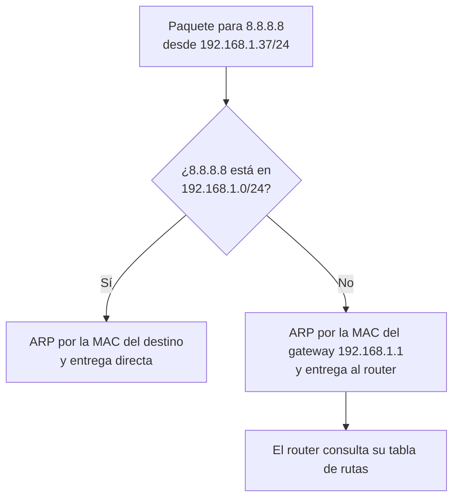
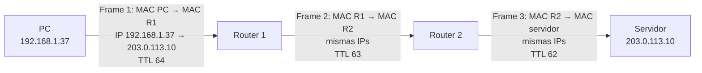
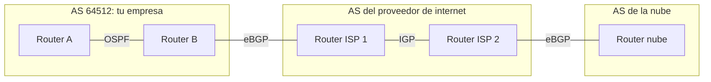
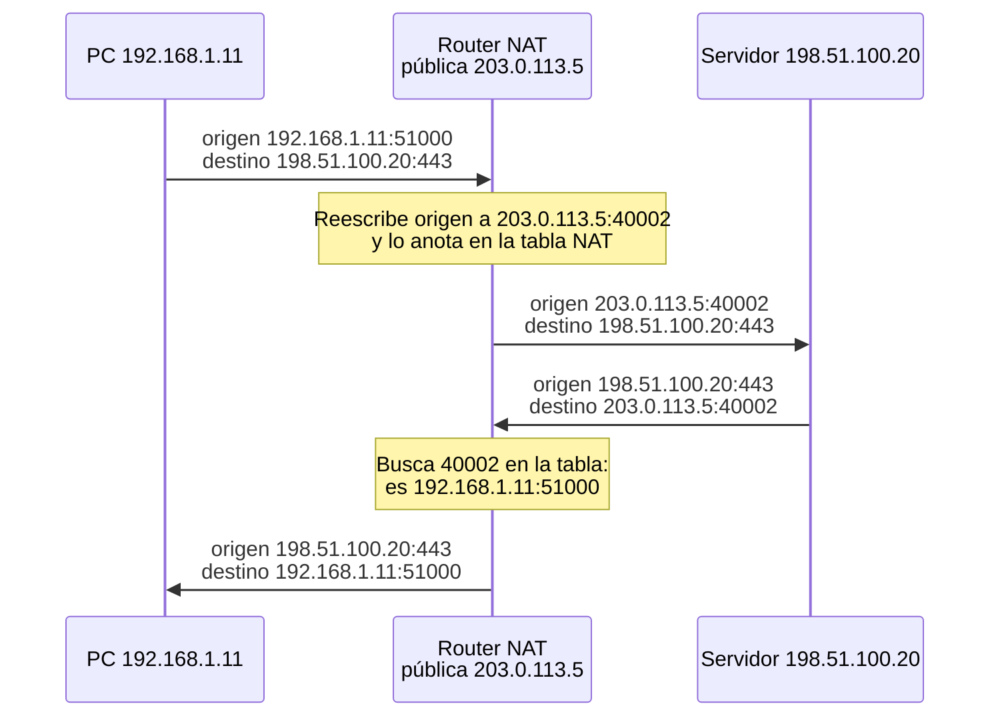

---
tags:
  - redes
  - networking
  - routing
---

# Routing y NAT

> Cómo decide un paquete por dónde ir entre redes (default gateway, tablas de rutas, longest prefix match, OSPF y BGP) y cómo NAT permite que muchas IPs privadas salgan a internet con pocas IPs públicas.

!!! info "Antes de leer"
    Esta nota asume lo visto en [Direccionamiento IP](../basico/direccionamiento-ip.md): máscaras, CIDR, la operación AND para saber la red de una IP y los rangos privados RFC 1918.

## ¿Qué es el routing?

**Routing** (enrutamiento) es el proceso de elegir el camino de un paquete **entre redes distintas**. Lo hacen los **routers**, que conectan varias redes y reenvían paquetes de una a otra.

Analogía: un viaje por carretera sin GPS. En cada cruce hay un cartel que dice "Valparaíso → por la izquierda; cualquier otro destino → recto". Nadie conoce el camino completo: cada cruce solo sabe **cuál es el siguiente tramo**. Igual en una red: cada router decide únicamente el **siguiente salto** (*next hop*); a eso se le llama routing **salto a salto** (*hop-by-hop*).

## El default gateway

Antes de enviar un paquete, un host se pregunta: **¿el destino está en mi red?** Lo sabe aplicando su máscara (la operación AND de la nota anterior).

- **Sí** → lo entrega directamente: averigua la MAC del destino con ARP y le envía el frame.
- **No** → se lo entrega a su **default gateway** (puerta de enlace predeterminada): el router de su red, que se encargará del resto.



En Linux, la tabla de rutas del host muestra ambas cosas:

```text
$ ip route
default via 192.168.1.1 dev eth0 proto dhcp metric 100
192.168.1.0/24 dev eth0 proto kernel scope link src 192.168.1.37 metric 100

$ ip route get 8.8.8.8
8.8.8.8 via 192.168.1.1 dev eth0 src 192.168.1.37 uid 1000
```

- La segunda línea es la **ruta conectada**: la red local, sin gateway (entrega directa).
- `default` es la ruta por defecto: "todo lo demás, al `192.168.1.1`". Equivale a `0.0.0.0/0`.
- `ip route get` te dice qué ruta usaría el sistema para un destino concreto.

En Windows: `route print` o `Get-NetRoute`.

## Qué cambia y qué no en cada salto

Este es el concepto que más ayuda a entender redes: **en cada salto se crea un frame nuevo (MACs nuevas), pero el paquete IP mantiene sus IPs** de origen y destino (si no hay NAT de por medio). Además, cada router resta 1 al **TTL** (*Time To Live*) del paquete; si llega a 0, lo descarta. Así se evita que un paquete dé vueltas para siempre en un bucle de routing (y así funciona `traceroute`).



## La tabla de rutas

Cada router (y cada host) tiene una **routing table** (tabla de rutas). Cada entrada dice: "para llegar a **esta red**, envía a **este siguiente salto** por **esta interfaz**".

| Campo | Significado |
| --- | --- |
| Destino | Red en notación CIDR (`10.1.0.0/16`) |
| Next hop | IP del siguiente router (o "conectada directamente") |
| Interfaz | Por dónde sale el paquete |
| Métrica | Costo de la ruta; a igualdad de destino, se prefiere la menor |
| Origen | Cómo se aprendió: **conectada**, **estática** o por un **protocolo dinámico** |

### Longest prefix match

Un destino puede coincidir con varias rutas. La regla es: **gana la ruta más específica**, la de **prefijo más largo** (*longest prefix match*).

Ejemplo de tabla:

| Destino | Next hop |
| --- | --- |
| `0.0.0.0/0` | ISP |
| `10.0.0.0/8` | Túnel VPN |
| `10.1.0.0/16` | Router R2 |
| `10.1.2.0/24` | Router R3 |

| Paquete hacia | Rutas que coinciden | Gana | Sale por |
| --- | --- | --- | --- |
| `10.1.2.50` | `/0`, `/8`, `/16`, `/24` | `/24` | R3 |
| `10.1.9.9` | `/0`, `/8`, `/16` | `/16` | R2 |
| `10.200.0.1` | `/0`, `/8` | `/8` | Túnel VPN |
| `8.8.8.8` | `/0` | `/0` | ISP |

La ruta `0.0.0.0/0` coincide con todo pero tiene el prefijo más corto posible: solo se usa si no hay nada mejor. Por eso se llama **ruta por defecto** (*default route*).

Si dos rutas tienen **el mismo prefijo** pero vienen de fuentes distintas (por ejemplo, una estática y otra de OSPF), el router prefiere la fuente más confiable (en equipos Cisco se llama **administrative distance**); y entre rutas de la misma fuente, la de menor métrica.

## Rutas estáticas y dinámicas

| | **Estáticas** (*static routes*) | **Dinámicas** (*dynamic routing*) |
| --- | --- | --- |
| Cómo se crean | A mano (o con IaC) | Los routers las intercambian con un protocolo |
| Si cae un enlace | Nada cambia hasta que alguien la edite | Se recalcula el camino automáticamente |
| Ventajas | Simples, predecibles, sin tráfico extra | Escalan, se adaptan a fallos |
| Úsalas en | Redes pequeñas, rutas por defecto, redes "stub" con una sola salida | Redes medianas y grandes, conexiones redundantes, internet |

```bash
# Ruta estática en Linux (no persiste tras reiniciar si no se guarda en la configuración de red)
sudo ip route add 10.50.0.0/16 via 192.168.1.254 dev eth0
```

## Sistemas autónomos, IGP y EGP

Un **sistema autónomo** (AS, *Autonomous System*) es un conjunto de redes bajo **una misma administración** y política de routing: un proveedor de internet, una nube, una gran empresa. Se identifica con un **ASN** (*Autonomous System Number*). Igual que con las IPs, hay ASN públicos y rangos **privados** (64512–65534 en 16 bits y 4200000000–4294967294 en 32 bits, RFC 6996) para uso interno, por ejemplo en conexiones VPN con la nube.

- **IGP** (*Interior Gateway Protocol*): protocolo de routing **dentro** de un AS. Busca el camino más rápido. Ejemplos: **OSPF**, IS-IS, EIGRP (de Cisco), RIP (antiguo).
- **EGP** (*Exterior Gateway Protocol*): routing **entre** AS. Aplica políticas de negocio. En la práctica, el único que se usa es **BGP**.



### OSPF en lo esencial

**OSPF** (*Open Shortest Path First*) es un protocolo de **estado de enlace** (*link-state*):

1. Cada router descubre a sus **vecinos** (*neighbors*) con mensajes *hello*.
2. Todos comparten información de sus enlaces, hasta que cada router tiene **el mapa completo** del área.
3. Cada uno calcula el camino más corto con el algoritmo de **Dijkstra** (SPF). El "largo" de cada enlace es un **costo**, que por defecto depende del ancho de banda.
4. Si un enlace cae, se avisa a todos y se recalcula en poco tiempo.

Para escalar, la red se divide en **áreas**; el **área 0** (*backbone*) conecta a todas las demás.

### BGP en lo esencial

**BGP** (*Border Gateway Protocol*) es el protocolo que **mantiene unido internet**. Es de tipo **path-vector**: cada anuncio de ruta lleva la lista de AS por los que pasa (**AS_PATH**), lo que evita bucles y permite aplicar políticas.

- Funciona sobre **TCP, puerto 179**, entre pares (*peers*) configurados explícitamente.
- **eBGP** entre AS distintos; **iBGP** dentro del mismo AS.
- No elige "el más rápido", sino el mejor según **atributos y políticas** (preferencia local, AS_PATH más corto, entre otros). Por ejemplo: "prefiero salir por el proveedor A porque es más barato".
- Un error de configuración BGP puede desviar tráfico de medio internet (*route leaks*, *BGP hijacking*). **RPKI** permite validar criptográficamente quién puede anunciar cada prefijo.

## NAT

IPv4 tiene pocas direcciones públicas, y las privadas (RFC 1918) no se enrutan en internet. **NAT** (*Network Address Translation*, traducción de direcciones de red) resuelve esto: un router o firewall **reescribe las direcciones IP** (y a veces los puertos) de los paquetes que lo atraviesan y recuerda cada traducción en una **tabla NAT** para poder deshacerla en la respuesta.

| Tipo | Traducción | Uso típico |
| --- | --- | --- |
| **Static NAT** (NAT estático) | 1 IP privada ↔ 1 IP pública, fija | Publicar un servidor concreto |
| **Dynamic NAT** (NAT dinámico) | IP privada → una IP libre de un *pool* de públicas | Poco usado hoy |
| **PAT** (*Port Address Translation*), también *NAT overload* o *masquerade* | Muchas IPs privadas → **una** IP pública, distinguidas por **puerto** | Tu casa, oficinas, NAT Gateway de la nube |

### Cómo funciona PAT

Dos equipos de la oficina abren conexiones al mismo servidor web. El router usa una única IP pública (`203.0.113.5`) y asigna un puerto de origen distinto a cada conexión:

| Origen interno | Origen traducido | Destino |
| --- | --- | --- |
| `192.168.1.10:51000` | `203.0.113.5:40001` | `198.51.100.20:443` |
| `192.168.1.11:51000` | `203.0.113.5:40002` | `198.51.100.20:443` |

Cuando vuelve una respuesta a `203.0.113.5:40002`, el router busca en la tabla y sabe que es para `192.168.1.11:51000`.



El servidor nunca ve `192.168.1.11`: solo ve la IP pública del router.

### SNAT, DNAT y port forwarding

- **SNAT** (*Source NAT*): se cambia la IP de **origen**. Es lo que hace PAT para que los equipos internos **salgan** a internet.
- **DNAT** (*Destination NAT*): se cambia la IP (y/o puerto) de **destino**. Sirve para que algo de fuera **entre** a un equipo interno.
- **Port forwarding** (reenvío de puertos): un DNAT fijo, del tipo "lo que llegue a `203.0.113.5:8080`, envíalo a `192.168.1.50:80`".

Ejemplo en Linux con `iptables` (un router hecho con una VM o un contenedor):

```bash
# Permitir que el equipo reenvíe paquetes entre interfaces
sudo sysctl -w net.ipv4.ip_forward=1

# SNAT/PAT: todo lo que salga por eth0 usa la IP de eth0
sudo iptables -t nat -A POSTROUTING -o eth0 -j MASQUERADE

# DNAT / port forwarding: puerto 8080 de fuera -> servidor interno puerto 80
sudo iptables -t nat -A PREROUTING -i eth0 -p tcp --dport 8080 \
  -j DNAT --to-destination 192.168.1.50:80
```

Las distribuciones modernas usan **nftables** por debajo, pero la lógica de las cadenas (*prerouting* para DNAT, *postrouting* para SNAT) es la misma.

!!! warning "NAT no es un firewall"
    Con PAT, de fuera no se puede iniciar una conexión hacia dentro porque no hay entrada en la tabla NAT, y eso **parece** protección. Pero es un efecto secundario, no una política: un port forwarding olvidado, UPnP o un error de configuración exponen equipos. La seguridad se define con reglas de firewall explícitas (ver [Seguridad de red](../avanzado/seguridad-red.md)).

### Efectos secundarios de NAT

- Rompe la comunicación **extremo a extremo**: los servicios de dentro no son alcanzables sin DNAT.
- En logs y auditorías, una IP pública representa a muchos usuarios: para identificar a alguien hace falta **IP + puerto + hora**.
- Muchos proveedores de internet aplican **CGNAT** (NAT a gran escala, con `100.64.0.0/10`): tu router doméstico ni siquiera tiene IP pública.
- La tabla NAT tiene límites de tamaño y de puertos, y las entradas caducan tras un tiempo de inactividad.
- Con **IPv6** no hace falta NAT para ahorrar direcciones: cada equipo puede tener IP pública y se protege con firewall.

## En la nube

| Concepto | AWS | Azure | Google Cloud |
| --- | --- | --- | --- |
| Tabla de rutas | **Route table** asociada a cada subnet; incluye la ruta `local` de la VPC | **System routes** automáticas + **route tables** con *user-defined routes* (UDR) | **Routes** a nivel de VPC, con prioridad (pueden limitarse a VMs con *network tags*) |
| Salida/entrada a internet para IPs públicas | **Internet Gateway**: hace NAT 1:1 entre la IP privada de la instancia y su IP pública | IP pública asociada al recurso | IP externa de la VM (la traducción la hace la red de Google) |
| SNAT/PAT para subnets privadas | **NAT Gateway** | **Azure NAT Gateway** | **Cloud NAT** (sobre Cloud Router; distribuido, sin VM intermedia) |
| DNAT / publicar un servicio | Load balancer | Load balancer, reglas DNAT de Azure Firewall | Load balancer |
| Routing dinámico con on-premise | **BGP** en Site-to-Site VPN (opcional) y en Direct Connect | **BGP** en VPN Gateway (opcional) y en ExpressRoute | **Cloud Router** habla BGP con HA VPN y Cloud Interconnect |

Fíjate en que la ruta "local" de la VPC hace que todas las subnets se vean entre sí sin configurar nada: lo que las separa son los firewalls (security groups, NSG, firewall rules), no el routing. Lo que hace a una subnet "pública" o "privada" es justamente su **ruta `0.0.0.0/0`**: hacia el Internet Gateway o hacia un NAT Gateway. Todo eso está desarrollado en [Redes en la nube](../../cloud/redes-y-datos/redes.md#subnets-publicas-y-privadas).

!!! tip "ASN en conexiones híbridas"
    Al montar una VPN con BGP o una conexión dedicada, cada lado necesita un ASN. Los proveedores traen uno por defecto en su lado (por ejemplo, 64512 en el gateway de AWS o 65515 en Azure VPN Gateway) y tú eliges uno **privado** que no choque con los demás de tu red. Revisa la documentación del servicio antes de configurarlo; lo verás en [Redes de datacenter e híbridas](../avanzado/redes-datacenter-hibridas.md).

## Conclusión práctica

- Un host entrega directo si el destino está en su red; si no, al **default gateway**.
- Cada router solo decide el **siguiente salto**; en cada salto cambian las MAC, no las IPs (sin NAT), y baja el TTL.
- Gana la ruta **más específica** (*longest prefix match*); `0.0.0.0/0` es el último recurso.
- **OSPF** busca el camino más corto dentro de tu red; **BGP** aplica políticas entre organizaciones y es el que usan las conexiones híbridas con la nube.
- **PAT/SNAT** permite salir con una sola IP pública; **DNAT** permite entrar. NAT no reemplaza al firewall.

## Relación con otras secciones

| Enfoque | Qué se mira desde ahí | Nota |
| --- | --- | --- |
| Cloud (el control) | Route tables, Internet Gateway, NAT Gateway / Cloud NAT, BGP en VPN y conexiones dedicadas; costo del NAT | [Redes en la nube](../../cloud/redes-y-datos/redes.md), [FinOps y costos](../../cloud/fundamentos/finops-costos.md) |
| DevOps (la automatización) | Ver y modificar rutas en Linux; definir route tables y NAT como código | [Linux, redes y scripting](../../devops/fundamentos/linux-redes-scripting.md), [Infrastructure as Code](../../devops/iac/infraestructura-como-codigo.md) |
| DevSecOps (la verificación) | Detectar subnets con ruta directa a internet que deberían ser privadas; reglas abiertas a `0.0.0.0/0` | [Seguridad de IaC](../../devsecops/infraestructura-y-contenedores/seguridad-iac.md), [Cumplimiento y gobierno](../../devsecops/gobierno-y-respuesta/cumplimiento.md) |
| Laboratorios (la práctica) | Practicar esto paso a paso | [Lab 01: Diagnóstico de red desde Linux](../../laboratorios/fundamentos/linux-red-diagnostico.md), [Lab 02: Plan de direccionamiento IP para una VPC](../../laboratorios/fundamentos/subnetting-plan-ips.md), [Lab 17: AWS: VPC con subnets públicas y privadas y una EC2](../../laboratorios/cloud/aws-vpc-ec2.md), [Lab 19: Azure: VNet, NSG y una VM con Azure CLI](../../laboratorios/cloud/azure-vnet-vm.md) |

**Siguiente:** [Capa de transporte](capa-transporte.md)

## Referencias

- [RFC 4632: Classless Inter-Domain Routing (CIDR)](https://www.rfc-editor.org/rfc/rfc4632)
- [RFC 2328: OSPF Version 2](https://www.rfc-editor.org/rfc/rfc2328)
- [RFC 4271: A Border Gateway Protocol 4 (BGP-4)](https://www.rfc-editor.org/rfc/rfc4271)
- [RFC 6996: Autonomous System Reservation for Private Use](https://www.rfc-editor.org/rfc/rfc6996)
- [RFC 3022: Traditional IP Network Address Translator](https://www.rfc-editor.org/rfc/rfc3022)
- [Cloudflare: What is BGP?](https://www.cloudflare.com/learning/security/glossary/what-is-bgp/)
- [AWS: Route tables](https://docs.aws.amazon.com/vpc/latest/userguide/VPC_Route_Tables.html)
- [AWS: NAT gateways](https://docs.aws.amazon.com/vpc/latest/userguide/vpc-nat-gateway.html)
- [Azure: enrutamiento del tráfico de red virtual](https://learn.microsoft.com/es-es/azure/virtual-network/virtual-networks-udr-overview)
- [Google Cloud: Routes](https://cloud.google.com/vpc/docs/routes)
- [Google Cloud: Cloud Router overview](https://cloud.google.com/network-connectivity/docs/router/concepts/overview)
