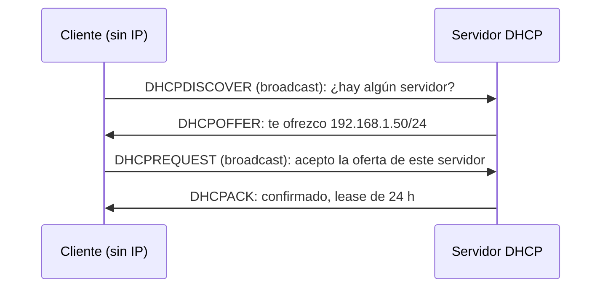
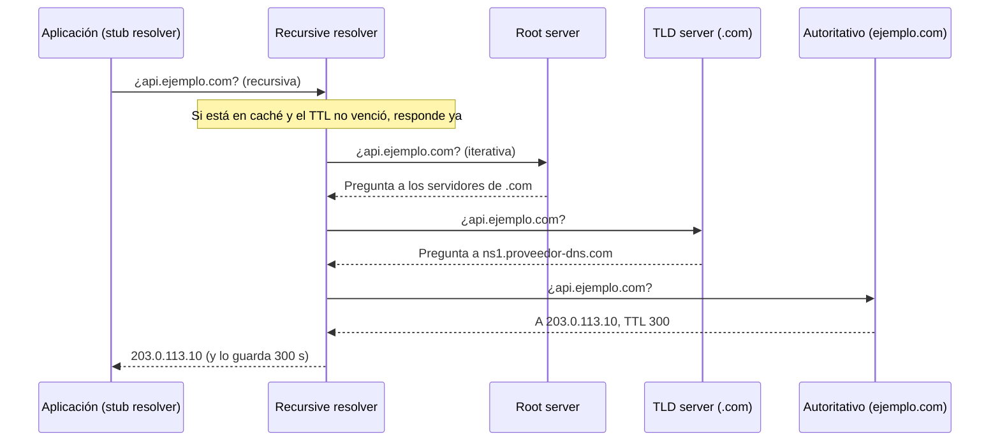

---
tags:
  - redes
  - networking
  - dns
  - dhcp
---

# Servicios de red: DHCP, DNS y NTP

> Los tres servicios que hacen que una red "simplemente funcione": DHCP te da una IP al conectarte, DNS traduce nombres a direcciones y NTP mantiene todos los relojes de acuerdo.

!!! info "Antes de leer"
    Esta nota asume lo visto en [Capa de transporte](capa-transporte.md): puertos, TCP y UDP. También usa direcciones IP, máscaras y default gateway ([Direccionamiento IP](../basico/direccionamiento-ip.md), [Routing y NAT](routing-nat.md)) y broadcast ([Capa de enlace y Ethernet](../basico/capa-enlace-ethernet.md)).

## ¿Qué es un servicio de red?

Hasta ahora viste cómo viaja un paquete. Pero para que un equipo pueda enviar algo útil necesita antes **saber quién es** (su IP, máscara y gateway), **a quién hablarle** (la IP detrás de un nombre) y **qué hora es** (para validar certificados y ordenar logs). Eso lo resuelven tres servicios de infraestructura que corren por debajo de casi todo:

| Servicio | Pregunta que responde | Transporte y puerto |
| --- | --- | --- |
| **DHCP** (*Dynamic Host Configuration Protocol*) | ¿Qué IP, máscara, gateway y DNS uso? | UDP 67 (servidor) y 68 (cliente) |
| **DNS** (*Domain Name System*) | ¿Qué IP tiene `api.ejemplo.com`? | UDP 53 y TCP 53 |
| **NTP** (*Network Time Protocol*) | ¿Qué hora es exactamente? | UDP 123 |

Los puertos están también en [Puertos comunes](../../recursos/puertos.md#redes-e-infraestructura-base).

## DHCP

Sin DHCP tendrías que configurar a mano la IP de cada equipo. Con DHCP, un servidor entrega una **lease** (concesión: una IP prestada por un tiempo) junto con las opciones de red.

### El proceso DORA

El cliente todavía no tiene IP, así que empieza con **broadcast** (desde `0.0.0.0` hacia `255.255.255.255`). Los cuatro mensajes forman la sigla **DORA**:



1. **Discover**: el cliente pregunta a toda la red si hay un servidor DHCP.
2. **Offer**: cada servidor que lo oye ofrece una IP y opciones.
3. **Request**: el cliente elige una oferta y la pide. Va en broadcast para que los demás servidores sepan que su oferta fue rechazada.
4. **Acknowledge**: el servidor confirma. Desde ese momento el cliente usa la IP.

Antes de que venza la lease, el cliente intenta **renovarla**: al 50 % del tiempo (T1) se lo pide directamente al servidor; si no responde, al 87,5 % (T2) lo intenta con cualquier servidor por broadcast.

### Opciones que entrega DHCP

| Opción | Para qué |
| --- | --- |
| Subnet mask | Máscara de la red |
| Router | Default gateway |
| Domain Name Server | Servidores DNS que usará el equipo |
| Domain Name | Sufijo de búsqueda (`corp.ejemplo.com`) |
| Lease time | Duración de la concesión |
| NTP servers | Servidores de hora |

### DHCP relay y reservas

- El broadcast **no cruza routers** (ver [Routing y NAT](routing-nat.md)). Para tener un solo servidor DHCP para muchas VLANs, el router reenvía las peticiones como unicast: es el **DHCP relay** (agente de retransmisión), que en equipos Cisco se configura con `ip helper-address`.
- Una **reservation** (reserva) asocia una MAC a una IP fija: la impresora siempre recibe la misma dirección sin configurarla a mano.
- En IPv6 existen dos caminos: **SLAAC** (*Stateless Address Autoconfiguration*, el equipo arma su propia dirección a partir del prefijo que anuncia el router) y **DHCPv6**.

!!! warning "Rogue DHCP"
    Cualquier equipo puede responder a un Discover. Un **rogue DHCP server** (servidor DHCP no autorizado) puede entregar un gateway o DNS falsos y desviar el tráfico. En switches gestionados se mitiga con **DHCP snooping**, que solo permite respuestas DHCP desde puertos de confianza. Verás más ataques de este tipo en [Seguridad de red](../avanzado/seguridad-red.md).

## DNS en profundidad

DNS es una **base de datos distribuida y jerárquica**. Nadie tiene todos los nombres: cada nivel sabe a quién preguntarle por el siguiente.

### La jerarquía

```text
.                          raíz (root)
└── com.                   TLD (top-level domain)
    └── ejemplo.com.       zona del dominio (la gestiona su dueño)
        └── api.ejemplo.com.
```

- **Root servers** (servidores raíz): 13 identidades lógicas (`a.root-servers.net` a `m.root-servers.net`) que en realidad son cientos de servidores repartidos por el mundo con **anycast** (la misma IP anunciada desde muchos sitios; lo verás en [Balanceo y alta disponibilidad](../avanzado/balanceo-alta-disponibilidad.md)). Saben qué servidores gestionan cada TLD.
- **TLD servers**: gestionan `.com`, `.org`, `.cl`, `.mx`… y saben qué servidores son autoritativos para cada dominio.
- **Authoritative servers** (servidores autoritativos): tienen la respuesta "oficial" de una zona. Son los que configuras en tu proveedor DNS.

### Quién hace qué al resolver un nombre

| Pieza | Qué hace | Ejemplo |
| --- | --- | --- |
| **Stub resolver** | Biblioteca del sistema operativo que hace la pregunta y espera la respuesta final | `systemd-resolved`, el cliente DNS de Windows |
| **Recursive resolver** (resolver recursivo) | Hace todo el trabajo de preguntar a la jerarquía y guarda en caché | El DNS de tu ISP, `1.1.1.1`, `8.8.8.8`, el resolver de la VPC |
| **Authoritative server** | Responde solo por sus zonas, sin buscar en otros | Route 53, Azure DNS, Cloud DNS, BIND |

- **Consulta recursiva**: "dame la respuesta final". Es la que hace el stub resolver al recursive resolver.
- **Consulta iterativa**: "dime lo que sepas o a quién preguntar". Es la que hace el recursive resolver a la raíz, al TLD y al autoritativo, que responden con una **referral** (derivación) al siguiente nivel.



!!! note "¿UDP o TCP?"
    Las consultas normales van por **UDP 53**: una pregunta, una respuesta, sin handshake. Se usa **TCP 53** cuando la respuesta no cabe en UDP (respuestas grandes, por ejemplo con DNSSEC) y para las **zone transfers** (AXFR/IXFR) entre servidores. Si un firewall solo permite UDP 53, algunas consultas fallarán de forma intermitente.

### Tipos de registro

| Registro | Para qué sirve | Ejemplo |
| --- | --- | --- |
| **A** | Nombre → dirección IPv4 | `api.ejemplo.com → 203.0.113.10` |
| **AAAA** | Nombre → dirección IPv6 | `api.ejemplo.com → 2001:db8::10` |
| **CNAME** | Alias de otro nombre (no se puede usar en el dominio raíz) | `www.ejemplo.com → ejemplo.github.io` |
| **MX** | Servidores de correo del dominio, con prioridad | `10 mail.ejemplo.com` |
| **TXT** | Texto libre: verificación de dominio, SPF, DKIM, DMARC | `"v=spf1 include:_spf.google.com ~all"` |
| **NS** | Servidores autoritativos de la zona | `ns1.proveedor-dns.com` |
| **SOA** (*Start of Authority*) | Datos de la zona: servidor primario, contacto, número de serie, TTL negativo | Uno por zona |
| **PTR** | Resolución inversa: IP → nombre (zonas `in-addr.arpa` e `ip6.arpa`) | `10.113.0.203.in-addr.arpa → api.ejemplo.com` |
| **SRV** | Dónde está un servicio: host, puerto, prioridad y peso | `_sip._tcp.ejemplo.com` |
| **CAA** | Qué autoridades de certificación pueden emitir certificados para el dominio | `0 issue "letsencrypt.org"` |
| **Alias / ALIAS** | Extensión del proveedor que permite apuntar el dominio raíz a un recurso (algo que CNAME no permite) | *Alias records* de Route 53 y de Azure DNS |

### TTL y caché

Cada respuesta lleva un **TTL** (*time to live*) en segundos. Mientras no vence, los resolvers responden desde su caché sin volver a preguntar. También se cachean las respuestas negativas (**NXDOMAIN**, "el nombre no existe") durante el tiempo que indica el SOA de la zona.

- TTL alto (horas): menos consultas y más rápido, pero los cambios tardan en verse.
- TTL bajo (30–60 s): cambios casi inmediatos, más consultas. Es lo que se usa para **DNS failover**.

!!! tip "Migraciones sin sorpresas"
    Baja el TTL del registro **al menos un TTL antiguo antes** del cambio (si era 86400, bájalo con un día de anticipación). Después de migrar, vuelve a subirlo. Ten en cuenta que algunos clientes y aplicaciones (por ejemplo, la JVM con ciertas configuraciones) cachean más tiempo del que dice el TTL.

### Leer la salida de `dig`

```console
$ dig www.ejemplo.com

;; ->>HEADER<<- opcode: QUERY, status: NOERROR, id: 41022
;; flags: qr rd ra; QUERY: 1, ANSWER: 2, AUTHORITY: 0, ADDITIONAL: 1

;; QUESTION SECTION:
;www.ejemplo.com.            IN  A

;; ANSWER SECTION:
www.ejemplo.com.     300     IN  CNAME  web-lb.ejemplo.net.
web-lb.ejemplo.net.  60      IN  A      203.0.113.25

;; Query time: 23 msec
;; SERVER: 127.0.0.53#53(127.0.0.53) (UDP)
```

| Campo | Qué te dice |
| --- | --- |
| `status` | `NOERROR` (bien), `NXDOMAIN` (el nombre no existe), `SERVFAIL` (el resolver no pudo resolver, a menudo problema del autoritativo o de DNSSEC), `REFUSED` (el servidor no quiere responderte) |
| `flags` | `qr` es respuesta, `rd` pediste recursión, `ra` el servidor la ofrece, `aa` respuesta autoritativa (no viene de caché) |
| Número tras el nombre | TTL **restante** en segundos |
| `SERVER` | Quién respondió. `127.0.0.53` es `systemd-resolved`, que reenvía al resolver configurado |

Comandos útiles: `dig nombre +short` para ver solo la respuesta, `dig +trace` para ver la cadena raíz → TLD → autoritativo, `dig @ns1.proveedor-dns.com nombre` para preguntar directo al autoritativo y saltarte cachés, y `dig -x 203.0.113.25` para la resolución inversa.

### Split-horizon y zonas privadas

**Split-horizon DNS** (DNS de horizonte dividido) responde distinto según **quién pregunta**: desde internet `api.ejemplo.com` devuelve la IP pública del load balancer; desde la red interna, una IP privada. Las **private zones** (zonas privadas) son la forma de hacerlo en la nube: solo se resuelven desde las redes que asocias a ellas.

### Seguridad de DNS en una línea cada una

- **DNSSEC**: firma las respuestas para que el resolver pueda verificar que no fueron alteradas. No cifra.
- **DoT** (*DNS over TLS*, TCP 853) y **DoH** (*DNS over HTTPS*, 443): cifran la consulta entre cliente y resolver.
- **DNS cache poisoning** (envenenamiento de caché): inyectar respuestas falsas en un resolver. Se ve en [Seguridad de red](../avanzado/seguridad-red.md).

## NTP

**NTP** sincroniza el reloj de los equipos contra fuentes de referencia. Se organiza en **stratum** (estratos): stratum 0 son relojes de referencia (atómicos, GPS), stratum 1 son servidores conectados directamente a ellos, stratum 2 se sincroniza con un stratum 1, y así sucesivamente.

Un reloj desfasado rompe cosas que no parecen relacionadas con la hora:

| Qué falla | Por qué |
| --- | --- |
| Conexiones TLS | El certificado "aún no es válido" o "ya expiró" según el reloj local |
| Kerberos / Active Directory | Rechaza autenticaciones con desfase mayor que el permitido (5 minutos por defecto) |
| Tokens (JWT, códigos TOTP) | Se validan con marcas de tiempo |
| Correlación de logs | Un incidente es imposible de reconstruir si cada servidor tiene una hora distinta |

En Linux moderno el cliente habitual es **chrony** (o `systemd-timesyncd`):

```console
$ timedatectl status
               Local time: vie 2026-10-23 10:15:02 -03
           Universal time: vie 2026-10-23 13:15:02 UTC
System clock synchronized: yes
              NTP service: active
```

## En la nube

| Servicio | AWS | Azure | Google Cloud |
| --- | --- | --- | --- |
| DHCP | Gestionado; se personaliza con **DHCP option sets** | Gestionado; los servidores DNS se cambian en la configuración de **DNS servers** de la VNet | Gestionado por la VPC |
| Resolver interno | **Route 53 Resolver** (en la IP base de la VPC + 2 y en `169.254.169.253`) | **Azure-provided DNS** (`168.63.129.16`) | **Metadata server** (`169.254.169.254`) |
| Hora | Amazon Time Sync Service (`169.254.169.123`) | Sincronización con el host de Azure | NTP del metadata server |

!!! tip "DNS híbrido: los dos sentidos"
    En una red híbrida necesitas que la nube resuelva nombres de la oficina **y** que la oficina resuelva las zonas privadas de la nube. Se hace con un **outbound endpoint** o *forwarding zone* (nube → on-premise) y un **inbound endpoint** o *inbound server policy* (on-premise → nube). Lo retomas en [Redes de datacenter e híbridas](../avanzado/redes-datacenter-hibridas.md).

El DNS autoritativo gestionado (Amazon Route 53, Azure DNS, Cloud DNS), sus zonas privadas, los resolvers híbridos y las routing policies de cada proveedor están en [Redes en la nube](../../cloud/redes-y-datos/redes.md#dns).

## Relación con otras secciones

| Enfoque | Qué se mira desde ahí | Nota |
| --- | --- | --- |
| Networking (la base) | Transporte UDP/TCP debajo de estos servicios; DNS failover y anycast; DNS híbrido; diagnóstico de "no resuelve" | [Capa de transporte](capa-transporte.md), [Balanceo y alta disponibilidad](../avanzado/balanceo-alta-disponibilidad.md), [Redes de datacenter e híbridas](../avanzado/redes-datacenter-hibridas.md), [Troubleshooting de red](../avanzado/troubleshooting-red.md) |
| Cloud (el control) | Route 53, Azure DNS y Cloud DNS; zonas privadas y resolvers híbridos | [Redes en la nube](../../cloud/redes-y-datos/redes.md) |
| DevOps (la automatización) | `dig` en el día a día; DNS de servicios dentro de Kubernetes; registros DNS como código | [Linux, redes y scripting](../../devops/fundamentos/linux-redes-scripting.md), [Kubernetes](../../devops/contenedores/kubernetes.md), [Infrastructure as Code](../../devops/iac/infraestructura-como-codigo.md) |
| DevSecOps (la verificación) | Registros CAA, subdomain takeover por CNAME huérfanos, logs DNS como fuente de detección | [Detección y respuesta](../../devsecops/gobierno-y-respuesta/deteccion-respuesta.md) |
| Laboratorios (la práctica) | Practicar esto paso a paso | [Lab 01: Diagnóstico de red desde Linux](../../laboratorios/fundamentos/linux-red-diagnostico.md) |

**Siguiente:** [Protocolos de aplicación](protocolos-aplicacion.md)

## Referencias

- [RFC 2131: Dynamic Host Configuration Protocol](https://www.rfc-editor.org/rfc/rfc2131)
- [RFC 1034: Domain names, concepts and facilities](https://www.rfc-editor.org/rfc/rfc1034)
- [RFC 1035: Domain names, implementation and specification](https://www.rfc-editor.org/rfc/rfc1035)
- [IANA: Root servers](https://www.iana.org/domains/root/servers)
- [Cloudflare: ¿Qué es el DNS?](https://www.cloudflare.com/es-es/learning/dns/what-is-dns/)
- [RFC 5905: Network Time Protocol Version 4](https://www.rfc-editor.org/rfc/rfc5905)
- [chrony documentation](https://chrony-project.org/documentation.html)
- [Amazon Route 53 Resolver](https://docs.aws.amazon.com/Route53/latest/DeveloperGuide/resolver.html)
- [DHCP option sets en Amazon VPC](https://docs.aws.amazon.com/vpc/latest/userguide/VPC_DHCP_Options.html)
- [Amazon Time Sync Service](https://docs.aws.amazon.com/AWSEC2/latest/UserGuide/set-time.html)
- [¿Qué es la dirección IP 168.63.129.16?](https://learn.microsoft.com/es-es/azure/virtual-network/what-is-ip-address-168-63-129-16)
- [Azure DNS Private Resolver](https://learn.microsoft.com/es-es/azure/dns/dns-private-resolver-overview)
- [Cloud DNS overview](https://cloud.google.com/dns/docs/overview)
- [Comandos de Linux](../../recursos/comandos/linux.md)
