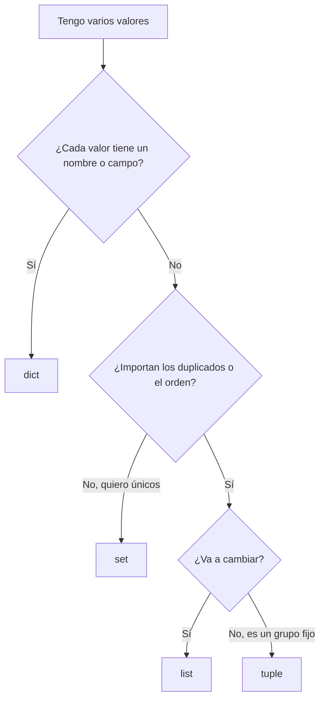

---
tags:
  - python
  - scripting
---

# Estructuras de datos

> Listas, tuplas, diccionarios y conjuntos: cuándo usar cada uno, cómo recorrerlos, filtrarlos y ordenarlos, comprehensions, slicing y las herramientas de `collections` que más ahorran trabajo al procesar logs e inventarios.

!!! info "Antes de leer"
    Necesitas conocer los tipos básicos, los strings y sus métodos (`split`, `strip`…). Lo tienes en [Sintaxis y tipos](sintaxis-tipos.md).

## ¿Qué es?

Una **estructura de datos** (*data structure*) agrupa varios valores bajo un mismo nombre. En infraestructura casi nunca trabajas con un único valor: tienes una lista de hosts, el inventario de instancias con sus etiquetas, las reglas de un security group o las líneas de un log. Y lo que devuelven las APIs y los SDK de la nube (al convertir el JSON) son **diccionarios y listas anidados**. Dominar estas cuatro estructuras es dominar el 80 % del scripting.

## Las cuatro estructuras

| Estructura | Sintaxis | Ordenada | Modificable | Duplicados | Úsala para |
| --- | --- | --- | --- | --- | --- |
| **list** (lista) | `["web-01", "db-01"]` | Sí | Sí | Sí | Secuencias que crecen: hosts, líneas, resultados |
| **tuple** (tupla) | `("10.0.1.15", 5432)` | Sí | No | Sí | Grupos fijos de valores: `(ip, puerto)`, retorno de varias cosas |
| **dict** (diccionario) | `{"id": "i-0abc", "tipo": "t3.micro"}` | Sí (orden de inserción) | Sí | Claves únicas | Datos con nombre: un recurso, sus tags, un JSON |
| **set** (conjunto) | `{22, 80, 443}` | No | Sí | No | Valores únicos, pertenencia rápida, diferencias entre grupos |

## Listas

```python
hosts = ["web-01", "web-02", "db-01"]
hosts.append("cache-01")              # añadir al final
print(hosts[0], hosts[-1], len(hosts))  # primero, último (índice negativo), longitud
hosts.remove("web-02")                # quitar por valor
print(hosts)
print("db-01" in hosts)
```

```text
web-01 cache-01 4
['web-01', 'db-01', 'cache-01']
True
```

Otros métodos útiles: `extend(otra_lista)` para unir, `insert(i, x)`, `pop()` para sacar el último, `index(x)` para buscar la posición.

## Tuplas

Una tupla es como una lista que no se puede modificar. Su uso más práctico es el **unpacking** (desempaquetado): asignar cada elemento a una variable en una sola línea.

```python
endpoint = ("10.0.1.15", 5432)
ip, puerto = endpoint
print(ip, puerto)       # 10.0.1.15 5432
```

Las verás sobre todo cuando una función devuelve varios valores y al recorrer `dict.items()`.

## Diccionarios

Un diccionario guarda pares **clave → valor**. Es la estructura natural para representar un recurso:

```python
instancia = {"id": "i-0abc123", "tipo": "t3.micro", "estado": "running"}

print(instancia["tipo"])                     # t3.micro
print(instancia.get("owner"))                # None: la clave no existe
print(instancia.get("owner", "sin-owner"))   # valor por defecto
instancia["owner"] = "equipo-datos"          # añadir o modificar

for clave, valor in instancia.items():
    print(f"{clave}: {valor}")
```

```text
t3.micro
None
sin-owner
id: i-0abc123
tipo: t3.micro
estado: running
owner: equipo-datos
```

!!! warning "`dic[clave]` vs `dic.get(clave)`"
    `instancia["owner"]` lanza `KeyError` si la clave no existe. Con datos de APIs, donde los campos opcionales a veces no vienen (una instancia sin tags no trae la clave `Tags`), usa `.get()` con un valor por defecto: `instancia.get("Tags", [])`.

Para recorrer: `dic.keys()` (claves), `dic.values()` (valores) y `dic.items()` (pares). Recorrer el diccionario directamente (`for k in dic`) da las claves.

## Conjuntos

Un set elimina duplicados y permite operaciones de teoría de conjuntos, muy útiles para **comparar** el estado esperado con el real:

```python
puertos_abiertos = {22, 80, 443, 3389}
permitidos = {80, 443}

print(sorted(puertos_abiertos - permitidos))   # [22, 3389]: abiertos que no deberían
print(permitidos <= puertos_abiertos)           # True: todos los permitidos están abiertos
```

| Operación | Operador | Pregunta que responde |
| --- | --- | --- |
| Diferencia | `a - b` | ¿Qué hay en A que no está en B? (recursos sin declarar, *drift*) |
| Intersección | `a & b` | ¿Qué tienen en común? |
| Unión | `a \| b` | Todo junto, sin repetir |
| Subconjunto | `a <= b` | ¿Está todo A dentro de B? |

Un set vacío se crea con `set()`; `{}` crea un diccionario vacío. Comprobar `x in conjunto` es mucho más rápido que `x in lista` cuando hay miles de elementos.

## Slicing

El **slicing** (rebanado) extrae una parte de una lista, tupla o string con `[inicio:fin:paso]`. El `fin` no se incluye.

```python
lineas = ["l1", "l2", "l3", "l4", "l5", "l6"]
print(lineas[:2])     # ['l1', 'l2']           las 2 primeras
print(lineas[-3:])    # ['l4', 'l5', 'l6']     las 3 últimas (como tail -n 3)
print(lineas[1:4])    # ['l2', 'l3', 'l4']
print(lineas[::-1])   # la lista al revés
print("10.0.1.15"[:4])  # '10.0'
```

## Recorrer y filtrar

Un `for` recorre cualquier estructura elemento a elemento (los bucles se ven a fondo en [Control de flujo y funciones](control-flujo-funciones.md)):

```python
for host in hosts:
    print(host)
```

Para filtrar o transformar, Python tiene las **comprehensions** (comprensiones): construyen una lista, diccionario o set nuevo en una línea.

```python
pods = ["api-7d9f-x1", "api-7d9f-x2", "worker-55c-a1", "api-7d9f-x3"]

# list comprehension: [expresión for elemento in origen if condición]
api = [p for p in pods if p.startswith("api-")]
print(api)                 # ['api-7d9f-x1', 'api-7d9f-x2', 'api-7d9f-x3']

# dict comprehension: tags de AWS (lista de Key/Value) a diccionario
tags = [{"Key": "env", "Value": "prod"}, {"Key": "owner", "Value": "dani"}]
print({t["Key"]: t["Value"] for t in tags})    # {'env': 'prod', 'owner': 'dani'}

# set comprehension: qué aplicaciones distintas hay
print(sorted({p.split("-")[0] for p in pods}))  # ['api', 'worker']
```

!!! tip "Cuándo no usar una comprehension"
    Si necesitas más de un `if` o anidar dos `for`, escribe el bucle normal. Una comprehension que no se entiende de un vistazo es peor que cuatro líneas claras.

## Ordenar con `sorted` y `key`

`sorted()` devuelve una lista nueva ordenada. Con `key` le dices **por qué** ordenar; `reverse=True` invierte el orden.

```python
discos = [("web-01", 91), ("db-01", 67), ("web-02", 78)]
print(sorted(discos, key=lambda d: d[1], reverse=True))
# [('web-01', 91), ('web-02', 78), ('db-01', 67)]   más llenos primero

instancias = [{"id": "i-1", "lanzada": "2026-03-01"}, {"id": "i-2", "lanzada": "2025-11-20"}]
print([i["id"] for i in sorted(instancias, key=lambda i: i["lanzada"])])
# ['i-2', 'i-1']   la más antigua primero (las fechas ISO se ordenan bien como texto)

print(max(discos, key=lambda d: d[1]))   # ('web-01', 91)
```

`lambda d: d[1]` es una función mínima sin nombre que recibe un elemento y devuelve el valor por el que ordenar. `min()` y `max()` aceptan el mismo `key`. Para ordenar sin distinguir mayúsculas: `sorted(nombres, key=str.lower)`.

## `collections`: `Counter` y `defaultdict`

El módulo `collections` de la librería estándar tiene dos estructuras que resuelven problemas típicos de scripting.

**`Counter`** cuenta apariciones. Ejemplo: qué IPs hacen más peticiones en un log de acceso (formato de NGINX/Apache):

```python title="contar_ips.py"
from collections import Counter

log = """\
203.0.113.7 - - [24/Oct/2026:10:15:02 +0000] "GET /login HTTP/1.1" 401 512
198.51.100.23 - - [24/Oct/2026:10:15:03 +0000] "GET / HTTP/1.1" 200 1043
203.0.113.7 - - [24/Oct/2026:10:15:04 +0000] "GET /login HTTP/1.1" 401 512
192.0.2.44 - - [24/Oct/2026:10:15:05 +0000] "GET /health HTTP/1.1" 200 2
203.0.113.7 - - [24/Oct/2026:10:15:06 +0000] "POST /login HTTP/1.1" 401 512
198.51.100.23 - - [24/Oct/2026:10:15:07 +0000] "GET /api/items HTTP/1.1" 500 87
"""

lineas = log.splitlines()
ips = Counter(linea.split()[0] for linea in lineas)      # primera columna
codigos = Counter(linea.split()[8] for linea in lineas)  # código de estado HTTP

print(ips.most_common(2))
print(codigos)
print(ips["203.0.113.7"], ips["10.0.0.1"])   # una IP que no aparece cuenta 0

for ip, total in ips.most_common():
    print(f"{ip:<15} {total:>3}")
```

```text
[('203.0.113.7', 3), ('198.51.100.23', 2)]
Counter({'401': 3, '200': 2, '500': 1})
3 0
203.0.113.7       3
198.51.100.23     2
192.0.2.44        1
```

Es el equivalente de `awk '{print $1}' access.log | sort | uniq -c | sort -rn` en Bash, pero puedes seguir trabajando con el resultado (por ejemplo, la IP con tres `401` seguidos en `/login` es candidata a bloqueo). Lo que va dentro de `Counter(...)` es una **generator expression** (expresión generadora): una comprehension sin corchetes que produce los valores uno a uno sin crear la lista entera en memoria.

**`defaultdict`** es un diccionario que crea un valor inicial cuando accedes a una clave que no existe. Sirve para **agrupar**:

```python
from collections import defaultdict

eventos = [("web-01", "ERROR"), ("db-01", "WARN"), ("web-01", "WARN"), ("web-01", "ERROR")]

por_host = defaultdict(list)          # cada clave nueva empieza como lista vacía
for host, nivel in eventos:
    por_host[host].append(nivel)

print(dict(por_host))   # {'web-01': ['ERROR', 'WARN', 'ERROR'], 'db-01': ['WARN']}
```

Con un `dict` normal tendrías que comprobar primero si la clave existe. `defaultdict(int)` sirve para sumar y `defaultdict(set)` para agrupar sin duplicados.

## ¿Cuál uso?



## Mini-ejercicio: auditar reglas de firewall

Tienes las reglas de entrada de varios security groups (como las devolvería un SDK, simplificadas):

```python
reglas = [
    {"sg": "sg-web", "puerto": 443, "origen": "0.0.0.0/0"},
    {"sg": "sg-web", "puerto": 22, "origen": "0.0.0.0/0"},
    {"sg": "sg-db", "puerto": 5432, "origen": "10.0.1.0/24"},
    {"sg": "sg-admin", "puerto": 3389, "origen": "0.0.0.0/0"},
    {"sg": "sg-web", "puerto": 80, "origen": "0.0.0.0/0"},
]
```

1. Muestra los puertos de cada security group, ordenados.
2. Lista los puertos abiertos a todo internet (`0.0.0.0/0`) que no sean 80 ni 443.

??? success "Solución"

    ```python title="auditar_reglas.py"
    from collections import defaultdict

    # (lista reglas del enunciado)
    PUBLICOS_PERMITIDOS = {80, 443}

    # 1. Puertos por security group
    por_sg = defaultdict(list)
    for regla in reglas:
        por_sg[regla["sg"]].append(regla["puerto"])
    for sg, puertos in sorted(por_sg.items()):
        print(f"{sg:<9} {sorted(puertos)}")

    # 2. Puertos abiertos a internet que no deberían estarlo
    abiertos = {r["puerto"] for r in reglas if r["origen"] == "0.0.0.0/0"}
    print("Revisar:", sorted(abiertos - PUBLICOS_PERMITIDOS))
    ```

    ```text
    sg-admin  [3389]
    sg-db     [5432]
    sg-web    [22, 80, 443]
    Revisar: [22, 3389]
    ```

    `defaultdict` agrupa, la set comprehension filtra y la diferencia de conjuntos compara lo real con lo permitido. Es la misma lógica que aplican herramientas como Checkov o Trivy al escanear reglas abiertas a `0.0.0.0/0`.

## Relación con otras secciones

| Enfoque | Qué se mira desde ahí | Nota |
| --- | --- | --- |
| Cloud (el control) | Security groups, tags y respuestas de la API que se convierten en listas y diccionarios | [Redes en la nube](../../cloud/redes-y-datos/redes.md), [Gobernanza](../../cloud/operacion-y-gobierno/gobernanza.md) |
| DevOps (la automatización) | Contar y agrupar eventos de logs antes de llevarlos a un sistema central | [Observabilidad](../../monitoreo/fundamentos/observabilidad.md) |
| DevSecOps (la verificación) | Detectar reglas abiertas a `0.0.0.0/0` y diferencias entre lo declarado y lo real | [Seguridad de IaC](../../devsecops/infraestructura-y-contenedores/seguridad-iac.md) |
| Networking (la base) | Qué puertos deberían estar expuestos y por qué | [Seguridad de red](../../networking/avanzado/seguridad-red.md), [Puertos comunes](../../recursos/puertos.md) |
| Python (la herramienta) | Recorrer estas estructuras con bucles y funciones | [Control de flujo y funciones](control-flujo-funciones.md) |
| Laboratorios (la práctica) | Practicar esto paso a paso | [Lab 02: Plan de direccionamiento IP para una VPC](../../laboratorios/fundamentos/subnetting-plan-ips.md), [Lab 03: Script en Python para analizar logs](../../laboratorios/fundamentos/python-analizar-logs.md) |

## Referencias

- [Tutorial de Python: estructuras de datos](https://docs.python.org/es/3/tutorial/datastructures.html)
- [Tipos integrados: secuencias, conjuntos y diccionarios](https://docs.python.org/es/3/library/stdtypes.html)
- [collections: Counter y defaultdict](https://docs.python.org/es/3/library/collections.html)
- [HOWTO de ordenamiento (sorted y key)](https://docs.python.org/es/3/howto/sorting.html)

Siguiente: [Control de flujo y funciones](control-flujo-funciones.md)
