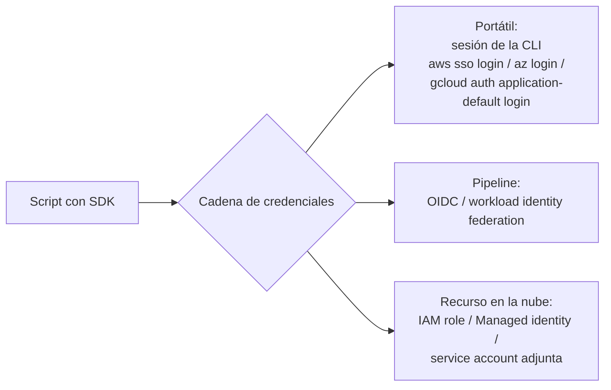

---
tags:
  - python
  - scripting
  - automatizacion
  - aws
  - azure
  - gcp
  - iam
---

# Automatización cloud con SDKs

> Usar los SDKs de Python de AWS (boto3), Azure y Google Cloud para consultar y operar recursos: clientes, paginación, credenciales sin claves en el código y el mismo ejemplo en las tres nubes. Y cuándo conviene un SDK, la CLI o IaC.

!!! info "Antes de leer"
    Esta nota asume lo visto en [APIs y HTTP](apis-http.md) (paginación, reintentos, tokens) y en [Sistema y procesos](sistema-procesos.md). Para entender las identidades que usan los SDKs, ten a mano [IAM: AWS, Azure y GCP](../../cloud/fundamentos/iam-comparativa.md).

## ¿Qué es?

Un **SDK** (*Software Development Kit*, kit de desarrollo) de la nube es una librería que envuelve las APIs REST del proveedor: firma las peticiones, obtiene credenciales, pagina, reintenta errores temporales y convierte las respuestas en objetos de Python. Es lo mismo que hace la CLI (`aws`, `az`, `gcloud`) por debajo, pero desde tu código.

| | AWS | Azure | Google Cloud |
| --- | --- | --- | --- |
| Paquete | `boto3` | `azure-identity` + un paquete por servicio (`azure-mgmt-compute`, `azure-mgmt-storage`, `azure-storage-blob`…) | Un paquete por servicio (`google-cloud-compute`, `google-cloud-storage`…) |
| Credenciales | **Credential provider chain** de AWS | **`DefaultAzureCredential`** (cadena de Microsoft Entra ID) | **ADC** (*Application Default Credentials*) |
| Objeto principal | `boto3.client("ec2")` | `ComputeManagementClient(credential, subscription_id)` | `compute_v1.InstancesClient()` |
| Paginación | `client.get_paginator("...")` | Los métodos `list*` devuelven un `ItemPaged` que pagina solo | Los métodos `list*` devuelven un *pager* que pagina solo |
| Errores | `botocore.exceptions.ClientError` | `azure.core.exceptions.HttpResponseError` | `google.api_core.exceptions.GoogleAPICallError` (`Forbidden`, `NotFound`…) |
| Metadatos para filtrar | **Tags** | **Tags** | **Labels** (las *network tags* son otra cosa: reglas de firewall) |

## Credenciales: nunca en el código

Los tres SDKs buscan las credenciales **solos**, recorriendo una cadena de fuentes. Eso permite que el mismo script funcione en tu portátil (con tu sesión de la CLI) y en producción (con la identidad del recurso o del pipeline) sin cambiar una línea.



=== "AWS"

    boto3 busca, en este orden aproximado: parámetros explícitos, **variables de entorno** (`AWS_ACCESS_KEY_ID`… o `AWS_PROFILE`), el **perfil** de `~/.aws/config` (incluidos perfiles de IAM Identity Center con `aws sso login` y perfiles que asumen un rol), y por último las credenciales del **contenedor o de la instancia** (el IAM role de la EC2, de la tarea ECS o de la Lambda).

    ```python
    import boto3

    session = boto3.Session(profile_name="dev", region_name="us-east-1")   # perfil explícito
    ec2 = session.client("ec2")

    ec2 = boto3.client("ec2")   # o simplemente: usa AWS_PROFILE / el rol del entorno
    print(session.client("sts").get_caller_identity()["Arn"])          # ¿quién soy?
    ```

=== "Azure"

    **`DefaultAzureCredential`** prueba en orden: variables de entorno de un service principal, **workload identity**, **managed identity**, y después las sesiones de herramientas de desarrollo (Azure CLI con `az login`, Azure PowerShell, Azure Developer CLI…).

    ```python
    import os

    from azure.identity import DefaultAzureCredential
    from azure.mgmt.compute import ComputeManagementClient

    credential = DefaultAzureCredential()
    compute = ComputeManagementClient(credential, os.environ["AZURE_SUBSCRIPTION_ID"])
    ```

    Microsoft recomienda, una vez desplegado, sustituir `DefaultAzureCredential` por la credencial concreta (por ejemplo `ManagedIdentityCredential`) o limitar la cadena con la variable `AZURE_TOKEN_CREDENTIALS` (`prod`, `dev` o el nombre de una credencial), para que sea predecible y fácil de depurar.

=== "Google Cloud"

    **ADC** busca: la variable `GOOGLE_APPLICATION_CREDENTIALS` (apuntando a un archivo de credenciales), las credenciales de usuario creadas con `gcloud auth application-default login`, y la **service account adjunta** al recurso (VM, Cloud Run, GKE con Workload Identity) a través del servidor de metadatos.

    ```python
    import google.auth
    from google.cloud import compute_v1

    credentials, proyecto = google.auth.default()      # lo que ADC encontró y el proyecto por defecto
    instancias = compute_v1.InstancesClient()          # los clientes usan ADC sin pasarles nada
    ```

    `GOOGLE_APPLICATION_CREDENTIALS` también acepta archivos de configuración de **Workload Identity Federation** (sin claves), que es lo que debes usar desde fuera de Google Cloud en lugar de una *service account key*.

!!! danger "Sin access keys, client secrets ni JSON keys en el código"
    Nada de `aws_access_key_id="AKIA..."`, `ClientSecretCredential(..., client_secret="...")` en claro ni archivos `key.json` en el repositorio. En el pipeline usa **OIDC** (ver [Secretos e identidades](../../devsecops/identidades-y-pipeline/secretos-identidades.md)); en la nube, la identidad del recurso; en tu equipo, la sesión de la CLI. Y dale al script **solo los permisos que usa**: si solo lista VMs, un rol de solo lectura.

## Mismo ejemplo en las tres nubes: VMs encendidas por tag

Objetivo: listar las VMs **encendidas** con la etiqueta `entorno=dev`, por ejemplo para apagarlas fuera de horario y ahorrar costos (ver [FinOps y costos](../../cloud/fundamentos/finops-costos.md)).

=== "AWS"

    ```bash
    pip install boto3
    ```

    ```python title="vms_dev_aws.py"
    import boto3


    def vms_por_tag(ec2, clave: str, valor: str) -> list[dict]:
        paginator = ec2.get_paginator("describe_instances")
        filtros = [
            {"Name": f"tag:{clave}", "Values": [valor]},              # filtro en el servidor
            {"Name": "instance-state-name", "Values": ["running"]},
        ]
        vms = []
        for pagina in paginator.paginate(Filters=filtros):
            for reserva in pagina["Reservations"]:
                for instancia in reserva["Instances"]:
                    tags = {t["Key"]: t["Value"] for t in instancia.get("Tags", [])}
                    vms.append({
                        "id": instancia["InstanceId"],
                        "nombre": tags.get("Name", "-"),
                        "tipo": instancia["InstanceType"],
                        "zona": instancia["Placement"]["AvailabilityZone"],
                    })
        return vms


    ec2 = boto3.client("ec2", region_name="us-east-1")
    for vm in vms_por_tag(ec2, "entorno", "dev"):
        print(f"{vm['id']}  {vm['nombre']:<10} {vm['tipo']:<10} {vm['zona']}")
    ```

    ```text
    i-0abc123  api-dev    t3.medium  us-east-1a
    i-0def456  -          t3.small   us-east-1b
    ```

    - boto3 devuelve **diccionarios** con la misma forma que el JSON de la API (`Reservations` → `Instances`), y las tags como lista de `{"Key", "Value"}`.
    - Un cliente trabaja en **una región**; para todas, recorre `ec2.describe_regions()["Regions"]` y crea un cliente por región.
    - Para apagarlas: `ec2.stop_instances(InstanceIds=[...])`.

=== "Azure"

    ```bash
    pip install azure-identity azure-mgmt-compute
    ```

    ```python title="vms_dev_azure.py"
    import os

    from azure.identity import DefaultAzureCredential
    from azure.mgmt.compute import ComputeManagementClient


    def vms_por_tag(compute: ComputeManagementClient, clave: str, valor: str) -> list[dict]:
        vms = []
        for vm in compute.virtual_machines.list_all():          # toda la suscripción; pagina solo
            if (vm.tags or {}).get(clave) != valor:              # tags puede ser None
                continue
            grupo = vm.id.split("/")[4]                          # /subscriptions/<id>/resourceGroups/<rg>/...
            estado = compute.virtual_machines.instance_view(grupo, vm.name)
            if not any(s.code == "PowerState/running" for s in estado.statuses or []):
                continue
            tamano = vm.hardware_profile.vm_size
            vms.append({"nombre": vm.name, "grupo": grupo, "region": vm.location,
                        "tamano": getattr(tamano, "value", tamano)})   # los tamaños conocidos llegan como enum
        return vms


    compute = ComputeManagementClient(DefaultAzureCredential(), os.environ["AZURE_SUBSCRIPTION_ID"])
    for vm in vms_por_tag(compute, "entorno", "dev"):
        print(f"{vm['nombre']:<10} {vm['grupo']:<8} {vm['tamano']:<14} {vm['region']}")
    ```

    ```text
    vm-dev-01  rg-dev   Standard_B2s   eastus
    ```

    - El SDK devuelve **objetos** con atributos en `snake_case` (`vm.hardware_profile.vm_size`), no diccionarios.
    - El estado de encendido no viene en el listado: se pide con `instance_view` (una llamada por VM). Para volúmenes grandes, **Azure Resource Graph** consulta miles de recursos de una vez.
    - Para apagarlas y dejar de pagar el cómputo: `compute.virtual_machines.begin_deallocate(grupo, nombre)`. Los métodos `begin_*` son operaciones largas que devuelven un *poller*; `.result()` espera a que terminen.

=== "Google Cloud"

    ```bash
    pip install google-cloud-compute
    ```

    ```python title="vms_dev_gcp.py"
    import os

    from google.cloud import compute_v1


    def vms_por_label(proyecto: str, clave: str, valor: str) -> list[dict]:
        cliente = compute_v1.InstancesClient()
        vms = []
        for zona, resultado in cliente.aggregated_list(project=proyecto):   # pares (zona, instancias)
            for instancia in resultado.instances:
                if instancia.labels.get(clave) != valor or instancia.status != "RUNNING":
                    continue
                vms.append({"nombre": instancia.name, "zona": zona.removeprefix("zones/"),
                            "tipo": instancia.machine_type.rsplit("/", 1)[-1]})
        return vms


    for vm in vms_por_label(os.environ["GOOGLE_CLOUD_PROJECT"], "entorno", "dev"):
        print(f"{vm['nombre']:<10} {vm['tipo']:<10} {vm['zona']}")
    ```

    ```text
    web-dev    e2-small   us-central1-a
    ```

    - `aggregated_list` recorre **todas las zonas** del proyecto de una vez; `list(project=..., zone=...)` lo hace para una zona.
    - `machine_type` llega como URL completa (`.../zones/us-central1-a/machineTypes/e2-small`); por eso se toma el último segmento.
    - Para apagarlas: `cliente.stop(project=..., zone=..., instance=...)`, que devuelve una operación larga (`.result()` espera).

!!! note "Los ejemplos se probaron con datos simulados"
    Los fragmentos se validaron contra las versiones actuales de los SDKs con respuestas simuladas (sin cuentas reales). Las salidas mostradas son ilustrativas. Antes de lanzar algo que **modifica** recursos, pruébalo en una cuenta de pruebas y con `--dry-run`.

## Errores típicos

| Síntoma | AWS | Azure | Google Cloud |
| --- | --- | --- | --- |
| No encuentra credenciales | `NoCredentialsError` | `CredentialUnavailableError` / `ClientAuthenticationError` | `google.auth.exceptions.DefaultCredentialsError` |
| Sin permiso | `ClientError` con código `AccessDenied` / `UnauthorizedOperation` | `HttpResponseError` con estado 403 (`AuthorizationFailed`) | `google.api_core.exceptions.Forbidden` (403) |
| No existe | `ClientError` (`NoSuchBucket`, `InvalidInstanceID.NotFound`…) | `ResourceNotFoundError` | `google.api_core.exceptions.NotFound` |
| Límite de peticiones | `ClientError` (`Throttling`, `RequestLimitExceeded`); boto3 ya reintenta | 429; el SDK reintenta | `TooManyRequests` / `ResourceExhausted`; el cliente reintenta según su política |

```python
from botocore.exceptions import ClientError

try:
    s3.get_bucket_tagging(Bucket="mi-bucket")
except ClientError as e:
    codigo = e.response["Error"]["Code"]       # el código concreto está aquí
    if codigo == "NoSuchTagSet":
        ...
    else:
        raise
```

## SDK vs CLI vs IaC

| Herramienta | Úsala para | Evítala para |
| --- | --- | --- |
| **IaC** (Terraform, Bicep, CloudFormation…) | **Crear y mantener** infraestructura duradera: redes, clústeres, IAM, bases de datos. Estado deseado, revisión en PR, drift | Consultas, reportes o acciones puntuales |
| **CLI** (`aws`, `az`, `gcloud`) | Consultas rápidas, comandos sueltos, pasos simples de un pipeline | Lógica con condiciones, bucles sobre muchos recursos, manejo de errores fino |
| **SDK** (Python) | **Operar y auditar**: reportes, limpieza, apagado programado, auto-remediación, integraciones (una Lambda o Function que reacciona a eventos) | Crear la infraestructura base: si un script crea recursos que nadie declara en IaC, aparecen *drift* y recursos huérfanos |

La regla práctica: **lo que debe existir se declara en IaC; lo que se consulta o se ejecuta periódicamente sobre lo que existe, se programa con el SDK**. Ver [Infrastructure as Code](../../devops/iac/infraestructura-como-codigo.md).

## Mini-ejercicio: buckets sin dueño

Escribe `s3_sin_owner.py` que liste los buckets de S3 de la cuenta **sin la etiqueta `owner`** y salga con 1 si encuentra alguno (para usarlo como control de gobernanza en un job programado). Pistas:

- `s3.get_paginator("list_buckets")` devuelve los buckets en `pagina["Buckets"]`.
- `s3.get_bucket_tagging(Bucket=...)` devuelve `TagSet`, pero si el bucket **no tiene ninguna etiqueta** lanza `ClientError` con código `NoSuchTagSet`: eso no es un error para ti.
- Cualquier otro error (por ejemplo `AccessDenied`) sí debe propagarse.

??? success "Solución"

    ```python title="s3_sin_owner.py"
    #!/usr/bin/env python3
    """Lista los buckets de S3 que no tienen la etiqueta `owner`."""
    import sys

    import boto3
    from botocore.exceptions import BotoCoreError, ClientError


    def tags_del_bucket(s3, bucket: str) -> dict[str, str]:
        try:
            respuesta = s3.get_bucket_tagging(Bucket=bucket)
        except ClientError as e:
            if e.response["Error"]["Code"] == "NoSuchTagSet":   # el bucket no tiene ninguna etiqueta
                return {}
            raise
        return {t["Key"]: t["Value"] for t in respuesta["TagSet"]}


    def buckets_sin_owner(s3) -> list[str]:
        sin_owner = []
        for pagina in s3.get_paginator("list_buckets").paginate():
            for bucket in pagina["Buckets"]:
                if "owner" not in tags_del_bucket(s3, bucket["Name"]):
                    sin_owner.append(bucket["Name"])
        return sin_owner


    def main() -> int:
        s3 = boto3.client("s3")
        try:
            sin_owner = buckets_sin_owner(s3)
        except (BotoCoreError, ClientError) as e:
            print(f"Error de AWS: {e}", file=sys.stderr)
            return 2
        for nombre in sin_owner:
            print(nombre)
        return 1 if sin_owner else 0


    if __name__ == "__main__":
        sys.exit(main())
    ```

    ```text
    $ AWS_PROFILE=auditoria ./s3_sin_owner.py; echo "exit=$?"
    tmp-pruebas
    datos-dev
    exit=1
    ```

    Permisos mínimos que necesita el rol: `s3:ListAllMyBuckets` y `s3:GetBucketTagging`. Para probar la lógica sin tocar AWS puedes usar `botocore.stub.Stubber`, que simula respuestas y errores del cliente (ver [Calidad y seguridad de scripts](calidad-codigo.md)).

    En las otras nubes la idea es la misma: en Azure, las cuentas de almacenamiento con `StorageManagementClient(...).storage_accounts.list()` y su atributo `tags`; en Google Cloud, `storage.Client().list_buckets()` y `bucket.labels`. A escala, los servicios de gobernanza (AWS Config, Azure Policy, Organization Policy) hacen este control de forma continua (ver [Gobernanza](../../cloud/operacion-y-gobierno/gobernanza.md)).

## Relación con otras secciones

| Enfoque | Qué se mira desde ahí | Nota |
| --- | --- | --- |
| Cloud (el control) | Las identidades que usa el SDK, los recursos que consulta y las etiquetas que los gobiernan | [IAM: AWS, Azure y GCP](../../cloud/fundamentos/iam-comparativa.md), [Máquinas virtuales](../../cloud/computo/maquinas-virtuales.md), [Gobernanza](../../cloud/operacion-y-gobierno/gobernanza.md), [FinOps y costos](../../cloud/fundamentos/finops-costos.md), [Serverless](../../cloud/computo/serverless.md) |
| DevOps (la automatización) | Dónde termina la IaC y empieza el script | [Infrastructure as Code](../../devops/iac/infraestructura-como-codigo.md), [Terraform](../../devops/iac/terraform-basico.md) |
| DevSecOps (la verificación) | OIDC en lugar de claves, permisos mínimos del script y auditoría continua | [Secretos e identidades](../../devsecops/identidades-y-pipeline/secretos-identidades.md), [Cumplimiento y gobierno](../../devsecops/gobierno-y-respuesta/cumplimiento.md) |
| Python (la herramienta) | Paginación, reintentos y CLIs | [APIs y HTTP](apis-http.md), [Scripts de línea de comandos](scripts-cli.md) |
| Laboratorios (la práctica) | Practicar esto paso a paso | [Lab 18: AWS: API serverless con Lambda, API Gateway y DynamoDB](../../laboratorios/cloud/aws-serverless-api.md) |

## Referencias

- [Boto3: credenciales](https://boto3.amazonaws.com/v1/documentation/api/latest/guide/credentials.html)
- [Boto3: paginators](https://boto3.amazonaws.com/v1/documentation/api/latest/guide/paginators.html)
- [Boto3: manejo de errores](https://boto3.amazonaws.com/v1/documentation/api/latest/guide/error-handling.html)
- [Boto3: EC2 `describe_instances`](https://boto3.amazonaws.com/v1/documentation/api/latest/reference/services/ec2/client/describe_instances.html)
- [Azure SDK for Python: autenticación](https://learn.microsoft.com/es-es/azure/developer/python/sdk/authentication/overview)
- [Cadenas de credenciales en Azure Identity para Python](https://learn.microsoft.com/es-es/azure/developer/python/sdk/authentication/credential-chains)
- [azure-mgmt-compute](https://learn.microsoft.com/es-es/python/api/overview/azure/mgmt-compute-readme)
- [Google Cloud: Application Default Credentials](https://cloud.google.com/docs/authentication/application-default-credentials)
- [Google Cloud: bibliotecas cliente de Python](https://cloud.google.com/python/docs/reference)
- [google-cloud-compute (referencia)](https://cloud.google.com/python/docs/reference/compute/latest)

Siguiente: [Calidad y seguridad de scripts](calidad-codigo.md)
