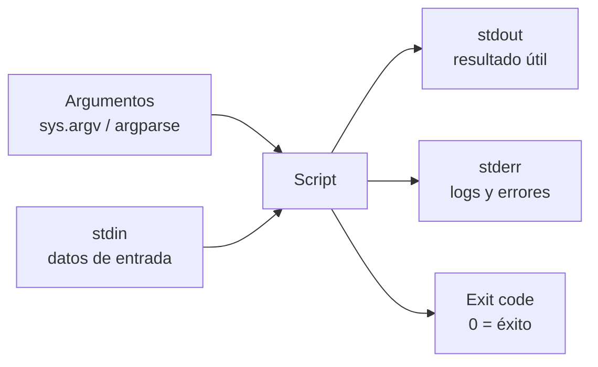

---
tags:
  - python
  - scripting
  - automatizacion
  - ci-cd
---

# Scripts de línea de comandos

> Cómo convertir un script de Python en una herramienta de terminal seria: shebang, argumentos con `argparse`, exit codes, stdin/stdout/stderr y `logging` en vez de `print`.

!!! info "Antes de leer"
    Esta nota asume lo visto en [Archivos y formatos](archivos-formatos.md) (leer JSON y archivos) y en [Errores, módulos y paquetes](../fundamentos/errores-modulos.md) (el bloque `if __name__ == "__main__":`).

## ¿Qué es?

Un **CLI** (*Command-Line Interface*, interfaz de línea de comandos) es un programa que se usa desde la terminal: recibe **argumentos**, lee de **stdin**, escribe en **stdout** y **stderr**, y termina con un **exit code** (código de salida). Si tu script cumple ese contrato, encaja con todo lo demás: se puede encadenar con tuberías (`|`), usar en un pipeline de CI, programar con cron o llamar desde Bash.



## Shebang y permisos

En Linux y macOS, la primera línea **shebang** indica qué intérprete ejecuta el archivo, igual que en Bash (ver [Linux, redes y scripting](../../devops/fundamentos/linux-redes-scripting.md)):

```python title="hola.py"
#!/usr/bin/env python3
print("hola")
```

```bash
chmod +x hola.py      # dar permiso de ejecución
./hola.py             # ya no hace falta escribir `python3 hola.py`
```

- `#!/usr/bin/env python3` busca `python3` en el `PATH`. Si tienes un **venv** activado, usará el Python de ese entorno.
- En Windows el shebang no se usa para ejecutar el archivo directamente (se ejecuta con `python hola.py` o `py hola.py`), pero no estorba.
- Si el script va a vivir en un servidor, lo más robusto es instalarlo como paquete con un *entry point* (ver [Calidad y seguridad de scripts](calidad-codigo.md)) o con `pipx`.

## Argumentos con sys.argv

**`sys.argv`** es la lista de argumentos tal como llegan: el elemento 0 es el nombre del script y el resto, lo que escribiste después.

```python title="desplegar.py"
import sys

if len(sys.argv) != 2:
    print(f"Uso: {sys.argv[0]} <entorno>", file=sys.stderr)
    sys.exit(2)
print(f"Desplegando en {sys.argv[1]}")
```

```text
$ python desplegar.py dev
Desplegando en dev
$ python desplegar.py
Uso: desplegar.py <entorno>
```

Sirve para un argumento o dos. En cuanto aparecen opciones (`--region`, `--dry-run`), usa `argparse`.

## argparse

**`argparse`** (librería estándar) define los argumentos, los valida, convierte tipos y genera la ayuda (`--help`) y los mensajes de error automáticamente.

```python
import argparse

parser = argparse.ArgumentParser(description="Limpia snapshots antiguos.")
parser.add_argument("entorno", choices=["dev", "staging", "prod"])            # posicional, obligatorio
parser.add_argument("-r", "--region", default="us-east-1")                   # opción con valor
parser.add_argument("-d", "--dias", type=int, default=30, help="antigüedad mínima")
parser.add_argument("--dry-run", action="store_true", help="solo muestra lo que haría")  # flag
parser.add_argument("--tag", action="append", default=[], help="se puede repetir")
args = parser.parse_args()

print(args.entorno, args.region, args.dias, args.dry_run, args.tag)
```

```text
$ python limpiar.py prod --dias 90 --dry-run --tag equipo=web --tag temporal=true
prod us-east-1 90 True ['equipo=web', 'temporal=true']
```

| Pieza | Qué hace |
| --- | --- |
| `"entorno"` (sin guiones) | Argumento **posicional**, obligatorio por defecto |
| `"-r", "--region"` | **Opción**: forma corta y larga; el valor queda en `args.region` |
| `type=int` | Convierte y valida; si no es un número, error con exit code 2 |
| `choices=[...]` | Solo acepta esos valores |
| `action="store_true"` | **Flag** (bandera): `True` si aparece, `False` si no |
| `action="append"` | Junta en una lista cada aparición de la opción |
| `nargs="?"` | Posicional opcional (usa `default`) |
| `required=True` | Hace obligatoria una opción con guiones |

Los guiones del nombre se convierten en guiones bajos: `--dry-run` queda como `args.dry_run`.

!!! tip "Haz que `--dry-run` sea lo primero que escribes"
    En scripts que borran, apagan o modifican recursos, un modo **dry run** (simulacro) que solo muestra lo que haría evita sustos. Algunos equipos invierten la lógica: por defecto es simulacro y hay que pasar `--apply` para ejecutar de verdad.

### Subcomandos

Cuando una herramienta hace varias cosas (como `git commit`, `git push`), cada una es un **subcomando** con sus propios argumentos. Se definen con `add_subparsers()`; el ejemplo completo de más abajo lo usa.

## Exit codes

El **exit code** es lo que mira el pipeline de CI (o `&&` en Bash) para decidir si el paso pasó. **`sys.exit(n)`** termina el script con ese código.

| Código | Convención |
| --- | --- |
| `0` | Éxito |
| `1` | Error general (la comprobación falló, el recurso no existe…) |
| `2` | Uso incorrecto (argumentos inválidos). Es el que usa `argparse` |
| Excepción sin capturar | Python muestra el *traceback* y sale con `1` |
| `Ctrl+C` | `KeyboardInterrupt`; si no se captura, el código suele ser 130 en Linux |

!!! note "`sys.exit(main())`"
    El patrón habitual es que `main()` devuelva un entero y el bloque final haga `sys.exit(main())`. Así la lógica se puede probar con `pytest` llamando a `main([...])` y comprobando lo que devuelve, sin que el test termine el proceso. `sys.exit("mensaje")` también vale: escribe el mensaje en stderr y sale con 1.

## stdin, stdout y stderr

| Flujo | En Python | Para qué |
| --- | --- | --- |
| **stdin** (entrada estándar) | `sys.stdin` | Datos que llegan por tubería: `terraform output -json \| ./script.py` |
| **stdout** (salida estándar) | `print()`, `sys.stdout` | **Solo el resultado útil**, para que otro comando lo pueda consumir |
| **stderr** (salida de errores) | `print(..., file=sys.stderr)`, `logging` | Mensajes, avisos, progreso y errores |

```python
import json
import sys

datos = json.load(sys.stdin)                       # lee todo lo que llega por la tubería
for linea in sys.stdin: ...                        # o línea a línea, para entradas grandes
print("procesando...", file=sys.stderr)            # no ensucia la salida
```

Separar bien los flujos permite cosas como `./tfout.py obtener vpc_id > vpc.txt`: el archivo solo tiene el valor, y los logs siguen apareciendo en la terminal.

## logging en vez de print

El módulo **`logging`** añade lo que a `print` le falta: **niveles**, **formato** con fecha, salida a stderr por defecto y la posibilidad de subir o bajar el detalle sin tocar el código.

```python
import logging

logging.basicConfig(
    level=logging.INFO,
    format="%(asctime)s %(levelname)s %(name)s: %(message)s",
)
log = logging.getLogger("backup")

log.debug("Detalle interno")            # no se muestra con level=INFO
log.info("Subiendo %s a %s", "backup.tar.gz", "s3://mi-bucket")
log.warning("Quedan %d intentos", 2)
log.error("No se pudo subir el backup")
```

```text
2026-10-24 11:48:57,470 INFO backup: Subiendo backup.tar.gz a s3://mi-bucket
2026-10-24 11:48:57,471 WARNING backup: Quedan 2 intentos
2026-10-24 11:48:57,471 ERROR backup: No se pudo subir el backup
```

| Nivel | Cuándo usarlo |
| --- | --- |
| `DEBUG` | Detalle para depurar (activable con `--verbose`) |
| `INFO` | Qué está haciendo el script |
| `WARNING` | Algo raro pero se puede seguir |
| `ERROR` | Una operación falló |
| `CRITICAL` | El script no puede continuar |

- Pasa los valores como argumentos (`log.info("Subiendo %s", archivo)`), no con f-string: el texto solo se construye si el nivel está activo.
- Dentro de un `except`, **`log.exception("...")`** registra el mensaje con el *traceback* completo.
- **Nunca registres secretos**: tokens, contraseñas ni cabeceras `Authorization`. Los logs acaban en sistemas que lee mucha gente.
- Si los logs los va a leer una plataforma (CloudWatch, Loki…), considera el formato JSON (ver [Observabilidad](../../devops/operacion/observabilidad.md)).

## Typer y Click

`argparse` no necesita instalar nada, lo que es una ventaja en servidores y runners. Para CLIs más grandes existen librerías externas:

- **Click**: define comandos y opciones con decoradores (`@click.command()`, `@click.option()`); muy usada (por ejemplo, en Flask).
- **Typer**: construida sobre Click, genera el CLI a partir de los **type hints** de la función (`def main(entorno: str, dias: int = 30)`).

Para scripts de automatización de este cuaderno, `argparse` es suficiente.

## Ejemplo completo: tfout

Un CLI pequeño con subcomandos que consulta la salida de `terraform output -json` (el formato visto en [Archivos y formatos](archivos-formatos.md#leer-terraform-output-json)), desde un archivo o desde stdin, sin mostrar outputs sensibles salvo que se pida.

```python title="tfout.py"
#!/usr/bin/env python3
"""Consulta la salida de `terraform output -json`.

Ejemplos:
    terraform output -json | ./tfout.py listar
    ./tfout.py --archivo outputs.json obtener vpc_id
"""
import argparse
import json
import logging
import sys

log = logging.getLogger("tfout")


def cargar(archivo: str) -> dict:
    if archivo == "-":
        return json.load(sys.stdin)
    with open(archivo, encoding="utf-8") as f:
        return json.load(f)


def cmd_listar(outputs: dict, args: argparse.Namespace) -> int:
    for nombre, salida in sorted(outputs.items()):
        valor = "(sensible)" if salida["sensitive"] else json.dumps(salida["value"])
        print(f"{nombre}\t{valor}")
    return 0


def cmd_obtener(outputs: dict, args: argparse.Namespace) -> int:
    if args.nombre not in outputs:
        log.error("No existe el output %r. Disponibles: %s", args.nombre, ", ".join(outputs))
        return 1
    salida = outputs[args.nombre]
    if salida["sensitive"] and not args.mostrar_sensible:
        log.error("El output %r es sensible; usa --mostrar-sensible si de verdad lo necesitas", args.nombre)
        return 1
    valor = salida["value"]
    print(valor if isinstance(valor, str) else json.dumps(valor))
    return 0


def crear_parser() -> argparse.ArgumentParser:
    parser = argparse.ArgumentParser(prog="tfout", description="Consulta outputs de Terraform.")
    parser.add_argument("-a", "--archivo", default="-",
                        help="JSON de `terraform output -json` (por defecto, stdin)")
    parser.add_argument("-v", "--verbose", action="store_true", help="muestra mensajes de depuración")
    sub = parser.add_subparsers(dest="comando", required=True)

    p_listar = sub.add_parser("listar", help="lista todos los outputs")
    p_listar.set_defaults(func=cmd_listar)

    p_obtener = sub.add_parser("obtener", help="imprime el valor de un output")
    p_obtener.add_argument("nombre", help="nombre del output")
    p_obtener.add_argument("--mostrar-sensible", action="store_true")
    p_obtener.set_defaults(func=cmd_obtener)
    return parser


def main(argv: list[str] | None = None) -> int:
    args = crear_parser().parse_args(argv)
    logging.basicConfig(
        level=logging.DEBUG if args.verbose else logging.INFO,
        format="%(asctime)s %(levelname)s %(name)s: %(message)s",
    )
    try:
        outputs = cargar(args.archivo)
    except (OSError, json.JSONDecodeError) as e:
        log.error("No se pudo leer %s: %s", args.archivo, e)
        return 1
    log.debug("Cargados %d outputs", len(outputs))
    return args.func(outputs, args)


if __name__ == "__main__":
    sys.exit(main())
```

```text
$ terraform output -json | ./tfout.py listar
db_password     (sensible)
vpc_id          "vpc-0a1b2c3d4e5f67890"
web_ips         ["10.0.1.10", "10.0.1.11"]

$ ./tfout.py -a outputs.json obtener vpc_id
vpc-0a1b2c3d4e5f67890

$ ./tfout.py -a outputs.json obtener db_password; echo "exit=$?"
2026-10-24 11:48:57,470 ERROR tfout: El output 'db_password' es sensible; usa --mostrar-sensible si de verdad lo necesitas
exit=1

$ ./tfout.py
usage: tfout [-h] [-a ARCHIVO] [-v] {listar,obtener} ...
tfout: error: the following arguments are required: comando
```

Fíjate en el diseño: cada subcomando es una función que devuelve su exit code, `set_defaults(func=...)` elige cuál ejecutar, y `main(argv)` acepta una lista para poder probarlo sin terminal.

## Mini-ejercicio: un *quality gate* para logs

Escribe `revisar_log.py` para usar como paso de un pipeline:

- Argumento posicional opcional `log` (si no se pasa o es `-`, lee de stdin).
- `--nivel` / `-n` con valores `DEBUG`, `INFO`, `WARNING`, `ERROR`, `CRITICAL` (por defecto `ERROR`).
- `--max` / `-m` entero (por defecto `0`).
- Imprime en stdout cuántas líneas de ese nivel hay y sale con **1** si superan el máximo, con **2** si no puede leer el archivo y con **0** en otro caso. Los mensajes van a stderr con `logging`.

Usa como entrada el `access.log` de [Archivos y formatos](archivos-formatos.md#archivos-grandes-linea-a-linea) (líneas como `2026-10-20T10:00:02 ERROR GET /api/pedidos 500`).

??? success "Solución"

    ```python title="revisar_log.py"
    #!/usr/bin/env python3
    """Cuenta líneas de un nivel en un log y falla si superan un umbral."""
    import argparse
    import logging
    import sys
    from collections.abc import Iterable

    log = logging.getLogger("revisar_log")
    NIVELES = ["DEBUG", "INFO", "WARNING", "ERROR", "CRITICAL"]


    def contar(lineas: Iterable[str], nivel: str) -> int:
        return sum(1 for linea in lineas if f" {nivel} " in linea)


    def main() -> int:
        parser = argparse.ArgumentParser(description=__doc__)
        parser.add_argument("log", nargs="?", default="-", help="archivo de log (por defecto, stdin)")
        parser.add_argument("-n", "--nivel", choices=NIVELES, default="ERROR")
        parser.add_argument("-m", "--max", type=int, default=0, help="máximo permitido (por defecto 0)")
        args = parser.parse_args()

        logging.basicConfig(level=logging.INFO, format="%(levelname)s: %(message)s")

        try:
            if args.log == "-":
                total = contar(sys.stdin, args.nivel)
            else:
                with open(args.log, encoding="utf-8", errors="replace") as f:
                    total = contar(f, args.nivel)
        except OSError as e:
            log.error("No se pudo leer el log: %s", e)
            return 2

        print(total)
        if total > args.max:
            log.error("%d líneas %s (máximo %d)", total, args.nivel, args.max)
            return 1
        return 0


    if __name__ == "__main__":
        sys.exit(main())
    ```

    ```text
    $ ./revisar_log.py access.log; echo "exit=$?"
    2
    ERROR: 2 líneas ERROR (máximo 0)
    exit=1

    $ cat access.log | ./revisar_log.py -n WARNING -m 1; echo "exit=$?"
    1
    exit=0

    $ ./revisar_log.py nada.log; echo "exit=$?"
    ERROR: No se pudo leer el log: [Errno 2] No such file or directory: 'nada.log'
    exit=2
    ```

    `contar` recibe cualquier iterable de líneas, así que sirve igual para un archivo abierto que para `sys.stdin` y se puede probar con una lista. En un workflow de CI bastaría con `run: python revisar_log.py build.log --max 0`: si el script sale con 1, el paso falla.

## Relación con otras secciones

| Enfoque | Qué se mira desde ahí | Nota |
| --- | --- | --- |
| DevOps (la automatización) | Scripts que se convierten en pasos de pipeline y cuyo exit code decide si el build pasa | [Linux, redes y scripting](../../devops/fundamentos/linux-redes-scripting.md), [Integración continua](../../devops/ci-cd/integracion-continua.md), [Observabilidad](../../devops/operacion/observabilidad.md) |
| DevSecOps (la verificación) | Validar argumentos con `choices` y `type`, y no escribir secretos en los logs | [Seguridad del código](../../devsecops/codigo-y-dependencias/seguridad-codigo.md) |
| Python (la herramienta) | Funciones, `if __name__ == "__main__":` y lectura de JSON | [Control de flujo y funciones](../fundamentos/control-flujo-funciones.md), [Errores, módulos y paquetes](../fundamentos/errores-modulos.md), [Archivos y formatos](archivos-formatos.md) |
| Laboratorios (la práctica) | Practicar esto paso a paso | [Lab 03: Script en Python para analizar logs](../../laboratorios/fundamentos/python-analizar-logs.md), [Lab 20: Google Cloud: desplegar un contenedor en Cloud Run](../../laboratorios/cloud/gcp-cloud-run.md) |

## Referencias

- [argparse: analizador sintáctico de argumentos de línea de comandos](https://docs.python.org/es/3/library/argparse.html)
- [Tutorial de argparse](https://docs.python.org/es/3/howto/argparse.html)
- [sys.argv, sys.exit y flujos estándar](https://docs.python.org/es/3/library/sys.html)
- [logging: instalación de registro para Python](https://docs.python.org/es/3/library/logging.html)
- [HOWTO de logging](https://docs.python.org/es/3/howto/logging.html)
- [Click](https://click.palletsprojects.com/)
- [Typer](https://typer.tiangolo.com/)

Siguiente: [Sistema y procesos](sistema-procesos.md)
