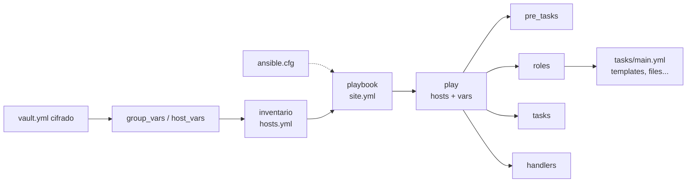
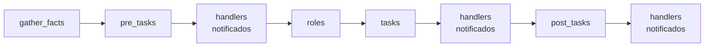

---
tags:
  - recursos
  - anatomia
  - ansible
---

# Anatomía de los archivos de Ansible

> Qué significa cada línea de un proyecto de Ansible: inventario, `ansible.cfg`, playbook, role con plantillas Jinja2 y archivos cifrados con Ansible Vault.

!!! info "Cómo leer esta nota"
    Cada línea de los ejemplos lleva su explicación a la derecha, después de `#` (en `ansible.cfg`, después de `;`). Lo obligatorio está marcado con **[obligatorio]**. Cuando una explicación es larga, verás un número en el código: haz clic en él para leerla. Las reglas básicas de YAML (indentación, listas, mapas, comillas) están en [YAML / YML](../sintaxis/yml.md). La teoría de Ansible está en [Configuration management con Ansible](../../devops/iac/ansible.md).

Todos los ejemplos configuran los mismos servidores: dos **web** que publican la API `lab-api` (FastAPI en el puerto 8000) detrás de NGINX, como en los labs del cuaderno.

## Dónde vive y cómo se organiza

Un proyecto de Ansible es una carpeta en Git. Esta es la estructura recomendada cuando hay varios entornos:

```text
ansible-lab-api/
├── ansible.cfg                  # configuración de Ansible para este proyecto
├── requirements.yml             # collections y roles externos (ansible-galaxy)
├── site.yml                     # playbook principal: el punto de entrada
├── vars/
│   └── app.yml                  # variables que carga el playbook con vars_files
├── templates/
│   └── lab-api.service.j2       # plantillas que usa el playbook (fuera de roles)
├── inventories/                 # un inventario por entorno
│   ├── dev/
│   │   └── hosts.yml
│   └── prod/
│       ├── hosts.yml            # servidores y grupos de producción
│       ├── group_vars/          # variables por grupo (el nombre = el grupo)
│       │   ├── all.yml          # para todos los hosts
│       │   └── web/             # carpeta: se cargan TODOS los archivos de dentro
│       │       ├── vars.yml     # variables normales del grupo web
│       │       └── vault.yml    # secretos cifrados con Ansible Vault
│       └── host_vars/
│           └── web1.yml         # variables solo para el host web1
└── roles/
    └── nginx/                   # un role = una responsabilidad reutilizable
        ├── defaults/main.yml    # valores por defecto (prioridad más baja)
        ├── vars/main.yml        # constantes internas (prioridad alta)
        ├── tasks/main.yml       # tareas del role
        ├── handlers/main.yml    # handlers del role
        ├── templates/           # plantillas Jinja2 (.j2)
        ├── files/               # archivos que se copian tal cual
        └── meta/main.yml        # metadatos y dependencias
```

- `group_vars/` y `host_vars/` se buscan **junto al inventario** y **junto al playbook**. Al lado del inventario permiten que cada entorno tenga sus valores.
- Los nombres `main.yml` de un role son fijos: Ansible los carga solo.
- `ansible-galaxy role init roles/nginx` crea el esqueleto del role.

## Estructura general

Cómo se relacionan las piezas:



Un **playbook** es una lista de **plays**; cada play elige hosts del inventario y les aplica **tasks** (tareas). Una task llama a un **module** (módulo). El orden de ejecución dentro de un play es siempre el mismo, aunque escribas las secciones en otro orden:



## Inventario comentado línea por línea

El **inventory** (inventario) dice qué servidores hay, cómo conectarse y en qué grupos están. Hay dos formatos equivalentes; para proyectos nuevos se recomienda YAML.

=== "YAML"

    ```yaml title="inventories/prod/hosts.yml"
    all:                                # [obligatorio] grupo raíz: siempre existe
      vars:                             # variables para todos los hosts
        ansible_user: despliegue        # usuario SSH con el que se conecta
      children:                         # subgrupos de all
        web:                            # grupo "web"
          hosts:                        # hosts del grupo
            web1:                       # nombre lógico (inventory_hostname)
              ansible_host: 10.0.1.10   # IP o DNS real a la que conecta
            web2:
              ansible_host: 10.0.1.11
              ansible_port: 2222        # SSH en un puerto distinto de 22
          vars:                         # variables del grupo web
            nginx_puerto: 80
        db:
          hosts:
            db1:
              ansible_host: 10.0.2.10
              ansible_user: dbadmin     # variable de host: gana a la de all
        prod:                           # grupo de grupos
          children:
            web:                        # vacío: solo dice "web es hijo de prod"
            db:
    ```

=== "INI"

    ```ini title="inventories/prod/hosts.ini"
    [web]                                          # grupo "web"
    web1 ansible_host=10.0.1.10                    # nombre lógico + variables de host
    web2 ansible_host=10.0.1.11 ansible_port=2222

    [db]
    db1 ansible_host=10.0.2.10 ansible_user=dbadmin

    [web:vars]
    nginx_puerto=80

    [all:vars]
    ansible_user=despliegue

    [prod:children]
    web
    db
    ```

    En INI, los comentarios al final de línea solo funcionan en las líneas de grupos y hosts; en las secciones `:vars` y `:children` pon los comentarios en su propia línea.

### Referencia de elementos del inventario

| Elemento | Obligatorio | Qué hace | Ejemplo |
| --- | --- | --- | --- |
| `all` | Sí (implícito en INI) | Grupo raíz que contiene todo | `all:` |
| `children` / `[g:children]` | No | Declara subgrupos | `prod` contiene `web` y `db` |
| `hosts` | No | Hosts de un grupo; la clave es el **nombre lógico** | `web1:` |
| `vars` / `[g:vars]` | No | Variables del grupo | `nginx_puerto: 80` |
| `ansible_host` | No | Dirección real si el nombre lógico no resuelve | `10.0.1.10` |
| `ansible_user` | No | Usuario remoto (SSH) | `despliegue` |
| `ansible_port` | No | Puerto SSH (por defecto 22) | `2222` |
| `ansible_connection` | No | Tipo de conexión (por defecto `ssh`) | `local`, `community.docker.docker` |
| `ansible_python_interpreter` | No | Python del host gestionado | `/usr/bin/python3` |
| `ungrouped` | Implícito | Hosts que no están en ningún grupo | — |

!!! tip "Las variables mejor en group_vars y host_vars"
    Poner variables en el inventario funciona, pero se vuelve ilegible. Lo habitual es dejar en `hosts.yml` solo la conexión (`ansible_host`, `ansible_user`) y el resto en archivos de `group_vars/` y `host_vars/`:

    ```yaml title="inventories/prod/group_vars/web/vars.yml"
    ---
    nginx_server_name: api.ejemplo.com      # variable normal del grupo web
    app_token: "{{ vault_app_token }}"      # el valor real vive cifrado en vault.yml
    ```

    ```yaml title="inventories/prod/host_vars/web1.yml"
    ---
    nginx_client_max_body_size: 20m        # solo web1 acepta subidas más grandes
    ```

## ansible.cfg comentado línea por línea

`ansible.cfg` evita repetir opciones en cada comando. Ansible usa **el primero que encuentre** en este orden: variable `ANSIBLE_CONFIG`, `./ansible.cfg` (carpeta actual), `~/.ansible.cfg`, `/etc/ansible/ansible.cfg`. No se combinan.

```ini title="ansible.cfg"
[defaults]
inventory = inventories/prod/hosts.yml    ; inventario por defecto (-i lo cambia)
roles_path = roles                        ; dónde buscar roles
remote_user = despliegue                  ; usuario SSH si el inventario no dice otro
forks = 10                                ; hosts en paralelo (por defecto 5)
interpreter_python = auto_silent          ; detectar Python del host sin avisos
callback_result_format = yaml             ; salida en YAML, más legible
retry_files_enabled = False               ; no crear archivos .retry

[privilege_escalation]
become_method = sudo                      ; cómo escala privilegios con become: true

[ssh_connection]
pipelining = True                         ; menos conexiones SSH; más rápido (1)
```

1.  **Pipelining** envía el módulo por la conexión SSH abierta en vez de copiarlo como archivo temporal. Es más rápido y evita el error de permisos al usar `become_user` con un usuario sin privilegios. Requiere que `sudoers` no tenga `requiretty` (no lo tiene por defecto en las distribuciones actuales).

!!! warning "Comentarios en ansible.cfg"
    En `ansible.cfg` una línea completa puede empezar por `#` o `;`, pero **al final de una línea con valor solo vale `;`**. Un `# comentario` al final pasa a formar parte del valor.

!!! danger "No desactives host_key_checking en producción"
    Verás tutoriales con `host_key_checking = False`. Eso acepta cualquier clave SSH y te expone a un ataque **man-in-the-middle** (intermediario). Gestiona las claves de host con `ssh-keyscan` o con el inventario dinámico de tu nube.

| Sección | Claves frecuentes | Para qué |
| --- | --- | --- |
| `[defaults]` | `inventory`, `roles_path`, `remote_user`, `forks`, `vault_password_file` | Comportamiento general |
| `[privilege_escalation]` | `become`, `become_method`, `become_user` | Valores por defecto de `become` |
| `[ssh_connection]` | `pipelining`, `ssh_args` | Ajustes de SSH |
| `[galaxy]` | `server_list` | Repositorios de collections propios |

Genera un archivo con todas las opciones comentadas con `ansible-config init --disabled > ansible.cfg`.

## requirements.yml comentado

```yaml title="requirements.yml"
---
collections:                              # collections de Ansible Galaxy
  - name: community.general               # namespace.coleccion
    version: ">=11.0.0,<12.0.0"            # rango de versiones (1)
  - name: ansible.posix
roles:                                    # roles de terceros
  - name: geerlingguy.docker
    version: 7.4.1                        # fíjalo: un role es código que se ejecuta como root
```

1.  Fija versiones como en cualquier dependencia: así todo el equipo y el pipeline instalan lo mismo. Los números son un ejemplo: revisa la versión vigente en [Ansible Galaxy](https://galaxy.ansible.com/) antes de usarlos.

```bash
ansible-galaxy install -r requirements.yml
```

## Playbook comentado línea por línea

```yaml title="site.yml"
---
- name: Configurar los servidores web de lab-api       # nombre del play (sale en la salida)
  hosts: web                                           # [obligatorio] grupo o patrón del inventario (1)
  become: true                                         # escalar privilegios (sudo) en todo el play
  gather_facts: true                                   # recopilar facts (SO, IPs, memoria...) al empezar
  vars:                                                # variables del play
    app_usuario: labapi
    app_dir: /opt/lab-api
    paquetes_base:                                     # una lista también es una variable
      - curl
      - ca-certificates
      - python3-venv
  vars_files:                                          # cargar variables de otros archivos
    - vars/app.yml                                     # aquí viven app_version y app_url

  pre_tasks:                                           # se ejecutan ANTES que los roles
    - name: Actualizar la caché de apt
      ansible.builtin.apt:
        update_cache: true
        cache_valid_time: 3600                         # no repetir si se actualizó hace < 1 h
      tags: [paquetes]

  roles:                                               # roles a aplicar, en este orden
    - role: nginx                                      # busca roles/nginx (o en roles_path)
      vars:
        nginx_backend_puerto: 8000                     # variable solo para este role

  tasks:                                               # se ejecutan DESPUÉS de los roles
    - name: Instalar paquetes base                     # describe el estado, no el comando
      ansible.builtin.apt:                             # [obligatorio] módulo, con FQCN (2)
        name: "{{ paquetes_base }}"                    # argumento: la lista entera, una sola llamada
        state: present                                 # estado deseado: instalado
      when: ansible_facts['os_family'] == "Debian"     # condición: Jinja2 SIN {{ }} (3)
      tags: [paquetes]                                 # permite --tags paquetes o --skip-tags

    - name: Crear el usuario de sistema de la app
      ansible.builtin.user:
        name: "{{ app_usuario }}"                      # empieza por {{ → comillas obligatorias
        system: true
        shell: /usr/sbin/nologin                       # sin login interactivo
        create_home: false

    - name: Crear las carpetas de la app
      ansible.builtin.file:
        path: "{{ item }}"                             # item = elemento actual del loop
        state: directory
        owner: "{{ app_usuario }}"
        group: "{{ app_usuario }}"
        mode: "0750"                                   # permisos SIEMPRE entre comillas (4)
      loop:                                            # repite la task por cada elemento
        - "{{ app_dir }}"
        - /var/log/lab-api

    - name: Instalar la unit de systemd
      ansible.builtin.template:
        src: templates/lab-api.service.j2              # relativo al playbook
        dest: /etc/systemd/system/lab-api.service
        mode: "0644"
      notify: Reiniciar lab-api                        # si cambia, avisa al handler

    - name: Leer la versión instalada
      ansible.builtin.command: cat {{ app_dir }}/VERSION
      become: true                                     # repetido junto a become_user (lo pide ansible-lint)
      become_user: "{{ app_usuario }}"                 # esta task corre como labapi, no como root
      register: version_actual                         # guarda el resultado en una variable (5)
      changed_when: false                              # solo lee: nunca cuenta como cambio
      failed_when: version_actual.rc not in [0, 1]     # rc=1 (no existe aún) no es un error

    - name: Desplegar una versión nueva
      when: version_actual.stdout != app_version       # el when se aplica a todo el block
      tags: [app]
      block:                                           # grupo de tasks que se tratan juntas
        - name: Descargar el paquete
          ansible.builtin.get_url:
            url: "{{ app_url }}"
            dest: /tmp/lab-api-{{ app_version }}.tar.gz
            mode: "0644"
        - name: Descomprimir en la carpeta de la app
          ansible.builtin.unarchive:
            src: /tmp/lab-api-{{ app_version }}.tar.gz
            dest: "{{ app_dir }}"
            remote_src: true                           # el archivo ya está en el servidor
            owner: "{{ app_usuario }}"
          notify: Reiniciar lab-api
      rescue:                                          # solo si falla una task del block (6)
        - name: Avisar del fallo
          ansible.builtin.debug:
            msg: "Falló el despliegue de {{ app_version }} en {{ inventory_hostname }}"
        - name: Marcar el host como fallido
          ansible.builtin.fail:
            msg: Despliegue abortado; la versión anterior sigue activa
      always:                                          # siempre, haya fallo o no
        - name: Borrar el paquete temporal
          ansible.builtin.file:
            path: /tmp/lab-api-{{ app_version }}.tar.gz
            state: absent

  handlers:                                            # tasks que solo corren si se les notifica
    - name: Reiniciar lab-api                          # notify usa este nombre exacto
      ansible.builtin.systemd_service:
        name: lab-api
        state: restarted
        daemon_reload: true                            # relee las units por si cambiaron
```

1.  Admite patrones: `web:db` (unión), `web:&prod` (intersección), `prod:!db1` (excluir) o `all`. Desde la línea de comandos, `--limit web1` reduce aún más el alcance sin editar el playbook.
2.  **FQCN** (*Fully Qualified Collection Name*): `colección.namespace.módulo`. `apt` a secas también funciona, pero el FQCN evita ambigüedades si dos collections tienen un módulo con el mismo nombre, y `ansible-lint` lo exige.
3.  `when` ya es una expresión Jinja2, así que no lleva llaves. `when: "{{ x }}"` da un aviso y en versiones recientes de ansible-core puede fallar. Para varias condiciones que deben cumplirse todas, usa una lista: `when: [cond1, cond2]`.
4.  Sin comillas, YAML lee `0750` como número octal (488) y `750` como decimal: Ansible pondría permisos erróneos. Con comillas es una cadena y Ansible la interpreta bien.
5.  `register` guarda la salida del módulo: `version_actual.stdout`, `.stderr`, `.rc` (código de salida), `.changed`, `.failed`. Muéstrala con `ansible.builtin.debug: var=version_actual` para ver todos los campos.
6.  `block/rescue/always` es el `try/except/finally` de Ansible. Si una task del `block` falla, se ejecuta `rescue`; `always` corre en cualquier caso. Si `rescue` termina bien, el host **no** se marca como fallido: por eso aquí se llama a `ansible.builtin.fail` al final.

```yaml title="vars/app.yml"
---
app_version: "0.2.0"                                   # entre comillas: es texto, no un número
app_url: "https://descargas.ejemplo.com/lab-api/lab-api-{{ app_version }}.tar.gz"
```

### Referencia de elementos del play

| Elemento | Obligatorio | Qué hace | Valores típicos / ejemplo |
| --- | --- | --- | --- |
| `name` | No (recomendado) | Título del play que aparece en la salida | `Configurar servidores web` |
| `hosts` | **Sí** | A qué hosts o grupos se aplica | `web`, `all`, `web:&prod` |
| `become` | No | Ejecutar con privilegios (`sudo`) | `true` |
| `become_user` | No | Usuario al que se escala (por defecto `root`) | `postgres` |
| `gather_facts` | No (por defecto `true`) | Recoger `ansible_facts` al inicio | `false` en hosts sin Python |
| `vars` | No | Variables del play | mapa de variables |
| `vars_files` | No | Archivos YAML de variables | `[vars/app.yml]` |
| `pre_tasks` / `post_tasks` | No | Tasks antes de los roles / al final | preparar, comprobar |
| `roles` | No | Roles que se aplican | `- role: nginx` |
| `tasks` | No | Tasks del play | lista de tasks |
| `handlers` | No | Tasks que solo corren si se notifican | reiniciar un servicio |
| `serial` | No | Cuántos hosts a la vez (despliegue por tandas) | `1`, `"25%"` |

### Referencia de elementos de una task

| Elemento | Obligatorio | Qué hace | Ejemplo |
| --- | --- | --- | --- |
| `name` | No (recomendado) | Describe el estado deseado | `Instalar paquetes base` |
| módulo (FQCN) | **Sí** | La acción y sus argumentos | `ansible.builtin.apt:` |
| `when` | No | Condición para ejecutarla | `ansible_facts['os_family'] == "Debian"` |
| `loop` | No | Repetir por cada elemento (`item`) | lista o variable |
| `register` | No | Guardar el resultado | `register: resultado` |
| `notify` | No | Avisar a un handler si hubo cambio | `notify: Reiniciar lab-api` |
| `tags` | No | Etiquetas para `--tags`/`--skip-tags` | `[paquetes]` |
| `become` / `become_user` | No | Privilegios solo para esta task | `become_user: labapi` |
| `changed_when` | No | Cuándo cuenta como cambio | `false`, `"'INSTALADO' in r.stdout"` |
| `failed_when` | No | Cuándo cuenta como fallo | `r.rc not in [0, 1]` |
| `no_log` | No | Ocultar la salida (secretos) | `true` |
| `ignore_errors` | No | Seguir aunque falle (úsalo poco) | `true` |
| `block` / `rescue` / `always` | No | Agrupar tasks y manejar errores | ver ejemplo |

## Role comentado

Un **role** empaqueta todo lo necesario para una responsabilidad (aquí: NGINX como **reverse proxy**, proxy inverso, delante de la API). El playbook solo dice `- role: nginx`.

### defaults/main.yml frente a vars/main.yml

```yaml title="roles/nginx/defaults/main.yml"
---
# Valores que quien use el role PUEDE cambiar (prioridad más baja de todas)
nginx_puerto: 80                                       # puerto en el que escucha NGINX
nginx_server_name: "{{ inventory_hostname }}"          # dominio del sitio
nginx_backend_puerto: 8000                             # puerto de la API (FastAPI)
nginx_client_max_body_size: 10m                        # tamaño máximo de una petición
nginx_ubicaciones_estaticas: []                        # lista de {ruta, carpeta}; vacía por defecto
```

```yaml title="roles/nginx/vars/main.yml"
---
# Constantes internas del role: NO pensadas para cambiarse (prioridad alta)
nginx_paquete: nginx
nginx_servicio: nginx
nginx_conf_dir: /etc/nginx
```

| | `defaults/main.yml` | `vars/main.yml` |
| --- | --- | --- |
| Prioridad | La más baja: cualquier otra variable la sobrescribe | Alta: gana a `group_vars`, `host_vars` y `vars` del play |
| Para qué | Opciones del role (puertos, nombres, tamaños) | Constantes: nombres de paquetes, rutas por distribución |
| Quién lo cambia | Quien usa el role, desde inventario o playbook | Solo quien mantiene el role |

Prefijo todas las variables con el nombre del role (`nginx_`): las variables de Ansible son globales para el host y `ansible-lint` lo exige para evitar choques.

### tasks/main.yml

```yaml title="roles/nginx/tasks/main.yml"
---
- name: Instalar NGINX
  ansible.builtin.apt:
    name: "{{ nginx_paquete }}"                        # viene de vars/main.yml
    state: present
  tags: [paquetes]

- name: Quitar el sitio por defecto de Debian
  ansible.builtin.file:
    path: "{{ nginx_conf_dir }}/sites-enabled/default"
    state: absent                                      # asegurar que NO existe
  notify: Recargar nginx

- name: Configurar el proxy hacia lab-api
  ansible.builtin.template:                            # renderiza Jinja2 y copia el resultado
    src: lab-api.conf.j2                               # busca en roles/nginx/templates/
    dest: "{{ nginx_conf_dir }}/conf.d/lab-api.conf"
    owner: root
    group: root
    mode: "0644"
  notify: Recargar nginx                               # llama a todos los handlers con listen

- name: Copiar la página de mantenimiento
  ansible.builtin.copy:                                # copia tal cual, sin plantillas
    src: mantenimiento.html                            # busca en roles/nginx/files/
    dest: /var/www/html/mantenimiento.html
    mode: "0644"

- name: Asegurar que NGINX está activo y arranca con el sistema
  ansible.builtin.service:
    name: "{{ nginx_servicio }}"
    state: started
    enabled: true
```

### handlers/main.yml

```yaml title="roles/nginx/handlers/main.yml"
---
- name: Validar la configuración de NGINX
  ansible.builtin.command: nginx -t                    # si falla, se detiene antes de recargar
  changed_when: false                                  # validar no cambia nada
  listen: Recargar nginx                               # responde al notify "Recargar nginx"

- name: Aplicar la configuración de NGINX
  ansible.builtin.service:
    name: "{{ nginx_servicio }}"
    state: reloaded                                    # recarga sin cortar conexiones
  listen: Recargar nginx                               # mismo tema: corre después del anterior
```

- Un handler se ejecuta **una sola vez** al final del bloque de tasks aunque lo notifiquen varias tasks, y **solo** si alguna cambió algo.
- `listen` agrupa varios handlers bajo un mismo nombre de aviso. Se ejecutan en el orden en que están escritos en este archivo, no en el orden de los `notify`.
- Si una task posterior falla, los handlers pendientes no se ejecutan. `--force-handlers` cambia ese comportamiento.

### templates/lab-api.conf.j2 (Jinja2)

Una plantilla **Jinja2** es el archivo final con huecos. Tres tipos de marcas:

| Marca | Para qué | Ejemplo |
| --- | --- | --- |
| `{{ ... }}` | Imprimir una variable o expresión | `{{ nginx_puerto }}` |
| `` | Lógica: `if`, `for`, `set` | `` |
| `{# ... #}` | Comentario de la plantilla: **no** aparece en el archivo generado | `{# nota #}` |

En esta plantilla cada comentario `{# ... #}` va en su propia línea, **encima** de la línea que explica:

```jinja title="roles/nginx/templates/lab-api.conf.j2"
{# Plantilla del role nginx: genera /etc/nginx/conf.d/lab-api.conf #}
{# Comentario de NGINX (#) con el aviso "gestionado por Ansible" #}
# {{ ansible_managed }}
upstream lab_api {
{# {{ variable }}: se sustituye por su valor (defaults del role) #}
    server 127.0.0.1:{{ nginx_backend_puerto }};
}

server {
    listen {{ nginx_puerto }};
    server_name {{ nginx_server_name }};
    client_max_body_size {{ nginx_client_max_body_size }};

{# for: repite el bloque por cada elemento de la lista #}

{# ubicacion.ruta: accede a una clave del diccionario #}
    location {{ ubicacion.ruta }} {
        alias {{ ubicacion.carpeta }};
    }


    location / {
        proxy_pass http://lab_api;
{# $host lleva $ sin llaves: es una variable de NGINX, Jinja2 no la toca #}
        proxy_set_header Host $host;
        proxy_set_header X-Forwarded-For $proxy_add_x_forwarded_for;
{# if: solo escribe la línea si alguien definió la variable #}

        proxy_read_timeout {{ nginx_timeout_lectura }};

    }

{# Si la API no responde, NGINX muestra la página de files/ #}
    error_page 502 503 /mantenimiento.html;
    location = /mantenimiento.html {
        root /var/www/html;
        internal;
    }
}
```

- `{{ ansible_managed }}` escribe un aviso de "archivo gestionado por Ansible" para que nadie lo edite a mano en el servidor.
- El módulo `template` activa `trim_blocks`: tras un `` o un `{# ... #}` se elimina el salto de línea, así que esas líneas no dejan huecos en el resultado. Por la misma razón, **no** pongas un `{# comentario #}` al final de una línea de contenido: se comería el salto de línea y uniría esa línea con la siguiente.
- Filtros útiles: `{{ x | default('valor') }}`, `{{ lista | join(', ') }}`, `{{ texto | upper }}`, `{{ dic | to_nice_yaml }}`, `{{ x | mandatory }}`.

Con `nginx_ubicaciones_estaticas: [{ruta: /static/, carpeta: /opt/lab-api/static/}]` en `group_vars`, la plantilla genera (fragmento):

```nginx title="/etc/nginx/conf.d/lab-api.conf (generado en web1)"
# Ansible managed
upstream lab_api {
    server 127.0.0.1:8000;
}

server {
    listen 80;
    server_name api.ejemplo.com;
    client_max_body_size 20m;

    location /static/ {
        alias /opt/lab-api/static/;
    }
...
```

### files/ y meta/main.yml

`files/` contiene archivos que se copian **sin procesar** (`ansible.builtin.copy` con `src: mantenimiento.html`). Si un archivo necesita variables, va en `templates/` con extensión `.j2`.

```yaml title="roles/nginx/meta/main.yml"
---
galaxy_info:                                           # metadatos (los usa Ansible Galaxy)
  author: dani
  description: NGINX como reverse proxy de lab-api
  license: MIT
  min_ansible_version: "2.17"                          # versión mínima de ansible-core
  platforms:                                           # sistemas soportados
    - name: Debian
      versions:
        - trixie
    - name: Ubuntu
      versions:
        - noble
dependencies: []                                       # roles que se ejecutan ANTES que este (1)
```

1.  Por ejemplo `dependencies: [{role: certificados}]` ejecuta el role `certificados` antes de `nginx`. Úsalo con moderación: las dependencias ocultas hacen difícil saber qué se ejecuta. Muchos equipos prefieren listar los roles en orden en el playbook.

## Archivo cifrado con Ansible Vault

**Ansible Vault** cifra con AES-256 un archivo entero o un valor suelto, para poder guardar secretos en Git. Antes de cifrar, el archivo es YAML normal:

```yaml title="inventories/prod/group_vars/web/vault.yml (antes de cifrar)"
---
vault_app_token: "s3cr3to-de-ejemplo"
vault_db_password: "otra-clave-de-ejemplo"
```

Después de `ansible-vault encrypt`, esto es **todo** lo que ve quien abra el archivo en Git:

```text title="inventories/prod/group_vars/web/vault.yml (cifrado)"
$ANSIBLE_VAULT;1.1;AES256
39646361346663646261623435363330383637633733633735653239306463633664656530363666
3530363264623465333762626230393932643861306235320a356162656432303261633863616232
39626433653039376631326338303562306636643966373336373631316438353933333637333561
...
```

| Parte | Significado |
| --- | --- |
| `$ANSIBLE_VAULT` | Marca de archivo cifrado: Ansible lo descifra solo al cargarlo |
| `1.1` | Versión del formato. `1.2` añade una etiqueta de **vault ID** |
| `AES256` | Algoritmo de cifrado |
| Líneas hexadecimales | Salt, HMAC y datos cifrados. No se ve ni el nombre de las variables |
| `;prod` (solo en 1.2) | Etiqueta del vault ID: `$ANSIBLE_VAULT;1.2;AES256;prod` permite tener una contraseña por entorno |

Por eso se usa la convención `vault_*`: en `vault.yml` (cifrado) va `vault_app_token`, y en `vars.yml` (sin cifrar) va `app_token: "{{ vault_app_token }}"`. Así cualquiera puede buscar qué variables existen sin descifrar nada.

También puedes cifrar **un solo valor** dentro de un archivo normal:

```bash
ansible-vault encrypt_string --name app_token 's3cr3to-de-ejemplo'
```

```yaml title="inventories/prod/group_vars/web/vars.yml (valor cifrado en línea)"
app_token: !vault |                                    # !vault: etiqueta YAML de valor cifrado
  $ANSIBLE_VAULT;1.1;AES256
  34666134373363656334336438356237313436393730646162653936333538396232383939633731
  3964663133663639383939373238313239313834303137370a313934386331363037663666646430
  ...
```

!!! warning "Cifrar no basta si luego se imprime"
    Ansible descifra los valores en memoria al ejecutar. Marca con `no_log: true` las tasks que los usan y no hagas `debug` de ellos. La contraseña de Vault va fuera del repositorio (`--vault-password-file ~/.vault-pass` con permisos `600`) o en el gestor de secretos del pipeline. Ver [Secretos e identidades](../../devsecops/identidades-y-pipeline/secretos-identidades.md).

## Errores comunes

| Error | Mensaje típico | Corrección |
| --- | --- | --- |
| Valor que empieza por `{{` sin comillas | `found unacceptable key (unhashable type: 'AnsibleMapping')` o `We were unable to read either as JSON nor YAML` | `name: "{{ var }}"` |
| Indentación incorrecta bajo un módulo | `mapping values are not allowed in this context` o `conflicting action statements` | Los argumentos van 2 espacios más adentro que el nombre del módulo |
| Módulo mal escrito o collection sin instalar | `couldn't resolve module/action 'community.general.ufw'` | Revisa el FQCN e instala con `ansible-galaxy install -r requirements.yml` |
| `notify` que no coincide con ningún handler | `The requested handler 'reiniciar nginx' was not found` | El nombre (o `listen`) debe coincidir exactamente, incluidas mayúsculas |
| `when` con llaves | `conditional statements should not include jinja2 templating delimiters` | `when: x == 1`, sin `{{ }}` |
| `mode: 644` sin comillas ni cero | Permisos raros (`-r----x--t`) | `mode: "0644"` |
| `become_user` a un usuario sin privilegios | `Failed to set permissions on the temporary files Ansible needs to create when becoming an unprivileged user` | Activa `pipelining = True` o instala `acl` en el host |
| Falta la contraseña de Vault | `Attempting to decrypt but no vault secrets found` | `--ask-vault-pass`, `--vault-password-file` o `ANSIBLE_VAULT_PASSWORD_FILE` |
| `yes`/`no` como texto | Una variable `respuesta: no` llega como booleano `false` | Usa `true`/`false` para booleanos y comillas para texto: `"no"` |
| Comentario `#` al final en `ansible.cfg` | La opción toma un valor extraño | Usa `;` para comentarios en línea |
| `become_user` sin `become` en la misma task | `ansible-lint`: `partial-become` | Pon `become: true` junto a `become_user` |
| `{# comentario #}` al final de una línea de plantilla | El archivo generado une dos líneas | Pon los comentarios Jinja2 en su propia línea |

## Validar el archivo

```bash
yamllint .                                             # sintaxis y estilo de todos los YAML
ansible-playbook site.yml --syntax-check               # estructura del playbook (no se conecta a nada)
ansible-inventory -i inventories/prod/hosts.yml --graph  # árbol de grupos y hosts
ansible-inventory -i inventories/prod/hosts.yml --host web1  # variables finales de un host
ansible-config dump --only-changed                     # qué opciones cambia tu ansible.cfg
ansible-lint                                           # buenas prácticas: FQCN, nombres, modos...
ansible-playbook site.yml --check --diff --limit web1  # simulación con diff, sin cambiar nada
```

`--syntax-check` detecta errores de YAML y de estructura, pero no si una variable existe ni si un módulo recibe argumentos válidos: para eso están `ansible-lint`, `--check` y las pruebas con Molecule ([Pruebas de infraestructura](../../devops/iac/pruebas-infraestructura.md)).

## Para practicar

- [Lab 10: Configurar servidores con Ansible](../../laboratorios/devops/ansible-configuracion.md): inventario con `group_vars` y `host_vars`, un role de NGINX con plantillas y handlers, y un secreto con Vault.
- Teoría: [Configuration management con Ansible](../../devops/iac/ansible.md) e [Infrastructure as Code: panorama y herramientas](../../devops/iac/infraestructura-como-codigo.md).
- Comandos: [guía de comandos de Ansible](../comandos/ansible.md).
- Otras anatomías: [Terraform](terraform.md) (crea los servidores que Ansible configura) y [Kubernetes](kubernetes.md).

!!! example "Practica en el laboratorio"
    - [Lab 22: Endurecer un servidor Linux con Ansible y medirlo con Lynis y OpenSCAP](../../laboratorios/devsecops/hardening-linux-ansible.md)

## Referencias

- [Construir un inventario](https://docs.ansible.com/ansible/latest/inventory_guide/intro_inventory.html)
- [Configuración de Ansible (`ansible.cfg`)](https://docs.ansible.com/ansible/latest/reference_appendices/config.html)
- [Palabras clave de playbooks (play, role, block, task)](https://docs.ansible.com/ansible/latest/reference_appendices/playbooks_keywords.html)
- [Bloques: block, rescue y always](https://docs.ansible.com/ansible/latest/playbook_guide/playbooks_blocks.html)
- [Handlers](https://docs.ansible.com/ansible/latest/playbook_guide/playbooks_handlers.html)
- [Roles](https://docs.ansible.com/ansible/latest/playbook_guide/playbooks_reuse_roles.html)
- [Plantillas Jinja2](https://docs.ansible.com/ansible/latest/playbook_guide/playbooks_templating.html)
- [Precedencia de variables](https://docs.ansible.com/ansible/latest/playbook_guide/playbooks_variables.html#understanding-variable-precedence)
- [Ansible Vault](https://docs.ansible.com/ansible/latest/vault_guide/index.html)
- [Instalar roles y collections con requirements.yml](https://docs.ansible.com/ansible/latest/galaxy/user_guide.html)
- [ansible-lint](https://docs.ansible.com/projects/lint/)
