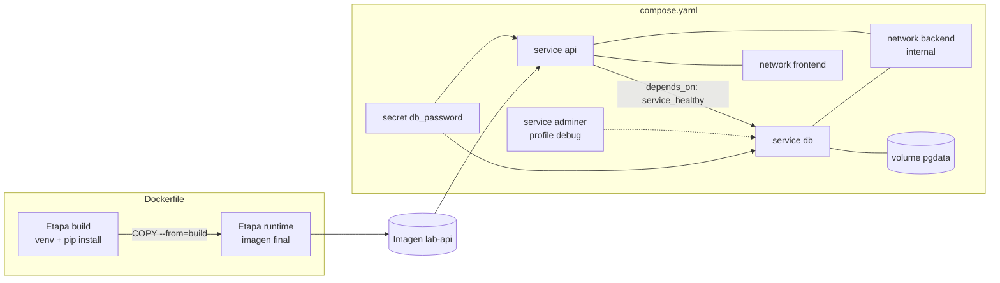

---
tags:
  - recursos
  - anatomia
  - docker
  - contenedores
---

# Anatomía de los archivos de Docker

> Qué significa cada línea de un `Dockerfile` multi-stage, de un `.dockerignore` y de un `compose.yaml` con base de datos, secretos, redes, volúmenes, healthchecks y profiles.

!!! info "Cómo leer esta nota"
    En `compose.yaml` cada línea lleva su explicación a la derecha, después de `#`. En el `Dockerfile` y en el `.dockerignore` **no existen los comentarios al final de línea**, así que la explicación va en la línea de arriba. Lo obligatorio está marcado con **[obligatorio]**. Cuando una explicación es larga, verás un número en el código: haz clic en él para leerla. Las reglas básicas de YAML (indentación, listas, mapas, comillas) están en [YAML / YML](../sintaxis/yml.md). La teoría (imágenes, capas, tags, registries) está en [Docker: imágenes, multi-stage builds y Compose](../../devops/contenedores/docker.md).

Todos los ejemplos empaquetan y levantan la API `lab-devops-app` (FastAPI en el puerto 8000) con PostgreSQL, igual que en el [Lab 05](../../laboratorios/devops/docker-multistage-compose.md), con algunas piezas más para ver todas las opciones.

## Dónde vive y cómo se organiza

```text
lab-devops-app/
├── Dockerfile              # receta de la imagen de la API
├── .dockerignore           # qué NO se envía al build context
├── compose.yaml            # servicios, redes, volúmenes y secretos del entorno local
├── .env                    # variables para interpolar ${...} en compose.yaml: NO va a Git
├── .env.example            # plantilla de .env sin valores reales: SÍ va a Git
├── config/
│   └── api.env             # variables que se inyectan al contenedor (env_file)
├── secrets/
│   └── db_password.txt     # secreto montado en /run/secrets: NO va a Git
├── db/
│   └── init.sql            # script de arranque de PostgreSQL (bind mount)
├── requirements.txt        # dependencias de Python, con versión fijada
└── app/
    ├── __init__.py
    └── main.py             # la API (FastAPI)
```

- El nombre recomendado del archivo de Compose es `compose.yaml` (también acepta `compose.yml`, `docker-compose.yaml` y `docker-compose.yml`).
- Todo lo que hay en la carpeta (menos lo que excluye `.dockerignore`) es el **build context** (contexto de build): lo único que `COPY` puede ver.

## Estructura general



Claves de nivel superior de `compose.yaml`:

```text
name:       # nombre del proyecto (opcional)
services:   # [obligatorio] los contenedores
networks:   # redes propias (opcional; si no, Compose crea "default")
volumes:    # volúmenes nombrados (opcional)
secrets:    # secretos (opcional)
configs:    # archivos de configuración montados (opcional, como secrets pero no sensibles)
```

## Dockerfile comentado instrucción por instrucción

```dockerfile title="Dockerfile"
# syntax=docker/dockerfile:1
# ↑ Parser directive: versión del frontend de BuildKit. Debe ser la PRIMERA línea (1)

# ARG antes del primer FROM: solo se puede usar en las líneas FROM [opcional]
ARG PYTHON_VERSION=3.14.9

# ==================== Etapa 1: build ====================
# FROM <imagen>:<tag> AS <nombre>: imagen base y nombre de la etapa [obligatorio]
FROM python:${PYTHON_VERSION}-slim AS build

# ENV: variable de entorno para esta etapa (y para el contenedor si es la final)
ENV PIP_DISABLE_PIP_VERSION_CHECK=1

# WORKDIR: carpeta de trabajo; la crea si no existe (evita "RUN cd ...")
WORKDIR /src

# RUN (shell form): ejecuta un comando en build y guarda el resultado como capa
RUN python -m venv /opt/venv
ENV PATH="/opt/venv/bin:$PATH"

# COPY: primero solo las dependencias, para reutilizar la caché de capas (2)
COPY requirements.txt .

# RUN --mount=type=cache: caché de pip que persiste entre builds y NO entra en la imagen (3)
RUN --mount=type=cache,target=/root/.cache/pip \
    pip install -r requirements.txt

# ==================== Etapa 2: runtime (imagen final) ====================
FROM python:${PYTHON_VERSION}-slim AS runtime

# ARG después de FROM: variable de build de esta etapa (docker build --build-arg APP_VERSION=1.2.0)
ARG APP_VERSION=dev

# LABEL: metadatos de la imagen (claves estándar OCI); se ven con docker inspect
LABEL org.opencontainers.image.title="lab-devops-app" \
      org.opencontainers.image.version="${APP_VERSION}" \
      org.opencontainers.image.source="https://github.com/usuario/lab-devops-app"

# ENV en la etapa final: llega al contenedor en ejecución
ENV PYTHONDONTWRITEBYTECODE=1 \
    PYTHONUNBUFFERED=1 \
    PATH="/opt/venv/bin:$PATH" \
    APP_VERSION=${APP_VERSION}

# Usuario de sistema sin privilegios, con UID/GID numéricos
RUN groupadd --system --gid 10001 app \
    && useradd --system --uid 10001 --gid app --no-create-home app

WORKDIR /app

# COPY --from=<etapa>: copia solo el resultado de la etapa build (sin pip ni caché)
COPY --from=build /opt/venv /opt/venv
COPY app/ ./app/

# USER: a partir de aquí todo (y el contenedor) corre con este usuario, no con root
USER 10001:10001

# EXPOSE: documenta el puerto de la app; NO lo publica (eso lo hace -p o ports:)
EXPOSE 8000

# HEALTHCHECK: comando que Docker ejecuta periódicamente; exit 0 = healthy (4)
HEALTHCHECK --interval=15s --timeout=3s --start-period=10s --retries=3 \
    CMD ["python", "-c", "import urllib.request; urllib.request.urlopen('http://127.0.0.1:8000/health', timeout=2)"]

# ENTRYPOINT (exec form): el ejecutable fijo del contenedor (5)
ENTRYPOINT ["uvicorn", "app.main:app"]

# CMD (exec form): argumentos por defecto para ENTRYPOINT; se sustituyen con docker run <imagen> <args>
CMD ["--host", "0.0.0.0", "--port", "8000"]
```

1.  Las **parser directives** (directivas del parser) solo se reconocen si están **antes de cualquier otra línea**, incluidos comentarios y líneas vacías. `docker/dockerfile:1` pide la última versión 1.x de la sintaxis, que habilita `RUN --mount`, heredocs y las build checks. Si la mueves de sitio, se convierte en un comentario normal sin avisar.
2.  Cada instrucción crea una **layer** (capa) y Docker reutiliza la caché mientras nada cambie en esa instrucción ni en las anteriores. Si copias primero `requirements.txt` y después el código, un cambio en `app/main.py` no invalida la capa de `pip install`, y el build tarda segundos.
3.  `--mount=type=cache` monta una carpeta que BuildKit conserva entre builds en la máquina (o runner) que construye. pip encuentra ahí los paquetes ya descargados aunque la capa se reconstruya, y nada de esa carpeta acaba en la imagen. Otros montajes útiles: `type=secret` (un secreto solo durante ese `RUN`) y `type=bind`.
4.  El resultado se ve en `docker ps` como `(healthy)` o `(unhealthy)`. Docker solo informa: no reinicia el contenedor por estar `unhealthy` (Compose sí lo usa para `depends_on: condition: service_healthy`; Kubernetes ignora `HEALTHCHECK` y usa sus propias probes). Como la imagen *slim* no trae `curl`, se comprueba con Python.
5.  En **exec form** (forma exec, array JSON) el proceso es el PID 1 y recibe `SIGTERM` al parar el contenedor. En **shell form** (`ENTRYPOINT uvicorn app.main:app`) se ejecuta `/bin/sh -c "…"`: el shell recibe la señal, la app no se entera y Docker la mata a los 10 segundos.

!!! warning "Un `#` al final de una instrucción no es un comentario"
    En un Dockerfile solo es comentario la línea que **empieza** por `#`. `FROM python:3.14.9-slim AS build # imagen base` da `dockerfile parse error on line 1: FROM requires either one or three arguments`, y en un `RUN` el texto pasa al shell. Pon la explicación en la línea de arriba.

### Referencia de instrucciones del Dockerfile

| Instrucción | Obligatorio | Qué hace | Valores típicos / ejemplo |
| --- | --- | --- | --- |
| `# syntax=` | No (recomendable) | Versión del frontend de BuildKit; primera línea | `# syntax=docker/dockerfile:1` |
| `ARG` | No | Variable **solo de build** (`--build-arg`). Antes del primer `FROM` solo sirve para las líneas `FROM`; para usarla dentro de una etapa hay que declararla otra vez después del `FROM` | `ARG PYTHON_VERSION=3.14.9` |
| `FROM … AS <nombre>` | **Sí** | Imagen base y, opcionalmente, nombre de la etapa | `FROM python:3.14.9-slim AS build`; `FROM scratch` |
| `WORKDIR` | No | Directorio de trabajo de las instrucciones siguientes y del contenedor | `/app` |
| `COPY` | No | Copia del build context (o de otra etapa con `--from`) a la imagen | `COPY app/ ./app/`; `COPY --from=build /opt/venv /opt/venv`; `--chown=10001:10001` |
| `ADD` | No | Como `COPY` pero además descarga URLs y descomprime `.tar`; usa `COPY` salvo que necesites eso | `ADD https://… /tmp/` |
| `RUN` | No | Ejecuta un comando en build y guarda el resultado como capa | `RUN pip install -r requirements.txt` |
| `RUN --mount=` | No | Montajes temporales durante ese `RUN` | `type=cache`, `type=secret,id=npmrc`, `type=bind` |
| `ENV` | No | Variable de entorno en build **y** en ejecución (queda en la imagen: nunca secretos) | `PYTHONUNBUFFERED=1` |
| `LABEL` | No | Metadatos clave-valor | `org.opencontainers.image.source`, `.version`, `.revision` |
| `USER` | No (muy recomendable) | Usuario de las instrucciones siguientes y del contenedor | `10001:10001`, `nonroot` |
| `EXPOSE` | No | Documenta el puerto; no lo abre ni lo publica | `8000`, `8000/tcp` |
| `HEALTHCHECK` | No | Comando de salud y su ritmo | `--interval=15s --timeout=3s --start-period=10s --retries=3`; `HEALTHCHECK NONE` |
| `ENTRYPOINT` | No | Ejecutable fijo del contenedor | `["uvicorn", "app.main:app"]` |
| `CMD` | No | Comando por defecto o argumentos para `ENTRYPOINT`; solo cuenta el último | `["--host", "0.0.0.0", "--port", "8000"]` |
| `VOLUME` | No | Marca una ruta como volumen anónimo | `/var/lib/postgresql` (lo usa la imagen de PostgreSQL) |
| `STOPSIGNAL` | No | Señal para parar el contenedor | `SIGINT` |

### ENTRYPOINT frente a CMD

Con `ENTRYPOINT ["uvicorn", "app.main:app"]` y `CMD ["--host", "0.0.0.0", "--port", "8000"]`, el contenedor ejecuta `ENTRYPOINT + CMD`:

| Comando | Qué se ejecuta dentro |
| --- | --- |
| `docker run lab-api:0.1.0` | `uvicorn app.main:app --host 0.0.0.0 --port 8000` |
| `docker run lab-api:0.1.0 --port 9000` | `uvicorn app.main:app --port 9000` (sustituye **todo** `CMD`: se pierde `--host 0.0.0.0` y uvicorn escucha solo en 127.0.0.1 dentro del contenedor) |
| `docker run --entrypoint python lab-api:0.1.0 -V` | `python -V` |
| `docker run -it --entrypoint sh lab-api:0.1.0` | Un shell para depurar |

| Combinación | Cuándo usarla |
| --- | --- |
| Solo `CMD` | Imágenes de uso general donde quieres poder cambiar el comando entero fácilmente (`docker run img bash`) |
| Solo `ENTRYPOINT` | El contenedor es "un ejecutable" con argumentos que siempre pasa quien lo usa |
| `ENTRYPOINT` + `CMD` | Ejecutable fijo con argumentos por defecto que se pueden cambiar (este ejemplo) |

En Kubernetes, `command` sustituye a `ENTRYPOINT` y `args` a `CMD`.

## .dockerignore comentado

```text title=".dockerignore"
# Cada línea es un patrón (sintaxis de Go filepath.Match, más **); los comentarios solo al inicio de línea

# Control de versiones y CI
.git
.github/

# Entornos y cachés de Python
.venv/
**/__pycache__/
**/*.pyc
.pytest_cache/
.ruff_cache/

# Secretos y configuración local: nunca dentro de la imagen
.env
.env.*
!.env.example
secrets/

# Archivos que no hacen falta para ejecutar
compose.yaml
Dockerfile
*.md
tests/
```

| Patrón | Qué excluye |
| --- | --- |
| `.git` | El archivo o carpeta `.git` en la raíz del contexto |
| `**/__pycache__/` | Esa carpeta a cualquier profundidad (`**` = cualquier número de carpetas) |
| `*.md` | Archivos `.md` **solo en la raíz** (para todos: `**/*.md`) |
| `!.env.example` | Excepción: vuelve a incluir algo excluido por una línea anterior (el orden importa: gana la última que coincide) |

- Si un archivo está en `.dockerignore`, `COPY` falla con `"/archivo": not found` aunque exista en tu disco.
- Excluir `Dockerfile` y `.dockerignore` no rompe el build: Docker los envía igualmente al builder, pero no podrán copiarse a la imagen.
- Con varios Dockerfiles, puedes tener uno específico: `api.Dockerfile` usa `api.Dockerfile.dockerignore` si existe.

## compose.yaml comentado línea por línea

```yaml title="compose.yaml"
name: lab-devops-app                   # nombre del proyecto (prefijo de contenedores, redes y volúmenes)

services:                              # [obligatorio] un servicio = uno o varios contenedores iguales
  api:                                 # nombre del servicio; también es su nombre DNS en la red
    build:                             # construir la imagen desde un Dockerfile
      context: .                       # carpeta que se envía como build context
      target: runtime                  # etapa del multi-stage que se construye
      args:                            # valores para los ARG del Dockerfile
        APP_VERSION: ${APP_VERSION:-dev} # interpolación: valor de .env o "dev" por defecto
    image: lab-api:${APP_VERSION:-dev} # con build: nombre y tag que recibe la imagen construida
    ports:                             # publicar puertos "IP_host:puerto_host:puerto_contenedor"
      - "127.0.0.1:8000:8000"          # solo en localhost; entre comillas para evitar sorpresas de YAML
    environment:                       # variables de entorno del contenedor (mapa clave: valor)
      DB_HOST: db                      # se llega a la base de datos por el nombre del servicio
      DB_NAME: tareas
      DB_USER: app
      DB_PASSWORD_FILE: /run/secrets/db_password # la app lee la contraseña de un archivo
    env_file:                          # más variables desde archivos (no es lo mismo que .env)
      - path: ./config/api.env
        required: false                # no falla si el archivo no existe
    secrets:                           # secretos montados en /run/secrets/<nombre>
      - db_password
    networks:                          # redes a las que se conecta
      - frontend
      - backend
    depends_on:                        # orden de arranque
      db:
        condition: service_healthy     # espera a que el healthcheck de db pase
        restart: true                  # reinicia api si db se reinicia
    restart: unless-stopped            # política de reinicio: no, always, on-failure, unless-stopped
    deploy:
      resources:                       # límites de CPU y memoria del contenedor
        limits:
          cpus: "0.50"                 # medio CPU como máximo
          memory: 256M                 # si lo supera, el kernel mata el proceso (OOM)
        reservations:
          memory: 128M                 # mínimo que se reserva

  db:
    image: postgres:18.6-alpine        # imagen con tag concreto (nunca latest)
    environment:
      POSTGRES_DB: tareas
      POSTGRES_USER: app
      POSTGRES_PASSWORD_FILE: /run/secrets/db_password # la imagen oficial admite *_FILE
    secrets:
      - db_password
    volumes:
      - pgdata:/var/lib/postgresql     # volumen nombrado: lo gestiona Docker y sobrevive a down
      - ./db/init.sql:/docker-entrypoint-initdb.d/init.sql:ro # bind mount: archivo del host, solo lectura
    networks:
      - backend                        # solo red interna: no se publica ningún puerto
    healthcheck:                       # cuándo se considera "healthy"
      test: ["CMD-SHELL", "pg_isready -U app -d tareas"] # CMD-SHELL: se ejecuta con /bin/sh -c
      interval: 5s                     # cada cuánto se comprueba
      timeout: 3s                      # tiempo máximo de cada comprobación
      retries: 10                      # fallos seguidos para marcarlo unhealthy
      start_period: 10s                # gracia inicial: los fallos no cuentan
    restart: unless-stopped

  adminer:                             # consola web de base de datos, solo para depurar
    image: adminer:6.1.2
    profiles: ["debug"]                # solo arranca con: docker compose --profile debug up
    ports:
      - "127.0.0.1:8080:8080"
    networks:
      - frontend
      - backend
    depends_on:
      - db                             # forma corta: solo orden de arranque, sin esperar health

networks:                              # redes definidas por el proyecto
  frontend: {}                         # red bridge normal
  backend:
    internal: true                     # sin salida a Internet ni puertos publicados

volumes:                               # volúmenes nombrados que usan los servicios
  pgdata: {}

secrets:                               # de dónde sale cada secreto
  db_password:
    file: ./secrets/db_password.txt    # archivo local que NO va a Git
```

!!! warning "La clave `version` está obsoleta"
    Los archivos antiguos empiezan por `version: "3.8"` (como el ejemplo de [YAML / YML](../sintaxis/yml.md#ejemplo-en-docker-compose)). Compose v2 sigue la **Compose Specification** (especificación de Compose), que no tiene versiones de formato: ignora la clave y avisa con ``the attribute `version` is obsolete, it will be ignored, please remove it to avoid potential confusion``. Bórrala. Las opciones nuevas se habilitan según la versión de Docker Compose que tengas instalada, no según esa clave.

### Referencia de claves de un servicio

| Clave | Obligatorio | Qué hace | Valores típicos / ejemplo |
| --- | --- | --- | --- |
| `image` | Sí, si no hay `build` | Imagen que se ejecuta; con `build`, nombre de la que se construye | `postgres:18.6-alpine` |
| `build` | Sí, si no hay `image` | Construye la imagen: `context`, `dockerfile`, `target`, `args`, `secrets`, `cache_from` | `build: .` (forma corta) |
| `ports` | No | Publica puertos `[IP:]host:contenedor[/protocolo]` | `"127.0.0.1:8000:8000"`, `"5432"` (puerto del host aleatorio) |
| `expose` | No | Documenta puertos accesibles solo dentro de la red | `- "8000"` |
| `environment` | No | Variables del contenedor; mapa o lista `- CLAVE=valor` | `DB_HOST: db` |
| `env_file` | No | Variables desde archivos; con `path` y `required` (Compose 2.24+) | `- path: ./config/api.env` |
| `secrets` | No | Monta secretos de la sección `secrets:` en `/run/secrets/<nombre>` | `- db_password` |
| `volumes` | No | Volúmenes nombrados, bind mounts o `tmpfs` | `pgdata:/var/lib/postgresql`, `./db/init.sql:/…:ro` |
| `networks` | No | Redes a las que se une (por defecto, `default`) | `- backend` |
| `depends_on` | No | Orden de arranque y condición | `condition: service_started`, `service_healthy`, `service_completed_successfully` |
| `healthcheck` | No | Sobrescribe el `HEALTHCHECK` de la imagen | `test`, `interval`, `timeout`, `retries`, `start_period`; `disable: true` |
| `restart` | No | Política de reinicio | `no` (por defecto), `always`, `on-failure[:N]`, `unless-stopped` |
| `deploy.resources` | No | Límites (`limits`) y reservas (`reservations`) de CPU y memoria | `cpus: "0.50"`, `memory: 256M` |
| `profiles` | No | El servicio solo arranca si activas uno de sus profiles | `["debug"]`; `--profile debug` o `COMPOSE_PROFILES=debug` |
| `command` / `entrypoint` | No | Sustituyen `CMD` / `ENTRYPOINT` de la imagen | `command: ["--port", "9000"]` |
| `user`, `read_only`, `cap_drop` | No | Endurecer la ejecución | `read_only: true`, `cap_drop: [ALL]` |

### Referencia de claves de nivel superior

| Clave | Qué define | Detalle |
| --- | --- | --- |
| `name` | Nombre del proyecto | Si falta, se usa el nombre de la carpeta; también con `-p` o `COMPOSE_PROJECT_NAME` |
| `networks` | Redes | `driver` (por defecto `bridge`), `internal: true` (sin salida ni puertos publicados), `external: true` (red creada fuera) |
| `volumes` | Volúmenes nombrados | `{}` = valores por defecto; `external: true` si ya existe; se borran con `docker compose down -v` |
| `secrets` | Origen de cada secreto | `file:` (archivo local) o `environment:` (variable del entorno de quien ejecuta Compose) |
| `configs` | Archivos de configuración | Igual que `secrets`, para datos no sensibles |

### `.env` frente a `env_file` y `environment`

Es la confusión más común de Compose:

| Mecanismo | A quién llega | Para qué |
| --- | --- | --- |
| Archivo `.env` junto a `compose.yaml` | A **Compose**, para sustituir `${VARIABLE}` dentro del YAML | Parametrizar el archivo (`${APP_VERSION:-dev}`) |
| `env_file:` | Al **contenedor** como variables de entorno | Muchas variables de configuración |
| `environment:` | Al **contenedor**; gana sobre `env_file` | Pocas variables, visibles en el YAML |
| `secrets:` | Al **contenedor** como archivo en `/run/secrets/` | Contraseñas y tokens: no aparecen en `docker inspect` |

Sintaxis de interpolación: `${VAR}`, `${VAR:-por_defecto}` (si no existe o está vacía), `${VAR:?mensaje}` (error si falta) y `$$` para un `$` literal.

### Volúmenes nombrados frente a bind mounts

| | Volumen nombrado | Bind mount |
| --- | --- | --- |
| Sintaxis | `pgdata:/var/lib/postgresql` (nombre sin `/` ni `.`) | `./db/init.sql:/docker-entrypoint-initdb.d/init.sql:ro` (empieza por `.`, `/` o `~`) |
| Dónde están los datos | En el área de Docker, gestionada por él | En una carpeta o archivo de tu máquina |
| Uso típico | Datos de bases de datos que deben sobrevivir a `down` | Código en desarrollo (recarga en caliente), archivos de configuración |
| Permisos | Docker inicializa el volumen con el contenido y dueño de la imagen | Los del host: cuidado con UID distintos y con Windows/macOS (más lento) |

## Errores comunes

| Error | Mensaje típico | Corrección |
| --- | --- | --- |
| Comentario al final de una instrucción | `dockerfile parse error on line 1: FROM requires either one or three arguments` | Comentario en su propia línea |
| `CMD`/`ENTRYPOINT` con comillas simples o sin corchetes | Build check `JSONArgsRecommended: JSON arguments recommended for CMD to prevent unintended behavior related to OS signals` | Array JSON con comillas dobles: `CMD ["uvicorn", "app.main:app"]` |
| Copiar algo fuera del contexto o excluido por `.dockerignore` | `failed to compute cache key: … "/secretos.txt": not found` | Mueve el archivo al contexto o revisa `.dockerignore` |
| Clave `version` | ``the attribute `version` is obsolete, it will be ignored`` | Bórrala |
| Indentación incorrecta en YAML | `yaml: line N: did not find expected key` | Revisa los espacios (nunca tabs) de esa línea y la anterior |
| Clave mal escrita | `services.api additional properties 'restar' not allowed` | Corrige el nombre (`restart`) |
| Valor no permitido | `services.api.depends_on.db.condition value must be one of 'service_started', 'service_healthy', 'service_completed_successfully'` | Usa uno de los valores de la lista |
| Puerto del host ya ocupado | `ports are not available: exposing port TCP 127.0.0.1:8000 … bind: Only one usage of each socket address …` (en Linux: `address already in use`) | Cambia el puerto del host (`"127.0.0.1:18000:8000"`) o para el proceso que lo usa |
| La app no responde aunque el puerto está publicado | `curl: (52) Empty reply from server` o conexión rechazada | La app debe escuchar en `0.0.0.0` dentro del contenedor, no en `127.0.0.1` |
| `depends_on` sin condición | La API arranca y falla al conectar con la base de datos | `condition: service_healthy` y un `healthcheck` en `db` |
| Puertos sin comillas | `"22:22"` sin comillas puede leerse como número en base 60 en YAML 1.1 | Pon siempre los puertos entre comillas |

## Validar el archivo

```bash
docker build --check .                         # build checks: sintaxis y buenas prácticas del Dockerfile, sin construir
hadolint Dockerfile                            # linter de Dockerfile (incluye ShellCheck para los RUN)
docker compose config                          # valida compose.yaml y muestra el resultado final con ${…} resuelto
docker compose config --quiet                  # solo valida (código de salida 0 si está bien)
docker compose --profile debug config --services  # qué servicios se levantarían con ese profile
yamllint compose.yaml                          # estilo y sintaxis YAML
trivy config .                                 # misconfigurations (Dockerfile con root, sin HEALTHCHECK…)
docker compose up -d --wait                    # levanta y espera a que todo esté running/healthy
```

`docker compose config` no necesita que el daemon esté corriendo, pero sí que existan los archivos que referencias (`env_file` con `required: true`, `secrets.file`). `docker build --check` sí necesita el builder. Lo que ninguno detecta (una variable mal nombrada que la app espera, un puerto equivocado) solo aparece al ejecutar: revisa `docker compose ps` y `docker compose logs`.

## Para practicar

- [Lab 05: Imagen multi-stage y Docker Compose](../../laboratorios/devops/docker-multistage-compose.md): construye esta misma imagen y levanta la API con PostgreSQL.
- [Lab 07: Pipeline de CI con GitHub Actions](../../laboratorios/devops/github-actions-ci.md): construir la imagen en CI.
- [Lab 12: Escaneos de seguridad en el pipeline](../../laboratorios/devsecops/escaneos-en-pipeline.md): escanear la imagen y el Dockerfile.
- [Lab 06: Desplegar una app en Kubernetes local con kind](../../laboratorios/devops/kubernetes-local-kind.md): la misma imagen, ahora en Kubernetes.
- Teoría: [Docker: imágenes, multi-stage builds y Compose](../../devops/contenedores/docker.md) y [Seguridad de contenedores](../../devsecops/infraestructura-y-contenedores/seguridad-contenedores.md).
- Comandos: [guía de comandos de Docker](../comandos/docker.md).
- Otras anatomías: [Kubernetes](kubernetes.md) (dónde se ejecuta la imagen en producción) y [GitHub Actions](github-actions.md) (el pipeline que la construye).

## Referencias

- [Referencia del Dockerfile](https://docs.docker.com/reference/dockerfile/)
- [Multi-stage builds](https://docs.docker.com/build/building/multi-stage/)
- [Optimizar la caché de build (cache mounts)](https://docs.docker.com/build/cache/optimize/)
- [Build checks](https://docs.docker.com/build/checks/)
- [Archivo .dockerignore](https://docs.docker.com/build/concepts/context/)
- [Compose file reference](https://docs.docker.com/reference/compose-file/)
- [Servicios en Compose](https://docs.docker.com/reference/compose-file/services/)
- [Interpolación de variables](https://docs.docker.com/compose/how-tos/environment-variables/variable-interpolation/)
- [Secretos en Compose](https://docs.docker.com/compose/how-tos/use-secrets/)
- [Profiles en Compose](https://docs.docker.com/compose/how-tos/profiles/)
- [Controlar el orden de arranque](https://docs.docker.com/compose/how-tos/startup-order/)
- [Annotations de imágenes OCI](https://github.com/opencontainers/image-spec/blob/main/annotations.md)
