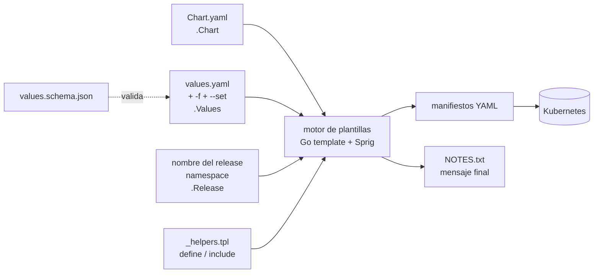

---
tags:
  - recursos
  - anatomia
  - helm
  - kubernetes
---

# Anatomía de un chart de Helm

> Qué significa cada archivo y cada línea de un chart de Helm: `Chart.yaml`, `values.yaml`, plantillas con sintaxis Go template, `_helpers.tpl`, `NOTES.txt` y el esquema de valores.

!!! info "Cómo leer esta nota"
    Cada línea de los ejemplos lleva su explicación a la derecha, después de `#`. Lo obligatorio está marcado con **[obligatorio]**. Cuando una explicación es larga, verás un número en el código: haz clic en él para leerla. Las plantillas generan los manifiestos de [Anatomía de los manifiestos de Kubernetes](kubernetes.md): léela primero si no conoces un Deployment. Las reglas de YAML están en [YAML / YML](../sintaxis/yml.md).

El chart de ejemplo empaqueta la API `lab-api` (FastAPI en el puerto 8000) del [Lab 06](../../laboratorios/devops/kubernetes-local-kind.md), con los mismos objetos que allí se escriben a mano.

## Dónde vive y cómo se organiza

Un **chart** es una carpeta con una estructura fija. `helm create lab-api` genera un esqueleto parecido a este:

```text
lab-api/
├── Chart.yaml                 # [obligatorio] nombre, versión y dependencias del chart
├── Chart.lock                 # versiones exactas de las dependencias (lo crea helm dependency update)
├── values.yaml                # valores por defecto: lo que el usuario puede cambiar
├── values.schema.json         # (opcional) esquema JSON que valida los valores
├── .helmignore                # archivos que NO se empaquetan (como .gitignore)
├── charts/                    # dependencias descargadas (subcharts .tgz)
└── templates/                 # plantillas: cada archivo genera manifiestos
    ├── _helpers.tpl           # empieza por _: solo define funciones, no genera objetos
    ├── NOTES.txt              # mensaje que se muestra tras instalar
    ├── deployment.yaml
    ├── service.yaml
    ├── configmap.yaml
    ├── httproute.yaml
    ├── hpa.yaml
    └── tests/
        └── test-connection.yaml   # pod que ejecuta helm test
```

- Cada archivo de `templates/` (salvo los que empiezan por `_` y `NOTES.txt`) se renderiza y se envía a Kubernetes.
- Un **release** es una instalación concreta del chart (`helm install api ./lab-api`): el mismo chart puede instalarse varias veces con distinto nombre y valores.
- Los valores finales se combinan así (gana el último): `values.yaml` del chart → archivos `-f valores-prod.yaml` → `--set clave=valor`.

## Estructura general



Helm no entiende YAML al renderizar: trata las plantillas como **texto**. Por eso la indentación del resultado depende de ti (`nindent`) y un espacio de más produce YAML inválido.

## Chart.yaml comentado línea por línea

```yaml title="lab-api/Chart.yaml"
apiVersion: v2                                       # [obligatorio] formato de chart de Helm 3 y Helm 4
name: lab-api                                        # [obligatorio] nombre del chart (= nombre de la carpeta)
description: API de tareas del laboratorio (FastAPI)
type: application                                    # application (despliega) o library (solo helpers)
version: 0.3.0                                       # [obligatorio] versión del CHART, SemVer (1)
appVersion: "0.2.0"                                  # versión de la APP que despliega; texto (2)
kubeVersion: ">=1.30.0-0"                            # versiones de Kubernetes soportadas
keywords:
  - api
  - fastapi
home: https://github.com/daedov/lab-devops-app
maintainers:
  - name: Dani
dependencies:                                        # subcharts que se instalan junto con este
  - name: postgresql                                 # nombre del chart dependiente
    version: "~16.7.0"                               # rango SemVer: 16.7.x
    repository: oci://registry.ejemplo.com/charts    # repositorio OCI o https://
    condition: postgresql.enabled                    # solo si este valor es true
```

1.  Sube `version` cada vez que cambie **cualquier cosa** del chart (plantillas, valores por defecto). Los repositorios y registries de charts no permiten publicar dos veces la misma versión.
2.  `appVersion` es informativa: aparece en `helm list` y aquí se usa como tag de imagen por defecto (ver la plantilla). Ponla entre comillas para que `1.10` no se convierta en el número `1.1`.

### Referencia de Chart.yaml

| Campo | Obligatorio | Qué hace | Ejemplo |
| --- | --- | --- | --- |
| `apiVersion` | **Sí** | Formato del chart; `v1` era Helm 2 | `v2` |
| `name` | **Sí** | Nombre del chart | `lab-api` |
| `version` | **Sí** | Versión del paquete, SemVer 2 | `0.3.0` |
| `appVersion` | No | Versión de la aplicación | `"0.2.0"` |
| `type` | No (por defecto `application`) | `application` o `library` | `library` para helpers compartidos |
| `kubeVersion` | No | Restricción de versión de Kubernetes | `">=1.30.0-0"` |
| `dependencies` | No | Subcharts con `name`, `version`, `repository`, `condition`, `alias` | ver ejemplo |
| `description`, `keywords`, `home`, `sources`, `maintainers`, `icon` | No | Metadatos para catálogos | — |
| `deprecated` | No | Marca el chart como obsoleto | `true` |

```bash
helm dependency update lab-api/    # descarga las dependencias a charts/ y escribe Chart.lock
```

## values.yaml comentado línea por línea

`values.yaml` es la **interfaz** del chart: lo que quien lo instala puede cambiar sin tocar las plantillas. Comenta cada valor: es la documentación que leerán otros.

```yaml title="lab-api/values.yaml"
replicaCount: 2                                      # réplicas si el HPA está desactivado

image:
  repository: registry.ejemplo.com/lab/lab-api       # imagen sin tag
  tag: ""                                            # vacío = usa appVersion de Chart.yaml
  pullPolicy: IfNotPresent

imagePullSecrets: []                                 # Secrets para registries privados
nameOverride: ""                                     # cambia el nombre corto (lab-api)
fullnameOverride: ""                                 # cambia el nombre completo de los objetos

serviceAccount:
  create: true                                       # crear un ServiceAccount propio
  name: ""                                           # vacío = nombre generado

podAnnotations: {}                                   # anotaciones extra para los pods

podSecurityContext:                                  # securityContext del pod (perfil restricted)
  runAsNonRoot: true
  runAsUser: 10001
  fsGroup: 10001
  seccompProfile:
    type: RuntimeDefault

securityContext:                                     # securityContext del contenedor
  allowPrivilegeEscalation: false
  readOnlyRootFilesystem: true
  capabilities:
    drop: ["ALL"]

containerPort: 8000                                  # puerto de FastAPI

config:                                              # se convierte en un ConfigMap (mapa clave: valor)
  LOG_LEVEL: info
  APP_MENSAJE: "Hola desde Helm"

extraEnv: []                                         # lista de {name, value} adicionales

existingSecret: api-secretos                         # Secret con API_TOKEN, creado FUERA del chart

service:
  type: ClusterIP
  port: 80

resources:
  requests:
    cpu: 50m
    memory: 64Mi
  limits:
    memory: 192Mi

autoscaling:
  enabled: false                                     # true = crea un HPA y no fija replicas
  minReplicas: 2
  maxReplicas: 6
  targetCPUUtilizationPercentage: 70

httpRoute:                                           # publicación con Gateway API
  enabled: true
  parentRefs:
    - name: lab-gateway
      sectionName: https
  hostnames:
    - api.ejemplo.com

nodeSelector: {}                                     # mapas y listas vacíos: el template los omite

postgresql:                                          # valores del subchart: van bajo su nombre
  enabled: false                                     # la condition de Chart.yaml lee este valor
```

- Los valores se leen en las plantillas como `.Values.image.repository`, `.Values.autoscaling.enabled`…
- Los valores de un subchart van bajo una clave con su nombre (`postgresql:`); el subchart los ve como su propio `.Values`.
- Usa `camelCase` en las claves (es la convención de Helm) y evita guiones: `.Values.mi-clave` no funciona en una plantilla.

## templates/deployment.yaml comentado línea por línea

La plantilla mezcla YAML normal con **acciones** entre `{{ }}`. Hay dos tipos de comentario:

- `# texto`: comentario de YAML. Helm lo trata como texto normal, así que **aparece en el YAML generado** (lo verás en `helm template`). Es válido, pero nunca debe contener llaves, porque Helm las evaluaría.
- `{{- /* texto */}}`: comentario de plantilla. **No** aparece en el resultado. Se usa en las líneas de control (`if`, `with`, `range`): un `#` ahí acabaría pegado a otra línea del resultado, porque `{{-` borra el salto de línea anterior.

```yaml title="lab-api/templates/deployment.yaml"
apiVersion: apps/v1
kind: Deployment
metadata:
  name: {{ include "lab-api.fullname" . }}                      # nombre calculado en _helpers.tpl (1)
  labels:
    {{- include "lab-api.labels" . | nindent 4 }}               # labels comunes, con 4 espacios (2)
spec:
  {{- if not .Values.autoscaling.enabled }}  {{- /* if: si NO hay HPA... */}}
  replicas: {{ .Values.replicaCount }}                          # ...fija las réplicas
  {{- end }}
  selector:
    matchLabels:
      {{- include "lab-api.selectorLabels" . | nindent 6 }}
  template:
    metadata:
      annotations:
        checksum/config: {{ include (print $.Template.BasePath "/configmap.yaml") . | sha256sum }}  # (3)
        {{- with .Values.podAnnotations }}  {{- /* with: solo si no está vacío */}}
        {{- toYaml . | nindent 8 }}                             # dentro de with, el punto es ese valor
        {{- end }}
      labels:
        {{- include "lab-api.selectorLabels" . | nindent 8 }}
    spec:
      serviceAccountName: {{ include "lab-api.serviceAccountName" . }}
      automountServiceAccountToken: false
      {{- with .Values.imagePullSecrets }}
      imagePullSecrets:
        {{- toYaml . | nindent 8 }}
      {{- end }}
      securityContext:
        {{- toYaml .Values.podSecurityContext | nindent 8 }}   # mapa de values convertido a YAML
      containers:
        - name: {{ .Chart.Name }}                               # dato de Chart.yaml
          image: "{{ .Values.image.repository }}:{{ .Values.image.tag | default .Chart.AppVersion }}"  # (4)
          imagePullPolicy: {{ .Values.image.pullPolicy }}
          ports:
            - name: http
              containerPort: {{ .Values.containerPort }}
          envFrom:
            - configMapRef:
                name: {{ include "lab-api.fullname" . }}        # el ConfigMap de configmap.yaml
          env:
            - name: API_TOKEN
              valueFrom:
                secretKeyRef:
                  name: {{ required "Define existingSecret: el Secret con API_TOKEN" .Values.existingSecret }}  # (5)
                  key: API_TOKEN
            {{- range .Values.extraEnv }}  {{- /* range: repite por cada elemento */}}
            - name: {{ .name }}                                 # el punto es el elemento actual
              value: {{ .value | quote }}                       # quote: siempre texto entre comillas
            {{- end }}
          resources:
            {{- toYaml .Values.resources | nindent 12 }}
          startupProbe:
            httpGet:
              path: /health
              port: http
            periodSeconds: 2
            failureThreshold: 15
          livenessProbe:
            httpGet:
              path: /health
              port: http
          readinessProbe:
            httpGet:
              path: /ready
              port: http
          securityContext:
            {{- toYaml .Values.securityContext | nindent 12 }}
          volumeMounts:
            - name: tmp
              mountPath: /tmp
      volumes:
        - name: tmp
          emptyDir: {}
      {{- with .Values.nodeSelector }}
      nodeSelector:
        {{- toYaml . | nindent 8 }}
      {{- end }}
```

1.  `include "nombre" .` ejecuta una plantilla definida en `_helpers.tpl` y devuelve su texto. El `.` final le pasa el **contexto** (todos los objetos: `.Values`, `.Release`, `.Chart`). Sin él, la plantilla no ve nada.
2.  `|` es un **pipe**: pasa el resultado a la siguiente función. `nindent 4` añade un salto de línea y 4 espacios delante de cada línea; el `{{-` borra los espacios y el salto de línea **anteriores**, así el texto empieza justo donde toca. Es el patrón más usado de Helm: `{{- include ... | nindent N }}` o `{{- toYaml ... | nindent N }}`, con `N` = la columna de la clave más uno de indentación.
3.  Calcula un hash del ConfigMap renderizado y lo pone como anotación del pod. Si cambia la configuración, cambia el hash, cambia la plantilla del pod y Kubernetes hace un rollout: los pods leen la configuración nueva. `$` es el contexto raíz: dentro de `with` o `range`, el `.` cambia y `$` sigue apuntando a todo.
4.  `default` devuelve el segundo valor si el primero está vacío: aquí, si `image.tag` es `""`, usa `appVersion`. Las comillas del YAML rodean toda la cadena porque `:` y el tag podrían confundir a YAML.
5.  `required "mensaje" valor` detiene el renderizado con ese mensaje si el valor está vacío. Así un error de configuración falla en `helm install`, no en el pod (`Error: execution error at (lab-api/templates/deployment.yaml:46:27): Define existingSecret...`, con la línea y la columna de la plantilla). En este chart, `values.schema.json` también exige `existingSecret`, así que el esquema lo detecta antes; `required` sigue siendo útil en charts sin esquema o para valores que dependen de otros.

### Sintaxis de las plantillas

| Sintaxis | Qué hace | Ejemplo |
| --- | --- | --- |
| `{{ expr }}` | Imprime el resultado | `{{ .Values.service.port }}` |
| `{{- expr }}` / `{{ expr -}}` | Recorta espacios y saltos de línea a la izquierda / derecha | `{{- if .Values.x }}` |
| `.Values` | Valores combinados (values.yaml, `-f`, `--set`) | `.Values.image.tag` |
| `.Release` | Datos del release | `.Release.Name`, `.Release.Namespace`, `.Release.IsUpgrade`, `.Release.Revision` |
| `.Chart` | Campos de Chart.yaml (con mayúscula inicial) | `.Chart.Name`, `.Chart.Version`, `.Chart.AppVersion` |
| `.Capabilities` | Qué soporta el clúster | `.Capabilities.KubeVersion`, `.Capabilities.APIVersions.Has "gateway.networking.k8s.io/v1"` |
| `.Template` | Plantilla actual | `.Template.BasePath` |
| `$` | Contexto raíz, útil dentro de `range`/`with` | `$.Release.Name` |
| `if` / `else if` / `else` / `end` | Condicional; vacío, `0`, `false` y `""` son falsos | `{{- if .Values.autoscaling.enabled }}` |
| `with` / `end` | Cambia el punto a un valor y se salta el bloque si está vacío | `{{- with .Values.nodeSelector }}` |
| `range` / `end` | Recorre listas o mapas | `{{- range $clave, $valor := .Values.config }}` |
| `define` / `include` / `template` | Define y llama plantillas con nombre | `include` permite usar pipes; `template` no |
| `default` | Valor por defecto | `{{ .Values.x | default "info" }}` |
| `required` | Falla si falta el valor | `{{ required "falta x" .Values.x }}` |
| `quote` / `squote` | Encierra en comillas dobles / simples | `{{ .Values.flag | quote }}` |
| `toYaml` / `nindent` / `indent` | Convierte a YAML / indenta | `{{- toYaml .Values.resources | nindent 12 }}` |
| `{{/* ... */}}` | Comentario de plantilla: no aparece en el resultado | `{{- /* explicación */}}` |

Las funciones vienen de Go template y de la biblioteca **Sprig** (`upper`, `trunc`, `trimSuffix`, `sha256sum`, `b64enc`…), más algunas propias de Helm (`include`, `required`, `tpl`, `lookup`, `toYaml`).

### Las otras plantillas del chart

```yaml title="lab-api/templates/configmap.yaml"
apiVersion: v1
kind: ConfigMap
metadata:
  name: {{ include "lab-api.fullname" . }}
  labels:
    {{- include "lab-api.labels" . | nindent 4 }}
data:
  {{- range $clave, $valor := .Values.config }}  {{- /* range sobre un mapa: clave y valor */}}
  {{ $clave }}: {{ $valor | quote }}                            # quote: un ConfigMap solo admite texto
  {{- end }}
```

```yaml title="lab-api/templates/service.yaml"
apiVersion: v1
kind: Service
metadata:
  name: {{ include "lab-api.fullname" . }}
  labels:
    {{- include "lab-api.labels" . | nindent 4 }}
spec:
  type: {{ .Values.service.type }}
  selector:
    {{- include "lab-api.selectorLabels" . | nindent 4 }}       # mismas labels que los pods
  ports:
    - name: http
      port: {{ .Values.service.port }}
      targetPort: http
```

```yaml title="lab-api/templates/httproute.yaml"
{{- /* Todo el archivo es opcional: solo se genera si httpRoute.enabled es true */}}
{{- if .Values.httpRoute.enabled }}
apiVersion: gateway.networking.k8s.io/v1
kind: HTTPRoute
metadata:
  name: {{ include "lab-api.fullname" . }}
  labels:
    {{- include "lab-api.labels" . | nindent 4 }}
spec:
  parentRefs:
    {{- toYaml .Values.httpRoute.parentRefs | nindent 4 }}
  hostnames:
    {{- toYaml .Values.httpRoute.hostnames | nindent 4 }}
  rules:
    - backendRefs:
        - name: {{ include "lab-api.fullname" . }}
          port: {{ .Values.service.port }}
{{- end }}
```

```yaml title="lab-api/templates/hpa.yaml"
{{- if .Values.autoscaling.enabled }}
apiVersion: autoscaling/v2
kind: HorizontalPodAutoscaler
metadata:
  name: {{ include "lab-api.fullname" . }}
  labels:
    {{- include "lab-api.labels" . | nindent 4 }}
spec:
  scaleTargetRef:
    apiVersion: apps/v1
    kind: Deployment
    name: {{ include "lab-api.fullname" . }}
  minReplicas: {{ .Values.autoscaling.minReplicas }}
  maxReplicas: {{ .Values.autoscaling.maxReplicas }}
  metrics:
    - type: Resource
      resource:
        name: cpu
        target:
          type: Utilization
          averageUtilization: {{ .Values.autoscaling.targetCPUUtilizationPercentage }}
{{- end }}
```

```yaml title="lab-api/templates/serviceaccount.yaml"
{{- if .Values.serviceAccount.create }}
apiVersion: v1
kind: ServiceAccount
metadata:
  name: {{ include "lab-api.serviceAccountName" . }}
  labels:
    {{- include "lab-api.labels" . | nindent 4 }}
automountServiceAccountToken: false
{{- end }}
```

## templates/_helpers.tpl comentado

`_helpers.tpl` define **plantillas con nombre** que las demás llaman con `include`. Como el archivo empieza por `_`, Helm no lo envía al clúster. Los comentarios van como bloques `{{/* ... */}}`: un `#` dentro de un `define` acabaría en el resultado.

```jinja title="lab-api/templates/_helpers.tpl"
{{/*
Nombre corto: el del chart (lab-api) o nameOverride.
trunc 63: los nombres de Kubernetes tienen como máximo 63 caracteres.
*/}}
{{- define "lab-api.name" -}}
{{- default .Chart.Name .Values.nameOverride | trunc 63 | trimSuffix "-" }}
{{- end }}

{{/*
Nombre completo de los objetos: <release>-<chart>, por ejemplo "api-lab-api".
Si el nombre del release ya contiene el del chart, no lo repite.
*/}}
{{- define "lab-api.fullname" -}}
{{- if .Values.fullnameOverride }}
{{- .Values.fullnameOverride | trunc 63 | trimSuffix "-" }}
{{- else }}
{{- $name := default .Chart.Name .Values.nameOverride }}
{{- if contains $name .Release.Name }}
{{- .Release.Name | trunc 63 | trimSuffix "-" }}
{{- else }}
{{- printf "%s-%s" .Release.Name $name | trunc 63 | trimSuffix "-" }}
{{- end }}
{{- end }}
{{- end }}

{{/*
Etiqueta chart: nombre y versión del chart (el "+" no es válido en una label).
*/}}
{{- define "lab-api.chart" -}}
{{- printf "%s-%s" .Chart.Name .Chart.Version | replace "+" "_" | trunc 63 | trimSuffix "-" }}
{{- end }}

{{/*
Labels comunes para metadata: las recomendadas por Kubernetes (app.kubernetes.io/*).
*/}}
{{- define "lab-api.labels" -}}
helm.sh/chart: {{ include "lab-api.chart" . }}
{{ include "lab-api.selectorLabels" . }}
app.kubernetes.io/version: {{ .Chart.AppVersion | quote }}
app.kubernetes.io/managed-by: {{ .Release.Service }}
{{- end }}

{{/*
Labels del selector: SOLO las que nunca cambian (el selector es inmutable).
Por eso no incluyen la versión.
*/}}
{{- define "lab-api.selectorLabels" -}}
app.kubernetes.io/name: {{ include "lab-api.name" . }}
app.kubernetes.io/instance: {{ .Release.Name }}
{{- end }}

{{/*
Nombre del ServiceAccount: el generado, el indicado en values o "default".
*/}}
{{- define "lab-api.serviceAccountName" -}}
{{- if .Values.serviceAccount.create }}
{{- default (include "lab-api.fullname" .) .Values.serviceAccount.name }}
{{- else }}
{{- default "default" .Values.serviceAccount.name }}
{{- end }}
{{- end }}
```

| Elemento | Qué hace |
| --- | --- |
| `{{- define "lab-api.name" -}}` … `{{- end }}` | Define una plantilla con nombre. Por convención se prefija con el nombre del chart, porque los nombres son globales (los subcharts los comparten) |
| `$name := ...` | Declara una variable local de plantilla |
| `printf "%s-%s" a b` | Formatea texto, como en Go |
| `contains a b` | `true` si `b` contiene `a` |
| `trunc 63 | trimSuffix "-"` | Corta a 63 caracteres y quita un guion final que dejaría un nombre inválido |
| `.Release.Service` | Siempre `Helm`: la label `managed-by` indica qué herramienta gestiona el objeto |

## NOTES.txt, values.schema.json y .helmignore

`NOTES.txt` también es una plantilla; su resultado se muestra al terminar `helm install` o `helm upgrade` (y con `helm status`):

```text title="lab-api/templates/NOTES.txt"
Instalado {{ .Chart.Name }} {{ .Chart.AppVersion }} como release "{{ .Release.Name }}" en el namespace {{ .Release.Namespace }}.
{{- if .Values.httpRoute.enabled }}

URL: https://{{ first .Values.httpRoute.hostnames }}
{{- else }}

Prueba la API con:
  kubectl -n {{ .Release.Namespace }} port-forward svc/{{ include "lab-api.fullname" . }} 8080:{{ .Values.service.port }}
  curl http://localhost:8080/health
{{- end }}
```

`values.schema.json` es un **JSON Schema** que Helm comprueba en `install`, `upgrade`, `lint` y `template`. Con él, un `replicaCount: "dos"` falla antes de llegar al clúster. JSON no admite comentarios, así que la explicación va en la tabla:

```json title="lab-api/values.schema.json"
{
  "$schema": "https://json-schema.org/draft-07/schema#",
  "type": "object",
  "required": ["image", "service", "existingSecret"],
  "properties": {
    "replicaCount": { "type": "integer", "minimum": 1 },
    "image": {
      "type": "object",
      "required": ["repository"],
      "properties": {
        "repository": { "type": "string", "minLength": 1 },
        "tag": { "type": "string" },
        "pullPolicy": { "enum": ["Always", "IfNotPresent", "Never"] }
      }
    },
    "existingSecret": { "type": "string", "minLength": 1 },
    "service": {
      "type": "object",
      "properties": {
        "type": { "enum": ["ClusterIP", "NodePort", "LoadBalancer"] },
        "port": { "type": "integer", "minimum": 1, "maximum": 65535 }
      }
    },
    "autoscaling": {
      "type": "object",
      "properties": {
        "enabled": { "type": "boolean" },
        "minReplicas": { "type": "integer", "minimum": 1 },
        "maxReplicas": { "type": "integer", "minimum": 1 }
      }
    }
  }
}
```

| Clave del esquema | Qué valida |
| --- | --- |
| `"$schema"` | Versión de JSON Schema (draft-07 es la más compatible entre versiones de Helm) |
| `"type"` | Tipo esperado: `object`, `string`, `integer`, `boolean`, `array` |
| `"required"` | Claves que deben existir |
| `"properties"` | Reglas para cada clave hija |
| `"enum"` | Lista cerrada de valores permitidos |
| `"minimum"` / `"maximum"` / `"minLength"` | Límites de números y longitud de textos |

`.helmignore` funciona como `.gitignore`: lo que coincide no entra en el paquete (`helm package`):

```text title="lab-api/.helmignore"
# Control de versiones y editores
.git/
.gitignore
.vscode/
*.swp
# Archivos de valores locales y de pruebas
valores-*.local.yaml
ci/
```

## Errores comunes

| Error | Mensaje típico | Corrección |
| --- | --- | --- |
| Indentación incorrecta de un `include`/`toYaml` | `error converting YAML to JSON: yaml: line 12: did not find expected key` | Ajusta el número de `nindent`; revisa el resultado con `helm template` |
| `{{ include ... | indent 4 }}` sin recortar | YAML con una línea mal colocada o claves pegadas | Usa `{{- ... | nindent 4 }}` |
| Valor inexistente o mal escrito | Campo vacío en el YAML, o `nil pointer evaluating interface {}.enabled` si falta el mapa padre | Revisa la ruta en `values.yaml`; usa `default`, `required` o un esquema |
| Número o booleano que debía ser texto | `cannot unmarshal bool into Go struct field ... of type string` | `{{ .Values.x | quote }}` |
| Clave con guion | `bad character U+002D '-'` | `camelCase`, o `{{ index .Values "mi-clave" }}` |
| Comentario `#` con llaves | Helm evalúa las llaves del comentario | Usa `{{/* ... */}}` o quita las llaves |
| Falta un valor obligatorio | `execution error at (...): Define existingSecret...` | Pásalo con `-f` o `--set` |
| Valores que no cumplen el esquema | `values don't meet the specifications of the schema(s)` | Corrige el tipo o el valor que indica el mensaje |
| Dependencias sin descargar | `chart directory is missing these dependencies: postgresql` | `helm dependency update` |
| `#` en una línea de `if`/`range`/`with` | El comentario aparece pegado a otra línea del YAML generado | Usa `{{- /* comentario */}}` en las líneas de control |
| Misma `version` del chart con cambios | El registry rechaza la publicación o los usuarios no ven el cambio | Sube `version` en `Chart.yaml` |

## Validar el archivo

```bash
helm version                                           # Helm 3.x o 4.x
helm dependency update lab-api/                        # dependencias a charts/
helm lint lab-api/ --strict                            # estructura, valores y esquema; --strict convierte avisos en errores
helm template api lab-api/ -n lab                      # renderiza los manifiestos sin clúster
helm template api lab-api/ -f valores-prod.yaml --set autoscaling.enabled=true   # prueba otras combinaciones
helm template api lab-api/ | kubectl apply --dry-run=server -f -   # la API valida el resultado
helm install api lab-api/ -n lab --dry-run=server --debug          # simula la instalación completa
helm diff upgrade api lab-api/                         # (plugin helm-diff) qué cambiaría en el release
```

`helm lint` no detecta todo: un manifiesto puede renderizar bien y ser inválido para Kubernetes (por ejemplo, un campo mal escrito). Por eso conviene pasar el resultado de `helm template` por `kubectl apply --dry-run=server`, kubeconform o un escáner como Trivy o Checkov (ver [Escaneo de IaC](../../devsecops/escaneos/iac-scanning.md)).

## Para practicar

- [Lab 06: Desplegar una app en Kubernetes local con kind](../../laboratorios/devops/kubernetes-local-kind.md): instala Envoy Gateway con un chart de Helm y escribe a mano los objetos que aquí son plantillas. Como reto, convierte la carpeta `k8s/` del lab en este chart.
- Teoría: [Helm y Kustomize](../../devops/contenedores/kubernetes.md#helm-y-kustomize) y [Despliegue continuo](../../devops/ci-cd/despliegue-continuo.md) (GitOps con Argo CD o Flux, que instalan charts).
- Comandos: [guía de Helm](../comandos/helm.md).
- Otras anatomías: [Kubernetes](kubernetes.md) (los objetos que generan estas plantillas).

## Referencias

- [Helm: guía de charts](https://helm.sh/docs/topics/charts/)
- [Guía de plantillas de charts](https://helm.sh/docs/chart_template_guide/)
- [Objetos integrados (`.Values`, `.Release`, `.Chart`…)](https://helm.sh/docs/chart_template_guide/builtin_objects/)
- [Funciones y pipelines](https://helm.sh/docs/chart_template_guide/functions_and_pipelines/) y [lista de funciones](https://helm.sh/docs/chart_template_guide/function_list/)
- [Plantillas con nombre (`define`, `include`)](https://helm.sh/docs/chart_template_guide/named_templates/)
- [Control de espacios en blanco](https://helm.sh/docs/chart_template_guide/control_structures/#controlling-whitespace)
- [Buenas prácticas de charts](https://helm.sh/docs/chart_best_practices/)
- [Esquema de valores (`values.schema.json`)](https://helm.sh/docs/topics/charts/#schema-files)
- [Sprig: funciones de plantilla](https://masterminds.github.io/sprig/)
