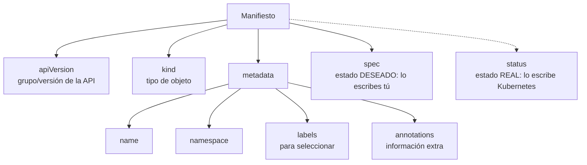

---
tags:
  - recursos
  - anatomia
  - kubernetes
---

# Anatomía de los manifiestos de Kubernetes

> Qué significa cada línea de los manifiestos que más se usan: Namespace, Deployment, Service, Gateway API, ConfigMap, Secret, HPA, NetworkPolicy, RBAC y `kustomization.yaml`.

!!! info "Cómo leer esta nota"
    Cada línea de los ejemplos lleva su explicación a la derecha, después de `#`. Lo obligatorio está marcado con **[obligatorio]**. Cuando una explicación es larga, verás un número en el código: haz clic en él para leerla. Las reglas básicas de YAML están en [YAML / YML](../sintaxis/yml.md) y la teoría en [Kubernetes: pods, deployments, services, Helm y Kustomize](../../devops/contenedores/kubernetes.md).

Todos los ejemplos despliegan la misma app: la API `lab-api` (FastAPI en el puerto 8000) en el namespace `lab`, como en el [Lab 06](../../laboratorios/devops/kubernetes-local-kind.md). Las piezas encajan entre sí: los nombres y las labels coinciden de un archivo a otro.

## Dónde vive y cómo se organiza

Los manifiestos viven en el repositorio de la app o en un repositorio de configuración (GitOps), normalmente uno por objeto:

```text
lab-devops-app/
└── k8s/
    ├── kustomization.yaml     # une todos los archivos y aplica cambios comunes
    ├── namespace.yaml         # namespace con Pod Security Standards
    ├── rbac.yaml              # ServiceAccounts, Role y RoleBinding
    ├── deployment.yaml        # la app: réplicas, imagen, probes, recursos
    ├── service.yaml           # IP y DNS estables delante de los pods
    ├── gateway.yaml           # entrada HTTP(S): Gateway + HTTPRoute
    ├── hpa.yaml               # autoescalado horizontal
    ├── networkpolicy.yaml     # quién puede hablar con los pods
    ├── configmap.yaml         # configuración (o la genera Kustomize)
    └── secret.yaml            # SOLO como ejemplo: los secretos no van a Git
```

Puedes poner varios objetos en un archivo separándolos con `---` (como `rbac.yaml`), pero un objeto por archivo facilita las revisiones. Con varios entornos se usa una carpeta `base/` y `overlays/dev`, `overlays/prod` (ver [Helm y Kustomize](../../devops/contenedores/kubernetes.md#helm-y-kustomize)).

## Estructura general

**Todos** los objetos de Kubernetes comparten las mismas cuatro partes de primer nivel:



```yaml title="esqueleto.yaml"
apiVersion: apps/v1                     # [obligatorio] grupo/versión; el grupo core es solo "v1"
kind: Deployment                        # [obligatorio] tipo de objeto, en PascalCase
metadata:                               # [obligatorio] identidad del objeto
  name: api                             # [obligatorio] único por tipo dentro del namespace
  namespace: lab                        # dónde vive; si falta, el del contexto (default)
  labels:                               # clave/valor para SELECCIONAR objetos
    app: api
  annotations:                          # clave/valor para INFORMAR (herramientas, personas)
    kubernetes.io/change-cause: "lab-api 0.2.0"
spec: {}                                # estado deseado: cada kind tiene el suyo
# status: lo rellena Kubernetes. No lo escribas: se ignora al aplicar
```

| Parte | Obligatorio | Qué es | Detalle |
| --- | --- | --- | --- |
| `apiVersion` | Sí | Grupo y versión de la API que define ese kind | `v1`, `apps/v1`, `networking.k8s.io/v1` |
| `kind` | Sí | Tipo de objeto | `Deployment`, `Service`… |
| `metadata.name` | Sí | Nombre; con el kind y el namespace identifica el objeto | Minúsculas, números y `-`, hasta 253 caracteres (63 en muchos kinds) |
| `metadata.namespace` | No | Namespace del objeto | Los objetos de clúster (Namespace, ClusterRole, Node) no lo llevan |
| `metadata.labels` | No | Etiquetas que usan los **selectors** | `app: api` |
| `metadata.annotations` | No | Metadatos que no se usan para seleccionar | Notas, configuración de controllers |
| `spec` | Casi siempre | Lo que quieres | ConfigMap y Secret usan `data` en lugar de `spec` |
| `status` | **No se escribe** | Lo que hay de verdad, lo actualizan los controllers | Lo ves con `kubectl get -o yaml` |

Así se ve el `status` que añade Kubernetes a un Deployment (`kubectl get deployment api -n lab -o yaml`):

```yaml
status:
  observedGeneration: 3                 # última versión del spec que el controller procesó
  replicas: 2                           # pods que existen
  readyReplicas: 2                      # pods que pasan la readinessProbe
  updatedReplicas: 2                    # pods con la plantilla más reciente
  conditions:
    - type: Available                   # hay suficientes réplicas listas
      status: "True"
```

!!! tip "No memorices los campos: pregúntale al clúster"
    `kubectl explain deployment.spec.strategy` describe cualquier campo con su tipo y documentación; añade `--recursive` para ver todo el árbol. `kubectl api-resources` lista cada kind con su `apiVersion` y si tiene namespace.

| Kind | `apiVersion` |
| --- | --- |
| Namespace, Service, ConfigMap, Secret, ServiceAccount, Pod | `v1` |
| Deployment, StatefulSet, DaemonSet | `apps/v1` |
| HorizontalPodAutoscaler | `autoscaling/v2` |
| NetworkPolicy, Ingress | `networking.k8s.io/v1` |
| Role, RoleBinding, ClusterRole, ClusterRoleBinding | `rbac.authorization.k8s.io/v1` |
| Gateway, HTTPRoute, GatewayClass | `gateway.networking.k8s.io/v1` (CRD que se instala aparte) |
| Kustomization (no se envía al clúster) | `kustomize.config.k8s.io/v1beta1` |

## Namespace comentado línea por línea

```yaml title="namespace.yaml"
apiVersion: v1                                        # [obligatorio] grupo core
kind: Namespace                                       # [obligatorio]
metadata:
  name: lab                                           # [obligatorio] único en el clúster
  labels:
    pod-security.kubernetes.io/enforce: restricted    # RECHAZA pods que no cumplan "restricted" (1)
    pod-security.kubernetes.io/enforce-version: latest  # versión de las reglas que se aplica
    pod-security.kubernetes.io/warn: restricted       # avisa en la salida de kubectl
    pod-security.kubernetes.io/audit: restricted      # anota la infracción en el audit log
```

1.  Son labels de **Pod Security Admission**, el control integrado que aplica los **Pod Security Standards** (`privileged`, `baseline`, `restricted`). Sustituye a PodSecurityPolicy, eliminada en Kubernetes 1.25. El Deployment de abajo cumple `restricted`. Ver [Seguridad de Kubernetes](../../devsecops/infraestructura-y-contenedores/seguridad-kubernetes.md#pod-security-standards).

## Deployment comentado línea por línea

```yaml title="deployment.yaml"
apiVersion: apps/v1                                   # [obligatorio]
kind: Deployment                                      # [obligatorio]
metadata:
  name: api                                           # [obligatorio]
  namespace: lab
  labels:
    app: api
spec:
  replicas: 2                                         # pods deseados (1)
  revisionHistoryLimit: 5                             # ReplicaSets viejos guardados para rollback
  selector:                                           # [obligatorio] qué pods gestiona; INMUTABLE (2)
    matchLabels:
      app: api
  strategy:
    type: RollingUpdate                               # por defecto; la otra opción es Recreate
    rollingUpdate:
      maxSurge: 1                                     # como máximo 1 pod extra durante la actualización
      maxUnavailable: 0                               # nunca por debajo de las réplicas deseadas
  template:                                           # [obligatorio] plantilla de cada pod
    metadata:
      labels:
        app: api                                      # [obligatorio] debe cumplir el selector
    spec:
      serviceAccountName: api                         # identidad del pod (rbac.yaml)
      automountServiceAccountToken: false             # la app no habla con la API de Kubernetes
      terminationGracePeriodSeconds: 30               # segundos para cerrar limpio tras SIGTERM
      securityContext:                                # nivel POD: aplica a todos los contenedores
        runAsNonRoot: true                            # rechaza arrancar si la imagen usa root
        runAsUser: 10001                              # UID con el que corre el proceso
        fsGroup: 10001                                # grupo dueño de los volúmenes montados
        seccompProfile:
          type: RuntimeDefault                        # filtro de syscalls por defecto del runtime
      containers:                                     # [obligatorio] lista de contenedores
        - name: api                                   # [obligatorio] nombre dentro del pod
          image: registry.ejemplo.com/lab/lab-api:0.2.0  # [obligatorio] tag fijo, nunca latest (3)
          imagePullPolicy: IfNotPresent               # descargar solo si no está en el nodo
          ports:
            - name: http                              # nombre: lo usan el Service y las probes
              containerPort: 8000                     # puerto en el que escucha FastAPI
              protocol: TCP
          env:                                        # variables una a una
            - name: LOG_LEVEL
              value: info                             # valor literal
            - name: API_TOKEN
              valueFrom:
                secretKeyRef:                         # valor tomado de un Secret
                  name: api-secretos
                  key: API_TOKEN
            - name: POD_NAME
              valueFrom:
                fieldRef:                             # dato del propio pod (Downward API)
                  fieldPath: metadata.name
          envFrom:                                    # todas las claves de un ConfigMap como variables
            - configMapRef:
                name: api-config
          resources:
            requests:                                 # reserva: el scheduler decide con esto
              cpu: 50m                                # 50 milicores = 0,05 CPU
              memory: 64Mi                            # mebibytes
            limits:
              memory: 192Mi                           # si lo supera: OOMKilled (4)
          startupProbe:                               # ¿terminó de arrancar?
            httpGet:
              path: /health
              port: http                              # por nombre del puerto
            periodSeconds: 2
            failureThreshold: 15                      # hasta 30 s (15 × 2 s) para arrancar
          livenessProbe:                              # ¿sigue vivo? si falla: REINICIA el contenedor
            httpGet:
              path: /health
              port: http
            periodSeconds: 10
            failureThreshold: 3
          readinessProbe:                             # ¿puede recibir tráfico? si falla: sale del Service
            httpGet:
              path: /ready
              port: http
            periodSeconds: 5
            failureThreshold: 2
          securityContext:                            # nivel CONTENEDOR
            allowPrivilegeEscalation: false           # sin setuid/sudo dentro del contenedor
            readOnlyRootFilesystem: true              # sistema de archivos de solo lectura
            capabilities:
              drop: ["ALL"]                           # sin capabilities de Linux
          volumeMounts:                               # dónde se montan los volúmenes en ESTE contenedor
            - name: tmp                               # debe coincidir con un volumes[].name
              mountPath: /tmp                         # la única carpeta con escritura
      volumes:                                        # volúmenes del POD
        - name: tmp
          emptyDir:                                   # carpeta vacía que vive lo que vive el pod
            sizeLimit: 64Mi
```

1.  Si un HorizontalPodAutoscaler gestiona este Deployment, quita `replicas` del manifiesto: cada `kubectl apply` volvería a 2 y pelearía con el HPA.
2.  El `selector` no se puede cambiar después de crear el Deployment (hay que borrarlo y recrearlo). Debe coincidir con las labels de `template.metadata.labels`; si no, la API rechaza el objeto con `` `selector` does not match template `labels` ``.
3.  Para máxima trazabilidad, fija por **digest**: `registry.ejemplo.com/lab/lab-api:0.2.0@sha256:<digest>`. El tag puede moverse; el digest identifica una imagen exacta. Ver [Software supply chain](../../devsecops/codigo-y-dependencias/cadena-suministro.md).
4.  Si el contenedor supera el límite de **memoria**, el kernel lo mata (`OOMKilled`). Si supera un límite de **CPU**, se le frena (*throttling*). Aquí no hay límite de CPU a propósito, una práctica habitual para evitar frenazos innecesarios.

### Referencia de elementos del Deployment

| Elemento | Obligatorio | Qué hace | Valores típicos |
| --- | --- | --- | --- |
| `spec.replicas` | No (por defecto 1) | Número de pods | `2`, `3`; quítalo si hay HPA |
| `spec.selector` | **Sí** | Qué pods pertenecen al Deployment | `matchLabels: {app: api}` |
| `spec.strategy` | No | Cómo se sustituyen los pods en una actualización | `RollingUpdate` (con `maxSurge`/`maxUnavailable`), `Recreate` |
| `spec.template` | **Sí** | Plantilla del pod: cambiarla crea una nueva revisión | `metadata` + `spec` del pod |
| `template.spec.containers[]` | **Sí** | Contenedores del pod | `name`, `image` obligatorios |
| `image` | **Sí** | Imagen con tag o digest | `repo/app:1.2.3`, `repo/app@sha256:…` |
| `ports[].containerPort` | No | Puerto del contenedor (documenta y da nombre) | `8000` |
| `env` / `envFrom` | No | Variables de entorno | literal, `secretKeyRef`, `configMapRef` |
| `resources.requests` | No (pero ponlo) | Reserva para el scheduler y base del HPA | `cpu: 100m`, `memory: 128Mi` |
| `resources.limits` | No | Máximo permitido | `memory: 256Mi` |
| `startupProbe` / `livenessProbe` / `readinessProbe` | No | Comprobaciones de salud | `httpGet`, `tcpSocket`, `exec`, `grpc` |
| `securityContext` (pod y contenedor) | No | Usuario, privilegios, seccomp | ver ejemplo (`restricted`) |
| `volumeMounts` / `volumes` | No | Montar almacenamiento en el contenedor | `emptyDir`, `configMap`, `secret`, `persistentVolumeClaim` |
| `serviceAccountName` | No (usa `default`) | Identidad del pod | un ServiceAccount por app |

## Service comentado línea por línea

```yaml title="service.yaml"
apiVersion: v1                                        # [obligatorio]
kind: Service                                         # [obligatorio]
metadata:
  name: api                                           # [obligatorio] también es el nombre DNS: api.lab.svc.cluster.local
  namespace: lab
spec:
  type: ClusterIP                                     # solo dentro del clúster (por defecto)
  selector:                                           # envía tráfico a los pods con esta label...
    app: api                                          # ...y que estén ready
  ports:
    - name: http
      port: 80                                        # puerto del Service (al que llaman los clientes)
      targetPort: http                                # puerto del contenedor, por nombre (8000)
      protocol: TCP
```

| `type` | Accesible desde | Uso |
| --- | --- | --- |
| `ClusterIP` | Dentro del clúster | Comunicación entre servicios; detrás de un Gateway |
| `NodePort` | Un puerto (30000–32767) de cada nodo | Pruebas |
| `LoadBalancer` | Fuera, con un load balancer de la nube | Exponer TCP/UDP directamente |
| `ExternalName` | — | Alias DNS (CNAME) hacia un nombre externo |

## Gateway y HTTPRoute comentados línea por línea

La **Gateway API** es la forma actual de exponer HTTP(S). Separa responsabilidades: el equipo de plataforma instala el controller (que crea la **GatewayClass**) y define el **Gateway**; cada equipo de aplicación publica sus **HTTPRoute**. Sus CRD se instalan aparte (muchos controllers lo hacen por ti).

```yaml title="gateway.yaml"
apiVersion: gateway.networking.k8s.io/v1              # [obligatorio]
kind: Gateway                                         # [obligatorio] el punto de entrada
metadata:
  name: lab-gateway
  namespace: lab
spec:
  gatewayClassName: eg                                # [obligatorio] qué controller lo implementa (1)
  listeners:                                          # [obligatorio] puertos y protocolos en los que escucha
    - name: http                                      # nombre: las rutas lo referencian con sectionName
      protocol: HTTP
      port: 80
    - name: https
      protocol: HTTPS
      port: 443
      hostname: api.ejemplo.com                       # solo acepta este dominio
      tls:
        mode: Terminate                               # el Gateway descifra el TLS
        certificateRefs:
          - kind: Secret                              # Secret de tipo kubernetes.io/tls
            name: api-tls
      allowedRoutes:
        namespaces:
          from: Same                                  # solo rutas de este namespace (All, Selector)
---
apiVersion: gateway.networking.k8s.io/v1
kind: HTTPRoute                                       # reglas HTTP de la app
metadata:
  name: api
  namespace: lab
spec:
  parentRefs:                                         # a qué Gateway se engancha
    - name: lab-gateway
      sectionName: https                              # solo al listener https
  hostnames:
    - api.ejemplo.com                                 # cabecera Host que atiende
  rules:
    - matches:
        - path:
            type: PathPrefix                          # Exact, PathPrefix o RegularExpression
            value: /
      backendRefs:                                    # a dónde va el tráfico
        - name: api                                   # Service api...
          port: 80                                    # ...en su puerto 80
          weight: 100                                 # reparto entre backends (canary) (2)
---
apiVersion: gateway.networking.k8s.io/v1
kind: HTTPRoute
metadata:
  name: api-redirigir-https
  namespace: lab
spec:
  parentRefs:
    - name: lab-gateway
      sectionName: http                               # se engancha al listener http
  hostnames:
    - api.ejemplo.com
  rules:
    - filters:                                        # transforman la petición; aquí, redirección
        - type: RequestRedirect
          requestRedirect:
            scheme: https
            statusCode: 301
```

1.  La GatewayClass la crea quien instala el controller (Envoy Gateway en el lab, `eg`). Otros controllers: NGINX Gateway Fabric, Istio, Cilium, y los load balancers gestionados de AWS, Azure y Google Cloud, cada uno con su nombre de clase.
2.  Con dos `backendRefs` (por ejemplo `api` con `weight: 90` y `api-canary` con `weight: 10`) haces un **canary release** (lanzamiento canario) sin herramientas extra. Ver [Despliegue continuo](../../devops/ci-cd/despliegue-continuo.md).

### Ingress (clásico)

El **Ingress** es la API anterior, todavía muy presente en clústeres existentes. Sigue siendo estable, pero las funciones avanzadas dependen de anotaciones propias de cada controller, y el controller comunitario Ingress NGINX se retiró en marzo de 2026. Para clústeres nuevos, usa Gateway API.

```yaml title="ingress.yaml"
apiVersion: networking.k8s.io/v1
kind: Ingress
metadata:
  name: api
  namespace: lab
spec:
  ingressClassName: mi-controller                     # qué controller lo aplica
  tls:
    - hosts: [api.ejemplo.com]
      secretName: api-tls
  rules:
    - host: api.ejemplo.com
      http:
        paths:
          - path: /
            pathType: Prefix                          # [obligatorio] Prefix, Exact o ImplementationSpecific
            backend:
              service:
                name: api
                port:
                  number: 80
```

| Ingress | Gateway API |
| --- | --- |
| `ingressClassName` | `gatewayClassName` del Gateway |
| Un objeto mezcla entrada y rutas | Gateway (entrada) y HTTPRoute (rutas) separados |
| `tls` en cada Ingress | `tls` en el listener del Gateway |
| Pesos, cabeceras, redirecciones: anotaciones del controller | Campos estándar (`weight`, `matches.headers`, `filters`) |

## ConfigMap comentado línea por línea

```yaml title="configmap.yaml"
apiVersion: v1                                        # [obligatorio]
kind: ConfigMap                                       # [obligatorio]
metadata:
  name: api-config
  namespace: lab
data:                                                 # en vez de spec: pares clave/valor (texto)
  APP_MENSAJE: "Hola desde Kubernetes"                # clave usable como variable (envFrom)
  FEATURE_EXPORTAR: "true"                            # SIEMPRE texto: "true", no true (1)
  config.json: |                                      # una clave puede ser un archivo entero
    {"zona_horaria": "America/Santiago", "pagina": 20}
```

1.  Los valores de `data` deben ser cadenas. `true` u `8000` sin comillas son booleano y número en YAML, y la API rechaza el ConfigMap (`cannot unmarshal bool into Go struct field ConfigMap.data of type string`).

- Como variables: `envFrom.configMapRef` (todas las claves) o `env.valueFrom.configMapKeyRef` (una).
- Como archivo: un volumen `configMap` monta cada clave como un archivo (`/etc/config/config.json`).
- Las variables se leen **al arrancar**: cambiar el ConfigMap no cambia los pods que ya corren (los archivos montados sí se actualizan, con retraso). Por eso Kustomize y Helm añaden un hash al nombre o una anotación, para forzar un rollout.

## Secret comentado línea por línea

```yaml title="secret.yaml"
apiVersion: v1                                        # [obligatorio]
kind: Secret                                          # [obligatorio]
metadata:
  name: api-secretos
  namespace: lab
type: Opaque                                          # genérico; otros: kubernetes.io/tls, kubernetes.io/dockerconfigjson
data:                                                 # valores en base64
  API_TOKEN: dG9rZW4tZGUtcHJ1ZWJhLTEyMw==             # "token-de-prueba-123" en base64
stringData:                                           # alternativa: texto plano, la API lo pasa a base64
  DB_USUARIO: lab_api
immutable: true                                       # no se puede modificar: protege y aligera la API
```

!!! danger "Base64 no es cifrado"
    `echo dG9rZW4tZGUtcHJ1ZWJhLTEyMw== | base64 -d` devuelve el token en un segundo. Base64 solo permite guardar datos binarios como texto. Lo que protege un Secret es **RBAC** (quién puede leerlo), el **cifrado de etcd** (*encryption at rest*, idealmente con KMS) y no guardarlo nunca en Git. En producción el valor viene de un gestor de secretos (Vault, AWS Secrets Manager, Azure Key Vault, Google Secret Manager) con External Secrets Operator o el Secrets Store CSI Driver. Ver [Secretos e identidades](../../devsecops/identidades-y-pipeline/secretos-identidades.md).

## HorizontalPodAutoscaler comentado línea por línea

```yaml title="hpa.yaml"
apiVersion: autoscaling/v2                            # [obligatorio] v2: varias métricas y behavior
kind: HorizontalPodAutoscaler                         # [obligatorio]
metadata:
  name: api
  namespace: lab
spec:
  scaleTargetRef:                                     # [obligatorio] qué escala
    apiVersion: apps/v1
    kind: Deployment
    name: api
  minReplicas: 2                                      # nunca menos (alta disponibilidad)
  maxReplicas: 6                                      # [obligatorio] techo: protege costos y la base de datos
  metrics:
    - type: Resource                                  # métrica de CPU o memoria del pod
      resource:
        name: cpu
        target:
          type: Utilization                           # porcentaje...
          averageUtilization: 70                      # ...sobre los REQUESTS, no sobre el límite
  behavior:                                           # velocidad de escalado (opcional)
    scaleDown:
      stabilizationWindowSeconds: 300                 # espera 5 min de métricas bajas antes de bajar
      policies:
        - type: Pods
          value: 1                                    # quita como máximo 1 pod...
          periodSeconds: 60                           # ...por minuto
```

Necesita **metrics-server** (o un adaptador de métricas) y `resources.requests.cpu` en el Deployment; si falta algo, verás `TARGETS <unknown>`.

## NetworkPolicy comentada línea por línea

```yaml title="networkpolicy.yaml"
apiVersion: networking.k8s.io/v1                      # [obligatorio]
kind: NetworkPolicy                                   # [obligatorio]
metadata:
  name: api
  namespace: lab
spec:
  podSelector:                                        # [obligatorio] a qué pods se aplica ({} = todos)
    matchLabels:
      app: api
  policyTypes: [Ingress, Egress]                      # lo no permitido abajo queda BLOQUEADO
  ingress:                                            # quién puede ENTRAR
    - from:
        - namespaceSelector:                          # pods de este namespace...
            matchLabels:
              kubernetes.io/metadata.name: envoy-gateway-system  # label automática con el nombre
      ports:
        - protocol: TCP
          port: 8000                                  # puerto del CONTENEDOR, no del Service
  egress:                                             # a dónde puede SALIR
    - to:
        - namespaceSelector:
            matchLabels:
              kubernetes.io/metadata.name: kube-system
          podSelector:                                # mismo elemento: namespace Y pod (1)
            matchLabels:
              k8s-app: kube-dns
      ports:
        - protocol: UDP
          port: 53                                    # DNS: sin esto no resuelve nombres
        - protocol: TCP
          port: 53
```

1.  Dentro de un mismo elemento de `from`/`to`, `namespaceSelector` y `podSelector` se combinan con **Y** (pods `kube-dns` del namespace `kube-system`). Si los pones como dos elementos de lista (cada uno con su `-`), se combinan con **O**: cualquier pod de `kube-system` **o** cualquier pod `kube-dns` de cualquier namespace. Un guion cambia la seguridad de la regla.

Solo funciona si el **CNI** del clúster aplica NetworkPolicies (Calico, Cilium y los modos correspondientes de EKS, AKS y GKE). Ver [Seguridad de Kubernetes](../../devsecops/infraestructura-y-contenedores/seguridad-kubernetes.md#networkpolicy).

## ServiceAccount, Role y RoleBinding comentados

**RBAC** responde a "quién puede hacer qué con la API". Aquí, dos identidades: la de los pods de la API (sin permisos) y la de la herramienta que despliega (por ejemplo, un controller de GitOps o el pipeline), con permisos solo en `lab`.

```yaml title="rbac.yaml"
apiVersion: v1
kind: ServiceAccount                                  # identidad de los pods de la API
metadata:
  name: api
  namespace: lab
automountServiceAccountToken: false                   # no montar el token si no se usa
---
apiVersion: v1
kind: ServiceAccount                                  # identidad de quien despliega
metadata:
  name: despliegue
  namespace: lab
---
apiVersion: rbac.authorization.k8s.io/v1
kind: Role                                            # permisos dentro de UN namespace
metadata:
  name: desplegar-api
  namespace: lab
rules:                                                # [obligatorio] lista de permisos
  - apiGroups: ["apps"]                               # grupo de la API ("" = core)
    resources: ["deployments"]
    verbs: ["get", "list", "watch", "patch", "update"]  # sin create/delete: solo actualizar
  - apiGroups: [""]
    resources: ["services", "configmaps"]
    verbs: ["get", "list", "watch", "create", "update", "patch"]
  - apiGroups: ["apps"]
    resources: ["deployments"]
    resourceNames: ["api"]                            # limitar a un objeto concreto
    verbs: ["delete"]
---
apiVersion: rbac.authorization.k8s.io/v1
kind: RoleBinding                                     # asigna el Role a alguien
metadata:
  name: despliegue-desplegar-api
  namespace: lab
subjects:                                             # A QUIÉN (usuarios, grupos o ServiceAccounts)
  - kind: ServiceAccount
    name: despliegue
    namespace: lab
roleRef:                                              # QUÉ permisos; INMUTABLE
  apiGroup: rbac.authorization.k8s.io
  kind: Role                                          # Role o ClusterRole
  name: desplegar-api
```

| Objeto | Alcance | Para qué |
| --- | --- | --- |
| ServiceAccount | Namespace | Identidad de pods y herramientas ante la API |
| Role / ClusterRole | Namespace / clúster | Lista de permisos (`apiGroups` + `resources` + `verbs`) |
| RoleBinding / ClusterRoleBinding | Namespace / clúster | Asigna un Role o ClusterRole a `subjects` |

Comprueba los permisos sin probar a ciegas: `kubectl auth can-i delete deployments -n lab --as=system:serviceaccount:lab:despliegue`. Nada de `verbs: ["*"]` ni `cluster-admin` para una app.

## kustomization.yaml comentado línea por línea

**Kustomize** (integrado en kubectl) une los manifiestos y les aplica cambios **sin plantillas**. `kustomization.yaml` no se envía al clúster: lo procesa `kubectl kustomize` o `kubectl apply -k`.

```yaml title="kustomization.yaml"
apiVersion: kustomize.config.k8s.io/v1beta1          # [obligatorio en la práctica]
kind: Kustomization
namespace: lab                                        # fuerza este namespace en todos los objetos
resources:                                            # archivos (o carpetas, o URLs) a incluir
  - namespace.yaml
  - rbac.yaml
  - deployment.yaml
  - service.yaml
  - gateway.yaml
  - hpa.yaml
  - networkpolicy.yaml                                # configmap.yaml no: lo genera configMapGenerator
labels:                                               # labels comunes (sustituye a commonLabels) (1)
  - pairs:
      app.kubernetes.io/part-of: lab-devops-app
    includeSelectors: false                           # NO tocar selectors (son inmutables)
images:                                               # cambiar imagen o tag sin editar el Deployment
  - name: registry.ejemplo.com/lab/lab-api            # imagen a buscar en los manifiestos
    newTag: "0.2.1"                                   # tag nuevo (o digest: abajo)
patches:                                              # parches sobre los objetos
  - target:                                           # parche JSON 6902: operaciones sobre rutas
      kind: Deployment
      name: api
    patch: |-
      - op: replace
        path: /spec/template/spec/containers/0/resources/limits/memory
        value: 256Mi
  - patch: |-                                         # parche strategic merge: un YAML parcial
      apiVersion: apps/v1
      kind: Deployment
      metadata:
        name: api
        namespace: lab
      spec:
        revisionHistoryLimit: 10
configMapGenerator:                                   # genera ConfigMaps con hash en el nombre (2)
  - name: api-config
    literals:
      - APP_MENSAJE=Hola desde Kustomize
      - FEATURE_EXPORTAR=true
```

1.  `commonLabels` está obsoleto porque también modificaba los `selector`, que son inmutables: cambiarlo en un Deployment existente hacía fallar el `apply`. Con `labels` decides: `includeSelectors: false` solo añade la label en `metadata`; `includeTemplates: true` la añade también a la plantilla de los pods.
2.  El ConfigMap se crea como `api-config-<hash>` y Kustomize actualiza las referencias (`envFrom` del Deployment). Al cambiar un valor cambia el hash, cambia la plantilla del pod y Kubernetes hace un rollout: los pods leen la configuración nueva. También existen `secretGenerator` (con el mismo aviso: no metas secretos reales en Git) y `files:` / `envs:` para generar desde archivos.

| Campo | Qué hace |
| --- | --- |
| `resources` | Qué incluir: archivos, carpetas con su propio `kustomization.yaml` (una base) o URLs de Git |
| `namespace` | Pone el namespace a todos los objetos con namespace |
| `namePrefix` / `nameSuffix` | Prefijo o sufijo para todos los nombres (`dev-`) |
| `labels` | Labels comunes, con control sobre selectors y plantillas |
| `images` | Cambia `newName`, `newTag` o `digest` de una imagen |
| `patches` | Parches strategic merge o JSON 6902, con `target` opcional |
| `configMapGenerator` / `secretGenerator` | Generan objetos con hash en el nombre |
| `replicas` | Cambia el número de réplicas de un Deployment por nombre |
| `components` | Bloques reutilizables entre overlays |

## Errores comunes

| Error | Mensaje típico | Corrección |
| --- | --- | --- |
| Labels del template que no cumplen el selector | `` spec.template.metadata.labels: Invalid value: ... `selector` does not match template `labels` `` | Igualar `spec.selector.matchLabels` y `spec.template.metadata.labels` |
| Cambiar el selector de un Deployment existente | `field is immutable` | Borrar y recrear el Deployment (o no cambiar el selector) |
| `apiVersion` antigua | `no matches for kind "Deployment" in version "extensions/v1beta1"` | Usar la actual (`apps/v1`); `kubectl api-resources` la muestra |
| CRD no instalada | `no matches for kind "HTTPRoute" in version "gateway.networking.k8s.io/v1"` | Instalar las CRD de Gateway API (o el controller que las trae) |
| Número o booleano en un ConfigMap | `json: cannot unmarshal bool into Go struct field ConfigMap.data of type string` | Comillas: `"8000"`, `"true"` |
| Campo mal escrito o mal indentado | `unknown field "spec.template.spec.containers[0].resource"` | Con validación estricta (por defecto en kubectl) el error dice el campo exacto |
| Tabulador en la indentación | `found character that cannot start any token` | Solo espacios |
| Pod que no cumple Pod Security | Al aplicar el Deployment solo sale `Warning: would violate PodSecurity "restricted:latest": allowPrivilegeEscalation != false...`; luego los pods no se crean (`kubectl describe rs` muestra `FailedCreate ... forbidden: violates PodSecurity`) | Completar el `securityContext` como en el ejemplo |
| Secret o ConfigMap que no existe | Pod en `CreateContainerConfigError` | Crear el objeto o corregir el nombre; `kubectl describe pod` lo dice en *Events* |
| `targetPort` que no coincide con el contenedor | Service sin endpoints útiles, `connection refused` | Usar el nombre del puerto (`http`) en vez del número |
| NetworkPolicy con egress y sin DNS | La app no resuelve nombres | Permitir UDP/TCP 53 hacia `kube-dns` |
| Parche de Kustomize que no encuentra su objeto | `no matches for Id Deployment.v1.apps/api.[noNs]; failed to find unique target for patch` | El parche debe llevar el mismo `namespace` que el objeto, o usa `target:` |

## Validar el archivo

```bash
yamllint k8s/                                          # sintaxis YAML y estilo
kubectl kustomize k8s/                                 # renderiza Kustomize sin clúster
kubectl apply --dry-run=client -f k8s/deployment.yaml  # valida contra el esquema (necesita acceso a un clúster)
kubectl apply --dry-run=server -k k8s/                 # la API valida todo, incluidos los admission controllers
kubectl diff -k k8s/                                   # qué cambiaría en el clúster, como un plan
kubeconform -strict -summary k8s/*.yaml                # validación sin clúster con los esquemas OpenAPI
```

- `--dry-run=client` necesita conexión a un clúster para descargar el esquema. Sin clúster usa **kubeconform** (o `kubectl kustomize` para comprobar que Kustomize genera algo coherente). Para CRD como Gateway API, kubeconform necesita sus esquemas (`-schema-location`).
- `--dry-run=server` es la prueba más completa: pasa por Pod Security Admission, Kyverno o Gatekeeper sin guardar nada.
- Para seguridad (root, `latest`, falta de límites): Trivy (`trivy config k8s/`), Checkov o Kubescape. Ver [Escaneo de IaC](../../devsecops/escaneos/iac-scanning.md) y [KSPM](../../devsecops/escaneos/kspm.md).

## Para practicar

- [Lab 06: Desplegar una app en Kubernetes local con kind](../../laboratorios/devops/kubernetes-local-kind.md): Deployment con probes, ConfigMap, Secret, Service, Gateway API, HPA y Kustomize.
- Teoría: [Kubernetes: pods, deployments, services, Helm y Kustomize](../../devops/contenedores/kubernetes.md) y [Seguridad de Kubernetes](../../devsecops/infraestructura-y-contenedores/seguridad-kubernetes.md).
- Comandos: [guía de kubectl](../comandos/kubectl.md).
- Otras anatomías: [Helm](helm.md) (los mismos objetos como plantillas) y [Docker](docker.md) (la imagen que se despliega).

## Referencias

- [Objetos de Kubernetes y sus campos](https://kubernetes.io/docs/concepts/overview/working-with-objects/)
- [Labels y selectors](https://kubernetes.io/docs/concepts/overview/working-with-objects/labels/) y [labels recomendadas](https://kubernetes.io/docs/concepts/overview/working-with-objects/common-labels/)
- [Referencia de la API de Kubernetes](https://kubernetes.io/docs/reference/kubernetes-api/)
- [Deployments](https://kubernetes.io/docs/concepts/workloads/controllers/deployment/)
- [Service](https://kubernetes.io/docs/concepts/services-networking/service/)
- [Gateway API: referencia](https://gateway-api.sigs.k8s.io/reference/spec/)
- [Ingress](https://kubernetes.io/docs/concepts/services-networking/ingress/)
- [ConfigMaps](https://kubernetes.io/docs/concepts/configuration/configmap/) y [Secrets](https://kubernetes.io/docs/concepts/configuration/secret/)
- [HorizontalPodAutoscaler](https://kubernetes.io/docs/concepts/workloads/autoscaling/horizontal-pod-autoscale/)
- [Network Policies](https://kubernetes.io/docs/concepts/services-networking/network-policies/)
- [RBAC](https://kubernetes.io/docs/reference/access-authn-authz/rbac/)
- [Pod Security Admission](https://kubernetes.io/docs/concepts/security/pod-security-admission/)
- [Referencia de kustomization.yaml](https://kubectl.docs.kubernetes.io/references/kustomize/kustomization/)
- [kubeconform](https://github.com/yannh/kubeconform)
