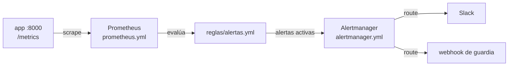

---
tags:
  - recursos
  - anatomia
  - observabilidad
  - gitops
---

# Anatomía de otros archivos de configuración

> Prometheus, reglas de alerta, Alertmanager, pre-commit, Dependabot, la `Application` de Argo CD, `.editorconfig` y `.gitignore`: qué significa cada línea de los archivos que acompañan a casi cualquier proyecto.

!!! info "Cómo leer esta nota"
    Cada línea de los ejemplos lleva su explicación a la derecha, después de `#`. Lo obligatorio está marcado con **[obligatorio]**. Los números en burbuja (`(1)`) abren una explicación más larga debajo del bloque. Todos los archivos son YAML salvo los dos últimos; repasa la [sintaxis de YAML](../sintaxis/yml.md) si dudas con la indentación o las comillas.

## Dónde vive y cómo se organiza

```text
lab-devops-app/
├── .github/
│   └── dependabot.yml                 # actualizaciones automáticas (solo esta ruta)
├── .pre-commit-config.yaml            # hooks de Git que se ejecutan antes de cada commit
├── .editorconfig                      # estilo básico para cualquier editor
├── .gitignore                         # lo que Git no debe versionar
├── observabilidad/
│   ├── prometheus/
│   │   ├── prometheus.yml             # qué se mide, cada cuánto y a quién se avisa
│   │   └── reglas/
│   │       └── alertas.yml            # recording rules y alerting rules
│   └── alertmanager/
│       └── alertmanager.yml           # a quién y cómo llegan las alertas
└── ...

lab-devops-app-config/                 # repo GitOps (separado del código)
├── argocd/
│   └── lab-devops-app-prod.yaml       # Application de Argo CD
└── overlays/prod/                     # manifiestos que Argo CD aplica
```

## Estructura general

| Archivo | Herramienta | Claves de nivel superior | Para qué |
| --- | --- | --- | --- |
| `prometheus.yml` | Prometheus | `global`, `rule_files`, `alerting`, `scrape_configs` | Recoger métricas y evaluar reglas |
| `reglas/*.yml` | Prometheus | `groups` → `rules` | Precalcular consultas y definir alertas |
| `alertmanager.yml` | Alertmanager | `global`, `route`, `receivers`, `inhibit_rules` | Agrupar, enrutar y silenciar alertas |
| `.pre-commit-config.yaml` | pre-commit | `repos` → `hooks` | Revisar cada commit en local |
| `.github/dependabot.yml` | Dependabot | `version`, `updates` | PRs de actualización de dependencias y actions |
| `Application` | Argo CD | `apiVersion`, `kind`, `metadata`, `spec` | Sincronizar un repo Git con un clúster |
| `.editorconfig` | Editores | Secciones `[patrón]` | Codificación, finales de línea, indentación |
| `.gitignore` | Git | Un patrón por línea | Excluir archivos del repositorio |



## `prometheus.yml` comentado

Coherente con el stack del [Lab 11 (observabilidad)](../../laboratorios/devops/observabilidad-prometheus-grafana.md), que reutiliza el [Lab 21 (game day)](../../laboratorios/operacion/game-day-incidente.md): la app expone métricas en `app:8000/metrics` y Prometheus corre en Docker Compose.

```yaml title="observabilidad/prometheus/prometheus.yml"
global:                                        # valores por defecto para todo el archivo
  scrape_interval: 15s                         # cada cuánto se leen los /metrics (por defecto 1m)
  scrape_timeout: 10s                          # tiempo máximo por scrape; ≤ scrape_interval
  evaluation_interval: 15s                     # cada cuánto se evalúan las reglas (por defecto 1m)
  external_labels:                             # se añaden al enviar alertas o hacer remote_write
    entorno: lab
    cluster: docker-local

rule_files:                                    # archivos de reglas; rutas relativas a este archivo
  - reglas/*.yml                               # admite comodines

alerting:                                      # a qué Alertmanager se envían las alertas
  alertmanagers:
    - static_configs:
        - targets: ["alertmanager:9093"]       # host:puerto (nombre del servicio en Compose)

scrape_configs:                                # [obligatorio en la práctica] qué se mide
  - job_name: prometheus                       # [obligatorio] único; se convierte en el label job
    static_configs:
      - targets: ["localhost:9090"]            # Prometheus también se mide a sí mismo

  - job_name: app
    scrape_interval: 5s                        # sobrescribe el valor global para este job
    metrics_path: /metrics                     # ruta del endpoint (este es el valor por defecto)
    scheme: http                               # http (por defecto) o https
    static_configs:                            # lista fija de objetivos
      - targets: ["app:8000"]
        labels:                                # labels extra en todas sus series
          servicio: lab-devops-app

  - job_name: node
    file_sd_configs:                           # (1)!
      - files: ["targets/node-*.json"]
        refresh_interval: 1m
    relabel_configs:                           # (2)!
      - source_labels: [__address__]
        regex: '([^:]+):\d+'
        target_label: host
        replacement: "$1"
```

1.  **Service discovery** basado en archivos: Prometheus vigila esos JSON (`[{"targets": ["10.0.1.5:9100"], "labels": {...}}]`) y añade o quita objetivos sin reiniciar. En la nube y en Kubernetes se usan los mecanismos nativos: `ec2_sd_configs`, `azure_sd_configs`, `gce_sd_configs` o `kubernetes_sd_configs` (en Kubernetes, lo habitual es que lo gestione el Prometheus Operator con `ServiceMonitor`).
2.  **Relabeling**: reescribe labels **antes** del scrape. Aquí copia la parte del host de `__address__` (`10.0.1.5:9100`) a un label nuevo `host`. Los labels que empiezan por `__` son internos y se descartan al guardar la serie. Con `action: drop`/`keep` también sirve para filtrar objetivos.

### Referencia de `prometheus.yml`

| Elemento | Obligatorio | Qué hace | Valores típicos |
| --- | --- | --- | --- |
| `global.scrape_interval` | No | Frecuencia de scrape por defecto | `15s`, `30s`, `1m` |
| `global.evaluation_interval` | No | Frecuencia de evaluación de reglas | Igual que el scrape |
| `global.external_labels` | No | Identifican este Prometheus ante sistemas externos | `entorno`, `cluster`, `region` |
| `rule_files` | No | Archivos de reglas | `reglas/*.yml` |
| `alerting.alertmanagers` | No | Destinos de las alertas | `alertmanager:9093` |
| `scrape_configs[].job_name` | Sí | Nombre del job (label `job`) | `app`, `node` |
| `static_configs[].targets` | Sí (o un `*_sd_configs`) | Objetivos `host:puerto` | `["app:8000"]` |
| `metrics_path` / `scheme` | No | Ruta y protocolo del endpoint | `/metrics`, `https` |
| `*_sd_configs` | No | Descubrimiento automático de objetivos | `file_sd_configs`, `kubernetes_sd_configs`, `ec2_sd_configs` |
| `relabel_configs` | No | Reescribir o filtrar objetivos antes del scrape | `action: keep` |
| `metric_relabel_configs` | No | Reescribir o descartar series después del scrape | Quitar labels de alta cardinalidad |

## Reglas de alerta de Prometheus comentadas

Mismas métricas que la app de los Labs 11 y 21 (`http_requests_total` con labels `path` y `status`, y el histograma de latencia). Para el criterio de qué merece una alerta, ver [Alertas accionables](../../devops/operacion/observabilidad.md#alertas-accionables).

```yaml title="observabilidad/prometheus/reglas/alertas.yml"
groups:                                        # [obligatorio] lista de grupos
  - name: lab-devops-app                       # [obligatorio] nombre único del grupo
    interval: 30s                              # opcional: sobrescribe evaluation_interval
    rules:                                     # [obligatorio] se evalúan en orden
      - record: path:http_requests:rate5m      # recording rule: guarda el resultado como serie nueva (1)
        expr: sum by (path) (rate(http_requests_total[5m]))

      - alert: AppCaida                        # alerting rule: nombre de la alerta (label alertname)
        expr: up{job="app"} == 0               # [obligatorio] PromQL; alerta por cada serie que devuelva
        for: 1m                                # debe cumplirse 1 min seguido antes de disparar
        labels:                                # labels añadidos a la alerta (Alertmanager enruta con ellos)
          severity: critical
        annotations:                           # texto para humanos; admite plantillas
          summary: "La app no responde al scrape de Prometheus"
          description: "{{ $labels.instance }} lleva más de 1 minuto sin responder."
          runbook_url: "https://wiki.ejemplo.com/runbooks/app-caida"

      - alert: TasaErrores5xxAlta
        expr: |                                # (2)!
          sum(rate(http_requests_total{status=~"5.."}[5m]))
            / sum(rate(http_requests_total[5m])) > 0.05
        for: 5m
        keep_firing_for: 5m                    # sigue activa 5 min tras recuperarse (evita alertas intermitentes)
        labels:
          severity: warning
        annotations:
          summary: "Más del 5 % de las peticiones responde 5xx ({{ $value | humanizePercentage }})"

      - alert: LatenciaP95Alta
        expr: |
          histogram_quantile(0.95,
            sum by (le) (rate(http_request_duration_seconds_bucket[5m]))) > 0.5
        for: 10m
        labels:
          severity: warning
        annotations:
          summary: "p95 por encima de 500 ms ({{ $value | humanizeDuration }})"
```

1.  Las **recording rules** precalculan consultas caras y guardan el resultado como una serie nueva, que los dashboards y otras reglas leen más rápido. La convención de nombre es `nivel:métrica:operaciones` (aquí: agregado por `path`, de `http_requests`, con `rate5m`).
2.  Con `|` la expresión puede ocupar varias líneas; no pongas comentarios `#` dentro del bloque porque formarían parte del PromQL. La alerta se dispara si la división (errores / total) supera 0,05. Los estados de una alerta son *inactive* → *pending* (se cumple, pero aún no pasó el `for`) → *firing* (se envía a Alertmanager).

| Elemento | Obligatorio | Qué hace | Ejemplo |
| --- | --- | --- | --- |
| `groups[].name` | Sí | Nombre del grupo; las reglas de un grupo se evalúan juntas y en orden | `lab-devops-app` |
| `record` | Sí (o `alert`) | Nombre de la serie nueva | `path:http_requests:rate5m` |
| `alert` | Sí (o `record`) | Nombre de la alerta | `AppCaida` |
| `expr` | Sí | Consulta PromQL | `up == 0` |
| `for` | No | Tiempo que debe cumplirse antes de disparar | `1m`, `5m` |
| `keep_firing_for` | No | Tiempo que sigue disparada tras dejar de cumplirse | `5m` |
| `labels` | No | Labels de la alerta; `severity` es la convención para enrutar | `critical`, `warning` |
| `annotations` | No | `summary`, `description`, `runbook_url`; plantillas con `$labels` y `$value` | `{{ $labels.instance }}` |

## `alertmanager.yml` comentado

Versión corta: un receptor por defecto para el equipo y otro para la guardia cuando la alerta es `critical`.

```yaml title="observabilidad/alertmanager/alertmanager.yml"
global:
  resolve_timeout: 5m                          # sin noticias de la alerta en 5 min → resuelta

route:                                         # [obligatorio] raíz del árbol de enrutado
  receiver: equipo-slack                       # [obligatorio] receptor por defecto
  group_by: [alertname, job]                   # alertas con estos labels iguales van en un solo aviso
  group_wait: 30s                              # espera inicial para juntar alertas del mismo grupo
  group_interval: 5m                           # cada cuánto se avisa de cambios en un grupo ya avisado
  repeat_interval: 4h                          # cada cuánto se repite un aviso que sigue activo
  routes:                                      # subrutas; la primera que coincide gana (salvo continue: true)
    - matchers:
        - severity = "critical"
      receiver: guardia
      repeat_interval: 1h

receivers:                                     # [obligatorio] destinos con nombre
  - name: equipo-slack
    slack_configs:
      - api_url_file: /etc/alertmanager/secretos/slack-webhook  # el webhook, leído de un archivo
        channel: "#alertas-lab"                # comillas: # sin comillas sería un comentario
        send_resolved: true                    # avisa también cuando se resuelve
  - name: guardia
    webhook_configs:
      - url: http://puente-guardia:8080/alertas  # p. ej. un puente hacia PagerDuty u Opsgenie
        send_resolved: true

inhibit_rules:                                 # silencia alertas que son consecuencia de otra
  - source_matchers: [alertname = "AppCaida"]  # si está activa esta…
    target_matchers: [severity = "warning"]    # …no avises de las warning…
    equal: [job]                               # …del mismo job
```

| Elemento | Obligatorio | Qué hace |
| --- | --- | --- |
| `route.receiver` | Sí | Receptor por defecto si ninguna subruta coincide |
| `route.group_by` / `group_wait` / `group_interval` / `repeat_interval` | No | Cómo se agrupan y repiten los avisos |
| `route.routes[].matchers` | No | Condiciones sobre los labels (`=`, `!=`, `=~`, `!~`) |
| `receivers[].name` | Sí | Nombre referenciado desde `route` |
| `*_configs` | No | Integraciones: `slack_configs`, `email_configs`, `webhook_configs`, `pagerduty_configs`, `msteamsv2_configs`… |
| `inhibit_rules` | No | Suprime alertas "hijas" mientras la causa está activa |

!!! tip "Secretos fuera del archivo"
    Usa las variantes `*_file` (`api_url_file`, `auth_password_file`, `routing_key_file`) y monta el secreto como archivo. Así `alertmanager.yml` puede ir a Git sin credenciales.

## `.pre-commit-config.yaml` comentado

**pre-commit** instala hooks de Git que revisan los archivos del commit en tu máquina antes de que lleguen al pipeline: es la primera línea del *shift-left*. Ver [Seguridad del código](../../devsecops/codigo-y-dependencias/seguridad-codigo.md).

```yaml title=".pre-commit-config.yaml"
default_install_hook_types: [pre-commit, pre-push]  # qué hooks instala pre-commit install
exclude: ^reports/                             # regex de rutas que ningún hook revisa

repos:                                         # [obligatorio] lista de repos de hooks
  - repo: https://github.com/pre-commit/pre-commit-hooks  # [obligatorio] URL del repo de hooks
    rev: v6.0.0                                # [obligatorio] tag o SHA; nunca una rama (1)
    hooks:                                     # [obligatorio] qué hooks de ese repo usar
      - id: trailing-whitespace                # [obligatorio] id del hook
      - id: end-of-file-fixer                  # todos los archivos acaban en salto de línea
      - id: check-yaml                         # YAML parseable
        args: [--allow-multiple-documents]     # admite archivos con varios documentos (---)
      - id: check-added-large-files
        args: [--maxkb=500]                    # bloquea archivos de más de 500 KB
      - id: detect-private-key                 # bloquea claves privadas

  - repo: https://github.com/astral-sh/ruff-pre-commit
    rev: v0.17.2
    hooks:
      - id: ruff-check                         # lint de Python…
        args: [--fix]                          # …corrigiendo lo que pueda
      - id: ruff-format                        # formateo de Python

  - repo: https://github.com/gitleaks/gitleaks
    rev: v8.30.1
    hooks:
      - id: gitleaks                           # secretos en lo que vas a commitear

  - repo: https://github.com/rhysd/actionlint
    rev: v1.7.12
    hooks:
      - id: actionlint                         # workflows de GitHub Actions

  - repo: local                                # hooks definidos aquí mismo
    hooks:
      - id: tests-rapidos
        name: tests rápidos                    # nombre en la salida
        entry: pytest -q -m "not integracion"  # comando que se ejecuta
        language: system                       # usa lo instalado en tu entorno
        pass_filenames: false                  # no le pasa la lista de archivos
        types: [python]                        # solo si el push incluye archivos .py
        stages: [pre-push]                     # al hacer git push, no en cada commit
```

1.  `rev` fija la versión del repo de hooks. `pre-commit autoupdate` la sube a la última; con `pre-commit autoupdate --freeze` escribe el SHA del commit y deja la versión en un comentario (`# frozen: v6.0.0`), el mismo criterio que fijar actions por SHA.

```bash
pre-commit install                  # instala los hooks de default_install_hook_types en .git/hooks
pre-commit run --all-files          # ejecuta todos los hooks sobre todo el repo (útil la primera vez y en CI)
pre-commit autoupdate               # actualiza los rev
```

## `.github/dependabot.yml` comentado

**Dependabot** abre PRs que actualizan dependencias, imágenes base y actions (incluido el SHA y su comentario de versión). Las alertas y PRs de seguridad se activan aparte, en *Settings → Code security*. Ver [Software supply chain](../../devsecops/codigo-y-dependencias/cadena-suministro.md).

```yaml title=".github/dependabot.yml"
version: 2                                     # [obligatorio] siempre 2
updates:                                       # [obligatorio] un bloque por ecosistema y carpeta
  - package-ecosystem: github-actions          # [obligatorio] actions de los workflows
    directories:                               # [obligatorio] directory (una) o directories (varias, con glob)
      - "/"                                    # "/" = .github/workflows y action.yml de la raíz
      - "/.github/actions/*"                   # composite actions propias
    schedule:                                  # [obligatorio] cuándo buscar versiones nuevas
      interval: weekly                         # daily | weekly | monthly | quarterly | semiannually | yearly | cron
      day: monday
      time: "06:00"
      timezone: America/Santiago               # zona IANA (por defecto UTC)
    groups:                                    # agrupa varias actualizaciones en un solo PR
      actions:
        patterns: ["*"]
    commit-message:
      prefix: ci                               # mensajes tipo "ci: bump actions/checkout…"
    labels: [dependencias, ci]

  - package-ecosystem: pip                     # requirements*.txt, pyproject.toml…
    directory: "/"
    schedule:
      interval: weekly
    cooldown:                                  # (1)!
      default-days: 7
    ignore:
      - dependency-name: fastapi
        update-types: ["version-update:semver-major"]  # las major de FastAPI, a mano
    open-pull-requests-limit: 5                # como mucho 5 PRs abiertos de este bloque

  - package-ecosystem: docker                  # FROM del Dockerfile
    directory: "/"
    schedule:
      interval: weekly
```

1.  `cooldown` hace que Dependabot espere unos días desde que se publica una versión antes de proponerla (por defecto ya aplica 3 días). Da tiempo a que se detecte una versión maliciosa o rota antes de que llegue a tu repo. No afecta a las actualizaciones de seguridad.

| Elemento | Obligatorio | Qué hace | Ejemplo |
| --- | --- | --- | --- |
| `version` | Sí | Versión del formato | `2` |
| `updates[].package-ecosystem` | Sí | Gestor de paquetes | `github-actions`, `pip`, `npm`, `docker`, `terraform`, `gomod` |
| `directory` / `directories` | Sí | Dónde están los manifiestos | `"/"`, `["/", "/infra/*"]` |
| `schedule.interval` | Sí | Frecuencia de revisión | `weekly` |
| `groups` | No | Varias actualizaciones en un PR | `patterns: ["*"]` |
| `ignore` | No | Dependencias o tipos de salto que no se proponen | `version-update:semver-major` |
| `cooldown` | No | Días de espera tras una publicación | `default-days: 7` |
| `open-pull-requests-limit` | No | Máximo de PRs abiertos (por defecto 5) | `10` |

## `Application` de Argo CD comentada

Una `Application` le dice a Argo CD **qué** (repo, rama, carpeta) debe estar desplegado **dónde** (clúster y namespace), y cómo sincronizarlo. Contexto en [Despliegue continuo: GitOps](../../devops/ci-cd/despliegue-continuo.md#gitops).

```yaml title="argocd/lab-devops-app-prod.yaml"
apiVersion: argoproj.io/v1alpha1               # [obligatorio] CRD de Argo CD
kind: Application                              # [obligatorio]
metadata:
  name: lab-devops-app-prod                    # [obligatorio] nombre en la UI de Argo CD
  namespace: argocd                            # donde está instalado Argo CD (no el de la app)
  finalizers:
    - resources-finalizer.argocd.argoproj.io   # al borrar la Application, borra también sus recursos
spec:
  project: default                             # [obligatorio] AppProject: limita repos y destinos permitidos
  source:                                      # [obligatorio] de dónde salen los manifiestos
    repoURL: https://github.com/mi-org/lab-devops-app-config.git
    targetRevision: main                       # rama, tag o SHA
    path: overlays/prod                        # carpeta (Kustomize, Helm o YAML plano, se detecta solo)
  destination:                                 # [obligatorio] a dónde se aplican
    server: https://kubernetes.default.svc     # el mismo clúster donde corre Argo CD
    namespace: lab-devops-app
  syncPolicy:
    automated:                                 # sincroniza solo, sin pulsar "Sync"
      prune: true                              # borra lo que ya no está en Git
      selfHeal: true                           # revierte cambios manuales en el clúster (drift)
    syncOptions:
      - CreateNamespace=true                   # crea el namespace si no existe
      - PruneLast=true                         # borra recursos al final, tras aplicar los nuevos
    retry:                                     # reintentos si la sincronización falla
      limit: 5
      backoff:
        duration: 10s                          # primer reintento a los 10 s…
        factor: 2                              # …luego 20 s, 40 s…
        maxDuration: 3m                        # …sin pasar de 3 min
  ignoreDifferences:                           # diferencias que no cuentan como drift
    - group: apps
      kind: Deployment
      jsonPointers:
        - /spec/replicas                       # las réplicas las cambia el HPA, no Git
  revisionHistoryLimit: 10                     # cuántas sincronizaciones guarda para rollback
```

| Elemento | Obligatorio | Qué hace |
| --- | --- | --- |
| `spec.project` | Sí | AppProject con los repos, clústeres y namespaces permitidos (`default` no limita nada: crea proyectos propios en producción) |
| `spec.source.repoURL` / `targetRevision` / `path` | Sí | Origen en Git; para un chart de Helm se usa `chart` y un bloque `helm:` |
| `spec.destination.server` o `name` | Sí | Clúster de destino |
| `spec.syncPolicy.automated` | No | Sincronización automática; `prune` y `selfHeal` |
| `spec.syncPolicy.syncOptions` | No | Opciones como `CreateNamespace=true`, `ServerSideApply=true` |
| `spec.ignoreDifferences` | No | Campos que gestionan otros controladores |

## `.editorconfig` y `.gitignore`

En estos dos formatos los comentarios **van en su propia línea**: en `.gitignore` un `#` a mitad de línea forma parte del patrón, y EditorConfig no admite comentarios al final de una línea.

```ini title=".editorconfig"
# Este es el archivo raíz: no busques otros .editorconfig en carpetas superiores
root = true

# Reglas para todos los archivos
[*]
charset = utf-8
end_of_line = lf
indent_style = space
indent_size = 4
insert_final_newline = true
trim_trailing_whitespace = true

# YAML, JSON y Terraform: 2 espacios
[*.{yml,yaml,json,tf}]
indent_size = 2

# Make exige tabuladores
[Makefile]
indent_style = tab

# En Markdown, dos espacios al final son un salto de línea
[*.md]
trim_trailing_whitespace = false
```

```text title=".gitignore"
# Python
__pycache__/
*.py[cod]
.venv/

# Herramientas y reportes generados por el pipeline
.pytest_cache/
.ruff_cache/
reports/

# Terraform: el state nunca va al repo (puede contener secretos)
.terraform/
*.tfstate
*.tfstate.*

# Secretos locales; la plantilla sí se versiona
.env
*.pem
!.env.example
```

| Patrón de `.gitignore` | Significado |
| --- | --- |
| `reports/` | La carpeta `reports` en cualquier nivel (la `/` final indica que es carpeta) |
| `/build` | Solo `build` en la raíz del repo |
| `*.tfstate` | Cualquier archivo con esa extensión |
| `**/logs` | `logs` en cualquier profundidad |
| `!.env.example` | Excepción: sí se versiona aunque coincida con un patrón anterior |

!!! warning "`.gitignore` no borra lo que ya está en el repo"
    Si un archivo ya se commiteó, añadirlo a `.gitignore` no lo quita. Usa `git rm --cached archivo` y, si era un secreto, **rótalo**: sigue en el historial. Ver [Comandos de Git](../comandos/git.md).

## Errores comunes

| Archivo | Síntoma o mensaje | Causa | Corrección |
| --- | --- | --- | --- |
| `prometheus.yml` | `field scrape_intervall not found in type config.plain` | Clave mal escrita | Corrige el nombre; `promtool check config` lo detecta |
| `prometheus.yml` | `scrape timeout greater than scrape interval` | `scrape_timeout` > `scrape_interval` | Bájalo o sube el intervalo |
| Reglas | `could not parse expression` | PromQL inválido (paréntesis, comillas) | Prueba la consulta en la UI de Prometheus antes |
| Reglas | La alerta nunca pasa de *pending* | `for` más largo que la duración del problema | Ajusta `for` al tiempo que de verdad importa |
| `alertmanager.yml` | `undefined receiver "guardia" used in route` | El nombre de `route` no existe en `receivers` | Usa exactamente el mismo nombre |
| Cualquier YAML | `channel: #alertas` llega vacío | `#` sin comillas empieza un comentario | Encomilla: `"#alertas"` |
| `.pre-commit-config.yaml` | `InvalidManifestError` / hook no encontrado | `id` que no existe en esa versión del repo | Revisa el `.pre-commit-hooks.yaml` del repo en ese `rev` |
| `dependabot.yml` | Error en la pestaña *Insights → Dependency graph → Dependabot* | Clave o ecosistema inválido | GitHub valida el archivo al hacer push y muestra el error |
| `Application` | `OutOfSync` permanente en `replicas` | Un HPA cambia el campo que Git define | `ignoreDifferences` o no declarar `replicas` en Git |

## Validar el archivo

```bash
# Prometheus: configuración (incluye los rule_files) y reglas por separado
promtool check config observabilidad/prometheus/prometheus.yml
promtool check rules observabilidad/prometheus/reglas/alertas.yml

# Alertmanager
amtool check-config observabilidad/alertmanager/alertmanager.yml

# pre-commit: valida la configuración y ejecuta todo
pre-commit validate-config
pre-commit run --all-files

# Cualquier YAML (sintaxis y estilo)
yamllint .github/dependabot.yml argocd/

# Argo CD: ver qué cambiaría antes de sincronizar
argocd app diff lab-devops-app-prod
```

- `promtool` y `amtool` vienen en los paquetes de Prometheus y Alertmanager (también dentro de sus imágenes de Docker: `docker run --rm --entrypoint promtool -v ...`).
- `promtool test rules` permite escribir **tests unitarios** de las alertas con series simuladas.
- `dependabot.yml` no tiene validador local oficial: GitHub lo valida al hacer push.

## Para practicar

- [Lab 11: Observabilidad con Prometheus y Grafana](../../laboratorios/devops/observabilidad-prometheus-grafana.md): `prometheus.yml`, recording y alerting rules (probadas con `promtool`), Alertmanager y Grafana en Docker Compose, con las mismas métricas y alertas de esta página.
- [Lab 21: Game day de un incidente](../../laboratorios/operacion/game-day-incidente.md): reutiliza el stack del Lab 11 para inyectar fallos, ver saltar estas alertas y escribir el postmortem.
- [Lab 07: Pipeline de CI con GitHub Actions](../../laboratorios/devops/github-actions-ci.md): el reto extra 1 crea el `dependabot.yml`.
- Teoría: [Observabilidad](../../devops/operacion/observabilidad.md), [Despliegue continuo y GitOps](../../devops/ci-cd/despliegue-continuo.md), [Seguridad del código](../../devsecops/codigo-y-dependencias/seguridad-codigo.md) y [Software supply chain](../../devsecops/codigo-y-dependencias/cadena-suministro.md).
- Anatomía de los pipelines: [GitHub Actions](github-actions.md) y [GitLab CI](gitlab-ci.md).

!!! example "Practica en el laboratorio"
    - [Lab 21: Game day: incidente simulado
    - troubleshooting y postmortem](../../laboratorios/operacion/game-day-incidente.md)

## Referencias

- [Prometheus: configuration](https://prometheus.io/docs/prometheus/latest/configuration/configuration/)
- [Prometheus: alerting rules](https://prometheus.io/docs/prometheus/latest/configuration/alerting_rules/) y [recording rules](https://prometheus.io/docs/prometheus/latest/configuration/recording_rules/)
- [Alertmanager: configuration](https://prometheus.io/docs/alerting/latest/configuration/)
- [pre-commit](https://pre-commit.com/)
- [Referencia de opciones de Dependabot](https://docs.github.com/es/code-security/reference/supply-chain-security/dependabot-options-reference)
- [Argo CD: declarative setup (`Application`)](https://argo-cd.readthedocs.io/en/stable/operator-manual/declarative-setup/)
- [EditorConfig](https://editorconfig.org/)
- [Git: gitignore](https://git-scm.com/docs/gitignore)
