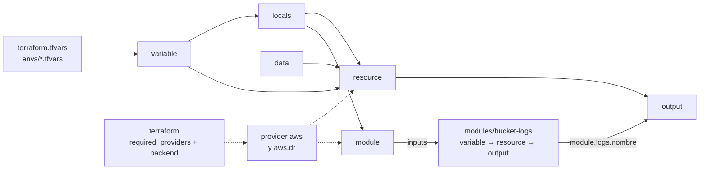

---
tags:
  - recursos
  - anatomia
  - terraform
  - iac
---

# Anatomía de los archivos de Terraform

> Qué significa cada línea de un proyecto de Terraform en HCL: `versions.tf`, `providers.tf`, `variables.tf`, `main.tf`, `outputs.tf`, un módulo hijo, los `.tfvars`, el lock file y la carpeta `.terraform/`.

!!! info "Cómo leer esta nota"
    Cada línea de los ejemplos lleva su explicación a la derecha, después de `#`. Lo obligatorio está marcado con **[obligatorio]**. Cuando una explicación es larga, verás un número en el código: haz clic en él para leerla. Los comentarios no están en una sola columna porque `terraform fmt` los alinea por grupos de líneas, y los ejemplos están tal cual los deja `fmt`. La teoría (state, backends, workflow) está en [Infrastructure as Code con Terraform](../../devops/iac/terraform-basico.md).

Todos los ejemplos forman **un mismo proyecto** que despliega en AWS la API `lab-devops-app` (FastAPI en el puerto 8000): una VPC con un módulo del registry, un Security group, instancias EC2, un parámetro cifrado en SSM, un bucket de logs con un módulo propio y un bucket de respaldo en otra región. Usa el provider `hashicorp/aws` v6.

La sintaxis del lenguaje (bloques, argumentos, expresiones y referencias) está en [HCL](../sintaxis/hcl.md).

## Dónde vive y cómo se organiza

Terraform lee **todos** los `.tf` de la carpeta donde lo ejecutas (en orden alfabético, pero el orden no importa: él calcula las dependencias). Esa carpeta es el **root module** (módulo raíz). Los nombres de archivo son convención:

```text
lab-devops-infra/
├── versions.tf             # bloque terraform: versiones, providers requeridos y backend
├── providers.tf            # configuración de cada provider (región, tags, alias)
├── variables.tf            # declaración de las variables de entrada
├── main.tf                 # data sources, locals, recursos y llamadas a módulos
├── outputs.tf              # valores que expone el proyecto
├── terraform.tfvars        # valores comunes de las variables (se carga solo)
├── envs/                   # lo que cambia por entorno
│   ├── dev.tfvars          # valores de dev:  -var-file=envs/dev.tfvars
│   ├── prod.tfvars         # valores de prod: -var-file=envs/prod.tfvars
│   ├── dev.s3.tfbackend    # key del state de dev:  -backend-config=envs/dev.s3.tfbackend
│   └── prod.s3.tfbackend   # key del state de prod
├── modules/                # módulos propios (child modules)
│   └── bucket-logs/
│       ├── variables.tf    # inputs del módulo
│       ├── main.tf         # recursos del módulo
│       └── outputs.tf      # outputs del módulo
├── .terraform.lock.hcl     # versiones exactas de los providers: SÍ va a Git
├── .terraform/             # caché local de providers y módulos: NO va a Git
└── .gitignore              # excluye .terraform/, *.tfstate, *.tfplan…
```

- Una carpeta = un root module = **un state**. Aquí cada entorno tiene su propio state (la `key` cambia en cada `.tfbackend`) aunque el código sea el mismo.
- Alternativa frecuente: una carpeta por entorno (`envs/dev/main.tf`, `envs/prod/main.tf`), cada una un root module pequeño que llama a los módulos de `modules/`. Aísla más los entornos, a costa de repetir algo de código. Otra opción son los [Terraform workspaces](../../devops/iac/terraform-workspaces.md).
- El `.gitignore` recomendado está en [Qué subir a Git](../../devops/iac/terraform-basico.md#que-subir-a-git).

## Estructura general

Cómo se conectan los bloques del root module con el módulo hijo:



| Bloque | Etiquetas | Para qué |
| --- | --- | --- |
| `terraform { }` | 0 | Versión de Terraform, providers requeridos, backend |
| `provider "<nombre>" { }` | 1 | Configurar un provider (región, credenciales, tags) |
| `variable "<nombre>" { }` | 1 | Declarar una entrada |
| `locals { }` | 0 | Valores calculados internos |
| `data "<tipo>" "<nombre>" { }` | 2 | Leer algo que ya existe |
| `resource "<tipo>" "<nombre>" { }` | 2 | Crear y gestionar un objeto |
| `module "<nombre>" { }` | 1 | Usar un módulo |
| `output "<nombre>" { }` | 1 | Exponer un valor |
| `import`, `moved`, `removed`, `check` | 0 | Importar, renombrar o dejar de gestionar recursos; comprobaciones (ver [terraform-basico](../../devops/iac/terraform-basico.md#import-importar-recursos-existentes)) |

## versions.tf comentado línea por línea

```hcl title="versions.tf"
terraform {                           # bloque de configuración de Terraform [obligatorio en la práctica]
  required_version = ">= 1.10, < 2.0" # versiones del binario terraform aceptadas

  required_providers {          # providers que usa este root module
    aws = {                     # nombre local del provider (el que usas en provider "aws")
      source  = "hashicorp/aws" # dirección en el registry: <namespace>/<tipo>
      version = "~> 6.0"        # >= 6.0 y < 7.0: acepta minors, no la siguiente major
    }
  }

  backend "s3" {                                     # dónde se guarda el state (solo uno por root module)
    bucket       = "lab-devops-tfstate-123456789012" # bucket que ya existe (se crea aparte)
    region       = "us-east-1"                       # región del bucket (no puede usar var.region)
    encrypt      = true                              # cifrado del objeto en S3
    use_lockfile = true                              # locking nativo con un .tflock en S3 (>= 1.10)
    # key no va aquí (partial configuration): llega con -backend-config=envs/<entorno>.s3.tfbackend
  }
}
```

Uso con el backend parcial (*partial configuration*):

```bash
terraform init -backend-config=envs/dev.s3.tfbackend     # dev
terraform init -reconfigure -backend-config=envs/prod.s3.tfbackend  # cambiar a prod
```

```hcl title="envs/dev.s3.tfbackend"
key = "lab-devops-app/dev/terraform.tfstate"
```

### Referencia de elementos del bloque terraform

| Elemento | Obligatorio | Qué hace | Valores típicos / ejemplo |
| --- | --- | --- | --- |
| `required_version` | No (muy recomendable) | Falla si el binario no cumple la restricción | `">= 1.10, < 2.0"`, `"~> 1.14"` |
| `required_providers` | Sí, si usas providers | Origen y versión de cada provider | `aws = { source = "hashicorp/aws", version = "~> 6.0" }` |
| `source` | Sí | `<host>/<namespace>/<tipo>`; el host por defecto es `registry.terraform.io` | `hashicorp/aws`, `hashicorp/azurerm`, `hashicorp/google` |
| `version` | No (fíjala siempre) | Restricción de versiones | `"~> 6.0"` (>= 6.0, < 7.0), `"~> 6.70.0"` (>= 6.70.0, < 6.71.0), `">= 6.0"` |
| `backend "<tipo>"` | No (por defecto `local`) | Dónde se guarda el state. **No admite variables ni locals** | `s3`, `azurerm`, `gcs`, `remote`; o bloque `cloud` para HCP Terraform |
| `use_lockfile` | No | Locking del state con un objeto `.tflock` en el bucket (sustituye a la tabla DynamoDB, ya deprecated) | `true` |
| `encrypt` | No | Cifrado del state en S3 (S3 ya cifra por defecto con SSE-S3; con `kms_key_id` usa tu llave KMS) | `true` |

!!! tip "Operador `~>` (pessimistic constraint)"
    `~>` solo deja crecer el **último** número que escribes: `~> 6.0` acepta 6.1, 6.70… pero no 7.0; `~> 6.70.0` acepta 6.70.1, pero no 6.71. En el root module fija con `~>`; en un módulo reutilizable usa un mínimo (`>= 6.0`) para no chocar con quien lo use.

## providers.tf comentado línea por línea

```hcl title="providers.tf"
provider "aws" {      # configuración por defecto del provider aws
  region = var.region # aquí sí se pueden usar variables

  default_tags { # tags que el provider añade a todos los recursos
    tags = {
      Proyecto  = "lab-devops-app"
      Entorno   = var.entorno
      ManagedBy = "terraform"
    }
  }
}

provider "aws" {       # segunda configuración del mismo provider
  alias  = "dr"        # nombre para elegirla: provider = aws.dr
  region = "us-west-2" # otra región (disaster recovery)

  default_tags { # default_tags no se hereda: se repite en cada alias
    tags = {
      Proyecto  = "lab-devops-app"
      Entorno   = var.entorno
      ManagedBy = "terraform"
    }
  }
}
```

Ni la región del backend ni las credenciales van aquí: el provider las toma de la cadena estándar de AWS (variables `AWS_*`, perfil de `~/.aws/config`, rol de la instancia u **OIDC** desde el pipeline). Ver [Secretos e identidades](../../devsecops/identidades-y-pipeline/secretos-identidades.md).

### Referencia de elementos del bloque provider

| Elemento | Obligatorio | Qué hace | Valores típicos / ejemplo |
| --- | --- | --- | --- |
| Etiqueta `"aws"` | Sí | Nombre local del provider (el de `required_providers`) | `"aws"`, `"azurerm"`, `"google"` |
| `region` | Sí para AWS (aquí o en el entorno) | Región por defecto de los recursos | `var.region`, `"us-east-1"` |
| `alias` | No | Crea una configuración adicional; los recursos la eligen con `provider = aws.<alias>` | `"dr"`, `"us_east_1"` |
| `default_tags { tags = {…} }` | No | Tags que se añaden a todos los recursos del provider que admiten tags | `Proyecto`, `Entorno`, `ManagedBy` |
| `assume_role { role_arn = … }` | No | Trabajar en otra cuenta asumiendo un rol | `"arn:aws:iam::111122223333:role/terraform"` |

Para pasar un provider con alias a un módulo se usa el meta-argumento `providers = { aws = aws.dr }` en el bloque `module`.

## variables.tf comentado línea por línea

```hcl title="variables.tf"
variable "region" {                       # declara la variable var.region
  description = "Región principal de AWS" # texto de ayuda (sale en errores y en la doc)
  type        = string                    # tipo esperado: string, number, bool, list, map, object…
  default     = "us-east-1"               # con default la variable es opcional
}

variable "entorno" { # sin default: es obligatoria (tfvars, -var o TF_VAR_)
  description = "Entorno: dev, staging o prod"
  type        = string

  validation {                                                        # regla propia; puede haber varias
    condition     = contains(["dev", "staging", "prod"], var.entorno) # debe dar true
    error_message = "entorno debe ser dev, staging o prod."           # mensaje si da false
  }
}

variable "vpc_cidr" {
  description = "Rango de IPs de la VPC"
  type        = string
  default     = "10.20.0.0/16"

  validation {
    condition     = can(cidrhost(var.vpc_cidr, 0)) # can() da false si la expresión falla
    error_message = "vpc_cidr debe ser un CIDR válido, p. ej. 10.20.0.0/16."
  }
}

variable "api" { # un objeto agrupa parámetros relacionados
  description = "Configuración de las instancias de la API"
  type = object({                                   # estructura con atributos y tipos fijos
    instancias       = number                       # atributo obligatorio dentro del objeto
    tipo             = optional(string, "t3.micro") # opcional con valor por defecto
    puerto           = optional(number, 8000)       # puerto de la app (FastAPI)
    cidrs_permitidos = optional(list(string), [])   # quién puede entrar al puerto
  })
  default = {
    instancias = 1 # el resto toma los defaults de optional()
  }
}

variable "etiquetas_extra" {
  description = "Tags adicionales para los recursos"
  type        = map(string) # mapa clave => valor, todos string
  default     = {}
  nullable    = false # si llega null, usa el default en vez de null
}

variable "token_alertas" {
  description = "Token del webhook de alertas"
  type        = string
  sensitive   = true # se oculta en plan/apply (pero queda en el state)
}
```

### Referencia de argumentos de variable

| Argumento | Obligatorio | Qué hace | Valores típicos / ejemplo |
| --- | --- | --- | --- |
| `type` | No (muy recomendable) | Restricción de tipo; Terraform convierte o rechaza el valor | `string`, `number`, `bool`, `list(string)`, `set(string)`, `map(number)`, `object({…})`, `tuple([…])`, `any` |
| `default` | No | Valor por defecto. **Sin `default`, la variable es obligatoria** | `"us-east-1"`, `{}`, `[]` |
| `description` | No (recomendable) | Documentación; la usan `terraform-docs` y los mensajes de error | Texto libre |
| `validation { condition, error_message }` | No | Regla que debe cumplirse; puede haber varias | `contains([...], var.x)`, `can(regex(...))`, `length(var.x) <= 63` |
| `sensitive` | No | Oculta el valor en la salida de la CLI (no en el state) | `true` |
| `nullable` | No (por defecto `true`) | Con `false`, un `null` explícito se convierte en el `default` | `false` |
| `ephemeral` | No | El valor no se guarda en el state ni en el plan (Terraform >= 1.10; solo se puede usar en sitios que lo admiten) | `true` |
| `optional(<tipo>, <default>)` | Dentro de `object()` | Atributo que se puede omitir; con segundo argumento, su valor por defecto | `optional(number, 8000)` |

!!! warning "sensitive no es cifrado"
    `sensitive = true` solo evita que el valor salga por pantalla. Se guarda **en texto plano en el state**, por eso el state se protege (cifrado, acceso restringido) y por eso `token_alertas` no se escribe en ningún `.tfvars` del repo.

## main.tf comentado línea por línea

```hcl title="main.tf"
# ---------- Data sources: leen cosas que ya existen ----------
data "aws_caller_identity" "actual" {} # cuenta y ARN de quien ejecuta; sin argumentos

data "aws_availability_zones" "disponibles" {
  state = "available" # filtra las AZs operativas de la región
}

data "aws_ami" "al2023" {  # busca una imagen; se lee como data.aws_ami.al2023.id
  most_recent = true       # si hay varias coincidencias, la más nueva
  owners      = ["amazon"] # solo AMIs publicadas por Amazon

  filter { # bloque anidado; se puede repetir
    name   = "name"
    values = ["al2023-ami-2023.*-x86_64"] # Amazon Linux 2023, x86_64
  }
}

# ---------- Locals: valores calculados que se reutilizan ----------
locals {
  nombre  = "lab-api-${var.entorno}"                                   # interpolación: inserta el valor en el string
  es_prod = var.entorno == "prod"                                      # expresión booleana
  azs     = slice(data.aws_availability_zones.disponibles.names, 0, 2) # primeras 2 AZs

  tags_comunes = merge(var.etiquetas_extra, { # merge(): une mapas (el último gana)
    Servicio = "api"
  })
}

# ---------- Módulo del registry ----------
module "vpc" {                              # llamada a un módulo; se lee como module.vpc.<output>
  source  = "terraform-aws-modules/vpc/aws" # origen: registry, ruta local o Git [obligatorio]
  version = "~> 6.0"                        # solo para módulos del registry; fíjala siempre

  name               = local.nombre # a partir de aquí: inputs (variables del módulo)
  enable_nat_gateway = false        # sin NAT Gateway (ahorra costos en el lab)
  cidr               = var.vpc_cidr
  azs                = local.azs
  public_subnets     = [for i, az in local.azs : cidrsubnet(var.vpc_cidr, 8, i + 1)] # (1)!
  tags               = local.tags_comunes
}

# ---------- Security group y reglas ----------
resource "aws_security_group" "api" { # resource "<tipo>" "<nombre local>"
  name        = "${local.nombre}-sg"  # argumento: lo escribes tú
  description = "Acceso a la API ${local.nombre}"
  vpc_id      = module.vpc.vpc_id # referencia a un output del módulo
  tags        = local.tags_comunes
}

resource "aws_vpc_security_group_ingress_rule" "api" {
  for_each = toset(var.api.cidrs_permitidos) # una instancia por elemento: api["203.0.113.0/24"]

  security_group_id = aws_security_group.api.id # tipo.nombre.atributo: crea dependencia implícita
  cidr_ipv4         = each.value                # each.key / each.value: elemento actual
  from_port         = var.api.puerto
  to_port           = var.api.puerto
  ip_protocol       = "tcp"
  description       = "API desde ${each.key}"
}

resource "aws_vpc_security_group_egress_rule" "todo" {
  security_group_id = aws_security_group.api.id
  cidr_ipv4         = "0.0.0.0/0" # salida a Internet (actualizaciones, imágenes)
  ip_protocol       = "-1"        # "-1" = todos los protocolos
}

# ---------- Secreto en SSM Parameter Store ----------
resource "aws_ssm_parameter" "token_alertas" {
  name  = "/${local.nombre}/token-alertas"
  type  = "SecureString"    # cifrado con KMS
  value = var.token_alertas # variable sensitive: el valor se oculta en el plan
}

# ---------- Instancias de la API ----------
resource "aws_instance" "api" {
  count = var.api.instancias # N copias: aws_instance.api[0], api[1]…

  ami                    = data.aws_ami.al2023.id
  instance_type          = var.api.tipo
  subnet_id              = module.vpc.public_subnets[count.index % length(module.vpc.public_subnets)] # (2)!
  vpc_security_group_ids = [aws_security_group.api.id]

  user_data = <<-EOT
    #!/bin/bash
    echo "ENTORNO=${var.entorno}" >> /etc/environment
  EOT

  metadata_options {         # bloque anidado del recurso
    http_tokens = "required" # obliga a usar IMDSv2
  }

  tags = merge(local.tags_comunes, {
    Name = "${local.nombre}-${count.index + 1}" # count.index empieza en 0
  })

  depends_on = [aws_ssm_parameter.token_alertas] # (3)!

  lifecycle {                     # cambia cómo Terraform crea/borra el recurso
    create_before_destroy = true  # al reemplazar: primero crea la nueva
    ignore_changes        = [ami] # no recrea la instancia cuando sale una AMI nueva
  }
}

# ---------- Módulo propio (local) ----------
module "logs" {
  source = "./modules/bucket-logs" # ruta local: sin version

  nombre = "${local.nombre}-logs-${data.aws_caller_identity.actual.account_id}"
  reglas_expiracion = {                   # prefijo => días hasta borrar
    "app/"     = local.es_prod ? 365 : 30 # condicional: cond ? si_true : si_false
    "accesos/" = 90
  }
}

# ---------- Recurso en otra región con el provider alias ----------
resource "aws_s3_bucket" "respaldo" {
  provider = aws.dr # usa la configuración con alias "dr"
  bucket   = "${local.nombre}-respaldo-${data.aws_caller_identity.actual.account_id}"

  lifecycle {
    prevent_destroy = true # cualquier plan que lo destruya da error
  }
}
```

1.  **For expression** sobre una lista con índice: `i` es la posición (0, 1) y `az` el elemento. `cidrsubnet("10.20.0.0/16", 8, 1)` suma 8 bits a la máscara y toma la subred número 1: `10.20.1.0/24`; con `i + 1 = 2`, `10.20.2.0/24`. Ver [Direccionamiento IP](../../networking/basico/direccionamiento-ip.md).
2.  Reparte las instancias entre las subredes: con 2 subredes, `count.index % 2` vale 0, 1, 0, 1… Así la instancia 0 va a la primera AZ, la 1 a la segunda, la 2 otra vez a la primera.
3.  **Dependencia explícita**: la instancia no referencia al parámetro en ningún argumento, pero la app lo lee al arrancar. Sin `depends_on`, Terraform podría crear la instancia antes que el parámetro. Úsalo solo para dependencias "ocultas" como esta; si puedes referenciar un atributo, la dependencia implícita es mejor.

!!! note "Dentro de un heredoc no hay comentarios"
    Todo lo que hay entre `<<-EOT` y `EOT` es texto que se envía tal cual (aquí, el script de `user_data`). Un `#` dentro es parte del script, no un comentario de HCL. La interpolación `${…}` sí funciona; si necesitas un `${` literal, escríbelo `$${`.

### Referencia de meta-argumentos

Los **meta-arguments** (meta-argumentos) funcionan en cualquier `resource` (y varios en `data` y `module`), porque los interpreta Terraform, no el provider:

| Meta-argumento | Qué hace | Ejemplo |
| --- | --- | --- |
| `count` | Crea N copias; dirección `tipo.nombre[índice]` | `count = var.api.instancias`; `count = local.es_prod ? 1 : 0` para crear o no |
| `for_each` | Una copia por elemento de un **map** o **set de strings**; dirección `tipo.nombre["clave"]` | `for_each = toset(var.cidrs)` |
| `depends_on` | Dependencias explícitas (lista de referencias, sin atributos) | `depends_on = [aws_ssm_parameter.token_alertas]` |
| `provider` | Elige una configuración con alias | `provider = aws.dr` |
| `providers` (en `module`) | Pasa providers con alias al módulo | `providers = { aws = aws.dr }` |
| `lifecycle` | Cambia el ciclo de vida del recurso | Ver tabla siguiente |

!!! tip "count o for_each"
    Con `count`, si borras un elemento del medio de la lista, todas las copias siguientes cambian de índice y Terraform las recrea. Con `for_each` cada copia tiene una clave estable. Usa `count` para "N copias iguales" o "0/1"; usa `for_each` para colecciones de cosas distintas.

| Dentro de `lifecycle` | Qué hace |
| --- | --- |
| `create_before_destroy = true` | En un reemplazo, crea la copia nueva antes de borrar la vieja (menos corte) |
| `prevent_destroy = true` | Falla cualquier plan que destruya el recurso (debe ser un valor literal, no una variable) |
| `ignore_changes = [atributo, …]` | No intenta corregir cambios en esos atributos (`all` para todos) |
| `replace_triggered_by = [referencia]` | Reemplaza el recurso cuando cambia otro |
| `precondition { }` / `postcondition { }` | Comprobaciones con `condition` y `error_message` antes / después de crear |

### Referencia de bloques de main.tf

| Bloque | Obligatorio | Qué hace | Ejemplo |
| --- | --- | --- | --- |
| `data "<tipo>" "<nombre>"` | No | Lee datos en cada `plan`; no crea nada | `data.aws_ami.al2023.id` |
| `locals { }` | No | Define valores intermedios; puede haber varios bloques `locals` | `local.nombre` |
| `resource "<tipo>" "<nombre>"` | Sí (para crear algo) | Objeto gestionado; el `<tipo>` empieza por el nombre del provider (`aws_…`) | `aws_instance.api` |
| `module "<nombre>"` | No | Llama a un módulo; `source` es obligatorio, `version` solo para registry | `module.vpc.vpc_id` |
| `dynamic "<bloque>"` | No | Genera bloques anidados repetidos (ver el módulo hijo) | `dynamic "rule" { for_each = … content { … } }` |

## outputs.tf comentado línea por línea

```hcl title="outputs.tf"
output "vpc_id" { # se ve con: terraform output vpc_id
  description = "ID de la VPC"
  value       = module.vpc.vpc_id # [obligatorio] el valor a exponer
}

output "api_ips_publicas" {
  description = "IPs públicas de las instancias de la API"
  value       = aws_instance.api[*].public_ip # splat [*]: lista con el atributo de cada copia
}

output "api_urls" {
  description = "URL de cada instancia"
  value       = [for ip in aws_instance.api[*].public_ip : "http://${ip}:${var.api.puerto}"]
}

output "bucket_logs" {
  description = "Nombre del bucket de logs (output del módulo hijo)"
  value       = module.logs.nombre
}

output "parametro_token" {
  description = "Ruta del parámetro con el token"
  value       = aws_ssm_parameter.token_alertas.name
  sensitive   = false # true lo oculta en la CLI (no en el state)
}
```

| Argumento | Obligatorio | Qué hace |
| --- | --- | --- |
| `value` | Sí | La expresión que se expone |
| `description` | No | Documentación del output |
| `sensitive` | No | Lo muestra como `(sensitive value)` en la CLI; `terraform output -json` sí lo muestra |
| `depends_on` | No | Rara vez hace falta |

Los outputs del root module se leen con `terraform output` (o `terraform output -json` para scripts); los de un módulo hijo solo los ve el módulo que lo llama, como `module.logs.nombre`.

## Módulo hijo comentado

Un **child module** (módulo hijo) es una carpeta con la misma estructura de archivos. No tiene `provider` ni `backend` propios: usa los providers del root y su state se guarda dentro del state del root (con direcciones como `module.logs.aws_s3_bucket.este`).

=== "variables.tf"

    ```hcl title="modules/bucket-logs/variables.tf"
    variable "nombre" { # input del módulo: lo pasa quien lo llama
      description = "Nombre único del bucket"
      type        = string
    }

    variable "reglas_expiracion" {
      description = "Prefijo => días hasta borrar los objetos"
      type        = map(number)
      default     = {}
    }
    ```

=== "main.tf"

    ```hcl title="modules/bucket-logs/main.tf"
    terraform {
      required_providers { # el módulo declara qué provider necesita…
        aws = {
          source  = "hashicorp/aws"
          version = ">= 6.0" # …con un rango amplio; el root fija la versión
        }
      }
    }

    resource "aws_s3_bucket" "este" { # usa el provider que le pasa el root
      bucket = var.nombre
    }

    resource "aws_s3_bucket_public_access_block" "este" {
      bucket = aws_s3_bucket.este.id

      block_public_acls       = true
      block_public_policy     = true
      ignore_public_acls      = true
      restrict_public_buckets = true
    }

    resource "aws_s3_bucket_lifecycle_configuration" "este" {
      count  = length(var.reglas_expiracion) > 0 ? 1 : 0 # count 0/1: crear o no el recurso
      bucket = aws_s3_bucket.este.id

      dynamic "rule" {                                    # genera un bloque rule {} por elemento
        for_each = var.reglas_expiracion                  # mapa: prefijo => días
        content {                                         # plantilla de cada bloque generado
          id     = "expirar-${trimsuffix(rule.key, "/")}" # rule.key / rule.value: elemento actual
          status = "Enabled"

          filter {
            prefix = rule.key
          }

          expiration {
            days = rule.value
          }
        }
      }
    }
    ```

=== "outputs.tf"

    ```hcl title="modules/bucket-logs/outputs.tf"
    output "nombre" { # el root lo lee como module.logs.nombre
      description = "Nombre del bucket"
      value       = aws_s3_bucket.este.bucket
    }

    output "arn" {
      description = "ARN del bucket"
      value       = aws_s3_bucket.este.arn
    }
    ```

Cómo funciona el `dynamic "rule"` con lo que pasa el root (`{ "app/" = 30, "accesos/" = 90 }`):

| Iteración | `rule.key` | `rule.value` | Bloque generado |
| --- | --- | --- | --- |
| 1 | `"accesos/"` | `90` | `rule { id = "expirar-accesos" … days = 90 }` |
| 2 | `"app/"` | `30` | `rule { id = "expirar-app" … days = 30 }` |

Dentro de `content`, el iterador se llama como el bloque (`rule`); puedes cambiarlo con `iterator = r`. Los mapas se recorren en orden alfabético de clave. No abuses de `dynamic`: si siempre hay los mismos bloques, escríbelos tal cual, que se leen mejor.

## terraform.tfvars y archivos de entorno

Un `.tfvars` solo contiene **asignaciones** `nombre = valor` a variables ya declaradas (ni bloques ni referencias a otras variables):

```hcl title="terraform.tfvars"
# Valores comunes a todos los entornos; se carga automáticamente
region = "us-east-1" # string

etiquetas_extra = { # mapa
  Equipo     = "plataforma"
  CostCenter = "cc-1234"
}

# token_alertas NO va aquí: pásalo con la variable de entorno TF_VAR_token_alertas
```

```hcl title="envs/dev.tfvars"
# Solo para dev: terraform plan -var-file=envs/dev.tfvars
entorno = "dev"

api = { # objeto: los atributos omitidos usan el default de optional()
  instancias       = 1
  cidrs_permitidos = ["203.0.113.0/24"] # lista de strings
}
```

```hcl title="envs/prod.tfvars"
entorno  = "prod"
vpc_cidr = "10.30.0.0/16"

api = {
  instancias       = 3
  tipo             = "t3.small"
  cidrs_permitidos = ["198.51.100.0/24"]
}
```

```bash
export TF_VAR_token_alertas="$(cat ~/.secrets/token-dev)"   # el secreto, por variable de entorno
terraform plan -var-file=envs/dev.tfvars -out=dev.tfplan
```

| Archivo | Se carga | Para qué |
| --- | --- | --- |
| `terraform.tfvars`, `terraform.tfvars.json` | Siempre, automáticamente | Valores comunes |
| `*.auto.tfvars`, `*.auto.tfvars.json` | Siempre, en orden alfabético | Valores generados o separados por tema |
| `-var-file=archivo.tfvars` | Solo si lo indicas | Valores de un entorno |
| `-var="nombre=valor"` y `TF_VAR_nombre` | Línea de comandos / entorno | Ajustes puntuales y secretos |

El orden de prioridad completo está en [Dar valor a las variables](../../devops/iac/terraform-basico.md#dar-valor-a-las-variables). Si un valor llega por varias vías, **gana el último** y reemplaza el valor entero: un objeto como `api` no se mezcla atributo a atributo entre archivos.

## .terraform.lock.hcl

El **dependency lock file** (archivo de bloqueo de dependencias) lo crea y actualiza `terraform init`. Guarda la versión exacta elegida de cada provider y sus hashes. **Va a Git** y no se edita a mano:

```hcl title=".terraform.lock.hcl"
# This file is maintained automatically by "terraform init".
# Manual edits may be lost in future updates.

provider "registry.terraform.io/hashicorp/aws" {       # dirección completa del provider
  version     = "6.70.0"                               # versión exacta seleccionada
  constraints = ">= 6.0.0, ~> 6.0, >= 6.28.0"          # todas las restricciones que encontró (root y módulos)
  hashes = [                                           # checksums aceptados para ese provider
    "h1:qyaviwNzelpKOn0sf1G+LYSdLf0BvGjhvBANYLe9UCw=", # h1: hash del paquete para la plataforma actual
    "zh:068ca7ed4fc77e3d63d7fac54515a426a32f3dc143b55a6ad00963fe68289955", # zh: hash de los zip publicados en el registry
    # … más líneas zh:, una por plataforma (linux_amd64, darwin_arm64, windows_amd64…)
  ]
}
```

- `constraints` junta tu `~> 6.0`, el `>= 6.0` del módulo `bucket-logs` y el `>= 6.28.0` que exige el módulo VPC del registry.
- Los **módulos no aparecen** en el lock file: por eso se fija su `version` en el bloque `module`.
- `terraform init -upgrade` busca versiones más nuevas dentro de las restricciones y reescribe el archivo: hazlo en un PR aparte y revisa el `plan`.
- Si en el equipo hay Windows, macOS y Linux (o el runner de CI es Linux), registra los hashes de todas las plataformas: `terraform providers lock -platform=linux_amd64 -platform=darwin_arm64 -platform=windows_amd64`. Si no, `init` en otra plataforma falla con *doesn't match any of the checksums previously recorded in the dependency lock file*.

## La carpeta .terraform/

Es la caché de trabajo local que crea `terraform init`. **No va a Git** (se regenera con `init`):

```text
.terraform/
├── providers/
│   └── registry.terraform.io/hashicorp/aws/6.70.0/windows_amd64/
│       └── terraform-provider-aws_v6.70.0_x5.exe   # binario del provider (cientos de MB)
├── modules/
│   ├── modules.json        # qué módulo hay en cada carpeta y de qué source/version salió
│   └── vpc/                # copia descargada del módulo del registry (los locales no se copian)
└── terraform.tfstate       # configuración del backend en uso, NO el state de tu infraestructura
```

- Con backend remoto, el state real está en S3; el `.terraform/terraform.tfstate` solo recuerda a qué backend te conectaste. Con backend `local`, el state es el `terraform.tfstate` de la raíz del proyecto.
- Si borras `.terraform/`, no pierdes nada: vuelve a ejecutar `terraform init`.
- Para no descargar el provider en cada proyecto, define una caché compartida con la variable `TF_PLUGIN_CACHE_DIR`.
- Los módulos locales (`./modules/bucket-logs`) se leen directamente de su carpeta; si cambias su `source` o añades un módulo, repite `terraform init`.

## Errores comunes

| Error | Mensaje típico | Corrección |
| --- | --- | --- |
| Argumento mal escrito | `Unsupported argument … An argument named "instance_tipe" is not expected here. Did you mean "instance_type"?` | Revisa el nombre en la documentación del recurso en el registry |
| Referencia a algo que no existe | `Reference to undeclared resource … A managed resource "aws_instance" "apii" has not been declared` | Corrige `<tipo>.<nombre>`; para data sources falta el prefijo `data.` |
| `for_each` con una lista | `Invalid for_each argument … must be a map, or set of strings, and you have provided a value of type list of string` | `for_each = toset(var.lista)` |
| Tipo entre comillas | `Invalid quoted type constraints` | `type = string`, sin comillas (sintaxis de Terraform 0.11) |
| Valor que no cumple la validación | `Invalid value for variable … entorno debe ser dev, staging o prod.` | Corrige el valor en el `.tfvars` o en `-var` |
| Falta un atributo obligatorio de un objeto | `The given value is not suitable for var.api … attribute "instancias" is required.` | Añádelo o decláralo con `optional()` |
| Variable o local dentro de `backend` | `Variables not allowed` | Valores literales o `-backend-config=archivo.tfbackend` |
| `=` delante de un bloque anidado o falta en un argumento | `Unsupported argument` / `Unsupported block type` / `An argument or block definition is required here` | Bloque: `lifecycle {`; argumento: `tags = {` |
| Cambiar backend o módulos sin `init` | `Backend initialization required, please run "terraform init"` / `Module not installed` | `terraform init` (con `-reconfigure` o `-migrate-state` si cambió el backend) |
| Lock file sin hashes de tu plataforma | `Failed to install provider … doesn't match any of the checksums previously recorded in the dependency lock file` | `terraform providers lock -platform=…` |

## Validar el archivo

```bash
terraform fmt -check -recursive -diff    # formato canónico (alinea = y comentarios); sin -check lo corrige
terraform init -backend=false            # descarga providers y módulos sin tocar el backend (útil en CI)
terraform validate                       # sintaxis, tipos, referencias y argumentos según el esquema del provider
terraform plan -var-file=envs/dev.tfvars # compara con la realidad: necesita credenciales y backend
tflint --recursive                       # linter: tipos de instancia inválidos, variables sin usar, convenciones
trivy config .                           # misconfigurations de seguridad (antes tfsec)
checkov -d .                             # misconfigurations de seguridad
```

`validate` no se conecta a la nube: no sabe si una AMI existe, si el nombre de un bucket ya está ocupado ni si tienes permisos. Eso solo aparece en `plan` y `apply`. Los escáneres de seguridad están en [Seguridad de IaC](../../devsecops/infraestructura-y-contenedores/seguridad-iac.md).

## Para practicar

- [Lab 08: Terraform sin nube: providers locales y workspaces](../../laboratorios/devops/terraform-local-workspaces.md): variables, `for_each`, outputs y workspaces sin cuenta cloud.
- [Lab 09: Terraform en AWS con remote state en S3](../../laboratorios/devops/terraform-aws-backend-remoto.md): backend `s3` con `use_lockfile`, migración del state y drift.
- [Lab 13: Desplegar en AWS desde GitHub Actions con OIDC](../../laboratorios/devsecops/oidc-github-aws.md): el rol del pipeline definido con Terraform.
- [Lab 12: Escaneos de seguridad en el pipeline](../../laboratorios/devsecops/escaneos-en-pipeline.md): escanear el código Terraform.
- Teoría: [Infrastructure as Code con Terraform](../../devops/iac/terraform-basico.md), [Terraform workspaces](../../devops/iac/terraform-workspaces.md) y [Pruebas de infraestructura](../../devops/iac/pruebas-infraestructura.md).
- Comandos: [guía de comandos de Terraform](../comandos/terraform.md).
- Otras anatomías: [Ansible](ansible.md) (configura los servidores que crea Terraform) y [GitHub Actions](github-actions.md) (el pipeline que ejecuta `plan` y `apply`).

## Referencias

- [Sintaxis de la configuración (HCL)](https://developer.hashicorp.com/terraform/language/syntax/configuration)
- [Expresiones](https://developer.hashicorp.com/terraform/language/expressions)
- [Bloque terraform](https://developer.hashicorp.com/terraform/language/block/terraform)
- [Restricciones de versión](https://developer.hashicorp.com/terraform/language/expressions/version-constraints)
- [Configuración de providers](https://developer.hashicorp.com/terraform/language/block/provider)
- [Variables de entrada](https://developer.hashicorp.com/terraform/language/block/variable)
- [Meta-argumentos](https://developer.hashicorp.com/terraform/language/meta-arguments)
- [Bloques dynamic](https://developer.hashicorp.com/terraform/language/expressions/dynamic-blocks)
- [Módulos](https://developer.hashicorp.com/terraform/language/modules)
- [Backend S3](https://developer.hashicorp.com/terraform/language/backend/s3)
- [Dependency lock file](https://developer.hashicorp.com/terraform/language/files/dependency-lock)
- [Estilo recomendado](https://developer.hashicorp.com/terraform/language/style)
- [Provider AWS en el registry](https://registry.terraform.io/providers/hashicorp/aws/latest/docs)
- [Módulo VPC de terraform-aws-modules](https://registry.terraform.io/modules/terraform-aws-modules/vpc/aws/latest)
